# Benchmarking normalisation methods with STBench

## Introduction

STBench is an R package for comparing normalisation methods in spatial
transcriptomics. This vignette demonstrates quality control,
normalisation, spatially variable gene (SVG) analysis, cell-type
annotation, spatial clustering, and Gene Ontology (GO) enrichment using
a human dorsolateral prefrontal cortex (DLPFC) Visium sample.

The same spatial sample is analysed with multiple normalisation methods.
We then compare the biological patterns and downstream results produced
by each method.

> **Development note:** This vignette currently uses a DLPFC
> `SpatialExperiment` object stored on the author’s HPC. It is suitable
> for testing in that environment, but **the data-loading step must be
> replaced with a publicly accessible example before the vignette can be
> reproduced by other users or built on a public CI service**. Some
> analyses (particularly nnSVG, SingleR and BANKSY) may take time.

## 1. Load packages and data

We load STBench and the packages required to retrieve the single-nucleus
RNA-seq reference and analyse the human DLPFC spatial sample. The
reference is later used for SingleR annotation.

``` r
library(STBench)
library(spatialLIBD)
library(HDF5Array)

ref_zip <- spatialLIBD::fetch_data(
  type = "spatialDLPFC_snRNAseq"
)

ref_dir <- tempfile()
dir.create(ref_dir)
unzip(ref_zip, exdir = ref_dir)

ref <- HDF5Array::loadHDF5SummarizedExperiment(
  file.path(ref_dir, "sce_DLPFC_annotated")
)

# Local development dataset: replace this path for a public vignette.
donor1 <- readRDS(
  "/data/gpfs/projects/punim2131/3DStereoSeq/dataSets/benchmarking_data/normalized_all/donor1.rds"
)
spe <- donor1$None$`151507`
```

The DLPFC sample contains Visium spots with manual cortical layer
annotations, which can be used for UMAP visualisation and spatial
clustering evaluation.

``` r
dim(spe)
#> [1] 1698 4172
colnames(SummarizedExperiment::colData(ref))
#>  [1] "Sample"                "Barcode"               "key"                  
#>  [4] "SAMPLE_ID"             "pos"                   "BrNum"                
#>  [7] "round"                 "Position"              "age"                  
#> [10] "sex"                   "diagnosis"             "sum"                  
#> [13] "detected"              "subsets_Mito_sum"      "subsets_Mito_detected"
#> [16] "subsets_Mito_percent"  "total"                 "high_mito"            
#> [19] "low_sum"               "low_detected"          "discard_auto"         
#> [22] "doubletScore"          "prelimCluster"         "collapsedCluster"     
#> [25] "kmeans"                "sizeFactor"            "cellType_broad_k"     
#> [28] "cellType_k"            "cellType_broad_hc"     "cellType_hc"          
#> [31] "cellType_layer"        "layer_annotation"
```

## 2. Quality control

### 2.1 Calculate and visualise QC metrics

We first calculate spot-level metrics, including library size, detected
genes and mitochondrial fraction, together with gene-level expression
summaries. We inspect their distributions before filtering.

``` r
spe <- add_qcs(
  spe,
  assay_name = "counts",
  mito_pattern = "^MT-"
)

p_qc <- plot_qc(
  spe,
  bins = 45,
  show_density = TRUE,
  theme_name = "classic"
)
p_qc$plot
```

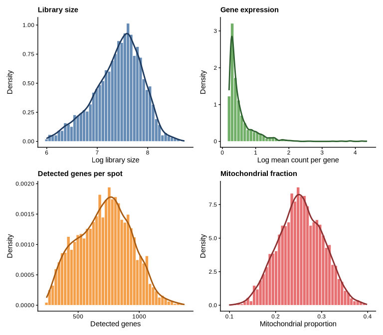

### 2.2 Explore filtering thresholds

First, we examine the relationship between possible cutoffs and the
proportions of spots and genes removed, without performing any
filtering. Then we display the selected illustrative thresholds: **6.5**
for log library size and **0.25** for log mean gene expression.

``` r
p_cutoffs <- plot_qc_cutoffs(
  spe,
  library_cutoff = NULL,
  gene_cutoff = NULL,
  n_points = 200,
  theme_name = "classic"
)
p_cutoffs$plot
```

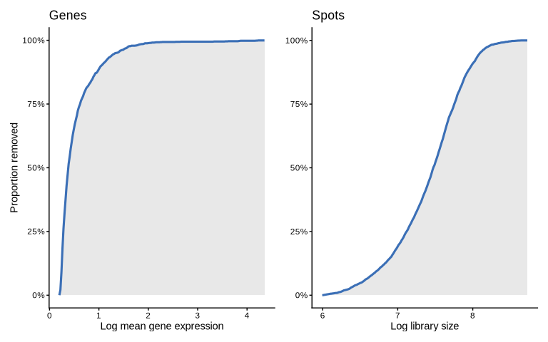

``` r
p_cutoffs <- plot_qc_cutoffs(
  spe,
  library_cutoff = 7.5,
  gene_cutoff = 0.4,
  n_points = 200,
  theme_name = "classic"
)
p_cutoffs$plot
```

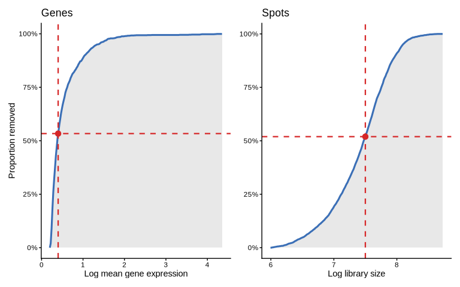

### 2.3 Apply filtering and reassess QC

We remove spots and genes below the selected thresholds. The QC metrics
are recalculated for the retained observations.

``` r
spe_filtered <- filter_qc(
  spe,
  library_cutoff = 7.5,
  gene_cutoff = 0.7,
  recalculate = TRUE,
  assay_name = "counts",
  mito_pattern = "^MT-"
)

p_qc_filtered <- plot_qc(
  spe_filtered,
  bins = 45,
  show_density = TRUE,
  theme_name = "classic"
)
p_qc_filtered$plot
```

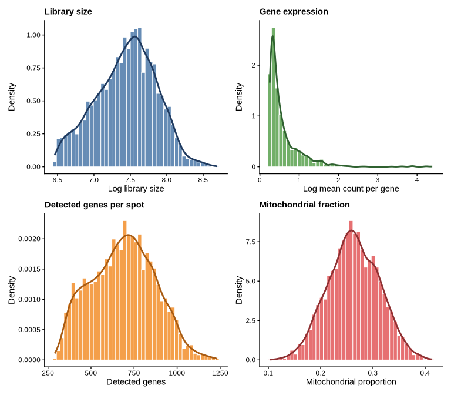

## 3. Apply normalisation methods

We apply five normalisation approaches to the same filtered sample. The
`None` method provides a log1p-transformed baseline. Method-specific
arguments are supplied through `params`.

``` r
norm <- normalize_spe(
  spe_filtered,
  methods = c(
    "None",
    "scran",
    "sctransform",
    "SpaNorm",
    "Giotto"
  ),
  params = list(
    sctransform = list(
      seed = 123,
      vst_flavor = "v2",
      verbosity = 1
    ),
    spanorm = list(
      sample_p = 0.3,
      df_tps = 6,
      adj_method = "logpac",
      seed = 123
    )
  )
)
#> Consider to install these (optional) packages to run all possible Giotto commands for spatial analyses:  MAST smfishHmrf trendsceek multinet RTriangle FactoMiner
#>  Giotto does not automatically install all these packages as they are not absolutely required and this reduces the number of dependenciespython:         /home/wboyagoda/.local/share/r-miniconda/envs/giotto_env/bin/python
#> libpython:      /home/wboyagoda/.local/share/r-miniconda/envs/giotto_env/lib/libpython3.6m.so
#> pythonhome:     /home/wboyagoda/.local/share/r-miniconda/envs/giotto_env:/home/wboyagoda/.local/share/r-miniconda/envs/giotto_env
#> version:        3.6.15 | packaged by conda-forge | (default, Dec  3 2021, 18:49:41)  [GCC 9.4.0]
#> numpy:          /home/wboyagoda/.local/share/r-miniconda/envs/giotto_env/lib/python3.6/site-packages/numpy
#> numpy_version:  1.19.5
#> 
#> NOTE: Python version was forced by use_python() function
#> 
#>  no external python path was provided, but a giotto python environment was found and will be used

# Check the dimensions returned by each normalisation method.
sapply(norm, dim)
#>      None scran sctransform SpaNorm Giotto
#> [1,]  351   351         351     351    351
#> [2,] 2005  2005        2005    2005   2005
```

## 4. Compare normalised library sizes

We compare summed normalised expression across spots using the methods
supported by this diagnostic. By default, the function excludes
sctransform and Giotto because their transformed assays are not
interpreted as standard log1p-normalised values.

``` r
p_ls <- plot_library_size_comparison(
  norm,
  methods = NULL,
  assay_name = "logcounts",
  point_size = 0.5,
  theme_name = "classic"
)
p_ls$plot
```

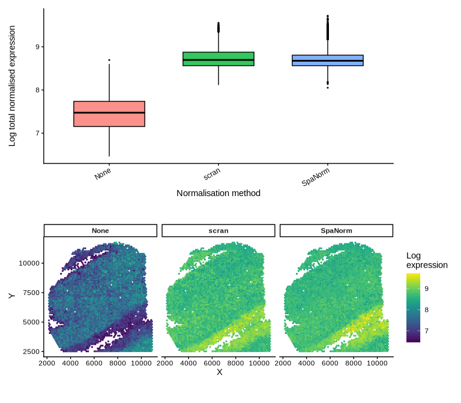

## 5. UMAP visualisation

We run PCA and UMAP independently for each normalisation method and use
the resulting coordinates to inspect the distribution of manually
annotated cortical layers. All available spot annotations are retained
for plotting.

``` r
umap_data <- get_umap_data(
  norm,
  methods = NULL,
  prop_spots = 1,
  seed = 123,
  assay_name = "logcounts",
  n_pcs = 30,
  n_neighbors = 15
)
```

``` r
p_umap_layer <- plot_umap_comparison(
  umap_data,
  colour_by = "layer_guess",
  point_size = 0.58,
  alpha = 0.6,
  ncol = 3,
  theme_name = "classic"
)
p_umap_layer$plot
```

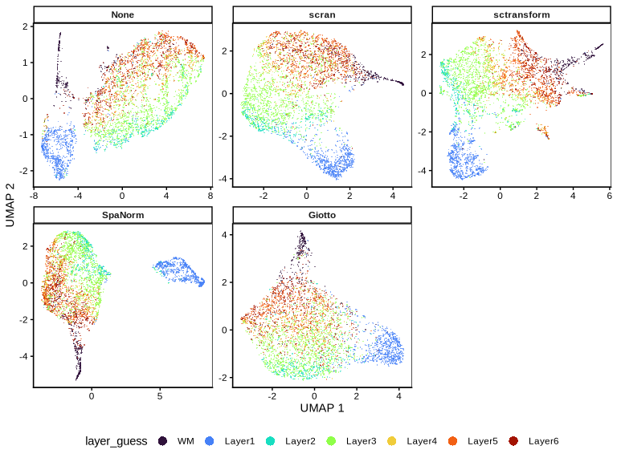

## 6. Spatially variable gene analysis

### 6.1 Detect SVGs using nnSVG

We use the same SVG detection procedure for each normalised dataset to
examine how normalisation affects spatial variability statistics and
gene rankings.

``` r
svg_norm <- run_svg(
  norm_list = norm,
  method = "nnSVG",
  n_threads = 1,
  verbose = TRUE
)
#> ---------------------------------------- 
#>  Ordering Coordinates 
#> ----------------------------------------
#>  Model description
#> ----------------------------------------
#> Using 10 nearest neighbors.
#> 
#> 
#> Source compiled with OpenMP support and model fit using 1 thread(s).
#> ----------------------------------------
#>  Building neighbor index
#> ----------------------------------------
#>  Model description
#> ----------------------------------------
#> BRISC model fit with 2005 observations.
#> 
#> Number of covariates 1 (including intercept if specified).
#> 
#> Using the exponential spatial correlation model.
#> 
#> Using 10 nearest neighbors.
#> 
#> 
#> Source compiled with OpenMP support and model fit using 1 thread(s).
#> ----------------------------------------
#>  Building neighbor index
#> ----------------------------------------
#>  Performing optimization
#> ----------------------------------------
#>  Processing optimizers
#> ----------------------------------------
#> ----------------------------------------
#>  Model description
#> ----------------------------------------
#> BRISC model fit with 2005 observations.
#> 
#> Number of covariates 1 (including intercept if specified).
#> 
#> Using the exponential spatial correlation model.
#> 
#> Using 10 nearest neighbors.
#> 
#> 
#> Source compiled with OpenMP support and model fit using 1 thread(s).
#> ----------------------------------------
#>  Building neighbor index
#> ----------------------------------------
#>  Performing optimization
#> ----------------------------------------
#>  Processing optimizers
#> ----------------------------------------
#> ----------------------------------------
#>  Model description
#> ----------------------------------------
#> BRISC model fit with 2005 observations.
#> 
#> Number of covariates 1 (including intercept if specified).
#> 
#> Using the exponential spatial correlation model.
#> 
#> Using 10 nearest neighbors.
#> 
#> 
#> Source compiled with OpenMP support and model fit using 1 thread(s).
#> ----------------------------------------
#>  Building neighbor index
#> ----------------------------------------
#>  Performing optimization
#> ----------------------------------------
#>  Processing optimizers
#> ----------------------------------------
#> ----------------------------------------
#>  Model description
#> ----------------------------------------
#> BRISC model fit with 2005 observations.
#> 
#> Number of covariates 1 (including intercept if specified).
#> 
#> Using the exponential spatial correlation model.
#> 
#> Using 10 nearest neighbors.
#> 
#> 
#> Source compiled with OpenMP support and model fit using 1 thread(s).
#> ----------------------------------------
#>  Building neighbor index
#> ----------------------------------------
#>  Performing optimization
#> ----------------------------------------
#>  Processing optimizers
#> ----------------------------------------
#> ----------------------------------------
#>  Model description
#> ----------------------------------------
#> BRISC model fit with 2005 observations.
#> 
#> Number of covariates 1 (including intercept if specified).
#> 
#> Using the exponential spatial correlation model.
#> 
#> Using 10 nearest neighbors.
#> 
#> 
#> Source compiled with OpenMP support and model fit using 1 thread(s).
#> ----------------------------------------
#>  Building neighbor index
#> ----------------------------------------
#>  Performing optimization
#> ----------------------------------------
#>  Processing optimizers
#> ----------------------------------------
#> ----------------------------------------
#>  Model description
#> ----------------------------------------
#> BRISC model fit with 2005 observations.
#> 
#> Number of covariates 1 (including intercept if specified).
#> 
#> Using the exponential spatial correlation model.
#> 
#> Using 10 nearest neighbors.
#> 
#> 
#> Source compiled with OpenMP support and model fit using 1 thread(s).
#> ----------------------------------------
#>  Building neighbor index
#> ----------------------------------------
#>  Performing optimization
#> ----------------------------------------
#>  Processing optimizers
#> ----------------------------------------
#> ----------------------------------------
#>  Model description
#> ----------------------------------------
#> BRISC model fit with 2005 observations.
#> 
#> Number of covariates 1 (including intercept if specified).
#> 
#> Using the exponential spatial correlation model.
#> 
#> Using 10 nearest neighbors.
#> 
#> 
#> Source compiled with OpenMP support and model fit using 1 thread(s).
#> ----------------------------------------
#>  Building neighbor index
#> ----------------------------------------
#>  Performing optimization
#> ----------------------------------------
#>  Processing optimizers
#> ----------------------------------------
#> ----------------------------------------
#>  Model description
#> ----------------------------------------
#> BRISC model fit with 2005 observations.
#> 
#> Number of covariates 1 (including intercept if specified).
#> 
#> Using the exponential spatial correlation model.
#> 
#> Using 10 nearest neighbors.
#> 
#> 
#> Source compiled with OpenMP support and model fit using 1 thread(s).
#> ----------------------------------------
#>  Building neighbor index
#> ----------------------------------------
#>  Performing optimization
#> ----------------------------------------
#>  Processing optimizers
#> ----------------------------------------
#> ----------------------------------------
#>  Model description
#> ----------------------------------------
#> BRISC model fit with 2005 observations.
#> 
#> Number of covariates 1 (including intercept if specified).
#> 
#> Using the exponential spatial correlation model.
#> 
#> Using 10 nearest neighbors.
#> 
#> 
#> Source compiled with OpenMP support and model fit using 1 thread(s).
#> ----------------------------------------
#>  Building neighbor index
#> ----------------------------------------
#>  Performing optimization
#> ----------------------------------------
#>  Processing optimizers
#> ----------------------------------------
#> ----------------------------------------
#>  Model description
#> ----------------------------------------
#> BRISC model fit with 2005 observations.
#> 
#> Number of covariates 1 (including intercept if specified).
#> 
#> Using the exponential spatial correlation model.
#> 
#> Using 10 nearest neighbors.
#> 
#> 
#> Source compiled with OpenMP support and model fit using 1 thread(s).
#> ----------------------------------------
#>  Building neighbor index
#> ----------------------------------------
#>  Performing optimization
#> ----------------------------------------
#>  Processing optimizers
#> ----------------------------------------
#> ----------------------------------------
#>  Model description
#> ----------------------------------------
#> BRISC model fit with 2005 observations.
#> 
#> Number of covariates 1 (including intercept if specified).
#> 
#> Using the exponential spatial correlation model.
#> 
#> Using 10 nearest neighbors.
#> 
#> 
#> Source compiled with OpenMP support and model fit using 1 thread(s).
#> ----------------------------------------
#>  Building neighbor index
#> ----------------------------------------
#>  Performing optimization
#> ----------------------------------------
#>  Processing optimizers
#> ----------------------------------------
#> ----------------------------------------
#>  Model description
#> ----------------------------------------
#> BRISC model fit with 2005 observations.
#> 
#> Number of covariates 1 (including intercept if specified).
#> 
#> Using the exponential spatial correlation model.
#> 
#> Using 10 nearest neighbors.
#> 
#> 
#> Source compiled with OpenMP support and model fit using 1 thread(s).
#> ----------------------------------------
#>  Building neighbor index
#> ----------------------------------------
#>  Performing optimization
#> ----------------------------------------
#>  Processing optimizers
#> ----------------------------------------
#> ----------------------------------------
#>  Model description
#> ----------------------------------------
#> BRISC model fit with 2005 observations.
#> 
#> Number of covariates 1 (including intercept if specified).
#> 
#> Using the exponential spatial correlation model.
#> 
#> Using 10 nearest neighbors.
#> 
#> 
#> Source compiled with OpenMP support and model fit using 1 thread(s).
#> ----------------------------------------
#>  Building neighbor index
#> ----------------------------------------
#>  Performing optimization
#> ----------------------------------------
#>  Processing optimizers
#> ----------------------------------------
#> ----------------------------------------
#>  Model description
#> ----------------------------------------
#> BRISC model fit with 2005 observations.
#> 
#> Number of covariates 1 (including intercept if specified).
#> 
#> Using the exponential spatial correlation model.
#> 
#> Using 10 nearest neighbors.
#> 
#> 
#> Source compiled with OpenMP support and model fit using 1 thread(s).
#> ----------------------------------------
#>  Building neighbor index
#> ----------------------------------------
#>  Performing optimization
#> ----------------------------------------
#>  Processing optimizers
#> ----------------------------------------
#> ----------------------------------------
#>  Model description
#> ----------------------------------------
#> BRISC model fit with 2005 observations.
#> 
#> Number of covariates 1 (including intercept if specified).
#> 
#> Using the exponential spatial correlation model.
#> 
#> Using 10 nearest neighbors.
#> 
#> 
#> Source compiled with OpenMP support and model fit using 1 thread(s).
#> ----------------------------------------
#>  Building neighbor index
#> ----------------------------------------
#>  Performing optimization
#> ----------------------------------------
#>  Processing optimizers
#> ----------------------------------------
#> ----------------------------------------
#>  Model description
#> ----------------------------------------
#> BRISC model fit with 2005 observations.
#> 
#> Number of covariates 1 (including intercept if specified).
#> 
#> Using the exponential spatial correlation model.
#> 
#> Using 10 nearest neighbors.
#> 
#> 
#> Source compiled with OpenMP support and model fit using 1 thread(s).
#> ----------------------------------------
#>  Building neighbor index
#> ----------------------------------------
#>  Performing optimization
#> ----------------------------------------
#>  Processing optimizers
#> ----------------------------------------
#> ----------------------------------------
#>  Model description
#> ----------------------------------------
#> BRISC model fit with 2005 observations.
#> 
#> Number of covariates 1 (including intercept if specified).
#> 
#> Using the exponential spatial correlation model.
#> 
#> Using 10 nearest neighbors.
#> 
#> 
#> Source compiled with OpenMP support and model fit using 1 thread(s).
#> ----------------------------------------
#>  Building neighbor index
#> ----------------------------------------
#>  Performing optimization
#> ----------------------------------------
#>  Processing optimizers
#> ----------------------------------------
#> ----------------------------------------
#>  Model description
#> ----------------------------------------
#> BRISC model fit with 2005 observations.
#> 
#> Number of covariates 1 (including intercept if specified).
#> 
#> Using the exponential spatial correlation model.
#> 
#> Using 10 nearest neighbors.
#> 
#> 
#> Source compiled with OpenMP support and model fit using 1 thread(s).
#> ----------------------------------------
#>  Building neighbor index
#> ----------------------------------------
#>  Performing optimization
#> ----------------------------------------
#>  Processing optimizers
#> ----------------------------------------
#> ----------------------------------------
#>  Model description
#> ----------------------------------------
#> BRISC model fit with 2005 observations.
#> 
#> Number of covariates 1 (including intercept if specified).
#> 
#> Using the exponential spatial correlation model.
#> 
#> Using 10 nearest neighbors.
#> 
#> 
#> Source compiled with OpenMP support and model fit using 1 thread(s).
#> ----------------------------------------
#>  Building neighbor index
#> ----------------------------------------
#>  Performing optimization
#> ----------------------------------------
#>  Processing optimizers
#> ----------------------------------------
#> ----------------------------------------
#>  Model description
#> ----------------------------------------
#> BRISC model fit with 2005 observations.
#> 
#> Number of covariates 1 (including intercept if specified).
#> 
#> Using the exponential spatial correlation model.
#> 
#> Using 10 nearest neighbors.
#> 
#> 
#> Source compiled with OpenMP support and model fit using 1 thread(s).
#> ----------------------------------------
#>  Building neighbor index
#> ----------------------------------------
#>  Performing optimization
#> ----------------------------------------
#>  Processing optimizers
#> ----------------------------------------
#> ----------------------------------------
#>  Model description
#> ----------------------------------------
#> BRISC model fit with 2005 observations.
#> 
#> Number of covariates 1 (including intercept if specified).
#> 
#> Using the exponential spatial correlation model.
#> 
#> Using 10 nearest neighbors.
#> 
#> 
#> Source compiled with OpenMP support and model fit using 1 thread(s).
#> ----------------------------------------
#>  Building neighbor index
#> ----------------------------------------
#>  Performing optimization
#> ----------------------------------------
#>  Processing optimizers
#> ----------------------------------------
#> ----------------------------------------
#>  Model description
#> ----------------------------------------
#> BRISC model fit with 2005 observations.
#> 
#> Number of covariates 1 (including intercept if specified).
#> 
#> Using the exponential spatial correlation model.
#> 
#> Using 10 nearest neighbors.
#> 
#> 
#> Source compiled with OpenMP support and model fit using 1 thread(s).
#> ----------------------------------------
#>  Building neighbor index
#> ----------------------------------------
#>  Performing optimization
#> ----------------------------------------
#>  Processing optimizers
#> ----------------------------------------
#> ----------------------------------------
#>  Model description
#> ----------------------------------------
#> BRISC model fit with 2005 observations.
#> 
#> Number of covariates 1 (including intercept if specified).
#> 
#> Using the exponential spatial correlation model.
#> 
#> Using 10 nearest neighbors.
#> 
#> 
#> Source compiled with OpenMP support and model fit using 1 thread(s).
#> ----------------------------------------
#>  Building neighbor index
#> ----------------------------------------
#>  Performing optimization
#> ----------------------------------------
#>  Processing optimizers
#> ----------------------------------------
#> ----------------------------------------
#>  Model description
#> ----------------------------------------
#> BRISC model fit with 2005 observations.
#> 
#> Number of covariates 1 (including intercept if specified).
#> 
#> Using the exponential spatial correlation model.
#> 
#> Using 10 nearest neighbors.
#> 
#> 
#> Source compiled with OpenMP support and model fit using 1 thread(s).
#> ----------------------------------------
#>  Building neighbor index
#> ----------------------------------------
#>  Performing optimization
#> ----------------------------------------
#>  Processing optimizers
#> ----------------------------------------
#> ----------------------------------------
#>  Model description
#> ----------------------------------------
#> BRISC model fit with 2005 observations.
#> 
#> Number of covariates 1 (including intercept if specified).
#> 
#> Using the exponential spatial correlation model.
#> 
#> Using 10 nearest neighbors.
#> 
#> 
#> Source compiled with OpenMP support and model fit using 1 thread(s).
#> ----------------------------------------
#>  Building neighbor index
#> ----------------------------------------
#>  Performing optimization
#> ----------------------------------------
#>  Processing optimizers
#> ----------------------------------------
#> ----------------------------------------
#>  Model description
#> ----------------------------------------
#> BRISC model fit with 2005 observations.
#> 
#> Number of covariates 1 (including intercept if specified).
#> 
#> Using the exponential spatial correlation model.
#> 
#> Using 10 nearest neighbors.
#> 
#> 
#> Source compiled with OpenMP support and model fit using 1 thread(s).
#> ----------------------------------------
#>  Building neighbor index
#> ----------------------------------------
#>  Performing optimization
#> ----------------------------------------
#>  Processing optimizers
#> ----------------------------------------
#> ----------------------------------------
#>  Model description
#> ----------------------------------------
#> BRISC model fit with 2005 observations.
#> 
#> Number of covariates 1 (including intercept if specified).
#> 
#> Using the exponential spatial correlation model.
#> 
#> Using 10 nearest neighbors.
#> 
#> 
#> Source compiled with OpenMP support and model fit using 1 thread(s).
#> ----------------------------------------
#>  Building neighbor index
#> ----------------------------------------
#>  Performing optimization
#> ----------------------------------------
#>  Processing optimizers
#> ----------------------------------------
#> ----------------------------------------
#>  Model description
#> ----------------------------------------
#> BRISC model fit with 2005 observations.
#> 
#> Number of covariates 1 (including intercept if specified).
#> 
#> Using the exponential spatial correlation model.
#> 
#> Using 10 nearest neighbors.
#> 
#> 
#> Source compiled with OpenMP support and model fit using 1 thread(s).
#> ----------------------------------------
#>  Building neighbor index
#> ----------------------------------------
#>  Performing optimization
#> ----------------------------------------
#>  Processing optimizers
#> ----------------------------------------
#> ----------------------------------------
#>  Model description
#> ----------------------------------------
#> BRISC model fit with 2005 observations.
#> 
#> Number of covariates 1 (including intercept if specified).
#> 
#> Using the exponential spatial correlation model.
#> 
#> Using 10 nearest neighbors.
#> 
#> 
#> Source compiled with OpenMP support and model fit using 1 thread(s).
#> ----------------------------------------
#>  Building neighbor index
#> ----------------------------------------
#>  Performing optimization
#> ----------------------------------------
#>  Processing optimizers
#> ----------------------------------------
#> ----------------------------------------
#>  Model description
#> ----------------------------------------
#> BRISC model fit with 2005 observations.
#> 
#> Number of covariates 1 (including intercept if specified).
#> 
#> Using the exponential spatial correlation model.
#> 
#> Using 10 nearest neighbors.
#> 
#> 
#> Source compiled with OpenMP support and model fit using 1 thread(s).
#> ----------------------------------------
#>  Building neighbor index
#> ----------------------------------------
#>  Performing optimization
#> ----------------------------------------
#>  Processing optimizers
#> ----------------------------------------
#> ----------------------------------------
#>  Model description
#> ----------------------------------------
#> BRISC model fit with 2005 observations.
#> 
#> Number of covariates 1 (including intercept if specified).
#> 
#> Using the exponential spatial correlation model.
#> 
#> Using 10 nearest neighbors.
#> 
#> 
#> Source compiled with OpenMP support and model fit using 1 thread(s).
#> ----------------------------------------
#>  Building neighbor index
#> ----------------------------------------
#>  Performing optimization
#> ----------------------------------------
#>  Processing optimizers
#> ----------------------------------------
#> ----------------------------------------
#>  Model description
#> ----------------------------------------
#> BRISC model fit with 2005 observations.
#> 
#> Number of covariates 1 (including intercept if specified).
#> 
#> Using the exponential spatial correlation model.
#> 
#> Using 10 nearest neighbors.
#> 
#> 
#> Source compiled with OpenMP support and model fit using 1 thread(s).
#> ----------------------------------------
#>  Building neighbor index
#> ----------------------------------------
#>  Performing optimization
#> ----------------------------------------
#>  Processing optimizers
#> ----------------------------------------
#> ----------------------------------------
#>  Model description
#> ----------------------------------------
#> BRISC model fit with 2005 observations.
#> 
#> Number of covariates 1 (including intercept if specified).
#> 
#> Using the exponential spatial correlation model.
#> 
#> Using 10 nearest neighbors.
#> 
#> 
#> Source compiled with OpenMP support and model fit using 1 thread(s).
#> ----------------------------------------
#>  Building neighbor index
#> ----------------------------------------
#>  Performing optimization
#> ----------------------------------------
#>  Processing optimizers
#> ----------------------------------------
#> ----------------------------------------
#>  Model description
#> ----------------------------------------
#> BRISC model fit with 2005 observations.
#> 
#> Number of covariates 1 (including intercept if specified).
#> 
#> Using the exponential spatial correlation model.
#> 
#> Using 10 nearest neighbors.
#> 
#> 
#> Source compiled with OpenMP support and model fit using 1 thread(s).
#> ----------------------------------------
#>  Building neighbor index
#> ----------------------------------------
#>  Performing optimization
#> ----------------------------------------
#>  Processing optimizers
#> ----------------------------------------
#> ----------------------------------------
#>  Model description
#> ----------------------------------------
#> BRISC model fit with 2005 observations.
#> 
#> Number of covariates 1 (including intercept if specified).
#> 
#> Using the exponential spatial correlation model.
#> 
#> Using 10 nearest neighbors.
#> 
#> 
#> Source compiled with OpenMP support and model fit using 1 thread(s).
#> ----------------------------------------
#>  Building neighbor index
#> ----------------------------------------
#>  Performing optimization
#> ----------------------------------------
#>  Processing optimizers
#> ----------------------------------------
#> ----------------------------------------
#>  Model description
#> ----------------------------------------
#> BRISC model fit with 2005 observations.
#> 
#> Number of covariates 1 (including intercept if specified).
#> 
#> Using the exponential spatial correlation model.
#> 
#> Using 10 nearest neighbors.
#> 
#> 
#> Source compiled with OpenMP support and model fit using 1 thread(s).
#> ----------------------------------------
#>  Building neighbor index
#> ----------------------------------------
#>  Performing optimization
#> ----------------------------------------
#>  Processing optimizers
#> ----------------------------------------
#> ----------------------------------------
#>  Model description
#> ----------------------------------------
#> BRISC model fit with 2005 observations.
#> 
#> Number of covariates 1 (including intercept if specified).
#> 
#> Using the exponential spatial correlation model.
#> 
#> Using 10 nearest neighbors.
#> 
#> 
#> Source compiled with OpenMP support and model fit using 1 thread(s).
#> ----------------------------------------
#>  Building neighbor index
#> ----------------------------------------
#>  Performing optimization
#> ----------------------------------------
#>  Processing optimizers
#> ----------------------------------------
#> ----------------------------------------
#>  Model description
#> ----------------------------------------
#> BRISC model fit with 2005 observations.
#> 
#> Number of covariates 1 (including intercept if specified).
#> 
#> Using the exponential spatial correlation model.
#> 
#> Using 10 nearest neighbors.
#> 
#> 
#> Source compiled with OpenMP support and model fit using 1 thread(s).
#> ----------------------------------------
#>  Building neighbor index
#> ----------------------------------------
#>  Performing optimization
#> ----------------------------------------
#>  Processing optimizers
#> ----------------------------------------
#> ----------------------------------------
#>  Model description
#> ----------------------------------------
#> BRISC model fit with 2005 observations.
#> 
#> Number of covariates 1 (including intercept if specified).
#> 
#> Using the exponential spatial correlation model.
#> 
#> Using 10 nearest neighbors.
#> 
#> 
#> Source compiled with OpenMP support and model fit using 1 thread(s).
#> ----------------------------------------
#>  Building neighbor index
#> ----------------------------------------
#>  Performing optimization
#> ----------------------------------------
#>  Processing optimizers
#> ----------------------------------------
#> ----------------------------------------
#>  Model description
#> ----------------------------------------
#> BRISC model fit with 2005 observations.
#> 
#> Number of covariates 1 (including intercept if specified).
#> 
#> Using the exponential spatial correlation model.
#> 
#> Using 10 nearest neighbors.
#> 
#> 
#> Source compiled with OpenMP support and model fit using 1 thread(s).
#> ----------------------------------------
#>  Building neighbor index
#> ----------------------------------------
#>  Performing optimization
#> ----------------------------------------
#>  Processing optimizers
#> ----------------------------------------
#> ----------------------------------------
#>  Model description
#> ----------------------------------------
#> BRISC model fit with 2005 observations.
#> 
#> Number of covariates 1 (including intercept if specified).
#> 
#> Using the exponential spatial correlation model.
#> 
#> Using 10 nearest neighbors.
#> 
#> 
#> Source compiled with OpenMP support and model fit using 1 thread(s).
#> ----------------------------------------
#>  Building neighbor index
#> ----------------------------------------
#>  Performing optimization
#> ----------------------------------------
#>  Processing optimizers
#> ----------------------------------------
#> ----------------------------------------
#>  Model description
#> ----------------------------------------
#> BRISC model fit with 2005 observations.
#> 
#> Number of covariates 1 (including intercept if specified).
#> 
#> Using the exponential spatial correlation model.
#> 
#> Using 10 nearest neighbors.
#> 
#> 
#> Source compiled with OpenMP support and model fit using 1 thread(s).
#> ----------------------------------------
#>  Building neighbor index
#> ----------------------------------------
#>  Performing optimization
#> ----------------------------------------
#>  Processing optimizers
#> ----------------------------------------
#> ----------------------------------------
#>  Model description
#> ----------------------------------------
#> BRISC model fit with 2005 observations.
#> 
#> Number of covariates 1 (including intercept if specified).
#> 
#> Using the exponential spatial correlation model.
#> 
#> Using 10 nearest neighbors.
#> 
#> 
#> Source compiled with OpenMP support and model fit using 1 thread(s).
#> ----------------------------------------
#>  Building neighbor index
#> ----------------------------------------
#>  Performing optimization
#> ----------------------------------------
#>  Processing optimizers
#> ----------------------------------------
#> ----------------------------------------
#>  Model description
#> ----------------------------------------
#> BRISC model fit with 2005 observations.
#> 
#> Number of covariates 1 (including intercept if specified).
#> 
#> Using the exponential spatial correlation model.
#> 
#> Using 10 nearest neighbors.
#> 
#> 
#> Source compiled with OpenMP support and model fit using 1 thread(s).
#> ----------------------------------------
#>  Building neighbor index
#> ----------------------------------------
#>  Performing optimization
#> ----------------------------------------
#>  Processing optimizers
#> ----------------------------------------
#> ----------------------------------------
#>  Model description
#> ----------------------------------------
#> BRISC model fit with 2005 observations.
#> 
#> Number of covariates 1 (including intercept if specified).
#> 
#> Using the exponential spatial correlation model.
#> 
#> Using 10 nearest neighbors.
#> 
#> 
#> Source compiled with OpenMP support and model fit using 1 thread(s).
#> ----------------------------------------
#>  Building neighbor index
#> ----------------------------------------
#>  Performing optimization
#> ----------------------------------------
#>  Processing optimizers
#> ----------------------------------------
#> ----------------------------------------
#>  Model description
#> ----------------------------------------
#> BRISC model fit with 2005 observations.
#> 
#> Number of covariates 1 (including intercept if specified).
#> 
#> Using the exponential spatial correlation model.
#> 
#> Using 10 nearest neighbors.
#> 
#> 
#> Source compiled with OpenMP support and model fit using 1 thread(s).
#> ----------------------------------------
#>  Building neighbor index
#> ----------------------------------------
#>  Performing optimization
#> ----------------------------------------
#>  Processing optimizers
#> ----------------------------------------
#> ----------------------------------------
#>  Model description
#> ----------------------------------------
#> BRISC model fit with 2005 observations.
#> 
#> Number of covariates 1 (including intercept if specified).
#> 
#> Using the exponential spatial correlation model.
#> 
#> Using 10 nearest neighbors.
#> 
#> 
#> Source compiled with OpenMP support and model fit using 1 thread(s).
#> ----------------------------------------
#>  Building neighbor index
#> ----------------------------------------
#>  Performing optimization
#> ----------------------------------------
#>  Processing optimizers
#> ----------------------------------------
#> ----------------------------------------
#>  Model description
#> ----------------------------------------
#> BRISC model fit with 2005 observations.
#> 
#> Number of covariates 1 (including intercept if specified).
#> 
#> Using the exponential spatial correlation model.
#> 
#> Using 10 nearest neighbors.
#> 
#> 
#> Source compiled with OpenMP support and model fit using 1 thread(s).
#> ----------------------------------------
#>  Building neighbor index
#> ----------------------------------------
#>  Performing optimization
#> ----------------------------------------
#>  Processing optimizers
#> ----------------------------------------
#> ----------------------------------------
#>  Model description
#> ----------------------------------------
#> BRISC model fit with 2005 observations.
#> 
#> Number of covariates 1 (including intercept if specified).
#> 
#> Using the exponential spatial correlation model.
#> 
#> Using 10 nearest neighbors.
#> 
#> 
#> Source compiled with OpenMP support and model fit using 1 thread(s).
#> ----------------------------------------
#>  Building neighbor index
#> ----------------------------------------
#>  Performing optimization
#> ----------------------------------------
#>  Processing optimizers
#> ----------------------------------------
#> ----------------------------------------
#>  Model description
#> ----------------------------------------
#> BRISC model fit with 2005 observations.
#> 
#> Number of covariates 1 (including intercept if specified).
#> 
#> Using the exponential spatial correlation model.
#> 
#> Using 10 nearest neighbors.
#> 
#> 
#> Source compiled with OpenMP support and model fit using 1 thread(s).
#> ----------------------------------------
#>  Building neighbor index
#> ----------------------------------------
#>  Performing optimization
#> ----------------------------------------
#>  Processing optimizers
#> ----------------------------------------
#> ----------------------------------------
#>  Model description
#> ----------------------------------------
#> BRISC model fit with 2005 observations.
#> 
#> Number of covariates 1 (including intercept if specified).
#> 
#> Using the exponential spatial correlation model.
#> 
#> Using 10 nearest neighbors.
#> 
#> 
#> Source compiled with OpenMP support and model fit using 1 thread(s).
#> ----------------------------------------
#>  Building neighbor index
#> ----------------------------------------
#>  Performing optimization
#> ----------------------------------------
#>  Processing optimizers
#> ----------------------------------------
#> ----------------------------------------
#>  Model description
#> ----------------------------------------
#> BRISC model fit with 2005 observations.
#> 
#> Number of covariates 1 (including intercept if specified).
#> 
#> Using the exponential spatial correlation model.
#> 
#> Using 10 nearest neighbors.
#> 
#> 
#> Source compiled with OpenMP support and model fit using 1 thread(s).
#> ----------------------------------------
#>  Building neighbor index
#> ----------------------------------------
#>  Performing optimization
#> ----------------------------------------
#>  Processing optimizers
#> ----------------------------------------
#> ----------------------------------------
#>  Model description
#> ----------------------------------------
#> BRISC model fit with 2005 observations.
#> 
#> Number of covariates 1 (including intercept if specified).
#> 
#> Using the exponential spatial correlation model.
#> 
#> Using 10 nearest neighbors.
#> 
#> 
#> Source compiled with OpenMP support and model fit using 1 thread(s).
#> ----------------------------------------
#>  Building neighbor index
#> ----------------------------------------
#>  Performing optimization
#> ----------------------------------------
#>  Processing optimizers
#> ----------------------------------------
#> ----------------------------------------
#>  Model description
#> ----------------------------------------
#> BRISC model fit with 2005 observations.
#> 
#> Number of covariates 1 (including intercept if specified).
#> 
#> Using the exponential spatial correlation model.
#> 
#> Using 10 nearest neighbors.
#> 
#> 
#> Source compiled with OpenMP support and model fit using 1 thread(s).
#> ----------------------------------------
#>  Building neighbor index
#> ----------------------------------------
#>  Performing optimization
#> ----------------------------------------
#>  Processing optimizers
#> ----------------------------------------
#> ----------------------------------------
#>  Model description
#> ----------------------------------------
#> BRISC model fit with 2005 observations.
#> 
#> Number of covariates 1 (including intercept if specified).
#> 
#> Using the exponential spatial correlation model.
#> 
#> Using 10 nearest neighbors.
#> 
#> 
#> Source compiled with OpenMP support and model fit using 1 thread(s).
#> ----------------------------------------
#>  Building neighbor index
#> ----------------------------------------
#>  Performing optimization
#> ----------------------------------------
#>  Processing optimizers
#> ----------------------------------------
#> ----------------------------------------
#>  Model description
#> ----------------------------------------
#> BRISC model fit with 2005 observations.
#> 
#> Number of covariates 1 (including intercept if specified).
#> 
#> Using the exponential spatial correlation model.
#> 
#> Using 10 nearest neighbors.
#> 
#> 
#> Source compiled with OpenMP support and model fit using 1 thread(s).
#> ----------------------------------------
#>  Building neighbor index
#> ----------------------------------------
#>  Performing optimization
#> ----------------------------------------
#>  Processing optimizers
#> ----------------------------------------
#> ----------------------------------------
#>  Model description
#> ----------------------------------------
#> BRISC model fit with 2005 observations.
#> 
#> Number of covariates 1 (including intercept if specified).
#> 
#> Using the exponential spatial correlation model.
#> 
#> Using 10 nearest neighbors.
#> 
#> 
#> Source compiled with OpenMP support and model fit using 1 thread(s).
#> ----------------------------------------
#>  Building neighbor index
#> ----------------------------------------
#>  Performing optimization
#> ----------------------------------------
#>  Processing optimizers
#> ----------------------------------------
#> ----------------------------------------
#>  Model description
#> ----------------------------------------
#> BRISC model fit with 2005 observations.
#> 
#> Number of covariates 1 (including intercept if specified).
#> 
#> Using the exponential spatial correlation model.
#> 
#> Using 10 nearest neighbors.
#> 
#> 
#> Source compiled with OpenMP support and model fit using 1 thread(s).
#> ----------------------------------------
#>  Building neighbor index
#> ----------------------------------------
#>  Performing optimization
#> ----------------------------------------
#>  Processing optimizers
#> ----------------------------------------
#> ----------------------------------------
#>  Model description
#> ----------------------------------------
#> BRISC model fit with 2005 observations.
#> 
#> Number of covariates 1 (including intercept if specified).
#> 
#> Using the exponential spatial correlation model.
#> 
#> Using 10 nearest neighbors.
#> 
#> 
#> Source compiled with OpenMP support and model fit using 1 thread(s).
#> ----------------------------------------
#>  Building neighbor index
#> ----------------------------------------
#>  Performing optimization
#> ----------------------------------------
#>  Processing optimizers
#> ----------------------------------------
#> ----------------------------------------
#>  Model description
#> ----------------------------------------
#> BRISC model fit with 2005 observations.
#> 
#> Number of covariates 1 (including intercept if specified).
#> 
#> Using the exponential spatial correlation model.
#> 
#> Using 10 nearest neighbors.
#> 
#> 
#> Source compiled with OpenMP support and model fit using 1 thread(s).
#> ----------------------------------------
#>  Building neighbor index
#> ----------------------------------------
#>  Performing optimization
#> ----------------------------------------
#>  Processing optimizers
#> ----------------------------------------
#> ----------------------------------------
#>  Model description
#> ----------------------------------------
#> BRISC model fit with 2005 observations.
#> 
#> Number of covariates 1 (including intercept if specified).
#> 
#> Using the exponential spatial correlation model.
#> 
#> Using 10 nearest neighbors.
#> 
#> 
#> Source compiled with OpenMP support and model fit using 1 thread(s).
#> ----------------------------------------
#>  Building neighbor index
#> ----------------------------------------
#>  Performing optimization
#> ----------------------------------------
#>  Processing optimizers
#> ----------------------------------------
#> ----------------------------------------
#>  Model description
#> ----------------------------------------
#> BRISC model fit with 2005 observations.
#> 
#> Number of covariates 1 (including intercept if specified).
#> 
#> Using the exponential spatial correlation model.
#> 
#> Using 10 nearest neighbors.
#> 
#> 
#> Source compiled with OpenMP support and model fit using 1 thread(s).
#> ----------------------------------------
#>  Building neighbor index
#> ----------------------------------------
#>  Performing optimization
#> ----------------------------------------
#>  Processing optimizers
#> ----------------------------------------
#> ----------------------------------------
#>  Model description
#> ----------------------------------------
#> BRISC model fit with 2005 observations.
#> 
#> Number of covariates 1 (including intercept if specified).
#> 
#> Using the exponential spatial correlation model.
#> 
#> Using 10 nearest neighbors.
#> 
#> 
#> Source compiled with OpenMP support and model fit using 1 thread(s).
#> ----------------------------------------
#>  Building neighbor index
#> ----------------------------------------
#>  Performing optimization
#> ----------------------------------------
#>  Processing optimizers
#> ----------------------------------------
#> ----------------------------------------
#>  Model description
#> ----------------------------------------
#> BRISC model fit with 2005 observations.
#> 
#> Number of covariates 1 (including intercept if specified).
#> 
#> Using the exponential spatial correlation model.
#> 
#> Using 10 nearest neighbors.
#> 
#> 
#> Source compiled with OpenMP support and model fit using 1 thread(s).
#> ----------------------------------------
#>  Building neighbor index
#> ----------------------------------------
#>  Performing optimization
#> ----------------------------------------
#>  Processing optimizers
#> ----------------------------------------
#> ----------------------------------------
#>  Model description
#> ----------------------------------------
#> BRISC model fit with 2005 observations.
#> 
#> Number of covariates 1 (including intercept if specified).
#> 
#> Using the exponential spatial correlation model.
#> 
#> Using 10 nearest neighbors.
#> 
#> 
#> Source compiled with OpenMP support and model fit using 1 thread(s).
#> ----------------------------------------
#>  Building neighbor index
#> ----------------------------------------
#>  Performing optimization
#> ----------------------------------------
#>  Processing optimizers
#> ----------------------------------------
#> ----------------------------------------
#>  Model description
#> ----------------------------------------
#> BRISC model fit with 2005 observations.
#> 
#> Number of covariates 1 (including intercept if specified).
#> 
#> Using the exponential spatial correlation model.
#> 
#> Using 10 nearest neighbors.
#> 
#> 
#> Source compiled with OpenMP support and model fit using 1 thread(s).
#> ----------------------------------------
#>  Building neighbor index
#> ----------------------------------------
#>  Performing optimization
#> ----------------------------------------
#>  Processing optimizers
#> ----------------------------------------
#> ----------------------------------------
#>  Model description
#> ----------------------------------------
#> BRISC model fit with 2005 observations.
#> 
#> Number of covariates 1 (including intercept if specified).
#> 
#> Using the exponential spatial correlation model.
#> 
#> Using 10 nearest neighbors.
#> 
#> 
#> Source compiled with OpenMP support and model fit using 1 thread(s).
#> ----------------------------------------
#>  Building neighbor index
#> ----------------------------------------
#>  Performing optimization
#> ----------------------------------------
#>  Processing optimizers
#> ----------------------------------------
#> ----------------------------------------
#>  Model description
#> ----------------------------------------
#> BRISC model fit with 2005 observations.
#> 
#> Number of covariates 1 (including intercept if specified).
#> 
#> Using the exponential spatial correlation model.
#> 
#> Using 10 nearest neighbors.
#> 
#> 
#> Source compiled with OpenMP support and model fit using 1 thread(s).
#> ----------------------------------------
#>  Building neighbor index
#> ----------------------------------------
#>  Performing optimization
#> ----------------------------------------
#>  Processing optimizers
#> ----------------------------------------
#> ----------------------------------------
#>  Model description
#> ----------------------------------------
#> BRISC model fit with 2005 observations.
#> 
#> Number of covariates 1 (including intercept if specified).
#> 
#> Using the exponential spatial correlation model.
#> 
#> Using 10 nearest neighbors.
#> 
#> 
#> Source compiled with OpenMP support and model fit using 1 thread(s).
#> ----------------------------------------
#>  Building neighbor index
#> ----------------------------------------
#>  Performing optimization
#> ----------------------------------------
#>  Processing optimizers
#> ----------------------------------------
#> ----------------------------------------
#>  Model description
#> ----------------------------------------
#> BRISC model fit with 2005 observations.
#> 
#> Number of covariates 1 (including intercept if specified).
#> 
#> Using the exponential spatial correlation model.
#> 
#> Using 10 nearest neighbors.
#> 
#> 
#> Source compiled with OpenMP support and model fit using 1 thread(s).
#> ----------------------------------------
#>  Building neighbor index
#> ----------------------------------------
#>  Performing optimization
#> ----------------------------------------
#>  Processing optimizers
#> ----------------------------------------
#> ----------------------------------------
#>  Model description
#> ----------------------------------------
#> BRISC model fit with 2005 observations.
#> 
#> Number of covariates 1 (including intercept if specified).
#> 
#> Using the exponential spatial correlation model.
#> 
#> Using 10 nearest neighbors.
#> 
#> 
#> Source compiled with OpenMP support and model fit using 1 thread(s).
#> ----------------------------------------
#>  Building neighbor index
#> ----------------------------------------
#>  Performing optimization
#> ----------------------------------------
#>  Processing optimizers
#> ----------------------------------------
#> ----------------------------------------
#>  Model description
#> ----------------------------------------
#> BRISC model fit with 2005 observations.
#> 
#> Number of covariates 1 (including intercept if specified).
#> 
#> Using the exponential spatial correlation model.
#> 
#> Using 10 nearest neighbors.
#> 
#> 
#> Source compiled with OpenMP support and model fit using 1 thread(s).
#> ----------------------------------------
#>  Building neighbor index
#> ----------------------------------------
#>  Performing optimization
#> ----------------------------------------
#>  Processing optimizers
#> ----------------------------------------
#> ----------------------------------------
#>  Model description
#> ----------------------------------------
#> BRISC model fit with 2005 observations.
#> 
#> Number of covariates 1 (including intercept if specified).
#> 
#> Using the exponential spatial correlation model.
#> 
#> Using 10 nearest neighbors.
#> 
#> 
#> Source compiled with OpenMP support and model fit using 1 thread(s).
#> ----------------------------------------
#>  Building neighbor index
#> ----------------------------------------
#>  Performing optimization
#> ----------------------------------------
#>  Processing optimizers
#> ----------------------------------------
#> ----------------------------------------
#>  Model description
#> ----------------------------------------
#> BRISC model fit with 2005 observations.
#> 
#> Number of covariates 1 (including intercept if specified).
#> 
#> Using the exponential spatial correlation model.
#> 
#> Using 10 nearest neighbors.
#> 
#> 
#> Source compiled with OpenMP support and model fit using 1 thread(s).
#> ----------------------------------------
#>  Building neighbor index
#> ----------------------------------------
#>  Performing optimization
#> ----------------------------------------
#>  Processing optimizers
#> ----------------------------------------
#> ----------------------------------------
#>  Model description
#> ----------------------------------------
#> BRISC model fit with 2005 observations.
#> 
#> Number of covariates 1 (including intercept if specified).
#> 
#> Using the exponential spatial correlation model.
#> 
#> Using 10 nearest neighbors.
#> 
#> 
#> Source compiled with OpenMP support and model fit using 1 thread(s).
#> ----------------------------------------
#>  Building neighbor index
#> ----------------------------------------
#>  Performing optimization
#> ----------------------------------------
#>  Processing optimizers
#> ----------------------------------------
#> ----------------------------------------
#>  Model description
#> ----------------------------------------
#> BRISC model fit with 2005 observations.
#> 
#> Number of covariates 1 (including intercept if specified).
#> 
#> Using the exponential spatial correlation model.
#> 
#> Using 10 nearest neighbors.
#> 
#> 
#> Source compiled with OpenMP support and model fit using 1 thread(s).
#> ----------------------------------------
#>  Building neighbor index
#> ----------------------------------------
#>  Performing optimization
#> ----------------------------------------
#>  Processing optimizers
#> ----------------------------------------
#> ----------------------------------------
#>  Model description
#> ----------------------------------------
#> BRISC model fit with 2005 observations.
#> 
#> Number of covariates 1 (including intercept if specified).
#> 
#> Using the exponential spatial correlation model.
#> 
#> Using 10 nearest neighbors.
#> 
#> 
#> Source compiled with OpenMP support and model fit using 1 thread(s).
#> ----------------------------------------
#>  Building neighbor index
#> ----------------------------------------
#>  Performing optimization
#> ----------------------------------------
#>  Processing optimizers
#> ----------------------------------------
#> ----------------------------------------
#>  Model description
#> ----------------------------------------
#> BRISC model fit with 2005 observations.
#> 
#> Number of covariates 1 (including intercept if specified).
#> 
#> Using the exponential spatial correlation model.
#> 
#> Using 10 nearest neighbors.
#> 
#> 
#> Source compiled with OpenMP support and model fit using 1 thread(s).
#> ----------------------------------------
#>  Building neighbor index
#> ----------------------------------------
#>  Performing optimization
#> ----------------------------------------
#>  Processing optimizers
#> ----------------------------------------
#> ----------------------------------------
#>  Model description
#> ----------------------------------------
#> BRISC model fit with 2005 observations.
#> 
#> Number of covariates 1 (including intercept if specified).
#> 
#> Using the exponential spatial correlation model.
#> 
#> Using 10 nearest neighbors.
#> 
#> 
#> Source compiled with OpenMP support and model fit using 1 thread(s).
#> ----------------------------------------
#>  Building neighbor index
#> ----------------------------------------
#>  Performing optimization
#> ----------------------------------------
#>  Processing optimizers
#> ----------------------------------------
#> ----------------------------------------
#>  Model description
#> ----------------------------------------
#> BRISC model fit with 2005 observations.
#> 
#> Number of covariates 1 (including intercept if specified).
#> 
#> Using the exponential spatial correlation model.
#> 
#> Using 10 nearest neighbors.
#> 
#> 
#> Source compiled with OpenMP support and model fit using 1 thread(s).
#> ----------------------------------------
#>  Building neighbor index
#> ----------------------------------------
#>  Performing optimization
#> ----------------------------------------
#>  Processing optimizers
#> ----------------------------------------
#> ----------------------------------------
#>  Model description
#> ----------------------------------------
#> BRISC model fit with 2005 observations.
#> 
#> Number of covariates 1 (including intercept if specified).
#> 
#> Using the exponential spatial correlation model.
#> 
#> Using 10 nearest neighbors.
#> 
#> 
#> Source compiled with OpenMP support and model fit using 1 thread(s).
#> ----------------------------------------
#>  Building neighbor index
#> ----------------------------------------
#>  Performing optimization
#> ----------------------------------------
#>  Processing optimizers
#> ----------------------------------------
#> ----------------------------------------
#>  Model description
#> ----------------------------------------
#> BRISC model fit with 2005 observations.
#> 
#> Number of covariates 1 (including intercept if specified).
#> 
#> Using the exponential spatial correlation model.
#> 
#> Using 10 nearest neighbors.
#> 
#> 
#> Source compiled with OpenMP support and model fit using 1 thread(s).
#> ----------------------------------------
#>  Building neighbor index
#> ----------------------------------------
#>  Performing optimization
#> ----------------------------------------
#>  Processing optimizers
#> ----------------------------------------
#> ----------------------------------------
#>  Model description
#> ----------------------------------------
#> BRISC model fit with 2005 observations.
#> 
#> Number of covariates 1 (including intercept if specified).
#> 
#> Using the exponential spatial correlation model.
#> 
#> Using 10 nearest neighbors.
#> 
#> 
#> Source compiled with OpenMP support and model fit using 1 thread(s).
#> ----------------------------------------
#>  Building neighbor index
#> ----------------------------------------
#>  Performing optimization
#> ----------------------------------------
#>  Processing optimizers
#> ----------------------------------------
#> ----------------------------------------
#>  Model description
#> ----------------------------------------
#> BRISC model fit with 2005 observations.
#> 
#> Number of covariates 1 (including intercept if specified).
#> 
#> Using the exponential spatial correlation model.
#> 
#> Using 10 nearest neighbors.
#> 
#> 
#> Source compiled with OpenMP support and model fit using 1 thread(s).
#> ----------------------------------------
#>  Building neighbor index
#> ----------------------------------------
#>  Performing optimization
#> ----------------------------------------
#>  Processing optimizers
#> ----------------------------------------
#> ----------------------------------------
#>  Model description
#> ----------------------------------------
#> BRISC model fit with 2005 observations.
#> 
#> Number of covariates 1 (including intercept if specified).
#> 
#> Using the exponential spatial correlation model.
#> 
#> Using 10 nearest neighbors.
#> 
#> 
#> Source compiled with OpenMP support and model fit using 1 thread(s).
#> ----------------------------------------
#>  Building neighbor index
#> ----------------------------------------
#>  Performing optimization
#> ----------------------------------------
#>  Processing optimizers
#> ----------------------------------------
#> ----------------------------------------
#>  Model description
#> ----------------------------------------
#> BRISC model fit with 2005 observations.
#> 
#> Number of covariates 1 (including intercept if specified).
#> 
#> Using the exponential spatial correlation model.
#> 
#> Using 10 nearest neighbors.
#> 
#> 
#> Source compiled with OpenMP support and model fit using 1 thread(s).
#> ----------------------------------------
#>  Building neighbor index
#> ----------------------------------------
#>  Performing optimization
#> ----------------------------------------
#>  Processing optimizers
#> ----------------------------------------
#> ----------------------------------------
#>  Model description
#> ----------------------------------------
#> BRISC model fit with 2005 observations.
#> 
#> Number of covariates 1 (including intercept if specified).
#> 
#> Using the exponential spatial correlation model.
#> 
#> Using 10 nearest neighbors.
#> 
#> 
#> Source compiled with OpenMP support and model fit using 1 thread(s).
#> ----------------------------------------
#>  Building neighbor index
#> ----------------------------------------
#>  Performing optimization
#> ----------------------------------------
#>  Processing optimizers
#> ----------------------------------------
#> ----------------------------------------
#>  Model description
#> ----------------------------------------
#> BRISC model fit with 2005 observations.
#> 
#> Number of covariates 1 (including intercept if specified).
#> 
#> Using the exponential spatial correlation model.
#> 
#> Using 10 nearest neighbors.
#> 
#> 
#> Source compiled with OpenMP support and model fit using 1 thread(s).
#> ----------------------------------------
#>  Building neighbor index
#> ----------------------------------------
#>  Performing optimization
#> ----------------------------------------
#>  Processing optimizers
#> ----------------------------------------
#> ----------------------------------------
#>  Model description
#> ----------------------------------------
#> BRISC model fit with 2005 observations.
#> 
#> Number of covariates 1 (including intercept if specified).
#> 
#> Using the exponential spatial correlation model.
#> 
#> Using 10 nearest neighbors.
#> 
#> 
#> Source compiled with OpenMP support and model fit using 1 thread(s).
#> ----------------------------------------
#>  Building neighbor index
#> ----------------------------------------
#>  Performing optimization
#> ----------------------------------------
#>  Processing optimizers
#> ----------------------------------------
#> ----------------------------------------
#>  Model description
#> ----------------------------------------
#> BRISC model fit with 2005 observations.
#> 
#> Number of covariates 1 (including intercept if specified).
#> 
#> Using the exponential spatial correlation model.
#> 
#> Using 10 nearest neighbors.
#> 
#> 
#> Source compiled with OpenMP support and model fit using 1 thread(s).
#> ----------------------------------------
#>  Building neighbor index
#> ----------------------------------------
#>  Performing optimization
#> ----------------------------------------
#>  Processing optimizers
#> ----------------------------------------
#> ----------------------------------------
#>  Model description
#> ----------------------------------------
#> BRISC model fit with 2005 observations.
#> 
#> Number of covariates 1 (including intercept if specified).
#> 
#> Using the exponential spatial correlation model.
#> 
#> Using 10 nearest neighbors.
#> 
#> 
#> Source compiled with OpenMP support and model fit using 1 thread(s).
#> ----------------------------------------
#>  Building neighbor index
#> ----------------------------------------
#>  Performing optimization
#> ----------------------------------------
#>  Processing optimizers
#> ----------------------------------------
#> ----------------------------------------
#>  Model description
#> ----------------------------------------
#> BRISC model fit with 2005 observations.
#> 
#> Number of covariates 1 (including intercept if specified).
#> 
#> Using the exponential spatial correlation model.
#> 
#> Using 10 nearest neighbors.
#> 
#> 
#> Source compiled with OpenMP support and model fit using 1 thread(s).
#> ----------------------------------------
#>  Building neighbor index
#> ----------------------------------------
#>  Performing optimization
#> ----------------------------------------
#>  Processing optimizers
#> ----------------------------------------
#> ----------------------------------------
#>  Model description
#> ----------------------------------------
#> BRISC model fit with 2005 observations.
#> 
#> Number of covariates 1 (including intercept if specified).
#> 
#> Using the exponential spatial correlation model.
#> 
#> Using 10 nearest neighbors.
#> 
#> 
#> Source compiled with OpenMP support and model fit using 1 thread(s).
#> ----------------------------------------
#>  Building neighbor index
#> ----------------------------------------
#>  Performing optimization
#> ----------------------------------------
#>  Processing optimizers
#> ----------------------------------------
#> ----------------------------------------
#>  Model description
#> ----------------------------------------
#> BRISC model fit with 2005 observations.
#> 
#> Number of covariates 1 (including intercept if specified).
#> 
#> Using the exponential spatial correlation model.
#> 
#> Using 10 nearest neighbors.
#> 
#> 
#> Source compiled with OpenMP support and model fit using 1 thread(s).
#> ----------------------------------------
#>  Building neighbor index
#> ----------------------------------------
#>  Performing optimization
#> ----------------------------------------
#>  Processing optimizers
#> ----------------------------------------
#> ----------------------------------------
#>  Model description
#> ----------------------------------------
#> BRISC model fit with 2005 observations.
#> 
#> Number of covariates 1 (including intercept if specified).
#> 
#> Using the exponential spatial correlation model.
#> 
#> Using 10 nearest neighbors.
#> 
#> 
#> Source compiled with OpenMP support and model fit using 1 thread(s).
#> ----------------------------------------
#>  Building neighbor index
#> ----------------------------------------
#>  Performing optimization
#> ----------------------------------------
#>  Processing optimizers
#> ----------------------------------------
#> ----------------------------------------
#>  Model description
#> ----------------------------------------
#> BRISC model fit with 2005 observations.
#> 
#> Number of covariates 1 (including intercept if specified).
#> 
#> Using the exponential spatial correlation model.
#> 
#> Using 10 nearest neighbors.
#> 
#> 
#> Source compiled with OpenMP support and model fit using 1 thread(s).
#> ----------------------------------------
#>  Building neighbor index
#> ----------------------------------------
#>  Performing optimization
#> ----------------------------------------
#>  Processing optimizers
#> ----------------------------------------
#> ----------------------------------------
#>  Model description
#> ----------------------------------------
#> BRISC model fit with 2005 observations.
#> 
#> Number of covariates 1 (including intercept if specified).
#> 
#> Using the exponential spatial correlation model.
#> 
#> Using 10 nearest neighbors.
#> 
#> 
#> Source compiled with OpenMP support and model fit using 1 thread(s).
#> ----------------------------------------
#>  Building neighbor index
#> ----------------------------------------
#>  Performing optimization
#> ----------------------------------------
#>  Processing optimizers
#> ----------------------------------------
#> ----------------------------------------
#>  Model description
#> ----------------------------------------
#> BRISC model fit with 2005 observations.
#> 
#> Number of covariates 1 (including intercept if specified).
#> 
#> Using the exponential spatial correlation model.
#> 
#> Using 10 nearest neighbors.
#> 
#> 
#> Source compiled with OpenMP support and model fit using 1 thread(s).
#> ----------------------------------------
#>  Building neighbor index
#> ----------------------------------------
#>  Performing optimization
#> ----------------------------------------
#>  Processing optimizers
#> ----------------------------------------
#> ----------------------------------------
#>  Model description
#> ----------------------------------------
#> BRISC model fit with 2005 observations.
#> 
#> Number of covariates 1 (including intercept if specified).
#> 
#> Using the exponential spatial correlation model.
#> 
#> Using 10 nearest neighbors.
#> 
#> 
#> Source compiled with OpenMP support and model fit using 1 thread(s).
#> ----------------------------------------
#>  Building neighbor index
#> ----------------------------------------
#>  Performing optimization
#> ----------------------------------------
#>  Processing optimizers
#> ----------------------------------------
#> ----------------------------------------
#>  Model description
#> ----------------------------------------
#> BRISC model fit with 2005 observations.
#> 
#> Number of covariates 1 (including intercept if specified).
#> 
#> Using the exponential spatial correlation model.
#> 
#> Using 10 nearest neighbors.
#> 
#> 
#> Source compiled with OpenMP support and model fit using 1 thread(s).
#> ----------------------------------------
#>  Building neighbor index
#> ----------------------------------------
#>  Performing optimization
#> ----------------------------------------
#>  Processing optimizers
#> ----------------------------------------
#> ----------------------------------------
#>  Model description
#> ----------------------------------------
#> BRISC model fit with 2005 observations.
#> 
#> Number of covariates 1 (including intercept if specified).
#> 
#> Using the exponential spatial correlation model.
#> 
#> Using 10 nearest neighbors.
#> 
#> 
#> Source compiled with OpenMP support and model fit using 1 thread(s).
#> ----------------------------------------
#>  Building neighbor index
#> ----------------------------------------
#>  Performing optimization
#> ----------------------------------------
#>  Processing optimizers
#> ----------------------------------------
#> ----------------------------------------
#>  Model description
#> ----------------------------------------
#> BRISC model fit with 2005 observations.
#> 
#> Number of covariates 1 (including intercept if specified).
#> 
#> Using the exponential spatial correlation model.
#> 
#> Using 10 nearest neighbors.
#> 
#> 
#> Source compiled with OpenMP support and model fit using 1 thread(s).
#> ----------------------------------------
#>  Building neighbor index
#> ----------------------------------------
#>  Performing optimization
#> ----------------------------------------
#>  Processing optimizers
#> ----------------------------------------
#> ----------------------------------------
#>  Model description
#> ----------------------------------------
#> BRISC model fit with 2005 observations.
#> 
#> Number of covariates 1 (including intercept if specified).
#> 
#> Using the exponential spatial correlation model.
#> 
#> Using 10 nearest neighbors.
#> 
#> 
#> Source compiled with OpenMP support and model fit using 1 thread(s).
#> ----------------------------------------
#>  Building neighbor index
#> ----------------------------------------
#>  Performing optimization
#> ----------------------------------------
#>  Processing optimizers
#> ----------------------------------------
#> ----------------------------------------
#>  Model description
#> ----------------------------------------
#> BRISC model fit with 2005 observations.
#> 
#> Number of covariates 1 (including intercept if specified).
#> 
#> Using the exponential spatial correlation model.
#> 
#> Using 10 nearest neighbors.
#> 
#> 
#> Source compiled with OpenMP support and model fit using 1 thread(s).
#> ----------------------------------------
#>  Building neighbor index
#> ----------------------------------------
#>  Performing optimization
#> ----------------------------------------
#>  Processing optimizers
#> ----------------------------------------
#> ----------------------------------------
#>  Model description
#> ----------------------------------------
#> BRISC model fit with 2005 observations.
#> 
#> Number of covariates 1 (including intercept if specified).
#> 
#> Using the exponential spatial correlation model.
#> 
#> Using 10 nearest neighbors.
#> 
#> 
#> Source compiled with OpenMP support and model fit using 1 thread(s).
#> ----------------------------------------
#>  Building neighbor index
#> ----------------------------------------
#>  Performing optimization
#> ----------------------------------------
#>  Processing optimizers
#> ----------------------------------------
#> ----------------------------------------
#>  Model description
#> ----------------------------------------
#> BRISC model fit with 2005 observations.
#> 
#> Number of covariates 1 (including intercept if specified).
#> 
#> Using the exponential spatial correlation model.
#> 
#> Using 10 nearest neighbors.
#> 
#> 
#> Source compiled with OpenMP support and model fit using 1 thread(s).
#> ----------------------------------------
#>  Building neighbor index
#> ----------------------------------------
#>  Performing optimization
#> ----------------------------------------
#>  Processing optimizers
#> ----------------------------------------
#> ----------------------------------------
#>  Model description
#> ----------------------------------------
#> BRISC model fit with 2005 observations.
#> 
#> Number of covariates 1 (including intercept if specified).
#> 
#> Using the exponential spatial correlation model.
#> 
#> Using 10 nearest neighbors.
#> 
#> 
#> Source compiled with OpenMP support and model fit using 1 thread(s).
#> ----------------------------------------
#>  Building neighbor index
#> ----------------------------------------
#>  Performing optimization
#> ----------------------------------------
#>  Processing optimizers
#> ----------------------------------------
#> ----------------------------------------
#>  Model description
#> ----------------------------------------
#> BRISC model fit with 2005 observations.
#> 
#> Number of covariates 1 (including intercept if specified).
#> 
#> Using the exponential spatial correlation model.
#> 
#> Using 10 nearest neighbors.
#> 
#> 
#> Source compiled with OpenMP support and model fit using 1 thread(s).
#> ----------------------------------------
#>  Building neighbor index
#> ----------------------------------------
#>  Performing optimization
#> ----------------------------------------
#>  Processing optimizers
#> ----------------------------------------
#> ----------------------------------------
#>  Model description
#> ----------------------------------------
#> BRISC model fit with 2005 observations.
#> 
#> Number of covariates 1 (including intercept if specified).
#> 
#> Using the exponential spatial correlation model.
#> 
#> Using 10 nearest neighbors.
#> 
#> 
#> Source compiled with OpenMP support and model fit using 1 thread(s).
#> ----------------------------------------
#>  Building neighbor index
#> ----------------------------------------
#>  Performing optimization
#> ----------------------------------------
#>  Processing optimizers
#> ----------------------------------------
#> ----------------------------------------
#>  Model description
#> ----------------------------------------
#> BRISC model fit with 2005 observations.
#> 
#> Number of covariates 1 (including intercept if specified).
#> 
#> Using the exponential spatial correlation model.
#> 
#> Using 10 nearest neighbors.
#> 
#> 
#> Source compiled with OpenMP support and model fit using 1 thread(s).
#> ----------------------------------------
#>  Building neighbor index
#> ----------------------------------------
#>  Performing optimization
#> ----------------------------------------
#>  Processing optimizers
#> ----------------------------------------
#> ----------------------------------------
#>  Model description
#> ----------------------------------------
#> BRISC model fit with 2005 observations.
#> 
#> Number of covariates 1 (including intercept if specified).
#> 
#> Using the exponential spatial correlation model.
#> 
#> Using 10 nearest neighbors.
#> 
#> 
#> Source compiled with OpenMP support and model fit using 1 thread(s).
#> ----------------------------------------
#>  Building neighbor index
#> ----------------------------------------
#>  Performing optimization
#> ----------------------------------------
#>  Processing optimizers
#> ----------------------------------------
#> ----------------------------------------
#>  Model description
#> ----------------------------------------
#> BRISC model fit with 2005 observations.
#> 
#> Number of covariates 1 (including intercept if specified).
#> 
#> Using the exponential spatial correlation model.
#> 
#> Using 10 nearest neighbors.
#> 
#> 
#> Source compiled with OpenMP support and model fit using 1 thread(s).
#> ----------------------------------------
#>  Building neighbor index
#> ----------------------------------------
#>  Performing optimization
#> ----------------------------------------
#>  Processing optimizers
#> ----------------------------------------
#> ----------------------------------------
#>  Model description
#> ----------------------------------------
#> BRISC model fit with 2005 observations.
#> 
#> Number of covariates 1 (including intercept if specified).
#> 
#> Using the exponential spatial correlation model.
#> 
#> Using 10 nearest neighbors.
#> 
#> 
#> Source compiled with OpenMP support and model fit using 1 thread(s).
#> ----------------------------------------
#>  Building neighbor index
#> ----------------------------------------
#>  Performing optimization
#> ----------------------------------------
#>  Processing optimizers
#> ----------------------------------------
#> ----------------------------------------
#>  Model description
#> ----------------------------------------
#> BRISC model fit with 2005 observations.
#> 
#> Number of covariates 1 (including intercept if specified).
#> 
#> Using the exponential spatial correlation model.
#> 
#> Using 10 nearest neighbors.
#> 
#> 
#> Source compiled with OpenMP support and model fit using 1 thread(s).
#> ----------------------------------------
#>  Building neighbor index
#> ----------------------------------------
#>  Performing optimization
#> ----------------------------------------
#>  Processing optimizers
#> ----------------------------------------
#> ----------------------------------------
#>  Model description
#> ----------------------------------------
#> BRISC model fit with 2005 observations.
#> 
#> Number of covariates 1 (including intercept if specified).
#> 
#> Using the exponential spatial correlation model.
#> 
#> Using 10 nearest neighbors.
#> 
#> 
#> Source compiled with OpenMP support and model fit using 1 thread(s).
#> ----------------------------------------
#>  Building neighbor index
#> ----------------------------------------
#>  Performing optimization
#> ----------------------------------------
#>  Processing optimizers
#> ----------------------------------------
#> ----------------------------------------
#>  Model description
#> ----------------------------------------
#> BRISC model fit with 2005 observations.
#> 
#> Number of covariates 1 (including intercept if specified).
#> 
#> Using the exponential spatial correlation model.
#> 
#> Using 10 nearest neighbors.
#> 
#> 
#> Source compiled with OpenMP support and model fit using 1 thread(s).
#> ----------------------------------------
#>  Building neighbor index
#> ----------------------------------------
#>  Performing optimization
#> ----------------------------------------
#>  Processing optimizers
#> ----------------------------------------
#> ----------------------------------------
#>  Model description
#> ----------------------------------------
#> BRISC model fit with 2005 observations.
#> 
#> Number of covariates 1 (including intercept if specified).
#> 
#> Using the exponential spatial correlation model.
#> 
#> Using 10 nearest neighbors.
#> 
#> 
#> Source compiled with OpenMP support and model fit using 1 thread(s).
#> ----------------------------------------
#>  Building neighbor index
#> ----------------------------------------
#>  Performing optimization
#> ----------------------------------------
#>  Processing optimizers
#> ----------------------------------------
#> ----------------------------------------
#>  Model description
#> ----------------------------------------
#> BRISC model fit with 2005 observations.
#> 
#> Number of covariates 1 (including intercept if specified).
#> 
#> Using the exponential spatial correlation model.
#> 
#> Using 10 nearest neighbors.
#> 
#> 
#> Source compiled with OpenMP support and model fit using 1 thread(s).
#> ----------------------------------------
#>  Building neighbor index
#> ----------------------------------------
#>  Performing optimization
#> ----------------------------------------
#>  Processing optimizers
#> ----------------------------------------
#> ----------------------------------------
#>  Model description
#> ----------------------------------------
#> BRISC model fit with 2005 observations.
#> 
#> Number of covariates 1 (including intercept if specified).
#> 
#> Using the exponential spatial correlation model.
#> 
#> Using 10 nearest neighbors.
#> 
#> 
#> Source compiled with OpenMP support and model fit using 1 thread(s).
#> ----------------------------------------
#>  Building neighbor index
#> ----------------------------------------
#>  Performing optimization
#> ----------------------------------------
#>  Processing optimizers
#> ----------------------------------------
#> ----------------------------------------
#>  Model description
#> ----------------------------------------
#> BRISC model fit with 2005 observations.
#> 
#> Number of covariates 1 (including intercept if specified).
#> 
#> Using the exponential spatial correlation model.
#> 
#> Using 10 nearest neighbors.
#> 
#> 
#> Source compiled with OpenMP support and model fit using 1 thread(s).
#> ----------------------------------------
#>  Building neighbor index
#> ----------------------------------------
#>  Performing optimization
#> ----------------------------------------
#>  Processing optimizers
#> ----------------------------------------
#> ----------------------------------------
#>  Model description
#> ----------------------------------------
#> BRISC model fit with 2005 observations.
#> 
#> Number of covariates 1 (including intercept if specified).
#> 
#> Using the exponential spatial correlation model.
#> 
#> Using 10 nearest neighbors.
#> 
#> 
#> Source compiled with OpenMP support and model fit using 1 thread(s).
#> ----------------------------------------
#>  Building neighbor index
#> ----------------------------------------
#>  Performing optimization
#> ----------------------------------------
#>  Processing optimizers
#> ----------------------------------------
#> ----------------------------------------
#>  Model description
#> ----------------------------------------
#> BRISC model fit with 2005 observations.
#> 
#> Number of covariates 1 (including intercept if specified).
#> 
#> Using the exponential spatial correlation model.
#> 
#> Using 10 nearest neighbors.
#> 
#> 
#> Source compiled with OpenMP support and model fit using 1 thread(s).
#> ----------------------------------------
#>  Building neighbor index
#> ----------------------------------------
#>  Performing optimization
#> ----------------------------------------
#>  Processing optimizers
#> ----------------------------------------
#> ----------------------------------------
#>  Model description
#> ----------------------------------------
#> BRISC model fit with 2005 observations.
#> 
#> Number of covariates 1 (including intercept if specified).
#> 
#> Using the exponential spatial correlation model.
#> 
#> Using 10 nearest neighbors.
#> 
#> 
#> Source compiled with OpenMP support and model fit using 1 thread(s).
#> ----------------------------------------
#>  Building neighbor index
#> ----------------------------------------
#>  Performing optimization
#> ----------------------------------------
#>  Processing optimizers
#> ----------------------------------------
#> ----------------------------------------
#>  Model description
#> ----------------------------------------
#> BRISC model fit with 2005 observations.
#> 
#> Number of covariates 1 (including intercept if specified).
#> 
#> Using the exponential spatial correlation model.
#> 
#> Using 10 nearest neighbors.
#> 
#> 
#> Source compiled with OpenMP support and model fit using 1 thread(s).
#> ----------------------------------------
#>  Building neighbor index
#> ----------------------------------------
#>  Performing optimization
#> ----------------------------------------
#>  Processing optimizers
#> ----------------------------------------
#> ----------------------------------------
#>  Model description
#> ----------------------------------------
#> BRISC model fit with 2005 observations.
#> 
#> Number of covariates 1 (including intercept if specified).
#> 
#> Using the exponential spatial correlation model.
#> 
#> Using 10 nearest neighbors.
#> 
#> 
#> Source compiled with OpenMP support and model fit using 1 thread(s).
#> ----------------------------------------
#>  Building neighbor index
#> ----------------------------------------
#>  Performing optimization
#> ----------------------------------------
#>  Processing optimizers
#> ----------------------------------------
#> ----------------------------------------
#>  Model description
#> ----------------------------------------
#> BRISC model fit with 2005 observations.
#> 
#> Number of covariates 1 (including intercept if specified).
#> 
#> Using the exponential spatial correlation model.
#> 
#> Using 10 nearest neighbors.
#> 
#> 
#> Source compiled with OpenMP support and model fit using 1 thread(s).
#> ----------------------------------------
#>  Building neighbor index
#> ----------------------------------------
#>  Performing optimization
#> ----------------------------------------
#>  Processing optimizers
#> ----------------------------------------
#> ----------------------------------------
#>  Model description
#> ----------------------------------------
#> BRISC model fit with 2005 observations.
#> 
#> Number of covariates 1 (including intercept if specified).
#> 
#> Using the exponential spatial correlation model.
#> 
#> Using 10 nearest neighbors.
#> 
#> 
#> Source compiled with OpenMP support and model fit using 1 thread(s).
#> ----------------------------------------
#>  Building neighbor index
#> ----------------------------------------
#>  Performing optimization
#> ----------------------------------------
#>  Processing optimizers
#> ----------------------------------------
#> ----------------------------------------
#>  Model description
#> ----------------------------------------
#> BRISC model fit with 2005 observations.
#> 
#> Number of covariates 1 (including intercept if specified).
#> 
#> Using the exponential spatial correlation model.
#> 
#> Using 10 nearest neighbors.
#> 
#> 
#> Source compiled with OpenMP support and model fit using 1 thread(s).
#> ----------------------------------------
#>  Building neighbor index
#> ----------------------------------------
#>  Performing optimization
#> ----------------------------------------
#>  Processing optimizers
#> ----------------------------------------
#> ----------------------------------------
#>  Model description
#> ----------------------------------------
#> BRISC model fit with 2005 observations.
#> 
#> Number of covariates 1 (including intercept if specified).
#> 
#> Using the exponential spatial correlation model.
#> 
#> Using 10 nearest neighbors.
#> 
#> 
#> Source compiled with OpenMP support and model fit using 1 thread(s).
#> ----------------------------------------
#>  Building neighbor index
#> ----------------------------------------
#>  Performing optimization
#> ----------------------------------------
#>  Processing optimizers
#> ----------------------------------------
#> ----------------------------------------
#>  Model description
#> ----------------------------------------
#> BRISC model fit with 2005 observations.
#> 
#> Number of covariates 1 (including intercept if specified).
#> 
#> Using the exponential spatial correlation model.
#> 
#> Using 10 nearest neighbors.
#> 
#> 
#> Source compiled with OpenMP support and model fit using 1 thread(s).
#> ----------------------------------------
#>  Building neighbor index
#> ----------------------------------------
#>  Performing optimization
#> ----------------------------------------
#>  Processing optimizers
#> ----------------------------------------
#> ----------------------------------------
#>  Model description
#> ----------------------------------------
#> BRISC model fit with 2005 observations.
#> 
#> Number of covariates 1 (including intercept if specified).
#> 
#> Using the exponential spatial correlation model.
#> 
#> Using 10 nearest neighbors.
#> 
#> 
#> Source compiled with OpenMP support and model fit using 1 thread(s).
#> ----------------------------------------
#>  Building neighbor index
#> ----------------------------------------
#>  Performing optimization
#> ----------------------------------------
#>  Processing optimizers
#> ----------------------------------------
#> ----------------------------------------
#>  Model description
#> ----------------------------------------
#> BRISC model fit with 2005 observations.
#> 
#> Number of covariates 1 (including intercept if specified).
#> 
#> Using the exponential spatial correlation model.
#> 
#> Using 10 nearest neighbors.
#> 
#> 
#> Source compiled with OpenMP support and model fit using 1 thread(s).
#> ----------------------------------------
#>  Building neighbor index
#> ----------------------------------------
#>  Performing optimization
#> ----------------------------------------
#>  Processing optimizers
#> ----------------------------------------
#> ----------------------------------------
#>  Model description
#> ----------------------------------------
#> BRISC model fit with 2005 observations.
#> 
#> Number of covariates 1 (including intercept if specified).
#> 
#> Using the exponential spatial correlation model.
#> 
#> Using 10 nearest neighbors.
#> 
#> 
#> Source compiled with OpenMP support and model fit using 1 thread(s).
#> ----------------------------------------
#>  Building neighbor index
#> ----------------------------------------
#>  Performing optimization
#> ----------------------------------------
#>  Processing optimizers
#> ----------------------------------------
#> ----------------------------------------
#>  Model description
#> ----------------------------------------
#> BRISC model fit with 2005 observations.
#> 
#> Number of covariates 1 (including intercept if specified).
#> 
#> Using the exponential spatial correlation model.
#> 
#> Using 10 nearest neighbors.
#> 
#> 
#> Source compiled with OpenMP support and model fit using 1 thread(s).
#> ----------------------------------------
#>  Building neighbor index
#> ----------------------------------------
#>  Performing optimization
#> ----------------------------------------
#>  Processing optimizers
#> ----------------------------------------
#> ----------------------------------------
#>  Model description
#> ----------------------------------------
#> BRISC model fit with 2005 observations.
#> 
#> Number of covariates 1 (including intercept if specified).
#> 
#> Using the exponential spatial correlation model.
#> 
#> Using 10 nearest neighbors.
#> 
#> 
#> Source compiled with OpenMP support and model fit using 1 thread(s).
#> ----------------------------------------
#>  Building neighbor index
#> ----------------------------------------
#>  Performing optimization
#> ----------------------------------------
#>  Processing optimizers
#> ----------------------------------------
#> ----------------------------------------
#>  Model description
#> ----------------------------------------
#> BRISC model fit with 2005 observations.
#> 
#> Number of covariates 1 (including intercept if specified).
#> 
#> Using the exponential spatial correlation model.
#> 
#> Using 10 nearest neighbors.
#> 
#> 
#> Source compiled with OpenMP support and model fit using 1 thread(s).
#> ----------------------------------------
#>  Building neighbor index
#> ----------------------------------------
#>  Performing optimization
#> ----------------------------------------
#>  Processing optimizers
#> ----------------------------------------
#> ----------------------------------------
#>  Model description
#> ----------------------------------------
#> BRISC model fit with 2005 observations.
#> 
#> Number of covariates 1 (including intercept if specified).
#> 
#> Using the exponential spatial correlation model.
#> 
#> Using 10 nearest neighbors.
#> 
#> 
#> Source compiled with OpenMP support and model fit using 1 thread(s).
#> ----------------------------------------
#>  Building neighbor index
#> ----------------------------------------
#>  Performing optimization
#> ----------------------------------------
#>  Processing optimizers
#> ----------------------------------------
#> ----------------------------------------
#>  Model description
#> ----------------------------------------
#> BRISC model fit with 2005 observations.
#> 
#> Number of covariates 1 (including intercept if specified).
#> 
#> Using the exponential spatial correlation model.
#> 
#> Using 10 nearest neighbors.
#> 
#> 
#> Source compiled with OpenMP support and model fit using 1 thread(s).
#> ----------------------------------------
#>  Building neighbor index
#> ----------------------------------------
#>  Performing optimization
#> ----------------------------------------
#>  Processing optimizers
#> ----------------------------------------
#> ----------------------------------------
#>  Model description
#> ----------------------------------------
#> BRISC model fit with 2005 observations.
#> 
#> Number of covariates 1 (including intercept if specified).
#> 
#> Using the exponential spatial correlation model.
#> 
#> Using 10 nearest neighbors.
#> 
#> 
#> Source compiled with OpenMP support and model fit using 1 thread(s).
#> ----------------------------------------
#>  Building neighbor index
#> ----------------------------------------
#>  Performing optimization
#> ----------------------------------------
#>  Processing optimizers
#> ----------------------------------------
#> ----------------------------------------
#>  Model description
#> ----------------------------------------
#> BRISC model fit with 2005 observations.
#> 
#> Number of covariates 1 (including intercept if specified).
#> 
#> Using the exponential spatial correlation model.
#> 
#> Using 10 nearest neighbors.
#> 
#> 
#> Source compiled with OpenMP support and model fit using 1 thread(s).
#> ----------------------------------------
#>  Building neighbor index
#> ----------------------------------------
#>  Performing optimization
#> ----------------------------------------
#>  Processing optimizers
#> ----------------------------------------
#> ----------------------------------------
#>  Model description
#> ----------------------------------------
#> BRISC model fit with 2005 observations.
#> 
#> Number of covariates 1 (including intercept if specified).
#> 
#> Using the exponential spatial correlation model.
#> 
#> Using 10 nearest neighbors.
#> 
#> 
#> Source compiled with OpenMP support and model fit using 1 thread(s).
#> ----------------------------------------
#>  Building neighbor index
#> ----------------------------------------
#>  Performing optimization
#> ----------------------------------------
#>  Processing optimizers
#> ----------------------------------------
#> ----------------------------------------
#>  Model description
#> ----------------------------------------
#> BRISC model fit with 2005 observations.
#> 
#> Number of covariates 1 (including intercept if specified).
#> 
#> Using the exponential spatial correlation model.
#> 
#> Using 10 nearest neighbors.
#> 
#> 
#> Source compiled with OpenMP support and model fit using 1 thread(s).
#> ----------------------------------------
#>  Building neighbor index
#> ----------------------------------------
#>  Performing optimization
#> ----------------------------------------
#>  Processing optimizers
#> ----------------------------------------
#> ----------------------------------------
#>  Model description
#> ----------------------------------------
#> BRISC model fit with 2005 observations.
#> 
#> Number of covariates 1 (including intercept if specified).
#> 
#> Using the exponential spatial correlation model.
#> 
#> Using 10 nearest neighbors.
#> 
#> 
#> Source compiled with OpenMP support and model fit using 1 thread(s).
#> ----------------------------------------
#>  Building neighbor index
#> ----------------------------------------
#>  Performing optimization
#> ----------------------------------------
#>  Processing optimizers
#> ----------------------------------------
#> ----------------------------------------
#>  Model description
#> ----------------------------------------
#> BRISC model fit with 2005 observations.
#> 
#> Number of covariates 1 (including intercept if specified).
#> 
#> Using the exponential spatial correlation model.
#> 
#> Using 10 nearest neighbors.
#> 
#> 
#> Source compiled with OpenMP support and model fit using 1 thread(s).
#> ----------------------------------------
#>  Building neighbor index
#> ----------------------------------------
#>  Performing optimization
#> ----------------------------------------
#>  Processing optimizers
#> ----------------------------------------
#> ----------------------------------------
#>  Model description
#> ----------------------------------------
#> BRISC model fit with 2005 observations.
#> 
#> Number of covariates 1 (including intercept if specified).
#> 
#> Using the exponential spatial correlation model.
#> 
#> Using 10 nearest neighbors.
#> 
#> 
#> Source compiled with OpenMP support and model fit using 1 thread(s).
#> ----------------------------------------
#>  Building neighbor index
#> ----------------------------------------
#>  Performing optimization
#> ----------------------------------------
#>  Processing optimizers
#> ----------------------------------------
#> ----------------------------------------
#>  Model description
#> ----------------------------------------
#> BRISC model fit with 2005 observations.
#> 
#> Number of covariates 1 (including intercept if specified).
#> 
#> Using the exponential spatial correlation model.
#> 
#> Using 10 nearest neighbors.
#> 
#> 
#> Source compiled with OpenMP support and model fit using 1 thread(s).
#> ----------------------------------------
#>  Building neighbor index
#> ----------------------------------------
#>  Performing optimization
#> ----------------------------------------
#>  Processing optimizers
#> ----------------------------------------
#> ----------------------------------------
#>  Model description
#> ----------------------------------------
#> BRISC model fit with 2005 observations.
#> 
#> Number of covariates 1 (including intercept if specified).
#> 
#> Using the exponential spatial correlation model.
#> 
#> Using 10 nearest neighbors.
#> 
#> 
#> Source compiled with OpenMP support and model fit using 1 thread(s).
#> ----------------------------------------
#>  Building neighbor index
#> ----------------------------------------
#>  Performing optimization
#> ----------------------------------------
#>  Processing optimizers
#> ----------------------------------------
#> ----------------------------------------
#>  Model description
#> ----------------------------------------
#> BRISC model fit with 2005 observations.
#> 
#> Number of covariates 1 (including intercept if specified).
#> 
#> Using the exponential spatial correlation model.
#> 
#> Using 10 nearest neighbors.
#> 
#> 
#> Source compiled with OpenMP support and model fit using 1 thread(s).
#> ----------------------------------------
#>  Building neighbor index
#> ----------------------------------------
#>  Performing optimization
#> ----------------------------------------
#>  Processing optimizers
#> ----------------------------------------
#> ----------------------------------------
#>  Model description
#> ----------------------------------------
#> BRISC model fit with 2005 observations.
#> 
#> Number of covariates 1 (including intercept if specified).
#> 
#> Using the exponential spatial correlation model.
#> 
#> Using 10 nearest neighbors.
#> 
#> 
#> Source compiled with OpenMP support and model fit using 1 thread(s).
#> ----------------------------------------
#>  Building neighbor index
#> ----------------------------------------
#>  Performing optimization
#> ----------------------------------------
#>  Processing optimizers
#> ----------------------------------------
#> ----------------------------------------
#>  Model description
#> ----------------------------------------
#> BRISC model fit with 2005 observations.
#> 
#> Number of covariates 1 (including intercept if specified).
#> 
#> Using the exponential spatial correlation model.
#> 
#> Using 10 nearest neighbors.
#> 
#> 
#> Source compiled with OpenMP support and model fit using 1 thread(s).
#> ----------------------------------------
#>  Building neighbor index
#> ----------------------------------------
#>  Performing optimization
#> ----------------------------------------
#>  Processing optimizers
#> ----------------------------------------
#> ----------------------------------------
#>  Model description
#> ----------------------------------------
#> BRISC model fit with 2005 observations.
#> 
#> Number of covariates 1 (including intercept if specified).
#> 
#> Using the exponential spatial correlation model.
#> 
#> Using 10 nearest neighbors.
#> 
#> 
#> Source compiled with OpenMP support and model fit using 1 thread(s).
#> ----------------------------------------
#>  Building neighbor index
#> ----------------------------------------
#>  Performing optimization
#> ----------------------------------------
#>  Processing optimizers
#> ----------------------------------------
#> ----------------------------------------
#>  Model description
#> ----------------------------------------
#> BRISC model fit with 2005 observations.
#> 
#> Number of covariates 1 (including intercept if specified).
#> 
#> Using the exponential spatial correlation model.
#> 
#> Using 10 nearest neighbors.
#> 
#> 
#> Source compiled with OpenMP support and model fit using 1 thread(s).
#> ----------------------------------------
#>  Building neighbor index
#> ----------------------------------------
#>  Performing optimization
#> ----------------------------------------
#>  Processing optimizers
#> ----------------------------------------
#> ----------------------------------------
#>  Model description
#> ----------------------------------------
#> BRISC model fit with 2005 observations.
#> 
#> Number of covariates 1 (including intercept if specified).
#> 
#> Using the exponential spatial correlation model.
#> 
#> Using 10 nearest neighbors.
#> 
#> 
#> Source compiled with OpenMP support and model fit using 1 thread(s).
#> ----------------------------------------
#>  Building neighbor index
#> ----------------------------------------
#>  Performing optimization
#> ----------------------------------------
#>  Processing optimizers
#> ----------------------------------------
#> ----------------------------------------
#>  Model description
#> ----------------------------------------
#> BRISC model fit with 2005 observations.
#> 
#> Number of covariates 1 (including intercept if specified).
#> 
#> Using the exponential spatial correlation model.
#> 
#> Using 10 nearest neighbors.
#> 
#> 
#> Source compiled with OpenMP support and model fit using 1 thread(s).
#> ----------------------------------------
#>  Building neighbor index
#> ----------------------------------------
#>  Performing optimization
#> ----------------------------------------
#>  Processing optimizers
#> ----------------------------------------
#> ----------------------------------------
#>  Model description
#> ----------------------------------------
#> BRISC model fit with 2005 observations.
#> 
#> Number of covariates 1 (including intercept if specified).
#> 
#> Using the exponential spatial correlation model.
#> 
#> Using 10 nearest neighbors.
#> 
#> 
#> Source compiled with OpenMP support and model fit using 1 thread(s).
#> ----------------------------------------
#>  Building neighbor index
#> ----------------------------------------
#>  Performing optimization
#> ----------------------------------------
#>  Processing optimizers
#> ----------------------------------------
#> ----------------------------------------
#>  Model description
#> ----------------------------------------
#> BRISC model fit with 2005 observations.
#> 
#> Number of covariates 1 (including intercept if specified).
#> 
#> Using the exponential spatial correlation model.
#> 
#> Using 10 nearest neighbors.
#> 
#> 
#> Source compiled with OpenMP support and model fit using 1 thread(s).
#> ----------------------------------------
#>  Building neighbor index
#> ----------------------------------------
#>  Performing optimization
#> ----------------------------------------
#>  Processing optimizers
#> ----------------------------------------
#> ----------------------------------------
#>  Model description
#> ----------------------------------------
#> BRISC model fit with 2005 observations.
#> 
#> Number of covariates 1 (including intercept if specified).
#> 
#> Using the exponential spatial correlation model.
#> 
#> Using 10 nearest neighbors.
#> 
#> 
#> Source compiled with OpenMP support and model fit using 1 thread(s).
#> ----------------------------------------
#>  Building neighbor index
#> ----------------------------------------
#>  Performing optimization
#> ----------------------------------------
#>  Processing optimizers
#> ----------------------------------------
#> ----------------------------------------
#>  Model description
#> ----------------------------------------
#> BRISC model fit with 2005 observations.
#> 
#> Number of covariates 1 (including intercept if specified).
#> 
#> Using the exponential spatial correlation model.
#> 
#> Using 10 nearest neighbors.
#> 
#> 
#> Source compiled with OpenMP support and model fit using 1 thread(s).
#> ----------------------------------------
#>  Building neighbor index
#> ----------------------------------------
#>  Performing optimization
#> ----------------------------------------
#>  Processing optimizers
#> ----------------------------------------
#> ----------------------------------------
#>  Model description
#> ----------------------------------------
#> BRISC model fit with 2005 observations.
#> 
#> Number of covariates 1 (including intercept if specified).
#> 
#> Using the exponential spatial correlation model.
#> 
#> Using 10 nearest neighbors.
#> 
#> 
#> Source compiled with OpenMP support and model fit using 1 thread(s).
#> ----------------------------------------
#>  Building neighbor index
#> ----------------------------------------
#>  Performing optimization
#> ----------------------------------------
#>  Processing optimizers
#> ----------------------------------------
#> ----------------------------------------
#>  Model description
#> ----------------------------------------
#> BRISC model fit with 2005 observations.
#> 
#> Number of covariates 1 (including intercept if specified).
#> 
#> Using the exponential spatial correlation model.
#> 
#> Using 10 nearest neighbors.
#> 
#> 
#> Source compiled with OpenMP support and model fit using 1 thread(s).
#> ----------------------------------------
#>  Building neighbor index
#> ----------------------------------------
#>  Performing optimization
#> ----------------------------------------
#>  Processing optimizers
#> ----------------------------------------
#> ----------------------------------------
#>  Model description
#> ----------------------------------------
#> BRISC model fit with 2005 observations.
#> 
#> Number of covariates 1 (including intercept if specified).
#> 
#> Using the exponential spatial correlation model.
#> 
#> Using 10 nearest neighbors.
#> 
#> 
#> Source compiled with OpenMP support and model fit using 1 thread(s).
#> ----------------------------------------
#>  Building neighbor index
#> ----------------------------------------
#>  Performing optimization
#> ----------------------------------------
#>  Processing optimizers
#> ----------------------------------------
#> ----------------------------------------
#>  Model description
#> ----------------------------------------
#> BRISC model fit with 2005 observations.
#> 
#> Number of covariates 1 (including intercept if specified).
#> 
#> Using the exponential spatial correlation model.
#> 
#> Using 10 nearest neighbors.
#> 
#> 
#> Source compiled with OpenMP support and model fit using 1 thread(s).
#> ----------------------------------------
#>  Building neighbor index
#> ----------------------------------------
#>  Performing optimization
#> ----------------------------------------
#>  Processing optimizers
#> ----------------------------------------
#> ----------------------------------------
#>  Model description
#> ----------------------------------------
#> BRISC model fit with 2005 observations.
#> 
#> Number of covariates 1 (including intercept if specified).
#> 
#> Using the exponential spatial correlation model.
#> 
#> Using 10 nearest neighbors.
#> 
#> 
#> Source compiled with OpenMP support and model fit using 1 thread(s).
#> ----------------------------------------
#>  Building neighbor index
#> ----------------------------------------
#>  Performing optimization
#> ----------------------------------------
#>  Processing optimizers
#> ----------------------------------------
#> ----------------------------------------
#>  Model description
#> ----------------------------------------
#> BRISC model fit with 2005 observations.
#> 
#> Number of covariates 1 (including intercept if specified).
#> 
#> Using the exponential spatial correlation model.
#> 
#> Using 10 nearest neighbors.
#> 
#> 
#> Source compiled with OpenMP support and model fit using 1 thread(s).
#> ----------------------------------------
#>  Building neighbor index
#> ----------------------------------------
#>  Performing optimization
#> ----------------------------------------
#>  Processing optimizers
#> ----------------------------------------
#> ----------------------------------------
#>  Model description
#> ----------------------------------------
#> BRISC model fit with 2005 observations.
#> 
#> Number of covariates 1 (including intercept if specified).
#> 
#> Using the exponential spatial correlation model.
#> 
#> Using 10 nearest neighbors.
#> 
#> 
#> Source compiled with OpenMP support and model fit using 1 thread(s).
#> ----------------------------------------
#>  Building neighbor index
#> ----------------------------------------
#>  Performing optimization
#> ----------------------------------------
#>  Processing optimizers
#> ----------------------------------------
#> ----------------------------------------
#>  Model description
#> ----------------------------------------
#> BRISC model fit with 2005 observations.
#> 
#> Number of covariates 1 (including intercept if specified).
#> 
#> Using the exponential spatial correlation model.
#> 
#> Using 10 nearest neighbors.
#> 
#> 
#> Source compiled with OpenMP support and model fit using 1 thread(s).
#> ----------------------------------------
#>  Building neighbor index
#> ----------------------------------------
#>  Performing optimization
#> ----------------------------------------
#>  Processing optimizers
#> ----------------------------------------
#> ----------------------------------------
#>  Model description
#> ----------------------------------------
#> BRISC model fit with 2005 observations.
#> 
#> Number of covariates 1 (including intercept if specified).
#> 
#> Using the exponential spatial correlation model.
#> 
#> Using 10 nearest neighbors.
#> 
#> 
#> Source compiled with OpenMP support and model fit using 1 thread(s).
#> ----------------------------------------
#>  Building neighbor index
#> ----------------------------------------
#>  Performing optimization
#> ----------------------------------------
#>  Processing optimizers
#> ----------------------------------------
#> ----------------------------------------
#>  Model description
#> ----------------------------------------
#> BRISC model fit with 2005 observations.
#> 
#> Number of covariates 1 (including intercept if specified).
#> 
#> Using the exponential spatial correlation model.
#> 
#> Using 10 nearest neighbors.
#> 
#> 
#> Source compiled with OpenMP support and model fit using 1 thread(s).
#> ----------------------------------------
#>  Building neighbor index
#> ----------------------------------------
#>  Performing optimization
#> ----------------------------------------
#>  Processing optimizers
#> ----------------------------------------
#> ----------------------------------------
#>  Model description
#> ----------------------------------------
#> BRISC model fit with 2005 observations.
#> 
#> Number of covariates 1 (including intercept if specified).
#> 
#> Using the exponential spatial correlation model.
#> 
#> Using 10 nearest neighbors.
#> 
#> 
#> Source compiled with OpenMP support and model fit using 1 thread(s).
#> ----------------------------------------
#>  Building neighbor index
#> ----------------------------------------
#>  Performing optimization
#> ----------------------------------------
#>  Processing optimizers
#> ----------------------------------------
#> ----------------------------------------
#>  Model description
#> ----------------------------------------
#> BRISC model fit with 2005 observations.
#> 
#> Number of covariates 1 (including intercept if specified).
#> 
#> Using the exponential spatial correlation model.
#> 
#> Using 10 nearest neighbors.
#> 
#> 
#> Source compiled with OpenMP support and model fit using 1 thread(s).
#> ----------------------------------------
#>  Building neighbor index
#> ----------------------------------------
#>  Performing optimization
#> ----------------------------------------
#>  Processing optimizers
#> ----------------------------------------
#> ----------------------------------------
#>  Model description
#> ----------------------------------------
#> BRISC model fit with 2005 observations.
#> 
#> Number of covariates 1 (including intercept if specified).
#> 
#> Using the exponential spatial correlation model.
#> 
#> Using 10 nearest neighbors.
#> 
#> 
#> Source compiled with OpenMP support and model fit using 1 thread(s).
#> ----------------------------------------
#>  Building neighbor index
#> ----------------------------------------
#>  Performing optimization
#> ----------------------------------------
#>  Processing optimizers
#> ----------------------------------------
#> ----------------------------------------
#>  Model description
#> ----------------------------------------
#> BRISC model fit with 2005 observations.
#> 
#> Number of covariates 1 (including intercept if specified).
#> 
#> Using the exponential spatial correlation model.
#> 
#> Using 10 nearest neighbors.
#> 
#> 
#> Source compiled with OpenMP support and model fit using 1 thread(s).
#> ----------------------------------------
#>  Building neighbor index
#> ----------------------------------------
#>  Performing optimization
#> ----------------------------------------
#>  Processing optimizers
#> ----------------------------------------
#> ----------------------------------------
#>  Model description
#> ----------------------------------------
#> BRISC model fit with 2005 observations.
#> 
#> Number of covariates 1 (including intercept if specified).
#> 
#> Using the exponential spatial correlation model.
#> 
#> Using 10 nearest neighbors.
#> 
#> 
#> Source compiled with OpenMP support and model fit using 1 thread(s).
#> ----------------------------------------
#>  Building neighbor index
#> ----------------------------------------
#>  Performing optimization
#> ----------------------------------------
#>  Processing optimizers
#> ----------------------------------------
#> ----------------------------------------
#>  Model description
#> ----------------------------------------
#> BRISC model fit with 2005 observations.
#> 
#> Number of covariates 1 (including intercept if specified).
#> 
#> Using the exponential spatial correlation model.
#> 
#> Using 10 nearest neighbors.
#> 
#> 
#> Source compiled with OpenMP support and model fit using 1 thread(s).
#> ----------------------------------------
#>  Building neighbor index
#> ----------------------------------------
#>  Performing optimization
#> ----------------------------------------
#>  Processing optimizers
#> ----------------------------------------
#> ----------------------------------------
#>  Model description
#> ----------------------------------------
#> BRISC model fit with 2005 observations.
#> 
#> Number of covariates 1 (including intercept if specified).
#> 
#> Using the exponential spatial correlation model.
#> 
#> Using 10 nearest neighbors.
#> 
#> 
#> Source compiled with OpenMP support and model fit using 1 thread(s).
#> ----------------------------------------
#>  Building neighbor index
#> ----------------------------------------
#>  Performing optimization
#> ----------------------------------------
#>  Processing optimizers
#> ----------------------------------------
#> ----------------------------------------
#>  Model description
#> ----------------------------------------
#> BRISC model fit with 2005 observations.
#> 
#> Number of covariates 1 (including intercept if specified).
#> 
#> Using the exponential spatial correlation model.
#> 
#> Using 10 nearest neighbors.
#> 
#> 
#> Source compiled with OpenMP support and model fit using 1 thread(s).
#> ----------------------------------------
#>  Building neighbor index
#> ----------------------------------------
#>  Performing optimization
#> ----------------------------------------
#>  Processing optimizers
#> ----------------------------------------
#> ----------------------------------------
#>  Model description
#> ----------------------------------------
#> BRISC model fit with 2005 observations.
#> 
#> Number of covariates 1 (including intercept if specified).
#> 
#> Using the exponential spatial correlation model.
#> 
#> Using 10 nearest neighbors.
#> 
#> 
#> Source compiled with OpenMP support and model fit using 1 thread(s).
#> ----------------------------------------
#>  Building neighbor index
#> ----------------------------------------
#>  Performing optimization
#> ----------------------------------------
#>  Processing optimizers
#> ----------------------------------------
#> ----------------------------------------
#>  Model description
#> ----------------------------------------
#> BRISC model fit with 2005 observations.
#> 
#> Number of covariates 1 (including intercept if specified).
#> 
#> Using the exponential spatial correlation model.
#> 
#> Using 10 nearest neighbors.
#> 
#> 
#> Source compiled with OpenMP support and model fit using 1 thread(s).
#> ----------------------------------------
#>  Building neighbor index
#> ----------------------------------------
#>  Performing optimization
#> ----------------------------------------
#>  Processing optimizers
#> ----------------------------------------
#> ----------------------------------------
#>  Model description
#> ----------------------------------------
#> BRISC model fit with 2005 observations.
#> 
#> Number of covariates 1 (including intercept if specified).
#> 
#> Using the exponential spatial correlation model.
#> 
#> Using 10 nearest neighbors.
#> 
#> 
#> Source compiled with OpenMP support and model fit using 1 thread(s).
#> ----------------------------------------
#>  Building neighbor index
#> ----------------------------------------
#>  Performing optimization
#> ----------------------------------------
#>  Processing optimizers
#> ----------------------------------------
#> ----------------------------------------
#>  Model description
#> ----------------------------------------
#> BRISC model fit with 2005 observations.
#> 
#> Number of covariates 1 (including intercept if specified).
#> 
#> Using the exponential spatial correlation model.
#> 
#> Using 10 nearest neighbors.
#> 
#> 
#> Source compiled with OpenMP support and model fit using 1 thread(s).
#> ----------------------------------------
#>  Building neighbor index
#> ----------------------------------------
#>  Performing optimization
#> ----------------------------------------
#>  Processing optimizers
#> ----------------------------------------
#> ----------------------------------------
#>  Model description
#> ----------------------------------------
#> BRISC model fit with 2005 observations.
#> 
#> Number of covariates 1 (including intercept if specified).
#> 
#> Using the exponential spatial correlation model.
#> 
#> Using 10 nearest neighbors.
#> 
#> 
#> Source compiled with OpenMP support and model fit using 1 thread(s).
#> ----------------------------------------
#>  Building neighbor index
#> ----------------------------------------
#>  Performing optimization
#> ----------------------------------------
#>  Processing optimizers
#> ----------------------------------------
#> ----------------------------------------
#>  Model description
#> ----------------------------------------
#> BRISC model fit with 2005 observations.
#> 
#> Number of covariates 1 (including intercept if specified).
#> 
#> Using the exponential spatial correlation model.
#> 
#> Using 10 nearest neighbors.
#> 
#> 
#> Source compiled with OpenMP support and model fit using 1 thread(s).
#> ----------------------------------------
#>  Building neighbor index
#> ----------------------------------------
#>  Performing optimization
#> ----------------------------------------
#>  Processing optimizers
#> ----------------------------------------
#> ----------------------------------------
#>  Model description
#> ----------------------------------------
#> BRISC model fit with 2005 observations.
#> 
#> Number of covariates 1 (including intercept if specified).
#> 
#> Using the exponential spatial correlation model.
#> 
#> Using 10 nearest neighbors.
#> 
#> 
#> Source compiled with OpenMP support and model fit using 1 thread(s).
#> ----------------------------------------
#>  Building neighbor index
#> ----------------------------------------
#>  Performing optimization
#> ----------------------------------------
#>  Processing optimizers
#> ----------------------------------------
#> ----------------------------------------
#>  Model description
#> ----------------------------------------
#> BRISC model fit with 2005 observations.
#> 
#> Number of covariates 1 (including intercept if specified).
#> 
#> Using the exponential spatial correlation model.
#> 
#> Using 10 nearest neighbors.
#> 
#> 
#> Source compiled with OpenMP support and model fit using 1 thread(s).
#> ----------------------------------------
#>  Building neighbor index
#> ----------------------------------------
#>  Performing optimization
#> ----------------------------------------
#>  Processing optimizers
#> ----------------------------------------
#> ----------------------------------------
#>  Model description
#> ----------------------------------------
#> BRISC model fit with 2005 observations.
#> 
#> Number of covariates 1 (including intercept if specified).
#> 
#> Using the exponential spatial correlation model.
#> 
#> Using 10 nearest neighbors.
#> 
#> 
#> Source compiled with OpenMP support and model fit using 1 thread(s).
#> ----------------------------------------
#>  Building neighbor index
#> ----------------------------------------
#>  Performing optimization
#> ----------------------------------------
#>  Processing optimizers
#> ----------------------------------------
#> ----------------------------------------
#>  Model description
#> ----------------------------------------
#> BRISC model fit with 2005 observations.
#> 
#> Number of covariates 1 (including intercept if specified).
#> 
#> Using the exponential spatial correlation model.
#> 
#> Using 10 nearest neighbors.
#> 
#> 
#> Source compiled with OpenMP support and model fit using 1 thread(s).
#> ----------------------------------------
#>  Building neighbor index
#> ----------------------------------------
#>  Performing optimization
#> ----------------------------------------
#>  Processing optimizers
#> ----------------------------------------
#> ----------------------------------------
#>  Model description
#> ----------------------------------------
#> BRISC model fit with 2005 observations.
#> 
#> Number of covariates 1 (including intercept if specified).
#> 
#> Using the exponential spatial correlation model.
#> 
#> Using 10 nearest neighbors.
#> 
#> 
#> Source compiled with OpenMP support and model fit using 1 thread(s).
#> ----------------------------------------
#>  Building neighbor index
#> ----------------------------------------
#>  Performing optimization
#> ----------------------------------------
#>  Processing optimizers
#> ----------------------------------------
#> ----------------------------------------
#>  Model description
#> ----------------------------------------
#> BRISC model fit with 2005 observations.
#> 
#> Number of covariates 1 (including intercept if specified).
#> 
#> Using the exponential spatial correlation model.
#> 
#> Using 10 nearest neighbors.
#> 
#> 
#> Source compiled with OpenMP support and model fit using 1 thread(s).
#> ----------------------------------------
#>  Building neighbor index
#> ----------------------------------------
#>  Performing optimization
#> ----------------------------------------
#>  Processing optimizers
#> ----------------------------------------
#> ----------------------------------------
#>  Model description
#> ----------------------------------------
#> BRISC model fit with 2005 observations.
#> 
#> Number of covariates 1 (including intercept if specified).
#> 
#> Using the exponential spatial correlation model.
#> 
#> Using 10 nearest neighbors.
#> 
#> 
#> Source compiled with OpenMP support and model fit using 1 thread(s).
#> ----------------------------------------
#>  Building neighbor index
#> ----------------------------------------
#>  Performing optimization
#> ----------------------------------------
#>  Processing optimizers
#> ----------------------------------------
#> ----------------------------------------
#>  Model description
#> ----------------------------------------
#> BRISC model fit with 2005 observations.
#> 
#> Number of covariates 1 (including intercept if specified).
#> 
#> Using the exponential spatial correlation model.
#> 
#> Using 10 nearest neighbors.
#> 
#> 
#> Source compiled with OpenMP support and model fit using 1 thread(s).
#> ----------------------------------------
#>  Building neighbor index
#> ----------------------------------------
#>  Performing optimization
#> ----------------------------------------
#>  Processing optimizers
#> ----------------------------------------
#> ----------------------------------------
#>  Model description
#> ----------------------------------------
#> BRISC model fit with 2005 observations.
#> 
#> Number of covariates 1 (including intercept if specified).
#> 
#> Using the exponential spatial correlation model.
#> 
#> Using 10 nearest neighbors.
#> 
#> 
#> Source compiled with OpenMP support and model fit using 1 thread(s).
#> ----------------------------------------
#>  Building neighbor index
#> ----------------------------------------
#>  Performing optimization
#> ----------------------------------------
#>  Processing optimizers
#> ----------------------------------------
#> ----------------------------------------
#>  Model description
#> ----------------------------------------
#> BRISC model fit with 2005 observations.
#> 
#> Number of covariates 1 (including intercept if specified).
#> 
#> Using the exponential spatial correlation model.
#> 
#> Using 10 nearest neighbors.
#> 
#> 
#> Source compiled with OpenMP support and model fit using 1 thread(s).
#> ----------------------------------------
#>  Building neighbor index
#> ----------------------------------------
#>  Performing optimization
#> ----------------------------------------
#>  Processing optimizers
#> ----------------------------------------
#> ----------------------------------------
#>  Model description
#> ----------------------------------------
#> BRISC model fit with 2005 observations.
#> 
#> Number of covariates 1 (including intercept if specified).
#> 
#> Using the exponential spatial correlation model.
#> 
#> Using 10 nearest neighbors.
#> 
#> 
#> Source compiled with OpenMP support and model fit using 1 thread(s).
#> ----------------------------------------
#>  Building neighbor index
#> ----------------------------------------
#>  Performing optimization
#> ----------------------------------------
#>  Processing optimizers
#> ----------------------------------------
#> ----------------------------------------
#>  Model description
#> ----------------------------------------
#> BRISC model fit with 2005 observations.
#> 
#> Number of covariates 1 (including intercept if specified).
#> 
#> Using the exponential spatial correlation model.
#> 
#> Using 10 nearest neighbors.
#> 
#> 
#> Source compiled with OpenMP support and model fit using 1 thread(s).
#> ----------------------------------------
#>  Building neighbor index
#> ----------------------------------------
#>  Performing optimization
#> ----------------------------------------
#>  Processing optimizers
#> ----------------------------------------
#> ----------------------------------------
#>  Model description
#> ----------------------------------------
#> BRISC model fit with 2005 observations.
#> 
#> Number of covariates 1 (including intercept if specified).
#> 
#> Using the exponential spatial correlation model.
#> 
#> Using 10 nearest neighbors.
#> 
#> 
#> Source compiled with OpenMP support and model fit using 1 thread(s).
#> ----------------------------------------
#>  Building neighbor index
#> ----------------------------------------
#>  Performing optimization
#> ----------------------------------------
#>  Processing optimizers
#> ----------------------------------------
#> ----------------------------------------
#>  Model description
#> ----------------------------------------
#> BRISC model fit with 2005 observations.
#> 
#> Number of covariates 1 (including intercept if specified).
#> 
#> Using the exponential spatial correlation model.
#> 
#> Using 10 nearest neighbors.
#> 
#> 
#> Source compiled with OpenMP support and model fit using 1 thread(s).
#> ----------------------------------------
#>  Building neighbor index
#> ----------------------------------------
#>  Performing optimization
#> ----------------------------------------
#>  Processing optimizers
#> ----------------------------------------
#> ----------------------------------------
#>  Model description
#> ----------------------------------------
#> BRISC model fit with 2005 observations.
#> 
#> Number of covariates 1 (including intercept if specified).
#> 
#> Using the exponential spatial correlation model.
#> 
#> Using 10 nearest neighbors.
#> 
#> 
#> Source compiled with OpenMP support and model fit using 1 thread(s).
#> ----------------------------------------
#>  Building neighbor index
#> ----------------------------------------
#>  Performing optimization
#> ----------------------------------------
#>  Processing optimizers
#> ----------------------------------------
#> ----------------------------------------
#>  Model description
#> ----------------------------------------
#> BRISC model fit with 2005 observations.
#> 
#> Number of covariates 1 (including intercept if specified).
#> 
#> Using the exponential spatial correlation model.
#> 
#> Using 10 nearest neighbors.
#> 
#> 
#> Source compiled with OpenMP support and model fit using 1 thread(s).
#> ----------------------------------------
#>  Building neighbor index
#> ----------------------------------------
#>  Performing optimization
#> ----------------------------------------
#>  Processing optimizers
#> ----------------------------------------
#> ----------------------------------------
#>  Model description
#> ----------------------------------------
#> BRISC model fit with 2005 observations.
#> 
#> Number of covariates 1 (including intercept if specified).
#> 
#> Using the exponential spatial correlation model.
#> 
#> Using 10 nearest neighbors.
#> 
#> 
#> Source compiled with OpenMP support and model fit using 1 thread(s).
#> ----------------------------------------
#>  Building neighbor index
#> ----------------------------------------
#>  Performing optimization
#> ----------------------------------------
#>  Processing optimizers
#> ----------------------------------------
#> ----------------------------------------
#>  Model description
#> ----------------------------------------
#> BRISC model fit with 2005 observations.
#> 
#> Number of covariates 1 (including intercept if specified).
#> 
#> Using the exponential spatial correlation model.
#> 
#> Using 10 nearest neighbors.
#> 
#> 
#> Source compiled with OpenMP support and model fit using 1 thread(s).
#> ----------------------------------------
#>  Building neighbor index
#> ----------------------------------------
#>  Performing optimization
#> ----------------------------------------
#>  Processing optimizers
#> ----------------------------------------
#> ----------------------------------------
#>  Model description
#> ----------------------------------------
#> BRISC model fit with 2005 observations.
#> 
#> Number of covariates 1 (including intercept if specified).
#> 
#> Using the exponential spatial correlation model.
#> 
#> Using 10 nearest neighbors.
#> 
#> 
#> Source compiled with OpenMP support and model fit using 1 thread(s).
#> ----------------------------------------
#>  Building neighbor index
#> ----------------------------------------
#>  Performing optimization
#> ----------------------------------------
#>  Processing optimizers
#> ----------------------------------------
#> ----------------------------------------
#>  Model description
#> ----------------------------------------
#> BRISC model fit with 2005 observations.
#> 
#> Number of covariates 1 (including intercept if specified).
#> 
#> Using the exponential spatial correlation model.
#> 
#> Using 10 nearest neighbors.
#> 
#> 
#> Source compiled with OpenMP support and model fit using 1 thread(s).
#> ----------------------------------------
#>  Building neighbor index
#> ----------------------------------------
#>  Performing optimization
#> ----------------------------------------
#>  Processing optimizers
#> ----------------------------------------
#> ----------------------------------------
#>  Model description
#> ----------------------------------------
#> BRISC model fit with 2005 observations.
#> 
#> Number of covariates 1 (including intercept if specified).
#> 
#> Using the exponential spatial correlation model.
#> 
#> Using 10 nearest neighbors.
#> 
#> 
#> Source compiled with OpenMP support and model fit using 1 thread(s).
#> ----------------------------------------
#>  Building neighbor index
#> ----------------------------------------
#>  Performing optimization
#> ----------------------------------------
#>  Processing optimizers
#> ----------------------------------------
#> ----------------------------------------
#>  Model description
#> ----------------------------------------
#> BRISC model fit with 2005 observations.
#> 
#> Number of covariates 1 (including intercept if specified).
#> 
#> Using the exponential spatial correlation model.
#> 
#> Using 10 nearest neighbors.
#> 
#> 
#> Source compiled with OpenMP support and model fit using 1 thread(s).
#> ----------------------------------------
#>  Building neighbor index
#> ----------------------------------------
#>  Performing optimization
#> ----------------------------------------
#>  Processing optimizers
#> ----------------------------------------
#> ----------------------------------------
#>  Model description
#> ----------------------------------------
#> BRISC model fit with 2005 observations.
#> 
#> Number of covariates 1 (including intercept if specified).
#> 
#> Using the exponential spatial correlation model.
#> 
#> Using 10 nearest neighbors.
#> 
#> 
#> Source compiled with OpenMP support and model fit using 1 thread(s).
#> ----------------------------------------
#>  Building neighbor index
#> ----------------------------------------
#>  Performing optimization
#> ----------------------------------------
#>  Processing optimizers
#> ----------------------------------------
#> ----------------------------------------
#>  Model description
#> ----------------------------------------
#> BRISC model fit with 2005 observations.
#> 
#> Number of covariates 1 (including intercept if specified).
#> 
#> Using the exponential spatial correlation model.
#> 
#> Using 10 nearest neighbors.
#> 
#> 
#> Source compiled with OpenMP support and model fit using 1 thread(s).
#> ----------------------------------------
#>  Building neighbor index
#> ----------------------------------------
#>  Performing optimization
#> ----------------------------------------
#>  Processing optimizers
#> ----------------------------------------
#> ----------------------------------------
#>  Model description
#> ----------------------------------------
#> BRISC model fit with 2005 observations.
#> 
#> Number of covariates 1 (including intercept if specified).
#> 
#> Using the exponential spatial correlation model.
#> 
#> Using 10 nearest neighbors.
#> 
#> 
#> Source compiled with OpenMP support and model fit using 1 thread(s).
#> ----------------------------------------
#>  Building neighbor index
#> ----------------------------------------
#>  Performing optimization
#> ----------------------------------------
#>  Processing optimizers
#> ----------------------------------------
#> ----------------------------------------
#>  Model description
#> ----------------------------------------
#> BRISC model fit with 2005 observations.
#> 
#> Number of covariates 1 (including intercept if specified).
#> 
#> Using the exponential spatial correlation model.
#> 
#> Using 10 nearest neighbors.
#> 
#> 
#> Source compiled with OpenMP support and model fit using 1 thread(s).
#> ----------------------------------------
#>  Building neighbor index
#> ----------------------------------------
#>  Performing optimization
#> ----------------------------------------
#>  Processing optimizers
#> ----------------------------------------
#> ----------------------------------------
#>  Model description
#> ----------------------------------------
#> BRISC model fit with 2005 observations.
#> 
#> Number of covariates 1 (including intercept if specified).
#> 
#> Using the exponential spatial correlation model.
#> 
#> Using 10 nearest neighbors.
#> 
#> 
#> Source compiled with OpenMP support and model fit using 1 thread(s).
#> ----------------------------------------
#>  Building neighbor index
#> ----------------------------------------
#>  Performing optimization
#> ----------------------------------------
#>  Processing optimizers
#> ----------------------------------------
#> ----------------------------------------
#>  Model description
#> ----------------------------------------
#> BRISC model fit with 2005 observations.
#> 
#> Number of covariates 1 (including intercept if specified).
#> 
#> Using the exponential spatial correlation model.
#> 
#> Using 10 nearest neighbors.
#> 
#> 
#> Source compiled with OpenMP support and model fit using 1 thread(s).
#> ----------------------------------------
#>  Building neighbor index
#> ----------------------------------------
#>  Performing optimization
#> ----------------------------------------
#>  Processing optimizers
#> ----------------------------------------
#> ----------------------------------------
#>  Model description
#> ----------------------------------------
#> BRISC model fit with 2005 observations.
#> 
#> Number of covariates 1 (including intercept if specified).
#> 
#> Using the exponential spatial correlation model.
#> 
#> Using 10 nearest neighbors.
#> 
#> 
#> Source compiled with OpenMP support and model fit using 1 thread(s).
#> ----------------------------------------
#>  Building neighbor index
#> ----------------------------------------
#>  Performing optimization
#> ----------------------------------------
#>  Processing optimizers
#> ----------------------------------------
#> ----------------------------------------
#>  Model description
#> ----------------------------------------
#> BRISC model fit with 2005 observations.
#> 
#> Number of covariates 1 (including intercept if specified).
#> 
#> Using the exponential spatial correlation model.
#> 
#> Using 10 nearest neighbors.
#> 
#> 
#> Source compiled with OpenMP support and model fit using 1 thread(s).
#> ----------------------------------------
#>  Building neighbor index
#> ----------------------------------------
#>  Performing optimization
#> ----------------------------------------
#>  Processing optimizers
#> ----------------------------------------
#> ----------------------------------------
#>  Model description
#> ----------------------------------------
#> BRISC model fit with 2005 observations.
#> 
#> Number of covariates 1 (including intercept if specified).
#> 
#> Using the exponential spatial correlation model.
#> 
#> Using 10 nearest neighbors.
#> 
#> 
#> Source compiled with OpenMP support and model fit using 1 thread(s).
#> ----------------------------------------
#>  Building neighbor index
#> ----------------------------------------
#>  Performing optimization
#> ----------------------------------------
#>  Processing optimizers
#> ----------------------------------------
#> ----------------------------------------
#>  Model description
#> ----------------------------------------
#> BRISC model fit with 2005 observations.
#> 
#> Number of covariates 1 (including intercept if specified).
#> 
#> Using the exponential spatial correlation model.
#> 
#> Using 10 nearest neighbors.
#> 
#> 
#> Source compiled with OpenMP support and model fit using 1 thread(s).
#> ----------------------------------------
#>  Building neighbor index
#> ----------------------------------------
#>  Performing optimization
#> ----------------------------------------
#>  Processing optimizers
#> ----------------------------------------
#> ----------------------------------------
#>  Model description
#> ----------------------------------------
#> BRISC model fit with 2005 observations.
#> 
#> Number of covariates 1 (including intercept if specified).
#> 
#> Using the exponential spatial correlation model.
#> 
#> Using 10 nearest neighbors.
#> 
#> 
#> Source compiled with OpenMP support and model fit using 1 thread(s).
#> ----------------------------------------
#>  Building neighbor index
#> ----------------------------------------
#>  Performing optimization
#> ----------------------------------------
#>  Processing optimizers
#> ----------------------------------------
#> ----------------------------------------
#>  Model description
#> ----------------------------------------
#> BRISC model fit with 2005 observations.
#> 
#> Number of covariates 1 (including intercept if specified).
#> 
#> Using the exponential spatial correlation model.
#> 
#> Using 10 nearest neighbors.
#> 
#> 
#> Source compiled with OpenMP support and model fit using 1 thread(s).
#> ----------------------------------------
#>  Building neighbor index
#> ----------------------------------------
#>  Performing optimization
#> ----------------------------------------
#>  Processing optimizers
#> ----------------------------------------
#> ----------------------------------------
#>  Model description
#> ----------------------------------------
#> BRISC model fit with 2005 observations.
#> 
#> Number of covariates 1 (including intercept if specified).
#> 
#> Using the exponential spatial correlation model.
#> 
#> Using 10 nearest neighbors.
#> 
#> 
#> Source compiled with OpenMP support and model fit using 1 thread(s).
#> ----------------------------------------
#>  Building neighbor index
#> ----------------------------------------
#>  Performing optimization
#> ----------------------------------------
#>  Processing optimizers
#> ----------------------------------------
#> ----------------------------------------
#>  Model description
#> ----------------------------------------
#> BRISC model fit with 2005 observations.
#> 
#> Number of covariates 1 (including intercept if specified).
#> 
#> Using the exponential spatial correlation model.
#> 
#> Using 10 nearest neighbors.
#> 
#> 
#> Source compiled with OpenMP support and model fit using 1 thread(s).
#> ----------------------------------------
#>  Building neighbor index
#> ----------------------------------------
#>  Performing optimization
#> ----------------------------------------
#>  Processing optimizers
#> ----------------------------------------
#> ----------------------------------------
#>  Model description
#> ----------------------------------------
#> BRISC model fit with 2005 observations.
#> 
#> Number of covariates 1 (including intercept if specified).
#> 
#> Using the exponential spatial correlation model.
#> 
#> Using 10 nearest neighbors.
#> 
#> 
#> Source compiled with OpenMP support and model fit using 1 thread(s).
#> ----------------------------------------
#>  Building neighbor index
#> ----------------------------------------
#>  Performing optimization
#> ----------------------------------------
#>  Processing optimizers
#> ----------------------------------------
#> ----------------------------------------
#>  Model description
#> ----------------------------------------
#> BRISC model fit with 2005 observations.
#> 
#> Number of covariates 1 (including intercept if specified).
#> 
#> Using the exponential spatial correlation model.
#> 
#> Using 10 nearest neighbors.
#> 
#> 
#> Source compiled with OpenMP support and model fit using 1 thread(s).
#> ----------------------------------------
#>  Building neighbor index
#> ----------------------------------------
#>  Performing optimization
#> ----------------------------------------
#>  Processing optimizers
#> ----------------------------------------
#> ----------------------------------------
#>  Model description
#> ----------------------------------------
#> BRISC model fit with 2005 observations.
#> 
#> Number of covariates 1 (including intercept if specified).
#> 
#> Using the exponential spatial correlation model.
#> 
#> Using 10 nearest neighbors.
#> 
#> 
#> Source compiled with OpenMP support and model fit using 1 thread(s).
#> ----------------------------------------
#>  Building neighbor index
#> ----------------------------------------
#>  Performing optimization
#> ----------------------------------------
#>  Processing optimizers
#> ----------------------------------------
#> ----------------------------------------
#>  Model description
#> ----------------------------------------
#> BRISC model fit with 2005 observations.
#> 
#> Number of covariates 1 (including intercept if specified).
#> 
#> Using the exponential spatial correlation model.
#> 
#> Using 10 nearest neighbors.
#> 
#> 
#> Source compiled with OpenMP support and model fit using 1 thread(s).
#> ----------------------------------------
#>  Building neighbor index
#> ----------------------------------------
#>  Performing optimization
#> ----------------------------------------
#>  Processing optimizers
#> ----------------------------------------
#> ----------------------------------------
#>  Model description
#> ----------------------------------------
#> BRISC model fit with 2005 observations.
#> 
#> Number of covariates 1 (including intercept if specified).
#> 
#> Using the exponential spatial correlation model.
#> 
#> Using 10 nearest neighbors.
#> 
#> 
#> Source compiled with OpenMP support and model fit using 1 thread(s).
#> ----------------------------------------
#>  Building neighbor index
#> ----------------------------------------
#>  Performing optimization
#> ----------------------------------------
#>  Processing optimizers
#> ----------------------------------------
#> ----------------------------------------
#>  Model description
#> ----------------------------------------
#> BRISC model fit with 2005 observations.
#> 
#> Number of covariates 1 (including intercept if specified).
#> 
#> Using the exponential spatial correlation model.
#> 
#> Using 10 nearest neighbors.
#> 
#> 
#> Source compiled with OpenMP support and model fit using 1 thread(s).
#> ----------------------------------------
#>  Building neighbor index
#> ----------------------------------------
#>  Performing optimization
#> ----------------------------------------
#>  Processing optimizers
#> ----------------------------------------
#> ----------------------------------------
#>  Model description
#> ----------------------------------------
#> BRISC model fit with 2005 observations.
#> 
#> Number of covariates 1 (including intercept if specified).
#> 
#> Using the exponential spatial correlation model.
#> 
#> Using 10 nearest neighbors.
#> 
#> 
#> Source compiled with OpenMP support and model fit using 1 thread(s).
#> ----------------------------------------
#>  Building neighbor index
#> ----------------------------------------
#>  Performing optimization
#> ----------------------------------------
#>  Processing optimizers
#> ----------------------------------------
#> ----------------------------------------
#>  Model description
#> ----------------------------------------
#> BRISC model fit with 2005 observations.
#> 
#> Number of covariates 1 (including intercept if specified).
#> 
#> Using the exponential spatial correlation model.
#> 
#> Using 10 nearest neighbors.
#> 
#> 
#> Source compiled with OpenMP support and model fit using 1 thread(s).
#> ----------------------------------------
#>  Building neighbor index
#> ----------------------------------------
#>  Performing optimization
#> ----------------------------------------
#>  Processing optimizers
#> ----------------------------------------
#> ----------------------------------------
#>  Model description
#> ----------------------------------------
#> BRISC model fit with 2005 observations.
#> 
#> Number of covariates 1 (including intercept if specified).
#> 
#> Using the exponential spatial correlation model.
#> 
#> Using 10 nearest neighbors.
#> 
#> 
#> Source compiled with OpenMP support and model fit using 1 thread(s).
#> ----------------------------------------
#>  Building neighbor index
#> ----------------------------------------
#>  Performing optimization
#> ----------------------------------------
#>  Processing optimizers
#> ----------------------------------------
#> ----------------------------------------
#>  Model description
#> ----------------------------------------
#> BRISC model fit with 2005 observations.
#> 
#> Number of covariates 1 (including intercept if specified).
#> 
#> Using the exponential spatial correlation model.
#> 
#> Using 10 nearest neighbors.
#> 
#> 
#> Source compiled with OpenMP support and model fit using 1 thread(s).
#> ----------------------------------------
#>  Building neighbor index
#> ----------------------------------------
#>  Performing optimization
#> ----------------------------------------
#>  Processing optimizers
#> ----------------------------------------
#> ----------------------------------------
#>  Model description
#> ----------------------------------------
#> BRISC model fit with 2005 observations.
#> 
#> Number of covariates 1 (including intercept if specified).
#> 
#> Using the exponential spatial correlation model.
#> 
#> Using 10 nearest neighbors.
#> 
#> 
#> Source compiled with OpenMP support and model fit using 1 thread(s).
#> ----------------------------------------
#>  Building neighbor index
#> ----------------------------------------
#>  Performing optimization
#> ----------------------------------------
#>  Processing optimizers
#> ----------------------------------------
#> ----------------------------------------
#>  Model description
#> ----------------------------------------
#> BRISC model fit with 2005 observations.
#> 
#> Number of covariates 1 (including intercept if specified).
#> 
#> Using the exponential spatial correlation model.
#> 
#> Using 10 nearest neighbors.
#> 
#> 
#> Source compiled with OpenMP support and model fit using 1 thread(s).
#> ----------------------------------------
#>  Building neighbor index
#> ----------------------------------------
#>  Performing optimization
#> ----------------------------------------
#>  Processing optimizers
#> ----------------------------------------
#> ----------------------------------------
#>  Model description
#> ----------------------------------------
#> BRISC model fit with 2005 observations.
#> 
#> Number of covariates 1 (including intercept if specified).
#> 
#> Using the exponential spatial correlation model.
#> 
#> Using 10 nearest neighbors.
#> 
#> 
#> Source compiled with OpenMP support and model fit using 1 thread(s).
#> ----------------------------------------
#>  Building neighbor index
#> ----------------------------------------
#>  Performing optimization
#> ----------------------------------------
#>  Processing optimizers
#> ----------------------------------------
#> ----------------------------------------
#>  Model description
#> ----------------------------------------
#> BRISC model fit with 2005 observations.
#> 
#> Number of covariates 1 (including intercept if specified).
#> 
#> Using the exponential spatial correlation model.
#> 
#> Using 10 nearest neighbors.
#> 
#> 
#> Source compiled with OpenMP support and model fit using 1 thread(s).
#> ----------------------------------------
#>  Building neighbor index
#> ----------------------------------------
#>  Performing optimization
#> ----------------------------------------
#>  Processing optimizers
#> ----------------------------------------
#> ----------------------------------------
#>  Model description
#> ----------------------------------------
#> BRISC model fit with 2005 observations.
#> 
#> Number of covariates 1 (including intercept if specified).
#> 
#> Using the exponential spatial correlation model.
#> 
#> Using 10 nearest neighbors.
#> 
#> 
#> Source compiled with OpenMP support and model fit using 1 thread(s).
#> ----------------------------------------
#>  Building neighbor index
#> ----------------------------------------
#>  Performing optimization
#> ----------------------------------------
#>  Processing optimizers
#> ----------------------------------------
#> ----------------------------------------
#>  Model description
#> ----------------------------------------
#> BRISC model fit with 2005 observations.
#> 
#> Number of covariates 1 (including intercept if specified).
#> 
#> Using the exponential spatial correlation model.
#> 
#> Using 10 nearest neighbors.
#> 
#> 
#> Source compiled with OpenMP support and model fit using 1 thread(s).
#> ----------------------------------------
#>  Building neighbor index
#> ----------------------------------------
#>  Performing optimization
#> ----------------------------------------
#>  Processing optimizers
#> ----------------------------------------
#> ----------------------------------------
#>  Model description
#> ----------------------------------------
#> BRISC model fit with 2005 observations.
#> 
#> Number of covariates 1 (including intercept if specified).
#> 
#> Using the exponential spatial correlation model.
#> 
#> Using 10 nearest neighbors.
#> 
#> 
#> Source compiled with OpenMP support and model fit using 1 thread(s).
#> ----------------------------------------
#>  Building neighbor index
#> ----------------------------------------
#>  Performing optimization
#> ----------------------------------------
#>  Processing optimizers
#> ----------------------------------------
#> ----------------------------------------
#>  Model description
#> ----------------------------------------
#> BRISC model fit with 2005 observations.
#> 
#> Number of covariates 1 (including intercept if specified).
#> 
#> Using the exponential spatial correlation model.
#> 
#> Using 10 nearest neighbors.
#> 
#> 
#> Source compiled with OpenMP support and model fit using 1 thread(s).
#> ----------------------------------------
#>  Building neighbor index
#> ----------------------------------------
#>  Performing optimization
#> ----------------------------------------
#>  Processing optimizers
#> ----------------------------------------
#> ----------------------------------------
#>  Model description
#> ----------------------------------------
#> BRISC model fit with 2005 observations.
#> 
#> Number of covariates 1 (including intercept if specified).
#> 
#> Using the exponential spatial correlation model.
#> 
#> Using 10 nearest neighbors.
#> 
#> 
#> Source compiled with OpenMP support and model fit using 1 thread(s).
#> ----------------------------------------
#>  Building neighbor index
#> ----------------------------------------
#>  Performing optimization
#> ----------------------------------------
#>  Processing optimizers
#> ----------------------------------------
#> ----------------------------------------
#>  Model description
#> ----------------------------------------
#> BRISC model fit with 2005 observations.
#> 
#> Number of covariates 1 (including intercept if specified).
#> 
#> Using the exponential spatial correlation model.
#> 
#> Using 10 nearest neighbors.
#> 
#> 
#> Source compiled with OpenMP support and model fit using 1 thread(s).
#> ----------------------------------------
#>  Building neighbor index
#> ----------------------------------------
#>  Performing optimization
#> ----------------------------------------
#>  Processing optimizers
#> ----------------------------------------
#> ----------------------------------------
#>  Model description
#> ----------------------------------------
#> BRISC model fit with 2005 observations.
#> 
#> Number of covariates 1 (including intercept if specified).
#> 
#> Using the exponential spatial correlation model.
#> 
#> Using 10 nearest neighbors.
#> 
#> 
#> Source compiled with OpenMP support and model fit using 1 thread(s).
#> ----------------------------------------
#>  Building neighbor index
#> ----------------------------------------
#>  Performing optimization
#> ----------------------------------------
#>  Processing optimizers
#> ----------------------------------------
#> ----------------------------------------
#>  Model description
#> ----------------------------------------
#> BRISC model fit with 2005 observations.
#> 
#> Number of covariates 1 (including intercept if specified).
#> 
#> Using the exponential spatial correlation model.
#> 
#> Using 10 nearest neighbors.
#> 
#> 
#> Source compiled with OpenMP support and model fit using 1 thread(s).
#> ----------------------------------------
#>  Building neighbor index
#> ----------------------------------------
#>  Performing optimization
#> ----------------------------------------
#>  Processing optimizers
#> ----------------------------------------
#> ----------------------------------------
#>  Model description
#> ----------------------------------------
#> BRISC model fit with 2005 observations.
#> 
#> Number of covariates 1 (including intercept if specified).
#> 
#> Using the exponential spatial correlation model.
#> 
#> Using 10 nearest neighbors.
#> 
#> 
#> Source compiled with OpenMP support and model fit using 1 thread(s).
#> ----------------------------------------
#>  Building neighbor index
#> ----------------------------------------
#>  Performing optimization
#> ----------------------------------------
#>  Processing optimizers
#> ----------------------------------------
#> ----------------------------------------
#>  Model description
#> ----------------------------------------
#> BRISC model fit with 2005 observations.
#> 
#> Number of covariates 1 (including intercept if specified).
#> 
#> Using the exponential spatial correlation model.
#> 
#> Using 10 nearest neighbors.
#> 
#> 
#> Source compiled with OpenMP support and model fit using 1 thread(s).
#> ----------------------------------------
#>  Building neighbor index
#> ----------------------------------------
#>  Performing optimization
#> ----------------------------------------
#>  Processing optimizers
#> ----------------------------------------
#> ----------------------------------------
#>  Model description
#> ----------------------------------------
#> BRISC model fit with 2005 observations.
#> 
#> Number of covariates 1 (including intercept if specified).
#> 
#> Using the exponential spatial correlation model.
#> 
#> Using 10 nearest neighbors.
#> 
#> 
#> Source compiled with OpenMP support and model fit using 1 thread(s).
#> ----------------------------------------
#>  Building neighbor index
#> ----------------------------------------
#>  Performing optimization
#> ----------------------------------------
#>  Processing optimizers
#> ----------------------------------------
#> ----------------------------------------
#>  Model description
#> ----------------------------------------
#> BRISC model fit with 2005 observations.
#> 
#> Number of covariates 1 (including intercept if specified).
#> 
#> Using the exponential spatial correlation model.
#> 
#> Using 10 nearest neighbors.
#> 
#> 
#> Source compiled with OpenMP support and model fit using 1 thread(s).
#> ----------------------------------------
#>  Building neighbor index
#> ----------------------------------------
#>  Performing optimization
#> ----------------------------------------
#>  Processing optimizers
#> ----------------------------------------
#> ----------------------------------------
#>  Model description
#> ----------------------------------------
#> BRISC model fit with 2005 observations.
#> 
#> Number of covariates 1 (including intercept if specified).
#> 
#> Using the exponential spatial correlation model.
#> 
#> Using 10 nearest neighbors.
#> 
#> 
#> Source compiled with OpenMP support and model fit using 1 thread(s).
#> ----------------------------------------
#>  Building neighbor index
#> ----------------------------------------
#>  Performing optimization
#> ----------------------------------------
#>  Processing optimizers
#> ----------------------------------------
#> ----------------------------------------
#>  Model description
#> ----------------------------------------
#> BRISC model fit with 2005 observations.
#> 
#> Number of covariates 1 (including intercept if specified).
#> 
#> Using the exponential spatial correlation model.
#> 
#> Using 10 nearest neighbors.
#> 
#> 
#> Source compiled with OpenMP support and model fit using 1 thread(s).
#> ----------------------------------------
#>  Building neighbor index
#> ----------------------------------------
#>  Performing optimization
#> ----------------------------------------
#>  Processing optimizers
#> ----------------------------------------
#> ----------------------------------------
#>  Model description
#> ----------------------------------------
#> BRISC model fit with 2005 observations.
#> 
#> Number of covariates 1 (including intercept if specified).
#> 
#> Using the exponential spatial correlation model.
#> 
#> Using 10 nearest neighbors.
#> 
#> 
#> Source compiled with OpenMP support and model fit using 1 thread(s).
#> ----------------------------------------
#>  Building neighbor index
#> ----------------------------------------
#>  Performing optimization
#> ----------------------------------------
#>  Processing optimizers
#> ----------------------------------------
#> ----------------------------------------
#>  Model description
#> ----------------------------------------
#> BRISC model fit with 2005 observations.
#> 
#> Number of covariates 1 (including intercept if specified).
#> 
#> Using the exponential spatial correlation model.
#> 
#> Using 10 nearest neighbors.
#> 
#> 
#> Source compiled with OpenMP support and model fit using 1 thread(s).
#> ----------------------------------------
#>  Building neighbor index
#> ----------------------------------------
#>  Performing optimization
#> ----------------------------------------
#>  Processing optimizers
#> ----------------------------------------
#> ----------------------------------------
#>  Model description
#> ----------------------------------------
#> BRISC model fit with 2005 observations.
#> 
#> Number of covariates 1 (including intercept if specified).
#> 
#> Using the exponential spatial correlation model.
#> 
#> Using 10 nearest neighbors.
#> 
#> 
#> Source compiled with OpenMP support and model fit using 1 thread(s).
#> ----------------------------------------
#>  Building neighbor index
#> ----------------------------------------
#>  Performing optimization
#> ----------------------------------------
#>  Processing optimizers
#> ----------------------------------------
#> ----------------------------------------
#>  Model description
#> ----------------------------------------
#> BRISC model fit with 2005 observations.
#> 
#> Number of covariates 1 (including intercept if specified).
#> 
#> Using the exponential spatial correlation model.
#> 
#> Using 10 nearest neighbors.
#> 
#> 
#> Source compiled with OpenMP support and model fit using 1 thread(s).
#> ----------------------------------------
#>  Building neighbor index
#> ----------------------------------------
#>  Performing optimization
#> ----------------------------------------
#>  Processing optimizers
#> ----------------------------------------
#> ----------------------------------------
#>  Model description
#> ----------------------------------------
#> BRISC model fit with 2005 observations.
#> 
#> Number of covariates 1 (including intercept if specified).
#> 
#> Using the exponential spatial correlation model.
#> 
#> Using 10 nearest neighbors.
#> 
#> 
#> Source compiled with OpenMP support and model fit using 1 thread(s).
#> ----------------------------------------
#>  Building neighbor index
#> ----------------------------------------
#>  Performing optimization
#> ----------------------------------------
#>  Processing optimizers
#> ----------------------------------------
#> ----------------------------------------
#>  Model description
#> ----------------------------------------
#> BRISC model fit with 2005 observations.
#> 
#> Number of covariates 1 (including intercept if specified).
#> 
#> Using the exponential spatial correlation model.
#> 
#> Using 10 nearest neighbors.
#> 
#> 
#> Source compiled with OpenMP support and model fit using 1 thread(s).
#> ----------------------------------------
#>  Building neighbor index
#> ----------------------------------------
#>  Performing optimization
#> ----------------------------------------
#>  Processing optimizers
#> ----------------------------------------
#> ----------------------------------------
#>  Model description
#> ----------------------------------------
#> BRISC model fit with 2005 observations.
#> 
#> Number of covariates 1 (including intercept if specified).
#> 
#> Using the exponential spatial correlation model.
#> 
#> Using 10 nearest neighbors.
#> 
#> 
#> Source compiled with OpenMP support and model fit using 1 thread(s).
#> ----------------------------------------
#>  Building neighbor index
#> ----------------------------------------
#>  Performing optimization
#> ----------------------------------------
#>  Processing optimizers
#> ----------------------------------------
#> ----------------------------------------
#>  Model description
#> ----------------------------------------
#> BRISC model fit with 2005 observations.
#> 
#> Number of covariates 1 (including intercept if specified).
#> 
#> Using the exponential spatial correlation model.
#> 
#> Using 10 nearest neighbors.
#> 
#> 
#> Source compiled with OpenMP support and model fit using 1 thread(s).
#> ----------------------------------------
#>  Building neighbor index
#> ----------------------------------------
#>  Performing optimization
#> ----------------------------------------
#>  Processing optimizers
#> ----------------------------------------
#> ----------------------------------------
#>  Model description
#> ----------------------------------------
#> BRISC model fit with 2005 observations.
#> 
#> Number of covariates 1 (including intercept if specified).
#> 
#> Using the exponential spatial correlation model.
#> 
#> Using 10 nearest neighbors.
#> 
#> 
#> Source compiled with OpenMP support and model fit using 1 thread(s).
#> ----------------------------------------
#>  Building neighbor index
#> ----------------------------------------
#>  Performing optimization
#> ----------------------------------------
#>  Processing optimizers
#> ----------------------------------------
#> ----------------------------------------
#>  Model description
#> ----------------------------------------
#> BRISC model fit with 2005 observations.
#> 
#> Number of covariates 1 (including intercept if specified).
#> 
#> Using the exponential spatial correlation model.
#> 
#> Using 10 nearest neighbors.
#> 
#> 
#> Source compiled with OpenMP support and model fit using 1 thread(s).
#> ----------------------------------------
#>  Building neighbor index
#> ----------------------------------------
#>  Performing optimization
#> ----------------------------------------
#>  Processing optimizers
#> ----------------------------------------
#> ----------------------------------------
#>  Model description
#> ----------------------------------------
#> BRISC model fit with 2005 observations.
#> 
#> Number of covariates 1 (including intercept if specified).
#> 
#> Using the exponential spatial correlation model.
#> 
#> Using 10 nearest neighbors.
#> 
#> 
#> Source compiled with OpenMP support and model fit using 1 thread(s).
#> ----------------------------------------
#>  Building neighbor index
#> ----------------------------------------
#>  Performing optimization
#> ----------------------------------------
#>  Processing optimizers
#> ----------------------------------------
#> ----------------------------------------
#>  Model description
#> ----------------------------------------
#> BRISC model fit with 2005 observations.
#> 
#> Number of covariates 1 (including intercept if specified).
#> 
#> Using the exponential spatial correlation model.
#> 
#> Using 10 nearest neighbors.
#> 
#> 
#> Source compiled with OpenMP support and model fit using 1 thread(s).
#> ----------------------------------------
#>  Building neighbor index
#> ----------------------------------------
#>  Performing optimization
#> ----------------------------------------
#>  Processing optimizers
#> ----------------------------------------
#> ----------------------------------------
#>  Model description
#> ----------------------------------------
#> BRISC model fit with 2005 observations.
#> 
#> Number of covariates 1 (including intercept if specified).
#> 
#> Using the exponential spatial correlation model.
#> 
#> Using 10 nearest neighbors.
#> 
#> 
#> Source compiled with OpenMP support and model fit using 1 thread(s).
#> ----------------------------------------
#>  Building neighbor index
#> ----------------------------------------
#>  Performing optimization
#> ----------------------------------------
#>  Processing optimizers
#> ----------------------------------------
#> ----------------------------------------
#>  Model description
#> ----------------------------------------
#> BRISC model fit with 2005 observations.
#> 
#> Number of covariates 1 (including intercept if specified).
#> 
#> Using the exponential spatial correlation model.
#> 
#> Using 10 nearest neighbors.
#> 
#> 
#> Source compiled with OpenMP support and model fit using 1 thread(s).
#> ----------------------------------------
#>  Building neighbor index
#> ----------------------------------------
#>  Performing optimization
#> ----------------------------------------
#>  Processing optimizers
#> ----------------------------------------
#> ----------------------------------------
#>  Model description
#> ----------------------------------------
#> BRISC model fit with 2005 observations.
#> 
#> Number of covariates 1 (including intercept if specified).
#> 
#> Using the exponential spatial correlation model.
#> 
#> Using 10 nearest neighbors.
#> 
#> 
#> Source compiled with OpenMP support and model fit using 1 thread(s).
#> ----------------------------------------
#>  Building neighbor index
#> ----------------------------------------
#>  Performing optimization
#> ----------------------------------------
#>  Processing optimizers
#> ----------------------------------------
#> ----------------------------------------
#>  Model description
#> ----------------------------------------
#> BRISC model fit with 2005 observations.
#> 
#> Number of covariates 1 (including intercept if specified).
#> 
#> Using the exponential spatial correlation model.
#> 
#> Using 10 nearest neighbors.
#> 
#> 
#> Source compiled with OpenMP support and model fit using 1 thread(s).
#> ----------------------------------------
#>  Building neighbor index
#> ----------------------------------------
#>  Performing optimization
#> ----------------------------------------
#>  Processing optimizers
#> ----------------------------------------
#> ----------------------------------------
#>  Model description
#> ----------------------------------------
#> BRISC model fit with 2005 observations.
#> 
#> Number of covariates 1 (including intercept if specified).
#> 
#> Using the exponential spatial correlation model.
#> 
#> Using 10 nearest neighbors.
#> 
#> 
#> Source compiled with OpenMP support and model fit using 1 thread(s).
#> ----------------------------------------
#>  Building neighbor index
#> ----------------------------------------
#>  Performing optimization
#> ----------------------------------------
#>  Processing optimizers
#> ----------------------------------------
#> ----------------------------------------
#>  Model description
#> ----------------------------------------
#> BRISC model fit with 2005 observations.
#> 
#> Number of covariates 1 (including intercept if specified).
#> 
#> Using the exponential spatial correlation model.
#> 
#> Using 10 nearest neighbors.
#> 
#> 
#> Source compiled with OpenMP support and model fit using 1 thread(s).
#> ----------------------------------------
#>  Building neighbor index
#> ----------------------------------------
#>  Performing optimization
#> ----------------------------------------
#>  Processing optimizers
#> ----------------------------------------
#> ----------------------------------------
#>  Model description
#> ----------------------------------------
#> BRISC model fit with 2005 observations.
#> 
#> Number of covariates 1 (including intercept if specified).
#> 
#> Using the exponential spatial correlation model.
#> 
#> Using 10 nearest neighbors.
#> 
#> 
#> Source compiled with OpenMP support and model fit using 1 thread(s).
#> ----------------------------------------
#>  Building neighbor index
#> ----------------------------------------
#>  Performing optimization
#> ----------------------------------------
#>  Processing optimizers
#> ----------------------------------------
#> ----------------------------------------
#>  Model description
#> ----------------------------------------
#> BRISC model fit with 2005 observations.
#> 
#> Number of covariates 1 (including intercept if specified).
#> 
#> Using the exponential spatial correlation model.
#> 
#> Using 10 nearest neighbors.
#> 
#> 
#> Source compiled with OpenMP support and model fit using 1 thread(s).
#> ----------------------------------------
#>  Building neighbor index
#> ----------------------------------------
#>  Performing optimization
#> ----------------------------------------
#>  Processing optimizers
#> ----------------------------------------
#> ----------------------------------------
#>  Model description
#> ----------------------------------------
#> BRISC model fit with 2005 observations.
#> 
#> Number of covariates 1 (including intercept if specified).
#> 
#> Using the exponential spatial correlation model.
#> 
#> Using 10 nearest neighbors.
#> 
#> 
#> Source compiled with OpenMP support and model fit using 1 thread(s).
#> ----------------------------------------
#>  Building neighbor index
#> ----------------------------------------
#>  Performing optimization
#> ----------------------------------------
#>  Processing optimizers
#> ----------------------------------------
#> ----------------------------------------
#>  Model description
#> ----------------------------------------
#> BRISC model fit with 2005 observations.
#> 
#> Number of covariates 1 (including intercept if specified).
#> 
#> Using the exponential spatial correlation model.
#> 
#> Using 10 nearest neighbors.
#> 
#> 
#> Source compiled with OpenMP support and model fit using 1 thread(s).
#> ----------------------------------------
#>  Building neighbor index
#> ----------------------------------------
#>  Performing optimization
#> ----------------------------------------
#>  Processing optimizers
#> ----------------------------------------
#> ----------------------------------------
#>  Model description
#> ----------------------------------------
#> BRISC model fit with 2005 observations.
#> 
#> Number of covariates 1 (including intercept if specified).
#> 
#> Using the exponential spatial correlation model.
#> 
#> Using 10 nearest neighbors.
#> 
#> 
#> Source compiled with OpenMP support and model fit using 1 thread(s).
#> ----------------------------------------
#>  Building neighbor index
#> ----------------------------------------
#>  Performing optimization
#> ----------------------------------------
#>  Processing optimizers
#> ----------------------------------------
#> ----------------------------------------
#>  Model description
#> ----------------------------------------
#> BRISC model fit with 2005 observations.
#> 
#> Number of covariates 1 (including intercept if specified).
#> 
#> Using the exponential spatial correlation model.
#> 
#> Using 10 nearest neighbors.
#> 
#> 
#> Source compiled with OpenMP support and model fit using 1 thread(s).
#> ----------------------------------------
#>  Building neighbor index
#> ----------------------------------------
#>  Performing optimization
#> ----------------------------------------
#>  Processing optimizers
#> ----------------------------------------
#> ----------------------------------------
#>  Model description
#> ----------------------------------------
#> BRISC model fit with 2005 observations.
#> 
#> Number of covariates 1 (including intercept if specified).
#> 
#> Using the exponential spatial correlation model.
#> 
#> Using 10 nearest neighbors.
#> 
#> 
#> Source compiled with OpenMP support and model fit using 1 thread(s).
#> ----------------------------------------
#>  Building neighbor index
#> ----------------------------------------
#>  Performing optimization
#> ----------------------------------------
#>  Processing optimizers
#> ----------------------------------------
#> ----------------------------------------
#>  Model description
#> ----------------------------------------
#> BRISC model fit with 2005 observations.
#> 
#> Number of covariates 1 (including intercept if specified).
#> 
#> Using the exponential spatial correlation model.
#> 
#> Using 10 nearest neighbors.
#> 
#> 
#> Source compiled with OpenMP support and model fit using 1 thread(s).
#> ----------------------------------------
#>  Building neighbor index
#> ----------------------------------------
#>  Performing optimization
#> ----------------------------------------
#>  Processing optimizers
#> ----------------------------------------
#> ----------------------------------------
#>  Model description
#> ----------------------------------------
#> BRISC model fit with 2005 observations.
#> 
#> Number of covariates 1 (including intercept if specified).
#> 
#> Using the exponential spatial correlation model.
#> 
#> Using 10 nearest neighbors.
#> 
#> 
#> Source compiled with OpenMP support and model fit using 1 thread(s).
#> ----------------------------------------
#>  Building neighbor index
#> ----------------------------------------
#>  Performing optimization
#> ----------------------------------------
#>  Processing optimizers
#> ----------------------------------------
#> ----------------------------------------
#>  Model description
#> ----------------------------------------
#> BRISC model fit with 2005 observations.
#> 
#> Number of covariates 1 (including intercept if specified).
#> 
#> Using the exponential spatial correlation model.
#> 
#> Using 10 nearest neighbors.
#> 
#> 
#> Source compiled with OpenMP support and model fit using 1 thread(s).
#> ----------------------------------------
#>  Building neighbor index
#> ----------------------------------------
#>  Performing optimization
#> ----------------------------------------
#>  Processing optimizers
#> ----------------------------------------
#> ----------------------------------------
#>  Model description
#> ----------------------------------------
#> BRISC model fit with 2005 observations.
#> 
#> Number of covariates 1 (including intercept if specified).
#> 
#> Using the exponential spatial correlation model.
#> 
#> Using 10 nearest neighbors.
#> 
#> 
#> Source compiled with OpenMP support and model fit using 1 thread(s).
#> ----------------------------------------
#>  Building neighbor index
#> ----------------------------------------
#>  Performing optimization
#> ----------------------------------------
#>  Processing optimizers
#> ----------------------------------------
#> ----------------------------------------
#>  Model description
#> ----------------------------------------
#> BRISC model fit with 2005 observations.
#> 
#> Number of covariates 1 (including intercept if specified).
#> 
#> Using the exponential spatial correlation model.
#> 
#> Using 10 nearest neighbors.
#> 
#> 
#> Source compiled with OpenMP support and model fit using 1 thread(s).
#> ----------------------------------------
#>  Building neighbor index
#> ----------------------------------------
#>  Performing optimization
#> ----------------------------------------
#>  Processing optimizers
#> ----------------------------------------
#> ----------------------------------------
#>  Model description
#> ----------------------------------------
#> BRISC model fit with 2005 observations.
#> 
#> Number of covariates 1 (including intercept if specified).
#> 
#> Using the exponential spatial correlation model.
#> 
#> Using 10 nearest neighbors.
#> 
#> 
#> Source compiled with OpenMP support and model fit using 1 thread(s).
#> ----------------------------------------
#>  Building neighbor index
#> ----------------------------------------
#>  Performing optimization
#> ----------------------------------------
#>  Processing optimizers
#> ----------------------------------------
#> ----------------------------------------
#>  Model description
#> ----------------------------------------
#> BRISC model fit with 2005 observations.
#> 
#> Number of covariates 1 (including intercept if specified).
#> 
#> Using the exponential spatial correlation model.
#> 
#> Using 10 nearest neighbors.
#> 
#> 
#> Source compiled with OpenMP support and model fit using 1 thread(s).
#> ----------------------------------------
#>  Building neighbor index
#> ----------------------------------------
#>  Performing optimization
#> ----------------------------------------
#>  Processing optimizers
#> ----------------------------------------
#> ----------------------------------------
#>  Model description
#> ----------------------------------------
#> BRISC model fit with 2005 observations.
#> 
#> Number of covariates 1 (including intercept if specified).
#> 
#> Using the exponential spatial correlation model.
#> 
#> Using 10 nearest neighbors.
#> 
#> 
#> Source compiled with OpenMP support and model fit using 1 thread(s).
#> ----------------------------------------
#>  Building neighbor index
#> ----------------------------------------
#>  Performing optimization
#> ----------------------------------------
#>  Processing optimizers
#> ----------------------------------------
#> ----------------------------------------
#>  Model description
#> ----------------------------------------
#> BRISC model fit with 2005 observations.
#> 
#> Number of covariates 1 (including intercept if specified).
#> 
#> Using the exponential spatial correlation model.
#> 
#> Using 10 nearest neighbors.
#> 
#> 
#> Source compiled with OpenMP support and model fit using 1 thread(s).
#> ----------------------------------------
#>  Building neighbor index
#> ----------------------------------------
#>  Performing optimization
#> ----------------------------------------
#>  Processing optimizers
#> ----------------------------------------
#> ----------------------------------------
#>  Model description
#> ----------------------------------------
#> BRISC model fit with 2005 observations.
#> 
#> Number of covariates 1 (including intercept if specified).
#> 
#> Using the exponential spatial correlation model.
#> 
#> Using 10 nearest neighbors.
#> 
#> 
#> Source compiled with OpenMP support and model fit using 1 thread(s).
#> ----------------------------------------
#>  Building neighbor index
#> ----------------------------------------
#>  Performing optimization
#> ----------------------------------------
#>  Processing optimizers
#> ----------------------------------------
#> ----------------------------------------
#>  Model description
#> ----------------------------------------
#> BRISC model fit with 2005 observations.
#> 
#> Number of covariates 1 (including intercept if specified).
#> 
#> Using the exponential spatial correlation model.
#> 
#> Using 10 nearest neighbors.
#> 
#> 
#> Source compiled with OpenMP support and model fit using 1 thread(s).
#> ----------------------------------------
#>  Building neighbor index
#> ----------------------------------------
#>  Performing optimization
#> ----------------------------------------
#>  Processing optimizers
#> ----------------------------------------
#> ----------------------------------------
#>  Model description
#> ----------------------------------------
#> BRISC model fit with 2005 observations.
#> 
#> Number of covariates 1 (including intercept if specified).
#> 
#> Using the exponential spatial correlation model.
#> 
#> Using 10 nearest neighbors.
#> 
#> 
#> Source compiled with OpenMP support and model fit using 1 thread(s).
#> ----------------------------------------
#>  Building neighbor index
#> ----------------------------------------
#>  Performing optimization
#> ----------------------------------------
#>  Processing optimizers
#> ----------------------------------------
#> ----------------------------------------
#>  Model description
#> ----------------------------------------
#> BRISC model fit with 2005 observations.
#> 
#> Number of covariates 1 (including intercept if specified).
#> 
#> Using the exponential spatial correlation model.
#> 
#> Using 10 nearest neighbors.
#> 
#> 
#> Source compiled with OpenMP support and model fit using 1 thread(s).
#> ----------------------------------------
#>  Building neighbor index
#> ----------------------------------------
#>  Performing optimization
#> ----------------------------------------
#>  Processing optimizers
#> ----------------------------------------
#> ----------------------------------------
#>  Model description
#> ----------------------------------------
#> BRISC model fit with 2005 observations.
#> 
#> Number of covariates 1 (including intercept if specified).
#> 
#> Using the exponential spatial correlation model.
#> 
#> Using 10 nearest neighbors.
#> 
#> 
#> Source compiled with OpenMP support and model fit using 1 thread(s).
#> ----------------------------------------
#>  Building neighbor index
#> ----------------------------------------
#>  Performing optimization
#> ----------------------------------------
#>  Processing optimizers
#> ----------------------------------------
#> ----------------------------------------
#>  Model description
#> ----------------------------------------
#> BRISC model fit with 2005 observations.
#> 
#> Number of covariates 1 (including intercept if specified).
#> 
#> Using the exponential spatial correlation model.
#> 
#> Using 10 nearest neighbors.
#> 
#> 
#> Source compiled with OpenMP support and model fit using 1 thread(s).
#> ----------------------------------------
#>  Building neighbor index
#> ----------------------------------------
#>  Performing optimization
#> ----------------------------------------
#>  Processing optimizers
#> ----------------------------------------
#> ----------------------------------------
#>  Model description
#> ----------------------------------------
#> BRISC model fit with 2005 observations.
#> 
#> Number of covariates 1 (including intercept if specified).
#> 
#> Using the exponential spatial correlation model.
#> 
#> Using 10 nearest neighbors.
#> 
#> 
#> Source compiled with OpenMP support and model fit using 1 thread(s).
#> ----------------------------------------
#>  Building neighbor index
#> ----------------------------------------
#>  Performing optimization
#> ----------------------------------------
#>  Processing optimizers
#> ----------------------------------------
#> ----------------------------------------
#>  Model description
#> ----------------------------------------
#> BRISC model fit with 2005 observations.
#> 
#> Number of covariates 1 (including intercept if specified).
#> 
#> Using the exponential spatial correlation model.
#> 
#> Using 10 nearest neighbors.
#> 
#> 
#> Source compiled with OpenMP support and model fit using 1 thread(s).
#> ----------------------------------------
#>  Building neighbor index
#> ----------------------------------------
#>  Performing optimization
#> ----------------------------------------
#>  Processing optimizers
#> ----------------------------------------
#> ----------------------------------------
#>  Model description
#> ----------------------------------------
#> BRISC model fit with 2005 observations.
#> 
#> Number of covariates 1 (including intercept if specified).
#> 
#> Using the exponential spatial correlation model.
#> 
#> Using 10 nearest neighbors.
#> 
#> 
#> Source compiled with OpenMP support and model fit using 1 thread(s).
#> ----------------------------------------
#>  Building neighbor index
#> ----------------------------------------
#>  Performing optimization
#> ----------------------------------------
#>  Processing optimizers
#> ----------------------------------------
#> ----------------------------------------
#>  Model description
#> ----------------------------------------
#> BRISC model fit with 2005 observations.
#> 
#> Number of covariates 1 (including intercept if specified).
#> 
#> Using the exponential spatial correlation model.
#> 
#> Using 10 nearest neighbors.
#> 
#> 
#> Source compiled with OpenMP support and model fit using 1 thread(s).
#> ----------------------------------------
#>  Building neighbor index
#> ----------------------------------------
#>  Performing optimization
#> ----------------------------------------
#>  Processing optimizers
#> ----------------------------------------
#> ----------------------------------------
#>  Model description
#> ----------------------------------------
#> BRISC model fit with 2005 observations.
#> 
#> Number of covariates 1 (including intercept if specified).
#> 
#> Using the exponential spatial correlation model.
#> 
#> Using 10 nearest neighbors.
#> 
#> 
#> Source compiled with OpenMP support and model fit using 1 thread(s).
#> ----------------------------------------
#>  Building neighbor index
#> ----------------------------------------
#>  Performing optimization
#> ----------------------------------------
#>  Processing optimizers
#> ----------------------------------------
#> ----------------------------------------
#>  Model description
#> ----------------------------------------
#> BRISC model fit with 2005 observations.
#> 
#> Number of covariates 1 (including intercept if specified).
#> 
#> Using the exponential spatial correlation model.
#> 
#> Using 10 nearest neighbors.
#> 
#> 
#> Source compiled with OpenMP support and model fit using 1 thread(s).
#> ----------------------------------------
#>  Building neighbor index
#> ----------------------------------------
#>  Performing optimization
#> ----------------------------------------
#>  Processing optimizers
#> ----------------------------------------
#> ----------------------------------------
#>  Model description
#> ----------------------------------------
#> BRISC model fit with 2005 observations.
#> 
#> Number of covariates 1 (including intercept if specified).
#> 
#> Using the exponential spatial correlation model.
#> 
#> Using 10 nearest neighbors.
#> 
#> 
#> Source compiled with OpenMP support and model fit using 1 thread(s).
#> ----------------------------------------
#>  Building neighbor index
#> ----------------------------------------
#>  Performing optimization
#> ----------------------------------------
#>  Processing optimizers
#> ----------------------------------------
#> ----------------------------------------
#>  Model description
#> ----------------------------------------
#> BRISC model fit with 2005 observations.
#> 
#> Number of covariates 1 (including intercept if specified).
#> 
#> Using the exponential spatial correlation model.
#> 
#> Using 10 nearest neighbors.
#> 
#> 
#> Source compiled with OpenMP support and model fit using 1 thread(s).
#> ----------------------------------------
#>  Building neighbor index
#> ----------------------------------------
#>  Performing optimization
#> ----------------------------------------
#>  Processing optimizers
#> ----------------------------------------
#> ----------------------------------------
#>  Model description
#> ----------------------------------------
#> BRISC model fit with 2005 observations.
#> 
#> Number of covariates 1 (including intercept if specified).
#> 
#> Using the exponential spatial correlation model.
#> 
#> Using 10 nearest neighbors.
#> 
#> 
#> Source compiled with OpenMP support and model fit using 1 thread(s).
#> ----------------------------------------
#>  Building neighbor index
#> ----------------------------------------
#>  Performing optimization
#> ----------------------------------------
#>  Processing optimizers
#> ----------------------------------------
#> ----------------------------------------
#>  Model description
#> ----------------------------------------
#> BRISC model fit with 2005 observations.
#> 
#> Number of covariates 1 (including intercept if specified).
#> 
#> Using the exponential spatial correlation model.
#> 
#> Using 10 nearest neighbors.
#> 
#> 
#> Source compiled with OpenMP support and model fit using 1 thread(s).
#> ----------------------------------------
#>  Building neighbor index
#> ----------------------------------------
#>  Performing optimization
#> ----------------------------------------
#>  Processing optimizers
#> ----------------------------------------
#> ----------------------------------------
#>  Model description
#> ----------------------------------------
#> BRISC model fit with 2005 observations.
#> 
#> Number of covariates 1 (including intercept if specified).
#> 
#> Using the exponential spatial correlation model.
#> 
#> Using 10 nearest neighbors.
#> 
#> 
#> Source compiled with OpenMP support and model fit using 1 thread(s).
#> ----------------------------------------
#>  Building neighbor index
#> ----------------------------------------
#>  Performing optimization
#> ----------------------------------------
#>  Processing optimizers
#> ----------------------------------------
#> ----------------------------------------
#>  Model description
#> ----------------------------------------
#> BRISC model fit with 2005 observations.
#> 
#> Number of covariates 1 (including intercept if specified).
#> 
#> Using the exponential spatial correlation model.
#> 
#> Using 10 nearest neighbors.
#> 
#> 
#> Source compiled with OpenMP support and model fit using 1 thread(s).
#> ----------------------------------------
#>  Building neighbor index
#> ----------------------------------------
#>  Performing optimization
#> ----------------------------------------
#>  Processing optimizers
#> ----------------------------------------
#> ----------------------------------------
#>  Model description
#> ----------------------------------------
#> BRISC model fit with 2005 observations.
#> 
#> Number of covariates 1 (including intercept if specified).
#> 
#> Using the exponential spatial correlation model.
#> 
#> Using 10 nearest neighbors.
#> 
#> 
#> Source compiled with OpenMP support and model fit using 1 thread(s).
#> ----------------------------------------
#>  Building neighbor index
#> ----------------------------------------
#>  Performing optimization
#> ----------------------------------------
#>  Processing optimizers
#> ----------------------------------------
#> ----------------------------------------
#>  Model description
#> ----------------------------------------
#> BRISC model fit with 2005 observations.
#> 
#> Number of covariates 1 (including intercept if specified).
#> 
#> Using the exponential spatial correlation model.
#> 
#> Using 10 nearest neighbors.
#> 
#> 
#> Source compiled with OpenMP support and model fit using 1 thread(s).
#> ----------------------------------------
#>  Building neighbor index
#> ----------------------------------------
#>  Performing optimization
#> ----------------------------------------
#>  Processing optimizers
#> ----------------------------------------
#> ----------------------------------------
#>  Model description
#> ----------------------------------------
#> BRISC model fit with 2005 observations.
#> 
#> Number of covariates 1 (including intercept if specified).
#> 
#> Using the exponential spatial correlation model.
#> 
#> Using 10 nearest neighbors.
#> 
#> 
#> Source compiled with OpenMP support and model fit using 1 thread(s).
#> ----------------------------------------
#>  Building neighbor index
#> ----------------------------------------
#>  Performing optimization
#> ----------------------------------------
#>  Processing optimizers
#> ----------------------------------------
#> ----------------------------------------
#>  Model description
#> ----------------------------------------
#> BRISC model fit with 2005 observations.
#> 
#> Number of covariates 1 (including intercept if specified).
#> 
#> Using the exponential spatial correlation model.
#> 
#> Using 10 nearest neighbors.
#> 
#> 
#> Source compiled with OpenMP support and model fit using 1 thread(s).
#> ----------------------------------------
#>  Building neighbor index
#> ----------------------------------------
#>  Performing optimization
#> ----------------------------------------
#>  Processing optimizers
#> ----------------------------------------
#> ----------------------------------------
#>  Model description
#> ----------------------------------------
#> BRISC model fit with 2005 observations.
#> 
#> Number of covariates 1 (including intercept if specified).
#> 
#> Using the exponential spatial correlation model.
#> 
#> Using 10 nearest neighbors.
#> 
#> 
#> Source compiled with OpenMP support and model fit using 1 thread(s).
#> ----------------------------------------
#>  Building neighbor index
#> ----------------------------------------
#>  Performing optimization
#> ----------------------------------------
#>  Processing optimizers
#> ----------------------------------------
#> ----------------------------------------
#>  Model description
#> ----------------------------------------
#> BRISC model fit with 2005 observations.
#> 
#> Number of covariates 1 (including intercept if specified).
#> 
#> Using the exponential spatial correlation model.
#> 
#> Using 10 nearest neighbors.
#> 
#> 
#> Source compiled with OpenMP support and model fit using 1 thread(s).
#> ----------------------------------------
#>  Building neighbor index
#> ----------------------------------------
#>  Performing optimization
#> ----------------------------------------
#>  Processing optimizers
#> ----------------------------------------
#> ----------------------------------------
#>  Model description
#> ----------------------------------------
#> BRISC model fit with 2005 observations.
#> 
#> Number of covariates 1 (including intercept if specified).
#> 
#> Using the exponential spatial correlation model.
#> 
#> Using 10 nearest neighbors.
#> 
#> 
#> Source compiled with OpenMP support and model fit using 1 thread(s).
#> ----------------------------------------
#>  Building neighbor index
#> ----------------------------------------
#>  Performing optimization
#> ----------------------------------------
#>  Processing optimizers
#> ----------------------------------------
#> ----------------------------------------
#>  Model description
#> ----------------------------------------
#> BRISC model fit with 2005 observations.
#> 
#> Number of covariates 1 (including intercept if specified).
#> 
#> Using the exponential spatial correlation model.
#> 
#> Using 10 nearest neighbors.
#> 
#> 
#> Source compiled with OpenMP support and model fit using 1 thread(s).
#> ----------------------------------------
#>  Building neighbor index
#> ----------------------------------------
#>  Performing optimization
#> ----------------------------------------
#>  Processing optimizers
#> ----------------------------------------
#> ----------------------------------------
#>  Model description
#> ----------------------------------------
#> BRISC model fit with 2005 observations.
#> 
#> Number of covariates 1 (including intercept if specified).
#> 
#> Using the exponential spatial correlation model.
#> 
#> Using 10 nearest neighbors.
#> 
#> 
#> Source compiled with OpenMP support and model fit using 1 thread(s).
#> ----------------------------------------
#>  Building neighbor index
#> ----------------------------------------
#>  Performing optimization
#> ----------------------------------------
#>  Processing optimizers
#> ----------------------------------------
#> ----------------------------------------
#>  Model description
#> ----------------------------------------
#> BRISC model fit with 2005 observations.
#> 
#> Number of covariates 1 (including intercept if specified).
#> 
#> Using the exponential spatial correlation model.
#> 
#> Using 10 nearest neighbors.
#> 
#> 
#> Source compiled with OpenMP support and model fit using 1 thread(s).
#> ----------------------------------------
#>  Building neighbor index
#> ----------------------------------------
#>  Performing optimization
#> ----------------------------------------
#>  Processing optimizers
#> ----------------------------------------
#> ----------------------------------------
#>  Model description
#> ----------------------------------------
#> BRISC model fit with 2005 observations.
#> 
#> Number of covariates 1 (including intercept if specified).
#> 
#> Using the exponential spatial correlation model.
#> 
#> Using 10 nearest neighbors.
#> 
#> 
#> Source compiled with OpenMP support and model fit using 1 thread(s).
#> ----------------------------------------
#>  Building neighbor index
#> ----------------------------------------
#>  Performing optimization
#> ----------------------------------------
#>  Processing optimizers
#> ----------------------------------------
#> ----------------------------------------
#>  Model description
#> ----------------------------------------
#> BRISC model fit with 2005 observations.
#> 
#> Number of covariates 1 (including intercept if specified).
#> 
#> Using the exponential spatial correlation model.
#> 
#> Using 10 nearest neighbors.
#> 
#> 
#> Source compiled with OpenMP support and model fit using 1 thread(s).
#> ----------------------------------------
#>  Building neighbor index
#> ----------------------------------------
#>  Performing optimization
#> ----------------------------------------
#>  Processing optimizers
#> ----------------------------------------
#> ----------------------------------------
#>  Model description
#> ----------------------------------------
#> BRISC model fit with 2005 observations.
#> 
#> Number of covariates 1 (including intercept if specified).
#> 
#> Using the exponential spatial correlation model.
#> 
#> Using 10 nearest neighbors.
#> 
#> 
#> Source compiled with OpenMP support and model fit using 1 thread(s).
#> ----------------------------------------
#>  Building neighbor index
#> ----------------------------------------
#>  Performing optimization
#> ----------------------------------------
#>  Processing optimizers
#> ----------------------------------------
#> ----------------------------------------
#>  Model description
#> ----------------------------------------
#> BRISC model fit with 2005 observations.
#> 
#> Number of covariates 1 (including intercept if specified).
#> 
#> Using the exponential spatial correlation model.
#> 
#> Using 10 nearest neighbors.
#> 
#> 
#> Source compiled with OpenMP support and model fit using 1 thread(s).
#> ----------------------------------------
#>  Building neighbor index
#> ----------------------------------------
#>  Performing optimization
#> ----------------------------------------
#>  Processing optimizers
#> ----------------------------------------
#> ----------------------------------------
#>  Model description
#> ----------------------------------------
#> BRISC model fit with 2005 observations.
#> 
#> Number of covariates 1 (including intercept if specified).
#> 
#> Using the exponential spatial correlation model.
#> 
#> Using 10 nearest neighbors.
#> 
#> 
#> Source compiled with OpenMP support and model fit using 1 thread(s).
#> ----------------------------------------
#>  Building neighbor index
#> ----------------------------------------
#>  Performing optimization
#> ----------------------------------------
#>  Processing optimizers
#> ----------------------------------------
#> ----------------------------------------
#>  Model description
#> ----------------------------------------
#> BRISC model fit with 2005 observations.
#> 
#> Number of covariates 1 (including intercept if specified).
#> 
#> Using the exponential spatial correlation model.
#> 
#> Using 10 nearest neighbors.
#> 
#> 
#> Source compiled with OpenMP support and model fit using 1 thread(s).
#> ----------------------------------------
#>  Building neighbor index
#> ----------------------------------------
#>  Performing optimization
#> ----------------------------------------
#>  Processing optimizers
#> ----------------------------------------
#> ----------------------------------------
#>  Model description
#> ----------------------------------------
#> BRISC model fit with 2005 observations.
#> 
#> Number of covariates 1 (including intercept if specified).
#> 
#> Using the exponential spatial correlation model.
#> 
#> Using 10 nearest neighbors.
#> 
#> 
#> Source compiled with OpenMP support and model fit using 1 thread(s).
#> ----------------------------------------
#>  Building neighbor index
#> ----------------------------------------
#>  Performing optimization
#> ----------------------------------------
#>  Processing optimizers
#> ----------------------------------------
#> ----------------------------------------
#>  Model description
#> ----------------------------------------
#> BRISC model fit with 2005 observations.
#> 
#> Number of covariates 1 (including intercept if specified).
#> 
#> Using the exponential spatial correlation model.
#> 
#> Using 10 nearest neighbors.
#> 
#> 
#> Source compiled with OpenMP support and model fit using 1 thread(s).
#> ----------------------------------------
#>  Building neighbor index
#> ----------------------------------------
#>  Performing optimization
#> ----------------------------------------
#>  Processing optimizers
#> ----------------------------------------
#> ----------------------------------------
#>  Model description
#> ----------------------------------------
#> BRISC model fit with 2005 observations.
#> 
#> Number of covariates 1 (including intercept if specified).
#> 
#> Using the exponential spatial correlation model.
#> 
#> Using 10 nearest neighbors.
#> 
#> 
#> Source compiled with OpenMP support and model fit using 1 thread(s).
#> ----------------------------------------
#>  Building neighbor index
#> ----------------------------------------
#>  Performing optimization
#> ----------------------------------------
#>  Processing optimizers
#> ----------------------------------------
#> ----------------------------------------
#>  Model description
#> ----------------------------------------
#> BRISC model fit with 2005 observations.
#> 
#> Number of covariates 1 (including intercept if specified).
#> 
#> Using the exponential spatial correlation model.
#> 
#> Using 10 nearest neighbors.
#> 
#> 
#> Source compiled with OpenMP support and model fit using 1 thread(s).
#> ----------------------------------------
#>  Building neighbor index
#> ----------------------------------------
#>  Performing optimization
#> ----------------------------------------
#>  Processing optimizers
#> ----------------------------------------
#> ----------------------------------------
#>  Model description
#> ----------------------------------------
#> BRISC model fit with 2005 observations.
#> 
#> Number of covariates 1 (including intercept if specified).
#> 
#> Using the exponential spatial correlation model.
#> 
#> Using 10 nearest neighbors.
#> 
#> 
#> Source compiled with OpenMP support and model fit using 1 thread(s).
#> ----------------------------------------
#>  Building neighbor index
#> ----------------------------------------
#>  Performing optimization
#> ----------------------------------------
#>  Processing optimizers
#> ----------------------------------------
#> ----------------------------------------
#>  Model description
#> ----------------------------------------
#> BRISC model fit with 2005 observations.
#> 
#> Number of covariates 1 (including intercept if specified).
#> 
#> Using the exponential spatial correlation model.
#> 
#> Using 10 nearest neighbors.
#> 
#> 
#> Source compiled with OpenMP support and model fit using 1 thread(s).
#> ----------------------------------------
#>  Building neighbor index
#> ----------------------------------------
#>  Performing optimization
#> ----------------------------------------
#>  Processing optimizers
#> ----------------------------------------
#> ----------------------------------------
#>  Model description
#> ----------------------------------------
#> BRISC model fit with 2005 observations.
#> 
#> Number of covariates 1 (including intercept if specified).
#> 
#> Using the exponential spatial correlation model.
#> 
#> Using 10 nearest neighbors.
#> 
#> 
#> Source compiled with OpenMP support and model fit using 1 thread(s).
#> ----------------------------------------
#>  Building neighbor index
#> ----------------------------------------
#>  Performing optimization
#> ----------------------------------------
#>  Processing optimizers
#> ----------------------------------------
#> ----------------------------------------
#>  Model description
#> ----------------------------------------
#> BRISC model fit with 2005 observations.
#> 
#> Number of covariates 1 (including intercept if specified).
#> 
#> Using the exponential spatial correlation model.
#> 
#> Using 10 nearest neighbors.
#> 
#> 
#> Source compiled with OpenMP support and model fit using 1 thread(s).
#> ----------------------------------------
#>  Building neighbor index
#> ----------------------------------------
#>  Performing optimization
#> ----------------------------------------
#>  Processing optimizers
#> ----------------------------------------
#> ----------------------------------------
#>  Model description
#> ----------------------------------------
#> BRISC model fit with 2005 observations.
#> 
#> Number of covariates 1 (including intercept if specified).
#> 
#> Using the exponential spatial correlation model.
#> 
#> Using 10 nearest neighbors.
#> 
#> 
#> Source compiled with OpenMP support and model fit using 1 thread(s).
#> ----------------------------------------
#>  Building neighbor index
#> ----------------------------------------
#>  Performing optimization
#> ----------------------------------------
#>  Processing optimizers
#> ----------------------------------------
#> ----------------------------------------
#>  Model description
#> ----------------------------------------
#> BRISC model fit with 2005 observations.
#> 
#> Number of covariates 1 (including intercept if specified).
#> 
#> Using the exponential spatial correlation model.
#> 
#> Using 10 nearest neighbors.
#> 
#> 
#> Source compiled with OpenMP support and model fit using 1 thread(s).
#> ----------------------------------------
#>  Building neighbor index
#> ----------------------------------------
#>  Performing optimization
#> ----------------------------------------
#>  Processing optimizers
#> ----------------------------------------
#> ----------------------------------------
#>  Model description
#> ----------------------------------------
#> BRISC model fit with 2005 observations.
#> 
#> Number of covariates 1 (including intercept if specified).
#> 
#> Using the exponential spatial correlation model.
#> 
#> Using 10 nearest neighbors.
#> 
#> 
#> Source compiled with OpenMP support and model fit using 1 thread(s).
#> ----------------------------------------
#>  Building neighbor index
#> ----------------------------------------
#>  Performing optimization
#> ----------------------------------------
#>  Processing optimizers
#> ----------------------------------------
#> ----------------------------------------
#>  Model description
#> ----------------------------------------
#> BRISC model fit with 2005 observations.
#> 
#> Number of covariates 1 (including intercept if specified).
#> 
#> Using the exponential spatial correlation model.
#> 
#> Using 10 nearest neighbors.
#> 
#> 
#> Source compiled with OpenMP support and model fit using 1 thread(s).
#> ----------------------------------------
#>  Building neighbor index
#> ----------------------------------------
#>  Performing optimization
#> ----------------------------------------
#>  Processing optimizers
#> ----------------------------------------
#> ----------------------------------------
#>  Model description
#> ----------------------------------------
#> BRISC model fit with 2005 observations.
#> 
#> Number of covariates 1 (including intercept if specified).
#> 
#> Using the exponential spatial correlation model.
#> 
#> Using 10 nearest neighbors.
#> 
#> 
#> Source compiled with OpenMP support and model fit using 1 thread(s).
#> ----------------------------------------
#>  Building neighbor index
#> ----------------------------------------
#>  Performing optimization
#> ----------------------------------------
#>  Processing optimizers
#> ----------------------------------------
#> ----------------------------------------
#>  Model description
#> ----------------------------------------
#> BRISC model fit with 2005 observations.
#> 
#> Number of covariates 1 (including intercept if specified).
#> 
#> Using the exponential spatial correlation model.
#> 
#> Using 10 nearest neighbors.
#> 
#> 
#> Source compiled with OpenMP support and model fit using 1 thread(s).
#> ----------------------------------------
#>  Building neighbor index
#> ----------------------------------------
#>  Performing optimization
#> ----------------------------------------
#>  Processing optimizers
#> ----------------------------------------
#> ----------------------------------------
#>  Model description
#> ----------------------------------------
#> BRISC model fit with 2005 observations.
#> 
#> Number of covariates 1 (including intercept if specified).
#> 
#> Using the exponential spatial correlation model.
#> 
#> Using 10 nearest neighbors.
#> 
#> 
#> Source compiled with OpenMP support and model fit using 1 thread(s).
#> ----------------------------------------
#>  Building neighbor index
#> ----------------------------------------
#>  Performing optimization
#> ----------------------------------------
#>  Processing optimizers
#> ----------------------------------------
#> ----------------------------------------
#>  Model description
#> ----------------------------------------
#> BRISC model fit with 2005 observations.
#> 
#> Number of covariates 1 (including intercept if specified).
#> 
#> Using the exponential spatial correlation model.
#> 
#> Using 10 nearest neighbors.
#> 
#> 
#> Source compiled with OpenMP support and model fit using 1 thread(s).
#> ----------------------------------------
#>  Building neighbor index
#> ----------------------------------------
#>  Performing optimization
#> ----------------------------------------
#>  Processing optimizers
#> ----------------------------------------
#> ----------------------------------------
#>  Model description
#> ----------------------------------------
#> BRISC model fit with 2005 observations.
#> 
#> Number of covariates 1 (including intercept if specified).
#> 
#> Using the exponential spatial correlation model.
#> 
#> Using 10 nearest neighbors.
#> 
#> 
#> Source compiled with OpenMP support and model fit using 1 thread(s).
#> ----------------------------------------
#>  Building neighbor index
#> ----------------------------------------
#>  Performing optimization
#> ----------------------------------------
#>  Processing optimizers
#> ----------------------------------------
#> ----------------------------------------
#>  Model description
#> ----------------------------------------
#> BRISC model fit with 2005 observations.
#> 
#> Number of covariates 1 (including intercept if specified).
#> 
#> Using the exponential spatial correlation model.
#> 
#> Using 10 nearest neighbors.
#> 
#> 
#> Source compiled with OpenMP support and model fit using 1 thread(s).
#> ----------------------------------------
#>  Building neighbor index
#> ----------------------------------------
#>  Performing optimization
#> ----------------------------------------
#>  Processing optimizers
#> ----------------------------------------
#> ----------------------------------------
#>  Model description
#> ----------------------------------------
#> BRISC model fit with 2005 observations.
#> 
#> Number of covariates 1 (including intercept if specified).
#> 
#> Using the exponential spatial correlation model.
#> 
#> Using 10 nearest neighbors.
#> 
#> 
#> Source compiled with OpenMP support and model fit using 1 thread(s).
#> ----------------------------------------
#>  Building neighbor index
#> ----------------------------------------
#>  Performing optimization
#> ----------------------------------------
#>  Processing optimizers
#> ----------------------------------------
#> ----------------------------------------
#>  Model description
#> ----------------------------------------
#> BRISC model fit with 2005 observations.
#> 
#> Number of covariates 1 (including intercept if specified).
#> 
#> Using the exponential spatial correlation model.
#> 
#> Using 10 nearest neighbors.
#> 
#> 
#> Source compiled with OpenMP support and model fit using 1 thread(s).
#> ----------------------------------------
#>  Building neighbor index
#> ----------------------------------------
#>  Performing optimization
#> ----------------------------------------
#>  Processing optimizers
#> ----------------------------------------
#> ----------------------------------------
#>  Model description
#> ----------------------------------------
#> BRISC model fit with 2005 observations.
#> 
#> Number of covariates 1 (including intercept if specified).
#> 
#> Using the exponential spatial correlation model.
#> 
#> Using 10 nearest neighbors.
#> 
#> 
#> Source compiled with OpenMP support and model fit using 1 thread(s).
#> ----------------------------------------
#>  Building neighbor index
#> ----------------------------------------
#>  Performing optimization
#> ----------------------------------------
#>  Processing optimizers
#> ----------------------------------------
#> ----------------------------------------
#>  Model description
#> ----------------------------------------
#> BRISC model fit with 2005 observations.
#> 
#> Number of covariates 1 (including intercept if specified).
#> 
#> Using the exponential spatial correlation model.
#> 
#> Using 10 nearest neighbors.
#> 
#> 
#> Source compiled with OpenMP support and model fit using 1 thread(s).
#> ----------------------------------------
#>  Building neighbor index
#> ----------------------------------------
#>  Performing optimization
#> ----------------------------------------
#>  Processing optimizers
#> ----------------------------------------
#> ----------------------------------------
#>  Model description
#> ----------------------------------------
#> BRISC model fit with 2005 observations.
#> 
#> Number of covariates 1 (including intercept if specified).
#> 
#> Using the exponential spatial correlation model.
#> 
#> Using 10 nearest neighbors.
#> 
#> 
#> Source compiled with OpenMP support and model fit using 1 thread(s).
#> ----------------------------------------
#>  Building neighbor index
#> ----------------------------------------
#>  Performing optimization
#> ----------------------------------------
#>  Processing optimizers
#> ----------------------------------------
#> ----------------------------------------
#>  Model description
#> ----------------------------------------
#> BRISC model fit with 2005 observations.
#> 
#> Number of covariates 1 (including intercept if specified).
#> 
#> Using the exponential spatial correlation model.
#> 
#> Using 10 nearest neighbors.
#> 
#> 
#> Source compiled with OpenMP support and model fit using 1 thread(s).
#> ----------------------------------------
#>  Building neighbor index
#> ----------------------------------------
#>  Performing optimization
#> ----------------------------------------
#>  Processing optimizers
#> ----------------------------------------
#> ----------------------------------------
#>  Model description
#> ----------------------------------------
#> BRISC model fit with 2005 observations.
#> 
#> Number of covariates 1 (including intercept if specified).
#> 
#> Using the exponential spatial correlation model.
#> 
#> Using 10 nearest neighbors.
#> 
#> 
#> Source compiled with OpenMP support and model fit using 1 thread(s).
#> ----------------------------------------
#>  Building neighbor index
#> ----------------------------------------
#>  Performing optimization
#> ----------------------------------------
#>  Processing optimizers
#> ----------------------------------------
#> ----------------------------------------
#>  Model description
#> ----------------------------------------
#> BRISC model fit with 2005 observations.
#> 
#> Number of covariates 1 (including intercept if specified).
#> 
#> Using the exponential spatial correlation model.
#> 
#> Using 10 nearest neighbors.
#> 
#> 
#> Source compiled with OpenMP support and model fit using 1 thread(s).
#> ----------------------------------------
#>  Building neighbor index
#> ----------------------------------------
#>  Performing optimization
#> ----------------------------------------
#>  Processing optimizers
#> ----------------------------------------
#> ----------------------------------------
#>  Model description
#> ----------------------------------------
#> BRISC model fit with 2005 observations.
#> 
#> Number of covariates 1 (including intercept if specified).
#> 
#> Using the exponential spatial correlation model.
#> 
#> Using 10 nearest neighbors.
#> 
#> 
#> Source compiled with OpenMP support and model fit using 1 thread(s).
#> ----------------------------------------
#>  Building neighbor index
#> ----------------------------------------
#>  Performing optimization
#> ----------------------------------------
#>  Processing optimizers
#> ----------------------------------------
#> ----------------------------------------
#>  Model description
#> ----------------------------------------
#> BRISC model fit with 2005 observations.
#> 
#> Number of covariates 1 (including intercept if specified).
#> 
#> Using the exponential spatial correlation model.
#> 
#> Using 10 nearest neighbors.
#> 
#> 
#> Source compiled with OpenMP support and model fit using 1 thread(s).
#> ----------------------------------------
#>  Building neighbor index
#> ----------------------------------------
#>  Performing optimization
#> ----------------------------------------
#>  Processing optimizers
#> ----------------------------------------
#> ----------------------------------------
#>  Model description
#> ----------------------------------------
#> BRISC model fit with 2005 observations.
#> 
#> Number of covariates 1 (including intercept if specified).
#> 
#> Using the exponential spatial correlation model.
#> 
#> Using 10 nearest neighbors.
#> 
#> 
#> Source compiled with OpenMP support and model fit using 1 thread(s).
#> ----------------------------------------
#>  Building neighbor index
#> ----------------------------------------
#>  Performing optimization
#> ----------------------------------------
#>  Processing optimizers
#> ----------------------------------------
#> ----------------------------------------
#>  Model description
#> ----------------------------------------
#> BRISC model fit with 2005 observations.
#> 
#> Number of covariates 1 (including intercept if specified).
#> 
#> Using the exponential spatial correlation model.
#> 
#> Using 10 nearest neighbors.
#> 
#> 
#> Source compiled with OpenMP support and model fit using 1 thread(s).
#> ----------------------------------------
#>  Building neighbor index
#> ----------------------------------------
#>  Performing optimization
#> ----------------------------------------
#>  Processing optimizers
#> ----------------------------------------
#> ----------------------------------------
#>  Model description
#> ----------------------------------------
#> BRISC model fit with 2005 observations.
#> 
#> Number of covariates 1 (including intercept if specified).
#> 
#> Using the exponential spatial correlation model.
#> 
#> Using 10 nearest neighbors.
#> 
#> 
#> Source compiled with OpenMP support and model fit using 1 thread(s).
#> ----------------------------------------
#>  Building neighbor index
#> ----------------------------------------
#>  Performing optimization
#> ----------------------------------------
#>  Processing optimizers
#> ----------------------------------------
#> ----------------------------------------
#>  Model description
#> ----------------------------------------
#> BRISC model fit with 2005 observations.
#> 
#> Number of covariates 1 (including intercept if specified).
#> 
#> Using the exponential spatial correlation model.
#> 
#> Using 10 nearest neighbors.
#> 
#> 
#> Source compiled with OpenMP support and model fit using 1 thread(s).
#> ----------------------------------------
#>  Building neighbor index
#> ----------------------------------------
#>  Performing optimization
#> ----------------------------------------
#>  Processing optimizers
#> ----------------------------------------
#> ----------------------------------------
#>  Model description
#> ----------------------------------------
#> BRISC model fit with 2005 observations.
#> 
#> Number of covariates 1 (including intercept if specified).
#> 
#> Using the exponential spatial correlation model.
#> 
#> Using 10 nearest neighbors.
#> 
#> 
#> Source compiled with OpenMP support and model fit using 1 thread(s).
#> ----------------------------------------
#>  Building neighbor index
#> ----------------------------------------
#>  Performing optimization
#> ----------------------------------------
#>  Processing optimizers
#> ----------------------------------------
#> ----------------------------------------
#>  Model description
#> ----------------------------------------
#> BRISC model fit with 2005 observations.
#> 
#> Number of covariates 1 (including intercept if specified).
#> 
#> Using the exponential spatial correlation model.
#> 
#> Using 10 nearest neighbors.
#> 
#> 
#> Source compiled with OpenMP support and model fit using 1 thread(s).
#> ----------------------------------------
#>  Building neighbor index
#> ----------------------------------------
#>  Performing optimization
#> ----------------------------------------
#>  Processing optimizers
#> ----------------------------------------
#> ----------------------------------------
#>  Model description
#> ----------------------------------------
#> BRISC model fit with 2005 observations.
#> 
#> Number of covariates 1 (including intercept if specified).
#> 
#> Using the exponential spatial correlation model.
#> 
#> Using 10 nearest neighbors.
#> 
#> 
#> Source compiled with OpenMP support and model fit using 1 thread(s).
#> ----------------------------------------
#>  Building neighbor index
#> ----------------------------------------
#>  Performing optimization
#> ----------------------------------------
#>  Processing optimizers
#> ----------------------------------------
#> ----------------------------------------
#>  Model description
#> ----------------------------------------
#> BRISC model fit with 2005 observations.
#> 
#> Number of covariates 1 (including intercept if specified).
#> 
#> Using the exponential spatial correlation model.
#> 
#> Using 10 nearest neighbors.
#> 
#> 
#> Source compiled with OpenMP support and model fit using 1 thread(s).
#> ----------------------------------------
#>  Building neighbor index
#> ----------------------------------------
#>  Performing optimization
#> ----------------------------------------
#>  Processing optimizers
#> ----------------------------------------
#> ----------------------------------------
#>  Model description
#> ----------------------------------------
#> BRISC model fit with 2005 observations.
#> 
#> Number of covariates 1 (including intercept if specified).
#> 
#> Using the exponential spatial correlation model.
#> 
#> Using 10 nearest neighbors.
#> 
#> 
#> Source compiled with OpenMP support and model fit using 1 thread(s).
#> ----------------------------------------
#>  Building neighbor index
#> ----------------------------------------
#>  Performing optimization
#> ----------------------------------------
#>  Processing optimizers
#> ----------------------------------------
#> ---------------------------------------- 
#>  Ordering Coordinates 
#> ----------------------------------------
#>  Model description
#> ----------------------------------------
#> Using 10 nearest neighbors.
#> 
#> 
#> Source compiled with OpenMP support and model fit using 1 thread(s).
#> ----------------------------------------
#>  Building neighbor index
#> ----------------------------------------
#>  Model description
#> ----------------------------------------
#> BRISC model fit with 2005 observations.
#> 
#> Number of covariates 1 (including intercept if specified).
#> 
#> Using the exponential spatial correlation model.
#> 
#> Using 10 nearest neighbors.
#> 
#> 
#> Source compiled with OpenMP support and model fit using 1 thread(s).
#> ----------------------------------------
#>  Building neighbor index
#> ----------------------------------------
#>  Performing optimization
#> ----------------------------------------
#>  Processing optimizers
#> ----------------------------------------
#> ----------------------------------------
#>  Model description
#> ----------------------------------------
#> BRISC model fit with 2005 observations.
#> 
#> Number of covariates 1 (including intercept if specified).
#> 
#> Using the exponential spatial correlation model.
#> 
#> Using 10 nearest neighbors.
#> 
#> 
#> Source compiled with OpenMP support and model fit using 1 thread(s).
#> ----------------------------------------
#>  Building neighbor index
#> ----------------------------------------
#>  Performing optimization
#> ----------------------------------------
#>  Processing optimizers
#> ----------------------------------------
#> ----------------------------------------
#>  Model description
#> ----------------------------------------
#> BRISC model fit with 2005 observations.
#> 
#> Number of covariates 1 (including intercept if specified).
#> 
#> Using the exponential spatial correlation model.
#> 
#> Using 10 nearest neighbors.
#> 
#> 
#> Source compiled with OpenMP support and model fit using 1 thread(s).
#> ----------------------------------------
#>  Building neighbor index
#> ----------------------------------------
#>  Performing optimization
#> ----------------------------------------
#>  Processing optimizers
#> ----------------------------------------
#> ----------------------------------------
#>  Model description
#> ----------------------------------------
#> BRISC model fit with 2005 observations.
#> 
#> Number of covariates 1 (including intercept if specified).
#> 
#> Using the exponential spatial correlation model.
#> 
#> Using 10 nearest neighbors.
#> 
#> 
#> Source compiled with OpenMP support and model fit using 1 thread(s).
#> ----------------------------------------
#>  Building neighbor index
#> ----------------------------------------
#>  Performing optimization
#> ----------------------------------------
#>  Processing optimizers
#> ----------------------------------------
#> ----------------------------------------
#>  Model description
#> ----------------------------------------
#> BRISC model fit with 2005 observations.
#> 
#> Number of covariates 1 (including intercept if specified).
#> 
#> Using the exponential spatial correlation model.
#> 
#> Using 10 nearest neighbors.
#> 
#> 
#> Source compiled with OpenMP support and model fit using 1 thread(s).
#> ----------------------------------------
#>  Building neighbor index
#> ----------------------------------------
#>  Performing optimization
#> ----------------------------------------
#>  Processing optimizers
#> ----------------------------------------
#> ----------------------------------------
#>  Model description
#> ----------------------------------------
#> BRISC model fit with 2005 observations.
#> 
#> Number of covariates 1 (including intercept if specified).
#> 
#> Using the exponential spatial correlation model.
#> 
#> Using 10 nearest neighbors.
#> 
#> 
#> Source compiled with OpenMP support and model fit using 1 thread(s).
#> ----------------------------------------
#>  Building neighbor index
#> ----------------------------------------
#>  Performing optimization
#> ----------------------------------------
#>  Processing optimizers
#> ----------------------------------------
#> ----------------------------------------
#>  Model description
#> ----------------------------------------
#> BRISC model fit with 2005 observations.
#> 
#> Number of covariates 1 (including intercept if specified).
#> 
#> Using the exponential spatial correlation model.
#> 
#> Using 10 nearest neighbors.
#> 
#> 
#> Source compiled with OpenMP support and model fit using 1 thread(s).
#> ----------------------------------------
#>  Building neighbor index
#> ----------------------------------------
#>  Performing optimization
#> ----------------------------------------
#>  Processing optimizers
#> ----------------------------------------
#> ----------------------------------------
#>  Model description
#> ----------------------------------------
#> BRISC model fit with 2005 observations.
#> 
#> Number of covariates 1 (including intercept if specified).
#> 
#> Using the exponential spatial correlation model.
#> 
#> Using 10 nearest neighbors.
#> 
#> 
#> Source compiled with OpenMP support and model fit using 1 thread(s).
#> ----------------------------------------
#>  Building neighbor index
#> ----------------------------------------
#>  Performing optimization
#> ----------------------------------------
#>  Processing optimizers
#> ----------------------------------------
#> ----------------------------------------
#>  Model description
#> ----------------------------------------
#> BRISC model fit with 2005 observations.
#> 
#> Number of covariates 1 (including intercept if specified).
#> 
#> Using the exponential spatial correlation model.
#> 
#> Using 10 nearest neighbors.
#> 
#> 
#> Source compiled with OpenMP support and model fit using 1 thread(s).
#> ----------------------------------------
#>  Building neighbor index
#> ----------------------------------------
#>  Performing optimization
#> ----------------------------------------
#>  Processing optimizers
#> ----------------------------------------
#> ----------------------------------------
#>  Model description
#> ----------------------------------------
#> BRISC model fit with 2005 observations.
#> 
#> Number of covariates 1 (including intercept if specified).
#> 
#> Using the exponential spatial correlation model.
#> 
#> Using 10 nearest neighbors.
#> 
#> 
#> Source compiled with OpenMP support and model fit using 1 thread(s).
#> ----------------------------------------
#>  Building neighbor index
#> ----------------------------------------
#>  Performing optimization
#> ----------------------------------------
#>  Processing optimizers
#> ----------------------------------------
#> ----------------------------------------
#>  Model description
#> ----------------------------------------
#> BRISC model fit with 2005 observations.
#> 
#> Number of covariates 1 (including intercept if specified).
#> 
#> Using the exponential spatial correlation model.
#> 
#> Using 10 nearest neighbors.
#> 
#> 
#> Source compiled with OpenMP support and model fit using 1 thread(s).
#> ----------------------------------------
#>  Building neighbor index
#> ----------------------------------------
#>  Performing optimization
#> ----------------------------------------
#>  Processing optimizers
#> ----------------------------------------
#> ----------------------------------------
#>  Model description
#> ----------------------------------------
#> BRISC model fit with 2005 observations.
#> 
#> Number of covariates 1 (including intercept if specified).
#> 
#> Using the exponential spatial correlation model.
#> 
#> Using 10 nearest neighbors.
#> 
#> 
#> Source compiled with OpenMP support and model fit using 1 thread(s).
#> ----------------------------------------
#>  Building neighbor index
#> ----------------------------------------
#>  Performing optimization
#> ----------------------------------------
#>  Processing optimizers
#> ----------------------------------------
#> ----------------------------------------
#>  Model description
#> ----------------------------------------
#> BRISC model fit with 2005 observations.
#> 
#> Number of covariates 1 (including intercept if specified).
#> 
#> Using the exponential spatial correlation model.
#> 
#> Using 10 nearest neighbors.
#> 
#> 
#> Source compiled with OpenMP support and model fit using 1 thread(s).
#> ----------------------------------------
#>  Building neighbor index
#> ----------------------------------------
#>  Performing optimization
#> ----------------------------------------
#>  Processing optimizers
#> ----------------------------------------
#> ----------------------------------------
#>  Model description
#> ----------------------------------------
#> BRISC model fit with 2005 observations.
#> 
#> Number of covariates 1 (including intercept if specified).
#> 
#> Using the exponential spatial correlation model.
#> 
#> Using 10 nearest neighbors.
#> 
#> 
#> Source compiled with OpenMP support and model fit using 1 thread(s).
#> ----------------------------------------
#>  Building neighbor index
#> ----------------------------------------
#>  Performing optimization
#> ----------------------------------------
#>  Processing optimizers
#> ----------------------------------------
#> ----------------------------------------
#>  Model description
#> ----------------------------------------
#> BRISC model fit with 2005 observations.
#> 
#> Number of covariates 1 (including intercept if specified).
#> 
#> Using the exponential spatial correlation model.
#> 
#> Using 10 nearest neighbors.
#> 
#> 
#> Source compiled with OpenMP support and model fit using 1 thread(s).
#> ----------------------------------------
#>  Building neighbor index
#> ----------------------------------------
#>  Performing optimization
#> ----------------------------------------
#>  Processing optimizers
#> ----------------------------------------
#> ----------------------------------------
#>  Model description
#> ----------------------------------------
#> BRISC model fit with 2005 observations.
#> 
#> Number of covariates 1 (including intercept if specified).
#> 
#> Using the exponential spatial correlation model.
#> 
#> Using 10 nearest neighbors.
#> 
#> 
#> Source compiled with OpenMP support and model fit using 1 thread(s).
#> ----------------------------------------
#>  Building neighbor index
#> ----------------------------------------
#>  Performing optimization
#> ----------------------------------------
#>  Processing optimizers
#> ----------------------------------------
#> ----------------------------------------
#>  Model description
#> ----------------------------------------
#> BRISC model fit with 2005 observations.
#> 
#> Number of covariates 1 (including intercept if specified).
#> 
#> Using the exponential spatial correlation model.
#> 
#> Using 10 nearest neighbors.
#> 
#> 
#> Source compiled with OpenMP support and model fit using 1 thread(s).
#> ----------------------------------------
#>  Building neighbor index
#> ----------------------------------------
#>  Performing optimization
#> ----------------------------------------
#>  Processing optimizers
#> ----------------------------------------
#> ----------------------------------------
#>  Model description
#> ----------------------------------------
#> BRISC model fit with 2005 observations.
#> 
#> Number of covariates 1 (including intercept if specified).
#> 
#> Using the exponential spatial correlation model.
#> 
#> Using 10 nearest neighbors.
#> 
#> 
#> Source compiled with OpenMP support and model fit using 1 thread(s).
#> ----------------------------------------
#>  Building neighbor index
#> ----------------------------------------
#>  Performing optimization
#> ----------------------------------------
#>  Processing optimizers
#> ----------------------------------------
#> ----------------------------------------
#>  Model description
#> ----------------------------------------
#> BRISC model fit with 2005 observations.
#> 
#> Number of covariates 1 (including intercept if specified).
#> 
#> Using the exponential spatial correlation model.
#> 
#> Using 10 nearest neighbors.
#> 
#> 
#> Source compiled with OpenMP support and model fit using 1 thread(s).
#> ----------------------------------------
#>  Building neighbor index
#> ----------------------------------------
#>  Performing optimization
#> ----------------------------------------
#>  Processing optimizers
#> ----------------------------------------
#> ----------------------------------------
#>  Model description
#> ----------------------------------------
#> BRISC model fit with 2005 observations.
#> 
#> Number of covariates 1 (including intercept if specified).
#> 
#> Using the exponential spatial correlation model.
#> 
#> Using 10 nearest neighbors.
#> 
#> 
#> Source compiled with OpenMP support and model fit using 1 thread(s).
#> ----------------------------------------
#>  Building neighbor index
#> ----------------------------------------
#>  Performing optimization
#> ----------------------------------------
#>  Processing optimizers
#> ----------------------------------------
#> ----------------------------------------
#>  Model description
#> ----------------------------------------
#> BRISC model fit with 2005 observations.
#> 
#> Number of covariates 1 (including intercept if specified).
#> 
#> Using the exponential spatial correlation model.
#> 
#> Using 10 nearest neighbors.
#> 
#> 
#> Source compiled with OpenMP support and model fit using 1 thread(s).
#> ----------------------------------------
#>  Building neighbor index
#> ----------------------------------------
#>  Performing optimization
#> ----------------------------------------
#>  Processing optimizers
#> ----------------------------------------
#> ----------------------------------------
#>  Model description
#> ----------------------------------------
#> BRISC model fit with 2005 observations.
#> 
#> Number of covariates 1 (including intercept if specified).
#> 
#> Using the exponential spatial correlation model.
#> 
#> Using 10 nearest neighbors.
#> 
#> 
#> Source compiled with OpenMP support and model fit using 1 thread(s).
#> ----------------------------------------
#>  Building neighbor index
#> ----------------------------------------
#>  Performing optimization
#> ----------------------------------------
#>  Processing optimizers
#> ----------------------------------------
#> ----------------------------------------
#>  Model description
#> ----------------------------------------
#> BRISC model fit with 2005 observations.
#> 
#> Number of covariates 1 (including intercept if specified).
#> 
#> Using the exponential spatial correlation model.
#> 
#> Using 10 nearest neighbors.
#> 
#> 
#> Source compiled with OpenMP support and model fit using 1 thread(s).
#> ----------------------------------------
#>  Building neighbor index
#> ----------------------------------------
#>  Performing optimization
#> ----------------------------------------
#>  Processing optimizers
#> ----------------------------------------
#> ----------------------------------------
#>  Model description
#> ----------------------------------------
#> BRISC model fit with 2005 observations.
#> 
#> Number of covariates 1 (including intercept if specified).
#> 
#> Using the exponential spatial correlation model.
#> 
#> Using 10 nearest neighbors.
#> 
#> 
#> Source compiled with OpenMP support and model fit using 1 thread(s).
#> ----------------------------------------
#>  Building neighbor index
#> ----------------------------------------
#>  Performing optimization
#> ----------------------------------------
#>  Processing optimizers
#> ----------------------------------------
#> ----------------------------------------
#>  Model description
#> ----------------------------------------
#> BRISC model fit with 2005 observations.
#> 
#> Number of covariates 1 (including intercept if specified).
#> 
#> Using the exponential spatial correlation model.
#> 
#> Using 10 nearest neighbors.
#> 
#> 
#> Source compiled with OpenMP support and model fit using 1 thread(s).
#> ----------------------------------------
#>  Building neighbor index
#> ----------------------------------------
#>  Performing optimization
#> ----------------------------------------
#>  Processing optimizers
#> ----------------------------------------
#> ----------------------------------------
#>  Model description
#> ----------------------------------------
#> BRISC model fit with 2005 observations.
#> 
#> Number of covariates 1 (including intercept if specified).
#> 
#> Using the exponential spatial correlation model.
#> 
#> Using 10 nearest neighbors.
#> 
#> 
#> Source compiled with OpenMP support and model fit using 1 thread(s).
#> ----------------------------------------
#>  Building neighbor index
#> ----------------------------------------
#>  Performing optimization
#> ----------------------------------------
#>  Processing optimizers
#> ----------------------------------------
#> ----------------------------------------
#>  Model description
#> ----------------------------------------
#> BRISC model fit with 2005 observations.
#> 
#> Number of covariates 1 (including intercept if specified).
#> 
#> Using the exponential spatial correlation model.
#> 
#> Using 10 nearest neighbors.
#> 
#> 
#> Source compiled with OpenMP support and model fit using 1 thread(s).
#> ----------------------------------------
#>  Building neighbor index
#> ----------------------------------------
#>  Performing optimization
#> ----------------------------------------
#>  Processing optimizers
#> ----------------------------------------
#> ----------------------------------------
#>  Model description
#> ----------------------------------------
#> BRISC model fit with 2005 observations.
#> 
#> Number of covariates 1 (including intercept if specified).
#> 
#> Using the exponential spatial correlation model.
#> 
#> Using 10 nearest neighbors.
#> 
#> 
#> Source compiled with OpenMP support and model fit using 1 thread(s).
#> ----------------------------------------
#>  Building neighbor index
#> ----------------------------------------
#>  Performing optimization
#> ----------------------------------------
#>  Processing optimizers
#> ----------------------------------------
#> ----------------------------------------
#>  Model description
#> ----------------------------------------
#> BRISC model fit with 2005 observations.
#> 
#> Number of covariates 1 (including intercept if specified).
#> 
#> Using the exponential spatial correlation model.
#> 
#> Using 10 nearest neighbors.
#> 
#> 
#> Source compiled with OpenMP support and model fit using 1 thread(s).
#> ----------------------------------------
#>  Building neighbor index
#> ----------------------------------------
#>  Performing optimization
#> ----------------------------------------
#>  Processing optimizers
#> ----------------------------------------
#> ----------------------------------------
#>  Model description
#> ----------------------------------------
#> BRISC model fit with 2005 observations.
#> 
#> Number of covariates 1 (including intercept if specified).
#> 
#> Using the exponential spatial correlation model.
#> 
#> Using 10 nearest neighbors.
#> 
#> 
#> Source compiled with OpenMP support and model fit using 1 thread(s).
#> ----------------------------------------
#>  Building neighbor index
#> ----------------------------------------
#>  Performing optimization
#> ----------------------------------------
#>  Processing optimizers
#> ----------------------------------------
#> ----------------------------------------
#>  Model description
#> ----------------------------------------
#> BRISC model fit with 2005 observations.
#> 
#> Number of covariates 1 (including intercept if specified).
#> 
#> Using the exponential spatial correlation model.
#> 
#> Using 10 nearest neighbors.
#> 
#> 
#> Source compiled with OpenMP support and model fit using 1 thread(s).
#> ----------------------------------------
#>  Building neighbor index
#> ----------------------------------------
#>  Performing optimization
#> ----------------------------------------
#>  Processing optimizers
#> ----------------------------------------
#> ----------------------------------------
#>  Model description
#> ----------------------------------------
#> BRISC model fit with 2005 observations.
#> 
#> Number of covariates 1 (including intercept if specified).
#> 
#> Using the exponential spatial correlation model.
#> 
#> Using 10 nearest neighbors.
#> 
#> 
#> Source compiled with OpenMP support and model fit using 1 thread(s).
#> ----------------------------------------
#>  Building neighbor index
#> ----------------------------------------
#>  Performing optimization
#> ----------------------------------------
#>  Processing optimizers
#> ----------------------------------------
#> ----------------------------------------
#>  Model description
#> ----------------------------------------
#> BRISC model fit with 2005 observations.
#> 
#> Number of covariates 1 (including intercept if specified).
#> 
#> Using the exponential spatial correlation model.
#> 
#> Using 10 nearest neighbors.
#> 
#> 
#> Source compiled with OpenMP support and model fit using 1 thread(s).
#> ----------------------------------------
#>  Building neighbor index
#> ----------------------------------------
#>  Performing optimization
#> ----------------------------------------
#>  Processing optimizers
#> ----------------------------------------
#> ----------------------------------------
#>  Model description
#> ----------------------------------------
#> BRISC model fit with 2005 observations.
#> 
#> Number of covariates 1 (including intercept if specified).
#> 
#> Using the exponential spatial correlation model.
#> 
#> Using 10 nearest neighbors.
#> 
#> 
#> Source compiled with OpenMP support and model fit using 1 thread(s).
#> ----------------------------------------
#>  Building neighbor index
#> ----------------------------------------
#>  Performing optimization
#> ----------------------------------------
#>  Processing optimizers
#> ----------------------------------------
#> ----------------------------------------
#>  Model description
#> ----------------------------------------
#> BRISC model fit with 2005 observations.
#> 
#> Number of covariates 1 (including intercept if specified).
#> 
#> Using the exponential spatial correlation model.
#> 
#> Using 10 nearest neighbors.
#> 
#> 
#> Source compiled with OpenMP support and model fit using 1 thread(s).
#> ----------------------------------------
#>  Building neighbor index
#> ----------------------------------------
#>  Performing optimization
#> ----------------------------------------
#>  Processing optimizers
#> ----------------------------------------
#> ----------------------------------------
#>  Model description
#> ----------------------------------------
#> BRISC model fit with 2005 observations.
#> 
#> Number of covariates 1 (including intercept if specified).
#> 
#> Using the exponential spatial correlation model.
#> 
#> Using 10 nearest neighbors.
#> 
#> 
#> Source compiled with OpenMP support and model fit using 1 thread(s).
#> ----------------------------------------
#>  Building neighbor index
#> ----------------------------------------
#>  Performing optimization
#> ----------------------------------------
#>  Processing optimizers
#> ----------------------------------------
#> ----------------------------------------
#>  Model description
#> ----------------------------------------
#> BRISC model fit with 2005 observations.
#> 
#> Number of covariates 1 (including intercept if specified).
#> 
#> Using the exponential spatial correlation model.
#> 
#> Using 10 nearest neighbors.
#> 
#> 
#> Source compiled with OpenMP support and model fit using 1 thread(s).
#> ----------------------------------------
#>  Building neighbor index
#> ----------------------------------------
#>  Performing optimization
#> ----------------------------------------
#>  Processing optimizers
#> ----------------------------------------
#> ----------------------------------------
#>  Model description
#> ----------------------------------------
#> BRISC model fit with 2005 observations.
#> 
#> Number of covariates 1 (including intercept if specified).
#> 
#> Using the exponential spatial correlation model.
#> 
#> Using 10 nearest neighbors.
#> 
#> 
#> Source compiled with OpenMP support and model fit using 1 thread(s).
#> ----------------------------------------
#>  Building neighbor index
#> ----------------------------------------
#>  Performing optimization
#> ----------------------------------------
#>  Processing optimizers
#> ----------------------------------------
#> ----------------------------------------
#>  Model description
#> ----------------------------------------
#> BRISC model fit with 2005 observations.
#> 
#> Number of covariates 1 (including intercept if specified).
#> 
#> Using the exponential spatial correlation model.
#> 
#> Using 10 nearest neighbors.
#> 
#> 
#> Source compiled with OpenMP support and model fit using 1 thread(s).
#> ----------------------------------------
#>  Building neighbor index
#> ----------------------------------------
#>  Performing optimization
#> ----------------------------------------
#>  Processing optimizers
#> ----------------------------------------
#> ----------------------------------------
#>  Model description
#> ----------------------------------------
#> BRISC model fit with 2005 observations.
#> 
#> Number of covariates 1 (including intercept if specified).
#> 
#> Using the exponential spatial correlation model.
#> 
#> Using 10 nearest neighbors.
#> 
#> 
#> Source compiled with OpenMP support and model fit using 1 thread(s).
#> ----------------------------------------
#>  Building neighbor index
#> ----------------------------------------
#>  Performing optimization
#> ----------------------------------------
#>  Processing optimizers
#> ----------------------------------------
#> ----------------------------------------
#>  Model description
#> ----------------------------------------
#> BRISC model fit with 2005 observations.
#> 
#> Number of covariates 1 (including intercept if specified).
#> 
#> Using the exponential spatial correlation model.
#> 
#> Using 10 nearest neighbors.
#> 
#> 
#> Source compiled with OpenMP support and model fit using 1 thread(s).
#> ----------------------------------------
#>  Building neighbor index
#> ----------------------------------------
#>  Performing optimization
#> ----------------------------------------
#>  Processing optimizers
#> ----------------------------------------
#> ----------------------------------------
#>  Model description
#> ----------------------------------------
#> BRISC model fit with 2005 observations.
#> 
#> Number of covariates 1 (including intercept if specified).
#> 
#> Using the exponential spatial correlation model.
#> 
#> Using 10 nearest neighbors.
#> 
#> 
#> Source compiled with OpenMP support and model fit using 1 thread(s).
#> ----------------------------------------
#>  Building neighbor index
#> ----------------------------------------
#>  Performing optimization
#> ----------------------------------------
#>  Processing optimizers
#> ----------------------------------------
#> ----------------------------------------
#>  Model description
#> ----------------------------------------
#> BRISC model fit with 2005 observations.
#> 
#> Number of covariates 1 (including intercept if specified).
#> 
#> Using the exponential spatial correlation model.
#> 
#> Using 10 nearest neighbors.
#> 
#> 
#> Source compiled with OpenMP support and model fit using 1 thread(s).
#> ----------------------------------------
#>  Building neighbor index
#> ----------------------------------------
#>  Performing optimization
#> ----------------------------------------
#>  Processing optimizers
#> ----------------------------------------
#> ----------------------------------------
#>  Model description
#> ----------------------------------------
#> BRISC model fit with 2005 observations.
#> 
#> Number of covariates 1 (including intercept if specified).
#> 
#> Using the exponential spatial correlation model.
#> 
#> Using 10 nearest neighbors.
#> 
#> 
#> Source compiled with OpenMP support and model fit using 1 thread(s).
#> ----------------------------------------
#>  Building neighbor index
#> ----------------------------------------
#>  Performing optimization
#> ----------------------------------------
#>  Processing optimizers
#> ----------------------------------------
#> ----------------------------------------
#>  Model description
#> ----------------------------------------
#> BRISC model fit with 2005 observations.
#> 
#> Number of covariates 1 (including intercept if specified).
#> 
#> Using the exponential spatial correlation model.
#> 
#> Using 10 nearest neighbors.
#> 
#> 
#> Source compiled with OpenMP support and model fit using 1 thread(s).
#> ----------------------------------------
#>  Building neighbor index
#> ----------------------------------------
#>  Performing optimization
#> ----------------------------------------
#>  Processing optimizers
#> ----------------------------------------
#> ----------------------------------------
#>  Model description
#> ----------------------------------------
#> BRISC model fit with 2005 observations.
#> 
#> Number of covariates 1 (including intercept if specified).
#> 
#> Using the exponential spatial correlation model.
#> 
#> Using 10 nearest neighbors.
#> 
#> 
#> Source compiled with OpenMP support and model fit using 1 thread(s).
#> ----------------------------------------
#>  Building neighbor index
#> ----------------------------------------
#>  Performing optimization
#> ----------------------------------------
#>  Processing optimizers
#> ----------------------------------------
#> ----------------------------------------
#>  Model description
#> ----------------------------------------
#> BRISC model fit with 2005 observations.
#> 
#> Number of covariates 1 (including intercept if specified).
#> 
#> Using the exponential spatial correlation model.
#> 
#> Using 10 nearest neighbors.
#> 
#> 
#> Source compiled with OpenMP support and model fit using 1 thread(s).
#> ----------------------------------------
#>  Building neighbor index
#> ----------------------------------------
#>  Performing optimization
#> ----------------------------------------
#>  Processing optimizers
#> ----------------------------------------
#> ----------------------------------------
#>  Model description
#> ----------------------------------------
#> BRISC model fit with 2005 observations.
#> 
#> Number of covariates 1 (including intercept if specified).
#> 
#> Using the exponential spatial correlation model.
#> 
#> Using 10 nearest neighbors.
#> 
#> 
#> Source compiled with OpenMP support and model fit using 1 thread(s).
#> ----------------------------------------
#>  Building neighbor index
#> ----------------------------------------
#>  Performing optimization
#> ----------------------------------------
#>  Processing optimizers
#> ----------------------------------------
#> ----------------------------------------
#>  Model description
#> ----------------------------------------
#> BRISC model fit with 2005 observations.
#> 
#> Number of covariates 1 (including intercept if specified).
#> 
#> Using the exponential spatial correlation model.
#> 
#> Using 10 nearest neighbors.
#> 
#> 
#> Source compiled with OpenMP support and model fit using 1 thread(s).
#> ----------------------------------------
#>  Building neighbor index
#> ----------------------------------------
#>  Performing optimization
#> ----------------------------------------
#>  Processing optimizers
#> ----------------------------------------
#> ----------------------------------------
#>  Model description
#> ----------------------------------------
#> BRISC model fit with 2005 observations.
#> 
#> Number of covariates 1 (including intercept if specified).
#> 
#> Using the exponential spatial correlation model.
#> 
#> Using 10 nearest neighbors.
#> 
#> 
#> Source compiled with OpenMP support and model fit using 1 thread(s).
#> ----------------------------------------
#>  Building neighbor index
#> ----------------------------------------
#>  Performing optimization
#> ----------------------------------------
#>  Processing optimizers
#> ----------------------------------------
#> ----------------------------------------
#>  Model description
#> ----------------------------------------
#> BRISC model fit with 2005 observations.
#> 
#> Number of covariates 1 (including intercept if specified).
#> 
#> Using the exponential spatial correlation model.
#> 
#> Using 10 nearest neighbors.
#> 
#> 
#> Source compiled with OpenMP support and model fit using 1 thread(s).
#> ----------------------------------------
#>  Building neighbor index
#> ----------------------------------------
#>  Performing optimization
#> ----------------------------------------
#>  Processing optimizers
#> ----------------------------------------
#> ----------------------------------------
#>  Model description
#> ----------------------------------------
#> BRISC model fit with 2005 observations.
#> 
#> Number of covariates 1 (including intercept if specified).
#> 
#> Using the exponential spatial correlation model.
#> 
#> Using 10 nearest neighbors.
#> 
#> 
#> Source compiled with OpenMP support and model fit using 1 thread(s).
#> ----------------------------------------
#>  Building neighbor index
#> ----------------------------------------
#>  Performing optimization
#> ----------------------------------------
#>  Processing optimizers
#> ----------------------------------------
#> ----------------------------------------
#>  Model description
#> ----------------------------------------
#> BRISC model fit with 2005 observations.
#> 
#> Number of covariates 1 (including intercept if specified).
#> 
#> Using the exponential spatial correlation model.
#> 
#> Using 10 nearest neighbors.
#> 
#> 
#> Source compiled with OpenMP support and model fit using 1 thread(s).
#> ----------------------------------------
#>  Building neighbor index
#> ----------------------------------------
#>  Performing optimization
#> ----------------------------------------
#>  Processing optimizers
#> ----------------------------------------
#> ----------------------------------------
#>  Model description
#> ----------------------------------------
#> BRISC model fit with 2005 observations.
#> 
#> Number of covariates 1 (including intercept if specified).
#> 
#> Using the exponential spatial correlation model.
#> 
#> Using 10 nearest neighbors.
#> 
#> 
#> Source compiled with OpenMP support and model fit using 1 thread(s).
#> ----------------------------------------
#>  Building neighbor index
#> ----------------------------------------
#>  Performing optimization
#> ----------------------------------------
#>  Processing optimizers
#> ----------------------------------------
#> ----------------------------------------
#>  Model description
#> ----------------------------------------
#> BRISC model fit with 2005 observations.
#> 
#> Number of covariates 1 (including intercept if specified).
#> 
#> Using the exponential spatial correlation model.
#> 
#> Using 10 nearest neighbors.
#> 
#> 
#> Source compiled with OpenMP support and model fit using 1 thread(s).
#> ----------------------------------------
#>  Building neighbor index
#> ----------------------------------------
#>  Performing optimization
#> ----------------------------------------
#>  Processing optimizers
#> ----------------------------------------
#> ----------------------------------------
#>  Model description
#> ----------------------------------------
#> BRISC model fit with 2005 observations.
#> 
#> Number of covariates 1 (including intercept if specified).
#> 
#> Using the exponential spatial correlation model.
#> 
#> Using 10 nearest neighbors.
#> 
#> 
#> Source compiled with OpenMP support and model fit using 1 thread(s).
#> ----------------------------------------
#>  Building neighbor index
#> ----------------------------------------
#>  Performing optimization
#> ----------------------------------------
#>  Processing optimizers
#> ----------------------------------------
#> ----------------------------------------
#>  Model description
#> ----------------------------------------
#> BRISC model fit with 2005 observations.
#> 
#> Number of covariates 1 (including intercept if specified).
#> 
#> Using the exponential spatial correlation model.
#> 
#> Using 10 nearest neighbors.
#> 
#> 
#> Source compiled with OpenMP support and model fit using 1 thread(s).
#> ----------------------------------------
#>  Building neighbor index
#> ----------------------------------------
#>  Performing optimization
#> ----------------------------------------
#>  Processing optimizers
#> ----------------------------------------
#> ----------------------------------------
#>  Model description
#> ----------------------------------------
#> BRISC model fit with 2005 observations.
#> 
#> Number of covariates 1 (including intercept if specified).
#> 
#> Using the exponential spatial correlation model.
#> 
#> Using 10 nearest neighbors.
#> 
#> 
#> Source compiled with OpenMP support and model fit using 1 thread(s).
#> ----------------------------------------
#>  Building neighbor index
#> ----------------------------------------
#>  Performing optimization
#> ----------------------------------------
#>  Processing optimizers
#> ----------------------------------------
#> ----------------------------------------
#>  Model description
#> ----------------------------------------
#> BRISC model fit with 2005 observations.
#> 
#> Number of covariates 1 (including intercept if specified).
#> 
#> Using the exponential spatial correlation model.
#> 
#> Using 10 nearest neighbors.
#> 
#> 
#> Source compiled with OpenMP support and model fit using 1 thread(s).
#> ----------------------------------------
#>  Building neighbor index
#> ----------------------------------------
#>  Performing optimization
#> ----------------------------------------
#>  Processing optimizers
#> ----------------------------------------
#> ----------------------------------------
#>  Model description
#> ----------------------------------------
#> BRISC model fit with 2005 observations.
#> 
#> Number of covariates 1 (including intercept if specified).
#> 
#> Using the exponential spatial correlation model.
#> 
#> Using 10 nearest neighbors.
#> 
#> 
#> Source compiled with OpenMP support and model fit using 1 thread(s).
#> ----------------------------------------
#>  Building neighbor index
#> ----------------------------------------
#>  Performing optimization
#> ----------------------------------------
#>  Processing optimizers
#> ----------------------------------------
#> ----------------------------------------
#>  Model description
#> ----------------------------------------
#> BRISC model fit with 2005 observations.
#> 
#> Number of covariates 1 (including intercept if specified).
#> 
#> Using the exponential spatial correlation model.
#> 
#> Using 10 nearest neighbors.
#> 
#> 
#> Source compiled with OpenMP support and model fit using 1 thread(s).
#> ----------------------------------------
#>  Building neighbor index
#> ----------------------------------------
#>  Performing optimization
#> ----------------------------------------
#>  Processing optimizers
#> ----------------------------------------
#> ----------------------------------------
#>  Model description
#> ----------------------------------------
#> BRISC model fit with 2005 observations.
#> 
#> Number of covariates 1 (including intercept if specified).
#> 
#> Using the exponential spatial correlation model.
#> 
#> Using 10 nearest neighbors.
#> 
#> 
#> Source compiled with OpenMP support and model fit using 1 thread(s).
#> ----------------------------------------
#>  Building neighbor index
#> ----------------------------------------
#>  Performing optimization
#> ----------------------------------------
#>  Processing optimizers
#> ----------------------------------------
#> ----------------------------------------
#>  Model description
#> ----------------------------------------
#> BRISC model fit with 2005 observations.
#> 
#> Number of covariates 1 (including intercept if specified).
#> 
#> Using the exponential spatial correlation model.
#> 
#> Using 10 nearest neighbors.
#> 
#> 
#> Source compiled with OpenMP support and model fit using 1 thread(s).
#> ----------------------------------------
#>  Building neighbor index
#> ----------------------------------------
#>  Performing optimization
#> ----------------------------------------
#>  Processing optimizers
#> ----------------------------------------
#> ----------------------------------------
#>  Model description
#> ----------------------------------------
#> BRISC model fit with 2005 observations.
#> 
#> Number of covariates 1 (including intercept if specified).
#> 
#> Using the exponential spatial correlation model.
#> 
#> Using 10 nearest neighbors.
#> 
#> 
#> Source compiled with OpenMP support and model fit using 1 thread(s).
#> ----------------------------------------
#>  Building neighbor index
#> ----------------------------------------
#>  Performing optimization
#> ----------------------------------------
#>  Processing optimizers
#> ----------------------------------------
#> ----------------------------------------
#>  Model description
#> ----------------------------------------
#> BRISC model fit with 2005 observations.
#> 
#> Number of covariates 1 (including intercept if specified).
#> 
#> Using the exponential spatial correlation model.
#> 
#> Using 10 nearest neighbors.
#> 
#> 
#> Source compiled with OpenMP support and model fit using 1 thread(s).
#> ----------------------------------------
#>  Building neighbor index
#> ----------------------------------------
#>  Performing optimization
#> ----------------------------------------
#>  Processing optimizers
#> ----------------------------------------
#> ----------------------------------------
#>  Model description
#> ----------------------------------------
#> BRISC model fit with 2005 observations.
#> 
#> Number of covariates 1 (including intercept if specified).
#> 
#> Using the exponential spatial correlation model.
#> 
#> Using 10 nearest neighbors.
#> 
#> 
#> Source compiled with OpenMP support and model fit using 1 thread(s).
#> ----------------------------------------
#>  Building neighbor index
#> ----------------------------------------
#>  Performing optimization
#> ----------------------------------------
#>  Processing optimizers
#> ----------------------------------------
#> ----------------------------------------
#>  Model description
#> ----------------------------------------
#> BRISC model fit with 2005 observations.
#> 
#> Number of covariates 1 (including intercept if specified).
#> 
#> Using the exponential spatial correlation model.
#> 
#> Using 10 nearest neighbors.
#> 
#> 
#> Source compiled with OpenMP support and model fit using 1 thread(s).
#> ----------------------------------------
#>  Building neighbor index
#> ----------------------------------------
#>  Performing optimization
#> ----------------------------------------
#>  Processing optimizers
#> ----------------------------------------
#> ----------------------------------------
#>  Model description
#> ----------------------------------------
#> BRISC model fit with 2005 observations.
#> 
#> Number of covariates 1 (including intercept if specified).
#> 
#> Using the exponential spatial correlation model.
#> 
#> Using 10 nearest neighbors.
#> 
#> 
#> Source compiled with OpenMP support and model fit using 1 thread(s).
#> ----------------------------------------
#>  Building neighbor index
#> ----------------------------------------
#>  Performing optimization
#> ----------------------------------------
#>  Processing optimizers
#> ----------------------------------------
#> ----------------------------------------
#>  Model description
#> ----------------------------------------
#> BRISC model fit with 2005 observations.
#> 
#> Number of covariates 1 (including intercept if specified).
#> 
#> Using the exponential spatial correlation model.
#> 
#> Using 10 nearest neighbors.
#> 
#> 
#> Source compiled with OpenMP support and model fit using 1 thread(s).
#> ----------------------------------------
#>  Building neighbor index
#> ----------------------------------------
#>  Performing optimization
#> ----------------------------------------
#>  Processing optimizers
#> ----------------------------------------
#> ----------------------------------------
#>  Model description
#> ----------------------------------------
#> BRISC model fit with 2005 observations.
#> 
#> Number of covariates 1 (including intercept if specified).
#> 
#> Using the exponential spatial correlation model.
#> 
#> Using 10 nearest neighbors.
#> 
#> 
#> Source compiled with OpenMP support and model fit using 1 thread(s).
#> ----------------------------------------
#>  Building neighbor index
#> ----------------------------------------
#>  Performing optimization
#> ----------------------------------------
#>  Processing optimizers
#> ----------------------------------------
#> ----------------------------------------
#>  Model description
#> ----------------------------------------
#> BRISC model fit with 2005 observations.
#> 
#> Number of covariates 1 (including intercept if specified).
#> 
#> Using the exponential spatial correlation model.
#> 
#> Using 10 nearest neighbors.
#> 
#> 
#> Source compiled with OpenMP support and model fit using 1 thread(s).
#> ----------------------------------------
#>  Building neighbor index
#> ----------------------------------------
#>  Performing optimization
#> ----------------------------------------
#>  Processing optimizers
#> ----------------------------------------
#> ----------------------------------------
#>  Model description
#> ----------------------------------------
#> BRISC model fit with 2005 observations.
#> 
#> Number of covariates 1 (including intercept if specified).
#> 
#> Using the exponential spatial correlation model.
#> 
#> Using 10 nearest neighbors.
#> 
#> 
#> Source compiled with OpenMP support and model fit using 1 thread(s).
#> ----------------------------------------
#>  Building neighbor index
#> ----------------------------------------
#>  Performing optimization
#> ----------------------------------------
#>  Processing optimizers
#> ----------------------------------------
#> ----------------------------------------
#>  Model description
#> ----------------------------------------
#> BRISC model fit with 2005 observations.
#> 
#> Number of covariates 1 (including intercept if specified).
#> 
#> Using the exponential spatial correlation model.
#> 
#> Using 10 nearest neighbors.
#> 
#> 
#> Source compiled with OpenMP support and model fit using 1 thread(s).
#> ----------------------------------------
#>  Building neighbor index
#> ----------------------------------------
#>  Performing optimization
#> ----------------------------------------
#>  Processing optimizers
#> ----------------------------------------
#> ----------------------------------------
#>  Model description
#> ----------------------------------------
#> BRISC model fit with 2005 observations.
#> 
#> Number of covariates 1 (including intercept if specified).
#> 
#> Using the exponential spatial correlation model.
#> 
#> Using 10 nearest neighbors.
#> 
#> 
#> Source compiled with OpenMP support and model fit using 1 thread(s).
#> ----------------------------------------
#>  Building neighbor index
#> ----------------------------------------
#>  Performing optimization
#> ----------------------------------------
#>  Processing optimizers
#> ----------------------------------------
#> ----------------------------------------
#>  Model description
#> ----------------------------------------
#> BRISC model fit with 2005 observations.
#> 
#> Number of covariates 1 (including intercept if specified).
#> 
#> Using the exponential spatial correlation model.
#> 
#> Using 10 nearest neighbors.
#> 
#> 
#> Source compiled with OpenMP support and model fit using 1 thread(s).
#> ----------------------------------------
#>  Building neighbor index
#> ----------------------------------------
#>  Performing optimization
#> ----------------------------------------
#>  Processing optimizers
#> ----------------------------------------
#> ----------------------------------------
#>  Model description
#> ----------------------------------------
#> BRISC model fit with 2005 observations.
#> 
#> Number of covariates 1 (including intercept if specified).
#> 
#> Using the exponential spatial correlation model.
#> 
#> Using 10 nearest neighbors.
#> 
#> 
#> Source compiled with OpenMP support and model fit using 1 thread(s).
#> ----------------------------------------
#>  Building neighbor index
#> ----------------------------------------
#>  Performing optimization
#> ----------------------------------------
#>  Processing optimizers
#> ----------------------------------------
#> ----------------------------------------
#>  Model description
#> ----------------------------------------
#> BRISC model fit with 2005 observations.
#> 
#> Number of covariates 1 (including intercept if specified).
#> 
#> Using the exponential spatial correlation model.
#> 
#> Using 10 nearest neighbors.
#> 
#> 
#> Source compiled with OpenMP support and model fit using 1 thread(s).
#> ----------------------------------------
#>  Building neighbor index
#> ----------------------------------------
#>  Performing optimization
#> ----------------------------------------
#>  Processing optimizers
#> ----------------------------------------
#> ----------------------------------------
#>  Model description
#> ----------------------------------------
#> BRISC model fit with 2005 observations.
#> 
#> Number of covariates 1 (including intercept if specified).
#> 
#> Using the exponential spatial correlation model.
#> 
#> Using 10 nearest neighbors.
#> 
#> 
#> Source compiled with OpenMP support and model fit using 1 thread(s).
#> ----------------------------------------
#>  Building neighbor index
#> ----------------------------------------
#>  Performing optimization
#> ----------------------------------------
#>  Processing optimizers
#> ----------------------------------------
#> ----------------------------------------
#>  Model description
#> ----------------------------------------
#> BRISC model fit with 2005 observations.
#> 
#> Number of covariates 1 (including intercept if specified).
#> 
#> Using the exponential spatial correlation model.
#> 
#> Using 10 nearest neighbors.
#> 
#> 
#> Source compiled with OpenMP support and model fit using 1 thread(s).
#> ----------------------------------------
#>  Building neighbor index
#> ----------------------------------------
#>  Performing optimization
#> ----------------------------------------
#>  Processing optimizers
#> ----------------------------------------
#> ----------------------------------------
#>  Model description
#> ----------------------------------------
#> BRISC model fit with 2005 observations.
#> 
#> Number of covariates 1 (including intercept if specified).
#> 
#> Using the exponential spatial correlation model.
#> 
#> Using 10 nearest neighbors.
#> 
#> 
#> Source compiled with OpenMP support and model fit using 1 thread(s).
#> ----------------------------------------
#>  Building neighbor index
#> ----------------------------------------
#>  Performing optimization
#> ----------------------------------------
#>  Processing optimizers
#> ----------------------------------------
#> ----------------------------------------
#>  Model description
#> ----------------------------------------
#> BRISC model fit with 2005 observations.
#> 
#> Number of covariates 1 (including intercept if specified).
#> 
#> Using the exponential spatial correlation model.
#> 
#> Using 10 nearest neighbors.
#> 
#> 
#> Source compiled with OpenMP support and model fit using 1 thread(s).
#> ----------------------------------------
#>  Building neighbor index
#> ----------------------------------------
#>  Performing optimization
#> ----------------------------------------
#>  Processing optimizers
#> ----------------------------------------
#> ----------------------------------------
#>  Model description
#> ----------------------------------------
#> BRISC model fit with 2005 observations.
#> 
#> Number of covariates 1 (including intercept if specified).
#> 
#> Using the exponential spatial correlation model.
#> 
#> Using 10 nearest neighbors.
#> 
#> 
#> Source compiled with OpenMP support and model fit using 1 thread(s).
#> ----------------------------------------
#>  Building neighbor index
#> ----------------------------------------
#>  Performing optimization
#> ----------------------------------------
#>  Processing optimizers
#> ----------------------------------------
#> ----------------------------------------
#>  Model description
#> ----------------------------------------
#> BRISC model fit with 2005 observations.
#> 
#> Number of covariates 1 (including intercept if specified).
#> 
#> Using the exponential spatial correlation model.
#> 
#> Using 10 nearest neighbors.
#> 
#> 
#> Source compiled with OpenMP support and model fit using 1 thread(s).
#> ----------------------------------------
#>  Building neighbor index
#> ----------------------------------------
#>  Performing optimization
#> ----------------------------------------
#>  Processing optimizers
#> ----------------------------------------
#> ----------------------------------------
#>  Model description
#> ----------------------------------------
#> BRISC model fit with 2005 observations.
#> 
#> Number of covariates 1 (including intercept if specified).
#> 
#> Using the exponential spatial correlation model.
#> 
#> Using 10 nearest neighbors.
#> 
#> 
#> Source compiled with OpenMP support and model fit using 1 thread(s).
#> ----------------------------------------
#>  Building neighbor index
#> ----------------------------------------
#>  Performing optimization
#> ----------------------------------------
#>  Processing optimizers
#> ----------------------------------------
#> ----------------------------------------
#>  Model description
#> ----------------------------------------
#> BRISC model fit with 2005 observations.
#> 
#> Number of covariates 1 (including intercept if specified).
#> 
#> Using the exponential spatial correlation model.
#> 
#> Using 10 nearest neighbors.
#> 
#> 
#> Source compiled with OpenMP support and model fit using 1 thread(s).
#> ----------------------------------------
#>  Building neighbor index
#> ----------------------------------------
#>  Performing optimization
#> ----------------------------------------
#>  Processing optimizers
#> ----------------------------------------
#> ----------------------------------------
#>  Model description
#> ----------------------------------------
#> BRISC model fit with 2005 observations.
#> 
#> Number of covariates 1 (including intercept if specified).
#> 
#> Using the exponential spatial correlation model.
#> 
#> Using 10 nearest neighbors.
#> 
#> 
#> Source compiled with OpenMP support and model fit using 1 thread(s).
#> ----------------------------------------
#>  Building neighbor index
#> ----------------------------------------
#>  Performing optimization
#> ----------------------------------------
#>  Processing optimizers
#> ----------------------------------------
#> ----------------------------------------
#>  Model description
#> ----------------------------------------
#> BRISC model fit with 2005 observations.
#> 
#> Number of covariates 1 (including intercept if specified).
#> 
#> Using the exponential spatial correlation model.
#> 
#> Using 10 nearest neighbors.
#> 
#> 
#> Source compiled with OpenMP support and model fit using 1 thread(s).
#> ----------------------------------------
#>  Building neighbor index
#> ----------------------------------------
#>  Performing optimization
#> ----------------------------------------
#>  Processing optimizers
#> ----------------------------------------
#> ----------------------------------------
#>  Model description
#> ----------------------------------------
#> BRISC model fit with 2005 observations.
#> 
#> Number of covariates 1 (including intercept if specified).
#> 
#> Using the exponential spatial correlation model.
#> 
#> Using 10 nearest neighbors.
#> 
#> 
#> Source compiled with OpenMP support and model fit using 1 thread(s).
#> ----------------------------------------
#>  Building neighbor index
#> ----------------------------------------
#>  Performing optimization
#> ----------------------------------------
#>  Processing optimizers
#> ----------------------------------------
#> ----------------------------------------
#>  Model description
#> ----------------------------------------
#> BRISC model fit with 2005 observations.
#> 
#> Number of covariates 1 (including intercept if specified).
#> 
#> Using the exponential spatial correlation model.
#> 
#> Using 10 nearest neighbors.
#> 
#> 
#> Source compiled with OpenMP support and model fit using 1 thread(s).
#> ----------------------------------------
#>  Building neighbor index
#> ----------------------------------------
#>  Performing optimization
#> ----------------------------------------
#>  Processing optimizers
#> ----------------------------------------
#> ----------------------------------------
#>  Model description
#> ----------------------------------------
#> BRISC model fit with 2005 observations.
#> 
#> Number of covariates 1 (including intercept if specified).
#> 
#> Using the exponential spatial correlation model.
#> 
#> Using 10 nearest neighbors.
#> 
#> 
#> Source compiled with OpenMP support and model fit using 1 thread(s).
#> ----------------------------------------
#>  Building neighbor index
#> ----------------------------------------
#>  Performing optimization
#> ----------------------------------------
#>  Processing optimizers
#> ----------------------------------------
#> ----------------------------------------
#>  Model description
#> ----------------------------------------
#> BRISC model fit with 2005 observations.
#> 
#> Number of covariates 1 (including intercept if specified).
#> 
#> Using the exponential spatial correlation model.
#> 
#> Using 10 nearest neighbors.
#> 
#> 
#> Source compiled with OpenMP support and model fit using 1 thread(s).
#> ----------------------------------------
#>  Building neighbor index
#> ----------------------------------------
#>  Performing optimization
#> ----------------------------------------
#>  Processing optimizers
#> ----------------------------------------
#> ----------------------------------------
#>  Model description
#> ----------------------------------------
#> BRISC model fit with 2005 observations.
#> 
#> Number of covariates 1 (including intercept if specified).
#> 
#> Using the exponential spatial correlation model.
#> 
#> Using 10 nearest neighbors.
#> 
#> 
#> Source compiled with OpenMP support and model fit using 1 thread(s).
#> ----------------------------------------
#>  Building neighbor index
#> ----------------------------------------
#>  Performing optimization
#> ----------------------------------------
#>  Processing optimizers
#> ----------------------------------------
#> ----------------------------------------
#>  Model description
#> ----------------------------------------
#> BRISC model fit with 2005 observations.
#> 
#> Number of covariates 1 (including intercept if specified).
#> 
#> Using the exponential spatial correlation model.
#> 
#> Using 10 nearest neighbors.
#> 
#> 
#> Source compiled with OpenMP support and model fit using 1 thread(s).
#> ----------------------------------------
#>  Building neighbor index
#> ----------------------------------------
#>  Performing optimization
#> ----------------------------------------
#>  Processing optimizers
#> ----------------------------------------
#> ----------------------------------------
#>  Model description
#> ----------------------------------------
#> BRISC model fit with 2005 observations.
#> 
#> Number of covariates 1 (including intercept if specified).
#> 
#> Using the exponential spatial correlation model.
#> 
#> Using 10 nearest neighbors.
#> 
#> 
#> Source compiled with OpenMP support and model fit using 1 thread(s).
#> ----------------------------------------
#>  Building neighbor index
#> ----------------------------------------
#>  Performing optimization
#> ----------------------------------------
#>  Processing optimizers
#> ----------------------------------------
#> ----------------------------------------
#>  Model description
#> ----------------------------------------
#> BRISC model fit with 2005 observations.
#> 
#> Number of covariates 1 (including intercept if specified).
#> 
#> Using the exponential spatial correlation model.
#> 
#> Using 10 nearest neighbors.
#> 
#> 
#> Source compiled with OpenMP support and model fit using 1 thread(s).
#> ----------------------------------------
#>  Building neighbor index
#> ----------------------------------------
#>  Performing optimization
#> ----------------------------------------
#>  Processing optimizers
#> ----------------------------------------
#> ----------------------------------------
#>  Model description
#> ----------------------------------------
#> BRISC model fit with 2005 observations.
#> 
#> Number of covariates 1 (including intercept if specified).
#> 
#> Using the exponential spatial correlation model.
#> 
#> Using 10 nearest neighbors.
#> 
#> 
#> Source compiled with OpenMP support and model fit using 1 thread(s).
#> ----------------------------------------
#>  Building neighbor index
#> ----------------------------------------
#>  Performing optimization
#> ----------------------------------------
#>  Processing optimizers
#> ----------------------------------------
#> ----------------------------------------
#>  Model description
#> ----------------------------------------
#> BRISC model fit with 2005 observations.
#> 
#> Number of covariates 1 (including intercept if specified).
#> 
#> Using the exponential spatial correlation model.
#> 
#> Using 10 nearest neighbors.
#> 
#> 
#> Source compiled with OpenMP support and model fit using 1 thread(s).
#> ----------------------------------------
#>  Building neighbor index
#> ----------------------------------------
#>  Performing optimization
#> ----------------------------------------
#>  Processing optimizers
#> ----------------------------------------
#> ----------------------------------------
#>  Model description
#> ----------------------------------------
#> BRISC model fit with 2005 observations.
#> 
#> Number of covariates 1 (including intercept if specified).
#> 
#> Using the exponential spatial correlation model.
#> 
#> Using 10 nearest neighbors.
#> 
#> 
#> Source compiled with OpenMP support and model fit using 1 thread(s).
#> ----------------------------------------
#>  Building neighbor index
#> ----------------------------------------
#>  Performing optimization
#> ----------------------------------------
#>  Processing optimizers
#> ----------------------------------------
#> ----------------------------------------
#>  Model description
#> ----------------------------------------
#> BRISC model fit with 2005 observations.
#> 
#> Number of covariates 1 (including intercept if specified).
#> 
#> Using the exponential spatial correlation model.
#> 
#> Using 10 nearest neighbors.
#> 
#> 
#> Source compiled with OpenMP support and model fit using 1 thread(s).
#> ----------------------------------------
#>  Building neighbor index
#> ----------------------------------------
#>  Performing optimization
#> ----------------------------------------
#>  Processing optimizers
#> ----------------------------------------
#> ----------------------------------------
#>  Model description
#> ----------------------------------------
#> BRISC model fit with 2005 observations.
#> 
#> Number of covariates 1 (including intercept if specified).
#> 
#> Using the exponential spatial correlation model.
#> 
#> Using 10 nearest neighbors.
#> 
#> 
#> Source compiled with OpenMP support and model fit using 1 thread(s).
#> ----------------------------------------
#>  Building neighbor index
#> ----------------------------------------
#>  Performing optimization
#> ----------------------------------------
#>  Processing optimizers
#> ----------------------------------------
#> ----------------------------------------
#>  Model description
#> ----------------------------------------
#> BRISC model fit with 2005 observations.
#> 
#> Number of covariates 1 (including intercept if specified).
#> 
#> Using the exponential spatial correlation model.
#> 
#> Using 10 nearest neighbors.
#> 
#> 
#> Source compiled with OpenMP support and model fit using 1 thread(s).
#> ----------------------------------------
#>  Building neighbor index
#> ----------------------------------------
#>  Performing optimization
#> ----------------------------------------
#>  Processing optimizers
#> ----------------------------------------
#> ----------------------------------------
#>  Model description
#> ----------------------------------------
#> BRISC model fit with 2005 observations.
#> 
#> Number of covariates 1 (including intercept if specified).
#> 
#> Using the exponential spatial correlation model.
#> 
#> Using 10 nearest neighbors.
#> 
#> 
#> Source compiled with OpenMP support and model fit using 1 thread(s).
#> ----------------------------------------
#>  Building neighbor index
#> ----------------------------------------
#>  Performing optimization
#> ----------------------------------------
#>  Processing optimizers
#> ----------------------------------------
#> ----------------------------------------
#>  Model description
#> ----------------------------------------
#> BRISC model fit with 2005 observations.
#> 
#> Number of covariates 1 (including intercept if specified).
#> 
#> Using the exponential spatial correlation model.
#> 
#> Using 10 nearest neighbors.
#> 
#> 
#> Source compiled with OpenMP support and model fit using 1 thread(s).
#> ----------------------------------------
#>  Building neighbor index
#> ----------------------------------------
#>  Performing optimization
#> ----------------------------------------
#>  Processing optimizers
#> ----------------------------------------
#> ----------------------------------------
#>  Model description
#> ----------------------------------------
#> BRISC model fit with 2005 observations.
#> 
#> Number of covariates 1 (including intercept if specified).
#> 
#> Using the exponential spatial correlation model.
#> 
#> Using 10 nearest neighbors.
#> 
#> 
#> Source compiled with OpenMP support and model fit using 1 thread(s).
#> ----------------------------------------
#>  Building neighbor index
#> ----------------------------------------
#>  Performing optimization
#> ----------------------------------------
#>  Processing optimizers
#> ----------------------------------------
#> ----------------------------------------
#>  Model description
#> ----------------------------------------
#> BRISC model fit with 2005 observations.
#> 
#> Number of covariates 1 (including intercept if specified).
#> 
#> Using the exponential spatial correlation model.
#> 
#> Using 10 nearest neighbors.
#> 
#> 
#> Source compiled with OpenMP support and model fit using 1 thread(s).
#> ----------------------------------------
#>  Building neighbor index
#> ----------------------------------------
#>  Performing optimization
#> ----------------------------------------
#>  Processing optimizers
#> ----------------------------------------
#> ----------------------------------------
#>  Model description
#> ----------------------------------------
#> BRISC model fit with 2005 observations.
#> 
#> Number of covariates 1 (including intercept if specified).
#> 
#> Using the exponential spatial correlation model.
#> 
#> Using 10 nearest neighbors.
#> 
#> 
#> Source compiled with OpenMP support and model fit using 1 thread(s).
#> ----------------------------------------
#>  Building neighbor index
#> ----------------------------------------
#>  Performing optimization
#> ----------------------------------------
#>  Processing optimizers
#> ----------------------------------------
#> ----------------------------------------
#>  Model description
#> ----------------------------------------
#> BRISC model fit with 2005 observations.
#> 
#> Number of covariates 1 (including intercept if specified).
#> 
#> Using the exponential spatial correlation model.
#> 
#> Using 10 nearest neighbors.
#> 
#> 
#> Source compiled with OpenMP support and model fit using 1 thread(s).
#> ----------------------------------------
#>  Building neighbor index
#> ----------------------------------------
#>  Performing optimization
#> ----------------------------------------
#>  Processing optimizers
#> ----------------------------------------
#> ----------------------------------------
#>  Model description
#> ----------------------------------------
#> BRISC model fit with 2005 observations.
#> 
#> Number of covariates 1 (including intercept if specified).
#> 
#> Using the exponential spatial correlation model.
#> 
#> Using 10 nearest neighbors.
#> 
#> 
#> Source compiled with OpenMP support and model fit using 1 thread(s).
#> ----------------------------------------
#>  Building neighbor index
#> ----------------------------------------
#>  Performing optimization
#> ----------------------------------------
#>  Processing optimizers
#> ----------------------------------------
#> ----------------------------------------
#>  Model description
#> ----------------------------------------
#> BRISC model fit with 2005 observations.
#> 
#> Number of covariates 1 (including intercept if specified).
#> 
#> Using the exponential spatial correlation model.
#> 
#> Using 10 nearest neighbors.
#> 
#> 
#> Source compiled with OpenMP support and model fit using 1 thread(s).
#> ----------------------------------------
#>  Building neighbor index
#> ----------------------------------------
#>  Performing optimization
#> ----------------------------------------
#>  Processing optimizers
#> ----------------------------------------
#> ----------------------------------------
#>  Model description
#> ----------------------------------------
#> BRISC model fit with 2005 observations.
#> 
#> Number of covariates 1 (including intercept if specified).
#> 
#> Using the exponential spatial correlation model.
#> 
#> Using 10 nearest neighbors.
#> 
#> 
#> Source compiled with OpenMP support and model fit using 1 thread(s).
#> ----------------------------------------
#>  Building neighbor index
#> ----------------------------------------
#>  Performing optimization
#> ----------------------------------------
#>  Processing optimizers
#> ----------------------------------------
#> ----------------------------------------
#>  Model description
#> ----------------------------------------
#> BRISC model fit with 2005 observations.
#> 
#> Number of covariates 1 (including intercept if specified).
#> 
#> Using the exponential spatial correlation model.
#> 
#> Using 10 nearest neighbors.
#> 
#> 
#> Source compiled with OpenMP support and model fit using 1 thread(s).
#> ----------------------------------------
#>  Building neighbor index
#> ----------------------------------------
#>  Performing optimization
#> ----------------------------------------
#>  Processing optimizers
#> ----------------------------------------
#> ----------------------------------------
#>  Model description
#> ----------------------------------------
#> BRISC model fit with 2005 observations.
#> 
#> Number of covariates 1 (including intercept if specified).
#> 
#> Using the exponential spatial correlation model.
#> 
#> Using 10 nearest neighbors.
#> 
#> 
#> Source compiled with OpenMP support and model fit using 1 thread(s).
#> ----------------------------------------
#>  Building neighbor index
#> ----------------------------------------
#>  Performing optimization
#> ----------------------------------------
#>  Processing optimizers
#> ----------------------------------------
#> ----------------------------------------
#>  Model description
#> ----------------------------------------
#> BRISC model fit with 2005 observations.
#> 
#> Number of covariates 1 (including intercept if specified).
#> 
#> Using the exponential spatial correlation model.
#> 
#> Using 10 nearest neighbors.
#> 
#> 
#> Source compiled with OpenMP support and model fit using 1 thread(s).
#> ----------------------------------------
#>  Building neighbor index
#> ----------------------------------------
#>  Performing optimization
#> ----------------------------------------
#>  Processing optimizers
#> ----------------------------------------
#> ----------------------------------------
#>  Model description
#> ----------------------------------------
#> BRISC model fit with 2005 observations.
#> 
#> Number of covariates 1 (including intercept if specified).
#> 
#> Using the exponential spatial correlation model.
#> 
#> Using 10 nearest neighbors.
#> 
#> 
#> Source compiled with OpenMP support and model fit using 1 thread(s).
#> ----------------------------------------
#>  Building neighbor index
#> ----------------------------------------
#>  Performing optimization
#> ----------------------------------------
#>  Processing optimizers
#> ----------------------------------------
#> ----------------------------------------
#>  Model description
#> ----------------------------------------
#> BRISC model fit with 2005 observations.
#> 
#> Number of covariates 1 (including intercept if specified).
#> 
#> Using the exponential spatial correlation model.
#> 
#> Using 10 nearest neighbors.
#> 
#> 
#> Source compiled with OpenMP support and model fit using 1 thread(s).
#> ----------------------------------------
#>  Building neighbor index
#> ----------------------------------------
#>  Performing optimization
#> ----------------------------------------
#>  Processing optimizers
#> ----------------------------------------
#> ----------------------------------------
#>  Model description
#> ----------------------------------------
#> BRISC model fit with 2005 observations.
#> 
#> Number of covariates 1 (including intercept if specified).
#> 
#> Using the exponential spatial correlation model.
#> 
#> Using 10 nearest neighbors.
#> 
#> 
#> Source compiled with OpenMP support and model fit using 1 thread(s).
#> ----------------------------------------
#>  Building neighbor index
#> ----------------------------------------
#>  Performing optimization
#> ----------------------------------------
#>  Processing optimizers
#> ----------------------------------------
#> ----------------------------------------
#>  Model description
#> ----------------------------------------
#> BRISC model fit with 2005 observations.
#> 
#> Number of covariates 1 (including intercept if specified).
#> 
#> Using the exponential spatial correlation model.
#> 
#> Using 10 nearest neighbors.
#> 
#> 
#> Source compiled with OpenMP support and model fit using 1 thread(s).
#> ----------------------------------------
#>  Building neighbor index
#> ----------------------------------------
#>  Performing optimization
#> ----------------------------------------
#>  Processing optimizers
#> ----------------------------------------
#> ----------------------------------------
#>  Model description
#> ----------------------------------------
#> BRISC model fit with 2005 observations.
#> 
#> Number of covariates 1 (including intercept if specified).
#> 
#> Using the exponential spatial correlation model.
#> 
#> Using 10 nearest neighbors.
#> 
#> 
#> Source compiled with OpenMP support and model fit using 1 thread(s).
#> ----------------------------------------
#>  Building neighbor index
#> ----------------------------------------
#>  Performing optimization
#> ----------------------------------------
#>  Processing optimizers
#> ----------------------------------------
#> ----------------------------------------
#>  Model description
#> ----------------------------------------
#> BRISC model fit with 2005 observations.
#> 
#> Number of covariates 1 (including intercept if specified).
#> 
#> Using the exponential spatial correlation model.
#> 
#> Using 10 nearest neighbors.
#> 
#> 
#> Source compiled with OpenMP support and model fit using 1 thread(s).
#> ----------------------------------------
#>  Building neighbor index
#> ----------------------------------------
#>  Performing optimization
#> ----------------------------------------
#>  Processing optimizers
#> ----------------------------------------
#> ----------------------------------------
#>  Model description
#> ----------------------------------------
#> BRISC model fit with 2005 observations.
#> 
#> Number of covariates 1 (including intercept if specified).
#> 
#> Using the exponential spatial correlation model.
#> 
#> Using 10 nearest neighbors.
#> 
#> 
#> Source compiled with OpenMP support and model fit using 1 thread(s).
#> ----------------------------------------
#>  Building neighbor index
#> ----------------------------------------
#>  Performing optimization
#> ----------------------------------------
#>  Processing optimizers
#> ----------------------------------------
#> ----------------------------------------
#>  Model description
#> ----------------------------------------
#> BRISC model fit with 2005 observations.
#> 
#> Number of covariates 1 (including intercept if specified).
#> 
#> Using the exponential spatial correlation model.
#> 
#> Using 10 nearest neighbors.
#> 
#> 
#> Source compiled with OpenMP support and model fit using 1 thread(s).
#> ----------------------------------------
#>  Building neighbor index
#> ----------------------------------------
#>  Performing optimization
#> ----------------------------------------
#>  Processing optimizers
#> ----------------------------------------
#> ----------------------------------------
#>  Model description
#> ----------------------------------------
#> BRISC model fit with 2005 observations.
#> 
#> Number of covariates 1 (including intercept if specified).
#> 
#> Using the exponential spatial correlation model.
#> 
#> Using 10 nearest neighbors.
#> 
#> 
#> Source compiled with OpenMP support and model fit using 1 thread(s).
#> ----------------------------------------
#>  Building neighbor index
#> ----------------------------------------
#>  Performing optimization
#> ----------------------------------------
#>  Processing optimizers
#> ----------------------------------------
#> ----------------------------------------
#>  Model description
#> ----------------------------------------
#> BRISC model fit with 2005 observations.
#> 
#> Number of covariates 1 (including intercept if specified).
#> 
#> Using the exponential spatial correlation model.
#> 
#> Using 10 nearest neighbors.
#> 
#> 
#> Source compiled with OpenMP support and model fit using 1 thread(s).
#> ----------------------------------------
#>  Building neighbor index
#> ----------------------------------------
#>  Performing optimization
#> ----------------------------------------
#>  Processing optimizers
#> ----------------------------------------
#> ----------------------------------------
#>  Model description
#> ----------------------------------------
#> BRISC model fit with 2005 observations.
#> 
#> Number of covariates 1 (including intercept if specified).
#> 
#> Using the exponential spatial correlation model.
#> 
#> Using 10 nearest neighbors.
#> 
#> 
#> Source compiled with OpenMP support and model fit using 1 thread(s).
#> ----------------------------------------
#>  Building neighbor index
#> ----------------------------------------
#>  Performing optimization
#> ----------------------------------------
#>  Processing optimizers
#> ----------------------------------------
#> ----------------------------------------
#>  Model description
#> ----------------------------------------
#> BRISC model fit with 2005 observations.
#> 
#> Number of covariates 1 (including intercept if specified).
#> 
#> Using the exponential spatial correlation model.
#> 
#> Using 10 nearest neighbors.
#> 
#> 
#> Source compiled with OpenMP support and model fit using 1 thread(s).
#> ----------------------------------------
#>  Building neighbor index
#> ----------------------------------------
#>  Performing optimization
#> ----------------------------------------
#>  Processing optimizers
#> ----------------------------------------
#> ----------------------------------------
#>  Model description
#> ----------------------------------------
#> BRISC model fit with 2005 observations.
#> 
#> Number of covariates 1 (including intercept if specified).
#> 
#> Using the exponential spatial correlation model.
#> 
#> Using 10 nearest neighbors.
#> 
#> 
#> Source compiled with OpenMP support and model fit using 1 thread(s).
#> ----------------------------------------
#>  Building neighbor index
#> ----------------------------------------
#>  Performing optimization
#> ----------------------------------------
#>  Processing optimizers
#> ----------------------------------------
#> ----------------------------------------
#>  Model description
#> ----------------------------------------
#> BRISC model fit with 2005 observations.
#> 
#> Number of covariates 1 (including intercept if specified).
#> 
#> Using the exponential spatial correlation model.
#> 
#> Using 10 nearest neighbors.
#> 
#> 
#> Source compiled with OpenMP support and model fit using 1 thread(s).
#> ----------------------------------------
#>  Building neighbor index
#> ----------------------------------------
#>  Performing optimization
#> ----------------------------------------
#>  Processing optimizers
#> ----------------------------------------
#> ----------------------------------------
#>  Model description
#> ----------------------------------------
#> BRISC model fit with 2005 observations.
#> 
#> Number of covariates 1 (including intercept if specified).
#> 
#> Using the exponential spatial correlation model.
#> 
#> Using 10 nearest neighbors.
#> 
#> 
#> Source compiled with OpenMP support and model fit using 1 thread(s).
#> ----------------------------------------
#>  Building neighbor index
#> ----------------------------------------
#>  Performing optimization
#> ----------------------------------------
#>  Processing optimizers
#> ----------------------------------------
#> ----------------------------------------
#>  Model description
#> ----------------------------------------
#> BRISC model fit with 2005 observations.
#> 
#> Number of covariates 1 (including intercept if specified).
#> 
#> Using the exponential spatial correlation model.
#> 
#> Using 10 nearest neighbors.
#> 
#> 
#> Source compiled with OpenMP support and model fit using 1 thread(s).
#> ----------------------------------------
#>  Building neighbor index
#> ----------------------------------------
#>  Performing optimization
#> ----------------------------------------
#>  Processing optimizers
#> ----------------------------------------
#> ----------------------------------------
#>  Model description
#> ----------------------------------------
#> BRISC model fit with 2005 observations.
#> 
#> Number of covariates 1 (including intercept if specified).
#> 
#> Using the exponential spatial correlation model.
#> 
#> Using 10 nearest neighbors.
#> 
#> 
#> Source compiled with OpenMP support and model fit using 1 thread(s).
#> ----------------------------------------
#>  Building neighbor index
#> ----------------------------------------
#>  Performing optimization
#> ----------------------------------------
#>  Processing optimizers
#> ----------------------------------------
#> ----------------------------------------
#>  Model description
#> ----------------------------------------
#> BRISC model fit with 2005 observations.
#> 
#> Number of covariates 1 (including intercept if specified).
#> 
#> Using the exponential spatial correlation model.
#> 
#> Using 10 nearest neighbors.
#> 
#> 
#> Source compiled with OpenMP support and model fit using 1 thread(s).
#> ----------------------------------------
#>  Building neighbor index
#> ----------------------------------------
#>  Performing optimization
#> ----------------------------------------
#>  Processing optimizers
#> ----------------------------------------
#> ----------------------------------------
#>  Model description
#> ----------------------------------------
#> BRISC model fit with 2005 observations.
#> 
#> Number of covariates 1 (including intercept if specified).
#> 
#> Using the exponential spatial correlation model.
#> 
#> Using 10 nearest neighbors.
#> 
#> 
#> Source compiled with OpenMP support and model fit using 1 thread(s).
#> ----------------------------------------
#>  Building neighbor index
#> ----------------------------------------
#>  Performing optimization
#> ----------------------------------------
#>  Processing optimizers
#> ----------------------------------------
#> ----------------------------------------
#>  Model description
#> ----------------------------------------
#> BRISC model fit with 2005 observations.
#> 
#> Number of covariates 1 (including intercept if specified).
#> 
#> Using the exponential spatial correlation model.
#> 
#> Using 10 nearest neighbors.
#> 
#> 
#> Source compiled with OpenMP support and model fit using 1 thread(s).
#> ----------------------------------------
#>  Building neighbor index
#> ----------------------------------------
#>  Performing optimization
#> ----------------------------------------
#>  Processing optimizers
#> ----------------------------------------
#> ----------------------------------------
#>  Model description
#> ----------------------------------------
#> BRISC model fit with 2005 observations.
#> 
#> Number of covariates 1 (including intercept if specified).
#> 
#> Using the exponential spatial correlation model.
#> 
#> Using 10 nearest neighbors.
#> 
#> 
#> Source compiled with OpenMP support and model fit using 1 thread(s).
#> ----------------------------------------
#>  Building neighbor index
#> ----------------------------------------
#>  Performing optimization
#> ----------------------------------------
#>  Processing optimizers
#> ----------------------------------------
#> ----------------------------------------
#>  Model description
#> ----------------------------------------
#> BRISC model fit with 2005 observations.
#> 
#> Number of covariates 1 (including intercept if specified).
#> 
#> Using the exponential spatial correlation model.
#> 
#> Using 10 nearest neighbors.
#> 
#> 
#> Source compiled with OpenMP support and model fit using 1 thread(s).
#> ----------------------------------------
#>  Building neighbor index
#> ----------------------------------------
#>  Performing optimization
#> ----------------------------------------
#>  Processing optimizers
#> ----------------------------------------
#> ----------------------------------------
#>  Model description
#> ----------------------------------------
#> BRISC model fit with 2005 observations.
#> 
#> Number of covariates 1 (including intercept if specified).
#> 
#> Using the exponential spatial correlation model.
#> 
#> Using 10 nearest neighbors.
#> 
#> 
#> Source compiled with OpenMP support and model fit using 1 thread(s).
#> ----------------------------------------
#>  Building neighbor index
#> ----------------------------------------
#>  Performing optimization
#> ----------------------------------------
#>  Processing optimizers
#> ----------------------------------------
#> ----------------------------------------
#>  Model description
#> ----------------------------------------
#> BRISC model fit with 2005 observations.
#> 
#> Number of covariates 1 (including intercept if specified).
#> 
#> Using the exponential spatial correlation model.
#> 
#> Using 10 nearest neighbors.
#> 
#> 
#> Source compiled with OpenMP support and model fit using 1 thread(s).
#> ----------------------------------------
#>  Building neighbor index
#> ----------------------------------------
#>  Performing optimization
#> ----------------------------------------
#>  Processing optimizers
#> ----------------------------------------
#> ----------------------------------------
#>  Model description
#> ----------------------------------------
#> BRISC model fit with 2005 observations.
#> 
#> Number of covariates 1 (including intercept if specified).
#> 
#> Using the exponential spatial correlation model.
#> 
#> Using 10 nearest neighbors.
#> 
#> 
#> Source compiled with OpenMP support and model fit using 1 thread(s).
#> ----------------------------------------
#>  Building neighbor index
#> ----------------------------------------
#>  Performing optimization
#> ----------------------------------------
#>  Processing optimizers
#> ----------------------------------------
#> ----------------------------------------
#>  Model description
#> ----------------------------------------
#> BRISC model fit with 2005 observations.
#> 
#> Number of covariates 1 (including intercept if specified).
#> 
#> Using the exponential spatial correlation model.
#> 
#> Using 10 nearest neighbors.
#> 
#> 
#> Source compiled with OpenMP support and model fit using 1 thread(s).
#> ----------------------------------------
#>  Building neighbor index
#> ----------------------------------------
#>  Performing optimization
#> ----------------------------------------
#>  Processing optimizers
#> ----------------------------------------
#> ----------------------------------------
#>  Model description
#> ----------------------------------------
#> BRISC model fit with 2005 observations.
#> 
#> Number of covariates 1 (including intercept if specified).
#> 
#> Using the exponential spatial correlation model.
#> 
#> Using 10 nearest neighbors.
#> 
#> 
#> Source compiled with OpenMP support and model fit using 1 thread(s).
#> ----------------------------------------
#>  Building neighbor index
#> ----------------------------------------
#>  Performing optimization
#> ----------------------------------------
#>  Processing optimizers
#> ----------------------------------------
#> ----------------------------------------
#>  Model description
#> ----------------------------------------
#> BRISC model fit with 2005 observations.
#> 
#> Number of covariates 1 (including intercept if specified).
#> 
#> Using the exponential spatial correlation model.
#> 
#> Using 10 nearest neighbors.
#> 
#> 
#> Source compiled with OpenMP support and model fit using 1 thread(s).
#> ----------------------------------------
#>  Building neighbor index
#> ----------------------------------------
#>  Performing optimization
#> ----------------------------------------
#>  Processing optimizers
#> ----------------------------------------
#> ----------------------------------------
#>  Model description
#> ----------------------------------------
#> BRISC model fit with 2005 observations.
#> 
#> Number of covariates 1 (including intercept if specified).
#> 
#> Using the exponential spatial correlation model.
#> 
#> Using 10 nearest neighbors.
#> 
#> 
#> Source compiled with OpenMP support and model fit using 1 thread(s).
#> ----------------------------------------
#>  Building neighbor index
#> ----------------------------------------
#>  Performing optimization
#> ----------------------------------------
#>  Processing optimizers
#> ----------------------------------------
#> ----------------------------------------
#>  Model description
#> ----------------------------------------
#> BRISC model fit with 2005 observations.
#> 
#> Number of covariates 1 (including intercept if specified).
#> 
#> Using the exponential spatial correlation model.
#> 
#> Using 10 nearest neighbors.
#> 
#> 
#> Source compiled with OpenMP support and model fit using 1 thread(s).
#> ----------------------------------------
#>  Building neighbor index
#> ----------------------------------------
#>  Performing optimization
#> ----------------------------------------
#>  Processing optimizers
#> ----------------------------------------
#> ----------------------------------------
#>  Model description
#> ----------------------------------------
#> BRISC model fit with 2005 observations.
#> 
#> Number of covariates 1 (including intercept if specified).
#> 
#> Using the exponential spatial correlation model.
#> 
#> Using 10 nearest neighbors.
#> 
#> 
#> Source compiled with OpenMP support and model fit using 1 thread(s).
#> ----------------------------------------
#>  Building neighbor index
#> ----------------------------------------
#>  Performing optimization
#> ----------------------------------------
#>  Processing optimizers
#> ----------------------------------------
#> ----------------------------------------
#>  Model description
#> ----------------------------------------
#> BRISC model fit with 2005 observations.
#> 
#> Number of covariates 1 (including intercept if specified).
#> 
#> Using the exponential spatial correlation model.
#> 
#> Using 10 nearest neighbors.
#> 
#> 
#> Source compiled with OpenMP support and model fit using 1 thread(s).
#> ----------------------------------------
#>  Building neighbor index
#> ----------------------------------------
#>  Performing optimization
#> ----------------------------------------
#>  Processing optimizers
#> ----------------------------------------
#> ----------------------------------------
#>  Model description
#> ----------------------------------------
#> BRISC model fit with 2005 observations.
#> 
#> Number of covariates 1 (including intercept if specified).
#> 
#> Using the exponential spatial correlation model.
#> 
#> Using 10 nearest neighbors.
#> 
#> 
#> Source compiled with OpenMP support and model fit using 1 thread(s).
#> ----------------------------------------
#>  Building neighbor index
#> ----------------------------------------
#>  Performing optimization
#> ----------------------------------------
#>  Processing optimizers
#> ----------------------------------------
#> ----------------------------------------
#>  Model description
#> ----------------------------------------
#> BRISC model fit with 2005 observations.
#> 
#> Number of covariates 1 (including intercept if specified).
#> 
#> Using the exponential spatial correlation model.
#> 
#> Using 10 nearest neighbors.
#> 
#> 
#> Source compiled with OpenMP support and model fit using 1 thread(s).
#> ----------------------------------------
#>  Building neighbor index
#> ----------------------------------------
#>  Performing optimization
#> ----------------------------------------
#>  Processing optimizers
#> ----------------------------------------
#> ----------------------------------------
#>  Model description
#> ----------------------------------------
#> BRISC model fit with 2005 observations.
#> 
#> Number of covariates 1 (including intercept if specified).
#> 
#> Using the exponential spatial correlation model.
#> 
#> Using 10 nearest neighbors.
#> 
#> 
#> Source compiled with OpenMP support and model fit using 1 thread(s).
#> ----------------------------------------
#>  Building neighbor index
#> ----------------------------------------
#>  Performing optimization
#> ----------------------------------------
#>  Processing optimizers
#> ----------------------------------------
#> ----------------------------------------
#>  Model description
#> ----------------------------------------
#> BRISC model fit with 2005 observations.
#> 
#> Number of covariates 1 (including intercept if specified).
#> 
#> Using the exponential spatial correlation model.
#> 
#> Using 10 nearest neighbors.
#> 
#> 
#> Source compiled with OpenMP support and model fit using 1 thread(s).
#> ----------------------------------------
#>  Building neighbor index
#> ----------------------------------------
#>  Performing optimization
#> ----------------------------------------
#>  Processing optimizers
#> ----------------------------------------
#> ----------------------------------------
#>  Model description
#> ----------------------------------------
#> BRISC model fit with 2005 observations.
#> 
#> Number of covariates 1 (including intercept if specified).
#> 
#> Using the exponential spatial correlation model.
#> 
#> Using 10 nearest neighbors.
#> 
#> 
#> Source compiled with OpenMP support and model fit using 1 thread(s).
#> ----------------------------------------
#>  Building neighbor index
#> ----------------------------------------
#>  Performing optimization
#> ----------------------------------------
#>  Processing optimizers
#> ----------------------------------------
#> ----------------------------------------
#>  Model description
#> ----------------------------------------
#> BRISC model fit with 2005 observations.
#> 
#> Number of covariates 1 (including intercept if specified).
#> 
#> Using the exponential spatial correlation model.
#> 
#> Using 10 nearest neighbors.
#> 
#> 
#> Source compiled with OpenMP support and model fit using 1 thread(s).
#> ----------------------------------------
#>  Building neighbor index
#> ----------------------------------------
#>  Performing optimization
#> ----------------------------------------
#>  Processing optimizers
#> ----------------------------------------
#> ----------------------------------------
#>  Model description
#> ----------------------------------------
#> BRISC model fit with 2005 observations.
#> 
#> Number of covariates 1 (including intercept if specified).
#> 
#> Using the exponential spatial correlation model.
#> 
#> Using 10 nearest neighbors.
#> 
#> 
#> Source compiled with OpenMP support and model fit using 1 thread(s).
#> ----------------------------------------
#>  Building neighbor index
#> ----------------------------------------
#>  Performing optimization
#> ----------------------------------------
#>  Processing optimizers
#> ----------------------------------------
#> ----------------------------------------
#>  Model description
#> ----------------------------------------
#> BRISC model fit with 2005 observations.
#> 
#> Number of covariates 1 (including intercept if specified).
#> 
#> Using the exponential spatial correlation model.
#> 
#> Using 10 nearest neighbors.
#> 
#> 
#> Source compiled with OpenMP support and model fit using 1 thread(s).
#> ----------------------------------------
#>  Building neighbor index
#> ----------------------------------------
#>  Performing optimization
#> ----------------------------------------
#>  Processing optimizers
#> ----------------------------------------
#> ----------------------------------------
#>  Model description
#> ----------------------------------------
#> BRISC model fit with 2005 observations.
#> 
#> Number of covariates 1 (including intercept if specified).
#> 
#> Using the exponential spatial correlation model.
#> 
#> Using 10 nearest neighbors.
#> 
#> 
#> Source compiled with OpenMP support and model fit using 1 thread(s).
#> ----------------------------------------
#>  Building neighbor index
#> ----------------------------------------
#>  Performing optimization
#> ----------------------------------------
#>  Processing optimizers
#> ----------------------------------------
#> ----------------------------------------
#>  Model description
#> ----------------------------------------
#> BRISC model fit with 2005 observations.
#> 
#> Number of covariates 1 (including intercept if specified).
#> 
#> Using the exponential spatial correlation model.
#> 
#> Using 10 nearest neighbors.
#> 
#> 
#> Source compiled with OpenMP support and model fit using 1 thread(s).
#> ----------------------------------------
#>  Building neighbor index
#> ----------------------------------------
#>  Performing optimization
#> ----------------------------------------
#>  Processing optimizers
#> ----------------------------------------
#> ----------------------------------------
#>  Model description
#> ----------------------------------------
#> BRISC model fit with 2005 observations.
#> 
#> Number of covariates 1 (including intercept if specified).
#> 
#> Using the exponential spatial correlation model.
#> 
#> Using 10 nearest neighbors.
#> 
#> 
#> Source compiled with OpenMP support and model fit using 1 thread(s).
#> ----------------------------------------
#>  Building neighbor index
#> ----------------------------------------
#>  Performing optimization
#> ----------------------------------------
#>  Processing optimizers
#> ----------------------------------------
#> ----------------------------------------
#>  Model description
#> ----------------------------------------
#> BRISC model fit with 2005 observations.
#> 
#> Number of covariates 1 (including intercept if specified).
#> 
#> Using the exponential spatial correlation model.
#> 
#> Using 10 nearest neighbors.
#> 
#> 
#> Source compiled with OpenMP support and model fit using 1 thread(s).
#> ----------------------------------------
#>  Building neighbor index
#> ----------------------------------------
#>  Performing optimization
#> ----------------------------------------
#>  Processing optimizers
#> ----------------------------------------
#> ----------------------------------------
#>  Model description
#> ----------------------------------------
#> BRISC model fit with 2005 observations.
#> 
#> Number of covariates 1 (including intercept if specified).
#> 
#> Using the exponential spatial correlation model.
#> 
#> Using 10 nearest neighbors.
#> 
#> 
#> Source compiled with OpenMP support and model fit using 1 thread(s).
#> ----------------------------------------
#>  Building neighbor index
#> ----------------------------------------
#>  Performing optimization
#> ----------------------------------------
#>  Processing optimizers
#> ----------------------------------------
#> ----------------------------------------
#>  Model description
#> ----------------------------------------
#> BRISC model fit with 2005 observations.
#> 
#> Number of covariates 1 (including intercept if specified).
#> 
#> Using the exponential spatial correlation model.
#> 
#> Using 10 nearest neighbors.
#> 
#> 
#> Source compiled with OpenMP support and model fit using 1 thread(s).
#> ----------------------------------------
#>  Building neighbor index
#> ----------------------------------------
#>  Performing optimization
#> ----------------------------------------
#>  Processing optimizers
#> ----------------------------------------
#> ----------------------------------------
#>  Model description
#> ----------------------------------------
#> BRISC model fit with 2005 observations.
#> 
#> Number of covariates 1 (including intercept if specified).
#> 
#> Using the exponential spatial correlation model.
#> 
#> Using 10 nearest neighbors.
#> 
#> 
#> Source compiled with OpenMP support and model fit using 1 thread(s).
#> ----------------------------------------
#>  Building neighbor index
#> ----------------------------------------
#>  Performing optimization
#> ----------------------------------------
#>  Processing optimizers
#> ----------------------------------------
#> ----------------------------------------
#>  Model description
#> ----------------------------------------
#> BRISC model fit with 2005 observations.
#> 
#> Number of covariates 1 (including intercept if specified).
#> 
#> Using the exponential spatial correlation model.
#> 
#> Using 10 nearest neighbors.
#> 
#> 
#> Source compiled with OpenMP support and model fit using 1 thread(s).
#> ----------------------------------------
#>  Building neighbor index
#> ----------------------------------------
#>  Performing optimization
#> ----------------------------------------
#>  Processing optimizers
#> ----------------------------------------
#> ----------------------------------------
#>  Model description
#> ----------------------------------------
#> BRISC model fit with 2005 observations.
#> 
#> Number of covariates 1 (including intercept if specified).
#> 
#> Using the exponential spatial correlation model.
#> 
#> Using 10 nearest neighbors.
#> 
#> 
#> Source compiled with OpenMP support and model fit using 1 thread(s).
#> ----------------------------------------
#>  Building neighbor index
#> ----------------------------------------
#>  Performing optimization
#> ----------------------------------------
#>  Processing optimizers
#> ----------------------------------------
#> ----------------------------------------
#>  Model description
#> ----------------------------------------
#> BRISC model fit with 2005 observations.
#> 
#> Number of covariates 1 (including intercept if specified).
#> 
#> Using the exponential spatial correlation model.
#> 
#> Using 10 nearest neighbors.
#> 
#> 
#> Source compiled with OpenMP support and model fit using 1 thread(s).
#> ----------------------------------------
#>  Building neighbor index
#> ----------------------------------------
#>  Performing optimization
#> ----------------------------------------
#>  Processing optimizers
#> ----------------------------------------
#> ----------------------------------------
#>  Model description
#> ----------------------------------------
#> BRISC model fit with 2005 observations.
#> 
#> Number of covariates 1 (including intercept if specified).
#> 
#> Using the exponential spatial correlation model.
#> 
#> Using 10 nearest neighbors.
#> 
#> 
#> Source compiled with OpenMP support and model fit using 1 thread(s).
#> ----------------------------------------
#>  Building neighbor index
#> ----------------------------------------
#>  Performing optimization
#> ----------------------------------------
#>  Processing optimizers
#> ----------------------------------------
#> ----------------------------------------
#>  Model description
#> ----------------------------------------
#> BRISC model fit with 2005 observations.
#> 
#> Number of covariates 1 (including intercept if specified).
#> 
#> Using the exponential spatial correlation model.
#> 
#> Using 10 nearest neighbors.
#> 
#> 
#> Source compiled with OpenMP support and model fit using 1 thread(s).
#> ----------------------------------------
#>  Building neighbor index
#> ----------------------------------------
#>  Performing optimization
#> ----------------------------------------
#>  Processing optimizers
#> ----------------------------------------
#> ----------------------------------------
#>  Model description
#> ----------------------------------------
#> BRISC model fit with 2005 observations.
#> 
#> Number of covariates 1 (including intercept if specified).
#> 
#> Using the exponential spatial correlation model.
#> 
#> Using 10 nearest neighbors.
#> 
#> 
#> Source compiled with OpenMP support and model fit using 1 thread(s).
#> ----------------------------------------
#>  Building neighbor index
#> ----------------------------------------
#>  Performing optimization
#> ----------------------------------------
#>  Processing optimizers
#> ----------------------------------------
#> ----------------------------------------
#>  Model description
#> ----------------------------------------
#> BRISC model fit with 2005 observations.
#> 
#> Number of covariates 1 (including intercept if specified).
#> 
#> Using the exponential spatial correlation model.
#> 
#> Using 10 nearest neighbors.
#> 
#> 
#> Source compiled with OpenMP support and model fit using 1 thread(s).
#> ----------------------------------------
#>  Building neighbor index
#> ----------------------------------------
#>  Performing optimization
#> ----------------------------------------
#>  Processing optimizers
#> ----------------------------------------
#> ----------------------------------------
#>  Model description
#> ----------------------------------------
#> BRISC model fit with 2005 observations.
#> 
#> Number of covariates 1 (including intercept if specified).
#> 
#> Using the exponential spatial correlation model.
#> 
#> Using 10 nearest neighbors.
#> 
#> 
#> Source compiled with OpenMP support and model fit using 1 thread(s).
#> ----------------------------------------
#>  Building neighbor index
#> ----------------------------------------
#>  Performing optimization
#> ----------------------------------------
#>  Processing optimizers
#> ----------------------------------------
#> ----------------------------------------
#>  Model description
#> ----------------------------------------
#> BRISC model fit with 2005 observations.
#> 
#> Number of covariates 1 (including intercept if specified).
#> 
#> Using the exponential spatial correlation model.
#> 
#> Using 10 nearest neighbors.
#> 
#> 
#> Source compiled with OpenMP support and model fit using 1 thread(s).
#> ----------------------------------------
#>  Building neighbor index
#> ----------------------------------------
#>  Performing optimization
#> ----------------------------------------
#>  Processing optimizers
#> ----------------------------------------
#> ----------------------------------------
#>  Model description
#> ----------------------------------------
#> BRISC model fit with 2005 observations.
#> 
#> Number of covariates 1 (including intercept if specified).
#> 
#> Using the exponential spatial correlation model.
#> 
#> Using 10 nearest neighbors.
#> 
#> 
#> Source compiled with OpenMP support and model fit using 1 thread(s).
#> ----------------------------------------
#>  Building neighbor index
#> ----------------------------------------
#>  Performing optimization
#> ----------------------------------------
#>  Processing optimizers
#> ----------------------------------------
#> ----------------------------------------
#>  Model description
#> ----------------------------------------
#> BRISC model fit with 2005 observations.
#> 
#> Number of covariates 1 (including intercept if specified).
#> 
#> Using the exponential spatial correlation model.
#> 
#> Using 10 nearest neighbors.
#> 
#> 
#> Source compiled with OpenMP support and model fit using 1 thread(s).
#> ----------------------------------------
#>  Building neighbor index
#> ----------------------------------------
#>  Performing optimization
#> ----------------------------------------
#>  Processing optimizers
#> ----------------------------------------
#> ----------------------------------------
#>  Model description
#> ----------------------------------------
#> BRISC model fit with 2005 observations.
#> 
#> Number of covariates 1 (including intercept if specified).
#> 
#> Using the exponential spatial correlation model.
#> 
#> Using 10 nearest neighbors.
#> 
#> 
#> Source compiled with OpenMP support and model fit using 1 thread(s).
#> ----------------------------------------
#>  Building neighbor index
#> ----------------------------------------
#>  Performing optimization
#> ----------------------------------------
#>  Processing optimizers
#> ----------------------------------------
#> ----------------------------------------
#>  Model description
#> ----------------------------------------
#> BRISC model fit with 2005 observations.
#> 
#> Number of covariates 1 (including intercept if specified).
#> 
#> Using the exponential spatial correlation model.
#> 
#> Using 10 nearest neighbors.
#> 
#> 
#> Source compiled with OpenMP support and model fit using 1 thread(s).
#> ----------------------------------------
#>  Building neighbor index
#> ----------------------------------------
#>  Performing optimization
#> ----------------------------------------
#>  Processing optimizers
#> ----------------------------------------
#> ----------------------------------------
#>  Model description
#> ----------------------------------------
#> BRISC model fit with 2005 observations.
#> 
#> Number of covariates 1 (including intercept if specified).
#> 
#> Using the exponential spatial correlation model.
#> 
#> Using 10 nearest neighbors.
#> 
#> 
#> Source compiled with OpenMP support and model fit using 1 thread(s).
#> ----------------------------------------
#>  Building neighbor index
#> ----------------------------------------
#>  Performing optimization
#> ----------------------------------------
#>  Processing optimizers
#> ----------------------------------------
#> ----------------------------------------
#>  Model description
#> ----------------------------------------
#> BRISC model fit with 2005 observations.
#> 
#> Number of covariates 1 (including intercept if specified).
#> 
#> Using the exponential spatial correlation model.
#> 
#> Using 10 nearest neighbors.
#> 
#> 
#> Source compiled with OpenMP support and model fit using 1 thread(s).
#> ----------------------------------------
#>  Building neighbor index
#> ----------------------------------------
#>  Performing optimization
#> ----------------------------------------
#>  Processing optimizers
#> ----------------------------------------
#> ----------------------------------------
#>  Model description
#> ----------------------------------------
#> BRISC model fit with 2005 observations.
#> 
#> Number of covariates 1 (including intercept if specified).
#> 
#> Using the exponential spatial correlation model.
#> 
#> Using 10 nearest neighbors.
#> 
#> 
#> Source compiled with OpenMP support and model fit using 1 thread(s).
#> ----------------------------------------
#>  Building neighbor index
#> ----------------------------------------
#>  Performing optimization
#> ----------------------------------------
#>  Processing optimizers
#> ----------------------------------------
#> ----------------------------------------
#>  Model description
#> ----------------------------------------
#> BRISC model fit with 2005 observations.
#> 
#> Number of covariates 1 (including intercept if specified).
#> 
#> Using the exponential spatial correlation model.
#> 
#> Using 10 nearest neighbors.
#> 
#> 
#> Source compiled with OpenMP support and model fit using 1 thread(s).
#> ----------------------------------------
#>  Building neighbor index
#> ----------------------------------------
#>  Performing optimization
#> ----------------------------------------
#>  Processing optimizers
#> ----------------------------------------
#> ----------------------------------------
#>  Model description
#> ----------------------------------------
#> BRISC model fit with 2005 observations.
#> 
#> Number of covariates 1 (including intercept if specified).
#> 
#> Using the exponential spatial correlation model.
#> 
#> Using 10 nearest neighbors.
#> 
#> 
#> Source compiled with OpenMP support and model fit using 1 thread(s).
#> ----------------------------------------
#>  Building neighbor index
#> ----------------------------------------
#>  Performing optimization
#> ----------------------------------------
#>  Processing optimizers
#> ----------------------------------------
#> ----------------------------------------
#>  Model description
#> ----------------------------------------
#> BRISC model fit with 2005 observations.
#> 
#> Number of covariates 1 (including intercept if specified).
#> 
#> Using the exponential spatial correlation model.
#> 
#> Using 10 nearest neighbors.
#> 
#> 
#> Source compiled with OpenMP support and model fit using 1 thread(s).
#> ----------------------------------------
#>  Building neighbor index
#> ----------------------------------------
#>  Performing optimization
#> ----------------------------------------
#>  Processing optimizers
#> ----------------------------------------
#> ----------------------------------------
#>  Model description
#> ----------------------------------------
#> BRISC model fit with 2005 observations.
#> 
#> Number of covariates 1 (including intercept if specified).
#> 
#> Using the exponential spatial correlation model.
#> 
#> Using 10 nearest neighbors.
#> 
#> 
#> Source compiled with OpenMP support and model fit using 1 thread(s).
#> ----------------------------------------
#>  Building neighbor index
#> ----------------------------------------
#>  Performing optimization
#> ----------------------------------------
#>  Processing optimizers
#> ----------------------------------------
#> ----------------------------------------
#>  Model description
#> ----------------------------------------
#> BRISC model fit with 2005 observations.
#> 
#> Number of covariates 1 (including intercept if specified).
#> 
#> Using the exponential spatial correlation model.
#> 
#> Using 10 nearest neighbors.
#> 
#> 
#> Source compiled with OpenMP support and model fit using 1 thread(s).
#> ----------------------------------------
#>  Building neighbor index
#> ----------------------------------------
#>  Performing optimization
#> ----------------------------------------
#>  Processing optimizers
#> ----------------------------------------
#> ----------------------------------------
#>  Model description
#> ----------------------------------------
#> BRISC model fit with 2005 observations.
#> 
#> Number of covariates 1 (including intercept if specified).
#> 
#> Using the exponential spatial correlation model.
#> 
#> Using 10 nearest neighbors.
#> 
#> 
#> Source compiled with OpenMP support and model fit using 1 thread(s).
#> ----------------------------------------
#>  Building neighbor index
#> ----------------------------------------
#>  Performing optimization
#> ----------------------------------------
#>  Processing optimizers
#> ----------------------------------------
#> ----------------------------------------
#>  Model description
#> ----------------------------------------
#> BRISC model fit with 2005 observations.
#> 
#> Number of covariates 1 (including intercept if specified).
#> 
#> Using the exponential spatial correlation model.
#> 
#> Using 10 nearest neighbors.
#> 
#> 
#> Source compiled with OpenMP support and model fit using 1 thread(s).
#> ----------------------------------------
#>  Building neighbor index
#> ----------------------------------------
#>  Performing optimization
#> ----------------------------------------
#>  Processing optimizers
#> ----------------------------------------
#> ----------------------------------------
#>  Model description
#> ----------------------------------------
#> BRISC model fit with 2005 observations.
#> 
#> Number of covariates 1 (including intercept if specified).
#> 
#> Using the exponential spatial correlation model.
#> 
#> Using 10 nearest neighbors.
#> 
#> 
#> Source compiled with OpenMP support and model fit using 1 thread(s).
#> ----------------------------------------
#>  Building neighbor index
#> ----------------------------------------
#>  Performing optimization
#> ----------------------------------------
#>  Processing optimizers
#> ----------------------------------------
#> ----------------------------------------
#>  Model description
#> ----------------------------------------
#> BRISC model fit with 2005 observations.
#> 
#> Number of covariates 1 (including intercept if specified).
#> 
#> Using the exponential spatial correlation model.
#> 
#> Using 10 nearest neighbors.
#> 
#> 
#> Source compiled with OpenMP support and model fit using 1 thread(s).
#> ----------------------------------------
#>  Building neighbor index
#> ----------------------------------------
#>  Performing optimization
#> ----------------------------------------
#>  Processing optimizers
#> ----------------------------------------
#> ----------------------------------------
#>  Model description
#> ----------------------------------------
#> BRISC model fit with 2005 observations.
#> 
#> Number of covariates 1 (including intercept if specified).
#> 
#> Using the exponential spatial correlation model.
#> 
#> Using 10 nearest neighbors.
#> 
#> 
#> Source compiled with OpenMP support and model fit using 1 thread(s).
#> ----------------------------------------
#>  Building neighbor index
#> ----------------------------------------
#>  Performing optimization
#> ----------------------------------------
#>  Processing optimizers
#> ----------------------------------------
#> ----------------------------------------
#>  Model description
#> ----------------------------------------
#> BRISC model fit with 2005 observations.
#> 
#> Number of covariates 1 (including intercept if specified).
#> 
#> Using the exponential spatial correlation model.
#> 
#> Using 10 nearest neighbors.
#> 
#> 
#> Source compiled with OpenMP support and model fit using 1 thread(s).
#> ----------------------------------------
#>  Building neighbor index
#> ----------------------------------------
#>  Performing optimization
#> ----------------------------------------
#>  Processing optimizers
#> ----------------------------------------
#> ----------------------------------------
#>  Model description
#> ----------------------------------------
#> BRISC model fit with 2005 observations.
#> 
#> Number of covariates 1 (including intercept if specified).
#> 
#> Using the exponential spatial correlation model.
#> 
#> Using 10 nearest neighbors.
#> 
#> 
#> Source compiled with OpenMP support and model fit using 1 thread(s).
#> ----------------------------------------
#>  Building neighbor index
#> ----------------------------------------
#>  Performing optimization
#> ----------------------------------------
#>  Processing optimizers
#> ----------------------------------------
#> ----------------------------------------
#>  Model description
#> ----------------------------------------
#> BRISC model fit with 2005 observations.
#> 
#> Number of covariates 1 (including intercept if specified).
#> 
#> Using the exponential spatial correlation model.
#> 
#> Using 10 nearest neighbors.
#> 
#> 
#> Source compiled with OpenMP support and model fit using 1 thread(s).
#> ----------------------------------------
#>  Building neighbor index
#> ----------------------------------------
#>  Performing optimization
#> ----------------------------------------
#>  Processing optimizers
#> ----------------------------------------
#> ----------------------------------------
#>  Model description
#> ----------------------------------------
#> BRISC model fit with 2005 observations.
#> 
#> Number of covariates 1 (including intercept if specified).
#> 
#> Using the exponential spatial correlation model.
#> 
#> Using 10 nearest neighbors.
#> 
#> 
#> Source compiled with OpenMP support and model fit using 1 thread(s).
#> ----------------------------------------
#>  Building neighbor index
#> ----------------------------------------
#>  Performing optimization
#> ----------------------------------------
#>  Processing optimizers
#> ----------------------------------------
#> ----------------------------------------
#>  Model description
#> ----------------------------------------
#> BRISC model fit with 2005 observations.
#> 
#> Number of covariates 1 (including intercept if specified).
#> 
#> Using the exponential spatial correlation model.
#> 
#> Using 10 nearest neighbors.
#> 
#> 
#> Source compiled with OpenMP support and model fit using 1 thread(s).
#> ----------------------------------------
#>  Building neighbor index
#> ----------------------------------------
#>  Performing optimization
#> ----------------------------------------
#>  Processing optimizers
#> ----------------------------------------
#> ----------------------------------------
#>  Model description
#> ----------------------------------------
#> BRISC model fit with 2005 observations.
#> 
#> Number of covariates 1 (including intercept if specified).
#> 
#> Using the exponential spatial correlation model.
#> 
#> Using 10 nearest neighbors.
#> 
#> 
#> Source compiled with OpenMP support and model fit using 1 thread(s).
#> ----------------------------------------
#>  Building neighbor index
#> ----------------------------------------
#>  Performing optimization
#> ----------------------------------------
#>  Processing optimizers
#> ----------------------------------------
#> ----------------------------------------
#>  Model description
#> ----------------------------------------
#> BRISC model fit with 2005 observations.
#> 
#> Number of covariates 1 (including intercept if specified).
#> 
#> Using the exponential spatial correlation model.
#> 
#> Using 10 nearest neighbors.
#> 
#> 
#> Source compiled with OpenMP support and model fit using 1 thread(s).
#> ----------------------------------------
#>  Building neighbor index
#> ----------------------------------------
#>  Performing optimization
#> ----------------------------------------
#>  Processing optimizers
#> ----------------------------------------
#> ----------------------------------------
#>  Model description
#> ----------------------------------------
#> BRISC model fit with 2005 observations.
#> 
#> Number of covariates 1 (including intercept if specified).
#> 
#> Using the exponential spatial correlation model.
#> 
#> Using 10 nearest neighbors.
#> 
#> 
#> Source compiled with OpenMP support and model fit using 1 thread(s).
#> ----------------------------------------
#>  Building neighbor index
#> ----------------------------------------
#>  Performing optimization
#> ----------------------------------------
#>  Processing optimizers
#> ----------------------------------------
#> ----------------------------------------
#>  Model description
#> ----------------------------------------
#> BRISC model fit with 2005 observations.
#> 
#> Number of covariates 1 (including intercept if specified).
#> 
#> Using the exponential spatial correlation model.
#> 
#> Using 10 nearest neighbors.
#> 
#> 
#> Source compiled with OpenMP support and model fit using 1 thread(s).
#> ----------------------------------------
#>  Building neighbor index
#> ----------------------------------------
#>  Performing optimization
#> ----------------------------------------
#>  Processing optimizers
#> ----------------------------------------
#> ----------------------------------------
#>  Model description
#> ----------------------------------------
#> BRISC model fit with 2005 observations.
#> 
#> Number of covariates 1 (including intercept if specified).
#> 
#> Using the exponential spatial correlation model.
#> 
#> Using 10 nearest neighbors.
#> 
#> 
#> Source compiled with OpenMP support and model fit using 1 thread(s).
#> ----------------------------------------
#>  Building neighbor index
#> ----------------------------------------
#>  Performing optimization
#> ----------------------------------------
#>  Processing optimizers
#> ----------------------------------------
#> ----------------------------------------
#>  Model description
#> ----------------------------------------
#> BRISC model fit with 2005 observations.
#> 
#> Number of covariates 1 (including intercept if specified).
#> 
#> Using the exponential spatial correlation model.
#> 
#> Using 10 nearest neighbors.
#> 
#> 
#> Source compiled with OpenMP support and model fit using 1 thread(s).
#> ----------------------------------------
#>  Building neighbor index
#> ----------------------------------------
#>  Performing optimization
#> ----------------------------------------
#>  Processing optimizers
#> ----------------------------------------
#> ----------------------------------------
#>  Model description
#> ----------------------------------------
#> BRISC model fit with 2005 observations.
#> 
#> Number of covariates 1 (including intercept if specified).
#> 
#> Using the exponential spatial correlation model.
#> 
#> Using 10 nearest neighbors.
#> 
#> 
#> Source compiled with OpenMP support and model fit using 1 thread(s).
#> ----------------------------------------
#>  Building neighbor index
#> ----------------------------------------
#>  Performing optimization
#> ----------------------------------------
#>  Processing optimizers
#> ----------------------------------------
#> ----------------------------------------
#>  Model description
#> ----------------------------------------
#> BRISC model fit with 2005 observations.
#> 
#> Number of covariates 1 (including intercept if specified).
#> 
#> Using the exponential spatial correlation model.
#> 
#> Using 10 nearest neighbors.
#> 
#> 
#> Source compiled with OpenMP support and model fit using 1 thread(s).
#> ----------------------------------------
#>  Building neighbor index
#> ----------------------------------------
#>  Performing optimization
#> ----------------------------------------
#>  Processing optimizers
#> ----------------------------------------
#> ----------------------------------------
#>  Model description
#> ----------------------------------------
#> BRISC model fit with 2005 observations.
#> 
#> Number of covariates 1 (including intercept if specified).
#> 
#> Using the exponential spatial correlation model.
#> 
#> Using 10 nearest neighbors.
#> 
#> 
#> Source compiled with OpenMP support and model fit using 1 thread(s).
#> ----------------------------------------
#>  Building neighbor index
#> ----------------------------------------
#>  Performing optimization
#> ----------------------------------------
#>  Processing optimizers
#> ----------------------------------------
#> ----------------------------------------
#>  Model description
#> ----------------------------------------
#> BRISC model fit with 2005 observations.
#> 
#> Number of covariates 1 (including intercept if specified).
#> 
#> Using the exponential spatial correlation model.
#> 
#> Using 10 nearest neighbors.
#> 
#> 
#> Source compiled with OpenMP support and model fit using 1 thread(s).
#> ----------------------------------------
#>  Building neighbor index
#> ----------------------------------------
#>  Performing optimization
#> ----------------------------------------
#>  Processing optimizers
#> ----------------------------------------
#> ----------------------------------------
#>  Model description
#> ----------------------------------------
#> BRISC model fit with 2005 observations.
#> 
#> Number of covariates 1 (including intercept if specified).
#> 
#> Using the exponential spatial correlation model.
#> 
#> Using 10 nearest neighbors.
#> 
#> 
#> Source compiled with OpenMP support and model fit using 1 thread(s).
#> ----------------------------------------
#>  Building neighbor index
#> ----------------------------------------
#>  Performing optimization
#> ----------------------------------------
#>  Processing optimizers
#> ----------------------------------------
#> ----------------------------------------
#>  Model description
#> ----------------------------------------
#> BRISC model fit with 2005 observations.
#> 
#> Number of covariates 1 (including intercept if specified).
#> 
#> Using the exponential spatial correlation model.
#> 
#> Using 10 nearest neighbors.
#> 
#> 
#> Source compiled with OpenMP support and model fit using 1 thread(s).
#> ----------------------------------------
#>  Building neighbor index
#> ----------------------------------------
#>  Performing optimization
#> ----------------------------------------
#>  Processing optimizers
#> ----------------------------------------
#> ----------------------------------------
#>  Model description
#> ----------------------------------------
#> BRISC model fit with 2005 observations.
#> 
#> Number of covariates 1 (including intercept if specified).
#> 
#> Using the exponential spatial correlation model.
#> 
#> Using 10 nearest neighbors.
#> 
#> 
#> Source compiled with OpenMP support and model fit using 1 thread(s).
#> ----------------------------------------
#>  Building neighbor index
#> ----------------------------------------
#>  Performing optimization
#> ----------------------------------------
#>  Processing optimizers
#> ----------------------------------------
#> ----------------------------------------
#>  Model description
#> ----------------------------------------
#> BRISC model fit with 2005 observations.
#> 
#> Number of covariates 1 (including intercept if specified).
#> 
#> Using the exponential spatial correlation model.
#> 
#> Using 10 nearest neighbors.
#> 
#> 
#> Source compiled with OpenMP support and model fit using 1 thread(s).
#> ----------------------------------------
#>  Building neighbor index
#> ----------------------------------------
#>  Performing optimization
#> ----------------------------------------
#>  Processing optimizers
#> ----------------------------------------
#> ----------------------------------------
#>  Model description
#> ----------------------------------------
#> BRISC model fit with 2005 observations.
#> 
#> Number of covariates 1 (including intercept if specified).
#> 
#> Using the exponential spatial correlation model.
#> 
#> Using 10 nearest neighbors.
#> 
#> 
#> Source compiled with OpenMP support and model fit using 1 thread(s).
#> ----------------------------------------
#>  Building neighbor index
#> ----------------------------------------
#>  Performing optimization
#> ----------------------------------------
#>  Processing optimizers
#> ----------------------------------------
#> ----------------------------------------
#>  Model description
#> ----------------------------------------
#> BRISC model fit with 2005 observations.
#> 
#> Number of covariates 1 (including intercept if specified).
#> 
#> Using the exponential spatial correlation model.
#> 
#> Using 10 nearest neighbors.
#> 
#> 
#> Source compiled with OpenMP support and model fit using 1 thread(s).
#> ----------------------------------------
#>  Building neighbor index
#> ----------------------------------------
#>  Performing optimization
#> ----------------------------------------
#>  Processing optimizers
#> ----------------------------------------
#> ----------------------------------------
#>  Model description
#> ----------------------------------------
#> BRISC model fit with 2005 observations.
#> 
#> Number of covariates 1 (including intercept if specified).
#> 
#> Using the exponential spatial correlation model.
#> 
#> Using 10 nearest neighbors.
#> 
#> 
#> Source compiled with OpenMP support and model fit using 1 thread(s).
#> ----------------------------------------
#>  Building neighbor index
#> ----------------------------------------
#>  Performing optimization
#> ----------------------------------------
#>  Processing optimizers
#> ----------------------------------------
#> ----------------------------------------
#>  Model description
#> ----------------------------------------
#> BRISC model fit with 2005 observations.
#> 
#> Number of covariates 1 (including intercept if specified).
#> 
#> Using the exponential spatial correlation model.
#> 
#> Using 10 nearest neighbors.
#> 
#> 
#> Source compiled with OpenMP support and model fit using 1 thread(s).
#> ----------------------------------------
#>  Building neighbor index
#> ----------------------------------------
#>  Performing optimization
#> ----------------------------------------
#>  Processing optimizers
#> ----------------------------------------
#> ----------------------------------------
#>  Model description
#> ----------------------------------------
#> BRISC model fit with 2005 observations.
#> 
#> Number of covariates 1 (including intercept if specified).
#> 
#> Using the exponential spatial correlation model.
#> 
#> Using 10 nearest neighbors.
#> 
#> 
#> Source compiled with OpenMP support and model fit using 1 thread(s).
#> ----------------------------------------
#>  Building neighbor index
#> ----------------------------------------
#>  Performing optimization
#> ----------------------------------------
#>  Processing optimizers
#> ----------------------------------------
#> ----------------------------------------
#>  Model description
#> ----------------------------------------
#> BRISC model fit with 2005 observations.
#> 
#> Number of covariates 1 (including intercept if specified).
#> 
#> Using the exponential spatial correlation model.
#> 
#> Using 10 nearest neighbors.
#> 
#> 
#> Source compiled with OpenMP support and model fit using 1 thread(s).
#> ----------------------------------------
#>  Building neighbor index
#> ----------------------------------------
#>  Performing optimization
#> ----------------------------------------
#>  Processing optimizers
#> ----------------------------------------
#> ----------------------------------------
#>  Model description
#> ----------------------------------------
#> BRISC model fit with 2005 observations.
#> 
#> Number of covariates 1 (including intercept if specified).
#> 
#> Using the exponential spatial correlation model.
#> 
#> Using 10 nearest neighbors.
#> 
#> 
#> Source compiled with OpenMP support and model fit using 1 thread(s).
#> ----------------------------------------
#>  Building neighbor index
#> ----------------------------------------
#>  Performing optimization
#> ----------------------------------------
#>  Processing optimizers
#> ----------------------------------------
#> ----------------------------------------
#>  Model description
#> ----------------------------------------
#> BRISC model fit with 2005 observations.
#> 
#> Number of covariates 1 (including intercept if specified).
#> 
#> Using the exponential spatial correlation model.
#> 
#> Using 10 nearest neighbors.
#> 
#> 
#> Source compiled with OpenMP support and model fit using 1 thread(s).
#> ----------------------------------------
#>  Building neighbor index
#> ----------------------------------------
#>  Performing optimization
#> ----------------------------------------
#>  Processing optimizers
#> ----------------------------------------
#> ----------------------------------------
#>  Model description
#> ----------------------------------------
#> BRISC model fit with 2005 observations.
#> 
#> Number of covariates 1 (including intercept if specified).
#> 
#> Using the exponential spatial correlation model.
#> 
#> Using 10 nearest neighbors.
#> 
#> 
#> Source compiled with OpenMP support and model fit using 1 thread(s).
#> ----------------------------------------
#>  Building neighbor index
#> ----------------------------------------
#>  Performing optimization
#> ----------------------------------------
#>  Processing optimizers
#> ----------------------------------------
#> ----------------------------------------
#>  Model description
#> ----------------------------------------
#> BRISC model fit with 2005 observations.
#> 
#> Number of covariates 1 (including intercept if specified).
#> 
#> Using the exponential spatial correlation model.
#> 
#> Using 10 nearest neighbors.
#> 
#> 
#> Source compiled with OpenMP support and model fit using 1 thread(s).
#> ----------------------------------------
#>  Building neighbor index
#> ----------------------------------------
#>  Performing optimization
#> ----------------------------------------
#>  Processing optimizers
#> ----------------------------------------
#> ----------------------------------------
#>  Model description
#> ----------------------------------------
#> BRISC model fit with 2005 observations.
#> 
#> Number of covariates 1 (including intercept if specified).
#> 
#> Using the exponential spatial correlation model.
#> 
#> Using 10 nearest neighbors.
#> 
#> 
#> Source compiled with OpenMP support and model fit using 1 thread(s).
#> ----------------------------------------
#>  Building neighbor index
#> ----------------------------------------
#>  Performing optimization
#> ----------------------------------------
#>  Processing optimizers
#> ----------------------------------------
#> ----------------------------------------
#>  Model description
#> ----------------------------------------
#> BRISC model fit with 2005 observations.
#> 
#> Number of covariates 1 (including intercept if specified).
#> 
#> Using the exponential spatial correlation model.
#> 
#> Using 10 nearest neighbors.
#> 
#> 
#> Source compiled with OpenMP support and model fit using 1 thread(s).
#> ----------------------------------------
#>  Building neighbor index
#> ----------------------------------------
#>  Performing optimization
#> ----------------------------------------
#>  Processing optimizers
#> ----------------------------------------
#> ----------------------------------------
#>  Model description
#> ----------------------------------------
#> BRISC model fit with 2005 observations.
#> 
#> Number of covariates 1 (including intercept if specified).
#> 
#> Using the exponential spatial correlation model.
#> 
#> Using 10 nearest neighbors.
#> 
#> 
#> Source compiled with OpenMP support and model fit using 1 thread(s).
#> ----------------------------------------
#>  Building neighbor index
#> ----------------------------------------
#>  Performing optimization
#> ----------------------------------------
#>  Processing optimizers
#> ----------------------------------------
#> ----------------------------------------
#>  Model description
#> ----------------------------------------
#> BRISC model fit with 2005 observations.
#> 
#> Number of covariates 1 (including intercept if specified).
#> 
#> Using the exponential spatial correlation model.
#> 
#> Using 10 nearest neighbors.
#> 
#> 
#> Source compiled with OpenMP support and model fit using 1 thread(s).
#> ----------------------------------------
#>  Building neighbor index
#> ----------------------------------------
#>  Performing optimization
#> ----------------------------------------
#>  Processing optimizers
#> ----------------------------------------
#> ----------------------------------------
#>  Model description
#> ----------------------------------------
#> BRISC model fit with 2005 observations.
#> 
#> Number of covariates 1 (including intercept if specified).
#> 
#> Using the exponential spatial correlation model.
#> 
#> Using 10 nearest neighbors.
#> 
#> 
#> Source compiled with OpenMP support and model fit using 1 thread(s).
#> ----------------------------------------
#>  Building neighbor index
#> ----------------------------------------
#>  Performing optimization
#> ----------------------------------------
#>  Processing optimizers
#> ----------------------------------------
#> ----------------------------------------
#>  Model description
#> ----------------------------------------
#> BRISC model fit with 2005 observations.
#> 
#> Number of covariates 1 (including intercept if specified).
#> 
#> Using the exponential spatial correlation model.
#> 
#> Using 10 nearest neighbors.
#> 
#> 
#> Source compiled with OpenMP support and model fit using 1 thread(s).
#> ----------------------------------------
#>  Building neighbor index
#> ----------------------------------------
#>  Performing optimization
#> ----------------------------------------
#>  Processing optimizers
#> ----------------------------------------
#> ----------------------------------------
#>  Model description
#> ----------------------------------------
#> BRISC model fit with 2005 observations.
#> 
#> Number of covariates 1 (including intercept if specified).
#> 
#> Using the exponential spatial correlation model.
#> 
#> Using 10 nearest neighbors.
#> 
#> 
#> Source compiled with OpenMP support and model fit using 1 thread(s).
#> ----------------------------------------
#>  Building neighbor index
#> ----------------------------------------
#>  Performing optimization
#> ----------------------------------------
#>  Processing optimizers
#> ----------------------------------------
#> ----------------------------------------
#>  Model description
#> ----------------------------------------
#> BRISC model fit with 2005 observations.
#> 
#> Number of covariates 1 (including intercept if specified).
#> 
#> Using the exponential spatial correlation model.
#> 
#> Using 10 nearest neighbors.
#> 
#> 
#> Source compiled with OpenMP support and model fit using 1 thread(s).
#> ----------------------------------------
#>  Building neighbor index
#> ----------------------------------------
#>  Performing optimization
#> ----------------------------------------
#>  Processing optimizers
#> ----------------------------------------
#> ----------------------------------------
#>  Model description
#> ----------------------------------------
#> BRISC model fit with 2005 observations.
#> 
#> Number of covariates 1 (including intercept if specified).
#> 
#> Using the exponential spatial correlation model.
#> 
#> Using 10 nearest neighbors.
#> 
#> 
#> Source compiled with OpenMP support and model fit using 1 thread(s).
#> ----------------------------------------
#>  Building neighbor index
#> ----------------------------------------
#>  Performing optimization
#> ----------------------------------------
#>  Processing optimizers
#> ----------------------------------------
#> ----------------------------------------
#>  Model description
#> ----------------------------------------
#> BRISC model fit with 2005 observations.
#> 
#> Number of covariates 1 (including intercept if specified).
#> 
#> Using the exponential spatial correlation model.
#> 
#> Using 10 nearest neighbors.
#> 
#> 
#> Source compiled with OpenMP support and model fit using 1 thread(s).
#> ----------------------------------------
#>  Building neighbor index
#> ----------------------------------------
#>  Performing optimization
#> ----------------------------------------
#>  Processing optimizers
#> ----------------------------------------
#> ----------------------------------------
#>  Model description
#> ----------------------------------------
#> BRISC model fit with 2005 observations.
#> 
#> Number of covariates 1 (including intercept if specified).
#> 
#> Using the exponential spatial correlation model.
#> 
#> Using 10 nearest neighbors.
#> 
#> 
#> Source compiled with OpenMP support and model fit using 1 thread(s).
#> ----------------------------------------
#>  Building neighbor index
#> ----------------------------------------
#>  Performing optimization
#> ----------------------------------------
#>  Processing optimizers
#> ----------------------------------------
#> ----------------------------------------
#>  Model description
#> ----------------------------------------
#> BRISC model fit with 2005 observations.
#> 
#> Number of covariates 1 (including intercept if specified).
#> 
#> Using the exponential spatial correlation model.
#> 
#> Using 10 nearest neighbors.
#> 
#> 
#> Source compiled with OpenMP support and model fit using 1 thread(s).
#> ----------------------------------------
#>  Building neighbor index
#> ----------------------------------------
#>  Performing optimization
#> ----------------------------------------
#>  Processing optimizers
#> ----------------------------------------
#> ----------------------------------------
#>  Model description
#> ----------------------------------------
#> BRISC model fit with 2005 observations.
#> 
#> Number of covariates 1 (including intercept if specified).
#> 
#> Using the exponential spatial correlation model.
#> 
#> Using 10 nearest neighbors.
#> 
#> 
#> Source compiled with OpenMP support and model fit using 1 thread(s).
#> ----------------------------------------
#>  Building neighbor index
#> ----------------------------------------
#>  Performing optimization
#> ----------------------------------------
#>  Processing optimizers
#> ----------------------------------------
#> ----------------------------------------
#>  Model description
#> ----------------------------------------
#> BRISC model fit with 2005 observations.
#> 
#> Number of covariates 1 (including intercept if specified).
#> 
#> Using the exponential spatial correlation model.
#> 
#> Using 10 nearest neighbors.
#> 
#> 
#> Source compiled with OpenMP support and model fit using 1 thread(s).
#> ----------------------------------------
#>  Building neighbor index
#> ----------------------------------------
#>  Performing optimization
#> ----------------------------------------
#>  Processing optimizers
#> ----------------------------------------
#> ----------------------------------------
#>  Model description
#> ----------------------------------------
#> BRISC model fit with 2005 observations.
#> 
#> Number of covariates 1 (including intercept if specified).
#> 
#> Using the exponential spatial correlation model.
#> 
#> Using 10 nearest neighbors.
#> 
#> 
#> Source compiled with OpenMP support and model fit using 1 thread(s).
#> ----------------------------------------
#>  Building neighbor index
#> ----------------------------------------
#>  Performing optimization
#> ----------------------------------------
#>  Processing optimizers
#> ----------------------------------------
#> ----------------------------------------
#>  Model description
#> ----------------------------------------
#> BRISC model fit with 2005 observations.
#> 
#> Number of covariates 1 (including intercept if specified).
#> 
#> Using the exponential spatial correlation model.
#> 
#> Using 10 nearest neighbors.
#> 
#> 
#> Source compiled with OpenMP support and model fit using 1 thread(s).
#> ----------------------------------------
#>  Building neighbor index
#> ----------------------------------------
#>  Performing optimization
#> ----------------------------------------
#>  Processing optimizers
#> ----------------------------------------
#> ----------------------------------------
#>  Model description
#> ----------------------------------------
#> BRISC model fit with 2005 observations.
#> 
#> Number of covariates 1 (including intercept if specified).
#> 
#> Using the exponential spatial correlation model.
#> 
#> Using 10 nearest neighbors.
#> 
#> 
#> Source compiled with OpenMP support and model fit using 1 thread(s).
#> ----------------------------------------
#>  Building neighbor index
#> ----------------------------------------
#>  Performing optimization
#> ----------------------------------------
#>  Processing optimizers
#> ----------------------------------------
#> ----------------------------------------
#>  Model description
#> ----------------------------------------
#> BRISC model fit with 2005 observations.
#> 
#> Number of covariates 1 (including intercept if specified).
#> 
#> Using the exponential spatial correlation model.
#> 
#> Using 10 nearest neighbors.
#> 
#> 
#> Source compiled with OpenMP support and model fit using 1 thread(s).
#> ----------------------------------------
#>  Building neighbor index
#> ----------------------------------------
#>  Performing optimization
#> ----------------------------------------
#>  Processing optimizers
#> ----------------------------------------
#> ----------------------------------------
#>  Model description
#> ----------------------------------------
#> BRISC model fit with 2005 observations.
#> 
#> Number of covariates 1 (including intercept if specified).
#> 
#> Using the exponential spatial correlation model.
#> 
#> Using 10 nearest neighbors.
#> 
#> 
#> Source compiled with OpenMP support and model fit using 1 thread(s).
#> ----------------------------------------
#>  Building neighbor index
#> ----------------------------------------
#>  Performing optimization
#> ----------------------------------------
#>  Processing optimizers
#> ----------------------------------------
#> ----------------------------------------
#>  Model description
#> ----------------------------------------
#> BRISC model fit with 2005 observations.
#> 
#> Number of covariates 1 (including intercept if specified).
#> 
#> Using the exponential spatial correlation model.
#> 
#> Using 10 nearest neighbors.
#> 
#> 
#> Source compiled with OpenMP support and model fit using 1 thread(s).
#> ----------------------------------------
#>  Building neighbor index
#> ----------------------------------------
#>  Performing optimization
#> ----------------------------------------
#>  Processing optimizers
#> ----------------------------------------
#> ----------------------------------------
#>  Model description
#> ----------------------------------------
#> BRISC model fit with 2005 observations.
#> 
#> Number of covariates 1 (including intercept if specified).
#> 
#> Using the exponential spatial correlation model.
#> 
#> Using 10 nearest neighbors.
#> 
#> 
#> Source compiled with OpenMP support and model fit using 1 thread(s).
#> ----------------------------------------
#>  Building neighbor index
#> ----------------------------------------
#>  Performing optimization
#> ----------------------------------------
#>  Processing optimizers
#> ----------------------------------------
#> ----------------------------------------
#>  Model description
#> ----------------------------------------
#> BRISC model fit with 2005 observations.
#> 
#> Number of covariates 1 (including intercept if specified).
#> 
#> Using the exponential spatial correlation model.
#> 
#> Using 10 nearest neighbors.
#> 
#> 
#> Source compiled with OpenMP support and model fit using 1 thread(s).
#> ----------------------------------------
#>  Building neighbor index
#> ----------------------------------------
#>  Performing optimization
#> ----------------------------------------
#>  Processing optimizers
#> ----------------------------------------
#> ----------------------------------------
#>  Model description
#> ----------------------------------------
#> BRISC model fit with 2005 observations.
#> 
#> Number of covariates 1 (including intercept if specified).
#> 
#> Using the exponential spatial correlation model.
#> 
#> Using 10 nearest neighbors.
#> 
#> 
#> Source compiled with OpenMP support and model fit using 1 thread(s).
#> ----------------------------------------
#>  Building neighbor index
#> ----------------------------------------
#>  Performing optimization
#> ----------------------------------------
#>  Processing optimizers
#> ----------------------------------------
#> ----------------------------------------
#>  Model description
#> ----------------------------------------
#> BRISC model fit with 2005 observations.
#> 
#> Number of covariates 1 (including intercept if specified).
#> 
#> Using the exponential spatial correlation model.
#> 
#> Using 10 nearest neighbors.
#> 
#> 
#> Source compiled with OpenMP support and model fit using 1 thread(s).
#> ----------------------------------------
#>  Building neighbor index
#> ----------------------------------------
#>  Performing optimization
#> ----------------------------------------
#>  Processing optimizers
#> ----------------------------------------
#> ----------------------------------------
#>  Model description
#> ----------------------------------------
#> BRISC model fit with 2005 observations.
#> 
#> Number of covariates 1 (including intercept if specified).
#> 
#> Using the exponential spatial correlation model.
#> 
#> Using 10 nearest neighbors.
#> 
#> 
#> Source compiled with OpenMP support and model fit using 1 thread(s).
#> ----------------------------------------
#>  Building neighbor index
#> ----------------------------------------
#>  Performing optimization
#> ----------------------------------------
#>  Processing optimizers
#> ----------------------------------------
#> ----------------------------------------
#>  Model description
#> ----------------------------------------
#> BRISC model fit with 2005 observations.
#> 
#> Number of covariates 1 (including intercept if specified).
#> 
#> Using the exponential spatial correlation model.
#> 
#> Using 10 nearest neighbors.
#> 
#> 
#> Source compiled with OpenMP support and model fit using 1 thread(s).
#> ----------------------------------------
#>  Building neighbor index
#> ----------------------------------------
#>  Performing optimization
#> ----------------------------------------
#>  Processing optimizers
#> ----------------------------------------
#> ----------------------------------------
#>  Model description
#> ----------------------------------------
#> BRISC model fit with 2005 observations.
#> 
#> Number of covariates 1 (including intercept if specified).
#> 
#> Using the exponential spatial correlation model.
#> 
#> Using 10 nearest neighbors.
#> 
#> 
#> Source compiled with OpenMP support and model fit using 1 thread(s).
#> ----------------------------------------
#>  Building neighbor index
#> ----------------------------------------
#>  Performing optimization
#> ----------------------------------------
#>  Processing optimizers
#> ----------------------------------------
#> ----------------------------------------
#>  Model description
#> ----------------------------------------
#> BRISC model fit with 2005 observations.
#> 
#> Number of covariates 1 (including intercept if specified).
#> 
#> Using the exponential spatial correlation model.
#> 
#> Using 10 nearest neighbors.
#> 
#> 
#> Source compiled with OpenMP support and model fit using 1 thread(s).
#> ----------------------------------------
#>  Building neighbor index
#> ----------------------------------------
#>  Performing optimization
#> ----------------------------------------
#>  Processing optimizers
#> ----------------------------------------
#> ----------------------------------------
#>  Model description
#> ----------------------------------------
#> BRISC model fit with 2005 observations.
#> 
#> Number of covariates 1 (including intercept if specified).
#> 
#> Using the exponential spatial correlation model.
#> 
#> Using 10 nearest neighbors.
#> 
#> 
#> Source compiled with OpenMP support and model fit using 1 thread(s).
#> ----------------------------------------
#>  Building neighbor index
#> ----------------------------------------
#>  Performing optimization
#> ----------------------------------------
#>  Processing optimizers
#> ----------------------------------------
#> ----------------------------------------
#>  Model description
#> ----------------------------------------
#> BRISC model fit with 2005 observations.
#> 
#> Number of covariates 1 (including intercept if specified).
#> 
#> Using the exponential spatial correlation model.
#> 
#> Using 10 nearest neighbors.
#> 
#> 
#> Source compiled with OpenMP support and model fit using 1 thread(s).
#> ----------------------------------------
#>  Building neighbor index
#> ----------------------------------------
#>  Performing optimization
#> ----------------------------------------
#>  Processing optimizers
#> ----------------------------------------
#> ----------------------------------------
#>  Model description
#> ----------------------------------------
#> BRISC model fit with 2005 observations.
#> 
#> Number of covariates 1 (including intercept if specified).
#> 
#> Using the exponential spatial correlation model.
#> 
#> Using 10 nearest neighbors.
#> 
#> 
#> Source compiled with OpenMP support and model fit using 1 thread(s).
#> ----------------------------------------
#>  Building neighbor index
#> ----------------------------------------
#>  Performing optimization
#> ----------------------------------------
#>  Processing optimizers
#> ----------------------------------------
#> ----------------------------------------
#>  Model description
#> ----------------------------------------
#> BRISC model fit with 2005 observations.
#> 
#> Number of covariates 1 (including intercept if specified).
#> 
#> Using the exponential spatial correlation model.
#> 
#> Using 10 nearest neighbors.
#> 
#> 
#> Source compiled with OpenMP support and model fit using 1 thread(s).
#> ----------------------------------------
#>  Building neighbor index
#> ----------------------------------------
#>  Performing optimization
#> ----------------------------------------
#>  Processing optimizers
#> ----------------------------------------
#> ----------------------------------------
#>  Model description
#> ----------------------------------------
#> BRISC model fit with 2005 observations.
#> 
#> Number of covariates 1 (including intercept if specified).
#> 
#> Using the exponential spatial correlation model.
#> 
#> Using 10 nearest neighbors.
#> 
#> 
#> Source compiled with OpenMP support and model fit using 1 thread(s).
#> ----------------------------------------
#>  Building neighbor index
#> ----------------------------------------
#>  Performing optimization
#> ----------------------------------------
#>  Processing optimizers
#> ----------------------------------------
#> ----------------------------------------
#>  Model description
#> ----------------------------------------
#> BRISC model fit with 2005 observations.
#> 
#> Number of covariates 1 (including intercept if specified).
#> 
#> Using the exponential spatial correlation model.
#> 
#> Using 10 nearest neighbors.
#> 
#> 
#> Source compiled with OpenMP support and model fit using 1 thread(s).
#> ----------------------------------------
#>  Building neighbor index
#> ----------------------------------------
#>  Performing optimization
#> ----------------------------------------
#>  Processing optimizers
#> ----------------------------------------
#> ----------------------------------------
#>  Model description
#> ----------------------------------------
#> BRISC model fit with 2005 observations.
#> 
#> Number of covariates 1 (including intercept if specified).
#> 
#> Using the exponential spatial correlation model.
#> 
#> Using 10 nearest neighbors.
#> 
#> 
#> Source compiled with OpenMP support and model fit using 1 thread(s).
#> ----------------------------------------
#>  Building neighbor index
#> ----------------------------------------
#>  Performing optimization
#> ----------------------------------------
#>  Processing optimizers
#> ----------------------------------------
#> ----------------------------------------
#>  Model description
#> ----------------------------------------
#> BRISC model fit with 2005 observations.
#> 
#> Number of covariates 1 (including intercept if specified).
#> 
#> Using the exponential spatial correlation model.
#> 
#> Using 10 nearest neighbors.
#> 
#> 
#> Source compiled with OpenMP support and model fit using 1 thread(s).
#> ----------------------------------------
#>  Building neighbor index
#> ----------------------------------------
#>  Performing optimization
#> ----------------------------------------
#>  Processing optimizers
#> ----------------------------------------
#> ----------------------------------------
#>  Model description
#> ----------------------------------------
#> BRISC model fit with 2005 observations.
#> 
#> Number of covariates 1 (including intercept if specified).
#> 
#> Using the exponential spatial correlation model.
#> 
#> Using 10 nearest neighbors.
#> 
#> 
#> Source compiled with OpenMP support and model fit using 1 thread(s).
#> ----------------------------------------
#>  Building neighbor index
#> ----------------------------------------
#>  Performing optimization
#> ----------------------------------------
#>  Processing optimizers
#> ----------------------------------------
#> ----------------------------------------
#>  Model description
#> ----------------------------------------
#> BRISC model fit with 2005 observations.
#> 
#> Number of covariates 1 (including intercept if specified).
#> 
#> Using the exponential spatial correlation model.
#> 
#> Using 10 nearest neighbors.
#> 
#> 
#> Source compiled with OpenMP support and model fit using 1 thread(s).
#> ----------------------------------------
#>  Building neighbor index
#> ----------------------------------------
#>  Performing optimization
#> ----------------------------------------
#>  Processing optimizers
#> ----------------------------------------
#> ----------------------------------------
#>  Model description
#> ----------------------------------------
#> BRISC model fit with 2005 observations.
#> 
#> Number of covariates 1 (including intercept if specified).
#> 
#> Using the exponential spatial correlation model.
#> 
#> Using 10 nearest neighbors.
#> 
#> 
#> Source compiled with OpenMP support and model fit using 1 thread(s).
#> ----------------------------------------
#>  Building neighbor index
#> ----------------------------------------
#>  Performing optimization
#> ----------------------------------------
#>  Processing optimizers
#> ----------------------------------------
#> ----------------------------------------
#>  Model description
#> ----------------------------------------
#> BRISC model fit with 2005 observations.
#> 
#> Number of covariates 1 (including intercept if specified).
#> 
#> Using the exponential spatial correlation model.
#> 
#> Using 10 nearest neighbors.
#> 
#> 
#> Source compiled with OpenMP support and model fit using 1 thread(s).
#> ----------------------------------------
#>  Building neighbor index
#> ----------------------------------------
#>  Performing optimization
#> ----------------------------------------
#>  Processing optimizers
#> ----------------------------------------
#> ----------------------------------------
#>  Model description
#> ----------------------------------------
#> BRISC model fit with 2005 observations.
#> 
#> Number of covariates 1 (including intercept if specified).
#> 
#> Using the exponential spatial correlation model.
#> 
#> Using 10 nearest neighbors.
#> 
#> 
#> Source compiled with OpenMP support and model fit using 1 thread(s).
#> ----------------------------------------
#>  Building neighbor index
#> ----------------------------------------
#>  Performing optimization
#> ----------------------------------------
#>  Processing optimizers
#> ----------------------------------------
#> ----------------------------------------
#>  Model description
#> ----------------------------------------
#> BRISC model fit with 2005 observations.
#> 
#> Number of covariates 1 (including intercept if specified).
#> 
#> Using the exponential spatial correlation model.
#> 
#> Using 10 nearest neighbors.
#> 
#> 
#> Source compiled with OpenMP support and model fit using 1 thread(s).
#> ----------------------------------------
#>  Building neighbor index
#> ----------------------------------------
#>  Performing optimization
#> ----------------------------------------
#>  Processing optimizers
#> ----------------------------------------
#> ----------------------------------------
#>  Model description
#> ----------------------------------------
#> BRISC model fit with 2005 observations.
#> 
#> Number of covariates 1 (including intercept if specified).
#> 
#> Using the exponential spatial correlation model.
#> 
#> Using 10 nearest neighbors.
#> 
#> 
#> Source compiled with OpenMP support and model fit using 1 thread(s).
#> ----------------------------------------
#>  Building neighbor index
#> ----------------------------------------
#>  Performing optimization
#> ----------------------------------------
#>  Processing optimizers
#> ----------------------------------------
#> ----------------------------------------
#>  Model description
#> ----------------------------------------
#> BRISC model fit with 2005 observations.
#> 
#> Number of covariates 1 (including intercept if specified).
#> 
#> Using the exponential spatial correlation model.
#> 
#> Using 10 nearest neighbors.
#> 
#> 
#> Source compiled with OpenMP support and model fit using 1 thread(s).
#> ----------------------------------------
#>  Building neighbor index
#> ----------------------------------------
#>  Performing optimization
#> ----------------------------------------
#>  Processing optimizers
#> ----------------------------------------
#> ----------------------------------------
#>  Model description
#> ----------------------------------------
#> BRISC model fit with 2005 observations.
#> 
#> Number of covariates 1 (including intercept if specified).
#> 
#> Using the exponential spatial correlation model.
#> 
#> Using 10 nearest neighbors.
#> 
#> 
#> Source compiled with OpenMP support and model fit using 1 thread(s).
#> ----------------------------------------
#>  Building neighbor index
#> ----------------------------------------
#>  Performing optimization
#> ----------------------------------------
#>  Processing optimizers
#> ----------------------------------------
#> ----------------------------------------
#>  Model description
#> ----------------------------------------
#> BRISC model fit with 2005 observations.
#> 
#> Number of covariates 1 (including intercept if specified).
#> 
#> Using the exponential spatial correlation model.
#> 
#> Using 10 nearest neighbors.
#> 
#> 
#> Source compiled with OpenMP support and model fit using 1 thread(s).
#> ----------------------------------------
#>  Building neighbor index
#> ----------------------------------------
#>  Performing optimization
#> ----------------------------------------
#>  Processing optimizers
#> ----------------------------------------
#> ----------------------------------------
#>  Model description
#> ----------------------------------------
#> BRISC model fit with 2005 observations.
#> 
#> Number of covariates 1 (including intercept if specified).
#> 
#> Using the exponential spatial correlation model.
#> 
#> Using 10 nearest neighbors.
#> 
#> 
#> Source compiled with OpenMP support and model fit using 1 thread(s).
#> ----------------------------------------
#>  Building neighbor index
#> ----------------------------------------
#>  Performing optimization
#> ----------------------------------------
#>  Processing optimizers
#> ----------------------------------------
#> ----------------------------------------
#>  Model description
#> ----------------------------------------
#> BRISC model fit with 2005 observations.
#> 
#> Number of covariates 1 (including intercept if specified).
#> 
#> Using the exponential spatial correlation model.
#> 
#> Using 10 nearest neighbors.
#> 
#> 
#> Source compiled with OpenMP support and model fit using 1 thread(s).
#> ----------------------------------------
#>  Building neighbor index
#> ----------------------------------------
#>  Performing optimization
#> ----------------------------------------
#>  Processing optimizers
#> ----------------------------------------
#> ----------------------------------------
#>  Model description
#> ----------------------------------------
#> BRISC model fit with 2005 observations.
#> 
#> Number of covariates 1 (including intercept if specified).
#> 
#> Using the exponential spatial correlation model.
#> 
#> Using 10 nearest neighbors.
#> 
#> 
#> Source compiled with OpenMP support and model fit using 1 thread(s).
#> ----------------------------------------
#>  Building neighbor index
#> ----------------------------------------
#>  Performing optimization
#> ----------------------------------------
#>  Processing optimizers
#> ----------------------------------------
#> ----------------------------------------
#>  Model description
#> ----------------------------------------
#> BRISC model fit with 2005 observations.
#> 
#> Number of covariates 1 (including intercept if specified).
#> 
#> Using the exponential spatial correlation model.
#> 
#> Using 10 nearest neighbors.
#> 
#> 
#> Source compiled with OpenMP support and model fit using 1 thread(s).
#> ----------------------------------------
#>  Building neighbor index
#> ----------------------------------------
#>  Performing optimization
#> ----------------------------------------
#>  Processing optimizers
#> ----------------------------------------
#> ----------------------------------------
#>  Model description
#> ----------------------------------------
#> BRISC model fit with 2005 observations.
#> 
#> Number of covariates 1 (including intercept if specified).
#> 
#> Using the exponential spatial correlation model.
#> 
#> Using 10 nearest neighbors.
#> 
#> 
#> Source compiled with OpenMP support and model fit using 1 thread(s).
#> ----------------------------------------
#>  Building neighbor index
#> ----------------------------------------
#>  Performing optimization
#> ----------------------------------------
#>  Processing optimizers
#> ----------------------------------------
#> ----------------------------------------
#>  Model description
#> ----------------------------------------
#> BRISC model fit with 2005 observations.
#> 
#> Number of covariates 1 (including intercept if specified).
#> 
#> Using the exponential spatial correlation model.
#> 
#> Using 10 nearest neighbors.
#> 
#> 
#> Source compiled with OpenMP support and model fit using 1 thread(s).
#> ----------------------------------------
#>  Building neighbor index
#> ----------------------------------------
#>  Performing optimization
#> ----------------------------------------
#>  Processing optimizers
#> ----------------------------------------
#> ----------------------------------------
#>  Model description
#> ----------------------------------------
#> BRISC model fit with 2005 observations.
#> 
#> Number of covariates 1 (including intercept if specified).
#> 
#> Using the exponential spatial correlation model.
#> 
#> Using 10 nearest neighbors.
#> 
#> 
#> Source compiled with OpenMP support and model fit using 1 thread(s).
#> ----------------------------------------
#>  Building neighbor index
#> ----------------------------------------
#>  Performing optimization
#> ----------------------------------------
#>  Processing optimizers
#> ----------------------------------------
#> ----------------------------------------
#>  Model description
#> ----------------------------------------
#> BRISC model fit with 2005 observations.
#> 
#> Number of covariates 1 (including intercept if specified).
#> 
#> Using the exponential spatial correlation model.
#> 
#> Using 10 nearest neighbors.
#> 
#> 
#> Source compiled with OpenMP support and model fit using 1 thread(s).
#> ----------------------------------------
#>  Building neighbor index
#> ----------------------------------------
#>  Performing optimization
#> ----------------------------------------
#>  Processing optimizers
#> ----------------------------------------
#> ----------------------------------------
#>  Model description
#> ----------------------------------------
#> BRISC model fit with 2005 observations.
#> 
#> Number of covariates 1 (including intercept if specified).
#> 
#> Using the exponential spatial correlation model.
#> 
#> Using 10 nearest neighbors.
#> 
#> 
#> Source compiled with OpenMP support and model fit using 1 thread(s).
#> ----------------------------------------
#>  Building neighbor index
#> ----------------------------------------
#>  Performing optimization
#> ----------------------------------------
#>  Processing optimizers
#> ----------------------------------------
#> ----------------------------------------
#>  Model description
#> ----------------------------------------
#> BRISC model fit with 2005 observations.
#> 
#> Number of covariates 1 (including intercept if specified).
#> 
#> Using the exponential spatial correlation model.
#> 
#> Using 10 nearest neighbors.
#> 
#> 
#> Source compiled with OpenMP support and model fit using 1 thread(s).
#> ----------------------------------------
#>  Building neighbor index
#> ----------------------------------------
#>  Performing optimization
#> ----------------------------------------
#>  Processing optimizers
#> ----------------------------------------
#> ----------------------------------------
#>  Model description
#> ----------------------------------------
#> BRISC model fit with 2005 observations.
#> 
#> Number of covariates 1 (including intercept if specified).
#> 
#> Using the exponential spatial correlation model.
#> 
#> Using 10 nearest neighbors.
#> 
#> 
#> Source compiled with OpenMP support and model fit using 1 thread(s).
#> ----------------------------------------
#>  Building neighbor index
#> ----------------------------------------
#>  Performing optimization
#> ----------------------------------------
#>  Processing optimizers
#> ----------------------------------------
#> ----------------------------------------
#>  Model description
#> ----------------------------------------
#> BRISC model fit with 2005 observations.
#> 
#> Number of covariates 1 (including intercept if specified).
#> 
#> Using the exponential spatial correlation model.
#> 
#> Using 10 nearest neighbors.
#> 
#> 
#> Source compiled with OpenMP support and model fit using 1 thread(s).
#> ----------------------------------------
#>  Building neighbor index
#> ----------------------------------------
#>  Performing optimization
#> ----------------------------------------
#>  Processing optimizers
#> ----------------------------------------
#> ----------------------------------------
#>  Model description
#> ----------------------------------------
#> BRISC model fit with 2005 observations.
#> 
#> Number of covariates 1 (including intercept if specified).
#> 
#> Using the exponential spatial correlation model.
#> 
#> Using 10 nearest neighbors.
#> 
#> 
#> Source compiled with OpenMP support and model fit using 1 thread(s).
#> ----------------------------------------
#>  Building neighbor index
#> ----------------------------------------
#>  Performing optimization
#> ----------------------------------------
#>  Processing optimizers
#> ----------------------------------------
#> ----------------------------------------
#>  Model description
#> ----------------------------------------
#> BRISC model fit with 2005 observations.
#> 
#> Number of covariates 1 (including intercept if specified).
#> 
#> Using the exponential spatial correlation model.
#> 
#> Using 10 nearest neighbors.
#> 
#> 
#> Source compiled with OpenMP support and model fit using 1 thread(s).
#> ----------------------------------------
#>  Building neighbor index
#> ----------------------------------------
#>  Performing optimization
#> ----------------------------------------
#>  Processing optimizers
#> ----------------------------------------
#> ----------------------------------------
#>  Model description
#> ----------------------------------------
#> BRISC model fit with 2005 observations.
#> 
#> Number of covariates 1 (including intercept if specified).
#> 
#> Using the exponential spatial correlation model.
#> 
#> Using 10 nearest neighbors.
#> 
#> 
#> Source compiled with OpenMP support and model fit using 1 thread(s).
#> ----------------------------------------
#>  Building neighbor index
#> ----------------------------------------
#>  Performing optimization
#> ----------------------------------------
#>  Processing optimizers
#> ----------------------------------------
#> ----------------------------------------
#>  Model description
#> ----------------------------------------
#> BRISC model fit with 2005 observations.
#> 
#> Number of covariates 1 (including intercept if specified).
#> 
#> Using the exponential spatial correlation model.
#> 
#> Using 10 nearest neighbors.
#> 
#> 
#> Source compiled with OpenMP support and model fit using 1 thread(s).
#> ----------------------------------------
#>  Building neighbor index
#> ----------------------------------------
#>  Performing optimization
#> ----------------------------------------
#>  Processing optimizers
#> ----------------------------------------
#> ----------------------------------------
#>  Model description
#> ----------------------------------------
#> BRISC model fit with 2005 observations.
#> 
#> Number of covariates 1 (including intercept if specified).
#> 
#> Using the exponential spatial correlation model.
#> 
#> Using 10 nearest neighbors.
#> 
#> 
#> Source compiled with OpenMP support and model fit using 1 thread(s).
#> ----------------------------------------
#>  Building neighbor index
#> ----------------------------------------
#>  Performing optimization
#> ----------------------------------------
#>  Processing optimizers
#> ----------------------------------------
#> ----------------------------------------
#>  Model description
#> ----------------------------------------
#> BRISC model fit with 2005 observations.
#> 
#> Number of covariates 1 (including intercept if specified).
#> 
#> Using the exponential spatial correlation model.
#> 
#> Using 10 nearest neighbors.
#> 
#> 
#> Source compiled with OpenMP support and model fit using 1 thread(s).
#> ----------------------------------------
#>  Building neighbor index
#> ----------------------------------------
#>  Performing optimization
#> ----------------------------------------
#>  Processing optimizers
#> ----------------------------------------
#> ----------------------------------------
#>  Model description
#> ----------------------------------------
#> BRISC model fit with 2005 observations.
#> 
#> Number of covariates 1 (including intercept if specified).
#> 
#> Using the exponential spatial correlation model.
#> 
#> Using 10 nearest neighbors.
#> 
#> 
#> Source compiled with OpenMP support and model fit using 1 thread(s).
#> ----------------------------------------
#>  Building neighbor index
#> ----------------------------------------
#>  Performing optimization
#> ----------------------------------------
#>  Processing optimizers
#> ----------------------------------------
#> ----------------------------------------
#>  Model description
#> ----------------------------------------
#> BRISC model fit with 2005 observations.
#> 
#> Number of covariates 1 (including intercept if specified).
#> 
#> Using the exponential spatial correlation model.
#> 
#> Using 10 nearest neighbors.
#> 
#> 
#> Source compiled with OpenMP support and model fit using 1 thread(s).
#> ----------------------------------------
#>  Building neighbor index
#> ----------------------------------------
#>  Performing optimization
#> ----------------------------------------
#>  Processing optimizers
#> ----------------------------------------
#> ----------------------------------------
#>  Model description
#> ----------------------------------------
#> BRISC model fit with 2005 observations.
#> 
#> Number of covariates 1 (including intercept if specified).
#> 
#> Using the exponential spatial correlation model.
#> 
#> Using 10 nearest neighbors.
#> 
#> 
#> Source compiled with OpenMP support and model fit using 1 thread(s).
#> ----------------------------------------
#>  Building neighbor index
#> ----------------------------------------
#>  Performing optimization
#> ----------------------------------------
#>  Processing optimizers
#> ----------------------------------------
#> ----------------------------------------
#>  Model description
#> ----------------------------------------
#> BRISC model fit with 2005 observations.
#> 
#> Number of covariates 1 (including intercept if specified).
#> 
#> Using the exponential spatial correlation model.
#> 
#> Using 10 nearest neighbors.
#> 
#> 
#> Source compiled with OpenMP support and model fit using 1 thread(s).
#> ----------------------------------------
#>  Building neighbor index
#> ----------------------------------------
#>  Performing optimization
#> ----------------------------------------
#>  Processing optimizers
#> ----------------------------------------
#> ----------------------------------------
#>  Model description
#> ----------------------------------------
#> BRISC model fit with 2005 observations.
#> 
#> Number of covariates 1 (including intercept if specified).
#> 
#> Using the exponential spatial correlation model.
#> 
#> Using 10 nearest neighbors.
#> 
#> 
#> Source compiled with OpenMP support and model fit using 1 thread(s).
#> ----------------------------------------
#>  Building neighbor index
#> ----------------------------------------
#>  Performing optimization
#> ----------------------------------------
#>  Processing optimizers
#> ----------------------------------------
#> ----------------------------------------
#>  Model description
#> ----------------------------------------
#> BRISC model fit with 2005 observations.
#> 
#> Number of covariates 1 (including intercept if specified).
#> 
#> Using the exponential spatial correlation model.
#> 
#> Using 10 nearest neighbors.
#> 
#> 
#> Source compiled with OpenMP support and model fit using 1 thread(s).
#> ----------------------------------------
#>  Building neighbor index
#> ----------------------------------------
#>  Performing optimization
#> ----------------------------------------
#>  Processing optimizers
#> ----------------------------------------
#> ----------------------------------------
#>  Model description
#> ----------------------------------------
#> BRISC model fit with 2005 observations.
#> 
#> Number of covariates 1 (including intercept if specified).
#> 
#> Using the exponential spatial correlation model.
#> 
#> Using 10 nearest neighbors.
#> 
#> 
#> Source compiled with OpenMP support and model fit using 1 thread(s).
#> ----------------------------------------
#>  Building neighbor index
#> ----------------------------------------
#>  Performing optimization
#> ----------------------------------------
#>  Processing optimizers
#> ----------------------------------------
#> ----------------------------------------
#>  Model description
#> ----------------------------------------
#> BRISC model fit with 2005 observations.
#> 
#> Number of covariates 1 (including intercept if specified).
#> 
#> Using the exponential spatial correlation model.
#> 
#> Using 10 nearest neighbors.
#> 
#> 
#> Source compiled with OpenMP support and model fit using 1 thread(s).
#> ----------------------------------------
#>  Building neighbor index
#> ----------------------------------------
#>  Performing optimization
#> ----------------------------------------
#>  Processing optimizers
#> ----------------------------------------
#> ----------------------------------------
#>  Model description
#> ----------------------------------------
#> BRISC model fit with 2005 observations.
#> 
#> Number of covariates 1 (including intercept if specified).
#> 
#> Using the exponential spatial correlation model.
#> 
#> Using 10 nearest neighbors.
#> 
#> 
#> Source compiled with OpenMP support and model fit using 1 thread(s).
#> ----------------------------------------
#>  Building neighbor index
#> ----------------------------------------
#>  Performing optimization
#> ----------------------------------------
#>  Processing optimizers
#> ----------------------------------------
#> ----------------------------------------
#>  Model description
#> ----------------------------------------
#> BRISC model fit with 2005 observations.
#> 
#> Number of covariates 1 (including intercept if specified).
#> 
#> Using the exponential spatial correlation model.
#> 
#> Using 10 nearest neighbors.
#> 
#> 
#> Source compiled with OpenMP support and model fit using 1 thread(s).
#> ----------------------------------------
#>  Building neighbor index
#> ----------------------------------------
#>  Performing optimization
#> ----------------------------------------
#>  Processing optimizers
#> ----------------------------------------
#> ----------------------------------------
#>  Model description
#> ----------------------------------------
#> BRISC model fit with 2005 observations.
#> 
#> Number of covariates 1 (including intercept if specified).
#> 
#> Using the exponential spatial correlation model.
#> 
#> Using 10 nearest neighbors.
#> 
#> 
#> Source compiled with OpenMP support and model fit using 1 thread(s).
#> ----------------------------------------
#>  Building neighbor index
#> ----------------------------------------
#>  Performing optimization
#> ----------------------------------------
#>  Processing optimizers
#> ----------------------------------------
#> ----------------------------------------
#>  Model description
#> ----------------------------------------
#> BRISC model fit with 2005 observations.
#> 
#> Number of covariates 1 (including intercept if specified).
#> 
#> Using the exponential spatial correlation model.
#> 
#> Using 10 nearest neighbors.
#> 
#> 
#> Source compiled with OpenMP support and model fit using 1 thread(s).
#> ----------------------------------------
#>  Building neighbor index
#> ----------------------------------------
#>  Performing optimization
#> ----------------------------------------
#>  Processing optimizers
#> ----------------------------------------
#> ----------------------------------------
#>  Model description
#> ----------------------------------------
#> BRISC model fit with 2005 observations.
#> 
#> Number of covariates 1 (including intercept if specified).
#> 
#> Using the exponential spatial correlation model.
#> 
#> Using 10 nearest neighbors.
#> 
#> 
#> Source compiled with OpenMP support and model fit using 1 thread(s).
#> ----------------------------------------
#>  Building neighbor index
#> ----------------------------------------
#>  Performing optimization
#> ----------------------------------------
#>  Processing optimizers
#> ----------------------------------------
#> ----------------------------------------
#>  Model description
#> ----------------------------------------
#> BRISC model fit with 2005 observations.
#> 
#> Number of covariates 1 (including intercept if specified).
#> 
#> Using the exponential spatial correlation model.
#> 
#> Using 10 nearest neighbors.
#> 
#> 
#> Source compiled with OpenMP support and model fit using 1 thread(s).
#> ----------------------------------------
#>  Building neighbor index
#> ----------------------------------------
#>  Performing optimization
#> ----------------------------------------
#>  Processing optimizers
#> ----------------------------------------
#> ----------------------------------------
#>  Model description
#> ----------------------------------------
#> BRISC model fit with 2005 observations.
#> 
#> Number of covariates 1 (including intercept if specified).
#> 
#> Using the exponential spatial correlation model.
#> 
#> Using 10 nearest neighbors.
#> 
#> 
#> Source compiled with OpenMP support and model fit using 1 thread(s).
#> ----------------------------------------
#>  Building neighbor index
#> ----------------------------------------
#>  Performing optimization
#> ----------------------------------------
#>  Processing optimizers
#> ----------------------------------------
#> ----------------------------------------
#>  Model description
#> ----------------------------------------
#> BRISC model fit with 2005 observations.
#> 
#> Number of covariates 1 (including intercept if specified).
#> 
#> Using the exponential spatial correlation model.
#> 
#> Using 10 nearest neighbors.
#> 
#> 
#> Source compiled with OpenMP support and model fit using 1 thread(s).
#> ----------------------------------------
#>  Building neighbor index
#> ----------------------------------------
#>  Performing optimization
#> ----------------------------------------
#>  Processing optimizers
#> ----------------------------------------
#> ----------------------------------------
#>  Model description
#> ----------------------------------------
#> BRISC model fit with 2005 observations.
#> 
#> Number of covariates 1 (including intercept if specified).
#> 
#> Using the exponential spatial correlation model.
#> 
#> Using 10 nearest neighbors.
#> 
#> 
#> Source compiled with OpenMP support and model fit using 1 thread(s).
#> ----------------------------------------
#>  Building neighbor index
#> ----------------------------------------
#>  Performing optimization
#> ----------------------------------------
#>  Processing optimizers
#> ----------------------------------------
#> ----------------------------------------
#>  Model description
#> ----------------------------------------
#> BRISC model fit with 2005 observations.
#> 
#> Number of covariates 1 (including intercept if specified).
#> 
#> Using the exponential spatial correlation model.
#> 
#> Using 10 nearest neighbors.
#> 
#> 
#> Source compiled with OpenMP support and model fit using 1 thread(s).
#> ----------------------------------------
#>  Building neighbor index
#> ----------------------------------------
#>  Performing optimization
#> ----------------------------------------
#>  Processing optimizers
#> ----------------------------------------
#> ----------------------------------------
#>  Model description
#> ----------------------------------------
#> BRISC model fit with 2005 observations.
#> 
#> Number of covariates 1 (including intercept if specified).
#> 
#> Using the exponential spatial correlation model.
#> 
#> Using 10 nearest neighbors.
#> 
#> 
#> Source compiled with OpenMP support and model fit using 1 thread(s).
#> ----------------------------------------
#>  Building neighbor index
#> ----------------------------------------
#>  Performing optimization
#> ----------------------------------------
#>  Processing optimizers
#> ----------------------------------------
#> ----------------------------------------
#>  Model description
#> ----------------------------------------
#> BRISC model fit with 2005 observations.
#> 
#> Number of covariates 1 (including intercept if specified).
#> 
#> Using the exponential spatial correlation model.
#> 
#> Using 10 nearest neighbors.
#> 
#> 
#> Source compiled with OpenMP support and model fit using 1 thread(s).
#> ----------------------------------------
#>  Building neighbor index
#> ----------------------------------------
#>  Performing optimization
#> ----------------------------------------
#>  Processing optimizers
#> ----------------------------------------
#> ----------------------------------------
#>  Model description
#> ----------------------------------------
#> BRISC model fit with 2005 observations.
#> 
#> Number of covariates 1 (including intercept if specified).
#> 
#> Using the exponential spatial correlation model.
#> 
#> Using 10 nearest neighbors.
#> 
#> 
#> Source compiled with OpenMP support and model fit using 1 thread(s).
#> ----------------------------------------
#>  Building neighbor index
#> ----------------------------------------
#>  Performing optimization
#> ----------------------------------------
#>  Processing optimizers
#> ----------------------------------------
#> ----------------------------------------
#>  Model description
#> ----------------------------------------
#> BRISC model fit with 2005 observations.
#> 
#> Number of covariates 1 (including intercept if specified).
#> 
#> Using the exponential spatial correlation model.
#> 
#> Using 10 nearest neighbors.
#> 
#> 
#> Source compiled with OpenMP support and model fit using 1 thread(s).
#> ----------------------------------------
#>  Building neighbor index
#> ----------------------------------------
#>  Performing optimization
#> ----------------------------------------
#>  Processing optimizers
#> ----------------------------------------
#> ----------------------------------------
#>  Model description
#> ----------------------------------------
#> BRISC model fit with 2005 observations.
#> 
#> Number of covariates 1 (including intercept if specified).
#> 
#> Using the exponential spatial correlation model.
#> 
#> Using 10 nearest neighbors.
#> 
#> 
#> Source compiled with OpenMP support and model fit using 1 thread(s).
#> ----------------------------------------
#>  Building neighbor index
#> ----------------------------------------
#>  Performing optimization
#> ----------------------------------------
#>  Processing optimizers
#> ----------------------------------------
#> ----------------------------------------
#>  Model description
#> ----------------------------------------
#> BRISC model fit with 2005 observations.
#> 
#> Number of covariates 1 (including intercept if specified).
#> 
#> Using the exponential spatial correlation model.
#> 
#> Using 10 nearest neighbors.
#> 
#> 
#> Source compiled with OpenMP support and model fit using 1 thread(s).
#> ----------------------------------------
#>  Building neighbor index
#> ----------------------------------------
#>  Performing optimization
#> ----------------------------------------
#>  Processing optimizers
#> ----------------------------------------
#> ----------------------------------------
#>  Model description
#> ----------------------------------------
#> BRISC model fit with 2005 observations.
#> 
#> Number of covariates 1 (including intercept if specified).
#> 
#> Using the exponential spatial correlation model.
#> 
#> Using 10 nearest neighbors.
#> 
#> 
#> Source compiled with OpenMP support and model fit using 1 thread(s).
#> ----------------------------------------
#>  Building neighbor index
#> ----------------------------------------
#>  Performing optimization
#> ----------------------------------------
#>  Processing optimizers
#> ----------------------------------------
#> ----------------------------------------
#>  Model description
#> ----------------------------------------
#> BRISC model fit with 2005 observations.
#> 
#> Number of covariates 1 (including intercept if specified).
#> 
#> Using the exponential spatial correlation model.
#> 
#> Using 10 nearest neighbors.
#> 
#> 
#> Source compiled with OpenMP support and model fit using 1 thread(s).
#> ----------------------------------------
#>  Building neighbor index
#> ----------------------------------------
#>  Performing optimization
#> ----------------------------------------
#>  Processing optimizers
#> ----------------------------------------
#> ----------------------------------------
#>  Model description
#> ----------------------------------------
#> BRISC model fit with 2005 observations.
#> 
#> Number of covariates 1 (including intercept if specified).
#> 
#> Using the exponential spatial correlation model.
#> 
#> Using 10 nearest neighbors.
#> 
#> 
#> Source compiled with OpenMP support and model fit using 1 thread(s).
#> ----------------------------------------
#>  Building neighbor index
#> ----------------------------------------
#>  Performing optimization
#> ----------------------------------------
#>  Processing optimizers
#> ----------------------------------------
#> ----------------------------------------
#>  Model description
#> ----------------------------------------
#> BRISC model fit with 2005 observations.
#> 
#> Number of covariates 1 (including intercept if specified).
#> 
#> Using the exponential spatial correlation model.
#> 
#> Using 10 nearest neighbors.
#> 
#> 
#> Source compiled with OpenMP support and model fit using 1 thread(s).
#> ----------------------------------------
#>  Building neighbor index
#> ----------------------------------------
#>  Performing optimization
#> ----------------------------------------
#>  Processing optimizers
#> ----------------------------------------
#> ----------------------------------------
#>  Model description
#> ----------------------------------------
#> BRISC model fit with 2005 observations.
#> 
#> Number of covariates 1 (including intercept if specified).
#> 
#> Using the exponential spatial correlation model.
#> 
#> Using 10 nearest neighbors.
#> 
#> 
#> Source compiled with OpenMP support and model fit using 1 thread(s).
#> ----------------------------------------
#>  Building neighbor index
#> ----------------------------------------
#>  Performing optimization
#> ----------------------------------------
#>  Processing optimizers
#> ----------------------------------------
#> ----------------------------------------
#>  Model description
#> ----------------------------------------
#> BRISC model fit with 2005 observations.
#> 
#> Number of covariates 1 (including intercept if specified).
#> 
#> Using the exponential spatial correlation model.
#> 
#> Using 10 nearest neighbors.
#> 
#> 
#> Source compiled with OpenMP support and model fit using 1 thread(s).
#> ----------------------------------------
#>  Building neighbor index
#> ----------------------------------------
#>  Performing optimization
#> ----------------------------------------
#>  Processing optimizers
#> ----------------------------------------
#> ----------------------------------------
#>  Model description
#> ----------------------------------------
#> BRISC model fit with 2005 observations.
#> 
#> Number of covariates 1 (including intercept if specified).
#> 
#> Using the exponential spatial correlation model.
#> 
#> Using 10 nearest neighbors.
#> 
#> 
#> Source compiled with OpenMP support and model fit using 1 thread(s).
#> ----------------------------------------
#>  Building neighbor index
#> ----------------------------------------
#>  Performing optimization
#> ----------------------------------------
#>  Processing optimizers
#> ----------------------------------------
#> ----------------------------------------
#>  Model description
#> ----------------------------------------
#> BRISC model fit with 2005 observations.
#> 
#> Number of covariates 1 (including intercept if specified).
#> 
#> Using the exponential spatial correlation model.
#> 
#> Using 10 nearest neighbors.
#> 
#> 
#> Source compiled with OpenMP support and model fit using 1 thread(s).
#> ----------------------------------------
#>  Building neighbor index
#> ----------------------------------------
#>  Performing optimization
#> ----------------------------------------
#>  Processing optimizers
#> ----------------------------------------
#> ----------------------------------------
#>  Model description
#> ----------------------------------------
#> BRISC model fit with 2005 observations.
#> 
#> Number of covariates 1 (including intercept if specified).
#> 
#> Using the exponential spatial correlation model.
#> 
#> Using 10 nearest neighbors.
#> 
#> 
#> Source compiled with OpenMP support and model fit using 1 thread(s).
#> ----------------------------------------
#>  Building neighbor index
#> ----------------------------------------
#>  Performing optimization
#> ----------------------------------------
#>  Processing optimizers
#> ----------------------------------------
#> ----------------------------------------
#>  Model description
#> ----------------------------------------
#> BRISC model fit with 2005 observations.
#> 
#> Number of covariates 1 (including intercept if specified).
#> 
#> Using the exponential spatial correlation model.
#> 
#> Using 10 nearest neighbors.
#> 
#> 
#> Source compiled with OpenMP support and model fit using 1 thread(s).
#> ----------------------------------------
#>  Building neighbor index
#> ----------------------------------------
#>  Performing optimization
#> ----------------------------------------
#>  Processing optimizers
#> ----------------------------------------
#> ----------------------------------------
#>  Model description
#> ----------------------------------------
#> BRISC model fit with 2005 observations.
#> 
#> Number of covariates 1 (including intercept if specified).
#> 
#> Using the exponential spatial correlation model.
#> 
#> Using 10 nearest neighbors.
#> 
#> 
#> Source compiled with OpenMP support and model fit using 1 thread(s).
#> ----------------------------------------
#>  Building neighbor index
#> ----------------------------------------
#>  Performing optimization
#> ----------------------------------------
#>  Processing optimizers
#> ----------------------------------------
#> ----------------------------------------
#>  Model description
#> ----------------------------------------
#> BRISC model fit with 2005 observations.
#> 
#> Number of covariates 1 (including intercept if specified).
#> 
#> Using the exponential spatial correlation model.
#> 
#> Using 10 nearest neighbors.
#> 
#> 
#> Source compiled with OpenMP support and model fit using 1 thread(s).
#> ----------------------------------------
#>  Building neighbor index
#> ----------------------------------------
#>  Performing optimization
#> ----------------------------------------
#>  Processing optimizers
#> ----------------------------------------
#> ----------------------------------------
#>  Model description
#> ----------------------------------------
#> BRISC model fit with 2005 observations.
#> 
#> Number of covariates 1 (including intercept if specified).
#> 
#> Using the exponential spatial correlation model.
#> 
#> Using 10 nearest neighbors.
#> 
#> 
#> Source compiled with OpenMP support and model fit using 1 thread(s).
#> ----------------------------------------
#>  Building neighbor index
#> ----------------------------------------
#>  Performing optimization
#> ----------------------------------------
#>  Processing optimizers
#> ----------------------------------------
#> ----------------------------------------
#>  Model description
#> ----------------------------------------
#> BRISC model fit with 2005 observations.
#> 
#> Number of covariates 1 (including intercept if specified).
#> 
#> Using the exponential spatial correlation model.
#> 
#> Using 10 nearest neighbors.
#> 
#> 
#> Source compiled with OpenMP support and model fit using 1 thread(s).
#> ----------------------------------------
#>  Building neighbor index
#> ----------------------------------------
#>  Performing optimization
#> ----------------------------------------
#>  Processing optimizers
#> ----------------------------------------
#> ----------------------------------------
#>  Model description
#> ----------------------------------------
#> BRISC model fit with 2005 observations.
#> 
#> Number of covariates 1 (including intercept if specified).
#> 
#> Using the exponential spatial correlation model.
#> 
#> Using 10 nearest neighbors.
#> 
#> 
#> Source compiled with OpenMP support and model fit using 1 thread(s).
#> ----------------------------------------
#>  Building neighbor index
#> ----------------------------------------
#>  Performing optimization
#> ----------------------------------------
#>  Processing optimizers
#> ----------------------------------------
#> ----------------------------------------
#>  Model description
#> ----------------------------------------
#> BRISC model fit with 2005 observations.
#> 
#> Number of covariates 1 (including intercept if specified).
#> 
#> Using the exponential spatial correlation model.
#> 
#> Using 10 nearest neighbors.
#> 
#> 
#> Source compiled with OpenMP support and model fit using 1 thread(s).
#> ----------------------------------------
#>  Building neighbor index
#> ----------------------------------------
#>  Performing optimization
#> ----------------------------------------
#>  Processing optimizers
#> ----------------------------------------
#> ----------------------------------------
#>  Model description
#> ----------------------------------------
#> BRISC model fit with 2005 observations.
#> 
#> Number of covariates 1 (including intercept if specified).
#> 
#> Using the exponential spatial correlation model.
#> 
#> Using 10 nearest neighbors.
#> 
#> 
#> Source compiled with OpenMP support and model fit using 1 thread(s).
#> ----------------------------------------
#>  Building neighbor index
#> ----------------------------------------
#>  Performing optimization
#> ----------------------------------------
#>  Processing optimizers
#> ----------------------------------------
#> ----------------------------------------
#>  Model description
#> ----------------------------------------
#> BRISC model fit with 2005 observations.
#> 
#> Number of covariates 1 (including intercept if specified).
#> 
#> Using the exponential spatial correlation model.
#> 
#> Using 10 nearest neighbors.
#> 
#> 
#> Source compiled with OpenMP support and model fit using 1 thread(s).
#> ----------------------------------------
#>  Building neighbor index
#> ----------------------------------------
#>  Performing optimization
#> ----------------------------------------
#>  Processing optimizers
#> ----------------------------------------
#> ----------------------------------------
#>  Model description
#> ----------------------------------------
#> BRISC model fit with 2005 observations.
#> 
#> Number of covariates 1 (including intercept if specified).
#> 
#> Using the exponential spatial correlation model.
#> 
#> Using 10 nearest neighbors.
#> 
#> 
#> Source compiled with OpenMP support and model fit using 1 thread(s).
#> ----------------------------------------
#>  Building neighbor index
#> ----------------------------------------
#>  Performing optimization
#> ----------------------------------------
#>  Processing optimizers
#> ----------------------------------------
#> ----------------------------------------
#>  Model description
#> ----------------------------------------
#> BRISC model fit with 2005 observations.
#> 
#> Number of covariates 1 (including intercept if specified).
#> 
#> Using the exponential spatial correlation model.
#> 
#> Using 10 nearest neighbors.
#> 
#> 
#> Source compiled with OpenMP support and model fit using 1 thread(s).
#> ----------------------------------------
#>  Building neighbor index
#> ----------------------------------------
#>  Performing optimization
#> ----------------------------------------
#>  Processing optimizers
#> ----------------------------------------
#> ----------------------------------------
#>  Model description
#> ----------------------------------------
#> BRISC model fit with 2005 observations.
#> 
#> Number of covariates 1 (including intercept if specified).
#> 
#> Using the exponential spatial correlation model.
#> 
#> Using 10 nearest neighbors.
#> 
#> 
#> Source compiled with OpenMP support and model fit using 1 thread(s).
#> ----------------------------------------
#>  Building neighbor index
#> ----------------------------------------
#>  Performing optimization
#> ----------------------------------------
#>  Processing optimizers
#> ----------------------------------------
#> ----------------------------------------
#>  Model description
#> ----------------------------------------
#> BRISC model fit with 2005 observations.
#> 
#> Number of covariates 1 (including intercept if specified).
#> 
#> Using the exponential spatial correlation model.
#> 
#> Using 10 nearest neighbors.
#> 
#> 
#> Source compiled with OpenMP support and model fit using 1 thread(s).
#> ----------------------------------------
#>  Building neighbor index
#> ----------------------------------------
#>  Performing optimization
#> ----------------------------------------
#>  Processing optimizers
#> ----------------------------------------
#> ----------------------------------------
#>  Model description
#> ----------------------------------------
#> BRISC model fit with 2005 observations.
#> 
#> Number of covariates 1 (including intercept if specified).
#> 
#> Using the exponential spatial correlation model.
#> 
#> Using 10 nearest neighbors.
#> 
#> 
#> Source compiled with OpenMP support and model fit using 1 thread(s).
#> ----------------------------------------
#>  Building neighbor index
#> ----------------------------------------
#>  Performing optimization
#> ----------------------------------------
#>  Processing optimizers
#> ----------------------------------------
#> ----------------------------------------
#>  Model description
#> ----------------------------------------
#> BRISC model fit with 2005 observations.
#> 
#> Number of covariates 1 (including intercept if specified).
#> 
#> Using the exponential spatial correlation model.
#> 
#> Using 10 nearest neighbors.
#> 
#> 
#> Source compiled with OpenMP support and model fit using 1 thread(s).
#> ----------------------------------------
#>  Building neighbor index
#> ----------------------------------------
#>  Performing optimization
#> ----------------------------------------
#>  Processing optimizers
#> ----------------------------------------
#> ----------------------------------------
#>  Model description
#> ----------------------------------------
#> BRISC model fit with 2005 observations.
#> 
#> Number of covariates 1 (including intercept if specified).
#> 
#> Using the exponential spatial correlation model.
#> 
#> Using 10 nearest neighbors.
#> 
#> 
#> Source compiled with OpenMP support and model fit using 1 thread(s).
#> ----------------------------------------
#>  Building neighbor index
#> ----------------------------------------
#>  Performing optimization
#> ----------------------------------------
#>  Processing optimizers
#> ----------------------------------------
#> ----------------------------------------
#>  Model description
#> ----------------------------------------
#> BRISC model fit with 2005 observations.
#> 
#> Number of covariates 1 (including intercept if specified).
#> 
#> Using the exponential spatial correlation model.
#> 
#> Using 10 nearest neighbors.
#> 
#> 
#> Source compiled with OpenMP support and model fit using 1 thread(s).
#> ----------------------------------------
#>  Building neighbor index
#> ----------------------------------------
#>  Performing optimization
#> ----------------------------------------
#>  Processing optimizers
#> ----------------------------------------
#> ----------------------------------------
#>  Model description
#> ----------------------------------------
#> BRISC model fit with 2005 observations.
#> 
#> Number of covariates 1 (including intercept if specified).
#> 
#> Using the exponential spatial correlation model.
#> 
#> Using 10 nearest neighbors.
#> 
#> 
#> Source compiled with OpenMP support and model fit using 1 thread(s).
#> ----------------------------------------
#>  Building neighbor index
#> ----------------------------------------
#>  Performing optimization
#> ----------------------------------------
#>  Processing optimizers
#> ----------------------------------------
#> ----------------------------------------
#>  Model description
#> ----------------------------------------
#> BRISC model fit with 2005 observations.
#> 
#> Number of covariates 1 (including intercept if specified).
#> 
#> Using the exponential spatial correlation model.
#> 
#> Using 10 nearest neighbors.
#> 
#> 
#> Source compiled with OpenMP support and model fit using 1 thread(s).
#> ----------------------------------------
#>  Building neighbor index
#> ----------------------------------------
#>  Performing optimization
#> ----------------------------------------
#>  Processing optimizers
#> ----------------------------------------
#> ----------------------------------------
#>  Model description
#> ----------------------------------------
#> BRISC model fit with 2005 observations.
#> 
#> Number of covariates 1 (including intercept if specified).
#> 
#> Using the exponential spatial correlation model.
#> 
#> Using 10 nearest neighbors.
#> 
#> 
#> Source compiled with OpenMP support and model fit using 1 thread(s).
#> ----------------------------------------
#>  Building neighbor index
#> ----------------------------------------
#>  Performing optimization
#> ----------------------------------------
#>  Processing optimizers
#> ----------------------------------------
#> ----------------------------------------
#>  Model description
#> ----------------------------------------
#> BRISC model fit with 2005 observations.
#> 
#> Number of covariates 1 (including intercept if specified).
#> 
#> Using the exponential spatial correlation model.
#> 
#> Using 10 nearest neighbors.
#> 
#> 
#> Source compiled with OpenMP support and model fit using 1 thread(s).
#> ----------------------------------------
#>  Building neighbor index
#> ----------------------------------------
#>  Performing optimization
#> ----------------------------------------
#>  Processing optimizers
#> ----------------------------------------
#> ----------------------------------------
#>  Model description
#> ----------------------------------------
#> BRISC model fit with 2005 observations.
#> 
#> Number of covariates 1 (including intercept if specified).
#> 
#> Using the exponential spatial correlation model.
#> 
#> Using 10 nearest neighbors.
#> 
#> 
#> Source compiled with OpenMP support and model fit using 1 thread(s).
#> ----------------------------------------
#>  Building neighbor index
#> ----------------------------------------
#>  Performing optimization
#> ----------------------------------------
#>  Processing optimizers
#> ----------------------------------------
#> ----------------------------------------
#>  Model description
#> ----------------------------------------
#> BRISC model fit with 2005 observations.
#> 
#> Number of covariates 1 (including intercept if specified).
#> 
#> Using the exponential spatial correlation model.
#> 
#> Using 10 nearest neighbors.
#> 
#> 
#> Source compiled with OpenMP support and model fit using 1 thread(s).
#> ----------------------------------------
#>  Building neighbor index
#> ----------------------------------------
#>  Performing optimization
#> ----------------------------------------
#>  Processing optimizers
#> ----------------------------------------
#> ----------------------------------------
#>  Model description
#> ----------------------------------------
#> BRISC model fit with 2005 observations.
#> 
#> Number of covariates 1 (including intercept if specified).
#> 
#> Using the exponential spatial correlation model.
#> 
#> Using 10 nearest neighbors.
#> 
#> 
#> Source compiled with OpenMP support and model fit using 1 thread(s).
#> ----------------------------------------
#>  Building neighbor index
#> ----------------------------------------
#>  Performing optimization
#> ----------------------------------------
#>  Processing optimizers
#> ----------------------------------------
#> ----------------------------------------
#>  Model description
#> ----------------------------------------
#> BRISC model fit with 2005 observations.
#> 
#> Number of covariates 1 (including intercept if specified).
#> 
#> Using the exponential spatial correlation model.
#> 
#> Using 10 nearest neighbors.
#> 
#> 
#> Source compiled with OpenMP support and model fit using 1 thread(s).
#> ----------------------------------------
#>  Building neighbor index
#> ----------------------------------------
#>  Performing optimization
#> ----------------------------------------
#>  Processing optimizers
#> ----------------------------------------
#> ----------------------------------------
#>  Model description
#> ----------------------------------------
#> BRISC model fit with 2005 observations.
#> 
#> Number of covariates 1 (including intercept if specified).
#> 
#> Using the exponential spatial correlation model.
#> 
#> Using 10 nearest neighbors.
#> 
#> 
#> Source compiled with OpenMP support and model fit using 1 thread(s).
#> ----------------------------------------
#>  Building neighbor index
#> ----------------------------------------
#>  Performing optimization
#> ----------------------------------------
#>  Processing optimizers
#> ----------------------------------------
#> ----------------------------------------
#>  Model description
#> ----------------------------------------
#> BRISC model fit with 2005 observations.
#> 
#> Number of covariates 1 (including intercept if specified).
#> 
#> Using the exponential spatial correlation model.
#> 
#> Using 10 nearest neighbors.
#> 
#> 
#> Source compiled with OpenMP support and model fit using 1 thread(s).
#> ----------------------------------------
#>  Building neighbor index
#> ----------------------------------------
#>  Performing optimization
#> ----------------------------------------
#>  Processing optimizers
#> ----------------------------------------
#> ----------------------------------------
#>  Model description
#> ----------------------------------------
#> BRISC model fit with 2005 observations.
#> 
#> Number of covariates 1 (including intercept if specified).
#> 
#> Using the exponential spatial correlation model.
#> 
#> Using 10 nearest neighbors.
#> 
#> 
#> Source compiled with OpenMP support and model fit using 1 thread(s).
#> ----------------------------------------
#>  Building neighbor index
#> ----------------------------------------
#>  Performing optimization
#> ----------------------------------------
#>  Processing optimizers
#> ----------------------------------------
#> ----------------------------------------
#>  Model description
#> ----------------------------------------
#> BRISC model fit with 2005 observations.
#> 
#> Number of covariates 1 (including intercept if specified).
#> 
#> Using the exponential spatial correlation model.
#> 
#> Using 10 nearest neighbors.
#> 
#> 
#> Source compiled with OpenMP support and model fit using 1 thread(s).
#> ----------------------------------------
#>  Building neighbor index
#> ----------------------------------------
#>  Performing optimization
#> ----------------------------------------
#>  Processing optimizers
#> ----------------------------------------
#> ----------------------------------------
#>  Model description
#> ----------------------------------------
#> BRISC model fit with 2005 observations.
#> 
#> Number of covariates 1 (including intercept if specified).
#> 
#> Using the exponential spatial correlation model.
#> 
#> Using 10 nearest neighbors.
#> 
#> 
#> Source compiled with OpenMP support and model fit using 1 thread(s).
#> ----------------------------------------
#>  Building neighbor index
#> ----------------------------------------
#>  Performing optimization
#> ----------------------------------------
#>  Processing optimizers
#> ----------------------------------------
#> ----------------------------------------
#>  Model description
#> ----------------------------------------
#> BRISC model fit with 2005 observations.
#> 
#> Number of covariates 1 (including intercept if specified).
#> 
#> Using the exponential spatial correlation model.
#> 
#> Using 10 nearest neighbors.
#> 
#> 
#> Source compiled with OpenMP support and model fit using 1 thread(s).
#> ----------------------------------------
#>  Building neighbor index
#> ----------------------------------------
#>  Performing optimization
#> ----------------------------------------
#>  Processing optimizers
#> ----------------------------------------
#> ----------------------------------------
#>  Model description
#> ----------------------------------------
#> BRISC model fit with 2005 observations.
#> 
#> Number of covariates 1 (including intercept if specified).
#> 
#> Using the exponential spatial correlation model.
#> 
#> Using 10 nearest neighbors.
#> 
#> 
#> Source compiled with OpenMP support and model fit using 1 thread(s).
#> ----------------------------------------
#>  Building neighbor index
#> ----------------------------------------
#>  Performing optimization
#> ----------------------------------------
#>  Processing optimizers
#> ----------------------------------------
#> ----------------------------------------
#>  Model description
#> ----------------------------------------
#> BRISC model fit with 2005 observations.
#> 
#> Number of covariates 1 (including intercept if specified).
#> 
#> Using the exponential spatial correlation model.
#> 
#> Using 10 nearest neighbors.
#> 
#> 
#> Source compiled with OpenMP support and model fit using 1 thread(s).
#> ----------------------------------------
#>  Building neighbor index
#> ----------------------------------------
#>  Performing optimization
#> ----------------------------------------
#>  Processing optimizers
#> ----------------------------------------
#> ----------------------------------------
#>  Model description
#> ----------------------------------------
#> BRISC model fit with 2005 observations.
#> 
#> Number of covariates 1 (including intercept if specified).
#> 
#> Using the exponential spatial correlation model.
#> 
#> Using 10 nearest neighbors.
#> 
#> 
#> Source compiled with OpenMP support and model fit using 1 thread(s).
#> ----------------------------------------
#>  Building neighbor index
#> ----------------------------------------
#>  Performing optimization
#> ----------------------------------------
#>  Processing optimizers
#> ----------------------------------------
#> ----------------------------------------
#>  Model description
#> ----------------------------------------
#> BRISC model fit with 2005 observations.
#> 
#> Number of covariates 1 (including intercept if specified).
#> 
#> Using the exponential spatial correlation model.
#> 
#> Using 10 nearest neighbors.
#> 
#> 
#> Source compiled with OpenMP support and model fit using 1 thread(s).
#> ----------------------------------------
#>  Building neighbor index
#> ----------------------------------------
#>  Performing optimization
#> ----------------------------------------
#>  Processing optimizers
#> ----------------------------------------
#> ----------------------------------------
#>  Model description
#> ----------------------------------------
#> BRISC model fit with 2005 observations.
#> 
#> Number of covariates 1 (including intercept if specified).
#> 
#> Using the exponential spatial correlation model.
#> 
#> Using 10 nearest neighbors.
#> 
#> 
#> Source compiled with OpenMP support and model fit using 1 thread(s).
#> ----------------------------------------
#>  Building neighbor index
#> ----------------------------------------
#>  Performing optimization
#> ----------------------------------------
#>  Processing optimizers
#> ----------------------------------------
#> ----------------------------------------
#>  Model description
#> ----------------------------------------
#> BRISC model fit with 2005 observations.
#> 
#> Number of covariates 1 (including intercept if specified).
#> 
#> Using the exponential spatial correlation model.
#> 
#> Using 10 nearest neighbors.
#> 
#> 
#> Source compiled with OpenMP support and model fit using 1 thread(s).
#> ----------------------------------------
#>  Building neighbor index
#> ----------------------------------------
#>  Performing optimization
#> ----------------------------------------
#>  Processing optimizers
#> ----------------------------------------
#> ----------------------------------------
#>  Model description
#> ----------------------------------------
#> BRISC model fit with 2005 observations.
#> 
#> Number of covariates 1 (including intercept if specified).
#> 
#> Using the exponential spatial correlation model.
#> 
#> Using 10 nearest neighbors.
#> 
#> 
#> Source compiled with OpenMP support and model fit using 1 thread(s).
#> ----------------------------------------
#>  Building neighbor index
#> ----------------------------------------
#>  Performing optimization
#> ----------------------------------------
#>  Processing optimizers
#> ----------------------------------------
#> ----------------------------------------
#>  Model description
#> ----------------------------------------
#> BRISC model fit with 2005 observations.
#> 
#> Number of covariates 1 (including intercept if specified).
#> 
#> Using the exponential spatial correlation model.
#> 
#> Using 10 nearest neighbors.
#> 
#> 
#> Source compiled with OpenMP support and model fit using 1 thread(s).
#> ----------------------------------------
#>  Building neighbor index
#> ----------------------------------------
#>  Performing optimization
#> ----------------------------------------
#>  Processing optimizers
#> ----------------------------------------
#> ---------------------------------------- 
#>  Ordering Coordinates 
#> ----------------------------------------
#>  Model description
#> ----------------------------------------
#> Using 10 nearest neighbors.
#> 
#> 
#> Source compiled with OpenMP support and model fit using 1 thread(s).
#> ----------------------------------------
#>  Building neighbor index
#> ----------------------------------------
#>  Model description
#> ----------------------------------------
#> BRISC model fit with 2005 observations.
#> 
#> Number of covariates 1 (including intercept if specified).
#> 
#> Using the exponential spatial correlation model.
#> 
#> Using 10 nearest neighbors.
#> 
#> 
#> Source compiled with OpenMP support and model fit using 1 thread(s).
#> ----------------------------------------
#>  Building neighbor index
#> ----------------------------------------
#>  Performing optimization
#> ----------------------------------------
#>  Processing optimizers
#> ----------------------------------------
#> ----------------------------------------
#>  Model description
#> ----------------------------------------
#> BRISC model fit with 2005 observations.
#> 
#> Number of covariates 1 (including intercept if specified).
#> 
#> Using the exponential spatial correlation model.
#> 
#> Using 10 nearest neighbors.
#> 
#> 
#> Source compiled with OpenMP support and model fit using 1 thread(s).
#> ----------------------------------------
#>  Building neighbor index
#> ----------------------------------------
#>  Performing optimization
#> ----------------------------------------
#>  Processing optimizers
#> ----------------------------------------
#> ----------------------------------------
#>  Model description
#> ----------------------------------------
#> BRISC model fit with 2005 observations.
#> 
#> Number of covariates 1 (including intercept if specified).
#> 
#> Using the exponential spatial correlation model.
#> 
#> Using 10 nearest neighbors.
#> 
#> 
#> Source compiled with OpenMP support and model fit using 1 thread(s).
#> ----------------------------------------
#>  Building neighbor index
#> ----------------------------------------
#>  Performing optimization
#> ----------------------------------------
#>  Processing optimizers
#> ----------------------------------------
#> ----------------------------------------
#>  Model description
#> ----------------------------------------
#> BRISC model fit with 2005 observations.
#> 
#> Number of covariates 1 (including intercept if specified).
#> 
#> Using the exponential spatial correlation model.
#> 
#> Using 10 nearest neighbors.
#> 
#> 
#> Source compiled with OpenMP support and model fit using 1 thread(s).
#> ----------------------------------------
#>  Building neighbor index
#> ----------------------------------------
#>  Performing optimization
#> ----------------------------------------
#>  Processing optimizers
#> ----------------------------------------
#> ----------------------------------------
#>  Model description
#> ----------------------------------------
#> BRISC model fit with 2005 observations.
#> 
#> Number of covariates 1 (including intercept if specified).
#> 
#> Using the exponential spatial correlation model.
#> 
#> Using 10 nearest neighbors.
#> 
#> 
#> Source compiled with OpenMP support and model fit using 1 thread(s).
#> ----------------------------------------
#>  Building neighbor index
#> ----------------------------------------
#>  Performing optimization
#> ----------------------------------------
#>  Processing optimizers
#> ----------------------------------------
#> ----------------------------------------
#>  Model description
#> ----------------------------------------
#> BRISC model fit with 2005 observations.
#> 
#> Number of covariates 1 (including intercept if specified).
#> 
#> Using the exponential spatial correlation model.
#> 
#> Using 10 nearest neighbors.
#> 
#> 
#> Source compiled with OpenMP support and model fit using 1 thread(s).
#> ----------------------------------------
#>  Building neighbor index
#> ----------------------------------------
#>  Performing optimization
#> ----------------------------------------
#>  Processing optimizers
#> ----------------------------------------
#> ----------------------------------------
#>  Model description
#> ----------------------------------------
#> BRISC model fit with 2005 observations.
#> 
#> Number of covariates 1 (including intercept if specified).
#> 
#> Using the exponential spatial correlation model.
#> 
#> Using 10 nearest neighbors.
#> 
#> 
#> Source compiled with OpenMP support and model fit using 1 thread(s).
#> ----------------------------------------
#>  Building neighbor index
#> ----------------------------------------
#>  Performing optimization
#> ----------------------------------------
#>  Processing optimizers
#> ----------------------------------------
#> ----------------------------------------
#>  Model description
#> ----------------------------------------
#> BRISC model fit with 2005 observations.
#> 
#> Number of covariates 1 (including intercept if specified).
#> 
#> Using the exponential spatial correlation model.
#> 
#> Using 10 nearest neighbors.
#> 
#> 
#> Source compiled with OpenMP support and model fit using 1 thread(s).
#> ----------------------------------------
#>  Building neighbor index
#> ----------------------------------------
#>  Performing optimization
#> ----------------------------------------
#>  Processing optimizers
#> ----------------------------------------
#> ----------------------------------------
#>  Model description
#> ----------------------------------------
#> BRISC model fit with 2005 observations.
#> 
#> Number of covariates 1 (including intercept if specified).
#> 
#> Using the exponential spatial correlation model.
#> 
#> Using 10 nearest neighbors.
#> 
#> 
#> Source compiled with OpenMP support and model fit using 1 thread(s).
#> ----------------------------------------
#>  Building neighbor index
#> ----------------------------------------
#>  Performing optimization
#> ----------------------------------------
#>  Processing optimizers
#> ----------------------------------------
#> ----------------------------------------
#>  Model description
#> ----------------------------------------
#> BRISC model fit with 2005 observations.
#> 
#> Number of covariates 1 (including intercept if specified).
#> 
#> Using the exponential spatial correlation model.
#> 
#> Using 10 nearest neighbors.
#> 
#> 
#> Source compiled with OpenMP support and model fit using 1 thread(s).
#> ----------------------------------------
#>  Building neighbor index
#> ----------------------------------------
#>  Performing optimization
#> ----------------------------------------
#>  Processing optimizers
#> ----------------------------------------
#> ----------------------------------------
#>  Model description
#> ----------------------------------------
#> BRISC model fit with 2005 observations.
#> 
#> Number of covariates 1 (including intercept if specified).
#> 
#> Using the exponential spatial correlation model.
#> 
#> Using 10 nearest neighbors.
#> 
#> 
#> Source compiled with OpenMP support and model fit using 1 thread(s).
#> ----------------------------------------
#>  Building neighbor index
#> ----------------------------------------
#>  Performing optimization
#> ----------------------------------------
#>  Processing optimizers
#> ----------------------------------------
#> ----------------------------------------
#>  Model description
#> ----------------------------------------
#> BRISC model fit with 2005 observations.
#> 
#> Number of covariates 1 (including intercept if specified).
#> 
#> Using the exponential spatial correlation model.
#> 
#> Using 10 nearest neighbors.
#> 
#> 
#> Source compiled with OpenMP support and model fit using 1 thread(s).
#> ----------------------------------------
#>  Building neighbor index
#> ----------------------------------------
#>  Performing optimization
#> ----------------------------------------
#>  Processing optimizers
#> ----------------------------------------
#> ----------------------------------------
#>  Model description
#> ----------------------------------------
#> BRISC model fit with 2005 observations.
#> 
#> Number of covariates 1 (including intercept if specified).
#> 
#> Using the exponential spatial correlation model.
#> 
#> Using 10 nearest neighbors.
#> 
#> 
#> Source compiled with OpenMP support and model fit using 1 thread(s).
#> ----------------------------------------
#>  Building neighbor index
#> ----------------------------------------
#>  Performing optimization
#> ----------------------------------------
#>  Processing optimizers
#> ----------------------------------------
#> ----------------------------------------
#>  Model description
#> ----------------------------------------
#> BRISC model fit with 2005 observations.
#> 
#> Number of covariates 1 (including intercept if specified).
#> 
#> Using the exponential spatial correlation model.
#> 
#> Using 10 nearest neighbors.
#> 
#> 
#> Source compiled with OpenMP support and model fit using 1 thread(s).
#> ----------------------------------------
#>  Building neighbor index
#> ----------------------------------------
#>  Performing optimization
#> ----------------------------------------
#>  Processing optimizers
#> ----------------------------------------
#> ----------------------------------------
#>  Model description
#> ----------------------------------------
#> BRISC model fit with 2005 observations.
#> 
#> Number of covariates 1 (including intercept if specified).
#> 
#> Using the exponential spatial correlation model.
#> 
#> Using 10 nearest neighbors.
#> 
#> 
#> Source compiled with OpenMP support and model fit using 1 thread(s).
#> ----------------------------------------
#>  Building neighbor index
#> ----------------------------------------
#>  Performing optimization
#> ----------------------------------------
#>  Processing optimizers
#> ----------------------------------------
#> ----------------------------------------
#>  Model description
#> ----------------------------------------
#> BRISC model fit with 2005 observations.
#> 
#> Number of covariates 1 (including intercept if specified).
#> 
#> Using the exponential spatial correlation model.
#> 
#> Using 10 nearest neighbors.
#> 
#> 
#> Source compiled with OpenMP support and model fit using 1 thread(s).
#> ----------------------------------------
#>  Building neighbor index
#> ----------------------------------------
#>  Performing optimization
#> ----------------------------------------
#>  Processing optimizers
#> ----------------------------------------
#> ----------------------------------------
#>  Model description
#> ----------------------------------------
#> BRISC model fit with 2005 observations.
#> 
#> Number of covariates 1 (including intercept if specified).
#> 
#> Using the exponential spatial correlation model.
#> 
#> Using 10 nearest neighbors.
#> 
#> 
#> Source compiled with OpenMP support and model fit using 1 thread(s).
#> ----------------------------------------
#>  Building neighbor index
#> ----------------------------------------
#>  Performing optimization
#> ----------------------------------------
#>  Processing optimizers
#> ----------------------------------------
#> ----------------------------------------
#>  Model description
#> ----------------------------------------
#> BRISC model fit with 2005 observations.
#> 
#> Number of covariates 1 (including intercept if specified).
#> 
#> Using the exponential spatial correlation model.
#> 
#> Using 10 nearest neighbors.
#> 
#> 
#> Source compiled with OpenMP support and model fit using 1 thread(s).
#> ----------------------------------------
#>  Building neighbor index
#> ----------------------------------------
#>  Performing optimization
#> ----------------------------------------
#>  Processing optimizers
#> ----------------------------------------
#> ----------------------------------------
#>  Model description
#> ----------------------------------------
#> BRISC model fit with 2005 observations.
#> 
#> Number of covariates 1 (including intercept if specified).
#> 
#> Using the exponential spatial correlation model.
#> 
#> Using 10 nearest neighbors.
#> 
#> 
#> Source compiled with OpenMP support and model fit using 1 thread(s).
#> ----------------------------------------
#>  Building neighbor index
#> ----------------------------------------
#>  Performing optimization
#> ----------------------------------------
#>  Processing optimizers
#> ----------------------------------------
#> ----------------------------------------
#>  Model description
#> ----------------------------------------
#> BRISC model fit with 2005 observations.
#> 
#> Number of covariates 1 (including intercept if specified).
#> 
#> Using the exponential spatial correlation model.
#> 
#> Using 10 nearest neighbors.
#> 
#> 
#> Source compiled with OpenMP support and model fit using 1 thread(s).
#> ----------------------------------------
#>  Building neighbor index
#> ----------------------------------------
#>  Performing optimization
#> ----------------------------------------
#>  Processing optimizers
#> ----------------------------------------
#> ----------------------------------------
#>  Model description
#> ----------------------------------------
#> BRISC model fit with 2005 observations.
#> 
#> Number of covariates 1 (including intercept if specified).
#> 
#> Using the exponential spatial correlation model.
#> 
#> Using 10 nearest neighbors.
#> 
#> 
#> Source compiled with OpenMP support and model fit using 1 thread(s).
#> ----------------------------------------
#>  Building neighbor index
#> ----------------------------------------
#>  Performing optimization
#> ----------------------------------------
#>  Processing optimizers
#> ----------------------------------------
#> ----------------------------------------
#>  Model description
#> ----------------------------------------
#> BRISC model fit with 2005 observations.
#> 
#> Number of covariates 1 (including intercept if specified).
#> 
#> Using the exponential spatial correlation model.
#> 
#> Using 10 nearest neighbors.
#> 
#> 
#> Source compiled with OpenMP support and model fit using 1 thread(s).
#> ----------------------------------------
#>  Building neighbor index
#> ----------------------------------------
#>  Performing optimization
#> ----------------------------------------
#>  Processing optimizers
#> ----------------------------------------
#> ----------------------------------------
#>  Model description
#> ----------------------------------------
#> BRISC model fit with 2005 observations.
#> 
#> Number of covariates 1 (including intercept if specified).
#> 
#> Using the exponential spatial correlation model.
#> 
#> Using 10 nearest neighbors.
#> 
#> 
#> Source compiled with OpenMP support and model fit using 1 thread(s).
#> ----------------------------------------
#>  Building neighbor index
#> ----------------------------------------
#>  Performing optimization
#> ----------------------------------------
#>  Processing optimizers
#> ----------------------------------------
#> ----------------------------------------
#>  Model description
#> ----------------------------------------
#> BRISC model fit with 2005 observations.
#> 
#> Number of covariates 1 (including intercept if specified).
#> 
#> Using the exponential spatial correlation model.
#> 
#> Using 10 nearest neighbors.
#> 
#> 
#> Source compiled with OpenMP support and model fit using 1 thread(s).
#> ----------------------------------------
#>  Building neighbor index
#> ----------------------------------------
#>  Performing optimization
#> ----------------------------------------
#>  Processing optimizers
#> ----------------------------------------
#> ----------------------------------------
#>  Model description
#> ----------------------------------------
#> BRISC model fit with 2005 observations.
#> 
#> Number of covariates 1 (including intercept if specified).
#> 
#> Using the exponential spatial correlation model.
#> 
#> Using 10 nearest neighbors.
#> 
#> 
#> Source compiled with OpenMP support and model fit using 1 thread(s).
#> ----------------------------------------
#>  Building neighbor index
#> ----------------------------------------
#>  Performing optimization
#> ----------------------------------------
#>  Processing optimizers
#> ----------------------------------------
#> ----------------------------------------
#>  Model description
#> ----------------------------------------
#> BRISC model fit with 2005 observations.
#> 
#> Number of covariates 1 (including intercept if specified).
#> 
#> Using the exponential spatial correlation model.
#> 
#> Using 10 nearest neighbors.
#> 
#> 
#> Source compiled with OpenMP support and model fit using 1 thread(s).
#> ----------------------------------------
#>  Building neighbor index
#> ----------------------------------------
#>  Performing optimization
#> ----------------------------------------
#>  Processing optimizers
#> ----------------------------------------
#> ----------------------------------------
#>  Model description
#> ----------------------------------------
#> BRISC model fit with 2005 observations.
#> 
#> Number of covariates 1 (including intercept if specified).
#> 
#> Using the exponential spatial correlation model.
#> 
#> Using 10 nearest neighbors.
#> 
#> 
#> Source compiled with OpenMP support and model fit using 1 thread(s).
#> ----------------------------------------
#>  Building neighbor index
#> ----------------------------------------
#>  Performing optimization
#> ----------------------------------------
#>  Processing optimizers
#> ----------------------------------------
#> ----------------------------------------
#>  Model description
#> ----------------------------------------
#> BRISC model fit with 2005 observations.
#> 
#> Number of covariates 1 (including intercept if specified).
#> 
#> Using the exponential spatial correlation model.
#> 
#> Using 10 nearest neighbors.
#> 
#> 
#> Source compiled with OpenMP support and model fit using 1 thread(s).
#> ----------------------------------------
#>  Building neighbor index
#> ----------------------------------------
#>  Performing optimization
#> ----------------------------------------
#>  Processing optimizers
#> ----------------------------------------
#> ----------------------------------------
#>  Model description
#> ----------------------------------------
#> BRISC model fit with 2005 observations.
#> 
#> Number of covariates 1 (including intercept if specified).
#> 
#> Using the exponential spatial correlation model.
#> 
#> Using 10 nearest neighbors.
#> 
#> 
#> Source compiled with OpenMP support and model fit using 1 thread(s).
#> ----------------------------------------
#>  Building neighbor index
#> ----------------------------------------
#>  Performing optimization
#> ----------------------------------------
#>  Processing optimizers
#> ----------------------------------------
#> ----------------------------------------
#>  Model description
#> ----------------------------------------
#> BRISC model fit with 2005 observations.
#> 
#> Number of covariates 1 (including intercept if specified).
#> 
#> Using the exponential spatial correlation model.
#> 
#> Using 10 nearest neighbors.
#> 
#> 
#> Source compiled with OpenMP support and model fit using 1 thread(s).
#> ----------------------------------------
#>  Building neighbor index
#> ----------------------------------------
#>  Performing optimization
#> ----------------------------------------
#>  Processing optimizers
#> ----------------------------------------
#> ----------------------------------------
#>  Model description
#> ----------------------------------------
#> BRISC model fit with 2005 observations.
#> 
#> Number of covariates 1 (including intercept if specified).
#> 
#> Using the exponential spatial correlation model.
#> 
#> Using 10 nearest neighbors.
#> 
#> 
#> Source compiled with OpenMP support and model fit using 1 thread(s).
#> ----------------------------------------
#>  Building neighbor index
#> ----------------------------------------
#>  Performing optimization
#> ----------------------------------------
#>  Processing optimizers
#> ----------------------------------------
#> ----------------------------------------
#>  Model description
#> ----------------------------------------
#> BRISC model fit with 2005 observations.
#> 
#> Number of covariates 1 (including intercept if specified).
#> 
#> Using the exponential spatial correlation model.
#> 
#> Using 10 nearest neighbors.
#> 
#> 
#> Source compiled with OpenMP support and model fit using 1 thread(s).
#> ----------------------------------------
#>  Building neighbor index
#> ----------------------------------------
#>  Performing optimization
#> ----------------------------------------
#>  Processing optimizers
#> ----------------------------------------
#> ----------------------------------------
#>  Model description
#> ----------------------------------------
#> BRISC model fit with 2005 observations.
#> 
#> Number of covariates 1 (including intercept if specified).
#> 
#> Using the exponential spatial correlation model.
#> 
#> Using 10 nearest neighbors.
#> 
#> 
#> Source compiled with OpenMP support and model fit using 1 thread(s).
#> ----------------------------------------
#>  Building neighbor index
#> ----------------------------------------
#>  Performing optimization
#> ----------------------------------------
#>  Processing optimizers
#> ----------------------------------------
#> ----------------------------------------
#>  Model description
#> ----------------------------------------
#> BRISC model fit with 2005 observations.
#> 
#> Number of covariates 1 (including intercept if specified).
#> 
#> Using the exponential spatial correlation model.
#> 
#> Using 10 nearest neighbors.
#> 
#> 
#> Source compiled with OpenMP support and model fit using 1 thread(s).
#> ----------------------------------------
#>  Building neighbor index
#> ----------------------------------------
#>  Performing optimization
#> ----------------------------------------
#>  Processing optimizers
#> ----------------------------------------
#> ----------------------------------------
#>  Model description
#> ----------------------------------------
#> BRISC model fit with 2005 observations.
#> 
#> Number of covariates 1 (including intercept if specified).
#> 
#> Using the exponential spatial correlation model.
#> 
#> Using 10 nearest neighbors.
#> 
#> 
#> Source compiled with OpenMP support and model fit using 1 thread(s).
#> ----------------------------------------
#>  Building neighbor index
#> ----------------------------------------
#>  Performing optimization
#> ----------------------------------------
#>  Processing optimizers
#> ----------------------------------------
#> ----------------------------------------
#>  Model description
#> ----------------------------------------
#> BRISC model fit with 2005 observations.
#> 
#> Number of covariates 1 (including intercept if specified).
#> 
#> Using the exponential spatial correlation model.
#> 
#> Using 10 nearest neighbors.
#> 
#> 
#> Source compiled with OpenMP support and model fit using 1 thread(s).
#> ----------------------------------------
#>  Building neighbor index
#> ----------------------------------------
#>  Performing optimization
#> ----------------------------------------
#>  Processing optimizers
#> ----------------------------------------
#> ----------------------------------------
#>  Model description
#> ----------------------------------------
#> BRISC model fit with 2005 observations.
#> 
#> Number of covariates 1 (including intercept if specified).
#> 
#> Using the exponential spatial correlation model.
#> 
#> Using 10 nearest neighbors.
#> 
#> 
#> Source compiled with OpenMP support and model fit using 1 thread(s).
#> ----------------------------------------
#>  Building neighbor index
#> ----------------------------------------
#>  Performing optimization
#> ----------------------------------------
#>  Processing optimizers
#> ----------------------------------------
#> ----------------------------------------
#>  Model description
#> ----------------------------------------
#> BRISC model fit with 2005 observations.
#> 
#> Number of covariates 1 (including intercept if specified).
#> 
#> Using the exponential spatial correlation model.
#> 
#> Using 10 nearest neighbors.
#> 
#> 
#> Source compiled with OpenMP support and model fit using 1 thread(s).
#> ----------------------------------------
#>  Building neighbor index
#> ----------------------------------------
#>  Performing optimization
#> ----------------------------------------
#>  Processing optimizers
#> ----------------------------------------
#> ----------------------------------------
#>  Model description
#> ----------------------------------------
#> BRISC model fit with 2005 observations.
#> 
#> Number of covariates 1 (including intercept if specified).
#> 
#> Using the exponential spatial correlation model.
#> 
#> Using 10 nearest neighbors.
#> 
#> 
#> Source compiled with OpenMP support and model fit using 1 thread(s).
#> ----------------------------------------
#>  Building neighbor index
#> ----------------------------------------
#>  Performing optimization
#> ----------------------------------------
#>  Processing optimizers
#> ----------------------------------------
#> ----------------------------------------
#>  Model description
#> ----------------------------------------
#> BRISC model fit with 2005 observations.
#> 
#> Number of covariates 1 (including intercept if specified).
#> 
#> Using the exponential spatial correlation model.
#> 
#> Using 10 nearest neighbors.
#> 
#> 
#> Source compiled with OpenMP support and model fit using 1 thread(s).
#> ----------------------------------------
#>  Building neighbor index
#> ----------------------------------------
#>  Performing optimization
#> ----------------------------------------
#>  Processing optimizers
#> ----------------------------------------
#> ----------------------------------------
#>  Model description
#> ----------------------------------------
#> BRISC model fit with 2005 observations.
#> 
#> Number of covariates 1 (including intercept if specified).
#> 
#> Using the exponential spatial correlation model.
#> 
#> Using 10 nearest neighbors.
#> 
#> 
#> Source compiled with OpenMP support and model fit using 1 thread(s).
#> ----------------------------------------
#>  Building neighbor index
#> ----------------------------------------
#>  Performing optimization
#> ----------------------------------------
#>  Processing optimizers
#> ----------------------------------------
#> ----------------------------------------
#>  Model description
#> ----------------------------------------
#> BRISC model fit with 2005 observations.
#> 
#> Number of covariates 1 (including intercept if specified).
#> 
#> Using the exponential spatial correlation model.
#> 
#> Using 10 nearest neighbors.
#> 
#> 
#> Source compiled with OpenMP support and model fit using 1 thread(s).
#> ----------------------------------------
#>  Building neighbor index
#> ----------------------------------------
#>  Performing optimization
#> ----------------------------------------
#>  Processing optimizers
#> ----------------------------------------
#> ----------------------------------------
#>  Model description
#> ----------------------------------------
#> BRISC model fit with 2005 observations.
#> 
#> Number of covariates 1 (including intercept if specified).
#> 
#> Using the exponential spatial correlation model.
#> 
#> Using 10 nearest neighbors.
#> 
#> 
#> Source compiled with OpenMP support and model fit using 1 thread(s).
#> ----------------------------------------
#>  Building neighbor index
#> ----------------------------------------
#>  Performing optimization
#> ----------------------------------------
#>  Processing optimizers
#> ----------------------------------------
#> ----------------------------------------
#>  Model description
#> ----------------------------------------
#> BRISC model fit with 2005 observations.
#> 
#> Number of covariates 1 (including intercept if specified).
#> 
#> Using the exponential spatial correlation model.
#> 
#> Using 10 nearest neighbors.
#> 
#> 
#> Source compiled with OpenMP support and model fit using 1 thread(s).
#> ----------------------------------------
#>  Building neighbor index
#> ----------------------------------------
#>  Performing optimization
#> ----------------------------------------
#>  Processing optimizers
#> ----------------------------------------
#> ----------------------------------------
#>  Model description
#> ----------------------------------------
#> BRISC model fit with 2005 observations.
#> 
#> Number of covariates 1 (including intercept if specified).
#> 
#> Using the exponential spatial correlation model.
#> 
#> Using 10 nearest neighbors.
#> 
#> 
#> Source compiled with OpenMP support and model fit using 1 thread(s).
#> ----------------------------------------
#>  Building neighbor index
#> ----------------------------------------
#>  Performing optimization
#> ----------------------------------------
#>  Processing optimizers
#> ----------------------------------------
#> ----------------------------------------
#>  Model description
#> ----------------------------------------
#> BRISC model fit with 2005 observations.
#> 
#> Number of covariates 1 (including intercept if specified).
#> 
#> Using the exponential spatial correlation model.
#> 
#> Using 10 nearest neighbors.
#> 
#> 
#> Source compiled with OpenMP support and model fit using 1 thread(s).
#> ----------------------------------------
#>  Building neighbor index
#> ----------------------------------------
#>  Performing optimization
#> ----------------------------------------
#>  Processing optimizers
#> ----------------------------------------
#> ----------------------------------------
#>  Model description
#> ----------------------------------------
#> BRISC model fit with 2005 observations.
#> 
#> Number of covariates 1 (including intercept if specified).
#> 
#> Using the exponential spatial correlation model.
#> 
#> Using 10 nearest neighbors.
#> 
#> 
#> Source compiled with OpenMP support and model fit using 1 thread(s).
#> ----------------------------------------
#>  Building neighbor index
#> ----------------------------------------
#>  Performing optimization
#> ----------------------------------------
#>  Processing optimizers
#> ----------------------------------------
#> ----------------------------------------
#>  Model description
#> ----------------------------------------
#> BRISC model fit with 2005 observations.
#> 
#> Number of covariates 1 (including intercept if specified).
#> 
#> Using the exponential spatial correlation model.
#> 
#> Using 10 nearest neighbors.
#> 
#> 
#> Source compiled with OpenMP support and model fit using 1 thread(s).
#> ----------------------------------------
#>  Building neighbor index
#> ----------------------------------------
#>  Performing optimization
#> ----------------------------------------
#>  Processing optimizers
#> ----------------------------------------
#> ----------------------------------------
#>  Model description
#> ----------------------------------------
#> BRISC model fit with 2005 observations.
#> 
#> Number of covariates 1 (including intercept if specified).
#> 
#> Using the exponential spatial correlation model.
#> 
#> Using 10 nearest neighbors.
#> 
#> 
#> Source compiled with OpenMP support and model fit using 1 thread(s).
#> ----------------------------------------
#>  Building neighbor index
#> ----------------------------------------
#>  Performing optimization
#> ----------------------------------------
#>  Processing optimizers
#> ----------------------------------------
#> ----------------------------------------
#>  Model description
#> ----------------------------------------
#> BRISC model fit with 2005 observations.
#> 
#> Number of covariates 1 (including intercept if specified).
#> 
#> Using the exponential spatial correlation model.
#> 
#> Using 10 nearest neighbors.
#> 
#> 
#> Source compiled with OpenMP support and model fit using 1 thread(s).
#> ----------------------------------------
#>  Building neighbor index
#> ----------------------------------------
#>  Performing optimization
#> ----------------------------------------
#>  Processing optimizers
#> ----------------------------------------
#> ----------------------------------------
#>  Model description
#> ----------------------------------------
#> BRISC model fit with 2005 observations.
#> 
#> Number of covariates 1 (including intercept if specified).
#> 
#> Using the exponential spatial correlation model.
#> 
#> Using 10 nearest neighbors.
#> 
#> 
#> Source compiled with OpenMP support and model fit using 1 thread(s).
#> ----------------------------------------
#>  Building neighbor index
#> ----------------------------------------
#>  Performing optimization
#> ----------------------------------------
#>  Processing optimizers
#> ----------------------------------------
#> ----------------------------------------
#>  Model description
#> ----------------------------------------
#> BRISC model fit with 2005 observations.
#> 
#> Number of covariates 1 (including intercept if specified).
#> 
#> Using the exponential spatial correlation model.
#> 
#> Using 10 nearest neighbors.
#> 
#> 
#> Source compiled with OpenMP support and model fit using 1 thread(s).
#> ----------------------------------------
#>  Building neighbor index
#> ----------------------------------------
#>  Performing optimization
#> ----------------------------------------
#>  Processing optimizers
#> ----------------------------------------
#> ----------------------------------------
#>  Model description
#> ----------------------------------------
#> BRISC model fit with 2005 observations.
#> 
#> Number of covariates 1 (including intercept if specified).
#> 
#> Using the exponential spatial correlation model.
#> 
#> Using 10 nearest neighbors.
#> 
#> 
#> Source compiled with OpenMP support and model fit using 1 thread(s).
#> ----------------------------------------
#>  Building neighbor index
#> ----------------------------------------
#>  Performing optimization
#> ----------------------------------------
#>  Processing optimizers
#> ----------------------------------------
#> ----------------------------------------
#>  Model description
#> ----------------------------------------
#> BRISC model fit with 2005 observations.
#> 
#> Number of covariates 1 (including intercept if specified).
#> 
#> Using the exponential spatial correlation model.
#> 
#> Using 10 nearest neighbors.
#> 
#> 
#> Source compiled with OpenMP support and model fit using 1 thread(s).
#> ----------------------------------------
#>  Building neighbor index
#> ----------------------------------------
#>  Performing optimization
#> ----------------------------------------
#>  Processing optimizers
#> ----------------------------------------
#> ----------------------------------------
#>  Model description
#> ----------------------------------------
#> BRISC model fit with 2005 observations.
#> 
#> Number of covariates 1 (including intercept if specified).
#> 
#> Using the exponential spatial correlation model.
#> 
#> Using 10 nearest neighbors.
#> 
#> 
#> Source compiled with OpenMP support and model fit using 1 thread(s).
#> ----------------------------------------
#>  Building neighbor index
#> ----------------------------------------
#>  Performing optimization
#> ----------------------------------------
#>  Processing optimizers
#> ----------------------------------------
#> ----------------------------------------
#>  Model description
#> ----------------------------------------
#> BRISC model fit with 2005 observations.
#> 
#> Number of covariates 1 (including intercept if specified).
#> 
#> Using the exponential spatial correlation model.
#> 
#> Using 10 nearest neighbors.
#> 
#> 
#> Source compiled with OpenMP support and model fit using 1 thread(s).
#> ----------------------------------------
#>  Building neighbor index
#> ----------------------------------------
#>  Performing optimization
#> ----------------------------------------
#>  Processing optimizers
#> ----------------------------------------
#> ----------------------------------------
#>  Model description
#> ----------------------------------------
#> BRISC model fit with 2005 observations.
#> 
#> Number of covariates 1 (including intercept if specified).
#> 
#> Using the exponential spatial correlation model.
#> 
#> Using 10 nearest neighbors.
#> 
#> 
#> Source compiled with OpenMP support and model fit using 1 thread(s).
#> ----------------------------------------
#>  Building neighbor index
#> ----------------------------------------
#>  Performing optimization
#> ----------------------------------------
#>  Processing optimizers
#> ----------------------------------------
#> ----------------------------------------
#>  Model description
#> ----------------------------------------
#> BRISC model fit with 2005 observations.
#> 
#> Number of covariates 1 (including intercept if specified).
#> 
#> Using the exponential spatial correlation model.
#> 
#> Using 10 nearest neighbors.
#> 
#> 
#> Source compiled with OpenMP support and model fit using 1 thread(s).
#> ----------------------------------------
#>  Building neighbor index
#> ----------------------------------------
#>  Performing optimization
#> ----------------------------------------
#>  Processing optimizers
#> ----------------------------------------
#> ----------------------------------------
#>  Model description
#> ----------------------------------------
#> BRISC model fit with 2005 observations.
#> 
#> Number of covariates 1 (including intercept if specified).
#> 
#> Using the exponential spatial correlation model.
#> 
#> Using 10 nearest neighbors.
#> 
#> 
#> Source compiled with OpenMP support and model fit using 1 thread(s).
#> ----------------------------------------
#>  Building neighbor index
#> ----------------------------------------
#>  Performing optimization
#> ----------------------------------------
#>  Processing optimizers
#> ----------------------------------------
#> ----------------------------------------
#>  Model description
#> ----------------------------------------
#> BRISC model fit with 2005 observations.
#> 
#> Number of covariates 1 (including intercept if specified).
#> 
#> Using the exponential spatial correlation model.
#> 
#> Using 10 nearest neighbors.
#> 
#> 
#> Source compiled with OpenMP support and model fit using 1 thread(s).
#> ----------------------------------------
#>  Building neighbor index
#> ----------------------------------------
#>  Performing optimization
#> ----------------------------------------
#>  Processing optimizers
#> ----------------------------------------
#> ----------------------------------------
#>  Model description
#> ----------------------------------------
#> BRISC model fit with 2005 observations.
#> 
#> Number of covariates 1 (including intercept if specified).
#> 
#> Using the exponential spatial correlation model.
#> 
#> Using 10 nearest neighbors.
#> 
#> 
#> Source compiled with OpenMP support and model fit using 1 thread(s).
#> ----------------------------------------
#>  Building neighbor index
#> ----------------------------------------
#>  Performing optimization
#> ----------------------------------------
#>  Processing optimizers
#> ----------------------------------------
#> ----------------------------------------
#>  Model description
#> ----------------------------------------
#> BRISC model fit with 2005 observations.
#> 
#> Number of covariates 1 (including intercept if specified).
#> 
#> Using the exponential spatial correlation model.
#> 
#> Using 10 nearest neighbors.
#> 
#> 
#> Source compiled with OpenMP support and model fit using 1 thread(s).
#> ----------------------------------------
#>  Building neighbor index
#> ----------------------------------------
#>  Performing optimization
#> ----------------------------------------
#>  Processing optimizers
#> ----------------------------------------
#> ----------------------------------------
#>  Model description
#> ----------------------------------------
#> BRISC model fit with 2005 observations.
#> 
#> Number of covariates 1 (including intercept if specified).
#> 
#> Using the exponential spatial correlation model.
#> 
#> Using 10 nearest neighbors.
#> 
#> 
#> Source compiled with OpenMP support and model fit using 1 thread(s).
#> ----------------------------------------
#>  Building neighbor index
#> ----------------------------------------
#>  Performing optimization
#> ----------------------------------------
#>  Processing optimizers
#> ----------------------------------------
#> ----------------------------------------
#>  Model description
#> ----------------------------------------
#> BRISC model fit with 2005 observations.
#> 
#> Number of covariates 1 (including intercept if specified).
#> 
#> Using the exponential spatial correlation model.
#> 
#> Using 10 nearest neighbors.
#> 
#> 
#> Source compiled with OpenMP support and model fit using 1 thread(s).
#> ----------------------------------------
#>  Building neighbor index
#> ----------------------------------------
#>  Performing optimization
#> ----------------------------------------
#>  Processing optimizers
#> ----------------------------------------
#> ----------------------------------------
#>  Model description
#> ----------------------------------------
#> BRISC model fit with 2005 observations.
#> 
#> Number of covariates 1 (including intercept if specified).
#> 
#> Using the exponential spatial correlation model.
#> 
#> Using 10 nearest neighbors.
#> 
#> 
#> Source compiled with OpenMP support and model fit using 1 thread(s).
#> ----------------------------------------
#>  Building neighbor index
#> ----------------------------------------
#>  Performing optimization
#> ----------------------------------------
#>  Processing optimizers
#> ----------------------------------------
#> ----------------------------------------
#>  Model description
#> ----------------------------------------
#> BRISC model fit with 2005 observations.
#> 
#> Number of covariates 1 (including intercept if specified).
#> 
#> Using the exponential spatial correlation model.
#> 
#> Using 10 nearest neighbors.
#> 
#> 
#> Source compiled with OpenMP support and model fit using 1 thread(s).
#> ----------------------------------------
#>  Building neighbor index
#> ----------------------------------------
#>  Performing optimization
#> ----------------------------------------
#>  Processing optimizers
#> ----------------------------------------
#> ----------------------------------------
#>  Model description
#> ----------------------------------------
#> BRISC model fit with 2005 observations.
#> 
#> Number of covariates 1 (including intercept if specified).
#> 
#> Using the exponential spatial correlation model.
#> 
#> Using 10 nearest neighbors.
#> 
#> 
#> Source compiled with OpenMP support and model fit using 1 thread(s).
#> ----------------------------------------
#>  Building neighbor index
#> ----------------------------------------
#>  Performing optimization
#> ----------------------------------------
#>  Processing optimizers
#> ----------------------------------------
#> ----------------------------------------
#>  Model description
#> ----------------------------------------
#> BRISC model fit with 2005 observations.
#> 
#> Number of covariates 1 (including intercept if specified).
#> 
#> Using the exponential spatial correlation model.
#> 
#> Using 10 nearest neighbors.
#> 
#> 
#> Source compiled with OpenMP support and model fit using 1 thread(s).
#> ----------------------------------------
#>  Building neighbor index
#> ----------------------------------------
#>  Performing optimization
#> ----------------------------------------
#>  Processing optimizers
#> ----------------------------------------
#> ----------------------------------------
#>  Model description
#> ----------------------------------------
#> BRISC model fit with 2005 observations.
#> 
#> Number of covariates 1 (including intercept if specified).
#> 
#> Using the exponential spatial correlation model.
#> 
#> Using 10 nearest neighbors.
#> 
#> 
#> Source compiled with OpenMP support and model fit using 1 thread(s).
#> ----------------------------------------
#>  Building neighbor index
#> ----------------------------------------
#>  Performing optimization
#> ----------------------------------------
#>  Processing optimizers
#> ----------------------------------------
#> ----------------------------------------
#>  Model description
#> ----------------------------------------
#> BRISC model fit with 2005 observations.
#> 
#> Number of covariates 1 (including intercept if specified).
#> 
#> Using the exponential spatial correlation model.
#> 
#> Using 10 nearest neighbors.
#> 
#> 
#> Source compiled with OpenMP support and model fit using 1 thread(s).
#> ----------------------------------------
#>  Building neighbor index
#> ----------------------------------------
#>  Performing optimization
#> ----------------------------------------
#>  Processing optimizers
#> ----------------------------------------
#> ----------------------------------------
#>  Model description
#> ----------------------------------------
#> BRISC model fit with 2005 observations.
#> 
#> Number of covariates 1 (including intercept if specified).
#> 
#> Using the exponential spatial correlation model.
#> 
#> Using 10 nearest neighbors.
#> 
#> 
#> Source compiled with OpenMP support and model fit using 1 thread(s).
#> ----------------------------------------
#>  Building neighbor index
#> ----------------------------------------
#>  Performing optimization
#> ----------------------------------------
#>  Processing optimizers
#> ----------------------------------------
#> ----------------------------------------
#>  Model description
#> ----------------------------------------
#> BRISC model fit with 2005 observations.
#> 
#> Number of covariates 1 (including intercept if specified).
#> 
#> Using the exponential spatial correlation model.
#> 
#> Using 10 nearest neighbors.
#> 
#> 
#> Source compiled with OpenMP support and model fit using 1 thread(s).
#> ----------------------------------------
#>  Building neighbor index
#> ----------------------------------------
#>  Performing optimization
#> ----------------------------------------
#>  Processing optimizers
#> ----------------------------------------
#> ----------------------------------------
#>  Model description
#> ----------------------------------------
#> BRISC model fit with 2005 observations.
#> 
#> Number of covariates 1 (including intercept if specified).
#> 
#> Using the exponential spatial correlation model.
#> 
#> Using 10 nearest neighbors.
#> 
#> 
#> Source compiled with OpenMP support and model fit using 1 thread(s).
#> ----------------------------------------
#>  Building neighbor index
#> ----------------------------------------
#>  Performing optimization
#> ----------------------------------------
#>  Processing optimizers
#> ----------------------------------------
#> ----------------------------------------
#>  Model description
#> ----------------------------------------
#> BRISC model fit with 2005 observations.
#> 
#> Number of covariates 1 (including intercept if specified).
#> 
#> Using the exponential spatial correlation model.
#> 
#> Using 10 nearest neighbors.
#> 
#> 
#> Source compiled with OpenMP support and model fit using 1 thread(s).
#> ----------------------------------------
#>  Building neighbor index
#> ----------------------------------------
#>  Performing optimization
#> ----------------------------------------
#>  Processing optimizers
#> ----------------------------------------
#> ----------------------------------------
#>  Model description
#> ----------------------------------------
#> BRISC model fit with 2005 observations.
#> 
#> Number of covariates 1 (including intercept if specified).
#> 
#> Using the exponential spatial correlation model.
#> 
#> Using 10 nearest neighbors.
#> 
#> 
#> Source compiled with OpenMP support and model fit using 1 thread(s).
#> ----------------------------------------
#>  Building neighbor index
#> ----------------------------------------
#>  Performing optimization
#> ----------------------------------------
#>  Processing optimizers
#> ----------------------------------------
#> ----------------------------------------
#>  Model description
#> ----------------------------------------
#> BRISC model fit with 2005 observations.
#> 
#> Number of covariates 1 (including intercept if specified).
#> 
#> Using the exponential spatial correlation model.
#> 
#> Using 10 nearest neighbors.
#> 
#> 
#> Source compiled with OpenMP support and model fit using 1 thread(s).
#> ----------------------------------------
#>  Building neighbor index
#> ----------------------------------------
#>  Performing optimization
#> ----------------------------------------
#>  Processing optimizers
#> ----------------------------------------
#> ----------------------------------------
#>  Model description
#> ----------------------------------------
#> BRISC model fit with 2005 observations.
#> 
#> Number of covariates 1 (including intercept if specified).
#> 
#> Using the exponential spatial correlation model.
#> 
#> Using 10 nearest neighbors.
#> 
#> 
#> Source compiled with OpenMP support and model fit using 1 thread(s).
#> ----------------------------------------
#>  Building neighbor index
#> ----------------------------------------
#>  Performing optimization
#> ----------------------------------------
#>  Processing optimizers
#> ----------------------------------------
#> ----------------------------------------
#>  Model description
#> ----------------------------------------
#> BRISC model fit with 2005 observations.
#> 
#> Number of covariates 1 (including intercept if specified).
#> 
#> Using the exponential spatial correlation model.
#> 
#> Using 10 nearest neighbors.
#> 
#> 
#> Source compiled with OpenMP support and model fit using 1 thread(s).
#> ----------------------------------------
#>  Building neighbor index
#> ----------------------------------------
#>  Performing optimization
#> ----------------------------------------
#>  Processing optimizers
#> ----------------------------------------
#> ----------------------------------------
#>  Model description
#> ----------------------------------------
#> BRISC model fit with 2005 observations.
#> 
#> Number of covariates 1 (including intercept if specified).
#> 
#> Using the exponential spatial correlation model.
#> 
#> Using 10 nearest neighbors.
#> 
#> 
#> Source compiled with OpenMP support and model fit using 1 thread(s).
#> ----------------------------------------
#>  Building neighbor index
#> ----------------------------------------
#>  Performing optimization
#> ----------------------------------------
#>  Processing optimizers
#> ----------------------------------------
#> ----------------------------------------
#>  Model description
#> ----------------------------------------
#> BRISC model fit with 2005 observations.
#> 
#> Number of covariates 1 (including intercept if specified).
#> 
#> Using the exponential spatial correlation model.
#> 
#> Using 10 nearest neighbors.
#> 
#> 
#> Source compiled with OpenMP support and model fit using 1 thread(s).
#> ----------------------------------------
#>  Building neighbor index
#> ----------------------------------------
#>  Performing optimization
#> ----------------------------------------
#>  Processing optimizers
#> ----------------------------------------
#> ----------------------------------------
#>  Model description
#> ----------------------------------------
#> BRISC model fit with 2005 observations.
#> 
#> Number of covariates 1 (including intercept if specified).
#> 
#> Using the exponential spatial correlation model.
#> 
#> Using 10 nearest neighbors.
#> 
#> 
#> Source compiled with OpenMP support and model fit using 1 thread(s).
#> ----------------------------------------
#>  Building neighbor index
#> ----------------------------------------
#>  Performing optimization
#> ----------------------------------------
#>  Processing optimizers
#> ----------------------------------------
#> ----------------------------------------
#>  Model description
#> ----------------------------------------
#> BRISC model fit with 2005 observations.
#> 
#> Number of covariates 1 (including intercept if specified).
#> 
#> Using the exponential spatial correlation model.
#> 
#> Using 10 nearest neighbors.
#> 
#> 
#> Source compiled with OpenMP support and model fit using 1 thread(s).
#> ----------------------------------------
#>  Building neighbor index
#> ----------------------------------------
#>  Performing optimization
#> ----------------------------------------
#>  Processing optimizers
#> ----------------------------------------
#> ----------------------------------------
#>  Model description
#> ----------------------------------------
#> BRISC model fit with 2005 observations.
#> 
#> Number of covariates 1 (including intercept if specified).
#> 
#> Using the exponential spatial correlation model.
#> 
#> Using 10 nearest neighbors.
#> 
#> 
#> Source compiled with OpenMP support and model fit using 1 thread(s).
#> ----------------------------------------
#>  Building neighbor index
#> ----------------------------------------
#>  Performing optimization
#> ----------------------------------------
#>  Processing optimizers
#> ----------------------------------------
#> ----------------------------------------
#>  Model description
#> ----------------------------------------
#> BRISC model fit with 2005 observations.
#> 
#> Number of covariates 1 (including intercept if specified).
#> 
#> Using the exponential spatial correlation model.
#> 
#> Using 10 nearest neighbors.
#> 
#> 
#> Source compiled with OpenMP support and model fit using 1 thread(s).
#> ----------------------------------------
#>  Building neighbor index
#> ----------------------------------------
#>  Performing optimization
#> ----------------------------------------
#>  Processing optimizers
#> ----------------------------------------
#> ----------------------------------------
#>  Model description
#> ----------------------------------------
#> BRISC model fit with 2005 observations.
#> 
#> Number of covariates 1 (including intercept if specified).
#> 
#> Using the exponential spatial correlation model.
#> 
#> Using 10 nearest neighbors.
#> 
#> 
#> Source compiled with OpenMP support and model fit using 1 thread(s).
#> ----------------------------------------
#>  Building neighbor index
#> ----------------------------------------
#>  Performing optimization
#> ----------------------------------------
#>  Processing optimizers
#> ----------------------------------------
#> ----------------------------------------
#>  Model description
#> ----------------------------------------
#> BRISC model fit with 2005 observations.
#> 
#> Number of covariates 1 (including intercept if specified).
#> 
#> Using the exponential spatial correlation model.
#> 
#> Using 10 nearest neighbors.
#> 
#> 
#> Source compiled with OpenMP support and model fit using 1 thread(s).
#> ----------------------------------------
#>  Building neighbor index
#> ----------------------------------------
#>  Performing optimization
#> ----------------------------------------
#>  Processing optimizers
#> ----------------------------------------
#> ----------------------------------------
#>  Model description
#> ----------------------------------------
#> BRISC model fit with 2005 observations.
#> 
#> Number of covariates 1 (including intercept if specified).
#> 
#> Using the exponential spatial correlation model.
#> 
#> Using 10 nearest neighbors.
#> 
#> 
#> Source compiled with OpenMP support and model fit using 1 thread(s).
#> ----------------------------------------
#>  Building neighbor index
#> ----------------------------------------
#>  Performing optimization
#> ----------------------------------------
#>  Processing optimizers
#> ----------------------------------------
#> ----------------------------------------
#>  Model description
#> ----------------------------------------
#> BRISC model fit with 2005 observations.
#> 
#> Number of covariates 1 (including intercept if specified).
#> 
#> Using the exponential spatial correlation model.
#> 
#> Using 10 nearest neighbors.
#> 
#> 
#> Source compiled with OpenMP support and model fit using 1 thread(s).
#> ----------------------------------------
#>  Building neighbor index
#> ----------------------------------------
#>  Performing optimization
#> ----------------------------------------
#>  Processing optimizers
#> ----------------------------------------
#> ----------------------------------------
#>  Model description
#> ----------------------------------------
#> BRISC model fit with 2005 observations.
#> 
#> Number of covariates 1 (including intercept if specified).
#> 
#> Using the exponential spatial correlation model.
#> 
#> Using 10 nearest neighbors.
#> 
#> 
#> Source compiled with OpenMP support and model fit using 1 thread(s).
#> ----------------------------------------
#>  Building neighbor index
#> ----------------------------------------
#>  Performing optimization
#> ----------------------------------------
#>  Processing optimizers
#> ----------------------------------------
#> ----------------------------------------
#>  Model description
#> ----------------------------------------
#> BRISC model fit with 2005 observations.
#> 
#> Number of covariates 1 (including intercept if specified).
#> 
#> Using the exponential spatial correlation model.
#> 
#> Using 10 nearest neighbors.
#> 
#> 
#> Source compiled with OpenMP support and model fit using 1 thread(s).
#> ----------------------------------------
#>  Building neighbor index
#> ----------------------------------------
#>  Performing optimization
#> ----------------------------------------
#>  Processing optimizers
#> ----------------------------------------
#> ----------------------------------------
#>  Model description
#> ----------------------------------------
#> BRISC model fit with 2005 observations.
#> 
#> Number of covariates 1 (including intercept if specified).
#> 
#> Using the exponential spatial correlation model.
#> 
#> Using 10 nearest neighbors.
#> 
#> 
#> Source compiled with OpenMP support and model fit using 1 thread(s).
#> ----------------------------------------
#>  Building neighbor index
#> ----------------------------------------
#>  Performing optimization
#> ----------------------------------------
#>  Processing optimizers
#> ----------------------------------------
#> ----------------------------------------
#>  Model description
#> ----------------------------------------
#> BRISC model fit with 2005 observations.
#> 
#> Number of covariates 1 (including intercept if specified).
#> 
#> Using the exponential spatial correlation model.
#> 
#> Using 10 nearest neighbors.
#> 
#> 
#> Source compiled with OpenMP support and model fit using 1 thread(s).
#> ----------------------------------------
#>  Building neighbor index
#> ----------------------------------------
#>  Performing optimization
#> ----------------------------------------
#>  Processing optimizers
#> ----------------------------------------
#> ----------------------------------------
#>  Model description
#> ----------------------------------------
#> BRISC model fit with 2005 observations.
#> 
#> Number of covariates 1 (including intercept if specified).
#> 
#> Using the exponential spatial correlation model.
#> 
#> Using 10 nearest neighbors.
#> 
#> 
#> Source compiled with OpenMP support and model fit using 1 thread(s).
#> ----------------------------------------
#>  Building neighbor index
#> ----------------------------------------
#>  Performing optimization
#> ----------------------------------------
#>  Processing optimizers
#> ----------------------------------------
#> ----------------------------------------
#>  Model description
#> ----------------------------------------
#> BRISC model fit with 2005 observations.
#> 
#> Number of covariates 1 (including intercept if specified).
#> 
#> Using the exponential spatial correlation model.
#> 
#> Using 10 nearest neighbors.
#> 
#> 
#> Source compiled with OpenMP support and model fit using 1 thread(s).
#> ----------------------------------------
#>  Building neighbor index
#> ----------------------------------------
#>  Performing optimization
#> ----------------------------------------
#>  Processing optimizers
#> ----------------------------------------
#> ----------------------------------------
#>  Model description
#> ----------------------------------------
#> BRISC model fit with 2005 observations.
#> 
#> Number of covariates 1 (including intercept if specified).
#> 
#> Using the exponential spatial correlation model.
#> 
#> Using 10 nearest neighbors.
#> 
#> 
#> Source compiled with OpenMP support and model fit using 1 thread(s).
#> ----------------------------------------
#>  Building neighbor index
#> ----------------------------------------
#>  Performing optimization
#> ----------------------------------------
#>  Processing optimizers
#> ----------------------------------------
#> ----------------------------------------
#>  Model description
#> ----------------------------------------
#> BRISC model fit with 2005 observations.
#> 
#> Number of covariates 1 (including intercept if specified).
#> 
#> Using the exponential spatial correlation model.
#> 
#> Using 10 nearest neighbors.
#> 
#> 
#> Source compiled with OpenMP support and model fit using 1 thread(s).
#> ----------------------------------------
#>  Building neighbor index
#> ----------------------------------------
#>  Performing optimization
#> ----------------------------------------
#>  Processing optimizers
#> ----------------------------------------
#> ----------------------------------------
#>  Model description
#> ----------------------------------------
#> BRISC model fit with 2005 observations.
#> 
#> Number of covariates 1 (including intercept if specified).
#> 
#> Using the exponential spatial correlation model.
#> 
#> Using 10 nearest neighbors.
#> 
#> 
#> Source compiled with OpenMP support and model fit using 1 thread(s).
#> ----------------------------------------
#>  Building neighbor index
#> ----------------------------------------
#>  Performing optimization
#> ----------------------------------------
#>  Processing optimizers
#> ----------------------------------------
#> ----------------------------------------
#>  Model description
#> ----------------------------------------
#> BRISC model fit with 2005 observations.
#> 
#> Number of covariates 1 (including intercept if specified).
#> 
#> Using the exponential spatial correlation model.
#> 
#> Using 10 nearest neighbors.
#> 
#> 
#> Source compiled with OpenMP support and model fit using 1 thread(s).
#> ----------------------------------------
#>  Building neighbor index
#> ----------------------------------------
#>  Performing optimization
#> ----------------------------------------
#>  Processing optimizers
#> ----------------------------------------
#> ----------------------------------------
#>  Model description
#> ----------------------------------------
#> BRISC model fit with 2005 observations.
#> 
#> Number of covariates 1 (including intercept if specified).
#> 
#> Using the exponential spatial correlation model.
#> 
#> Using 10 nearest neighbors.
#> 
#> 
#> Source compiled with OpenMP support and model fit using 1 thread(s).
#> ----------------------------------------
#>  Building neighbor index
#> ----------------------------------------
#>  Performing optimization
#> ----------------------------------------
#>  Processing optimizers
#> ----------------------------------------
#> ----------------------------------------
#>  Model description
#> ----------------------------------------
#> BRISC model fit with 2005 observations.
#> 
#> Number of covariates 1 (including intercept if specified).
#> 
#> Using the exponential spatial correlation model.
#> 
#> Using 10 nearest neighbors.
#> 
#> 
#> Source compiled with OpenMP support and model fit using 1 thread(s).
#> ----------------------------------------
#>  Building neighbor index
#> ----------------------------------------
#>  Performing optimization
#> ----------------------------------------
#>  Processing optimizers
#> ----------------------------------------
#> ----------------------------------------
#>  Model description
#> ----------------------------------------
#> BRISC model fit with 2005 observations.
#> 
#> Number of covariates 1 (including intercept if specified).
#> 
#> Using the exponential spatial correlation model.
#> 
#> Using 10 nearest neighbors.
#> 
#> 
#> Source compiled with OpenMP support and model fit using 1 thread(s).
#> ----------------------------------------
#>  Building neighbor index
#> ----------------------------------------
#>  Performing optimization
#> ----------------------------------------
#>  Processing optimizers
#> ----------------------------------------
#> ----------------------------------------
#>  Model description
#> ----------------------------------------
#> BRISC model fit with 2005 observations.
#> 
#> Number of covariates 1 (including intercept if specified).
#> 
#> Using the exponential spatial correlation model.
#> 
#> Using 10 nearest neighbors.
#> 
#> 
#> Source compiled with OpenMP support and model fit using 1 thread(s).
#> ----------------------------------------
#>  Building neighbor index
#> ----------------------------------------
#>  Performing optimization
#> ----------------------------------------
#>  Processing optimizers
#> ----------------------------------------
#> ----------------------------------------
#>  Model description
#> ----------------------------------------
#> BRISC model fit with 2005 observations.
#> 
#> Number of covariates 1 (including intercept if specified).
#> 
#> Using the exponential spatial correlation model.
#> 
#> Using 10 nearest neighbors.
#> 
#> 
#> Source compiled with OpenMP support and model fit using 1 thread(s).
#> ----------------------------------------
#>  Building neighbor index
#> ----------------------------------------
#>  Performing optimization
#> ----------------------------------------
#>  Processing optimizers
#> ----------------------------------------
#> ----------------------------------------
#>  Model description
#> ----------------------------------------
#> BRISC model fit with 2005 observations.
#> 
#> Number of covariates 1 (including intercept if specified).
#> 
#> Using the exponential spatial correlation model.
#> 
#> Using 10 nearest neighbors.
#> 
#> 
#> Source compiled with OpenMP support and model fit using 1 thread(s).
#> ----------------------------------------
#>  Building neighbor index
#> ----------------------------------------
#>  Performing optimization
#> ----------------------------------------
#>  Processing optimizers
#> ----------------------------------------
#> ----------------------------------------
#>  Model description
#> ----------------------------------------
#> BRISC model fit with 2005 observations.
#> 
#> Number of covariates 1 (including intercept if specified).
#> 
#> Using the exponential spatial correlation model.
#> 
#> Using 10 nearest neighbors.
#> 
#> 
#> Source compiled with OpenMP support and model fit using 1 thread(s).
#> ----------------------------------------
#>  Building neighbor index
#> ----------------------------------------
#>  Performing optimization
#> ----------------------------------------
#>  Processing optimizers
#> ----------------------------------------
#> ----------------------------------------
#>  Model description
#> ----------------------------------------
#> BRISC model fit with 2005 observations.
#> 
#> Number of covariates 1 (including intercept if specified).
#> 
#> Using the exponential spatial correlation model.
#> 
#> Using 10 nearest neighbors.
#> 
#> 
#> Source compiled with OpenMP support and model fit using 1 thread(s).
#> ----------------------------------------
#>  Building neighbor index
#> ----------------------------------------
#>  Performing optimization
#> ----------------------------------------
#>  Processing optimizers
#> ----------------------------------------
#> ----------------------------------------
#>  Model description
#> ----------------------------------------
#> BRISC model fit with 2005 observations.
#> 
#> Number of covariates 1 (including intercept if specified).
#> 
#> Using the exponential spatial correlation model.
#> 
#> Using 10 nearest neighbors.
#> 
#> 
#> Source compiled with OpenMP support and model fit using 1 thread(s).
#> ----------------------------------------
#>  Building neighbor index
#> ----------------------------------------
#>  Performing optimization
#> ----------------------------------------
#>  Processing optimizers
#> ----------------------------------------
#> ----------------------------------------
#>  Model description
#> ----------------------------------------
#> BRISC model fit with 2005 observations.
#> 
#> Number of covariates 1 (including intercept if specified).
#> 
#> Using the exponential spatial correlation model.
#> 
#> Using 10 nearest neighbors.
#> 
#> 
#> Source compiled with OpenMP support and model fit using 1 thread(s).
#> ----------------------------------------
#>  Building neighbor index
#> ----------------------------------------
#>  Performing optimization
#> ----------------------------------------
#>  Processing optimizers
#> ----------------------------------------
#> ----------------------------------------
#>  Model description
#> ----------------------------------------
#> BRISC model fit with 2005 observations.
#> 
#> Number of covariates 1 (including intercept if specified).
#> 
#> Using the exponential spatial correlation model.
#> 
#> Using 10 nearest neighbors.
#> 
#> 
#> Source compiled with OpenMP support and model fit using 1 thread(s).
#> ----------------------------------------
#>  Building neighbor index
#> ----------------------------------------
#>  Performing optimization
#> ----------------------------------------
#>  Processing optimizers
#> ----------------------------------------
#> ----------------------------------------
#>  Model description
#> ----------------------------------------
#> BRISC model fit with 2005 observations.
#> 
#> Number of covariates 1 (including intercept if specified).
#> 
#> Using the exponential spatial correlation model.
#> 
#> Using 10 nearest neighbors.
#> 
#> 
#> Source compiled with OpenMP support and model fit using 1 thread(s).
#> ----------------------------------------
#>  Building neighbor index
#> ----------------------------------------
#>  Performing optimization
#> ----------------------------------------
#>  Processing optimizers
#> ----------------------------------------
#> ----------------------------------------
#>  Model description
#> ----------------------------------------
#> BRISC model fit with 2005 observations.
#> 
#> Number of covariates 1 (including intercept if specified).
#> 
#> Using the exponential spatial correlation model.
#> 
#> Using 10 nearest neighbors.
#> 
#> 
#> Source compiled with OpenMP support and model fit using 1 thread(s).
#> ----------------------------------------
#>  Building neighbor index
#> ----------------------------------------
#>  Performing optimization
#> ----------------------------------------
#>  Processing optimizers
#> ----------------------------------------
#> ----------------------------------------
#>  Model description
#> ----------------------------------------
#> BRISC model fit with 2005 observations.
#> 
#> Number of covariates 1 (including intercept if specified).
#> 
#> Using the exponential spatial correlation model.
#> 
#> Using 10 nearest neighbors.
#> 
#> 
#> Source compiled with OpenMP support and model fit using 1 thread(s).
#> ----------------------------------------
#>  Building neighbor index
#> ----------------------------------------
#>  Performing optimization
#> ----------------------------------------
#>  Processing optimizers
#> ----------------------------------------
#> ----------------------------------------
#>  Model description
#> ----------------------------------------
#> BRISC model fit with 2005 observations.
#> 
#> Number of covariates 1 (including intercept if specified).
#> 
#> Using the exponential spatial correlation model.
#> 
#> Using 10 nearest neighbors.
#> 
#> 
#> Source compiled with OpenMP support and model fit using 1 thread(s).
#> ----------------------------------------
#>  Building neighbor index
#> ----------------------------------------
#>  Performing optimization
#> ----------------------------------------
#>  Processing optimizers
#> ----------------------------------------
#> ----------------------------------------
#>  Model description
#> ----------------------------------------
#> BRISC model fit with 2005 observations.
#> 
#> Number of covariates 1 (including intercept if specified).
#> 
#> Using the exponential spatial correlation model.
#> 
#> Using 10 nearest neighbors.
#> 
#> 
#> Source compiled with OpenMP support and model fit using 1 thread(s).
#> ----------------------------------------
#>  Building neighbor index
#> ----------------------------------------
#>  Performing optimization
#> ----------------------------------------
#>  Processing optimizers
#> ----------------------------------------
#> ----------------------------------------
#>  Model description
#> ----------------------------------------
#> BRISC model fit with 2005 observations.
#> 
#> Number of covariates 1 (including intercept if specified).
#> 
#> Using the exponential spatial correlation model.
#> 
#> Using 10 nearest neighbors.
#> 
#> 
#> Source compiled with OpenMP support and model fit using 1 thread(s).
#> ----------------------------------------
#>  Building neighbor index
#> ----------------------------------------
#>  Performing optimization
#> ----------------------------------------
#>  Processing optimizers
#> ----------------------------------------
#> ----------------------------------------
#>  Model description
#> ----------------------------------------
#> BRISC model fit with 2005 observations.
#> 
#> Number of covariates 1 (including intercept if specified).
#> 
#> Using the exponential spatial correlation model.
#> 
#> Using 10 nearest neighbors.
#> 
#> 
#> Source compiled with OpenMP support and model fit using 1 thread(s).
#> ----------------------------------------
#>  Building neighbor index
#> ----------------------------------------
#>  Performing optimization
#> ----------------------------------------
#>  Processing optimizers
#> ----------------------------------------
#> ----------------------------------------
#>  Model description
#> ----------------------------------------
#> BRISC model fit with 2005 observations.
#> 
#> Number of covariates 1 (including intercept if specified).
#> 
#> Using the exponential spatial correlation model.
#> 
#> Using 10 nearest neighbors.
#> 
#> 
#> Source compiled with OpenMP support and model fit using 1 thread(s).
#> ----------------------------------------
#>  Building neighbor index
#> ----------------------------------------
#>  Performing optimization
#> ----------------------------------------
#>  Processing optimizers
#> ----------------------------------------
#> ----------------------------------------
#>  Model description
#> ----------------------------------------
#> BRISC model fit with 2005 observations.
#> 
#> Number of covariates 1 (including intercept if specified).
#> 
#> Using the exponential spatial correlation model.
#> 
#> Using 10 nearest neighbors.
#> 
#> 
#> Source compiled with OpenMP support and model fit using 1 thread(s).
#> ----------------------------------------
#>  Building neighbor index
#> ----------------------------------------
#>  Performing optimization
#> ----------------------------------------
#>  Processing optimizers
#> ----------------------------------------
#> ----------------------------------------
#>  Model description
#> ----------------------------------------
#> BRISC model fit with 2005 observations.
#> 
#> Number of covariates 1 (including intercept if specified).
#> 
#> Using the exponential spatial correlation model.
#> 
#> Using 10 nearest neighbors.
#> 
#> 
#> Source compiled with OpenMP support and model fit using 1 thread(s).
#> ----------------------------------------
#>  Building neighbor index
#> ----------------------------------------
#>  Performing optimization
#> ----------------------------------------
#>  Processing optimizers
#> ----------------------------------------
#> ----------------------------------------
#>  Model description
#> ----------------------------------------
#> BRISC model fit with 2005 observations.
#> 
#> Number of covariates 1 (including intercept if specified).
#> 
#> Using the exponential spatial correlation model.
#> 
#> Using 10 nearest neighbors.
#> 
#> 
#> Source compiled with OpenMP support and model fit using 1 thread(s).
#> ----------------------------------------
#>  Building neighbor index
#> ----------------------------------------
#>  Performing optimization
#> ----------------------------------------
#>  Processing optimizers
#> ----------------------------------------
#> ----------------------------------------
#>  Model description
#> ----------------------------------------
#> BRISC model fit with 2005 observations.
#> 
#> Number of covariates 1 (including intercept if specified).
#> 
#> Using the exponential spatial correlation model.
#> 
#> Using 10 nearest neighbors.
#> 
#> 
#> Source compiled with OpenMP support and model fit using 1 thread(s).
#> ----------------------------------------
#>  Building neighbor index
#> ----------------------------------------
#>  Performing optimization
#> ----------------------------------------
#>  Processing optimizers
#> ----------------------------------------
#> ----------------------------------------
#>  Model description
#> ----------------------------------------
#> BRISC model fit with 2005 observations.
#> 
#> Number of covariates 1 (including intercept if specified).
#> 
#> Using the exponential spatial correlation model.
#> 
#> Using 10 nearest neighbors.
#> 
#> 
#> Source compiled with OpenMP support and model fit using 1 thread(s).
#> ----------------------------------------
#>  Building neighbor index
#> ----------------------------------------
#>  Performing optimization
#> ----------------------------------------
#>  Processing optimizers
#> ----------------------------------------
#> ----------------------------------------
#>  Model description
#> ----------------------------------------
#> BRISC model fit with 2005 observations.
#> 
#> Number of covariates 1 (including intercept if specified).
#> 
#> Using the exponential spatial correlation model.
#> 
#> Using 10 nearest neighbors.
#> 
#> 
#> Source compiled with OpenMP support and model fit using 1 thread(s).
#> ----------------------------------------
#>  Building neighbor index
#> ----------------------------------------
#>  Performing optimization
#> ----------------------------------------
#>  Processing optimizers
#> ----------------------------------------
#> ----------------------------------------
#>  Model description
#> ----------------------------------------
#> BRISC model fit with 2005 observations.
#> 
#> Number of covariates 1 (including intercept if specified).
#> 
#> Using the exponential spatial correlation model.
#> 
#> Using 10 nearest neighbors.
#> 
#> 
#> Source compiled with OpenMP support and model fit using 1 thread(s).
#> ----------------------------------------
#>  Building neighbor index
#> ----------------------------------------
#>  Performing optimization
#> ----------------------------------------
#>  Processing optimizers
#> ----------------------------------------
#> ----------------------------------------
#>  Model description
#> ----------------------------------------
#> BRISC model fit with 2005 observations.
#> 
#> Number of covariates 1 (including intercept if specified).
#> 
#> Using the exponential spatial correlation model.
#> 
#> Using 10 nearest neighbors.
#> 
#> 
#> Source compiled with OpenMP support and model fit using 1 thread(s).
#> ----------------------------------------
#>  Building neighbor index
#> ----------------------------------------
#>  Performing optimization
#> ----------------------------------------
#>  Processing optimizers
#> ----------------------------------------
#> ----------------------------------------
#>  Model description
#> ----------------------------------------
#> BRISC model fit with 2005 observations.
#> 
#> Number of covariates 1 (including intercept if specified).
#> 
#> Using the exponential spatial correlation model.
#> 
#> Using 10 nearest neighbors.
#> 
#> 
#> Source compiled with OpenMP support and model fit using 1 thread(s).
#> ----------------------------------------
#>  Building neighbor index
#> ----------------------------------------
#>  Performing optimization
#> ----------------------------------------
#>  Processing optimizers
#> ----------------------------------------
#> ----------------------------------------
#>  Model description
#> ----------------------------------------
#> BRISC model fit with 2005 observations.
#> 
#> Number of covariates 1 (including intercept if specified).
#> 
#> Using the exponential spatial correlation model.
#> 
#> Using 10 nearest neighbors.
#> 
#> 
#> Source compiled with OpenMP support and model fit using 1 thread(s).
#> ----------------------------------------
#>  Building neighbor index
#> ----------------------------------------
#>  Performing optimization
#> ----------------------------------------
#>  Processing optimizers
#> ----------------------------------------
#> ----------------------------------------
#>  Model description
#> ----------------------------------------
#> BRISC model fit with 2005 observations.
#> 
#> Number of covariates 1 (including intercept if specified).
#> 
#> Using the exponential spatial correlation model.
#> 
#> Using 10 nearest neighbors.
#> 
#> 
#> Source compiled with OpenMP support and model fit using 1 thread(s).
#> ----------------------------------------
#>  Building neighbor index
#> ----------------------------------------
#>  Performing optimization
#> ----------------------------------------
#>  Processing optimizers
#> ----------------------------------------
#> ----------------------------------------
#>  Model description
#> ----------------------------------------
#> BRISC model fit with 2005 observations.
#> 
#> Number of covariates 1 (including intercept if specified).
#> 
#> Using the exponential spatial correlation model.
#> 
#> Using 10 nearest neighbors.
#> 
#> 
#> Source compiled with OpenMP support and model fit using 1 thread(s).
#> ----------------------------------------
#>  Building neighbor index
#> ----------------------------------------
#>  Performing optimization
#> ----------------------------------------
#>  Processing optimizers
#> ----------------------------------------
#> ----------------------------------------
#>  Model description
#> ----------------------------------------
#> BRISC model fit with 2005 observations.
#> 
#> Number of covariates 1 (including intercept if specified).
#> 
#> Using the exponential spatial correlation model.
#> 
#> Using 10 nearest neighbors.
#> 
#> 
#> Source compiled with OpenMP support and model fit using 1 thread(s).
#> ----------------------------------------
#>  Building neighbor index
#> ----------------------------------------
#>  Performing optimization
#> ----------------------------------------
#>  Processing optimizers
#> ----------------------------------------
#> ----------------------------------------
#>  Model description
#> ----------------------------------------
#> BRISC model fit with 2005 observations.
#> 
#> Number of covariates 1 (including intercept if specified).
#> 
#> Using the exponential spatial correlation model.
#> 
#> Using 10 nearest neighbors.
#> 
#> 
#> Source compiled with OpenMP support and model fit using 1 thread(s).
#> ----------------------------------------
#>  Building neighbor index
#> ----------------------------------------
#>  Performing optimization
#> ----------------------------------------
#>  Processing optimizers
#> ----------------------------------------
#> ----------------------------------------
#>  Model description
#> ----------------------------------------
#> BRISC model fit with 2005 observations.
#> 
#> Number of covariates 1 (including intercept if specified).
#> 
#> Using the exponential spatial correlation model.
#> 
#> Using 10 nearest neighbors.
#> 
#> 
#> Source compiled with OpenMP support and model fit using 1 thread(s).
#> ----------------------------------------
#>  Building neighbor index
#> ----------------------------------------
#>  Performing optimization
#> ----------------------------------------
#>  Processing optimizers
#> ----------------------------------------
#> ----------------------------------------
#>  Model description
#> ----------------------------------------
#> BRISC model fit with 2005 observations.
#> 
#> Number of covariates 1 (including intercept if specified).
#> 
#> Using the exponential spatial correlation model.
#> 
#> Using 10 nearest neighbors.
#> 
#> 
#> Source compiled with OpenMP support and model fit using 1 thread(s).
#> ----------------------------------------
#>  Building neighbor index
#> ----------------------------------------
#>  Performing optimization
#> ----------------------------------------
#>  Processing optimizers
#> ----------------------------------------
#> ----------------------------------------
#>  Model description
#> ----------------------------------------
#> BRISC model fit with 2005 observations.
#> 
#> Number of covariates 1 (including intercept if specified).
#> 
#> Using the exponential spatial correlation model.
#> 
#> Using 10 nearest neighbors.
#> 
#> 
#> Source compiled with OpenMP support and model fit using 1 thread(s).
#> ----------------------------------------
#>  Building neighbor index
#> ----------------------------------------
#>  Performing optimization
#> ----------------------------------------
#>  Processing optimizers
#> ----------------------------------------
#> ----------------------------------------
#>  Model description
#> ----------------------------------------
#> BRISC model fit with 2005 observations.
#> 
#> Number of covariates 1 (including intercept if specified).
#> 
#> Using the exponential spatial correlation model.
#> 
#> Using 10 nearest neighbors.
#> 
#> 
#> Source compiled with OpenMP support and model fit using 1 thread(s).
#> ----------------------------------------
#>  Building neighbor index
#> ----------------------------------------
#>  Performing optimization
#> ----------------------------------------
#>  Processing optimizers
#> ----------------------------------------
#> ----------------------------------------
#>  Model description
#> ----------------------------------------
#> BRISC model fit with 2005 observations.
#> 
#> Number of covariates 1 (including intercept if specified).
#> 
#> Using the exponential spatial correlation model.
#> 
#> Using 10 nearest neighbors.
#> 
#> 
#> Source compiled with OpenMP support and model fit using 1 thread(s).
#> ----------------------------------------
#>  Building neighbor index
#> ----------------------------------------
#>  Performing optimization
#> ----------------------------------------
#>  Processing optimizers
#> ----------------------------------------
#> ----------------------------------------
#>  Model description
#> ----------------------------------------
#> BRISC model fit with 2005 observations.
#> 
#> Number of covariates 1 (including intercept if specified).
#> 
#> Using the exponential spatial correlation model.
#> 
#> Using 10 nearest neighbors.
#> 
#> 
#> Source compiled with OpenMP support and model fit using 1 thread(s).
#> ----------------------------------------
#>  Building neighbor index
#> ----------------------------------------
#>  Performing optimization
#> ----------------------------------------
#>  Processing optimizers
#> ----------------------------------------
#> ----------------------------------------
#>  Model description
#> ----------------------------------------
#> BRISC model fit with 2005 observations.
#> 
#> Number of covariates 1 (including intercept if specified).
#> 
#> Using the exponential spatial correlation model.
#> 
#> Using 10 nearest neighbors.
#> 
#> 
#> Source compiled with OpenMP support and model fit using 1 thread(s).
#> ----------------------------------------
#>  Building neighbor index
#> ----------------------------------------
#>  Performing optimization
#> ----------------------------------------
#>  Processing optimizers
#> ----------------------------------------
#> ----------------------------------------
#>  Model description
#> ----------------------------------------
#> BRISC model fit with 2005 observations.
#> 
#> Number of covariates 1 (including intercept if specified).
#> 
#> Using the exponential spatial correlation model.
#> 
#> Using 10 nearest neighbors.
#> 
#> 
#> Source compiled with OpenMP support and model fit using 1 thread(s).
#> ----------------------------------------
#>  Building neighbor index
#> ----------------------------------------
#>  Performing optimization
#> ----------------------------------------
#>  Processing optimizers
#> ----------------------------------------
#> ----------------------------------------
#>  Model description
#> ----------------------------------------
#> BRISC model fit with 2005 observations.
#> 
#> Number of covariates 1 (including intercept if specified).
#> 
#> Using the exponential spatial correlation model.
#> 
#> Using 10 nearest neighbors.
#> 
#> 
#> Source compiled with OpenMP support and model fit using 1 thread(s).
#> ----------------------------------------
#>  Building neighbor index
#> ----------------------------------------
#>  Performing optimization
#> ----------------------------------------
#>  Processing optimizers
#> ----------------------------------------
#> ----------------------------------------
#>  Model description
#> ----------------------------------------
#> BRISC model fit with 2005 observations.
#> 
#> Number of covariates 1 (including intercept if specified).
#> 
#> Using the exponential spatial correlation model.
#> 
#> Using 10 nearest neighbors.
#> 
#> 
#> Source compiled with OpenMP support and model fit using 1 thread(s).
#> ----------------------------------------
#>  Building neighbor index
#> ----------------------------------------
#>  Performing optimization
#> ----------------------------------------
#>  Processing optimizers
#> ----------------------------------------
#> ----------------------------------------
#>  Model description
#> ----------------------------------------
#> BRISC model fit with 2005 observations.
#> 
#> Number of covariates 1 (including intercept if specified).
#> 
#> Using the exponential spatial correlation model.
#> 
#> Using 10 nearest neighbors.
#> 
#> 
#> Source compiled with OpenMP support and model fit using 1 thread(s).
#> ----------------------------------------
#>  Building neighbor index
#> ----------------------------------------
#>  Performing optimization
#> ----------------------------------------
#>  Processing optimizers
#> ----------------------------------------
#> ----------------------------------------
#>  Model description
#> ----------------------------------------
#> BRISC model fit with 2005 observations.
#> 
#> Number of covariates 1 (including intercept if specified).
#> 
#> Using the exponential spatial correlation model.
#> 
#> Using 10 nearest neighbors.
#> 
#> 
#> Source compiled with OpenMP support and model fit using 1 thread(s).
#> ----------------------------------------
#>  Building neighbor index
#> ----------------------------------------
#>  Performing optimization
#> ----------------------------------------
#>  Processing optimizers
#> ----------------------------------------
#> ----------------------------------------
#>  Model description
#> ----------------------------------------
#> BRISC model fit with 2005 observations.
#> 
#> Number of covariates 1 (including intercept if specified).
#> 
#> Using the exponential spatial correlation model.
#> 
#> Using 10 nearest neighbors.
#> 
#> 
#> Source compiled with OpenMP support and model fit using 1 thread(s).
#> ----------------------------------------
#>  Building neighbor index
#> ----------------------------------------
#>  Performing optimization
#> ----------------------------------------
#>  Processing optimizers
#> ----------------------------------------
#> ----------------------------------------
#>  Model description
#> ----------------------------------------
#> BRISC model fit with 2005 observations.
#> 
#> Number of covariates 1 (including intercept if specified).
#> 
#> Using the exponential spatial correlation model.
#> 
#> Using 10 nearest neighbors.
#> 
#> 
#> Source compiled with OpenMP support and model fit using 1 thread(s).
#> ----------------------------------------
#>  Building neighbor index
#> ----------------------------------------
#>  Performing optimization
#> ----------------------------------------
#>  Processing optimizers
#> ----------------------------------------
#> ----------------------------------------
#>  Model description
#> ----------------------------------------
#> BRISC model fit with 2005 observations.
#> 
#> Number of covariates 1 (including intercept if specified).
#> 
#> Using the exponential spatial correlation model.
#> 
#> Using 10 nearest neighbors.
#> 
#> 
#> Source compiled with OpenMP support and model fit using 1 thread(s).
#> ----------------------------------------
#>  Building neighbor index
#> ----------------------------------------
#>  Performing optimization
#> ----------------------------------------
#>  Processing optimizers
#> ----------------------------------------
#> ----------------------------------------
#>  Model description
#> ----------------------------------------
#> BRISC model fit with 2005 observations.
#> 
#> Number of covariates 1 (including intercept if specified).
#> 
#> Using the exponential spatial correlation model.
#> 
#> Using 10 nearest neighbors.
#> 
#> 
#> Source compiled with OpenMP support and model fit using 1 thread(s).
#> ----------------------------------------
#>  Building neighbor index
#> ----------------------------------------
#>  Performing optimization
#> ----------------------------------------
#>  Processing optimizers
#> ----------------------------------------
#> ----------------------------------------
#>  Model description
#> ----------------------------------------
#> BRISC model fit with 2005 observations.
#> 
#> Number of covariates 1 (including intercept if specified).
#> 
#> Using the exponential spatial correlation model.
#> 
#> Using 10 nearest neighbors.
#> 
#> 
#> Source compiled with OpenMP support and model fit using 1 thread(s).
#> ----------------------------------------
#>  Building neighbor index
#> ----------------------------------------
#>  Performing optimization
#> ----------------------------------------
#>  Processing optimizers
#> ----------------------------------------
#> ----------------------------------------
#>  Model description
#> ----------------------------------------
#> BRISC model fit with 2005 observations.
#> 
#> Number of covariates 1 (including intercept if specified).
#> 
#> Using the exponential spatial correlation model.
#> 
#> Using 10 nearest neighbors.
#> 
#> 
#> Source compiled with OpenMP support and model fit using 1 thread(s).
#> ----------------------------------------
#>  Building neighbor index
#> ----------------------------------------
#>  Performing optimization
#> ----------------------------------------
#>  Processing optimizers
#> ----------------------------------------
#> ----------------------------------------
#>  Model description
#> ----------------------------------------
#> BRISC model fit with 2005 observations.
#> 
#> Number of covariates 1 (including intercept if specified).
#> 
#> Using the exponential spatial correlation model.
#> 
#> Using 10 nearest neighbors.
#> 
#> 
#> Source compiled with OpenMP support and model fit using 1 thread(s).
#> ----------------------------------------
#>  Building neighbor index
#> ----------------------------------------
#>  Performing optimization
#> ----------------------------------------
#>  Processing optimizers
#> ----------------------------------------
#> ----------------------------------------
#>  Model description
#> ----------------------------------------
#> BRISC model fit with 2005 observations.
#> 
#> Number of covariates 1 (including intercept if specified).
#> 
#> Using the exponential spatial correlation model.
#> 
#> Using 10 nearest neighbors.
#> 
#> 
#> Source compiled with OpenMP support and model fit using 1 thread(s).
#> ----------------------------------------
#>  Building neighbor index
#> ----------------------------------------
#>  Performing optimization
#> ----------------------------------------
#>  Processing optimizers
#> ----------------------------------------
#> ----------------------------------------
#>  Model description
#> ----------------------------------------
#> BRISC model fit with 2005 observations.
#> 
#> Number of covariates 1 (including intercept if specified).
#> 
#> Using the exponential spatial correlation model.
#> 
#> Using 10 nearest neighbors.
#> 
#> 
#> Source compiled with OpenMP support and model fit using 1 thread(s).
#> ----------------------------------------
#>  Building neighbor index
#> ----------------------------------------
#>  Performing optimization
#> ----------------------------------------
#>  Processing optimizers
#> ----------------------------------------
#> ----------------------------------------
#>  Model description
#> ----------------------------------------
#> BRISC model fit with 2005 observations.
#> 
#> Number of covariates 1 (including intercept if specified).
#> 
#> Using the exponential spatial correlation model.
#> 
#> Using 10 nearest neighbors.
#> 
#> 
#> Source compiled with OpenMP support and model fit using 1 thread(s).
#> ----------------------------------------
#>  Building neighbor index
#> ----------------------------------------
#>  Performing optimization
#> ----------------------------------------
#>  Processing optimizers
#> ----------------------------------------
#> ----------------------------------------
#>  Model description
#> ----------------------------------------
#> BRISC model fit with 2005 observations.
#> 
#> Number of covariates 1 (including intercept if specified).
#> 
#> Using the exponential spatial correlation model.
#> 
#> Using 10 nearest neighbors.
#> 
#> 
#> Source compiled with OpenMP support and model fit using 1 thread(s).
#> ----------------------------------------
#>  Building neighbor index
#> ----------------------------------------
#>  Performing optimization
#> ----------------------------------------
#>  Processing optimizers
#> ----------------------------------------
#> ----------------------------------------
#>  Model description
#> ----------------------------------------
#> BRISC model fit with 2005 observations.
#> 
#> Number of covariates 1 (including intercept if specified).
#> 
#> Using the exponential spatial correlation model.
#> 
#> Using 10 nearest neighbors.
#> 
#> 
#> Source compiled with OpenMP support and model fit using 1 thread(s).
#> ----------------------------------------
#>  Building neighbor index
#> ----------------------------------------
#>  Performing optimization
#> ----------------------------------------
#>  Processing optimizers
#> ----------------------------------------
#> ----------------------------------------
#>  Model description
#> ----------------------------------------
#> BRISC model fit with 2005 observations.
#> 
#> Number of covariates 1 (including intercept if specified).
#> 
#> Using the exponential spatial correlation model.
#> 
#> Using 10 nearest neighbors.
#> 
#> 
#> Source compiled with OpenMP support and model fit using 1 thread(s).
#> ----------------------------------------
#>  Building neighbor index
#> ----------------------------------------
#>  Performing optimization
#> ----------------------------------------
#>  Processing optimizers
#> ----------------------------------------
#> ----------------------------------------
#>  Model description
#> ----------------------------------------
#> BRISC model fit with 2005 observations.
#> 
#> Number of covariates 1 (including intercept if specified).
#> 
#> Using the exponential spatial correlation model.
#> 
#> Using 10 nearest neighbors.
#> 
#> 
#> Source compiled with OpenMP support and model fit using 1 thread(s).
#> ----------------------------------------
#>  Building neighbor index
#> ----------------------------------------
#>  Performing optimization
#> ----------------------------------------
#>  Processing optimizers
#> ----------------------------------------
#> ----------------------------------------
#>  Model description
#> ----------------------------------------
#> BRISC model fit with 2005 observations.
#> 
#> Number of covariates 1 (including intercept if specified).
#> 
#> Using the exponential spatial correlation model.
#> 
#> Using 10 nearest neighbors.
#> 
#> 
#> Source compiled with OpenMP support and model fit using 1 thread(s).
#> ----------------------------------------
#>  Building neighbor index
#> ----------------------------------------
#>  Performing optimization
#> ----------------------------------------
#>  Processing optimizers
#> ----------------------------------------
#> ----------------------------------------
#>  Model description
#> ----------------------------------------
#> BRISC model fit with 2005 observations.
#> 
#> Number of covariates 1 (including intercept if specified).
#> 
#> Using the exponential spatial correlation model.
#> 
#> Using 10 nearest neighbors.
#> 
#> 
#> Source compiled with OpenMP support and model fit using 1 thread(s).
#> ----------------------------------------
#>  Building neighbor index
#> ----------------------------------------
#>  Performing optimization
#> ----------------------------------------
#>  Processing optimizers
#> ----------------------------------------
#> ----------------------------------------
#>  Model description
#> ----------------------------------------
#> BRISC model fit with 2005 observations.
#> 
#> Number of covariates 1 (including intercept if specified).
#> 
#> Using the exponential spatial correlation model.
#> 
#> Using 10 nearest neighbors.
#> 
#> 
#> Source compiled with OpenMP support and model fit using 1 thread(s).
#> ----------------------------------------
#>  Building neighbor index
#> ----------------------------------------
#>  Performing optimization
#> ----------------------------------------
#>  Processing optimizers
#> ----------------------------------------
#> ----------------------------------------
#>  Model description
#> ----------------------------------------
#> BRISC model fit with 2005 observations.
#> 
#> Number of covariates 1 (including intercept if specified).
#> 
#> Using the exponential spatial correlation model.
#> 
#> Using 10 nearest neighbors.
#> 
#> 
#> Source compiled with OpenMP support and model fit using 1 thread(s).
#> ----------------------------------------
#>  Building neighbor index
#> ----------------------------------------
#>  Performing optimization
#> ----------------------------------------
#>  Processing optimizers
#> ----------------------------------------
#> ----------------------------------------
#>  Model description
#> ----------------------------------------
#> BRISC model fit with 2005 observations.
#> 
#> Number of covariates 1 (including intercept if specified).
#> 
#> Using the exponential spatial correlation model.
#> 
#> Using 10 nearest neighbors.
#> 
#> 
#> Source compiled with OpenMP support and model fit using 1 thread(s).
#> ----------------------------------------
#>  Building neighbor index
#> ----------------------------------------
#>  Performing optimization
#> ----------------------------------------
#>  Processing optimizers
#> ----------------------------------------
#> ----------------------------------------
#>  Model description
#> ----------------------------------------
#> BRISC model fit with 2005 observations.
#> 
#> Number of covariates 1 (including intercept if specified).
#> 
#> Using the exponential spatial correlation model.
#> 
#> Using 10 nearest neighbors.
#> 
#> 
#> Source compiled with OpenMP support and model fit using 1 thread(s).
#> ----------------------------------------
#>  Building neighbor index
#> ----------------------------------------
#>  Performing optimization
#> ----------------------------------------
#>  Processing optimizers
#> ----------------------------------------
#> ----------------------------------------
#>  Model description
#> ----------------------------------------
#> BRISC model fit with 2005 observations.
#> 
#> Number of covariates 1 (including intercept if specified).
#> 
#> Using the exponential spatial correlation model.
#> 
#> Using 10 nearest neighbors.
#> 
#> 
#> Source compiled with OpenMP support and model fit using 1 thread(s).
#> ----------------------------------------
#>  Building neighbor index
#> ----------------------------------------
#>  Performing optimization
#> ----------------------------------------
#>  Processing optimizers
#> ----------------------------------------
#> ----------------------------------------
#>  Model description
#> ----------------------------------------
#> BRISC model fit with 2005 observations.
#> 
#> Number of covariates 1 (including intercept if specified).
#> 
#> Using the exponential spatial correlation model.
#> 
#> Using 10 nearest neighbors.
#> 
#> 
#> Source compiled with OpenMP support and model fit using 1 thread(s).
#> ----------------------------------------
#>  Building neighbor index
#> ----------------------------------------
#>  Performing optimization
#> ----------------------------------------
#>  Processing optimizers
#> ----------------------------------------
#> ----------------------------------------
#>  Model description
#> ----------------------------------------
#> BRISC model fit with 2005 observations.
#> 
#> Number of covariates 1 (including intercept if specified).
#> 
#> Using the exponential spatial correlation model.
#> 
#> Using 10 nearest neighbors.
#> 
#> 
#> Source compiled with OpenMP support and model fit using 1 thread(s).
#> ----------------------------------------
#>  Building neighbor index
#> ----------------------------------------
#>  Performing optimization
#> ----------------------------------------
#>  Processing optimizers
#> ----------------------------------------
#> ----------------------------------------
#>  Model description
#> ----------------------------------------
#> BRISC model fit with 2005 observations.
#> 
#> Number of covariates 1 (including intercept if specified).
#> 
#> Using the exponential spatial correlation model.
#> 
#> Using 10 nearest neighbors.
#> 
#> 
#> Source compiled with OpenMP support and model fit using 1 thread(s).
#> ----------------------------------------
#>  Building neighbor index
#> ----------------------------------------
#>  Performing optimization
#> ----------------------------------------
#>  Processing optimizers
#> ----------------------------------------
#> ----------------------------------------
#>  Model description
#> ----------------------------------------
#> BRISC model fit with 2005 observations.
#> 
#> Number of covariates 1 (including intercept if specified).
#> 
#> Using the exponential spatial correlation model.
#> 
#> Using 10 nearest neighbors.
#> 
#> 
#> Source compiled with OpenMP support and model fit using 1 thread(s).
#> ----------------------------------------
#>  Building neighbor index
#> ----------------------------------------
#>  Performing optimization
#> ----------------------------------------
#>  Processing optimizers
#> ----------------------------------------
#> ----------------------------------------
#>  Model description
#> ----------------------------------------
#> BRISC model fit with 2005 observations.
#> 
#> Number of covariates 1 (including intercept if specified).
#> 
#> Using the exponential spatial correlation model.
#> 
#> Using 10 nearest neighbors.
#> 
#> 
#> Source compiled with OpenMP support and model fit using 1 thread(s).
#> ----------------------------------------
#>  Building neighbor index
#> ----------------------------------------
#>  Performing optimization
#> ----------------------------------------
#>  Processing optimizers
#> ----------------------------------------
#> ----------------------------------------
#>  Model description
#> ----------------------------------------
#> BRISC model fit with 2005 observations.
#> 
#> Number of covariates 1 (including intercept if specified).
#> 
#> Using the exponential spatial correlation model.
#> 
#> Using 10 nearest neighbors.
#> 
#> 
#> Source compiled with OpenMP support and model fit using 1 thread(s).
#> ----------------------------------------
#>  Building neighbor index
#> ----------------------------------------
#>  Performing optimization
#> ----------------------------------------
#>  Processing optimizers
#> ----------------------------------------
#> ----------------------------------------
#>  Model description
#> ----------------------------------------
#> BRISC model fit with 2005 observations.
#> 
#> Number of covariates 1 (including intercept if specified).
#> 
#> Using the exponential spatial correlation model.
#> 
#> Using 10 nearest neighbors.
#> 
#> 
#> Source compiled with OpenMP support and model fit using 1 thread(s).
#> ----------------------------------------
#>  Building neighbor index
#> ----------------------------------------
#>  Performing optimization
#> ----------------------------------------
#>  Processing optimizers
#> ----------------------------------------
#> ----------------------------------------
#>  Model description
#> ----------------------------------------
#> BRISC model fit with 2005 observations.
#> 
#> Number of covariates 1 (including intercept if specified).
#> 
#> Using the exponential spatial correlation model.
#> 
#> Using 10 nearest neighbors.
#> 
#> 
#> Source compiled with OpenMP support and model fit using 1 thread(s).
#> ----------------------------------------
#>  Building neighbor index
#> ----------------------------------------
#>  Performing optimization
#> ----------------------------------------
#>  Processing optimizers
#> ----------------------------------------
#> ----------------------------------------
#>  Model description
#> ----------------------------------------
#> BRISC model fit with 2005 observations.
#> 
#> Number of covariates 1 (including intercept if specified).
#> 
#> Using the exponential spatial correlation model.
#> 
#> Using 10 nearest neighbors.
#> 
#> 
#> Source compiled with OpenMP support and model fit using 1 thread(s).
#> ----------------------------------------
#>  Building neighbor index
#> ----------------------------------------
#>  Performing optimization
#> ----------------------------------------
#>  Processing optimizers
#> ----------------------------------------
#> ----------------------------------------
#>  Model description
#> ----------------------------------------
#> BRISC model fit with 2005 observations.
#> 
#> Number of covariates 1 (including intercept if specified).
#> 
#> Using the exponential spatial correlation model.
#> 
#> Using 10 nearest neighbors.
#> 
#> 
#> Source compiled with OpenMP support and model fit using 1 thread(s).
#> ----------------------------------------
#>  Building neighbor index
#> ----------------------------------------
#>  Performing optimization
#> ----------------------------------------
#>  Processing optimizers
#> ----------------------------------------
#> ----------------------------------------
#>  Model description
#> ----------------------------------------
#> BRISC model fit with 2005 observations.
#> 
#> Number of covariates 1 (including intercept if specified).
#> 
#> Using the exponential spatial correlation model.
#> 
#> Using 10 nearest neighbors.
#> 
#> 
#> Source compiled with OpenMP support and model fit using 1 thread(s).
#> ----------------------------------------
#>  Building neighbor index
#> ----------------------------------------
#>  Performing optimization
#> ----------------------------------------
#>  Processing optimizers
#> ----------------------------------------
#> ----------------------------------------
#>  Model description
#> ----------------------------------------
#> BRISC model fit with 2005 observations.
#> 
#> Number of covariates 1 (including intercept if specified).
#> 
#> Using the exponential spatial correlation model.
#> 
#> Using 10 nearest neighbors.
#> 
#> 
#> Source compiled with OpenMP support and model fit using 1 thread(s).
#> ----------------------------------------
#>  Building neighbor index
#> ----------------------------------------
#>  Performing optimization
#> ----------------------------------------
#>  Processing optimizers
#> ----------------------------------------
#> ----------------------------------------
#>  Model description
#> ----------------------------------------
#> BRISC model fit with 2005 observations.
#> 
#> Number of covariates 1 (including intercept if specified).
#> 
#> Using the exponential spatial correlation model.
#> 
#> Using 10 nearest neighbors.
#> 
#> 
#> Source compiled with OpenMP support and model fit using 1 thread(s).
#> ----------------------------------------
#>  Building neighbor index
#> ----------------------------------------
#>  Performing optimization
#> ----------------------------------------
#>  Processing optimizers
#> ----------------------------------------
#> ----------------------------------------
#>  Model description
#> ----------------------------------------
#> BRISC model fit with 2005 observations.
#> 
#> Number of covariates 1 (including intercept if specified).
#> 
#> Using the exponential spatial correlation model.
#> 
#> Using 10 nearest neighbors.
#> 
#> 
#> Source compiled with OpenMP support and model fit using 1 thread(s).
#> ----------------------------------------
#>  Building neighbor index
#> ----------------------------------------
#>  Performing optimization
#> ----------------------------------------
#>  Processing optimizers
#> ----------------------------------------
#> ----------------------------------------
#>  Model description
#> ----------------------------------------
#> BRISC model fit with 2005 observations.
#> 
#> Number of covariates 1 (including intercept if specified).
#> 
#> Using the exponential spatial correlation model.
#> 
#> Using 10 nearest neighbors.
#> 
#> 
#> Source compiled with OpenMP support and model fit using 1 thread(s).
#> ----------------------------------------
#>  Building neighbor index
#> ----------------------------------------
#>  Performing optimization
#> ----------------------------------------
#>  Processing optimizers
#> ----------------------------------------
#> ----------------------------------------
#>  Model description
#> ----------------------------------------
#> BRISC model fit with 2005 observations.
#> 
#> Number of covariates 1 (including intercept if specified).
#> 
#> Using the exponential spatial correlation model.
#> 
#> Using 10 nearest neighbors.
#> 
#> 
#> Source compiled with OpenMP support and model fit using 1 thread(s).
#> ----------------------------------------
#>  Building neighbor index
#> ----------------------------------------
#>  Performing optimization
#> ----------------------------------------
#>  Processing optimizers
#> ----------------------------------------
#> ----------------------------------------
#>  Model description
#> ----------------------------------------
#> BRISC model fit with 2005 observations.
#> 
#> Number of covariates 1 (including intercept if specified).
#> 
#> Using the exponential spatial correlation model.
#> 
#> Using 10 nearest neighbors.
#> 
#> 
#> Source compiled with OpenMP support and model fit using 1 thread(s).
#> ----------------------------------------
#>  Building neighbor index
#> ----------------------------------------
#>  Performing optimization
#> ----------------------------------------
#>  Processing optimizers
#> ----------------------------------------
#> ----------------------------------------
#>  Model description
#> ----------------------------------------
#> BRISC model fit with 2005 observations.
#> 
#> Number of covariates 1 (including intercept if specified).
#> 
#> Using the exponential spatial correlation model.
#> 
#> Using 10 nearest neighbors.
#> 
#> 
#> Source compiled with OpenMP support and model fit using 1 thread(s).
#> ----------------------------------------
#>  Building neighbor index
#> ----------------------------------------
#>  Performing optimization
#> ----------------------------------------
#>  Processing optimizers
#> ----------------------------------------
#> ----------------------------------------
#>  Model description
#> ----------------------------------------
#> BRISC model fit with 2005 observations.
#> 
#> Number of covariates 1 (including intercept if specified).
#> 
#> Using the exponential spatial correlation model.
#> 
#> Using 10 nearest neighbors.
#> 
#> 
#> Source compiled with OpenMP support and model fit using 1 thread(s).
#> ----------------------------------------
#>  Building neighbor index
#> ----------------------------------------
#>  Performing optimization
#> ----------------------------------------
#>  Processing optimizers
#> ----------------------------------------
#> ----------------------------------------
#>  Model description
#> ----------------------------------------
#> BRISC model fit with 2005 observations.
#> 
#> Number of covariates 1 (including intercept if specified).
#> 
#> Using the exponential spatial correlation model.
#> 
#> Using 10 nearest neighbors.
#> 
#> 
#> Source compiled with OpenMP support and model fit using 1 thread(s).
#> ----------------------------------------
#>  Building neighbor index
#> ----------------------------------------
#>  Performing optimization
#> ----------------------------------------
#>  Processing optimizers
#> ----------------------------------------
#> ----------------------------------------
#>  Model description
#> ----------------------------------------
#> BRISC model fit with 2005 observations.
#> 
#> Number of covariates 1 (including intercept if specified).
#> 
#> Using the exponential spatial correlation model.
#> 
#> Using 10 nearest neighbors.
#> 
#> 
#> Source compiled with OpenMP support and model fit using 1 thread(s).
#> ----------------------------------------
#>  Building neighbor index
#> ----------------------------------------
#>  Performing optimization
#> ----------------------------------------
#>  Processing optimizers
#> ----------------------------------------
#> ----------------------------------------
#>  Model description
#> ----------------------------------------
#> BRISC model fit with 2005 observations.
#> 
#> Number of covariates 1 (including intercept if specified).
#> 
#> Using the exponential spatial correlation model.
#> 
#> Using 10 nearest neighbors.
#> 
#> 
#> Source compiled with OpenMP support and model fit using 1 thread(s).
#> ----------------------------------------
#>  Building neighbor index
#> ----------------------------------------
#>  Performing optimization
#> ----------------------------------------
#>  Processing optimizers
#> ----------------------------------------
#> ----------------------------------------
#>  Model description
#> ----------------------------------------
#> BRISC model fit with 2005 observations.
#> 
#> Number of covariates 1 (including intercept if specified).
#> 
#> Using the exponential spatial correlation model.
#> 
#> Using 10 nearest neighbors.
#> 
#> 
#> Source compiled with OpenMP support and model fit using 1 thread(s).
#> ----------------------------------------
#>  Building neighbor index
#> ----------------------------------------
#>  Performing optimization
#> ----------------------------------------
#>  Processing optimizers
#> ----------------------------------------
#> ----------------------------------------
#>  Model description
#> ----------------------------------------
#> BRISC model fit with 2005 observations.
#> 
#> Number of covariates 1 (including intercept if specified).
#> 
#> Using the exponential spatial correlation model.
#> 
#> Using 10 nearest neighbors.
#> 
#> 
#> Source compiled with OpenMP support and model fit using 1 thread(s).
#> ----------------------------------------
#>  Building neighbor index
#> ----------------------------------------
#>  Performing optimization
#> ----------------------------------------
#>  Processing optimizers
#> ----------------------------------------
#> ----------------------------------------
#>  Model description
#> ----------------------------------------
#> BRISC model fit with 2005 observations.
#> 
#> Number of covariates 1 (including intercept if specified).
#> 
#> Using the exponential spatial correlation model.
#> 
#> Using 10 nearest neighbors.
#> 
#> 
#> Source compiled with OpenMP support and model fit using 1 thread(s).
#> ----------------------------------------
#>  Building neighbor index
#> ----------------------------------------
#>  Performing optimization
#> ----------------------------------------
#>  Processing optimizers
#> ----------------------------------------
#> ----------------------------------------
#>  Model description
#> ----------------------------------------
#> BRISC model fit with 2005 observations.
#> 
#> Number of covariates 1 (including intercept if specified).
#> 
#> Using the exponential spatial correlation model.
#> 
#> Using 10 nearest neighbors.
#> 
#> 
#> Source compiled with OpenMP support and model fit using 1 thread(s).
#> ----------------------------------------
#>  Building neighbor index
#> ----------------------------------------
#>  Performing optimization
#> ----------------------------------------
#>  Processing optimizers
#> ----------------------------------------
#> ----------------------------------------
#>  Model description
#> ----------------------------------------
#> BRISC model fit with 2005 observations.
#> 
#> Number of covariates 1 (including intercept if specified).
#> 
#> Using the exponential spatial correlation model.
#> 
#> Using 10 nearest neighbors.
#> 
#> 
#> Source compiled with OpenMP support and model fit using 1 thread(s).
#> ----------------------------------------
#>  Building neighbor index
#> ----------------------------------------
#>  Performing optimization
#> ----------------------------------------
#>  Processing optimizers
#> ----------------------------------------
#> ----------------------------------------
#>  Model description
#> ----------------------------------------
#> BRISC model fit with 2005 observations.
#> 
#> Number of covariates 1 (including intercept if specified).
#> 
#> Using the exponential spatial correlation model.
#> 
#> Using 10 nearest neighbors.
#> 
#> 
#> Source compiled with OpenMP support and model fit using 1 thread(s).
#> ----------------------------------------
#>  Building neighbor index
#> ----------------------------------------
#>  Performing optimization
#> ----------------------------------------
#>  Processing optimizers
#> ----------------------------------------
#> ----------------------------------------
#>  Model description
#> ----------------------------------------
#> BRISC model fit with 2005 observations.
#> 
#> Number of covariates 1 (including intercept if specified).
#> 
#> Using the exponential spatial correlation model.
#> 
#> Using 10 nearest neighbors.
#> 
#> 
#> Source compiled with OpenMP support and model fit using 1 thread(s).
#> ----------------------------------------
#>  Building neighbor index
#> ----------------------------------------
#>  Performing optimization
#> ----------------------------------------
#>  Processing optimizers
#> ----------------------------------------
#> ----------------------------------------
#>  Model description
#> ----------------------------------------
#> BRISC model fit with 2005 observations.
#> 
#> Number of covariates 1 (including intercept if specified).
#> 
#> Using the exponential spatial correlation model.
#> 
#> Using 10 nearest neighbors.
#> 
#> 
#> Source compiled with OpenMP support and model fit using 1 thread(s).
#> ----------------------------------------
#>  Building neighbor index
#> ----------------------------------------
#>  Performing optimization
#> ----------------------------------------
#>  Processing optimizers
#> ----------------------------------------
#> ----------------------------------------
#>  Model description
#> ----------------------------------------
#> BRISC model fit with 2005 observations.
#> 
#> Number of covariates 1 (including intercept if specified).
#> 
#> Using the exponential spatial correlation model.
#> 
#> Using 10 nearest neighbors.
#> 
#> 
#> Source compiled with OpenMP support and model fit using 1 thread(s).
#> ----------------------------------------
#>  Building neighbor index
#> ----------------------------------------
#>  Performing optimization
#> ----------------------------------------
#>  Processing optimizers
#> ----------------------------------------
#> ----------------------------------------
#>  Model description
#> ----------------------------------------
#> BRISC model fit with 2005 observations.
#> 
#> Number of covariates 1 (including intercept if specified).
#> 
#> Using the exponential spatial correlation model.
#> 
#> Using 10 nearest neighbors.
#> 
#> 
#> Source compiled with OpenMP support and model fit using 1 thread(s).
#> ----------------------------------------
#>  Building neighbor index
#> ----------------------------------------
#>  Performing optimization
#> ----------------------------------------
#>  Processing optimizers
#> ----------------------------------------
#> ----------------------------------------
#>  Model description
#> ----------------------------------------
#> BRISC model fit with 2005 observations.
#> 
#> Number of covariates 1 (including intercept if specified).
#> 
#> Using the exponential spatial correlation model.
#> 
#> Using 10 nearest neighbors.
#> 
#> 
#> Source compiled with OpenMP support and model fit using 1 thread(s).
#> ----------------------------------------
#>  Building neighbor index
#> ----------------------------------------
#>  Performing optimization
#> ----------------------------------------
#>  Processing optimizers
#> ----------------------------------------
#> ----------------------------------------
#>  Model description
#> ----------------------------------------
#> BRISC model fit with 2005 observations.
#> 
#> Number of covariates 1 (including intercept if specified).
#> 
#> Using the exponential spatial correlation model.
#> 
#> Using 10 nearest neighbors.
#> 
#> 
#> Source compiled with OpenMP support and model fit using 1 thread(s).
#> ----------------------------------------
#>  Building neighbor index
#> ----------------------------------------
#>  Performing optimization
#> ----------------------------------------
#>  Processing optimizers
#> ----------------------------------------
#> ----------------------------------------
#>  Model description
#> ----------------------------------------
#> BRISC model fit with 2005 observations.
#> 
#> Number of covariates 1 (including intercept if specified).
#> 
#> Using the exponential spatial correlation model.
#> 
#> Using 10 nearest neighbors.
#> 
#> 
#> Source compiled with OpenMP support and model fit using 1 thread(s).
#> ----------------------------------------
#>  Building neighbor index
#> ----------------------------------------
#>  Performing optimization
#> ----------------------------------------
#>  Processing optimizers
#> ----------------------------------------
#> ----------------------------------------
#>  Model description
#> ----------------------------------------
#> BRISC model fit with 2005 observations.
#> 
#> Number of covariates 1 (including intercept if specified).
#> 
#> Using the exponential spatial correlation model.
#> 
#> Using 10 nearest neighbors.
#> 
#> 
#> Source compiled with OpenMP support and model fit using 1 thread(s).
#> ----------------------------------------
#>  Building neighbor index
#> ----------------------------------------
#>  Performing optimization
#> ----------------------------------------
#>  Processing optimizers
#> ----------------------------------------
#> ----------------------------------------
#>  Model description
#> ----------------------------------------
#> BRISC model fit with 2005 observations.
#> 
#> Number of covariates 1 (including intercept if specified).
#> 
#> Using the exponential spatial correlation model.
#> 
#> Using 10 nearest neighbors.
#> 
#> 
#> Source compiled with OpenMP support and model fit using 1 thread(s).
#> ----------------------------------------
#>  Building neighbor index
#> ----------------------------------------
#>  Performing optimization
#> ----------------------------------------
#>  Processing optimizers
#> ----------------------------------------
#> ----------------------------------------
#>  Model description
#> ----------------------------------------
#> BRISC model fit with 2005 observations.
#> 
#> Number of covariates 1 (including intercept if specified).
#> 
#> Using the exponential spatial correlation model.
#> 
#> Using 10 nearest neighbors.
#> 
#> 
#> Source compiled with OpenMP support and model fit using 1 thread(s).
#> ----------------------------------------
#>  Building neighbor index
#> ----------------------------------------
#>  Performing optimization
#> ----------------------------------------
#>  Processing optimizers
#> ----------------------------------------
#> ----------------------------------------
#>  Model description
#> ----------------------------------------
#> BRISC model fit with 2005 observations.
#> 
#> Number of covariates 1 (including intercept if specified).
#> 
#> Using the exponential spatial correlation model.
#> 
#> Using 10 nearest neighbors.
#> 
#> 
#> Source compiled with OpenMP support and model fit using 1 thread(s).
#> ----------------------------------------
#>  Building neighbor index
#> ----------------------------------------
#>  Performing optimization
#> ----------------------------------------
#>  Processing optimizers
#> ----------------------------------------
#> ----------------------------------------
#>  Model description
#> ----------------------------------------
#> BRISC model fit with 2005 observations.
#> 
#> Number of covariates 1 (including intercept if specified).
#> 
#> Using the exponential spatial correlation model.
#> 
#> Using 10 nearest neighbors.
#> 
#> 
#> Source compiled with OpenMP support and model fit using 1 thread(s).
#> ----------------------------------------
#>  Building neighbor index
#> ----------------------------------------
#>  Performing optimization
#> ----------------------------------------
#>  Processing optimizers
#> ----------------------------------------
#> ----------------------------------------
#>  Model description
#> ----------------------------------------
#> BRISC model fit with 2005 observations.
#> 
#> Number of covariates 1 (including intercept if specified).
#> 
#> Using the exponential spatial correlation model.
#> 
#> Using 10 nearest neighbors.
#> 
#> 
#> Source compiled with OpenMP support and model fit using 1 thread(s).
#> ----------------------------------------
#>  Building neighbor index
#> ----------------------------------------
#>  Performing optimization
#> ----------------------------------------
#>  Processing optimizers
#> ----------------------------------------
#> ----------------------------------------
#>  Model description
#> ----------------------------------------
#> BRISC model fit with 2005 observations.
#> 
#> Number of covariates 1 (including intercept if specified).
#> 
#> Using the exponential spatial correlation model.
#> 
#> Using 10 nearest neighbors.
#> 
#> 
#> Source compiled with OpenMP support and model fit using 1 thread(s).
#> ----------------------------------------
#>  Building neighbor index
#> ----------------------------------------
#>  Performing optimization
#> ----------------------------------------
#>  Processing optimizers
#> ----------------------------------------
#> ----------------------------------------
#>  Model description
#> ----------------------------------------
#> BRISC model fit with 2005 observations.
#> 
#> Number of covariates 1 (including intercept if specified).
#> 
#> Using the exponential spatial correlation model.
#> 
#> Using 10 nearest neighbors.
#> 
#> 
#> Source compiled with OpenMP support and model fit using 1 thread(s).
#> ----------------------------------------
#>  Building neighbor index
#> ----------------------------------------
#>  Performing optimization
#> ----------------------------------------
#>  Processing optimizers
#> ----------------------------------------
#> ----------------------------------------
#>  Model description
#> ----------------------------------------
#> BRISC model fit with 2005 observations.
#> 
#> Number of covariates 1 (including intercept if specified).
#> 
#> Using the exponential spatial correlation model.
#> 
#> Using 10 nearest neighbors.
#> 
#> 
#> Source compiled with OpenMP support and model fit using 1 thread(s).
#> ----------------------------------------
#>  Building neighbor index
#> ----------------------------------------
#>  Performing optimization
#> ----------------------------------------
#>  Processing optimizers
#> ----------------------------------------
#> ----------------------------------------
#>  Model description
#> ----------------------------------------
#> BRISC model fit with 2005 observations.
#> 
#> Number of covariates 1 (including intercept if specified).
#> 
#> Using the exponential spatial correlation model.
#> 
#> Using 10 nearest neighbors.
#> 
#> 
#> Source compiled with OpenMP support and model fit using 1 thread(s).
#> ----------------------------------------
#>  Building neighbor index
#> ----------------------------------------
#>  Performing optimization
#> ----------------------------------------
#>  Processing optimizers
#> ----------------------------------------
#> ----------------------------------------
#>  Model description
#> ----------------------------------------
#> BRISC model fit with 2005 observations.
#> 
#> Number of covariates 1 (including intercept if specified).
#> 
#> Using the exponential spatial correlation model.
#> 
#> Using 10 nearest neighbors.
#> 
#> 
#> Source compiled with OpenMP support and model fit using 1 thread(s).
#> ----------------------------------------
#>  Building neighbor index
#> ----------------------------------------
#>  Performing optimization
#> ----------------------------------------
#>  Processing optimizers
#> ----------------------------------------
#> ----------------------------------------
#>  Model description
#> ----------------------------------------
#> BRISC model fit with 2005 observations.
#> 
#> Number of covariates 1 (including intercept if specified).
#> 
#> Using the exponential spatial correlation model.
#> 
#> Using 10 nearest neighbors.
#> 
#> 
#> Source compiled with OpenMP support and model fit using 1 thread(s).
#> ----------------------------------------
#>  Building neighbor index
#> ----------------------------------------
#>  Performing optimization
#> ----------------------------------------
#>  Processing optimizers
#> ----------------------------------------
#> ----------------------------------------
#>  Model description
#> ----------------------------------------
#> BRISC model fit with 2005 observations.
#> 
#> Number of covariates 1 (including intercept if specified).
#> 
#> Using the exponential spatial correlation model.
#> 
#> Using 10 nearest neighbors.
#> 
#> 
#> Source compiled with OpenMP support and model fit using 1 thread(s).
#> ----------------------------------------
#>  Building neighbor index
#> ----------------------------------------
#>  Performing optimization
#> ----------------------------------------
#>  Processing optimizers
#> ----------------------------------------
#> ----------------------------------------
#>  Model description
#> ----------------------------------------
#> BRISC model fit with 2005 observations.
#> 
#> Number of covariates 1 (including intercept if specified).
#> 
#> Using the exponential spatial correlation model.
#> 
#> Using 10 nearest neighbors.
#> 
#> 
#> Source compiled with OpenMP support and model fit using 1 thread(s).
#> ----------------------------------------
#>  Building neighbor index
#> ----------------------------------------
#>  Performing optimization
#> ----------------------------------------
#>  Processing optimizers
#> ----------------------------------------
#> ----------------------------------------
#>  Model description
#> ----------------------------------------
#> BRISC model fit with 2005 observations.
#> 
#> Number of covariates 1 (including intercept if specified).
#> 
#> Using the exponential spatial correlation model.
#> 
#> Using 10 nearest neighbors.
#> 
#> 
#> Source compiled with OpenMP support and model fit using 1 thread(s).
#> ----------------------------------------
#>  Building neighbor index
#> ----------------------------------------
#>  Performing optimization
#> ----------------------------------------
#>  Processing optimizers
#> ----------------------------------------
#> ----------------------------------------
#>  Model description
#> ----------------------------------------
#> BRISC model fit with 2005 observations.
#> 
#> Number of covariates 1 (including intercept if specified).
#> 
#> Using the exponential spatial correlation model.
#> 
#> Using 10 nearest neighbors.
#> 
#> 
#> Source compiled with OpenMP support and model fit using 1 thread(s).
#> ----------------------------------------
#>  Building neighbor index
#> ----------------------------------------
#>  Performing optimization
#> ----------------------------------------
#>  Processing optimizers
#> ----------------------------------------
#> ----------------------------------------
#>  Model description
#> ----------------------------------------
#> BRISC model fit with 2005 observations.
#> 
#> Number of covariates 1 (including intercept if specified).
#> 
#> Using the exponential spatial correlation model.
#> 
#> Using 10 nearest neighbors.
#> 
#> 
#> Source compiled with OpenMP support and model fit using 1 thread(s).
#> ----------------------------------------
#>  Building neighbor index
#> ----------------------------------------
#>  Performing optimization
#> ----------------------------------------
#>  Processing optimizers
#> ----------------------------------------
#> ----------------------------------------
#>  Model description
#> ----------------------------------------
#> BRISC model fit with 2005 observations.
#> 
#> Number of covariates 1 (including intercept if specified).
#> 
#> Using the exponential spatial correlation model.
#> 
#> Using 10 nearest neighbors.
#> 
#> 
#> Source compiled with OpenMP support and model fit using 1 thread(s).
#> ----------------------------------------
#>  Building neighbor index
#> ----------------------------------------
#>  Performing optimization
#> ----------------------------------------
#>  Processing optimizers
#> ----------------------------------------
#> ----------------------------------------
#>  Model description
#> ----------------------------------------
#> BRISC model fit with 2005 observations.
#> 
#> Number of covariates 1 (including intercept if specified).
#> 
#> Using the exponential spatial correlation model.
#> 
#> Using 10 nearest neighbors.
#> 
#> 
#> Source compiled with OpenMP support and model fit using 1 thread(s).
#> ----------------------------------------
#>  Building neighbor index
#> ----------------------------------------
#>  Performing optimization
#> ----------------------------------------
#>  Processing optimizers
#> ----------------------------------------
#> ----------------------------------------
#>  Model description
#> ----------------------------------------
#> BRISC model fit with 2005 observations.
#> 
#> Number of covariates 1 (including intercept if specified).
#> 
#> Using the exponential spatial correlation model.
#> 
#> Using 10 nearest neighbors.
#> 
#> 
#> Source compiled with OpenMP support and model fit using 1 thread(s).
#> ----------------------------------------
#>  Building neighbor index
#> ----------------------------------------
#>  Performing optimization
#> ----------------------------------------
#>  Processing optimizers
#> ----------------------------------------
#> ----------------------------------------
#>  Model description
#> ----------------------------------------
#> BRISC model fit with 2005 observations.
#> 
#> Number of covariates 1 (including intercept if specified).
#> 
#> Using the exponential spatial correlation model.
#> 
#> Using 10 nearest neighbors.
#> 
#> 
#> Source compiled with OpenMP support and model fit using 1 thread(s).
#> ----------------------------------------
#>  Building neighbor index
#> ----------------------------------------
#>  Performing optimization
#> ----------------------------------------
#>  Processing optimizers
#> ----------------------------------------
#> ----------------------------------------
#>  Model description
#> ----------------------------------------
#> BRISC model fit with 2005 observations.
#> 
#> Number of covariates 1 (including intercept if specified).
#> 
#> Using the exponential spatial correlation model.
#> 
#> Using 10 nearest neighbors.
#> 
#> 
#> Source compiled with OpenMP support and model fit using 1 thread(s).
#> ----------------------------------------
#>  Building neighbor index
#> ----------------------------------------
#>  Performing optimization
#> ----------------------------------------
#>  Processing optimizers
#> ----------------------------------------
#> ----------------------------------------
#>  Model description
#> ----------------------------------------
#> BRISC model fit with 2005 observations.
#> 
#> Number of covariates 1 (including intercept if specified).
#> 
#> Using the exponential spatial correlation model.
#> 
#> Using 10 nearest neighbors.
#> 
#> 
#> Source compiled with OpenMP support and model fit using 1 thread(s).
#> ----------------------------------------
#>  Building neighbor index
#> ----------------------------------------
#>  Performing optimization
#> ----------------------------------------
#>  Processing optimizers
#> ----------------------------------------
#> ----------------------------------------
#>  Model description
#> ----------------------------------------
#> BRISC model fit with 2005 observations.
#> 
#> Number of covariates 1 (including intercept if specified).
#> 
#> Using the exponential spatial correlation model.
#> 
#> Using 10 nearest neighbors.
#> 
#> 
#> Source compiled with OpenMP support and model fit using 1 thread(s).
#> ----------------------------------------
#>  Building neighbor index
#> ----------------------------------------
#>  Performing optimization
#> ----------------------------------------
#>  Processing optimizers
#> ----------------------------------------
#> ----------------------------------------
#>  Model description
#> ----------------------------------------
#> BRISC model fit with 2005 observations.
#> 
#> Number of covariates 1 (including intercept if specified).
#> 
#> Using the exponential spatial correlation model.
#> 
#> Using 10 nearest neighbors.
#> 
#> 
#> Source compiled with OpenMP support and model fit using 1 thread(s).
#> ----------------------------------------
#>  Building neighbor index
#> ----------------------------------------
#>  Performing optimization
#> ----------------------------------------
#>  Processing optimizers
#> ----------------------------------------
#> ----------------------------------------
#>  Model description
#> ----------------------------------------
#> BRISC model fit with 2005 observations.
#> 
#> Number of covariates 1 (including intercept if specified).
#> 
#> Using the exponential spatial correlation model.
#> 
#> Using 10 nearest neighbors.
#> 
#> 
#> Source compiled with OpenMP support and model fit using 1 thread(s).
#> ----------------------------------------
#>  Building neighbor index
#> ----------------------------------------
#>  Performing optimization
#> ----------------------------------------
#>  Processing optimizers
#> ----------------------------------------
#> ----------------------------------------
#>  Model description
#> ----------------------------------------
#> BRISC model fit with 2005 observations.
#> 
#> Number of covariates 1 (including intercept if specified).
#> 
#> Using the exponential spatial correlation model.
#> 
#> Using 10 nearest neighbors.
#> 
#> 
#> Source compiled with OpenMP support and model fit using 1 thread(s).
#> ----------------------------------------
#>  Building neighbor index
#> ----------------------------------------
#>  Performing optimization
#> ----------------------------------------
#>  Processing optimizers
#> ----------------------------------------
#> ----------------------------------------
#>  Model description
#> ----------------------------------------
#> BRISC model fit with 2005 observations.
#> 
#> Number of covariates 1 (including intercept if specified).
#> 
#> Using the exponential spatial correlation model.
#> 
#> Using 10 nearest neighbors.
#> 
#> 
#> Source compiled with OpenMP support and model fit using 1 thread(s).
#> ----------------------------------------
#>  Building neighbor index
#> ----------------------------------------
#>  Performing optimization
#> ----------------------------------------
#>  Processing optimizers
#> ----------------------------------------
#> ----------------------------------------
#>  Model description
#> ----------------------------------------
#> BRISC model fit with 2005 observations.
#> 
#> Number of covariates 1 (including intercept if specified).
#> 
#> Using the exponential spatial correlation model.
#> 
#> Using 10 nearest neighbors.
#> 
#> 
#> Source compiled with OpenMP support and model fit using 1 thread(s).
#> ----------------------------------------
#>  Building neighbor index
#> ----------------------------------------
#>  Performing optimization
#> ----------------------------------------
#>  Processing optimizers
#> ----------------------------------------
#> ----------------------------------------
#>  Model description
#> ----------------------------------------
#> BRISC model fit with 2005 observations.
#> 
#> Number of covariates 1 (including intercept if specified).
#> 
#> Using the exponential spatial correlation model.
#> 
#> Using 10 nearest neighbors.
#> 
#> 
#> Source compiled with OpenMP support and model fit using 1 thread(s).
#> ----------------------------------------
#>  Building neighbor index
#> ----------------------------------------
#>  Performing optimization
#> ----------------------------------------
#>  Processing optimizers
#> ----------------------------------------
#> ----------------------------------------
#>  Model description
#> ----------------------------------------
#> BRISC model fit with 2005 observations.
#> 
#> Number of covariates 1 (including intercept if specified).
#> 
#> Using the exponential spatial correlation model.
#> 
#> Using 10 nearest neighbors.
#> 
#> 
#> Source compiled with OpenMP support and model fit using 1 thread(s).
#> ----------------------------------------
#>  Building neighbor index
#> ----------------------------------------
#>  Performing optimization
#> ----------------------------------------
#>  Processing optimizers
#> ----------------------------------------
#> ----------------------------------------
#>  Model description
#> ----------------------------------------
#> BRISC model fit with 2005 observations.
#> 
#> Number of covariates 1 (including intercept if specified).
#> 
#> Using the exponential spatial correlation model.
#> 
#> Using 10 nearest neighbors.
#> 
#> 
#> Source compiled with OpenMP support and model fit using 1 thread(s).
#> ----------------------------------------
#>  Building neighbor index
#> ----------------------------------------
#>  Performing optimization
#> ----------------------------------------
#>  Processing optimizers
#> ----------------------------------------
#> ----------------------------------------
#>  Model description
#> ----------------------------------------
#> BRISC model fit with 2005 observations.
#> 
#> Number of covariates 1 (including intercept if specified).
#> 
#> Using the exponential spatial correlation model.
#> 
#> Using 10 nearest neighbors.
#> 
#> 
#> Source compiled with OpenMP support and model fit using 1 thread(s).
#> ----------------------------------------
#>  Building neighbor index
#> ----------------------------------------
#>  Performing optimization
#> ----------------------------------------
#>  Processing optimizers
#> ----------------------------------------
#> ----------------------------------------
#>  Model description
#> ----------------------------------------
#> BRISC model fit with 2005 observations.
#> 
#> Number of covariates 1 (including intercept if specified).
#> 
#> Using the exponential spatial correlation model.
#> 
#> Using 10 nearest neighbors.
#> 
#> 
#> Source compiled with OpenMP support and model fit using 1 thread(s).
#> ----------------------------------------
#>  Building neighbor index
#> ----------------------------------------
#>  Performing optimization
#> ----------------------------------------
#>  Processing optimizers
#> ----------------------------------------
#> ----------------------------------------
#>  Model description
#> ----------------------------------------
#> BRISC model fit with 2005 observations.
#> 
#> Number of covariates 1 (including intercept if specified).
#> 
#> Using the exponential spatial correlation model.
#> 
#> Using 10 nearest neighbors.
#> 
#> 
#> Source compiled with OpenMP support and model fit using 1 thread(s).
#> ----------------------------------------
#>  Building neighbor index
#> ----------------------------------------
#>  Performing optimization
#> ----------------------------------------
#>  Processing optimizers
#> ----------------------------------------
#> ----------------------------------------
#>  Model description
#> ----------------------------------------
#> BRISC model fit with 2005 observations.
#> 
#> Number of covariates 1 (including intercept if specified).
#> 
#> Using the exponential spatial correlation model.
#> 
#> Using 10 nearest neighbors.
#> 
#> 
#> Source compiled with OpenMP support and model fit using 1 thread(s).
#> ----------------------------------------
#>  Building neighbor index
#> ----------------------------------------
#>  Performing optimization
#> ----------------------------------------
#>  Processing optimizers
#> ----------------------------------------
#> ----------------------------------------
#>  Model description
#> ----------------------------------------
#> BRISC model fit with 2005 observations.
#> 
#> Number of covariates 1 (including intercept if specified).
#> 
#> Using the exponential spatial correlation model.
#> 
#> Using 10 nearest neighbors.
#> 
#> 
#> Source compiled with OpenMP support and model fit using 1 thread(s).
#> ----------------------------------------
#>  Building neighbor index
#> ----------------------------------------
#>  Performing optimization
#> ----------------------------------------
#>  Processing optimizers
#> ----------------------------------------
#> ----------------------------------------
#>  Model description
#> ----------------------------------------
#> BRISC model fit with 2005 observations.
#> 
#> Number of covariates 1 (including intercept if specified).
#> 
#> Using the exponential spatial correlation model.
#> 
#> Using 10 nearest neighbors.
#> 
#> 
#> Source compiled with OpenMP support and model fit using 1 thread(s).
#> ----------------------------------------
#>  Building neighbor index
#> ----------------------------------------
#>  Performing optimization
#> ----------------------------------------
#>  Processing optimizers
#> ----------------------------------------
#> ----------------------------------------
#>  Model description
#> ----------------------------------------
#> BRISC model fit with 2005 observations.
#> 
#> Number of covariates 1 (including intercept if specified).
#> 
#> Using the exponential spatial correlation model.
#> 
#> Using 10 nearest neighbors.
#> 
#> 
#> Source compiled with OpenMP support and model fit using 1 thread(s).
#> ----------------------------------------
#>  Building neighbor index
#> ----------------------------------------
#>  Performing optimization
#> ----------------------------------------
#>  Processing optimizers
#> ----------------------------------------
#> ----------------------------------------
#>  Model description
#> ----------------------------------------
#> BRISC model fit with 2005 observations.
#> 
#> Number of covariates 1 (including intercept if specified).
#> 
#> Using the exponential spatial correlation model.
#> 
#> Using 10 nearest neighbors.
#> 
#> 
#> Source compiled with OpenMP support and model fit using 1 thread(s).
#> ----------------------------------------
#>  Building neighbor index
#> ----------------------------------------
#>  Performing optimization
#> ----------------------------------------
#>  Processing optimizers
#> ----------------------------------------
#> ----------------------------------------
#>  Model description
#> ----------------------------------------
#> BRISC model fit with 2005 observations.
#> 
#> Number of covariates 1 (including intercept if specified).
#> 
#> Using the exponential spatial correlation model.
#> 
#> Using 10 nearest neighbors.
#> 
#> 
#> Source compiled with OpenMP support and model fit using 1 thread(s).
#> ----------------------------------------
#>  Building neighbor index
#> ----------------------------------------
#>  Performing optimization
#> ----------------------------------------
#>  Processing optimizers
#> ----------------------------------------
#> ----------------------------------------
#>  Model description
#> ----------------------------------------
#> BRISC model fit with 2005 observations.
#> 
#> Number of covariates 1 (including intercept if specified).
#> 
#> Using the exponential spatial correlation model.
#> 
#> Using 10 nearest neighbors.
#> 
#> 
#> Source compiled with OpenMP support and model fit using 1 thread(s).
#> ----------------------------------------
#>  Building neighbor index
#> ----------------------------------------
#>  Performing optimization
#> ----------------------------------------
#>  Processing optimizers
#> ----------------------------------------
#> ----------------------------------------
#>  Model description
#> ----------------------------------------
#> BRISC model fit with 2005 observations.
#> 
#> Number of covariates 1 (including intercept if specified).
#> 
#> Using the exponential spatial correlation model.
#> 
#> Using 10 nearest neighbors.
#> 
#> 
#> Source compiled with OpenMP support and model fit using 1 thread(s).
#> ----------------------------------------
#>  Building neighbor index
#> ----------------------------------------
#>  Performing optimization
#> ----------------------------------------
#>  Processing optimizers
#> ----------------------------------------
#> ----------------------------------------
#>  Model description
#> ----------------------------------------
#> BRISC model fit with 2005 observations.
#> 
#> Number of covariates 1 (including intercept if specified).
#> 
#> Using the exponential spatial correlation model.
#> 
#> Using 10 nearest neighbors.
#> 
#> 
#> Source compiled with OpenMP support and model fit using 1 thread(s).
#> ----------------------------------------
#>  Building neighbor index
#> ----------------------------------------
#>  Performing optimization
#> ----------------------------------------
#>  Processing optimizers
#> ----------------------------------------
#> ----------------------------------------
#>  Model description
#> ----------------------------------------
#> BRISC model fit with 2005 observations.
#> 
#> Number of covariates 1 (including intercept if specified).
#> 
#> Using the exponential spatial correlation model.
#> 
#> Using 10 nearest neighbors.
#> 
#> 
#> Source compiled with OpenMP support and model fit using 1 thread(s).
#> ----------------------------------------
#>  Building neighbor index
#> ----------------------------------------
#>  Performing optimization
#> ----------------------------------------
#>  Processing optimizers
#> ----------------------------------------
#> ----------------------------------------
#>  Model description
#> ----------------------------------------
#> BRISC model fit with 2005 observations.
#> 
#> Number of covariates 1 (including intercept if specified).
#> 
#> Using the exponential spatial correlation model.
#> 
#> Using 10 nearest neighbors.
#> 
#> 
#> Source compiled with OpenMP support and model fit using 1 thread(s).
#> ----------------------------------------
#>  Building neighbor index
#> ----------------------------------------
#>  Performing optimization
#> ----------------------------------------
#>  Processing optimizers
#> ----------------------------------------
#> ----------------------------------------
#>  Model description
#> ----------------------------------------
#> BRISC model fit with 2005 observations.
#> 
#> Number of covariates 1 (including intercept if specified).
#> 
#> Using the exponential spatial correlation model.
#> 
#> Using 10 nearest neighbors.
#> 
#> 
#> Source compiled with OpenMP support and model fit using 1 thread(s).
#> ----------------------------------------
#>  Building neighbor index
#> ----------------------------------------
#>  Performing optimization
#> ----------------------------------------
#>  Processing optimizers
#> ----------------------------------------
#> ----------------------------------------
#>  Model description
#> ----------------------------------------
#> BRISC model fit with 2005 observations.
#> 
#> Number of covariates 1 (including intercept if specified).
#> 
#> Using the exponential spatial correlation model.
#> 
#> Using 10 nearest neighbors.
#> 
#> 
#> Source compiled with OpenMP support and model fit using 1 thread(s).
#> ----------------------------------------
#>  Building neighbor index
#> ----------------------------------------
#>  Performing optimization
#> ----------------------------------------
#>  Processing optimizers
#> ----------------------------------------
#> ----------------------------------------
#>  Model description
#> ----------------------------------------
#> BRISC model fit with 2005 observations.
#> 
#> Number of covariates 1 (including intercept if specified).
#> 
#> Using the exponential spatial correlation model.
#> 
#> Using 10 nearest neighbors.
#> 
#> 
#> Source compiled with OpenMP support and model fit using 1 thread(s).
#> ----------------------------------------
#>  Building neighbor index
#> ----------------------------------------
#>  Performing optimization
#> ----------------------------------------
#>  Processing optimizers
#> ----------------------------------------
#> ----------------------------------------
#>  Model description
#> ----------------------------------------
#> BRISC model fit with 2005 observations.
#> 
#> Number of covariates 1 (including intercept if specified).
#> 
#> Using the exponential spatial correlation model.
#> 
#> Using 10 nearest neighbors.
#> 
#> 
#> Source compiled with OpenMP support and model fit using 1 thread(s).
#> ----------------------------------------
#>  Building neighbor index
#> ----------------------------------------
#>  Performing optimization
#> ----------------------------------------
#>  Processing optimizers
#> ----------------------------------------
#> ----------------------------------------
#>  Model description
#> ----------------------------------------
#> BRISC model fit with 2005 observations.
#> 
#> Number of covariates 1 (including intercept if specified).
#> 
#> Using the exponential spatial correlation model.
#> 
#> Using 10 nearest neighbors.
#> 
#> 
#> Source compiled with OpenMP support and model fit using 1 thread(s).
#> ----------------------------------------
#>  Building neighbor index
#> ----------------------------------------
#>  Performing optimization
#> ----------------------------------------
#>  Processing optimizers
#> ----------------------------------------
#> ----------------------------------------
#>  Model description
#> ----------------------------------------
#> BRISC model fit with 2005 observations.
#> 
#> Number of covariates 1 (including intercept if specified).
#> 
#> Using the exponential spatial correlation model.
#> 
#> Using 10 nearest neighbors.
#> 
#> 
#> Source compiled with OpenMP support and model fit using 1 thread(s).
#> ----------------------------------------
#>  Building neighbor index
#> ----------------------------------------
#>  Performing optimization
#> ----------------------------------------
#>  Processing optimizers
#> ----------------------------------------
#> ----------------------------------------
#>  Model description
#> ----------------------------------------
#> BRISC model fit with 2005 observations.
#> 
#> Number of covariates 1 (including intercept if specified).
#> 
#> Using the exponential spatial correlation model.
#> 
#> Using 10 nearest neighbors.
#> 
#> 
#> Source compiled with OpenMP support and model fit using 1 thread(s).
#> ----------------------------------------
#>  Building neighbor index
#> ----------------------------------------
#>  Performing optimization
#> ----------------------------------------
#>  Processing optimizers
#> ----------------------------------------
#> ----------------------------------------
#>  Model description
#> ----------------------------------------
#> BRISC model fit with 2005 observations.
#> 
#> Number of covariates 1 (including intercept if specified).
#> 
#> Using the exponential spatial correlation model.
#> 
#> Using 10 nearest neighbors.
#> 
#> 
#> Source compiled with OpenMP support and model fit using 1 thread(s).
#> ----------------------------------------
#>  Building neighbor index
#> ----------------------------------------
#>  Performing optimization
#> ----------------------------------------
#>  Processing optimizers
#> ----------------------------------------
#> ----------------------------------------
#>  Model description
#> ----------------------------------------
#> BRISC model fit with 2005 observations.
#> 
#> Number of covariates 1 (including intercept if specified).
#> 
#> Using the exponential spatial correlation model.
#> 
#> Using 10 nearest neighbors.
#> 
#> 
#> Source compiled with OpenMP support and model fit using 1 thread(s).
#> ----------------------------------------
#>  Building neighbor index
#> ----------------------------------------
#>  Performing optimization
#> ----------------------------------------
#>  Processing optimizers
#> ----------------------------------------
#> ----------------------------------------
#>  Model description
#> ----------------------------------------
#> BRISC model fit with 2005 observations.
#> 
#> Number of covariates 1 (including intercept if specified).
#> 
#> Using the exponential spatial correlation model.
#> 
#> Using 10 nearest neighbors.
#> 
#> 
#> Source compiled with OpenMP support and model fit using 1 thread(s).
#> ----------------------------------------
#>  Building neighbor index
#> ----------------------------------------
#>  Performing optimization
#> ----------------------------------------
#>  Processing optimizers
#> ----------------------------------------
#> ----------------------------------------
#>  Model description
#> ----------------------------------------
#> BRISC model fit with 2005 observations.
#> 
#> Number of covariates 1 (including intercept if specified).
#> 
#> Using the exponential spatial correlation model.
#> 
#> Using 10 nearest neighbors.
#> 
#> 
#> Source compiled with OpenMP support and model fit using 1 thread(s).
#> ----------------------------------------
#>  Building neighbor index
#> ----------------------------------------
#>  Performing optimization
#> ----------------------------------------
#>  Processing optimizers
#> ----------------------------------------
#> ----------------------------------------
#>  Model description
#> ----------------------------------------
#> BRISC model fit with 2005 observations.
#> 
#> Number of covariates 1 (including intercept if specified).
#> 
#> Using the exponential spatial correlation model.
#> 
#> Using 10 nearest neighbors.
#> 
#> 
#> Source compiled with OpenMP support and model fit using 1 thread(s).
#> ----------------------------------------
#>  Building neighbor index
#> ----------------------------------------
#>  Performing optimization
#> ----------------------------------------
#>  Processing optimizers
#> ----------------------------------------
#> ----------------------------------------
#>  Model description
#> ----------------------------------------
#> BRISC model fit with 2005 observations.
#> 
#> Number of covariates 1 (including intercept if specified).
#> 
#> Using the exponential spatial correlation model.
#> 
#> Using 10 nearest neighbors.
#> 
#> 
#> Source compiled with OpenMP support and model fit using 1 thread(s).
#> ----------------------------------------
#>  Building neighbor index
#> ----------------------------------------
#>  Performing optimization
#> ----------------------------------------
#>  Processing optimizers
#> ----------------------------------------
#> ----------------------------------------
#>  Model description
#> ----------------------------------------
#> BRISC model fit with 2005 observations.
#> 
#> Number of covariates 1 (including intercept if specified).
#> 
#> Using the exponential spatial correlation model.
#> 
#> Using 10 nearest neighbors.
#> 
#> 
#> Source compiled with OpenMP support and model fit using 1 thread(s).
#> ----------------------------------------
#>  Building neighbor index
#> ----------------------------------------
#>  Performing optimization
#> ----------------------------------------
#>  Processing optimizers
#> ----------------------------------------
#> ----------------------------------------
#>  Model description
#> ----------------------------------------
#> BRISC model fit with 2005 observations.
#> 
#> Number of covariates 1 (including intercept if specified).
#> 
#> Using the exponential spatial correlation model.
#> 
#> Using 10 nearest neighbors.
#> 
#> 
#> Source compiled with OpenMP support and model fit using 1 thread(s).
#> ----------------------------------------
#>  Building neighbor index
#> ----------------------------------------
#>  Performing optimization
#> ----------------------------------------
#>  Processing optimizers
#> ----------------------------------------
#> ----------------------------------------
#>  Model description
#> ----------------------------------------
#> BRISC model fit with 2005 observations.
#> 
#> Number of covariates 1 (including intercept if specified).
#> 
#> Using the exponential spatial correlation model.
#> 
#> Using 10 nearest neighbors.
#> 
#> 
#> Source compiled with OpenMP support and model fit using 1 thread(s).
#> ----------------------------------------
#>  Building neighbor index
#> ----------------------------------------
#>  Performing optimization
#> ----------------------------------------
#>  Processing optimizers
#> ----------------------------------------
#> ----------------------------------------
#>  Model description
#> ----------------------------------------
#> BRISC model fit with 2005 observations.
#> 
#> Number of covariates 1 (including intercept if specified).
#> 
#> Using the exponential spatial correlation model.
#> 
#> Using 10 nearest neighbors.
#> 
#> 
#> Source compiled with OpenMP support and model fit using 1 thread(s).
#> ----------------------------------------
#>  Building neighbor index
#> ----------------------------------------
#>  Performing optimization
#> ----------------------------------------
#>  Processing optimizers
#> ----------------------------------------
#> ----------------------------------------
#>  Model description
#> ----------------------------------------
#> BRISC model fit with 2005 observations.
#> 
#> Number of covariates 1 (including intercept if specified).
#> 
#> Using the exponential spatial correlation model.
#> 
#> Using 10 nearest neighbors.
#> 
#> 
#> Source compiled with OpenMP support and model fit using 1 thread(s).
#> ----------------------------------------
#>  Building neighbor index
#> ----------------------------------------
#>  Performing optimization
#> ----------------------------------------
#>  Processing optimizers
#> ----------------------------------------
#> ----------------------------------------
#>  Model description
#> ----------------------------------------
#> BRISC model fit with 2005 observations.
#> 
#> Number of covariates 1 (including intercept if specified).
#> 
#> Using the exponential spatial correlation model.
#> 
#> Using 10 nearest neighbors.
#> 
#> 
#> Source compiled with OpenMP support and model fit using 1 thread(s).
#> ----------------------------------------
#>  Building neighbor index
#> ----------------------------------------
#>  Performing optimization
#> ----------------------------------------
#>  Processing optimizers
#> ----------------------------------------
#> ----------------------------------------
#>  Model description
#> ----------------------------------------
#> BRISC model fit with 2005 observations.
#> 
#> Number of covariates 1 (including intercept if specified).
#> 
#> Using the exponential spatial correlation model.
#> 
#> Using 10 nearest neighbors.
#> 
#> 
#> Source compiled with OpenMP support and model fit using 1 thread(s).
#> ----------------------------------------
#>  Building neighbor index
#> ----------------------------------------
#>  Performing optimization
#> ----------------------------------------
#>  Processing optimizers
#> ----------------------------------------
#> ----------------------------------------
#>  Model description
#> ----------------------------------------
#> BRISC model fit with 2005 observations.
#> 
#> Number of covariates 1 (including intercept if specified).
#> 
#> Using the exponential spatial correlation model.
#> 
#> Using 10 nearest neighbors.
#> 
#> 
#> Source compiled with OpenMP support and model fit using 1 thread(s).
#> ----------------------------------------
#>  Building neighbor index
#> ----------------------------------------
#>  Performing optimization
#> ----------------------------------------
#>  Processing optimizers
#> ----------------------------------------
#> ----------------------------------------
#>  Model description
#> ----------------------------------------
#> BRISC model fit with 2005 observations.
#> 
#> Number of covariates 1 (including intercept if specified).
#> 
#> Using the exponential spatial correlation model.
#> 
#> Using 10 nearest neighbors.
#> 
#> 
#> Source compiled with OpenMP support and model fit using 1 thread(s).
#> ----------------------------------------
#>  Building neighbor index
#> ----------------------------------------
#>  Performing optimization
#> ----------------------------------------
#>  Processing optimizers
#> ----------------------------------------
#> ----------------------------------------
#>  Model description
#> ----------------------------------------
#> BRISC model fit with 2005 observations.
#> 
#> Number of covariates 1 (including intercept if specified).
#> 
#> Using the exponential spatial correlation model.
#> 
#> Using 10 nearest neighbors.
#> 
#> 
#> Source compiled with OpenMP support and model fit using 1 thread(s).
#> ----------------------------------------
#>  Building neighbor index
#> ----------------------------------------
#>  Performing optimization
#> ----------------------------------------
#>  Processing optimizers
#> ----------------------------------------
#> ----------------------------------------
#>  Model description
#> ----------------------------------------
#> BRISC model fit with 2005 observations.
#> 
#> Number of covariates 1 (including intercept if specified).
#> 
#> Using the exponential spatial correlation model.
#> 
#> Using 10 nearest neighbors.
#> 
#> 
#> Source compiled with OpenMP support and model fit using 1 thread(s).
#> ----------------------------------------
#>  Building neighbor index
#> ----------------------------------------
#>  Performing optimization
#> ----------------------------------------
#>  Processing optimizers
#> ----------------------------------------
#> ----------------------------------------
#>  Model description
#> ----------------------------------------
#> BRISC model fit with 2005 observations.
#> 
#> Number of covariates 1 (including intercept if specified).
#> 
#> Using the exponential spatial correlation model.
#> 
#> Using 10 nearest neighbors.
#> 
#> 
#> Source compiled with OpenMP support and model fit using 1 thread(s).
#> ----------------------------------------
#>  Building neighbor index
#> ----------------------------------------
#>  Performing optimization
#> ----------------------------------------
#>  Processing optimizers
#> ----------------------------------------
#> ----------------------------------------
#>  Model description
#> ----------------------------------------
#> BRISC model fit with 2005 observations.
#> 
#> Number of covariates 1 (including intercept if specified).
#> 
#> Using the exponential spatial correlation model.
#> 
#> Using 10 nearest neighbors.
#> 
#> 
#> Source compiled with OpenMP support and model fit using 1 thread(s).
#> ----------------------------------------
#>  Building neighbor index
#> ----------------------------------------
#>  Performing optimization
#> ----------------------------------------
#>  Processing optimizers
#> ----------------------------------------
#> ----------------------------------------
#>  Model description
#> ----------------------------------------
#> BRISC model fit with 2005 observations.
#> 
#> Number of covariates 1 (including intercept if specified).
#> 
#> Using the exponential spatial correlation model.
#> 
#> Using 10 nearest neighbors.
#> 
#> 
#> Source compiled with OpenMP support and model fit using 1 thread(s).
#> ----------------------------------------
#>  Building neighbor index
#> ----------------------------------------
#>  Performing optimization
#> ----------------------------------------
#>  Processing optimizers
#> ----------------------------------------
#> ----------------------------------------
#>  Model description
#> ----------------------------------------
#> BRISC model fit with 2005 observations.
#> 
#> Number of covariates 1 (including intercept if specified).
#> 
#> Using the exponential spatial correlation model.
#> 
#> Using 10 nearest neighbors.
#> 
#> 
#> Source compiled with OpenMP support and model fit using 1 thread(s).
#> ----------------------------------------
#>  Building neighbor index
#> ----------------------------------------
#>  Performing optimization
#> ----------------------------------------
#>  Processing optimizers
#> ----------------------------------------
#> ----------------------------------------
#>  Model description
#> ----------------------------------------
#> BRISC model fit with 2005 observations.
#> 
#> Number of covariates 1 (including intercept if specified).
#> 
#> Using the exponential spatial correlation model.
#> 
#> Using 10 nearest neighbors.
#> 
#> 
#> Source compiled with OpenMP support and model fit using 1 thread(s).
#> ----------------------------------------
#>  Building neighbor index
#> ----------------------------------------
#>  Performing optimization
#> ----------------------------------------
#>  Processing optimizers
#> ----------------------------------------
#> ----------------------------------------
#>  Model description
#> ----------------------------------------
#> BRISC model fit with 2005 observations.
#> 
#> Number of covariates 1 (including intercept if specified).
#> 
#> Using the exponential spatial correlation model.
#> 
#> Using 10 nearest neighbors.
#> 
#> 
#> Source compiled with OpenMP support and model fit using 1 thread(s).
#> ----------------------------------------
#>  Building neighbor index
#> ----------------------------------------
#>  Performing optimization
#> ----------------------------------------
#>  Processing optimizers
#> ----------------------------------------
#> ----------------------------------------
#>  Model description
#> ----------------------------------------
#> BRISC model fit with 2005 observations.
#> 
#> Number of covariates 1 (including intercept if specified).
#> 
#> Using the exponential spatial correlation model.
#> 
#> Using 10 nearest neighbors.
#> 
#> 
#> Source compiled with OpenMP support and model fit using 1 thread(s).
#> ----------------------------------------
#>  Building neighbor index
#> ----------------------------------------
#>  Performing optimization
#> ----------------------------------------
#>  Processing optimizers
#> ----------------------------------------
#> ----------------------------------------
#>  Model description
#> ----------------------------------------
#> BRISC model fit with 2005 observations.
#> 
#> Number of covariates 1 (including intercept if specified).
#> 
#> Using the exponential spatial correlation model.
#> 
#> Using 10 nearest neighbors.
#> 
#> 
#> Source compiled with OpenMP support and model fit using 1 thread(s).
#> ----------------------------------------
#>  Building neighbor index
#> ----------------------------------------
#>  Performing optimization
#> ----------------------------------------
#>  Processing optimizers
#> ----------------------------------------
#> ----------------------------------------
#>  Model description
#> ----------------------------------------
#> BRISC model fit with 2005 observations.
#> 
#> Number of covariates 1 (including intercept if specified).
#> 
#> Using the exponential spatial correlation model.
#> 
#> Using 10 nearest neighbors.
#> 
#> 
#> Source compiled with OpenMP support and model fit using 1 thread(s).
#> ----------------------------------------
#>  Building neighbor index
#> ----------------------------------------
#>  Performing optimization
#> ----------------------------------------
#>  Processing optimizers
#> ----------------------------------------
#> ----------------------------------------
#>  Model description
#> ----------------------------------------
#> BRISC model fit with 2005 observations.
#> 
#> Number of covariates 1 (including intercept if specified).
#> 
#> Using the exponential spatial correlation model.
#> 
#> Using 10 nearest neighbors.
#> 
#> 
#> Source compiled with OpenMP support and model fit using 1 thread(s).
#> ----------------------------------------
#>  Building neighbor index
#> ----------------------------------------
#>  Performing optimization
#> ----------------------------------------
#>  Processing optimizers
#> ----------------------------------------
#> ----------------------------------------
#>  Model description
#> ----------------------------------------
#> BRISC model fit with 2005 observations.
#> 
#> Number of covariates 1 (including intercept if specified).
#> 
#> Using the exponential spatial correlation model.
#> 
#> Using 10 nearest neighbors.
#> 
#> 
#> Source compiled with OpenMP support and model fit using 1 thread(s).
#> ----------------------------------------
#>  Building neighbor index
#> ----------------------------------------
#>  Performing optimization
#> ----------------------------------------
#>  Processing optimizers
#> ----------------------------------------
#> ----------------------------------------
#>  Model description
#> ----------------------------------------
#> BRISC model fit with 2005 observations.
#> 
#> Number of covariates 1 (including intercept if specified).
#> 
#> Using the exponential spatial correlation model.
#> 
#> Using 10 nearest neighbors.
#> 
#> 
#> Source compiled with OpenMP support and model fit using 1 thread(s).
#> ----------------------------------------
#>  Building neighbor index
#> ----------------------------------------
#>  Performing optimization
#> ----------------------------------------
#>  Processing optimizers
#> ----------------------------------------
#> ----------------------------------------
#>  Model description
#> ----------------------------------------
#> BRISC model fit with 2005 observations.
#> 
#> Number of covariates 1 (including intercept if specified).
#> 
#> Using the exponential spatial correlation model.
#> 
#> Using 10 nearest neighbors.
#> 
#> 
#> Source compiled with OpenMP support and model fit using 1 thread(s).
#> ----------------------------------------
#>  Building neighbor index
#> ----------------------------------------
#>  Performing optimization
#> ----------------------------------------
#>  Processing optimizers
#> ----------------------------------------
#> ----------------------------------------
#>  Model description
#> ----------------------------------------
#> BRISC model fit with 2005 observations.
#> 
#> Number of covariates 1 (including intercept if specified).
#> 
#> Using the exponential spatial correlation model.
#> 
#> Using 10 nearest neighbors.
#> 
#> 
#> Source compiled with OpenMP support and model fit using 1 thread(s).
#> ----------------------------------------
#>  Building neighbor index
#> ----------------------------------------
#>  Performing optimization
#> ----------------------------------------
#>  Processing optimizers
#> ----------------------------------------
#> ----------------------------------------
#>  Model description
#> ----------------------------------------
#> BRISC model fit with 2005 observations.
#> 
#> Number of covariates 1 (including intercept if specified).
#> 
#> Using the exponential spatial correlation model.
#> 
#> Using 10 nearest neighbors.
#> 
#> 
#> Source compiled with OpenMP support and model fit using 1 thread(s).
#> ----------------------------------------
#>  Building neighbor index
#> ----------------------------------------
#>  Performing optimization
#> ----------------------------------------
#>  Processing optimizers
#> ----------------------------------------
#> ----------------------------------------
#>  Model description
#> ----------------------------------------
#> BRISC model fit with 2005 observations.
#> 
#> Number of covariates 1 (including intercept if specified).
#> 
#> Using the exponential spatial correlation model.
#> 
#> Using 10 nearest neighbors.
#> 
#> 
#> Source compiled with OpenMP support and model fit using 1 thread(s).
#> ----------------------------------------
#>  Building neighbor index
#> ----------------------------------------
#>  Performing optimization
#> ----------------------------------------
#>  Processing optimizers
#> ----------------------------------------
#> ----------------------------------------
#>  Model description
#> ----------------------------------------
#> BRISC model fit with 2005 observations.
#> 
#> Number of covariates 1 (including intercept if specified).
#> 
#> Using the exponential spatial correlation model.
#> 
#> Using 10 nearest neighbors.
#> 
#> 
#> Source compiled with OpenMP support and model fit using 1 thread(s).
#> ----------------------------------------
#>  Building neighbor index
#> ----------------------------------------
#>  Performing optimization
#> ----------------------------------------
#>  Processing optimizers
#> ----------------------------------------
#> ----------------------------------------
#>  Model description
#> ----------------------------------------
#> BRISC model fit with 2005 observations.
#> 
#> Number of covariates 1 (including intercept if specified).
#> 
#> Using the exponential spatial correlation model.
#> 
#> Using 10 nearest neighbors.
#> 
#> 
#> Source compiled with OpenMP support and model fit using 1 thread(s).
#> ----------------------------------------
#>  Building neighbor index
#> ----------------------------------------
#>  Performing optimization
#> ----------------------------------------
#>  Processing optimizers
#> ----------------------------------------
#> ----------------------------------------
#>  Model description
#> ----------------------------------------
#> BRISC model fit with 2005 observations.
#> 
#> Number of covariates 1 (including intercept if specified).
#> 
#> Using the exponential spatial correlation model.
#> 
#> Using 10 nearest neighbors.
#> 
#> 
#> Source compiled with OpenMP support and model fit using 1 thread(s).
#> ----------------------------------------
#>  Building neighbor index
#> ----------------------------------------
#>  Performing optimization
#> ----------------------------------------
#>  Processing optimizers
#> ----------------------------------------
#> ----------------------------------------
#>  Model description
#> ----------------------------------------
#> BRISC model fit with 2005 observations.
#> 
#> Number of covariates 1 (including intercept if specified).
#> 
#> Using the exponential spatial correlation model.
#> 
#> Using 10 nearest neighbors.
#> 
#> 
#> Source compiled with OpenMP support and model fit using 1 thread(s).
#> ----------------------------------------
#>  Building neighbor index
#> ----------------------------------------
#>  Performing optimization
#> ----------------------------------------
#>  Processing optimizers
#> ----------------------------------------
#> ----------------------------------------
#>  Model description
#> ----------------------------------------
#> BRISC model fit with 2005 observations.
#> 
#> Number of covariates 1 (including intercept if specified).
#> 
#> Using the exponential spatial correlation model.
#> 
#> Using 10 nearest neighbors.
#> 
#> 
#> Source compiled with OpenMP support and model fit using 1 thread(s).
#> ----------------------------------------
#>  Building neighbor index
#> ----------------------------------------
#>  Performing optimization
#> ----------------------------------------
#>  Processing optimizers
#> ----------------------------------------
#> ----------------------------------------
#>  Model description
#> ----------------------------------------
#> BRISC model fit with 2005 observations.
#> 
#> Number of covariates 1 (including intercept if specified).
#> 
#> Using the exponential spatial correlation model.
#> 
#> Using 10 nearest neighbors.
#> 
#> 
#> Source compiled with OpenMP support and model fit using 1 thread(s).
#> ----------------------------------------
#>  Building neighbor index
#> ----------------------------------------
#>  Performing optimization
#> ----------------------------------------
#>  Processing optimizers
#> ----------------------------------------
#> ----------------------------------------
#>  Model description
#> ----------------------------------------
#> BRISC model fit with 2005 observations.
#> 
#> Number of covariates 1 (including intercept if specified).
#> 
#> Using the exponential spatial correlation model.
#> 
#> Using 10 nearest neighbors.
#> 
#> 
#> Source compiled with OpenMP support and model fit using 1 thread(s).
#> ----------------------------------------
#>  Building neighbor index
#> ----------------------------------------
#>  Performing optimization
#> ----------------------------------------
#>  Processing optimizers
#> ----------------------------------------
#> ----------------------------------------
#>  Model description
#> ----------------------------------------
#> BRISC model fit with 2005 observations.
#> 
#> Number of covariates 1 (including intercept if specified).
#> 
#> Using the exponential spatial correlation model.
#> 
#> Using 10 nearest neighbors.
#> 
#> 
#> Source compiled with OpenMP support and model fit using 1 thread(s).
#> ----------------------------------------
#>  Building neighbor index
#> ----------------------------------------
#>  Performing optimization
#> ----------------------------------------
#>  Processing optimizers
#> ----------------------------------------
#> ----------------------------------------
#>  Model description
#> ----------------------------------------
#> BRISC model fit with 2005 observations.
#> 
#> Number of covariates 1 (including intercept if specified).
#> 
#> Using the exponential spatial correlation model.
#> 
#> Using 10 nearest neighbors.
#> 
#> 
#> Source compiled with OpenMP support and model fit using 1 thread(s).
#> ----------------------------------------
#>  Building neighbor index
#> ----------------------------------------
#>  Performing optimization
#> ----------------------------------------
#>  Processing optimizers
#> ----------------------------------------
#> ----------------------------------------
#>  Model description
#> ----------------------------------------
#> BRISC model fit with 2005 observations.
#> 
#> Number of covariates 1 (including intercept if specified).
#> 
#> Using the exponential spatial correlation model.
#> 
#> Using 10 nearest neighbors.
#> 
#> 
#> Source compiled with OpenMP support and model fit using 1 thread(s).
#> ----------------------------------------
#>  Building neighbor index
#> ----------------------------------------
#>  Performing optimization
#> ----------------------------------------
#>  Processing optimizers
#> ----------------------------------------
#> ----------------------------------------
#>  Model description
#> ----------------------------------------
#> BRISC model fit with 2005 observations.
#> 
#> Number of covariates 1 (including intercept if specified).
#> 
#> Using the exponential spatial correlation model.
#> 
#> Using 10 nearest neighbors.
#> 
#> 
#> Source compiled with OpenMP support and model fit using 1 thread(s).
#> ----------------------------------------
#>  Building neighbor index
#> ----------------------------------------
#>  Performing optimization
#> ----------------------------------------
#>  Processing optimizers
#> ----------------------------------------
#> ----------------------------------------
#>  Model description
#> ----------------------------------------
#> BRISC model fit with 2005 observations.
#> 
#> Number of covariates 1 (including intercept if specified).
#> 
#> Using the exponential spatial correlation model.
#> 
#> Using 10 nearest neighbors.
#> 
#> 
#> Source compiled with OpenMP support and model fit using 1 thread(s).
#> ----------------------------------------
#>  Building neighbor index
#> ----------------------------------------
#>  Performing optimization
#> ----------------------------------------
#>  Processing optimizers
#> ----------------------------------------
#> ----------------------------------------
#>  Model description
#> ----------------------------------------
#> BRISC model fit with 2005 observations.
#> 
#> Number of covariates 1 (including intercept if specified).
#> 
#> Using the exponential spatial correlation model.
#> 
#> Using 10 nearest neighbors.
#> 
#> 
#> Source compiled with OpenMP support and model fit using 1 thread(s).
#> ----------------------------------------
#>  Building neighbor index
#> ----------------------------------------
#>  Performing optimization
#> ----------------------------------------
#>  Processing optimizers
#> ----------------------------------------
#> ----------------------------------------
#>  Model description
#> ----------------------------------------
#> BRISC model fit with 2005 observations.
#> 
#> Number of covariates 1 (including intercept if specified).
#> 
#> Using the exponential spatial correlation model.
#> 
#> Using 10 nearest neighbors.
#> 
#> 
#> Source compiled with OpenMP support and model fit using 1 thread(s).
#> ----------------------------------------
#>  Building neighbor index
#> ----------------------------------------
#>  Performing optimization
#> ----------------------------------------
#>  Processing optimizers
#> ----------------------------------------
#> ----------------------------------------
#>  Model description
#> ----------------------------------------
#> BRISC model fit with 2005 observations.
#> 
#> Number of covariates 1 (including intercept if specified).
#> 
#> Using the exponential spatial correlation model.
#> 
#> Using 10 nearest neighbors.
#> 
#> 
#> Source compiled with OpenMP support and model fit using 1 thread(s).
#> ----------------------------------------
#>  Building neighbor index
#> ----------------------------------------
#>  Performing optimization
#> ----------------------------------------
#>  Processing optimizers
#> ----------------------------------------
#> ----------------------------------------
#>  Model description
#> ----------------------------------------
#> BRISC model fit with 2005 observations.
#> 
#> Number of covariates 1 (including intercept if specified).
#> 
#> Using the exponential spatial correlation model.
#> 
#> Using 10 nearest neighbors.
#> 
#> 
#> Source compiled with OpenMP support and model fit using 1 thread(s).
#> ----------------------------------------
#>  Building neighbor index
#> ----------------------------------------
#>  Performing optimization
#> ----------------------------------------
#>  Processing optimizers
#> ----------------------------------------
#> ----------------------------------------
#>  Model description
#> ----------------------------------------
#> BRISC model fit with 2005 observations.
#> 
#> Number of covariates 1 (including intercept if specified).
#> 
#> Using the exponential spatial correlation model.
#> 
#> Using 10 nearest neighbors.
#> 
#> 
#> Source compiled with OpenMP support and model fit using 1 thread(s).
#> ----------------------------------------
#>  Building neighbor index
#> ----------------------------------------
#>  Performing optimization
#> ----------------------------------------
#>  Processing optimizers
#> ----------------------------------------
#> ----------------------------------------
#>  Model description
#> ----------------------------------------
#> BRISC model fit with 2005 observations.
#> 
#> Number of covariates 1 (including intercept if specified).
#> 
#> Using the exponential spatial correlation model.
#> 
#> Using 10 nearest neighbors.
#> 
#> 
#> Source compiled with OpenMP support and model fit using 1 thread(s).
#> ----------------------------------------
#>  Building neighbor index
#> ----------------------------------------
#>  Performing optimization
#> ----------------------------------------
#>  Processing optimizers
#> ----------------------------------------
#> ----------------------------------------
#>  Model description
#> ----------------------------------------
#> BRISC model fit with 2005 observations.
#> 
#> Number of covariates 1 (including intercept if specified).
#> 
#> Using the exponential spatial correlation model.
#> 
#> Using 10 nearest neighbors.
#> 
#> 
#> Source compiled with OpenMP support and model fit using 1 thread(s).
#> ----------------------------------------
#>  Building neighbor index
#> ----------------------------------------
#>  Performing optimization
#> ----------------------------------------
#>  Processing optimizers
#> ----------------------------------------
#> ----------------------------------------
#>  Model description
#> ----------------------------------------
#> BRISC model fit with 2005 observations.
#> 
#> Number of covariates 1 (including intercept if specified).
#> 
#> Using the exponential spatial correlation model.
#> 
#> Using 10 nearest neighbors.
#> 
#> 
#> Source compiled with OpenMP support and model fit using 1 thread(s).
#> ----------------------------------------
#>  Building neighbor index
#> ----------------------------------------
#>  Performing optimization
#> ----------------------------------------
#>  Processing optimizers
#> ----------------------------------------
#> ----------------------------------------
#>  Model description
#> ----------------------------------------
#> BRISC model fit with 2005 observations.
#> 
#> Number of covariates 1 (including intercept if specified).
#> 
#> Using the exponential spatial correlation model.
#> 
#> Using 10 nearest neighbors.
#> 
#> 
#> Source compiled with OpenMP support and model fit using 1 thread(s).
#> ----------------------------------------
#>  Building neighbor index
#> ----------------------------------------
#>  Performing optimization
#> ----------------------------------------
#>  Processing optimizers
#> ----------------------------------------
#> ----------------------------------------
#>  Model description
#> ----------------------------------------
#> BRISC model fit with 2005 observations.
#> 
#> Number of covariates 1 (including intercept if specified).
#> 
#> Using the exponential spatial correlation model.
#> 
#> Using 10 nearest neighbors.
#> 
#> 
#> Source compiled with OpenMP support and model fit using 1 thread(s).
#> ----------------------------------------
#>  Building neighbor index
#> ----------------------------------------
#>  Performing optimization
#> ----------------------------------------
#>  Processing optimizers
#> ----------------------------------------
#> ----------------------------------------
#>  Model description
#> ----------------------------------------
#> BRISC model fit with 2005 observations.
#> 
#> Number of covariates 1 (including intercept if specified).
#> 
#> Using the exponential spatial correlation model.
#> 
#> Using 10 nearest neighbors.
#> 
#> 
#> Source compiled with OpenMP support and model fit using 1 thread(s).
#> ----------------------------------------
#>  Building neighbor index
#> ----------------------------------------
#>  Performing optimization
#> ----------------------------------------
#>  Processing optimizers
#> ----------------------------------------
#> ----------------------------------------
#>  Model description
#> ----------------------------------------
#> BRISC model fit with 2005 observations.
#> 
#> Number of covariates 1 (including intercept if specified).
#> 
#> Using the exponential spatial correlation model.
#> 
#> Using 10 nearest neighbors.
#> 
#> 
#> Source compiled with OpenMP support and model fit using 1 thread(s).
#> ----------------------------------------
#>  Building neighbor index
#> ----------------------------------------
#>  Performing optimization
#> ----------------------------------------
#>  Processing optimizers
#> ----------------------------------------
#> ----------------------------------------
#>  Model description
#> ----------------------------------------
#> BRISC model fit with 2005 observations.
#> 
#> Number of covariates 1 (including intercept if specified).
#> 
#> Using the exponential spatial correlation model.
#> 
#> Using 10 nearest neighbors.
#> 
#> 
#> Source compiled with OpenMP support and model fit using 1 thread(s).
#> ----------------------------------------
#>  Building neighbor index
#> ----------------------------------------
#>  Performing optimization
#> ----------------------------------------
#>  Processing optimizers
#> ----------------------------------------
#> ----------------------------------------
#>  Model description
#> ----------------------------------------
#> BRISC model fit with 2005 observations.
#> 
#> Number of covariates 1 (including intercept if specified).
#> 
#> Using the exponential spatial correlation model.
#> 
#> Using 10 nearest neighbors.
#> 
#> 
#> Source compiled with OpenMP support and model fit using 1 thread(s).
#> ----------------------------------------
#>  Building neighbor index
#> ----------------------------------------
#>  Performing optimization
#> ----------------------------------------
#>  Processing optimizers
#> ----------------------------------------
#> ----------------------------------------
#>  Model description
#> ----------------------------------------
#> BRISC model fit with 2005 observations.
#> 
#> Number of covariates 1 (including intercept if specified).
#> 
#> Using the exponential spatial correlation model.
#> 
#> Using 10 nearest neighbors.
#> 
#> 
#> Source compiled with OpenMP support and model fit using 1 thread(s).
#> ----------------------------------------
#>  Building neighbor index
#> ----------------------------------------
#>  Performing optimization
#> ----------------------------------------
#>  Processing optimizers
#> ----------------------------------------
#> ----------------------------------------
#>  Model description
#> ----------------------------------------
#> BRISC model fit with 2005 observations.
#> 
#> Number of covariates 1 (including intercept if specified).
#> 
#> Using the exponential spatial correlation model.
#> 
#> Using 10 nearest neighbors.
#> 
#> 
#> Source compiled with OpenMP support and model fit using 1 thread(s).
#> ----------------------------------------
#>  Building neighbor index
#> ----------------------------------------
#>  Performing optimization
#> ----------------------------------------
#>  Processing optimizers
#> ----------------------------------------
#> ----------------------------------------
#>  Model description
#> ----------------------------------------
#> BRISC model fit with 2005 observations.
#> 
#> Number of covariates 1 (including intercept if specified).
#> 
#> Using the exponential spatial correlation model.
#> 
#> Using 10 nearest neighbors.
#> 
#> 
#> Source compiled with OpenMP support and model fit using 1 thread(s).
#> ----------------------------------------
#>  Building neighbor index
#> ----------------------------------------
#>  Performing optimization
#> ----------------------------------------
#>  Processing optimizers
#> ----------------------------------------
#> ----------------------------------------
#>  Model description
#> ----------------------------------------
#> BRISC model fit with 2005 observations.
#> 
#> Number of covariates 1 (including intercept if specified).
#> 
#> Using the exponential spatial correlation model.
#> 
#> Using 10 nearest neighbors.
#> 
#> 
#> Source compiled with OpenMP support and model fit using 1 thread(s).
#> ----------------------------------------
#>  Building neighbor index
#> ----------------------------------------
#>  Performing optimization
#> ----------------------------------------
#>  Processing optimizers
#> ----------------------------------------
#> ----------------------------------------
#>  Model description
#> ----------------------------------------
#> BRISC model fit with 2005 observations.
#> 
#> Number of covariates 1 (including intercept if specified).
#> 
#> Using the exponential spatial correlation model.
#> 
#> Using 10 nearest neighbors.
#> 
#> 
#> Source compiled with OpenMP support and model fit using 1 thread(s).
#> ----------------------------------------
#>  Building neighbor index
#> ----------------------------------------
#>  Performing optimization
#> ----------------------------------------
#>  Processing optimizers
#> ----------------------------------------
#> ----------------------------------------
#>  Model description
#> ----------------------------------------
#> BRISC model fit with 2005 observations.
#> 
#> Number of covariates 1 (including intercept if specified).
#> 
#> Using the exponential spatial correlation model.
#> 
#> Using 10 nearest neighbors.
#> 
#> 
#> Source compiled with OpenMP support and model fit using 1 thread(s).
#> ----------------------------------------
#>  Building neighbor index
#> ----------------------------------------
#>  Performing optimization
#> ----------------------------------------
#>  Processing optimizers
#> ----------------------------------------
#> ----------------------------------------
#>  Model description
#> ----------------------------------------
#> BRISC model fit with 2005 observations.
#> 
#> Number of covariates 1 (including intercept if specified).
#> 
#> Using the exponential spatial correlation model.
#> 
#> Using 10 nearest neighbors.
#> 
#> 
#> Source compiled with OpenMP support and model fit using 1 thread(s).
#> ----------------------------------------
#>  Building neighbor index
#> ----------------------------------------
#>  Performing optimization
#> ----------------------------------------
#>  Processing optimizers
#> ----------------------------------------
#> ----------------------------------------
#>  Model description
#> ----------------------------------------
#> BRISC model fit with 2005 observations.
#> 
#> Number of covariates 1 (including intercept if specified).
#> 
#> Using the exponential spatial correlation model.
#> 
#> Using 10 nearest neighbors.
#> 
#> 
#> Source compiled with OpenMP support and model fit using 1 thread(s).
#> ----------------------------------------
#>  Building neighbor index
#> ----------------------------------------
#>  Performing optimization
#> ----------------------------------------
#>  Processing optimizers
#> ----------------------------------------
#> ----------------------------------------
#>  Model description
#> ----------------------------------------
#> BRISC model fit with 2005 observations.
#> 
#> Number of covariates 1 (including intercept if specified).
#> 
#> Using the exponential spatial correlation model.
#> 
#> Using 10 nearest neighbors.
#> 
#> 
#> Source compiled with OpenMP support and model fit using 1 thread(s).
#> ----------------------------------------
#>  Building neighbor index
#> ----------------------------------------
#>  Performing optimization
#> ----------------------------------------
#>  Processing optimizers
#> ----------------------------------------
#> ----------------------------------------
#>  Model description
#> ----------------------------------------
#> BRISC model fit with 2005 observations.
#> 
#> Number of covariates 1 (including intercept if specified).
#> 
#> Using the exponential spatial correlation model.
#> 
#> Using 10 nearest neighbors.
#> 
#> 
#> Source compiled with OpenMP support and model fit using 1 thread(s).
#> ----------------------------------------
#>  Building neighbor index
#> ----------------------------------------
#>  Performing optimization
#> ----------------------------------------
#>  Processing optimizers
#> ----------------------------------------
#> ----------------------------------------
#>  Model description
#> ----------------------------------------
#> BRISC model fit with 2005 observations.
#> 
#> Number of covariates 1 (including intercept if specified).
#> 
#> Using the exponential spatial correlation model.
#> 
#> Using 10 nearest neighbors.
#> 
#> 
#> Source compiled with OpenMP support and model fit using 1 thread(s).
#> ----------------------------------------
#>  Building neighbor index
#> ----------------------------------------
#>  Performing optimization
#> ----------------------------------------
#>  Processing optimizers
#> ----------------------------------------
#> ----------------------------------------
#>  Model description
#> ----------------------------------------
#> BRISC model fit with 2005 observations.
#> 
#> Number of covariates 1 (including intercept if specified).
#> 
#> Using the exponential spatial correlation model.
#> 
#> Using 10 nearest neighbors.
#> 
#> 
#> Source compiled with OpenMP support and model fit using 1 thread(s).
#> ----------------------------------------
#>  Building neighbor index
#> ----------------------------------------
#>  Performing optimization
#> ----------------------------------------
#>  Processing optimizers
#> ----------------------------------------
#> ----------------------------------------
#>  Model description
#> ----------------------------------------
#> BRISC model fit with 2005 observations.
#> 
#> Number of covariates 1 (including intercept if specified).
#> 
#> Using the exponential spatial correlation model.
#> 
#> Using 10 nearest neighbors.
#> 
#> 
#> Source compiled with OpenMP support and model fit using 1 thread(s).
#> ----------------------------------------
#>  Building neighbor index
#> ----------------------------------------
#>  Performing optimization
#> ----------------------------------------
#>  Processing optimizers
#> ----------------------------------------
#> ----------------------------------------
#>  Model description
#> ----------------------------------------
#> BRISC model fit with 2005 observations.
#> 
#> Number of covariates 1 (including intercept if specified).
#> 
#> Using the exponential spatial correlation model.
#> 
#> Using 10 nearest neighbors.
#> 
#> 
#> Source compiled with OpenMP support and model fit using 1 thread(s).
#> ----------------------------------------
#>  Building neighbor index
#> ----------------------------------------
#>  Performing optimization
#> ----------------------------------------
#>  Processing optimizers
#> ----------------------------------------
#> ----------------------------------------
#>  Model description
#> ----------------------------------------
#> BRISC model fit with 2005 observations.
#> 
#> Number of covariates 1 (including intercept if specified).
#> 
#> Using the exponential spatial correlation model.
#> 
#> Using 10 nearest neighbors.
#> 
#> 
#> Source compiled with OpenMP support and model fit using 1 thread(s).
#> ----------------------------------------
#>  Building neighbor index
#> ----------------------------------------
#>  Performing optimization
#> ----------------------------------------
#>  Processing optimizers
#> ----------------------------------------
#> ----------------------------------------
#>  Model description
#> ----------------------------------------
#> BRISC model fit with 2005 observations.
#> 
#> Number of covariates 1 (including intercept if specified).
#> 
#> Using the exponential spatial correlation model.
#> 
#> Using 10 nearest neighbors.
#> 
#> 
#> Source compiled with OpenMP support and model fit using 1 thread(s).
#> ----------------------------------------
#>  Building neighbor index
#> ----------------------------------------
#>  Performing optimization
#> ----------------------------------------
#>  Processing optimizers
#> ----------------------------------------
#> ----------------------------------------
#>  Model description
#> ----------------------------------------
#> BRISC model fit with 2005 observations.
#> 
#> Number of covariates 1 (including intercept if specified).
#> 
#> Using the exponential spatial correlation model.
#> 
#> Using 10 nearest neighbors.
#> 
#> 
#> Source compiled with OpenMP support and model fit using 1 thread(s).
#> ----------------------------------------
#>  Building neighbor index
#> ----------------------------------------
#>  Performing optimization
#> ----------------------------------------
#>  Processing optimizers
#> ----------------------------------------
#> ----------------------------------------
#>  Model description
#> ----------------------------------------
#> BRISC model fit with 2005 observations.
#> 
#> Number of covariates 1 (including intercept if specified).
#> 
#> Using the exponential spatial correlation model.
#> 
#> Using 10 nearest neighbors.
#> 
#> 
#> Source compiled with OpenMP support and model fit using 1 thread(s).
#> ----------------------------------------
#>  Building neighbor index
#> ----------------------------------------
#>  Performing optimization
#> ----------------------------------------
#>  Processing optimizers
#> ----------------------------------------
#> ----------------------------------------
#>  Model description
#> ----------------------------------------
#> BRISC model fit with 2005 observations.
#> 
#> Number of covariates 1 (including intercept if specified).
#> 
#> Using the exponential spatial correlation model.
#> 
#> Using 10 nearest neighbors.
#> 
#> 
#> Source compiled with OpenMP support and model fit using 1 thread(s).
#> ----------------------------------------
#>  Building neighbor index
#> ----------------------------------------
#>  Performing optimization
#> ----------------------------------------
#>  Processing optimizers
#> ----------------------------------------
#> ----------------------------------------
#>  Model description
#> ----------------------------------------
#> BRISC model fit with 2005 observations.
#> 
#> Number of covariates 1 (including intercept if specified).
#> 
#> Using the exponential spatial correlation model.
#> 
#> Using 10 nearest neighbors.
#> 
#> 
#> Source compiled with OpenMP support and model fit using 1 thread(s).
#> ----------------------------------------
#>  Building neighbor index
#> ----------------------------------------
#>  Performing optimization
#> ----------------------------------------
#>  Processing optimizers
#> ----------------------------------------
#> ----------------------------------------
#>  Model description
#> ----------------------------------------
#> BRISC model fit with 2005 observations.
#> 
#> Number of covariates 1 (including intercept if specified).
#> 
#> Using the exponential spatial correlation model.
#> 
#> Using 10 nearest neighbors.
#> 
#> 
#> Source compiled with OpenMP support and model fit using 1 thread(s).
#> ----------------------------------------
#>  Building neighbor index
#> ----------------------------------------
#>  Performing optimization
#> ----------------------------------------
#>  Processing optimizers
#> ----------------------------------------
#> ----------------------------------------
#>  Model description
#> ----------------------------------------
#> BRISC model fit with 2005 observations.
#> 
#> Number of covariates 1 (including intercept if specified).
#> 
#> Using the exponential spatial correlation model.
#> 
#> Using 10 nearest neighbors.
#> 
#> 
#> Source compiled with OpenMP support and model fit using 1 thread(s).
#> ----------------------------------------
#>  Building neighbor index
#> ----------------------------------------
#>  Performing optimization
#> ----------------------------------------
#>  Processing optimizers
#> ----------------------------------------
#> ----------------------------------------
#>  Model description
#> ----------------------------------------
#> BRISC model fit with 2005 observations.
#> 
#> Number of covariates 1 (including intercept if specified).
#> 
#> Using the exponential spatial correlation model.
#> 
#> Using 10 nearest neighbors.
#> 
#> 
#> Source compiled with OpenMP support and model fit using 1 thread(s).
#> ----------------------------------------
#>  Building neighbor index
#> ----------------------------------------
#>  Performing optimization
#> ----------------------------------------
#>  Processing optimizers
#> ----------------------------------------
#> ----------------------------------------
#>  Model description
#> ----------------------------------------
#> BRISC model fit with 2005 observations.
#> 
#> Number of covariates 1 (including intercept if specified).
#> 
#> Using the exponential spatial correlation model.
#> 
#> Using 10 nearest neighbors.
#> 
#> 
#> Source compiled with OpenMP support and model fit using 1 thread(s).
#> ----------------------------------------
#>  Building neighbor index
#> ----------------------------------------
#>  Performing optimization
#> ----------------------------------------
#>  Processing optimizers
#> ----------------------------------------
#> ----------------------------------------
#>  Model description
#> ----------------------------------------
#> BRISC model fit with 2005 observations.
#> 
#> Number of covariates 1 (including intercept if specified).
#> 
#> Using the exponential spatial correlation model.
#> 
#> Using 10 nearest neighbors.
#> 
#> 
#> Source compiled with OpenMP support and model fit using 1 thread(s).
#> ----------------------------------------
#>  Building neighbor index
#> ----------------------------------------
#>  Performing optimization
#> ----------------------------------------
#>  Processing optimizers
#> ----------------------------------------
#> ----------------------------------------
#>  Model description
#> ----------------------------------------
#> BRISC model fit with 2005 observations.
#> 
#> Number of covariates 1 (including intercept if specified).
#> 
#> Using the exponential spatial correlation model.
#> 
#> Using 10 nearest neighbors.
#> 
#> 
#> Source compiled with OpenMP support and model fit using 1 thread(s).
#> ----------------------------------------
#>  Building neighbor index
#> ----------------------------------------
#>  Performing optimization
#> ----------------------------------------
#>  Processing optimizers
#> ----------------------------------------
#> ----------------------------------------
#>  Model description
#> ----------------------------------------
#> BRISC model fit with 2005 observations.
#> 
#> Number of covariates 1 (including intercept if specified).
#> 
#> Using the exponential spatial correlation model.
#> 
#> Using 10 nearest neighbors.
#> 
#> 
#> Source compiled with OpenMP support and model fit using 1 thread(s).
#> ----------------------------------------
#>  Building neighbor index
#> ----------------------------------------
#>  Performing optimization
#> ----------------------------------------
#>  Processing optimizers
#> ----------------------------------------
#> ----------------------------------------
#>  Model description
#> ----------------------------------------
#> BRISC model fit with 2005 observations.
#> 
#> Number of covariates 1 (including intercept if specified).
#> 
#> Using the exponential spatial correlation model.
#> 
#> Using 10 nearest neighbors.
#> 
#> 
#> Source compiled with OpenMP support and model fit using 1 thread(s).
#> ----------------------------------------
#>  Building neighbor index
#> ----------------------------------------
#>  Performing optimization
#> ----------------------------------------
#>  Processing optimizers
#> ----------------------------------------
#> ----------------------------------------
#>  Model description
#> ----------------------------------------
#> BRISC model fit with 2005 observations.
#> 
#> Number of covariates 1 (including intercept if specified).
#> 
#> Using the exponential spatial correlation model.
#> 
#> Using 10 nearest neighbors.
#> 
#> 
#> Source compiled with OpenMP support and model fit using 1 thread(s).
#> ----------------------------------------
#>  Building neighbor index
#> ----------------------------------------
#>  Performing optimization
#> ----------------------------------------
#>  Processing optimizers
#> ----------------------------------------
#> ----------------------------------------
#>  Model description
#> ----------------------------------------
#> BRISC model fit with 2005 observations.
#> 
#> Number of covariates 1 (including intercept if specified).
#> 
#> Using the exponential spatial correlation model.
#> 
#> Using 10 nearest neighbors.
#> 
#> 
#> Source compiled with OpenMP support and model fit using 1 thread(s).
#> ----------------------------------------
#>  Building neighbor index
#> ----------------------------------------
#>  Performing optimization
#> ----------------------------------------
#>  Processing optimizers
#> ----------------------------------------
#> ----------------------------------------
#>  Model description
#> ----------------------------------------
#> BRISC model fit with 2005 observations.
#> 
#> Number of covariates 1 (including intercept if specified).
#> 
#> Using the exponential spatial correlation model.
#> 
#> Using 10 nearest neighbors.
#> 
#> 
#> Source compiled with OpenMP support and model fit using 1 thread(s).
#> ----------------------------------------
#>  Building neighbor index
#> ----------------------------------------
#>  Performing optimization
#> ----------------------------------------
#>  Processing optimizers
#> ----------------------------------------
#> ----------------------------------------
#>  Model description
#> ----------------------------------------
#> BRISC model fit with 2005 observations.
#> 
#> Number of covariates 1 (including intercept if specified).
#> 
#> Using the exponential spatial correlation model.
#> 
#> Using 10 nearest neighbors.
#> 
#> 
#> Source compiled with OpenMP support and model fit using 1 thread(s).
#> ----------------------------------------
#>  Building neighbor index
#> ----------------------------------------
#>  Performing optimization
#> ----------------------------------------
#>  Processing optimizers
#> ----------------------------------------
#> ----------------------------------------
#>  Model description
#> ----------------------------------------
#> BRISC model fit with 2005 observations.
#> 
#> Number of covariates 1 (including intercept if specified).
#> 
#> Using the exponential spatial correlation model.
#> 
#> Using 10 nearest neighbors.
#> 
#> 
#> Source compiled with OpenMP support and model fit using 1 thread(s).
#> ----------------------------------------
#>  Building neighbor index
#> ----------------------------------------
#>  Performing optimization
#> ----------------------------------------
#>  Processing optimizers
#> ----------------------------------------
#> ----------------------------------------
#>  Model description
#> ----------------------------------------
#> BRISC model fit with 2005 observations.
#> 
#> Number of covariates 1 (including intercept if specified).
#> 
#> Using the exponential spatial correlation model.
#> 
#> Using 10 nearest neighbors.
#> 
#> 
#> Source compiled with OpenMP support and model fit using 1 thread(s).
#> ----------------------------------------
#>  Building neighbor index
#> ----------------------------------------
#>  Performing optimization
#> ----------------------------------------
#>  Processing optimizers
#> ----------------------------------------
#> ----------------------------------------
#>  Model description
#> ----------------------------------------
#> BRISC model fit with 2005 observations.
#> 
#> Number of covariates 1 (including intercept if specified).
#> 
#> Using the exponential spatial correlation model.
#> 
#> Using 10 nearest neighbors.
#> 
#> 
#> Source compiled with OpenMP support and model fit using 1 thread(s).
#> ----------------------------------------
#>  Building neighbor index
#> ----------------------------------------
#>  Performing optimization
#> ----------------------------------------
#>  Processing optimizers
#> ----------------------------------------
#> ----------------------------------------
#>  Model description
#> ----------------------------------------
#> BRISC model fit with 2005 observations.
#> 
#> Number of covariates 1 (including intercept if specified).
#> 
#> Using the exponential spatial correlation model.
#> 
#> Using 10 nearest neighbors.
#> 
#> 
#> Source compiled with OpenMP support and model fit using 1 thread(s).
#> ----------------------------------------
#>  Building neighbor index
#> ----------------------------------------
#>  Performing optimization
#> ----------------------------------------
#>  Processing optimizers
#> ----------------------------------------
#> ----------------------------------------
#>  Model description
#> ----------------------------------------
#> BRISC model fit with 2005 observations.
#> 
#> Number of covariates 1 (including intercept if specified).
#> 
#> Using the exponential spatial correlation model.
#> 
#> Using 10 nearest neighbors.
#> 
#> 
#> Source compiled with OpenMP support and model fit using 1 thread(s).
#> ----------------------------------------
#>  Building neighbor index
#> ----------------------------------------
#>  Performing optimization
#> ----------------------------------------
#>  Processing optimizers
#> ----------------------------------------
#> ----------------------------------------
#>  Model description
#> ----------------------------------------
#> BRISC model fit with 2005 observations.
#> 
#> Number of covariates 1 (including intercept if specified).
#> 
#> Using the exponential spatial correlation model.
#> 
#> Using 10 nearest neighbors.
#> 
#> 
#> Source compiled with OpenMP support and model fit using 1 thread(s).
#> ----------------------------------------
#>  Building neighbor index
#> ----------------------------------------
#>  Performing optimization
#> ----------------------------------------
#>  Processing optimizers
#> ----------------------------------------
#> ----------------------------------------
#>  Model description
#> ----------------------------------------
#> BRISC model fit with 2005 observations.
#> 
#> Number of covariates 1 (including intercept if specified).
#> 
#> Using the exponential spatial correlation model.
#> 
#> Using 10 nearest neighbors.
#> 
#> 
#> Source compiled with OpenMP support and model fit using 1 thread(s).
#> ----------------------------------------
#>  Building neighbor index
#> ----------------------------------------
#>  Performing optimization
#> ----------------------------------------
#>  Processing optimizers
#> ----------------------------------------
#> ----------------------------------------
#>  Model description
#> ----------------------------------------
#> BRISC model fit with 2005 observations.
#> 
#> Number of covariates 1 (including intercept if specified).
#> 
#> Using the exponential spatial correlation model.
#> 
#> Using 10 nearest neighbors.
#> 
#> 
#> Source compiled with OpenMP support and model fit using 1 thread(s).
#> ----------------------------------------
#>  Building neighbor index
#> ----------------------------------------
#>  Performing optimization
#> ----------------------------------------
#>  Processing optimizers
#> ----------------------------------------
#> ---------------------------------------- 
#>  Ordering Coordinates 
#> ----------------------------------------
#>  Model description
#> ----------------------------------------
#> Using 10 nearest neighbors.
#> 
#> 
#> Source compiled with OpenMP support and model fit using 1 thread(s).
#> ----------------------------------------
#>  Building neighbor index
#> ----------------------------------------
#>  Model description
#> ----------------------------------------
#> BRISC model fit with 2005 observations.
#> 
#> Number of covariates 1 (including intercept if specified).
#> 
#> Using the exponential spatial correlation model.
#> 
#> Using 10 nearest neighbors.
#> 
#> 
#> Source compiled with OpenMP support and model fit using 1 thread(s).
#> ----------------------------------------
#>  Building neighbor index
#> ----------------------------------------
#>  Performing optimization
#> ----------------------------------------
#>  Processing optimizers
#> ----------------------------------------
#> ----------------------------------------
#>  Model description
#> ----------------------------------------
#> BRISC model fit with 2005 observations.
#> 
#> Number of covariates 1 (including intercept if specified).
#> 
#> Using the exponential spatial correlation model.
#> 
#> Using 10 nearest neighbors.
#> 
#> 
#> Source compiled with OpenMP support and model fit using 1 thread(s).
#> ----------------------------------------
#>  Building neighbor index
#> ----------------------------------------
#>  Performing optimization
#> ----------------------------------------
#>  Processing optimizers
#> ----------------------------------------
#> ----------------------------------------
#>  Model description
#> ----------------------------------------
#> BRISC model fit with 2005 observations.
#> 
#> Number of covariates 1 (including intercept if specified).
#> 
#> Using the exponential spatial correlation model.
#> 
#> Using 10 nearest neighbors.
#> 
#> 
#> Source compiled with OpenMP support and model fit using 1 thread(s).
#> ----------------------------------------
#>  Building neighbor index
#> ----------------------------------------
#>  Performing optimization
#> ----------------------------------------
#>  Processing optimizers
#> ----------------------------------------
#> ----------------------------------------
#>  Model description
#> ----------------------------------------
#> BRISC model fit with 2005 observations.
#> 
#> Number of covariates 1 (including intercept if specified).
#> 
#> Using the exponential spatial correlation model.
#> 
#> Using 10 nearest neighbors.
#> 
#> 
#> Source compiled with OpenMP support and model fit using 1 thread(s).
#> ----------------------------------------
#>  Building neighbor index
#> ----------------------------------------
#>  Performing optimization
#> ----------------------------------------
#>  Processing optimizers
#> ----------------------------------------
#> ----------------------------------------
#>  Model description
#> ----------------------------------------
#> BRISC model fit with 2005 observations.
#> 
#> Number of covariates 1 (including intercept if specified).
#> 
#> Using the exponential spatial correlation model.
#> 
#> Using 10 nearest neighbors.
#> 
#> 
#> Source compiled with OpenMP support and model fit using 1 thread(s).
#> ----------------------------------------
#>  Building neighbor index
#> ----------------------------------------
#>  Performing optimization
#> ----------------------------------------
#>  Processing optimizers
#> ----------------------------------------
#> ----------------------------------------
#>  Model description
#> ----------------------------------------
#> BRISC model fit with 2005 observations.
#> 
#> Number of covariates 1 (including intercept if specified).
#> 
#> Using the exponential spatial correlation model.
#> 
#> Using 10 nearest neighbors.
#> 
#> 
#> Source compiled with OpenMP support and model fit using 1 thread(s).
#> ----------------------------------------
#>  Building neighbor index
#> ----------------------------------------
#>  Performing optimization
#> ----------------------------------------
#>  Processing optimizers
#> ----------------------------------------
#> ----------------------------------------
#>  Model description
#> ----------------------------------------
#> BRISC model fit with 2005 observations.
#> 
#> Number of covariates 1 (including intercept if specified).
#> 
#> Using the exponential spatial correlation model.
#> 
#> Using 10 nearest neighbors.
#> 
#> 
#> Source compiled with OpenMP support and model fit using 1 thread(s).
#> ----------------------------------------
#>  Building neighbor index
#> ----------------------------------------
#>  Performing optimization
#> ----------------------------------------
#>  Processing optimizers
#> ----------------------------------------
#> ----------------------------------------
#>  Model description
#> ----------------------------------------
#> BRISC model fit with 2005 observations.
#> 
#> Number of covariates 1 (including intercept if specified).
#> 
#> Using the exponential spatial correlation model.
#> 
#> Using 10 nearest neighbors.
#> 
#> 
#> Source compiled with OpenMP support and model fit using 1 thread(s).
#> ----------------------------------------
#>  Building neighbor index
#> ----------------------------------------
#>  Performing optimization
#> ----------------------------------------
#>  Processing optimizers
#> ----------------------------------------
#> ----------------------------------------
#>  Model description
#> ----------------------------------------
#> BRISC model fit with 2005 observations.
#> 
#> Number of covariates 1 (including intercept if specified).
#> 
#> Using the exponential spatial correlation model.
#> 
#> Using 10 nearest neighbors.
#> 
#> 
#> Source compiled with OpenMP support and model fit using 1 thread(s).
#> ----------------------------------------
#>  Building neighbor index
#> ----------------------------------------
#>  Performing optimization
#> ----------------------------------------
#>  Processing optimizers
#> ----------------------------------------
#> ----------------------------------------
#>  Model description
#> ----------------------------------------
#> BRISC model fit with 2005 observations.
#> 
#> Number of covariates 1 (including intercept if specified).
#> 
#> Using the exponential spatial correlation model.
#> 
#> Using 10 nearest neighbors.
#> 
#> 
#> Source compiled with OpenMP support and model fit using 1 thread(s).
#> ----------------------------------------
#>  Building neighbor index
#> ----------------------------------------
#>  Performing optimization
#> ----------------------------------------
#>  Processing optimizers
#> ----------------------------------------
#> ----------------------------------------
#>  Model description
#> ----------------------------------------
#> BRISC model fit with 2005 observations.
#> 
#> Number of covariates 1 (including intercept if specified).
#> 
#> Using the exponential spatial correlation model.
#> 
#> Using 10 nearest neighbors.
#> 
#> 
#> Source compiled with OpenMP support and model fit using 1 thread(s).
#> ----------------------------------------
#>  Building neighbor index
#> ----------------------------------------
#>  Performing optimization
#> ----------------------------------------
#>  Processing optimizers
#> ----------------------------------------
#> ----------------------------------------
#>  Model description
#> ----------------------------------------
#> BRISC model fit with 2005 observations.
#> 
#> Number of covariates 1 (including intercept if specified).
#> 
#> Using the exponential spatial correlation model.
#> 
#> Using 10 nearest neighbors.
#> 
#> 
#> Source compiled with OpenMP support and model fit using 1 thread(s).
#> ----------------------------------------
#>  Building neighbor index
#> ----------------------------------------
#>  Performing optimization
#> ----------------------------------------
#>  Processing optimizers
#> ----------------------------------------
#> ----------------------------------------
#>  Model description
#> ----------------------------------------
#> BRISC model fit with 2005 observations.
#> 
#> Number of covariates 1 (including intercept if specified).
#> 
#> Using the exponential spatial correlation model.
#> 
#> Using 10 nearest neighbors.
#> 
#> 
#> Source compiled with OpenMP support and model fit using 1 thread(s).
#> ----------------------------------------
#>  Building neighbor index
#> ----------------------------------------
#>  Performing optimization
#> ----------------------------------------
#>  Processing optimizers
#> ----------------------------------------
#> ----------------------------------------
#>  Model description
#> ----------------------------------------
#> BRISC model fit with 2005 observations.
#> 
#> Number of covariates 1 (including intercept if specified).
#> 
#> Using the exponential spatial correlation model.
#> 
#> Using 10 nearest neighbors.
#> 
#> 
#> Source compiled with OpenMP support and model fit using 1 thread(s).
#> ----------------------------------------
#>  Building neighbor index
#> ----------------------------------------
#>  Performing optimization
#> ----------------------------------------
#>  Processing optimizers
#> ----------------------------------------
#> ----------------------------------------
#>  Model description
#> ----------------------------------------
#> BRISC model fit with 2005 observations.
#> 
#> Number of covariates 1 (including intercept if specified).
#> 
#> Using the exponential spatial correlation model.
#> 
#> Using 10 nearest neighbors.
#> 
#> 
#> Source compiled with OpenMP support and model fit using 1 thread(s).
#> ----------------------------------------
#>  Building neighbor index
#> ----------------------------------------
#>  Performing optimization
#> ----------------------------------------
#>  Processing optimizers
#> ----------------------------------------
#> ----------------------------------------
#>  Model description
#> ----------------------------------------
#> BRISC model fit with 2005 observations.
#> 
#> Number of covariates 1 (including intercept if specified).
#> 
#> Using the exponential spatial correlation model.
#> 
#> Using 10 nearest neighbors.
#> 
#> 
#> Source compiled with OpenMP support and model fit using 1 thread(s).
#> ----------------------------------------
#>  Building neighbor index
#> ----------------------------------------
#>  Performing optimization
#> ----------------------------------------
#>  Processing optimizers
#> ----------------------------------------
#> ----------------------------------------
#>  Model description
#> ----------------------------------------
#> BRISC model fit with 2005 observations.
#> 
#> Number of covariates 1 (including intercept if specified).
#> 
#> Using the exponential spatial correlation model.
#> 
#> Using 10 nearest neighbors.
#> 
#> 
#> Source compiled with OpenMP support and model fit using 1 thread(s).
#> ----------------------------------------
#>  Building neighbor index
#> ----------------------------------------
#>  Performing optimization
#> ----------------------------------------
#>  Processing optimizers
#> ----------------------------------------
#> ----------------------------------------
#>  Model description
#> ----------------------------------------
#> BRISC model fit with 2005 observations.
#> 
#> Number of covariates 1 (including intercept if specified).
#> 
#> Using the exponential spatial correlation model.
#> 
#> Using 10 nearest neighbors.
#> 
#> 
#> Source compiled with OpenMP support and model fit using 1 thread(s).
#> ----------------------------------------
#>  Building neighbor index
#> ----------------------------------------
#>  Performing optimization
#> ----------------------------------------
#>  Processing optimizers
#> ----------------------------------------
#> ----------------------------------------
#>  Model description
#> ----------------------------------------
#> BRISC model fit with 2005 observations.
#> 
#> Number of covariates 1 (including intercept if specified).
#> 
#> Using the exponential spatial correlation model.
#> 
#> Using 10 nearest neighbors.
#> 
#> 
#> Source compiled with OpenMP support and model fit using 1 thread(s).
#> ----------------------------------------
#>  Building neighbor index
#> ----------------------------------------
#>  Performing optimization
#> ----------------------------------------
#>  Processing optimizers
#> ----------------------------------------
#> ----------------------------------------
#>  Model description
#> ----------------------------------------
#> BRISC model fit with 2005 observations.
#> 
#> Number of covariates 1 (including intercept if specified).
#> 
#> Using the exponential spatial correlation model.
#> 
#> Using 10 nearest neighbors.
#> 
#> 
#> Source compiled with OpenMP support and model fit using 1 thread(s).
#> ----------------------------------------
#>  Building neighbor index
#> ----------------------------------------
#>  Performing optimization
#> ----------------------------------------
#>  Processing optimizers
#> ----------------------------------------
#> ----------------------------------------
#>  Model description
#> ----------------------------------------
#> BRISC model fit with 2005 observations.
#> 
#> Number of covariates 1 (including intercept if specified).
#> 
#> Using the exponential spatial correlation model.
#> 
#> Using 10 nearest neighbors.
#> 
#> 
#> Source compiled with OpenMP support and model fit using 1 thread(s).
#> ----------------------------------------
#>  Building neighbor index
#> ----------------------------------------
#>  Performing optimization
#> ----------------------------------------
#>  Processing optimizers
#> ----------------------------------------
#> ----------------------------------------
#>  Model description
#> ----------------------------------------
#> BRISC model fit with 2005 observations.
#> 
#> Number of covariates 1 (including intercept if specified).
#> 
#> Using the exponential spatial correlation model.
#> 
#> Using 10 nearest neighbors.
#> 
#> 
#> Source compiled with OpenMP support and model fit using 1 thread(s).
#> ----------------------------------------
#>  Building neighbor index
#> ----------------------------------------
#>  Performing optimization
#> ----------------------------------------
#>  Processing optimizers
#> ----------------------------------------
#> ----------------------------------------
#>  Model description
#> ----------------------------------------
#> BRISC model fit with 2005 observations.
#> 
#> Number of covariates 1 (including intercept if specified).
#> 
#> Using the exponential spatial correlation model.
#> 
#> Using 10 nearest neighbors.
#> 
#> 
#> Source compiled with OpenMP support and model fit using 1 thread(s).
#> ----------------------------------------
#>  Building neighbor index
#> ----------------------------------------
#>  Performing optimization
#> ----------------------------------------
#>  Processing optimizers
#> ----------------------------------------
#> ----------------------------------------
#>  Model description
#> ----------------------------------------
#> BRISC model fit with 2005 observations.
#> 
#> Number of covariates 1 (including intercept if specified).
#> 
#> Using the exponential spatial correlation model.
#> 
#> Using 10 nearest neighbors.
#> 
#> 
#> Source compiled with OpenMP support and model fit using 1 thread(s).
#> ----------------------------------------
#>  Building neighbor index
#> ----------------------------------------
#>  Performing optimization
#> ----------------------------------------
#>  Processing optimizers
#> ----------------------------------------
#> ----------------------------------------
#>  Model description
#> ----------------------------------------
#> BRISC model fit with 2005 observations.
#> 
#> Number of covariates 1 (including intercept if specified).
#> 
#> Using the exponential spatial correlation model.
#> 
#> Using 10 nearest neighbors.
#> 
#> 
#> Source compiled with OpenMP support and model fit using 1 thread(s).
#> ----------------------------------------
#>  Building neighbor index
#> ----------------------------------------
#>  Performing optimization
#> ----------------------------------------
#>  Processing optimizers
#> ----------------------------------------
#> ----------------------------------------
#>  Model description
#> ----------------------------------------
#> BRISC model fit with 2005 observations.
#> 
#> Number of covariates 1 (including intercept if specified).
#> 
#> Using the exponential spatial correlation model.
#> 
#> Using 10 nearest neighbors.
#> 
#> 
#> Source compiled with OpenMP support and model fit using 1 thread(s).
#> ----------------------------------------
#>  Building neighbor index
#> ----------------------------------------
#>  Performing optimization
#> ----------------------------------------
#>  Processing optimizers
#> ----------------------------------------
#> ----------------------------------------
#>  Model description
#> ----------------------------------------
#> BRISC model fit with 2005 observations.
#> 
#> Number of covariates 1 (including intercept if specified).
#> 
#> Using the exponential spatial correlation model.
#> 
#> Using 10 nearest neighbors.
#> 
#> 
#> Source compiled with OpenMP support and model fit using 1 thread(s).
#> ----------------------------------------
#>  Building neighbor index
#> ----------------------------------------
#>  Performing optimization
#> ----------------------------------------
#>  Processing optimizers
#> ----------------------------------------
#> ----------------------------------------
#>  Model description
#> ----------------------------------------
#> BRISC model fit with 2005 observations.
#> 
#> Number of covariates 1 (including intercept if specified).
#> 
#> Using the exponential spatial correlation model.
#> 
#> Using 10 nearest neighbors.
#> 
#> 
#> Source compiled with OpenMP support and model fit using 1 thread(s).
#> ----------------------------------------
#>  Building neighbor index
#> ----------------------------------------
#>  Performing optimization
#> ----------------------------------------
#>  Processing optimizers
#> ----------------------------------------
#> ----------------------------------------
#>  Model description
#> ----------------------------------------
#> BRISC model fit with 2005 observations.
#> 
#> Number of covariates 1 (including intercept if specified).
#> 
#> Using the exponential spatial correlation model.
#> 
#> Using 10 nearest neighbors.
#> 
#> 
#> Source compiled with OpenMP support and model fit using 1 thread(s).
#> ----------------------------------------
#>  Building neighbor index
#> ----------------------------------------
#>  Performing optimization
#> ----------------------------------------
#>  Processing optimizers
#> ----------------------------------------
#> ----------------------------------------
#>  Model description
#> ----------------------------------------
#> BRISC model fit with 2005 observations.
#> 
#> Number of covariates 1 (including intercept if specified).
#> 
#> Using the exponential spatial correlation model.
#> 
#> Using 10 nearest neighbors.
#> 
#> 
#> Source compiled with OpenMP support and model fit using 1 thread(s).
#> ----------------------------------------
#>  Building neighbor index
#> ----------------------------------------
#>  Performing optimization
#> ----------------------------------------
#>  Processing optimizers
#> ----------------------------------------
#> ----------------------------------------
#>  Model description
#> ----------------------------------------
#> BRISC model fit with 2005 observations.
#> 
#> Number of covariates 1 (including intercept if specified).
#> 
#> Using the exponential spatial correlation model.
#> 
#> Using 10 nearest neighbors.
#> 
#> 
#> Source compiled with OpenMP support and model fit using 1 thread(s).
#> ----------------------------------------
#>  Building neighbor index
#> ----------------------------------------
#>  Performing optimization
#> ----------------------------------------
#>  Processing optimizers
#> ----------------------------------------
#> ----------------------------------------
#>  Model description
#> ----------------------------------------
#> BRISC model fit with 2005 observations.
#> 
#> Number of covariates 1 (including intercept if specified).
#> 
#> Using the exponential spatial correlation model.
#> 
#> Using 10 nearest neighbors.
#> 
#> 
#> Source compiled with OpenMP support and model fit using 1 thread(s).
#> ----------------------------------------
#>  Building neighbor index
#> ----------------------------------------
#>  Performing optimization
#> ----------------------------------------
#>  Processing optimizers
#> ----------------------------------------
#> ----------------------------------------
#>  Model description
#> ----------------------------------------
#> BRISC model fit with 2005 observations.
#> 
#> Number of covariates 1 (including intercept if specified).
#> 
#> Using the exponential spatial correlation model.
#> 
#> Using 10 nearest neighbors.
#> 
#> 
#> Source compiled with OpenMP support and model fit using 1 thread(s).
#> ----------------------------------------
#>  Building neighbor index
#> ----------------------------------------
#>  Performing optimization
#> ----------------------------------------
#>  Processing optimizers
#> ----------------------------------------
#> ----------------------------------------
#>  Model description
#> ----------------------------------------
#> BRISC model fit with 2005 observations.
#> 
#> Number of covariates 1 (including intercept if specified).
#> 
#> Using the exponential spatial correlation model.
#> 
#> Using 10 nearest neighbors.
#> 
#> 
#> Source compiled with OpenMP support and model fit using 1 thread(s).
#> ----------------------------------------
#>  Building neighbor index
#> ----------------------------------------
#>  Performing optimization
#> ----------------------------------------
#>  Processing optimizers
#> ----------------------------------------
#> ----------------------------------------
#>  Model description
#> ----------------------------------------
#> BRISC model fit with 2005 observations.
#> 
#> Number of covariates 1 (including intercept if specified).
#> 
#> Using the exponential spatial correlation model.
#> 
#> Using 10 nearest neighbors.
#> 
#> 
#> Source compiled with OpenMP support and model fit using 1 thread(s).
#> ----------------------------------------
#>  Building neighbor index
#> ----------------------------------------
#>  Performing optimization
#> ----------------------------------------
#>  Processing optimizers
#> ----------------------------------------
#> ----------------------------------------
#>  Model description
#> ----------------------------------------
#> BRISC model fit with 2005 observations.
#> 
#> Number of covariates 1 (including intercept if specified).
#> 
#> Using the exponential spatial correlation model.
#> 
#> Using 10 nearest neighbors.
#> 
#> 
#> Source compiled with OpenMP support and model fit using 1 thread(s).
#> ----------------------------------------
#>  Building neighbor index
#> ----------------------------------------
#>  Performing optimization
#> ----------------------------------------
#>  Processing optimizers
#> ----------------------------------------
#> ----------------------------------------
#>  Model description
#> ----------------------------------------
#> BRISC model fit with 2005 observations.
#> 
#> Number of covariates 1 (including intercept if specified).
#> 
#> Using the exponential spatial correlation model.
#> 
#> Using 10 nearest neighbors.
#> 
#> 
#> Source compiled with OpenMP support and model fit using 1 thread(s).
#> ----------------------------------------
#>  Building neighbor index
#> ----------------------------------------
#>  Performing optimization
#> ----------------------------------------
#>  Processing optimizers
#> ----------------------------------------
#> ----------------------------------------
#>  Model description
#> ----------------------------------------
#> BRISC model fit with 2005 observations.
#> 
#> Number of covariates 1 (including intercept if specified).
#> 
#> Using the exponential spatial correlation model.
#> 
#> Using 10 nearest neighbors.
#> 
#> 
#> Source compiled with OpenMP support and model fit using 1 thread(s).
#> ----------------------------------------
#>  Building neighbor index
#> ----------------------------------------
#>  Performing optimization
#> ----------------------------------------
#>  Processing optimizers
#> ----------------------------------------
#> ----------------------------------------
#>  Model description
#> ----------------------------------------
#> BRISC model fit with 2005 observations.
#> 
#> Number of covariates 1 (including intercept if specified).
#> 
#> Using the exponential spatial correlation model.
#> 
#> Using 10 nearest neighbors.
#> 
#> 
#> Source compiled with OpenMP support and model fit using 1 thread(s).
#> ----------------------------------------
#>  Building neighbor index
#> ----------------------------------------
#>  Performing optimization
#> ----------------------------------------
#>  Processing optimizers
#> ----------------------------------------
#> ----------------------------------------
#>  Model description
#> ----------------------------------------
#> BRISC model fit with 2005 observations.
#> 
#> Number of covariates 1 (including intercept if specified).
#> 
#> Using the exponential spatial correlation model.
#> 
#> Using 10 nearest neighbors.
#> 
#> 
#> Source compiled with OpenMP support and model fit using 1 thread(s).
#> ----------------------------------------
#>  Building neighbor index
#> ----------------------------------------
#>  Performing optimization
#> ----------------------------------------
#>  Processing optimizers
#> ----------------------------------------
#> ----------------------------------------
#>  Model description
#> ----------------------------------------
#> BRISC model fit with 2005 observations.
#> 
#> Number of covariates 1 (including intercept if specified).
#> 
#> Using the exponential spatial correlation model.
#> 
#> Using 10 nearest neighbors.
#> 
#> 
#> Source compiled with OpenMP support and model fit using 1 thread(s).
#> ----------------------------------------
#>  Building neighbor index
#> ----------------------------------------
#>  Performing optimization
#> ----------------------------------------
#>  Processing optimizers
#> ----------------------------------------
#> ----------------------------------------
#>  Model description
#> ----------------------------------------
#> BRISC model fit with 2005 observations.
#> 
#> Number of covariates 1 (including intercept if specified).
#> 
#> Using the exponential spatial correlation model.
#> 
#> Using 10 nearest neighbors.
#> 
#> 
#> Source compiled with OpenMP support and model fit using 1 thread(s).
#> ----------------------------------------
#>  Building neighbor index
#> ----------------------------------------
#>  Performing optimization
#> ----------------------------------------
#>  Processing optimizers
#> ----------------------------------------
#> ----------------------------------------
#>  Model description
#> ----------------------------------------
#> BRISC model fit with 2005 observations.
#> 
#> Number of covariates 1 (including intercept if specified).
#> 
#> Using the exponential spatial correlation model.
#> 
#> Using 10 nearest neighbors.
#> 
#> 
#> Source compiled with OpenMP support and model fit using 1 thread(s).
#> ----------------------------------------
#>  Building neighbor index
#> ----------------------------------------
#>  Performing optimization
#> ----------------------------------------
#>  Processing optimizers
#> ----------------------------------------
#> ----------------------------------------
#>  Model description
#> ----------------------------------------
#> BRISC model fit with 2005 observations.
#> 
#> Number of covariates 1 (including intercept if specified).
#> 
#> Using the exponential spatial correlation model.
#> 
#> Using 10 nearest neighbors.
#> 
#> 
#> Source compiled with OpenMP support and model fit using 1 thread(s).
#> ----------------------------------------
#>  Building neighbor index
#> ----------------------------------------
#>  Performing optimization
#> ----------------------------------------
#>  Processing optimizers
#> ----------------------------------------
#> ----------------------------------------
#>  Model description
#> ----------------------------------------
#> BRISC model fit with 2005 observations.
#> 
#> Number of covariates 1 (including intercept if specified).
#> 
#> Using the exponential spatial correlation model.
#> 
#> Using 10 nearest neighbors.
#> 
#> 
#> Source compiled with OpenMP support and model fit using 1 thread(s).
#> ----------------------------------------
#>  Building neighbor index
#> ----------------------------------------
#>  Performing optimization
#> ----------------------------------------
#>  Processing optimizers
#> ----------------------------------------
#> ----------------------------------------
#>  Model description
#> ----------------------------------------
#> BRISC model fit with 2005 observations.
#> 
#> Number of covariates 1 (including intercept if specified).
#> 
#> Using the exponential spatial correlation model.
#> 
#> Using 10 nearest neighbors.
#> 
#> 
#> Source compiled with OpenMP support and model fit using 1 thread(s).
#> ----------------------------------------
#>  Building neighbor index
#> ----------------------------------------
#>  Performing optimization
#> ----------------------------------------
#>  Processing optimizers
#> ----------------------------------------
#> ----------------------------------------
#>  Model description
#> ----------------------------------------
#> BRISC model fit with 2005 observations.
#> 
#> Number of covariates 1 (including intercept if specified).
#> 
#> Using the exponential spatial correlation model.
#> 
#> Using 10 nearest neighbors.
#> 
#> 
#> Source compiled with OpenMP support and model fit using 1 thread(s).
#> ----------------------------------------
#>  Building neighbor index
#> ----------------------------------------
#>  Performing optimization
#> ----------------------------------------
#>  Processing optimizers
#> ----------------------------------------
#> ----------------------------------------
#>  Model description
#> ----------------------------------------
#> BRISC model fit with 2005 observations.
#> 
#> Number of covariates 1 (including intercept if specified).
#> 
#> Using the exponential spatial correlation model.
#> 
#> Using 10 nearest neighbors.
#> 
#> 
#> Source compiled with OpenMP support and model fit using 1 thread(s).
#> ----------------------------------------
#>  Building neighbor index
#> ----------------------------------------
#>  Performing optimization
#> ----------------------------------------
#>  Processing optimizers
#> ----------------------------------------
#> ----------------------------------------
#>  Model description
#> ----------------------------------------
#> BRISC model fit with 2005 observations.
#> 
#> Number of covariates 1 (including intercept if specified).
#> 
#> Using the exponential spatial correlation model.
#> 
#> Using 10 nearest neighbors.
#> 
#> 
#> Source compiled with OpenMP support and model fit using 1 thread(s).
#> ----------------------------------------
#>  Building neighbor index
#> ----------------------------------------
#>  Performing optimization
#> ----------------------------------------
#>  Processing optimizers
#> ----------------------------------------
#> ----------------------------------------
#>  Model description
#> ----------------------------------------
#> BRISC model fit with 2005 observations.
#> 
#> Number of covariates 1 (including intercept if specified).
#> 
#> Using the exponential spatial correlation model.
#> 
#> Using 10 nearest neighbors.
#> 
#> 
#> Source compiled with OpenMP support and model fit using 1 thread(s).
#> ----------------------------------------
#>  Building neighbor index
#> ----------------------------------------
#>  Performing optimization
#> ----------------------------------------
#>  Processing optimizers
#> ----------------------------------------
#> ----------------------------------------
#>  Model description
#> ----------------------------------------
#> BRISC model fit with 2005 observations.
#> 
#> Number of covariates 1 (including intercept if specified).
#> 
#> Using the exponential spatial correlation model.
#> 
#> Using 10 nearest neighbors.
#> 
#> 
#> Source compiled with OpenMP support and model fit using 1 thread(s).
#> ----------------------------------------
#>  Building neighbor index
#> ----------------------------------------
#>  Performing optimization
#> ----------------------------------------
#>  Processing optimizers
#> ----------------------------------------
#> ----------------------------------------
#>  Model description
#> ----------------------------------------
#> BRISC model fit with 2005 observations.
#> 
#> Number of covariates 1 (including intercept if specified).
#> 
#> Using the exponential spatial correlation model.
#> 
#> Using 10 nearest neighbors.
#> 
#> 
#> Source compiled with OpenMP support and model fit using 1 thread(s).
#> ----------------------------------------
#>  Building neighbor index
#> ----------------------------------------
#>  Performing optimization
#> ----------------------------------------
#>  Processing optimizers
#> ----------------------------------------
#> ----------------------------------------
#>  Model description
#> ----------------------------------------
#> BRISC model fit with 2005 observations.
#> 
#> Number of covariates 1 (including intercept if specified).
#> 
#> Using the exponential spatial correlation model.
#> 
#> Using 10 nearest neighbors.
#> 
#> 
#> Source compiled with OpenMP support and model fit using 1 thread(s).
#> ----------------------------------------
#>  Building neighbor index
#> ----------------------------------------
#>  Performing optimization
#> ----------------------------------------
#>  Processing optimizers
#> ----------------------------------------
#> ----------------------------------------
#>  Model description
#> ----------------------------------------
#> BRISC model fit with 2005 observations.
#> 
#> Number of covariates 1 (including intercept if specified).
#> 
#> Using the exponential spatial correlation model.
#> 
#> Using 10 nearest neighbors.
#> 
#> 
#> Source compiled with OpenMP support and model fit using 1 thread(s).
#> ----------------------------------------
#>  Building neighbor index
#> ----------------------------------------
#>  Performing optimization
#> ----------------------------------------
#>  Processing optimizers
#> ----------------------------------------
#> ----------------------------------------
#>  Model description
#> ----------------------------------------
#> BRISC model fit with 2005 observations.
#> 
#> Number of covariates 1 (including intercept if specified).
#> 
#> Using the exponential spatial correlation model.
#> 
#> Using 10 nearest neighbors.
#> 
#> 
#> Source compiled with OpenMP support and model fit using 1 thread(s).
#> ----------------------------------------
#>  Building neighbor index
#> ----------------------------------------
#>  Performing optimization
#> ----------------------------------------
#>  Processing optimizers
#> ----------------------------------------
#> ----------------------------------------
#>  Model description
#> ----------------------------------------
#> BRISC model fit with 2005 observations.
#> 
#> Number of covariates 1 (including intercept if specified).
#> 
#> Using the exponential spatial correlation model.
#> 
#> Using 10 nearest neighbors.
#> 
#> 
#> Source compiled with OpenMP support and model fit using 1 thread(s).
#> ----------------------------------------
#>  Building neighbor index
#> ----------------------------------------
#>  Performing optimization
#> ----------------------------------------
#>  Processing optimizers
#> ----------------------------------------
#> ----------------------------------------
#>  Model description
#> ----------------------------------------
#> BRISC model fit with 2005 observations.
#> 
#> Number of covariates 1 (including intercept if specified).
#> 
#> Using the exponential spatial correlation model.
#> 
#> Using 10 nearest neighbors.
#> 
#> 
#> Source compiled with OpenMP support and model fit using 1 thread(s).
#> ----------------------------------------
#>  Building neighbor index
#> ----------------------------------------
#>  Performing optimization
#> ----------------------------------------
#>  Processing optimizers
#> ----------------------------------------
#> ----------------------------------------
#>  Model description
#> ----------------------------------------
#> BRISC model fit with 2005 observations.
#> 
#> Number of covariates 1 (including intercept if specified).
#> 
#> Using the exponential spatial correlation model.
#> 
#> Using 10 nearest neighbors.
#> 
#> 
#> Source compiled with OpenMP support and model fit using 1 thread(s).
#> ----------------------------------------
#>  Building neighbor index
#> ----------------------------------------
#>  Performing optimization
#> ----------------------------------------
#>  Processing optimizers
#> ----------------------------------------
#> ----------------------------------------
#>  Model description
#> ----------------------------------------
#> BRISC model fit with 2005 observations.
#> 
#> Number of covariates 1 (including intercept if specified).
#> 
#> Using the exponential spatial correlation model.
#> 
#> Using 10 nearest neighbors.
#> 
#> 
#> Source compiled with OpenMP support and model fit using 1 thread(s).
#> ----------------------------------------
#>  Building neighbor index
#> ----------------------------------------
#>  Performing optimization
#> ----------------------------------------
#>  Processing optimizers
#> ----------------------------------------
#> ----------------------------------------
#>  Model description
#> ----------------------------------------
#> BRISC model fit with 2005 observations.
#> 
#> Number of covariates 1 (including intercept if specified).
#> 
#> Using the exponential spatial correlation model.
#> 
#> Using 10 nearest neighbors.
#> 
#> 
#> Source compiled with OpenMP support and model fit using 1 thread(s).
#> ----------------------------------------
#>  Building neighbor index
#> ----------------------------------------
#>  Performing optimization
#> ----------------------------------------
#>  Processing optimizers
#> ----------------------------------------
#> ----------------------------------------
#>  Model description
#> ----------------------------------------
#> BRISC model fit with 2005 observations.
#> 
#> Number of covariates 1 (including intercept if specified).
#> 
#> Using the exponential spatial correlation model.
#> 
#> Using 10 nearest neighbors.
#> 
#> 
#> Source compiled with OpenMP support and model fit using 1 thread(s).
#> ----------------------------------------
#>  Building neighbor index
#> ----------------------------------------
#>  Performing optimization
#> ----------------------------------------
#>  Processing optimizers
#> ----------------------------------------
#> ----------------------------------------
#>  Model description
#> ----------------------------------------
#> BRISC model fit with 2005 observations.
#> 
#> Number of covariates 1 (including intercept if specified).
#> 
#> Using the exponential spatial correlation model.
#> 
#> Using 10 nearest neighbors.
#> 
#> 
#> Source compiled with OpenMP support and model fit using 1 thread(s).
#> ----------------------------------------
#>  Building neighbor index
#> ----------------------------------------
#>  Performing optimization
#> ----------------------------------------
#>  Processing optimizers
#> ----------------------------------------
#> ----------------------------------------
#>  Model description
#> ----------------------------------------
#> BRISC model fit with 2005 observations.
#> 
#> Number of covariates 1 (including intercept if specified).
#> 
#> Using the exponential spatial correlation model.
#> 
#> Using 10 nearest neighbors.
#> 
#> 
#> Source compiled with OpenMP support and model fit using 1 thread(s).
#> ----------------------------------------
#>  Building neighbor index
#> ----------------------------------------
#>  Performing optimization
#> ----------------------------------------
#>  Processing optimizers
#> ----------------------------------------
#> ----------------------------------------
#>  Model description
#> ----------------------------------------
#> BRISC model fit with 2005 observations.
#> 
#> Number of covariates 1 (including intercept if specified).
#> 
#> Using the exponential spatial correlation model.
#> 
#> Using 10 nearest neighbors.
#> 
#> 
#> Source compiled with OpenMP support and model fit using 1 thread(s).
#> ----------------------------------------
#>  Building neighbor index
#> ----------------------------------------
#>  Performing optimization
#> ----------------------------------------
#>  Processing optimizers
#> ----------------------------------------
#> ----------------------------------------
#>  Model description
#> ----------------------------------------
#> BRISC model fit with 2005 observations.
#> 
#> Number of covariates 1 (including intercept if specified).
#> 
#> Using the exponential spatial correlation model.
#> 
#> Using 10 nearest neighbors.
#> 
#> 
#> Source compiled with OpenMP support and model fit using 1 thread(s).
#> ----------------------------------------
#>  Building neighbor index
#> ----------------------------------------
#>  Performing optimization
#> ----------------------------------------
#>  Processing optimizers
#> ----------------------------------------
#> ----------------------------------------
#>  Model description
#> ----------------------------------------
#> BRISC model fit with 2005 observations.
#> 
#> Number of covariates 1 (including intercept if specified).
#> 
#> Using the exponential spatial correlation model.
#> 
#> Using 10 nearest neighbors.
#> 
#> 
#> Source compiled with OpenMP support and model fit using 1 thread(s).
#> ----------------------------------------
#>  Building neighbor index
#> ----------------------------------------
#>  Performing optimization
#> ----------------------------------------
#>  Processing optimizers
#> ----------------------------------------
#> ----------------------------------------
#>  Model description
#> ----------------------------------------
#> BRISC model fit with 2005 observations.
#> 
#> Number of covariates 1 (including intercept if specified).
#> 
#> Using the exponential spatial correlation model.
#> 
#> Using 10 nearest neighbors.
#> 
#> 
#> Source compiled with OpenMP support and model fit using 1 thread(s).
#> ----------------------------------------
#>  Building neighbor index
#> ----------------------------------------
#>  Performing optimization
#> ----------------------------------------
#>  Processing optimizers
#> ----------------------------------------
#> ----------------------------------------
#>  Model description
#> ----------------------------------------
#> BRISC model fit with 2005 observations.
#> 
#> Number of covariates 1 (including intercept if specified).
#> 
#> Using the exponential spatial correlation model.
#> 
#> Using 10 nearest neighbors.
#> 
#> 
#> Source compiled with OpenMP support and model fit using 1 thread(s).
#> ----------------------------------------
#>  Building neighbor index
#> ----------------------------------------
#>  Performing optimization
#> ----------------------------------------
#>  Processing optimizers
#> ----------------------------------------
#> ----------------------------------------
#>  Model description
#> ----------------------------------------
#> BRISC model fit with 2005 observations.
#> 
#> Number of covariates 1 (including intercept if specified).
#> 
#> Using the exponential spatial correlation model.
#> 
#> Using 10 nearest neighbors.
#> 
#> 
#> Source compiled with OpenMP support and model fit using 1 thread(s).
#> ----------------------------------------
#>  Building neighbor index
#> ----------------------------------------
#>  Performing optimization
#> ----------------------------------------
#>  Processing optimizers
#> ----------------------------------------
#> ----------------------------------------
#>  Model description
#> ----------------------------------------
#> BRISC model fit with 2005 observations.
#> 
#> Number of covariates 1 (including intercept if specified).
#> 
#> Using the exponential spatial correlation model.
#> 
#> Using 10 nearest neighbors.
#> 
#> 
#> Source compiled with OpenMP support and model fit using 1 thread(s).
#> ----------------------------------------
#>  Building neighbor index
#> ----------------------------------------
#>  Performing optimization
#> ----------------------------------------
#>  Processing optimizers
#> ----------------------------------------
#> ----------------------------------------
#>  Model description
#> ----------------------------------------
#> BRISC model fit with 2005 observations.
#> 
#> Number of covariates 1 (including intercept if specified).
#> 
#> Using the exponential spatial correlation model.
#> 
#> Using 10 nearest neighbors.
#> 
#> 
#> Source compiled with OpenMP support and model fit using 1 thread(s).
#> ----------------------------------------
#>  Building neighbor index
#> ----------------------------------------
#>  Performing optimization
#> ----------------------------------------
#>  Processing optimizers
#> ----------------------------------------
#> ----------------------------------------
#>  Model description
#> ----------------------------------------
#> BRISC model fit with 2005 observations.
#> 
#> Number of covariates 1 (including intercept if specified).
#> 
#> Using the exponential spatial correlation model.
#> 
#> Using 10 nearest neighbors.
#> 
#> 
#> Source compiled with OpenMP support and model fit using 1 thread(s).
#> ----------------------------------------
#>  Building neighbor index
#> ----------------------------------------
#>  Performing optimization
#> ----------------------------------------
#>  Processing optimizers
#> ----------------------------------------
#> ----------------------------------------
#>  Model description
#> ----------------------------------------
#> BRISC model fit with 2005 observations.
#> 
#> Number of covariates 1 (including intercept if specified).
#> 
#> Using the exponential spatial correlation model.
#> 
#> Using 10 nearest neighbors.
#> 
#> 
#> Source compiled with OpenMP support and model fit using 1 thread(s).
#> ----------------------------------------
#>  Building neighbor index
#> ----------------------------------------
#>  Performing optimization
#> ----------------------------------------
#>  Processing optimizers
#> ----------------------------------------
#> ----------------------------------------
#>  Model description
#> ----------------------------------------
#> BRISC model fit with 2005 observations.
#> 
#> Number of covariates 1 (including intercept if specified).
#> 
#> Using the exponential spatial correlation model.
#> 
#> Using 10 nearest neighbors.
#> 
#> 
#> Source compiled with OpenMP support and model fit using 1 thread(s).
#> ----------------------------------------
#>  Building neighbor index
#> ----------------------------------------
#>  Performing optimization
#> ----------------------------------------
#>  Processing optimizers
#> ----------------------------------------
#> ----------------------------------------
#>  Model description
#> ----------------------------------------
#> BRISC model fit with 2005 observations.
#> 
#> Number of covariates 1 (including intercept if specified).
#> 
#> Using the exponential spatial correlation model.
#> 
#> Using 10 nearest neighbors.
#> 
#> 
#> Source compiled with OpenMP support and model fit using 1 thread(s).
#> ----------------------------------------
#>  Building neighbor index
#> ----------------------------------------
#>  Performing optimization
#> ----------------------------------------
#>  Processing optimizers
#> ----------------------------------------
#> ----------------------------------------
#>  Model description
#> ----------------------------------------
#> BRISC model fit with 2005 observations.
#> 
#> Number of covariates 1 (including intercept if specified).
#> 
#> Using the exponential spatial correlation model.
#> 
#> Using 10 nearest neighbors.
#> 
#> 
#> Source compiled with OpenMP support and model fit using 1 thread(s).
#> ----------------------------------------
#>  Building neighbor index
#> ----------------------------------------
#>  Performing optimization
#> ----------------------------------------
#>  Processing optimizers
#> ----------------------------------------
#> ----------------------------------------
#>  Model description
#> ----------------------------------------
#> BRISC model fit with 2005 observations.
#> 
#> Number of covariates 1 (including intercept if specified).
#> 
#> Using the exponential spatial correlation model.
#> 
#> Using 10 nearest neighbors.
#> 
#> 
#> Source compiled with OpenMP support and model fit using 1 thread(s).
#> ----------------------------------------
#>  Building neighbor index
#> ----------------------------------------
#>  Performing optimization
#> ----------------------------------------
#>  Processing optimizers
#> ----------------------------------------
#> ----------------------------------------
#>  Model description
#> ----------------------------------------
#> BRISC model fit with 2005 observations.
#> 
#> Number of covariates 1 (including intercept if specified).
#> 
#> Using the exponential spatial correlation model.
#> 
#> Using 10 nearest neighbors.
#> 
#> 
#> Source compiled with OpenMP support and model fit using 1 thread(s).
#> ----------------------------------------
#>  Building neighbor index
#> ----------------------------------------
#>  Performing optimization
#> ----------------------------------------
#>  Processing optimizers
#> ----------------------------------------
#> ----------------------------------------
#>  Model description
#> ----------------------------------------
#> BRISC model fit with 2005 observations.
#> 
#> Number of covariates 1 (including intercept if specified).
#> 
#> Using the exponential spatial correlation model.
#> 
#> Using 10 nearest neighbors.
#> 
#> 
#> Source compiled with OpenMP support and model fit using 1 thread(s).
#> ----------------------------------------
#>  Building neighbor index
#> ----------------------------------------
#>  Performing optimization
#> ----------------------------------------
#>  Processing optimizers
#> ----------------------------------------
#> ----------------------------------------
#>  Model description
#> ----------------------------------------
#> BRISC model fit with 2005 observations.
#> 
#> Number of covariates 1 (including intercept if specified).
#> 
#> Using the exponential spatial correlation model.
#> 
#> Using 10 nearest neighbors.
#> 
#> 
#> Source compiled with OpenMP support and model fit using 1 thread(s).
#> ----------------------------------------
#>  Building neighbor index
#> ----------------------------------------
#>  Performing optimization
#> ----------------------------------------
#>  Processing optimizers
#> ----------------------------------------
#> ----------------------------------------
#>  Model description
#> ----------------------------------------
#> BRISC model fit with 2005 observations.
#> 
#> Number of covariates 1 (including intercept if specified).
#> 
#> Using the exponential spatial correlation model.
#> 
#> Using 10 nearest neighbors.
#> 
#> 
#> Source compiled with OpenMP support and model fit using 1 thread(s).
#> ----------------------------------------
#>  Building neighbor index
#> ----------------------------------------
#>  Performing optimization
#> ----------------------------------------
#>  Processing optimizers
#> ----------------------------------------
#> ----------------------------------------
#>  Model description
#> ----------------------------------------
#> BRISC model fit with 2005 observations.
#> 
#> Number of covariates 1 (including intercept if specified).
#> 
#> Using the exponential spatial correlation model.
#> 
#> Using 10 nearest neighbors.
#> 
#> 
#> Source compiled with OpenMP support and model fit using 1 thread(s).
#> ----------------------------------------
#>  Building neighbor index
#> ----------------------------------------
#>  Performing optimization
#> ----------------------------------------
#>  Processing optimizers
#> ----------------------------------------
#> ----------------------------------------
#>  Model description
#> ----------------------------------------
#> BRISC model fit with 2005 observations.
#> 
#> Number of covariates 1 (including intercept if specified).
#> 
#> Using the exponential spatial correlation model.
#> 
#> Using 10 nearest neighbors.
#> 
#> 
#> Source compiled with OpenMP support and model fit using 1 thread(s).
#> ----------------------------------------
#>  Building neighbor index
#> ----------------------------------------
#>  Performing optimization
#> ----------------------------------------
#>  Processing optimizers
#> ----------------------------------------
#> ----------------------------------------
#>  Model description
#> ----------------------------------------
#> BRISC model fit with 2005 observations.
#> 
#> Number of covariates 1 (including intercept if specified).
#> 
#> Using the exponential spatial correlation model.
#> 
#> Using 10 nearest neighbors.
#> 
#> 
#> Source compiled with OpenMP support and model fit using 1 thread(s).
#> ----------------------------------------
#>  Building neighbor index
#> ----------------------------------------
#>  Performing optimization
#> ----------------------------------------
#>  Processing optimizers
#> ----------------------------------------
#> ----------------------------------------
#>  Model description
#> ----------------------------------------
#> BRISC model fit with 2005 observations.
#> 
#> Number of covariates 1 (including intercept if specified).
#> 
#> Using the exponential spatial correlation model.
#> 
#> Using 10 nearest neighbors.
#> 
#> 
#> Source compiled with OpenMP support and model fit using 1 thread(s).
#> ----------------------------------------
#>  Building neighbor index
#> ----------------------------------------
#>  Performing optimization
#> ----------------------------------------
#>  Processing optimizers
#> ----------------------------------------
#> ----------------------------------------
#>  Model description
#> ----------------------------------------
#> BRISC model fit with 2005 observations.
#> 
#> Number of covariates 1 (including intercept if specified).
#> 
#> Using the exponential spatial correlation model.
#> 
#> Using 10 nearest neighbors.
#> 
#> 
#> Source compiled with OpenMP support and model fit using 1 thread(s).
#> ----------------------------------------
#>  Building neighbor index
#> ----------------------------------------
#>  Performing optimization
#> ----------------------------------------
#>  Processing optimizers
#> ----------------------------------------
#> ----------------------------------------
#>  Model description
#> ----------------------------------------
#> BRISC model fit with 2005 observations.
#> 
#> Number of covariates 1 (including intercept if specified).
#> 
#> Using the exponential spatial correlation model.
#> 
#> Using 10 nearest neighbors.
#> 
#> 
#> Source compiled with OpenMP support and model fit using 1 thread(s).
#> ----------------------------------------
#>  Building neighbor index
#> ----------------------------------------
#>  Performing optimization
#> ----------------------------------------
#>  Processing optimizers
#> ----------------------------------------
#> ----------------------------------------
#>  Model description
#> ----------------------------------------
#> BRISC model fit with 2005 observations.
#> 
#> Number of covariates 1 (including intercept if specified).
#> 
#> Using the exponential spatial correlation model.
#> 
#> Using 10 nearest neighbors.
#> 
#> 
#> Source compiled with OpenMP support and model fit using 1 thread(s).
#> ----------------------------------------
#>  Building neighbor index
#> ----------------------------------------
#>  Performing optimization
#> ----------------------------------------
#>  Processing optimizers
#> ----------------------------------------
#> ----------------------------------------
#>  Model description
#> ----------------------------------------
#> BRISC model fit with 2005 observations.
#> 
#> Number of covariates 1 (including intercept if specified).
#> 
#> Using the exponential spatial correlation model.
#> 
#> Using 10 nearest neighbors.
#> 
#> 
#> Source compiled with OpenMP support and model fit using 1 thread(s).
#> ----------------------------------------
#>  Building neighbor index
#> ----------------------------------------
#>  Performing optimization
#> ----------------------------------------
#>  Processing optimizers
#> ----------------------------------------
#> ----------------------------------------
#>  Model description
#> ----------------------------------------
#> BRISC model fit with 2005 observations.
#> 
#> Number of covariates 1 (including intercept if specified).
#> 
#> Using the exponential spatial correlation model.
#> 
#> Using 10 nearest neighbors.
#> 
#> 
#> Source compiled with OpenMP support and model fit using 1 thread(s).
#> ----------------------------------------
#>  Building neighbor index
#> ----------------------------------------
#>  Performing optimization
#> ----------------------------------------
#>  Processing optimizers
#> ----------------------------------------
#> ----------------------------------------
#>  Model description
#> ----------------------------------------
#> BRISC model fit with 2005 observations.
#> 
#> Number of covariates 1 (including intercept if specified).
#> 
#> Using the exponential spatial correlation model.
#> 
#> Using 10 nearest neighbors.
#> 
#> 
#> Source compiled with OpenMP support and model fit using 1 thread(s).
#> ----------------------------------------
#>  Building neighbor index
#> ----------------------------------------
#>  Performing optimization
#> ----------------------------------------
#>  Processing optimizers
#> ----------------------------------------
#> ----------------------------------------
#>  Model description
#> ----------------------------------------
#> BRISC model fit with 2005 observations.
#> 
#> Number of covariates 1 (including intercept if specified).
#> 
#> Using the exponential spatial correlation model.
#> 
#> Using 10 nearest neighbors.
#> 
#> 
#> Source compiled with OpenMP support and model fit using 1 thread(s).
#> ----------------------------------------
#>  Building neighbor index
#> ----------------------------------------
#>  Performing optimization
#> ----------------------------------------
#>  Processing optimizers
#> ----------------------------------------
#> ----------------------------------------
#>  Model description
#> ----------------------------------------
#> BRISC model fit with 2005 observations.
#> 
#> Number of covariates 1 (including intercept if specified).
#> 
#> Using the exponential spatial correlation model.
#> 
#> Using 10 nearest neighbors.
#> 
#> 
#> Source compiled with OpenMP support and model fit using 1 thread(s).
#> ----------------------------------------
#>  Building neighbor index
#> ----------------------------------------
#>  Performing optimization
#> ----------------------------------------
#>  Processing optimizers
#> ----------------------------------------
#> ----------------------------------------
#>  Model description
#> ----------------------------------------
#> BRISC model fit with 2005 observations.
#> 
#> Number of covariates 1 (including intercept if specified).
#> 
#> Using the exponential spatial correlation model.
#> 
#> Using 10 nearest neighbors.
#> 
#> 
#> Source compiled with OpenMP support and model fit using 1 thread(s).
#> ----------------------------------------
#>  Building neighbor index
#> ----------------------------------------
#>  Performing optimization
#> ----------------------------------------
#>  Processing optimizers
#> ----------------------------------------
#> ----------------------------------------
#>  Model description
#> ----------------------------------------
#> BRISC model fit with 2005 observations.
#> 
#> Number of covariates 1 (including intercept if specified).
#> 
#> Using the exponential spatial correlation model.
#> 
#> Using 10 nearest neighbors.
#> 
#> 
#> Source compiled with OpenMP support and model fit using 1 thread(s).
#> ----------------------------------------
#>  Building neighbor index
#> ----------------------------------------
#>  Performing optimization
#> ----------------------------------------
#>  Processing optimizers
#> ----------------------------------------
#> ----------------------------------------
#>  Model description
#> ----------------------------------------
#> BRISC model fit with 2005 observations.
#> 
#> Number of covariates 1 (including intercept if specified).
#> 
#> Using the exponential spatial correlation model.
#> 
#> Using 10 nearest neighbors.
#> 
#> 
#> Source compiled with OpenMP support and model fit using 1 thread(s).
#> ----------------------------------------
#>  Building neighbor index
#> ----------------------------------------
#>  Performing optimization
#> ----------------------------------------
#>  Processing optimizers
#> ----------------------------------------
#> ----------------------------------------
#>  Model description
#> ----------------------------------------
#> BRISC model fit with 2005 observations.
#> 
#> Number of covariates 1 (including intercept if specified).
#> 
#> Using the exponential spatial correlation model.
#> 
#> Using 10 nearest neighbors.
#> 
#> 
#> Source compiled with OpenMP support and model fit using 1 thread(s).
#> ----------------------------------------
#>  Building neighbor index
#> ----------------------------------------
#>  Performing optimization
#> ----------------------------------------
#>  Processing optimizers
#> ----------------------------------------
#> ----------------------------------------
#>  Model description
#> ----------------------------------------
#> BRISC model fit with 2005 observations.
#> 
#> Number of covariates 1 (including intercept if specified).
#> 
#> Using the exponential spatial correlation model.
#> 
#> Using 10 nearest neighbors.
#> 
#> 
#> Source compiled with OpenMP support and model fit using 1 thread(s).
#> ----------------------------------------
#>  Building neighbor index
#> ----------------------------------------
#>  Performing optimization
#> ----------------------------------------
#>  Processing optimizers
#> ----------------------------------------
#> ----------------------------------------
#>  Model description
#> ----------------------------------------
#> BRISC model fit with 2005 observations.
#> 
#> Number of covariates 1 (including intercept if specified).
#> 
#> Using the exponential spatial correlation model.
#> 
#> Using 10 nearest neighbors.
#> 
#> 
#> Source compiled with OpenMP support and model fit using 1 thread(s).
#> ----------------------------------------
#>  Building neighbor index
#> ----------------------------------------
#>  Performing optimization
#> ----------------------------------------
#>  Processing optimizers
#> ----------------------------------------
#> ----------------------------------------
#>  Model description
#> ----------------------------------------
#> BRISC model fit with 2005 observations.
#> 
#> Number of covariates 1 (including intercept if specified).
#> 
#> Using the exponential spatial correlation model.
#> 
#> Using 10 nearest neighbors.
#> 
#> 
#> Source compiled with OpenMP support and model fit using 1 thread(s).
#> ----------------------------------------
#>  Building neighbor index
#> ----------------------------------------
#>  Performing optimization
#> ----------------------------------------
#>  Processing optimizers
#> ----------------------------------------
#> ----------------------------------------
#>  Model description
#> ----------------------------------------
#> BRISC model fit with 2005 observations.
#> 
#> Number of covariates 1 (including intercept if specified).
#> 
#> Using the exponential spatial correlation model.
#> 
#> Using 10 nearest neighbors.
#> 
#> 
#> Source compiled with OpenMP support and model fit using 1 thread(s).
#> ----------------------------------------
#>  Building neighbor index
#> ----------------------------------------
#>  Performing optimization
#> ----------------------------------------
#>  Processing optimizers
#> ----------------------------------------
#> ----------------------------------------
#>  Model description
#> ----------------------------------------
#> BRISC model fit with 2005 observations.
#> 
#> Number of covariates 1 (including intercept if specified).
#> 
#> Using the exponential spatial correlation model.
#> 
#> Using 10 nearest neighbors.
#> 
#> 
#> Source compiled with OpenMP support and model fit using 1 thread(s).
#> ----------------------------------------
#>  Building neighbor index
#> ----------------------------------------
#>  Performing optimization
#> ----------------------------------------
#>  Processing optimizers
#> ----------------------------------------
#> ----------------------------------------
#>  Model description
#> ----------------------------------------
#> BRISC model fit with 2005 observations.
#> 
#> Number of covariates 1 (including intercept if specified).
#> 
#> Using the exponential spatial correlation model.
#> 
#> Using 10 nearest neighbors.
#> 
#> 
#> Source compiled with OpenMP support and model fit using 1 thread(s).
#> ----------------------------------------
#>  Building neighbor index
#> ----------------------------------------
#>  Performing optimization
#> ----------------------------------------
#>  Processing optimizers
#> ----------------------------------------
#> ----------------------------------------
#>  Model description
#> ----------------------------------------
#> BRISC model fit with 2005 observations.
#> 
#> Number of covariates 1 (including intercept if specified).
#> 
#> Using the exponential spatial correlation model.
#> 
#> Using 10 nearest neighbors.
#> 
#> 
#> Source compiled with OpenMP support and model fit using 1 thread(s).
#> ----------------------------------------
#>  Building neighbor index
#> ----------------------------------------
#>  Performing optimization
#> ----------------------------------------
#>  Processing optimizers
#> ----------------------------------------
#> ----------------------------------------
#>  Model description
#> ----------------------------------------
#> BRISC model fit with 2005 observations.
#> 
#> Number of covariates 1 (including intercept if specified).
#> 
#> Using the exponential spatial correlation model.
#> 
#> Using 10 nearest neighbors.
#> 
#> 
#> Source compiled with OpenMP support and model fit using 1 thread(s).
#> ----------------------------------------
#>  Building neighbor index
#> ----------------------------------------
#>  Performing optimization
#> ----------------------------------------
#>  Processing optimizers
#> ----------------------------------------
#> ----------------------------------------
#>  Model description
#> ----------------------------------------
#> BRISC model fit with 2005 observations.
#> 
#> Number of covariates 1 (including intercept if specified).
#> 
#> Using the exponential spatial correlation model.
#> 
#> Using 10 nearest neighbors.
#> 
#> 
#> Source compiled with OpenMP support and model fit using 1 thread(s).
#> ----------------------------------------
#>  Building neighbor index
#> ----------------------------------------
#>  Performing optimization
#> ----------------------------------------
#>  Processing optimizers
#> ----------------------------------------
#> ----------------------------------------
#>  Model description
#> ----------------------------------------
#> BRISC model fit with 2005 observations.
#> 
#> Number of covariates 1 (including intercept if specified).
#> 
#> Using the exponential spatial correlation model.
#> 
#> Using 10 nearest neighbors.
#> 
#> 
#> Source compiled with OpenMP support and model fit using 1 thread(s).
#> ----------------------------------------
#>  Building neighbor index
#> ----------------------------------------
#>  Performing optimization
#> ----------------------------------------
#>  Processing optimizers
#> ----------------------------------------
#> ----------------------------------------
#>  Model description
#> ----------------------------------------
#> BRISC model fit with 2005 observations.
#> 
#> Number of covariates 1 (including intercept if specified).
#> 
#> Using the exponential spatial correlation model.
#> 
#> Using 10 nearest neighbors.
#> 
#> 
#> Source compiled with OpenMP support and model fit using 1 thread(s).
#> ----------------------------------------
#>  Building neighbor index
#> ----------------------------------------
#>  Performing optimization
#> ----------------------------------------
#>  Processing optimizers
#> ----------------------------------------
#> ----------------------------------------
#>  Model description
#> ----------------------------------------
#> BRISC model fit with 2005 observations.
#> 
#> Number of covariates 1 (including intercept if specified).
#> 
#> Using the exponential spatial correlation model.
#> 
#> Using 10 nearest neighbors.
#> 
#> 
#> Source compiled with OpenMP support and model fit using 1 thread(s).
#> ----------------------------------------
#>  Building neighbor index
#> ----------------------------------------
#>  Performing optimization
#> ----------------------------------------
#>  Processing optimizers
#> ----------------------------------------
#> ----------------------------------------
#>  Model description
#> ----------------------------------------
#> BRISC model fit with 2005 observations.
#> 
#> Number of covariates 1 (including intercept if specified).
#> 
#> Using the exponential spatial correlation model.
#> 
#> Using 10 nearest neighbors.
#> 
#> 
#> Source compiled with OpenMP support and model fit using 1 thread(s).
#> ----------------------------------------
#>  Building neighbor index
#> ----------------------------------------
#>  Performing optimization
#> ----------------------------------------
#>  Processing optimizers
#> ----------------------------------------
#> ----------------------------------------
#>  Model description
#> ----------------------------------------
#> BRISC model fit with 2005 observations.
#> 
#> Number of covariates 1 (including intercept if specified).
#> 
#> Using the exponential spatial correlation model.
#> 
#> Using 10 nearest neighbors.
#> 
#> 
#> Source compiled with OpenMP support and model fit using 1 thread(s).
#> ----------------------------------------
#>  Building neighbor index
#> ----------------------------------------
#>  Performing optimization
#> ----------------------------------------
#>  Processing optimizers
#> ----------------------------------------
#> ----------------------------------------
#>  Model description
#> ----------------------------------------
#> BRISC model fit with 2005 observations.
#> 
#> Number of covariates 1 (including intercept if specified).
#> 
#> Using the exponential spatial correlation model.
#> 
#> Using 10 nearest neighbors.
#> 
#> 
#> Source compiled with OpenMP support and model fit using 1 thread(s).
#> ----------------------------------------
#>  Building neighbor index
#> ----------------------------------------
#>  Performing optimization
#> ----------------------------------------
#>  Processing optimizers
#> ----------------------------------------
#> ----------------------------------------
#>  Model description
#> ----------------------------------------
#> BRISC model fit with 2005 observations.
#> 
#> Number of covariates 1 (including intercept if specified).
#> 
#> Using the exponential spatial correlation model.
#> 
#> Using 10 nearest neighbors.
#> 
#> 
#> Source compiled with OpenMP support and model fit using 1 thread(s).
#> ----------------------------------------
#>  Building neighbor index
#> ----------------------------------------
#>  Performing optimization
#> ----------------------------------------
#>  Processing optimizers
#> ----------------------------------------
#> ----------------------------------------
#>  Model description
#> ----------------------------------------
#> BRISC model fit with 2005 observations.
#> 
#> Number of covariates 1 (including intercept if specified).
#> 
#> Using the exponential spatial correlation model.
#> 
#> Using 10 nearest neighbors.
#> 
#> 
#> Source compiled with OpenMP support and model fit using 1 thread(s).
#> ----------------------------------------
#>  Building neighbor index
#> ----------------------------------------
#>  Performing optimization
#> ----------------------------------------
#>  Processing optimizers
#> ----------------------------------------
#> ----------------------------------------
#>  Model description
#> ----------------------------------------
#> BRISC model fit with 2005 observations.
#> 
#> Number of covariates 1 (including intercept if specified).
#> 
#> Using the exponential spatial correlation model.
#> 
#> Using 10 nearest neighbors.
#> 
#> 
#> Source compiled with OpenMP support and model fit using 1 thread(s).
#> ----------------------------------------
#>  Building neighbor index
#> ----------------------------------------
#>  Performing optimization
#> ----------------------------------------
#>  Processing optimizers
#> ----------------------------------------
#> ----------------------------------------
#>  Model description
#> ----------------------------------------
#> BRISC model fit with 2005 observations.
#> 
#> Number of covariates 1 (including intercept if specified).
#> 
#> Using the exponential spatial correlation model.
#> 
#> Using 10 nearest neighbors.
#> 
#> 
#> Source compiled with OpenMP support and model fit using 1 thread(s).
#> ----------------------------------------
#>  Building neighbor index
#> ----------------------------------------
#>  Performing optimization
#> ----------------------------------------
#>  Processing optimizers
#> ----------------------------------------
#> ----------------------------------------
#>  Model description
#> ----------------------------------------
#> BRISC model fit with 2005 observations.
#> 
#> Number of covariates 1 (including intercept if specified).
#> 
#> Using the exponential spatial correlation model.
#> 
#> Using 10 nearest neighbors.
#> 
#> 
#> Source compiled with OpenMP support and model fit using 1 thread(s).
#> ----------------------------------------
#>  Building neighbor index
#> ----------------------------------------
#>  Performing optimization
#> ----------------------------------------
#>  Processing optimizers
#> ----------------------------------------
#> ----------------------------------------
#>  Model description
#> ----------------------------------------
#> BRISC model fit with 2005 observations.
#> 
#> Number of covariates 1 (including intercept if specified).
#> 
#> Using the exponential spatial correlation model.
#> 
#> Using 10 nearest neighbors.
#> 
#> 
#> Source compiled with OpenMP support and model fit using 1 thread(s).
#> ----------------------------------------
#>  Building neighbor index
#> ----------------------------------------
#>  Performing optimization
#> ----------------------------------------
#>  Processing optimizers
#> ----------------------------------------
#> ----------------------------------------
#>  Model description
#> ----------------------------------------
#> BRISC model fit with 2005 observations.
#> 
#> Number of covariates 1 (including intercept if specified).
#> 
#> Using the exponential spatial correlation model.
#> 
#> Using 10 nearest neighbors.
#> 
#> 
#> Source compiled with OpenMP support and model fit using 1 thread(s).
#> ----------------------------------------
#>  Building neighbor index
#> ----------------------------------------
#>  Performing optimization
#> ----------------------------------------
#>  Processing optimizers
#> ----------------------------------------
#> ----------------------------------------
#>  Model description
#> ----------------------------------------
#> BRISC model fit with 2005 observations.
#> 
#> Number of covariates 1 (including intercept if specified).
#> 
#> Using the exponential spatial correlation model.
#> 
#> Using 10 nearest neighbors.
#> 
#> 
#> Source compiled with OpenMP support and model fit using 1 thread(s).
#> ----------------------------------------
#>  Building neighbor index
#> ----------------------------------------
#>  Performing optimization
#> ----------------------------------------
#>  Processing optimizers
#> ----------------------------------------
#> ----------------------------------------
#>  Model description
#> ----------------------------------------
#> BRISC model fit with 2005 observations.
#> 
#> Number of covariates 1 (including intercept if specified).
#> 
#> Using the exponential spatial correlation model.
#> 
#> Using 10 nearest neighbors.
#> 
#> 
#> Source compiled with OpenMP support and model fit using 1 thread(s).
#> ----------------------------------------
#>  Building neighbor index
#> ----------------------------------------
#>  Performing optimization
#> ----------------------------------------
#>  Processing optimizers
#> ----------------------------------------
#> ----------------------------------------
#>  Model description
#> ----------------------------------------
#> BRISC model fit with 2005 observations.
#> 
#> Number of covariates 1 (including intercept if specified).
#> 
#> Using the exponential spatial correlation model.
#> 
#> Using 10 nearest neighbors.
#> 
#> 
#> Source compiled with OpenMP support and model fit using 1 thread(s).
#> ----------------------------------------
#>  Building neighbor index
#> ----------------------------------------
#>  Performing optimization
#> ----------------------------------------
#>  Processing optimizers
#> ----------------------------------------
#> ----------------------------------------
#>  Model description
#> ----------------------------------------
#> BRISC model fit with 2005 observations.
#> 
#> Number of covariates 1 (including intercept if specified).
#> 
#> Using the exponential spatial correlation model.
#> 
#> Using 10 nearest neighbors.
#> 
#> 
#> Source compiled with OpenMP support and model fit using 1 thread(s).
#> ----------------------------------------
#>  Building neighbor index
#> ----------------------------------------
#>  Performing optimization
#> ----------------------------------------
#>  Processing optimizers
#> ----------------------------------------
#> ----------------------------------------
#>  Model description
#> ----------------------------------------
#> BRISC model fit with 2005 observations.
#> 
#> Number of covariates 1 (including intercept if specified).
#> 
#> Using the exponential spatial correlation model.
#> 
#> Using 10 nearest neighbors.
#> 
#> 
#> Source compiled with OpenMP support and model fit using 1 thread(s).
#> ----------------------------------------
#>  Building neighbor index
#> ----------------------------------------
#>  Performing optimization
#> ----------------------------------------
#>  Processing optimizers
#> ----------------------------------------
#> ----------------------------------------
#>  Model description
#> ----------------------------------------
#> BRISC model fit with 2005 observations.
#> 
#> Number of covariates 1 (including intercept if specified).
#> 
#> Using the exponential spatial correlation model.
#> 
#> Using 10 nearest neighbors.
#> 
#> 
#> Source compiled with OpenMP support and model fit using 1 thread(s).
#> ----------------------------------------
#>  Building neighbor index
#> ----------------------------------------
#>  Performing optimization
#> ----------------------------------------
#>  Processing optimizers
#> ----------------------------------------
#> ----------------------------------------
#>  Model description
#> ----------------------------------------
#> BRISC model fit with 2005 observations.
#> 
#> Number of covariates 1 (including intercept if specified).
#> 
#> Using the exponential spatial correlation model.
#> 
#> Using 10 nearest neighbors.
#> 
#> 
#> Source compiled with OpenMP support and model fit using 1 thread(s).
#> ----------------------------------------
#>  Building neighbor index
#> ----------------------------------------
#>  Performing optimization
#> ----------------------------------------
#>  Processing optimizers
#> ----------------------------------------
#> ----------------------------------------
#>  Model description
#> ----------------------------------------
#> BRISC model fit with 2005 observations.
#> 
#> Number of covariates 1 (including intercept if specified).
#> 
#> Using the exponential spatial correlation model.
#> 
#> Using 10 nearest neighbors.
#> 
#> 
#> Source compiled with OpenMP support and model fit using 1 thread(s).
#> ----------------------------------------
#>  Building neighbor index
#> ----------------------------------------
#>  Performing optimization
#> ----------------------------------------
#>  Processing optimizers
#> ----------------------------------------
#> ----------------------------------------
#>  Model description
#> ----------------------------------------
#> BRISC model fit with 2005 observations.
#> 
#> Number of covariates 1 (including intercept if specified).
#> 
#> Using the exponential spatial correlation model.
#> 
#> Using 10 nearest neighbors.
#> 
#> 
#> Source compiled with OpenMP support and model fit using 1 thread(s).
#> ----------------------------------------
#>  Building neighbor index
#> ----------------------------------------
#>  Performing optimization
#> ----------------------------------------
#>  Processing optimizers
#> ----------------------------------------
#> ----------------------------------------
#>  Model description
#> ----------------------------------------
#> BRISC model fit with 2005 observations.
#> 
#> Number of covariates 1 (including intercept if specified).
#> 
#> Using the exponential spatial correlation model.
#> 
#> Using 10 nearest neighbors.
#> 
#> 
#> Source compiled with OpenMP support and model fit using 1 thread(s).
#> ----------------------------------------
#>  Building neighbor index
#> ----------------------------------------
#>  Performing optimization
#> ----------------------------------------
#>  Processing optimizers
#> ----------------------------------------
#> ----------------------------------------
#>  Model description
#> ----------------------------------------
#> BRISC model fit with 2005 observations.
#> 
#> Number of covariates 1 (including intercept if specified).
#> 
#> Using the exponential spatial correlation model.
#> 
#> Using 10 nearest neighbors.
#> 
#> 
#> Source compiled with OpenMP support and model fit using 1 thread(s).
#> ----------------------------------------
#>  Building neighbor index
#> ----------------------------------------
#>  Performing optimization
#> ----------------------------------------
#>  Processing optimizers
#> ----------------------------------------
#> ----------------------------------------
#>  Model description
#> ----------------------------------------
#> BRISC model fit with 2005 observations.
#> 
#> Number of covariates 1 (including intercept if specified).
#> 
#> Using the exponential spatial correlation model.
#> 
#> Using 10 nearest neighbors.
#> 
#> 
#> Source compiled with OpenMP support and model fit using 1 thread(s).
#> ----------------------------------------
#>  Building neighbor index
#> ----------------------------------------
#>  Performing optimization
#> ----------------------------------------
#>  Processing optimizers
#> ----------------------------------------
#> ----------------------------------------
#>  Model description
#> ----------------------------------------
#> BRISC model fit with 2005 observations.
#> 
#> Number of covariates 1 (including intercept if specified).
#> 
#> Using the exponential spatial correlation model.
#> 
#> Using 10 nearest neighbors.
#> 
#> 
#> Source compiled with OpenMP support and model fit using 1 thread(s).
#> ----------------------------------------
#>  Building neighbor index
#> ----------------------------------------
#>  Performing optimization
#> ----------------------------------------
#>  Processing optimizers
#> ----------------------------------------
#> ----------------------------------------
#>  Model description
#> ----------------------------------------
#> BRISC model fit with 2005 observations.
#> 
#> Number of covariates 1 (including intercept if specified).
#> 
#> Using the exponential spatial correlation model.
#> 
#> Using 10 nearest neighbors.
#> 
#> 
#> Source compiled with OpenMP support and model fit using 1 thread(s).
#> ----------------------------------------
#>  Building neighbor index
#> ----------------------------------------
#>  Performing optimization
#> ----------------------------------------
#>  Processing optimizers
#> ----------------------------------------
#> ----------------------------------------
#>  Model description
#> ----------------------------------------
#> BRISC model fit with 2005 observations.
#> 
#> Number of covariates 1 (including intercept if specified).
#> 
#> Using the exponential spatial correlation model.
#> 
#> Using 10 nearest neighbors.
#> 
#> 
#> Source compiled with OpenMP support and model fit using 1 thread(s).
#> ----------------------------------------
#>  Building neighbor index
#> ----------------------------------------
#>  Performing optimization
#> ----------------------------------------
#>  Processing optimizers
#> ----------------------------------------
#> ----------------------------------------
#>  Model description
#> ----------------------------------------
#> BRISC model fit with 2005 observations.
#> 
#> Number of covariates 1 (including intercept if specified).
#> 
#> Using the exponential spatial correlation model.
#> 
#> Using 10 nearest neighbors.
#> 
#> 
#> Source compiled with OpenMP support and model fit using 1 thread(s).
#> ----------------------------------------
#>  Building neighbor index
#> ----------------------------------------
#>  Performing optimization
#> ----------------------------------------
#>  Processing optimizers
#> ----------------------------------------
#> ----------------------------------------
#>  Model description
#> ----------------------------------------
#> BRISC model fit with 2005 observations.
#> 
#> Number of covariates 1 (including intercept if specified).
#> 
#> Using the exponential spatial correlation model.
#> 
#> Using 10 nearest neighbors.
#> 
#> 
#> Source compiled with OpenMP support and model fit using 1 thread(s).
#> ----------------------------------------
#>  Building neighbor index
#> ----------------------------------------
#>  Performing optimization
#> ----------------------------------------
#>  Processing optimizers
#> ----------------------------------------
#> ----------------------------------------
#>  Model description
#> ----------------------------------------
#> BRISC model fit with 2005 observations.
#> 
#> Number of covariates 1 (including intercept if specified).
#> 
#> Using the exponential spatial correlation model.
#> 
#> Using 10 nearest neighbors.
#> 
#> 
#> Source compiled with OpenMP support and model fit using 1 thread(s).
#> ----------------------------------------
#>  Building neighbor index
#> ----------------------------------------
#>  Performing optimization
#> ----------------------------------------
#>  Processing optimizers
#> ----------------------------------------
#> ----------------------------------------
#>  Model description
#> ----------------------------------------
#> BRISC model fit with 2005 observations.
#> 
#> Number of covariates 1 (including intercept if specified).
#> 
#> Using the exponential spatial correlation model.
#> 
#> Using 10 nearest neighbors.
#> 
#> 
#> Source compiled with OpenMP support and model fit using 1 thread(s).
#> ----------------------------------------
#>  Building neighbor index
#> ----------------------------------------
#>  Performing optimization
#> ----------------------------------------
#>  Processing optimizers
#> ----------------------------------------
#> ----------------------------------------
#>  Model description
#> ----------------------------------------
#> BRISC model fit with 2005 observations.
#> 
#> Number of covariates 1 (including intercept if specified).
#> 
#> Using the exponential spatial correlation model.
#> 
#> Using 10 nearest neighbors.
#> 
#> 
#> Source compiled with OpenMP support and model fit using 1 thread(s).
#> ----------------------------------------
#>  Building neighbor index
#> ----------------------------------------
#>  Performing optimization
#> ----------------------------------------
#>  Processing optimizers
#> ----------------------------------------
#> ----------------------------------------
#>  Model description
#> ----------------------------------------
#> BRISC model fit with 2005 observations.
#> 
#> Number of covariates 1 (including intercept if specified).
#> 
#> Using the exponential spatial correlation model.
#> 
#> Using 10 nearest neighbors.
#> 
#> 
#> Source compiled with OpenMP support and model fit using 1 thread(s).
#> ----------------------------------------
#>  Building neighbor index
#> ----------------------------------------
#>  Performing optimization
#> ----------------------------------------
#>  Processing optimizers
#> ----------------------------------------
#> ----------------------------------------
#>  Model description
#> ----------------------------------------
#> BRISC model fit with 2005 observations.
#> 
#> Number of covariates 1 (including intercept if specified).
#> 
#> Using the exponential spatial correlation model.
#> 
#> Using 10 nearest neighbors.
#> 
#> 
#> Source compiled with OpenMP support and model fit using 1 thread(s).
#> ----------------------------------------
#>  Building neighbor index
#> ----------------------------------------
#>  Performing optimization
#> ----------------------------------------
#>  Processing optimizers
#> ----------------------------------------
#> ----------------------------------------
#>  Model description
#> ----------------------------------------
#> BRISC model fit with 2005 observations.
#> 
#> Number of covariates 1 (including intercept if specified).
#> 
#> Using the exponential spatial correlation model.
#> 
#> Using 10 nearest neighbors.
#> 
#> 
#> Source compiled with OpenMP support and model fit using 1 thread(s).
#> ----------------------------------------
#>  Building neighbor index
#> ----------------------------------------
#>  Performing optimization
#> ----------------------------------------
#>  Processing optimizers
#> ----------------------------------------
#> ----------------------------------------
#>  Model description
#> ----------------------------------------
#> BRISC model fit with 2005 observations.
#> 
#> Number of covariates 1 (including intercept if specified).
#> 
#> Using the exponential spatial correlation model.
#> 
#> Using 10 nearest neighbors.
#> 
#> 
#> Source compiled with OpenMP support and model fit using 1 thread(s).
#> ----------------------------------------
#>  Building neighbor index
#> ----------------------------------------
#>  Performing optimization
#> ----------------------------------------
#>  Processing optimizers
#> ----------------------------------------
#> ----------------------------------------
#>  Model description
#> ----------------------------------------
#> BRISC model fit with 2005 observations.
#> 
#> Number of covariates 1 (including intercept if specified).
#> 
#> Using the exponential spatial correlation model.
#> 
#> Using 10 nearest neighbors.
#> 
#> 
#> Source compiled with OpenMP support and model fit using 1 thread(s).
#> ----------------------------------------
#>  Building neighbor index
#> ----------------------------------------
#>  Performing optimization
#> ----------------------------------------
#>  Processing optimizers
#> ----------------------------------------
#> ----------------------------------------
#>  Model description
#> ----------------------------------------
#> BRISC model fit with 2005 observations.
#> 
#> Number of covariates 1 (including intercept if specified).
#> 
#> Using the exponential spatial correlation model.
#> 
#> Using 10 nearest neighbors.
#> 
#> 
#> Source compiled with OpenMP support and model fit using 1 thread(s).
#> ----------------------------------------
#>  Building neighbor index
#> ----------------------------------------
#>  Performing optimization
#> ----------------------------------------
#>  Processing optimizers
#> ----------------------------------------
#> ----------------------------------------
#>  Model description
#> ----------------------------------------
#> BRISC model fit with 2005 observations.
#> 
#> Number of covariates 1 (including intercept if specified).
#> 
#> Using the exponential spatial correlation model.
#> 
#> Using 10 nearest neighbors.
#> 
#> 
#> Source compiled with OpenMP support and model fit using 1 thread(s).
#> ----------------------------------------
#>  Building neighbor index
#> ----------------------------------------
#>  Performing optimization
#> ----------------------------------------
#>  Processing optimizers
#> ----------------------------------------
#> ----------------------------------------
#>  Model description
#> ----------------------------------------
#> BRISC model fit with 2005 observations.
#> 
#> Number of covariates 1 (including intercept if specified).
#> 
#> Using the exponential spatial correlation model.
#> 
#> Using 10 nearest neighbors.
#> 
#> 
#> Source compiled with OpenMP support and model fit using 1 thread(s).
#> ----------------------------------------
#>  Building neighbor index
#> ----------------------------------------
#>  Performing optimization
#> ----------------------------------------
#>  Processing optimizers
#> ----------------------------------------
#> ----------------------------------------
#>  Model description
#> ----------------------------------------
#> BRISC model fit with 2005 observations.
#> 
#> Number of covariates 1 (including intercept if specified).
#> 
#> Using the exponential spatial correlation model.
#> 
#> Using 10 nearest neighbors.
#> 
#> 
#> Source compiled with OpenMP support and model fit using 1 thread(s).
#> ----------------------------------------
#>  Building neighbor index
#> ----------------------------------------
#>  Performing optimization
#> ----------------------------------------
#>  Processing optimizers
#> ----------------------------------------
#> ----------------------------------------
#>  Model description
#> ----------------------------------------
#> BRISC model fit with 2005 observations.
#> 
#> Number of covariates 1 (including intercept if specified).
#> 
#> Using the exponential spatial correlation model.
#> 
#> Using 10 nearest neighbors.
#> 
#> 
#> Source compiled with OpenMP support and model fit using 1 thread(s).
#> ----------------------------------------
#>  Building neighbor index
#> ----------------------------------------
#>  Performing optimization
#> ----------------------------------------
#>  Processing optimizers
#> ----------------------------------------
#> ----------------------------------------
#>  Model description
#> ----------------------------------------
#> BRISC model fit with 2005 observations.
#> 
#> Number of covariates 1 (including intercept if specified).
#> 
#> Using the exponential spatial correlation model.
#> 
#> Using 10 nearest neighbors.
#> 
#> 
#> Source compiled with OpenMP support and model fit using 1 thread(s).
#> ----------------------------------------
#>  Building neighbor index
#> ----------------------------------------
#>  Performing optimization
#> ----------------------------------------
#>  Processing optimizers
#> ----------------------------------------
#> ----------------------------------------
#>  Model description
#> ----------------------------------------
#> BRISC model fit with 2005 observations.
#> 
#> Number of covariates 1 (including intercept if specified).
#> 
#> Using the exponential spatial correlation model.
#> 
#> Using 10 nearest neighbors.
#> 
#> 
#> Source compiled with OpenMP support and model fit using 1 thread(s).
#> ----------------------------------------
#>  Building neighbor index
#> ----------------------------------------
#>  Performing optimization
#> ----------------------------------------
#>  Processing optimizers
#> ----------------------------------------
#> ----------------------------------------
#>  Model description
#> ----------------------------------------
#> BRISC model fit with 2005 observations.
#> 
#> Number of covariates 1 (including intercept if specified).
#> 
#> Using the exponential spatial correlation model.
#> 
#> Using 10 nearest neighbors.
#> 
#> 
#> Source compiled with OpenMP support and model fit using 1 thread(s).
#> ----------------------------------------
#>  Building neighbor index
#> ----------------------------------------
#>  Performing optimization
#> ----------------------------------------
#>  Processing optimizers
#> ----------------------------------------
#> ----------------------------------------
#>  Model description
#> ----------------------------------------
#> BRISC model fit with 2005 observations.
#> 
#> Number of covariates 1 (including intercept if specified).
#> 
#> Using the exponential spatial correlation model.
#> 
#> Using 10 nearest neighbors.
#> 
#> 
#> Source compiled with OpenMP support and model fit using 1 thread(s).
#> ----------------------------------------
#>  Building neighbor index
#> ----------------------------------------
#>  Performing optimization
#> ----------------------------------------
#>  Processing optimizers
#> ----------------------------------------
#> ----------------------------------------
#>  Model description
#> ----------------------------------------
#> BRISC model fit with 2005 observations.
#> 
#> Number of covariates 1 (including intercept if specified).
#> 
#> Using the exponential spatial correlation model.
#> 
#> Using 10 nearest neighbors.
#> 
#> 
#> Source compiled with OpenMP support and model fit using 1 thread(s).
#> ----------------------------------------
#>  Building neighbor index
#> ----------------------------------------
#>  Performing optimization
#> ----------------------------------------
#>  Processing optimizers
#> ----------------------------------------
#> ----------------------------------------
#>  Model description
#> ----------------------------------------
#> BRISC model fit with 2005 observations.
#> 
#> Number of covariates 1 (including intercept if specified).
#> 
#> Using the exponential spatial correlation model.
#> 
#> Using 10 nearest neighbors.
#> 
#> 
#> Source compiled with OpenMP support and model fit using 1 thread(s).
#> ----------------------------------------
#>  Building neighbor index
#> ----------------------------------------
#>  Performing optimization
#> ----------------------------------------
#>  Processing optimizers
#> ----------------------------------------
#> ----------------------------------------
#>  Model description
#> ----------------------------------------
#> BRISC model fit with 2005 observations.
#> 
#> Number of covariates 1 (including intercept if specified).
#> 
#> Using the exponential spatial correlation model.
#> 
#> Using 10 nearest neighbors.
#> 
#> 
#> Source compiled with OpenMP support and model fit using 1 thread(s).
#> ----------------------------------------
#>  Building neighbor index
#> ----------------------------------------
#>  Performing optimization
#> ----------------------------------------
#>  Processing optimizers
#> ----------------------------------------
#> ----------------------------------------
#>  Model description
#> ----------------------------------------
#> BRISC model fit with 2005 observations.
#> 
#> Number of covariates 1 (including intercept if specified).
#> 
#> Using the exponential spatial correlation model.
#> 
#> Using 10 nearest neighbors.
#> 
#> 
#> Source compiled with OpenMP support and model fit using 1 thread(s).
#> ----------------------------------------
#>  Building neighbor index
#> ----------------------------------------
#>  Performing optimization
#> ----------------------------------------
#>  Processing optimizers
#> ----------------------------------------
#> ----------------------------------------
#>  Model description
#> ----------------------------------------
#> BRISC model fit with 2005 observations.
#> 
#> Number of covariates 1 (including intercept if specified).
#> 
#> Using the exponential spatial correlation model.
#> 
#> Using 10 nearest neighbors.
#> 
#> 
#> Source compiled with OpenMP support and model fit using 1 thread(s).
#> ----------------------------------------
#>  Building neighbor index
#> ----------------------------------------
#>  Performing optimization
#> ----------------------------------------
#>  Processing optimizers
#> ----------------------------------------
#> ----------------------------------------
#>  Model description
#> ----------------------------------------
#> BRISC model fit with 2005 observations.
#> 
#> Number of covariates 1 (including intercept if specified).
#> 
#> Using the exponential spatial correlation model.
#> 
#> Using 10 nearest neighbors.
#> 
#> 
#> Source compiled with OpenMP support and model fit using 1 thread(s).
#> ----------------------------------------
#>  Building neighbor index
#> ----------------------------------------
#>  Performing optimization
#> ----------------------------------------
#>  Processing optimizers
#> ----------------------------------------
#> ----------------------------------------
#>  Model description
#> ----------------------------------------
#> BRISC model fit with 2005 observations.
#> 
#> Number of covariates 1 (including intercept if specified).
#> 
#> Using the exponential spatial correlation model.
#> 
#> Using 10 nearest neighbors.
#> 
#> 
#> Source compiled with OpenMP support and model fit using 1 thread(s).
#> ----------------------------------------
#>  Building neighbor index
#> ----------------------------------------
#>  Performing optimization
#> ----------------------------------------
#>  Processing optimizers
#> ----------------------------------------
#> ----------------------------------------
#>  Model description
#> ----------------------------------------
#> BRISC model fit with 2005 observations.
#> 
#> Number of covariates 1 (including intercept if specified).
#> 
#> Using the exponential spatial correlation model.
#> 
#> Using 10 nearest neighbors.
#> 
#> 
#> Source compiled with OpenMP support and model fit using 1 thread(s).
#> ----------------------------------------
#>  Building neighbor index
#> ----------------------------------------
#>  Performing optimization
#> ----------------------------------------
#>  Processing optimizers
#> ----------------------------------------
#> ----------------------------------------
#>  Model description
#> ----------------------------------------
#> BRISC model fit with 2005 observations.
#> 
#> Number of covariates 1 (including intercept if specified).
#> 
#> Using the exponential spatial correlation model.
#> 
#> Using 10 nearest neighbors.
#> 
#> 
#> Source compiled with OpenMP support and model fit using 1 thread(s).
#> ----------------------------------------
#>  Building neighbor index
#> ----------------------------------------
#>  Performing optimization
#> ----------------------------------------
#>  Processing optimizers
#> ----------------------------------------
#> ----------------------------------------
#>  Model description
#> ----------------------------------------
#> BRISC model fit with 2005 observations.
#> 
#> Number of covariates 1 (including intercept if specified).
#> 
#> Using the exponential spatial correlation model.
#> 
#> Using 10 nearest neighbors.
#> 
#> 
#> Source compiled with OpenMP support and model fit using 1 thread(s).
#> ----------------------------------------
#>  Building neighbor index
#> ----------------------------------------
#>  Performing optimization
#> ----------------------------------------
#>  Processing optimizers
#> ----------------------------------------
#> ----------------------------------------
#>  Model description
#> ----------------------------------------
#> BRISC model fit with 2005 observations.
#> 
#> Number of covariates 1 (including intercept if specified).
#> 
#> Using the exponential spatial correlation model.
#> 
#> Using 10 nearest neighbors.
#> 
#> 
#> Source compiled with OpenMP support and model fit using 1 thread(s).
#> ----------------------------------------
#>  Building neighbor index
#> ----------------------------------------
#>  Performing optimization
#> ----------------------------------------
#>  Processing optimizers
#> ----------------------------------------
#> ----------------------------------------
#>  Model description
#> ----------------------------------------
#> BRISC model fit with 2005 observations.
#> 
#> Number of covariates 1 (including intercept if specified).
#> 
#> Using the exponential spatial correlation model.
#> 
#> Using 10 nearest neighbors.
#> 
#> 
#> Source compiled with OpenMP support and model fit using 1 thread(s).
#> ----------------------------------------
#>  Building neighbor index
#> ----------------------------------------
#>  Performing optimization
#> ----------------------------------------
#>  Processing optimizers
#> ----------------------------------------
#> ----------------------------------------
#>  Model description
#> ----------------------------------------
#> BRISC model fit with 2005 observations.
#> 
#> Number of covariates 1 (including intercept if specified).
#> 
#> Using the exponential spatial correlation model.
#> 
#> Using 10 nearest neighbors.
#> 
#> 
#> Source compiled with OpenMP support and model fit using 1 thread(s).
#> ----------------------------------------
#>  Building neighbor index
#> ----------------------------------------
#>  Performing optimization
#> ----------------------------------------
#>  Processing optimizers
#> ----------------------------------------
#> ----------------------------------------
#>  Model description
#> ----------------------------------------
#> BRISC model fit with 2005 observations.
#> 
#> Number of covariates 1 (including intercept if specified).
#> 
#> Using the exponential spatial correlation model.
#> 
#> Using 10 nearest neighbors.
#> 
#> 
#> Source compiled with OpenMP support and model fit using 1 thread(s).
#> ----------------------------------------
#>  Building neighbor index
#> ----------------------------------------
#>  Performing optimization
#> ----------------------------------------
#>  Processing optimizers
#> ----------------------------------------
#> ----------------------------------------
#>  Model description
#> ----------------------------------------
#> BRISC model fit with 2005 observations.
#> 
#> Number of covariates 1 (including intercept if specified).
#> 
#> Using the exponential spatial correlation model.
#> 
#> Using 10 nearest neighbors.
#> 
#> 
#> Source compiled with OpenMP support and model fit using 1 thread(s).
#> ----------------------------------------
#>  Building neighbor index
#> ----------------------------------------
#>  Performing optimization
#> ----------------------------------------
#>  Processing optimizers
#> ----------------------------------------
#> ----------------------------------------
#>  Model description
#> ----------------------------------------
#> BRISC model fit with 2005 observations.
#> 
#> Number of covariates 1 (including intercept if specified).
#> 
#> Using the exponential spatial correlation model.
#> 
#> Using 10 nearest neighbors.
#> 
#> 
#> Source compiled with OpenMP support and model fit using 1 thread(s).
#> ----------------------------------------
#>  Building neighbor index
#> ----------------------------------------
#>  Performing optimization
#> ----------------------------------------
#>  Processing optimizers
#> ----------------------------------------
#> ----------------------------------------
#>  Model description
#> ----------------------------------------
#> BRISC model fit with 2005 observations.
#> 
#> Number of covariates 1 (including intercept if specified).
#> 
#> Using the exponential spatial correlation model.
#> 
#> Using 10 nearest neighbors.
#> 
#> 
#> Source compiled with OpenMP support and model fit using 1 thread(s).
#> ----------------------------------------
#>  Building neighbor index
#> ----------------------------------------
#>  Performing optimization
#> ----------------------------------------
#>  Processing optimizers
#> ----------------------------------------
#> ----------------------------------------
#>  Model description
#> ----------------------------------------
#> BRISC model fit with 2005 observations.
#> 
#> Number of covariates 1 (including intercept if specified).
#> 
#> Using the exponential spatial correlation model.
#> 
#> Using 10 nearest neighbors.
#> 
#> 
#> Source compiled with OpenMP support and model fit using 1 thread(s).
#> ----------------------------------------
#>  Building neighbor index
#> ----------------------------------------
#>  Performing optimization
#> ----------------------------------------
#>  Processing optimizers
#> ----------------------------------------
#> ----------------------------------------
#>  Model description
#> ----------------------------------------
#> BRISC model fit with 2005 observations.
#> 
#> Number of covariates 1 (including intercept if specified).
#> 
#> Using the exponential spatial correlation model.
#> 
#> Using 10 nearest neighbors.
#> 
#> 
#> Source compiled with OpenMP support and model fit using 1 thread(s).
#> ----------------------------------------
#>  Building neighbor index
#> ----------------------------------------
#>  Performing optimization
#> ----------------------------------------
#>  Processing optimizers
#> ----------------------------------------
#> ----------------------------------------
#>  Model description
#> ----------------------------------------
#> BRISC model fit with 2005 observations.
#> 
#> Number of covariates 1 (including intercept if specified).
#> 
#> Using the exponential spatial correlation model.
#> 
#> Using 10 nearest neighbors.
#> 
#> 
#> Source compiled with OpenMP support and model fit using 1 thread(s).
#> ----------------------------------------
#>  Building neighbor index
#> ----------------------------------------
#>  Performing optimization
#> ----------------------------------------
#>  Processing optimizers
#> ----------------------------------------
#> ----------------------------------------
#>  Model description
#> ----------------------------------------
#> BRISC model fit with 2005 observations.
#> 
#> Number of covariates 1 (including intercept if specified).
#> 
#> Using the exponential spatial correlation model.
#> 
#> Using 10 nearest neighbors.
#> 
#> 
#> Source compiled with OpenMP support and model fit using 1 thread(s).
#> ----------------------------------------
#>  Building neighbor index
#> ----------------------------------------
#>  Performing optimization
#> ----------------------------------------
#>  Processing optimizers
#> ----------------------------------------
#> ----------------------------------------
#>  Model description
#> ----------------------------------------
#> BRISC model fit with 2005 observations.
#> 
#> Number of covariates 1 (including intercept if specified).
#> 
#> Using the exponential spatial correlation model.
#> 
#> Using 10 nearest neighbors.
#> 
#> 
#> Source compiled with OpenMP support and model fit using 1 thread(s).
#> ----------------------------------------
#>  Building neighbor index
#> ----------------------------------------
#>  Performing optimization
#> ----------------------------------------
#>  Processing optimizers
#> ----------------------------------------
#> ----------------------------------------
#>  Model description
#> ----------------------------------------
#> BRISC model fit with 2005 observations.
#> 
#> Number of covariates 1 (including intercept if specified).
#> 
#> Using the exponential spatial correlation model.
#> 
#> Using 10 nearest neighbors.
#> 
#> 
#> Source compiled with OpenMP support and model fit using 1 thread(s).
#> ----------------------------------------
#>  Building neighbor index
#> ----------------------------------------
#>  Performing optimization
#> ----------------------------------------
#>  Processing optimizers
#> ----------------------------------------
#> ----------------------------------------
#>  Model description
#> ----------------------------------------
#> BRISC model fit with 2005 observations.
#> 
#> Number of covariates 1 (including intercept if specified).
#> 
#> Using the exponential spatial correlation model.
#> 
#> Using 10 nearest neighbors.
#> 
#> 
#> Source compiled with OpenMP support and model fit using 1 thread(s).
#> ----------------------------------------
#>  Building neighbor index
#> ----------------------------------------
#>  Performing optimization
#> ----------------------------------------
#>  Processing optimizers
#> ----------------------------------------
#> ----------------------------------------
#>  Model description
#> ----------------------------------------
#> BRISC model fit with 2005 observations.
#> 
#> Number of covariates 1 (including intercept if specified).
#> 
#> Using the exponential spatial correlation model.
#> 
#> Using 10 nearest neighbors.
#> 
#> 
#> Source compiled with OpenMP support and model fit using 1 thread(s).
#> ----------------------------------------
#>  Building neighbor index
#> ----------------------------------------
#>  Performing optimization
#> ----------------------------------------
#>  Processing optimizers
#> ----------------------------------------
#> ----------------------------------------
#>  Model description
#> ----------------------------------------
#> BRISC model fit with 2005 observations.
#> 
#> Number of covariates 1 (including intercept if specified).
#> 
#> Using the exponential spatial correlation model.
#> 
#> Using 10 nearest neighbors.
#> 
#> 
#> Source compiled with OpenMP support and model fit using 1 thread(s).
#> ----------------------------------------
#>  Building neighbor index
#> ----------------------------------------
#>  Performing optimization
#> ----------------------------------------
#>  Processing optimizers
#> ----------------------------------------
#> ----------------------------------------
#>  Model description
#> ----------------------------------------
#> BRISC model fit with 2005 observations.
#> 
#> Number of covariates 1 (including intercept if specified).
#> 
#> Using the exponential spatial correlation model.
#> 
#> Using 10 nearest neighbors.
#> 
#> 
#> Source compiled with OpenMP support and model fit using 1 thread(s).
#> ----------------------------------------
#>  Building neighbor index
#> ----------------------------------------
#>  Performing optimization
#> ----------------------------------------
#>  Processing optimizers
#> ----------------------------------------
#> ----------------------------------------
#>  Model description
#> ----------------------------------------
#> BRISC model fit with 2005 observations.
#> 
#> Number of covariates 1 (including intercept if specified).
#> 
#> Using the exponential spatial correlation model.
#> 
#> Using 10 nearest neighbors.
#> 
#> 
#> Source compiled with OpenMP support and model fit using 1 thread(s).
#> ----------------------------------------
#>  Building neighbor index
#> ----------------------------------------
#>  Performing optimization
#> ----------------------------------------
#>  Processing optimizers
#> ----------------------------------------
#> ----------------------------------------
#>  Model description
#> ----------------------------------------
#> BRISC model fit with 2005 observations.
#> 
#> Number of covariates 1 (including intercept if specified).
#> 
#> Using the exponential spatial correlation model.
#> 
#> Using 10 nearest neighbors.
#> 
#> 
#> Source compiled with OpenMP support and model fit using 1 thread(s).
#> ----------------------------------------
#>  Building neighbor index
#> ----------------------------------------
#>  Performing optimization
#> ----------------------------------------
#>  Processing optimizers
#> ----------------------------------------
#> ----------------------------------------
#>  Model description
#> ----------------------------------------
#> BRISC model fit with 2005 observations.
#> 
#> Number of covariates 1 (including intercept if specified).
#> 
#> Using the exponential spatial correlation model.
#> 
#> Using 10 nearest neighbors.
#> 
#> 
#> Source compiled with OpenMP support and model fit using 1 thread(s).
#> ----------------------------------------
#>  Building neighbor index
#> ----------------------------------------
#>  Performing optimization
#> ----------------------------------------
#>  Processing optimizers
#> ----------------------------------------
#> ----------------------------------------
#>  Model description
#> ----------------------------------------
#> BRISC model fit with 2005 observations.
#> 
#> Number of covariates 1 (including intercept if specified).
#> 
#> Using the exponential spatial correlation model.
#> 
#> Using 10 nearest neighbors.
#> 
#> 
#> Source compiled with OpenMP support and model fit using 1 thread(s).
#> ----------------------------------------
#>  Building neighbor index
#> ----------------------------------------
#>  Performing optimization
#> ----------------------------------------
#>  Processing optimizers
#> ----------------------------------------
#> ----------------------------------------
#>  Model description
#> ----------------------------------------
#> BRISC model fit with 2005 observations.
#> 
#> Number of covariates 1 (including intercept if specified).
#> 
#> Using the exponential spatial correlation model.
#> 
#> Using 10 nearest neighbors.
#> 
#> 
#> Source compiled with OpenMP support and model fit using 1 thread(s).
#> ----------------------------------------
#>  Building neighbor index
#> ----------------------------------------
#>  Performing optimization
#> ----------------------------------------
#>  Processing optimizers
#> ----------------------------------------
#> ----------------------------------------
#>  Model description
#> ----------------------------------------
#> BRISC model fit with 2005 observations.
#> 
#> Number of covariates 1 (including intercept if specified).
#> 
#> Using the exponential spatial correlation model.
#> 
#> Using 10 nearest neighbors.
#> 
#> 
#> Source compiled with OpenMP support and model fit using 1 thread(s).
#> ----------------------------------------
#>  Building neighbor index
#> ----------------------------------------
#>  Performing optimization
#> ----------------------------------------
#>  Processing optimizers
#> ----------------------------------------
#> ----------------------------------------
#>  Model description
#> ----------------------------------------
#> BRISC model fit with 2005 observations.
#> 
#> Number of covariates 1 (including intercept if specified).
#> 
#> Using the exponential spatial correlation model.
#> 
#> Using 10 nearest neighbors.
#> 
#> 
#> Source compiled with OpenMP support and model fit using 1 thread(s).
#> ----------------------------------------
#>  Building neighbor index
#> ----------------------------------------
#>  Performing optimization
#> ----------------------------------------
#>  Processing optimizers
#> ----------------------------------------
#> ----------------------------------------
#>  Model description
#> ----------------------------------------
#> BRISC model fit with 2005 observations.
#> 
#> Number of covariates 1 (including intercept if specified).
#> 
#> Using the exponential spatial correlation model.
#> 
#> Using 10 nearest neighbors.
#> 
#> 
#> Source compiled with OpenMP support and model fit using 1 thread(s).
#> ----------------------------------------
#>  Building neighbor index
#> ----------------------------------------
#>  Performing optimization
#> ----------------------------------------
#>  Processing optimizers
#> ----------------------------------------
#> ----------------------------------------
#>  Model description
#> ----------------------------------------
#> BRISC model fit with 2005 observations.
#> 
#> Number of covariates 1 (including intercept if specified).
#> 
#> Using the exponential spatial correlation model.
#> 
#> Using 10 nearest neighbors.
#> 
#> 
#> Source compiled with OpenMP support and model fit using 1 thread(s).
#> ----------------------------------------
#>  Building neighbor index
#> ----------------------------------------
#>  Performing optimization
#> ----------------------------------------
#>  Processing optimizers
#> ----------------------------------------
#> ----------------------------------------
#>  Model description
#> ----------------------------------------
#> BRISC model fit with 2005 observations.
#> 
#> Number of covariates 1 (including intercept if specified).
#> 
#> Using the exponential spatial correlation model.
#> 
#> Using 10 nearest neighbors.
#> 
#> 
#> Source compiled with OpenMP support and model fit using 1 thread(s).
#> ----------------------------------------
#>  Building neighbor index
#> ----------------------------------------
#>  Performing optimization
#> ----------------------------------------
#>  Processing optimizers
#> ----------------------------------------
#> ----------------------------------------
#>  Model description
#> ----------------------------------------
#> BRISC model fit with 2005 observations.
#> 
#> Number of covariates 1 (including intercept if specified).
#> 
#> Using the exponential spatial correlation model.
#> 
#> Using 10 nearest neighbors.
#> 
#> 
#> Source compiled with OpenMP support and model fit using 1 thread(s).
#> ----------------------------------------
#>  Building neighbor index
#> ----------------------------------------
#>  Performing optimization
#> ----------------------------------------
#>  Processing optimizers
#> ----------------------------------------
#> ----------------------------------------
#>  Model description
#> ----------------------------------------
#> BRISC model fit with 2005 observations.
#> 
#> Number of covariates 1 (including intercept if specified).
#> 
#> Using the exponential spatial correlation model.
#> 
#> Using 10 nearest neighbors.
#> 
#> 
#> Source compiled with OpenMP support and model fit using 1 thread(s).
#> ----------------------------------------
#>  Building neighbor index
#> ----------------------------------------
#>  Performing optimization
#> ----------------------------------------
#>  Processing optimizers
#> ----------------------------------------
#> ----------------------------------------
#>  Model description
#> ----------------------------------------
#> BRISC model fit with 2005 observations.
#> 
#> Number of covariates 1 (including intercept if specified).
#> 
#> Using the exponential spatial correlation model.
#> 
#> Using 10 nearest neighbors.
#> 
#> 
#> Source compiled with OpenMP support and model fit using 1 thread(s).
#> ----------------------------------------
#>  Building neighbor index
#> ----------------------------------------
#>  Performing optimization
#> ----------------------------------------
#>  Processing optimizers
#> ----------------------------------------
#> ----------------------------------------
#>  Model description
#> ----------------------------------------
#> BRISC model fit with 2005 observations.
#> 
#> Number of covariates 1 (including intercept if specified).
#> 
#> Using the exponential spatial correlation model.
#> 
#> Using 10 nearest neighbors.
#> 
#> 
#> Source compiled with OpenMP support and model fit using 1 thread(s).
#> ----------------------------------------
#>  Building neighbor index
#> ----------------------------------------
#>  Performing optimization
#> ----------------------------------------
#>  Processing optimizers
#> ----------------------------------------
#> ----------------------------------------
#>  Model description
#> ----------------------------------------
#> BRISC model fit with 2005 observations.
#> 
#> Number of covariates 1 (including intercept if specified).
#> 
#> Using the exponential spatial correlation model.
#> 
#> Using 10 nearest neighbors.
#> 
#> 
#> Source compiled with OpenMP support and model fit using 1 thread(s).
#> ----------------------------------------
#>  Building neighbor index
#> ----------------------------------------
#>  Performing optimization
#> ----------------------------------------
#>  Processing optimizers
#> ----------------------------------------
#> ----------------------------------------
#>  Model description
#> ----------------------------------------
#> BRISC model fit with 2005 observations.
#> 
#> Number of covariates 1 (including intercept if specified).
#> 
#> Using the exponential spatial correlation model.
#> 
#> Using 10 nearest neighbors.
#> 
#> 
#> Source compiled with OpenMP support and model fit using 1 thread(s).
#> ----------------------------------------
#>  Building neighbor index
#> ----------------------------------------
#>  Performing optimization
#> ----------------------------------------
#>  Processing optimizers
#> ----------------------------------------
#> ----------------------------------------
#>  Model description
#> ----------------------------------------
#> BRISC model fit with 2005 observations.
#> 
#> Number of covariates 1 (including intercept if specified).
#> 
#> Using the exponential spatial correlation model.
#> 
#> Using 10 nearest neighbors.
#> 
#> 
#> Source compiled with OpenMP support and model fit using 1 thread(s).
#> ----------------------------------------
#>  Building neighbor index
#> ----------------------------------------
#>  Performing optimization
#> ----------------------------------------
#>  Processing optimizers
#> ----------------------------------------
#> ----------------------------------------
#>  Model description
#> ----------------------------------------
#> BRISC model fit with 2005 observations.
#> 
#> Number of covariates 1 (including intercept if specified).
#> 
#> Using the exponential spatial correlation model.
#> 
#> Using 10 nearest neighbors.
#> 
#> 
#> Source compiled with OpenMP support and model fit using 1 thread(s).
#> ----------------------------------------
#>  Building neighbor index
#> ----------------------------------------
#>  Performing optimization
#> ----------------------------------------
#>  Processing optimizers
#> ----------------------------------------
#> ----------------------------------------
#>  Model description
#> ----------------------------------------
#> BRISC model fit with 2005 observations.
#> 
#> Number of covariates 1 (including intercept if specified).
#> 
#> Using the exponential spatial correlation model.
#> 
#> Using 10 nearest neighbors.
#> 
#> 
#> Source compiled with OpenMP support and model fit using 1 thread(s).
#> ----------------------------------------
#>  Building neighbor index
#> ----------------------------------------
#>  Performing optimization
#> ----------------------------------------
#>  Processing optimizers
#> ----------------------------------------
#> ----------------------------------------
#>  Model description
#> ----------------------------------------
#> BRISC model fit with 2005 observations.
#> 
#> Number of covariates 1 (including intercept if specified).
#> 
#> Using the exponential spatial correlation model.
#> 
#> Using 10 nearest neighbors.
#> 
#> 
#> Source compiled with OpenMP support and model fit using 1 thread(s).
#> ----------------------------------------
#>  Building neighbor index
#> ----------------------------------------
#>  Performing optimization
#> ----------------------------------------
#>  Processing optimizers
#> ----------------------------------------
#> ----------------------------------------
#>  Model description
#> ----------------------------------------
#> BRISC model fit with 2005 observations.
#> 
#> Number of covariates 1 (including intercept if specified).
#> 
#> Using the exponential spatial correlation model.
#> 
#> Using 10 nearest neighbors.
#> 
#> 
#> Source compiled with OpenMP support and model fit using 1 thread(s).
#> ----------------------------------------
#>  Building neighbor index
#> ----------------------------------------
#>  Performing optimization
#> ----------------------------------------
#>  Processing optimizers
#> ----------------------------------------
#> ----------------------------------------
#>  Model description
#> ----------------------------------------
#> BRISC model fit with 2005 observations.
#> 
#> Number of covariates 1 (including intercept if specified).
#> 
#> Using the exponential spatial correlation model.
#> 
#> Using 10 nearest neighbors.
#> 
#> 
#> Source compiled with OpenMP support and model fit using 1 thread(s).
#> ----------------------------------------
#>  Building neighbor index
#> ----------------------------------------
#>  Performing optimization
#> ----------------------------------------
#>  Processing optimizers
#> ----------------------------------------
#> ----------------------------------------
#>  Model description
#> ----------------------------------------
#> BRISC model fit with 2005 observations.
#> 
#> Number of covariates 1 (including intercept if specified).
#> 
#> Using the exponential spatial correlation model.
#> 
#> Using 10 nearest neighbors.
#> 
#> 
#> Source compiled with OpenMP support and model fit using 1 thread(s).
#> ----------------------------------------
#>  Building neighbor index
#> ----------------------------------------
#>  Performing optimization
#> ----------------------------------------
#>  Processing optimizers
#> ----------------------------------------
#> ----------------------------------------
#>  Model description
#> ----------------------------------------
#> BRISC model fit with 2005 observations.
#> 
#> Number of covariates 1 (including intercept if specified).
#> 
#> Using the exponential spatial correlation model.
#> 
#> Using 10 nearest neighbors.
#> 
#> 
#> Source compiled with OpenMP support and model fit using 1 thread(s).
#> ----------------------------------------
#>  Building neighbor index
#> ----------------------------------------
#>  Performing optimization
#> ----------------------------------------
#>  Processing optimizers
#> ----------------------------------------
#> ----------------------------------------
#>  Model description
#> ----------------------------------------
#> BRISC model fit with 2005 observations.
#> 
#> Number of covariates 1 (including intercept if specified).
#> 
#> Using the exponential spatial correlation model.
#> 
#> Using 10 nearest neighbors.
#> 
#> 
#> Source compiled with OpenMP support and model fit using 1 thread(s).
#> ----------------------------------------
#>  Building neighbor index
#> ----------------------------------------
#>  Performing optimization
#> ----------------------------------------
#>  Processing optimizers
#> ----------------------------------------
#> ----------------------------------------
#>  Model description
#> ----------------------------------------
#> BRISC model fit with 2005 observations.
#> 
#> Number of covariates 1 (including intercept if specified).
#> 
#> Using the exponential spatial correlation model.
#> 
#> Using 10 nearest neighbors.
#> 
#> 
#> Source compiled with OpenMP support and model fit using 1 thread(s).
#> ----------------------------------------
#>  Building neighbor index
#> ----------------------------------------
#>  Performing optimization
#> ----------------------------------------
#>  Processing optimizers
#> ----------------------------------------
#> ----------------------------------------
#>  Model description
#> ----------------------------------------
#> BRISC model fit with 2005 observations.
#> 
#> Number of covariates 1 (including intercept if specified).
#> 
#> Using the exponential spatial correlation model.
#> 
#> Using 10 nearest neighbors.
#> 
#> 
#> Source compiled with OpenMP support and model fit using 1 thread(s).
#> ----------------------------------------
#>  Building neighbor index
#> ----------------------------------------
#>  Performing optimization
#> ----------------------------------------
#>  Processing optimizers
#> ----------------------------------------
#> ----------------------------------------
#>  Model description
#> ----------------------------------------
#> BRISC model fit with 2005 observations.
#> 
#> Number of covariates 1 (including intercept if specified).
#> 
#> Using the exponential spatial correlation model.
#> 
#> Using 10 nearest neighbors.
#> 
#> 
#> Source compiled with OpenMP support and model fit using 1 thread(s).
#> ----------------------------------------
#>  Building neighbor index
#> ----------------------------------------
#>  Performing optimization
#> ----------------------------------------
#>  Processing optimizers
#> ----------------------------------------
#> ----------------------------------------
#>  Model description
#> ----------------------------------------
#> BRISC model fit with 2005 observations.
#> 
#> Number of covariates 1 (including intercept if specified).
#> 
#> Using the exponential spatial correlation model.
#> 
#> Using 10 nearest neighbors.
#> 
#> 
#> Source compiled with OpenMP support and model fit using 1 thread(s).
#> ----------------------------------------
#>  Building neighbor index
#> ----------------------------------------
#>  Performing optimization
#> ----------------------------------------
#>  Processing optimizers
#> ----------------------------------------
#> ----------------------------------------
#>  Model description
#> ----------------------------------------
#> BRISC model fit with 2005 observations.
#> 
#> Number of covariates 1 (including intercept if specified).
#> 
#> Using the exponential spatial correlation model.
#> 
#> Using 10 nearest neighbors.
#> 
#> 
#> Source compiled with OpenMP support and model fit using 1 thread(s).
#> ----------------------------------------
#>  Building neighbor index
#> ----------------------------------------
#>  Performing optimization
#> ----------------------------------------
#>  Processing optimizers
#> ----------------------------------------
#> ----------------------------------------
#>  Model description
#> ----------------------------------------
#> BRISC model fit with 2005 observations.
#> 
#> Number of covariates 1 (including intercept if specified).
#> 
#> Using the exponential spatial correlation model.
#> 
#> Using 10 nearest neighbors.
#> 
#> 
#> Source compiled with OpenMP support and model fit using 1 thread(s).
#> ----------------------------------------
#>  Building neighbor index
#> ----------------------------------------
#>  Performing optimization
#> ----------------------------------------
#>  Processing optimizers
#> ----------------------------------------
#> ----------------------------------------
#>  Model description
#> ----------------------------------------
#> BRISC model fit with 2005 observations.
#> 
#> Number of covariates 1 (including intercept if specified).
#> 
#> Using the exponential spatial correlation model.
#> 
#> Using 10 nearest neighbors.
#> 
#> 
#> Source compiled with OpenMP support and model fit using 1 thread(s).
#> ----------------------------------------
#>  Building neighbor index
#> ----------------------------------------
#>  Performing optimization
#> ----------------------------------------
#>  Processing optimizers
#> ----------------------------------------
#> ----------------------------------------
#>  Model description
#> ----------------------------------------
#> BRISC model fit with 2005 observations.
#> 
#> Number of covariates 1 (including intercept if specified).
#> 
#> Using the exponential spatial correlation model.
#> 
#> Using 10 nearest neighbors.
#> 
#> 
#> Source compiled with OpenMP support and model fit using 1 thread(s).
#> ----------------------------------------
#>  Building neighbor index
#> ----------------------------------------
#>  Performing optimization
#> ----------------------------------------
#>  Processing optimizers
#> ----------------------------------------
#> ----------------------------------------
#>  Model description
#> ----------------------------------------
#> BRISC model fit with 2005 observations.
#> 
#> Number of covariates 1 (including intercept if specified).
#> 
#> Using the exponential spatial correlation model.
#> 
#> Using 10 nearest neighbors.
#> 
#> 
#> Source compiled with OpenMP support and model fit using 1 thread(s).
#> ----------------------------------------
#>  Building neighbor index
#> ----------------------------------------
#>  Performing optimization
#> ----------------------------------------
#>  Processing optimizers
#> ----------------------------------------
#> ----------------------------------------
#>  Model description
#> ----------------------------------------
#> BRISC model fit with 2005 observations.
#> 
#> Number of covariates 1 (including intercept if specified).
#> 
#> Using the exponential spatial correlation model.
#> 
#> Using 10 nearest neighbors.
#> 
#> 
#> Source compiled with OpenMP support and model fit using 1 thread(s).
#> ----------------------------------------
#>  Building neighbor index
#> ----------------------------------------
#>  Performing optimization
#> ----------------------------------------
#>  Processing optimizers
#> ----------------------------------------
#> ----------------------------------------
#>  Model description
#> ----------------------------------------
#> BRISC model fit with 2005 observations.
#> 
#> Number of covariates 1 (including intercept if specified).
#> 
#> Using the exponential spatial correlation model.
#> 
#> Using 10 nearest neighbors.
#> 
#> 
#> Source compiled with OpenMP support and model fit using 1 thread(s).
#> ----------------------------------------
#>  Building neighbor index
#> ----------------------------------------
#>  Performing optimization
#> ----------------------------------------
#>  Processing optimizers
#> ----------------------------------------
#> ----------------------------------------
#>  Model description
#> ----------------------------------------
#> BRISC model fit with 2005 observations.
#> 
#> Number of covariates 1 (including intercept if specified).
#> 
#> Using the exponential spatial correlation model.
#> 
#> Using 10 nearest neighbors.
#> 
#> 
#> Source compiled with OpenMP support and model fit using 1 thread(s).
#> ----------------------------------------
#>  Building neighbor index
#> ----------------------------------------
#>  Performing optimization
#> ----------------------------------------
#>  Processing optimizers
#> ----------------------------------------
#> ----------------------------------------
#>  Model description
#> ----------------------------------------
#> BRISC model fit with 2005 observations.
#> 
#> Number of covariates 1 (including intercept if specified).
#> 
#> Using the exponential spatial correlation model.
#> 
#> Using 10 nearest neighbors.
#> 
#> 
#> Source compiled with OpenMP support and model fit using 1 thread(s).
#> ----------------------------------------
#>  Building neighbor index
#> ----------------------------------------
#>  Performing optimization
#> ----------------------------------------
#>  Processing optimizers
#> ----------------------------------------
#> ----------------------------------------
#>  Model description
#> ----------------------------------------
#> BRISC model fit with 2005 observations.
#> 
#> Number of covariates 1 (including intercept if specified).
#> 
#> Using the exponential spatial correlation model.
#> 
#> Using 10 nearest neighbors.
#> 
#> 
#> Source compiled with OpenMP support and model fit using 1 thread(s).
#> ----------------------------------------
#>  Building neighbor index
#> ----------------------------------------
#>  Performing optimization
#> ----------------------------------------
#>  Processing optimizers
#> ----------------------------------------
#> ----------------------------------------
#>  Model description
#> ----------------------------------------
#> BRISC model fit with 2005 observations.
#> 
#> Number of covariates 1 (including intercept if specified).
#> 
#> Using the exponential spatial correlation model.
#> 
#> Using 10 nearest neighbors.
#> 
#> 
#> Source compiled with OpenMP support and model fit using 1 thread(s).
#> ----------------------------------------
#>  Building neighbor index
#> ----------------------------------------
#>  Performing optimization
#> ----------------------------------------
#>  Processing optimizers
#> ----------------------------------------
#> ----------------------------------------
#>  Model description
#> ----------------------------------------
#> BRISC model fit with 2005 observations.
#> 
#> Number of covariates 1 (including intercept if specified).
#> 
#> Using the exponential spatial correlation model.
#> 
#> Using 10 nearest neighbors.
#> 
#> 
#> Source compiled with OpenMP support and model fit using 1 thread(s).
#> ----------------------------------------
#>  Building neighbor index
#> ----------------------------------------
#>  Performing optimization
#> ----------------------------------------
#>  Processing optimizers
#> ----------------------------------------
#> ----------------------------------------
#>  Model description
#> ----------------------------------------
#> BRISC model fit with 2005 observations.
#> 
#> Number of covariates 1 (including intercept if specified).
#> 
#> Using the exponential spatial correlation model.
#> 
#> Using 10 nearest neighbors.
#> 
#> 
#> Source compiled with OpenMP support and model fit using 1 thread(s).
#> ----------------------------------------
#>  Building neighbor index
#> ----------------------------------------
#>  Performing optimization
#> ----------------------------------------
#>  Processing optimizers
#> ----------------------------------------
#> ----------------------------------------
#>  Model description
#> ----------------------------------------
#> BRISC model fit with 2005 observations.
#> 
#> Number of covariates 1 (including intercept if specified).
#> 
#> Using the exponential spatial correlation model.
#> 
#> Using 10 nearest neighbors.
#> 
#> 
#> Source compiled with OpenMP support and model fit using 1 thread(s).
#> ----------------------------------------
#>  Building neighbor index
#> ----------------------------------------
#>  Performing optimization
#> ----------------------------------------
#>  Processing optimizers
#> ----------------------------------------
#> ----------------------------------------
#>  Model description
#> ----------------------------------------
#> BRISC model fit with 2005 observations.
#> 
#> Number of covariates 1 (including intercept if specified).
#> 
#> Using the exponential spatial correlation model.
#> 
#> Using 10 nearest neighbors.
#> 
#> 
#> Source compiled with OpenMP support and model fit using 1 thread(s).
#> ----------------------------------------
#>  Building neighbor index
#> ----------------------------------------
#>  Performing optimization
#> ----------------------------------------
#>  Processing optimizers
#> ----------------------------------------
#> ----------------------------------------
#>  Model description
#> ----------------------------------------
#> BRISC model fit with 2005 observations.
#> 
#> Number of covariates 1 (including intercept if specified).
#> 
#> Using the exponential spatial correlation model.
#> 
#> Using 10 nearest neighbors.
#> 
#> 
#> Source compiled with OpenMP support and model fit using 1 thread(s).
#> ----------------------------------------
#>  Building neighbor index
#> ----------------------------------------
#>  Performing optimization
#> ----------------------------------------
#>  Processing optimizers
#> ----------------------------------------
#> ----------------------------------------
#>  Model description
#> ----------------------------------------
#> BRISC model fit with 2005 observations.
#> 
#> Number of covariates 1 (including intercept if specified).
#> 
#> Using the exponential spatial correlation model.
#> 
#> Using 10 nearest neighbors.
#> 
#> 
#> Source compiled with OpenMP support and model fit using 1 thread(s).
#> ----------------------------------------
#>  Building neighbor index
#> ----------------------------------------
#>  Performing optimization
#> ----------------------------------------
#>  Processing optimizers
#> ----------------------------------------
#> ----------------------------------------
#>  Model description
#> ----------------------------------------
#> BRISC model fit with 2005 observations.
#> 
#> Number of covariates 1 (including intercept if specified).
#> 
#> Using the exponential spatial correlation model.
#> 
#> Using 10 nearest neighbors.
#> 
#> 
#> Source compiled with OpenMP support and model fit using 1 thread(s).
#> ----------------------------------------
#>  Building neighbor index
#> ----------------------------------------
#>  Performing optimization
#> ----------------------------------------
#>  Processing optimizers
#> ----------------------------------------
#> ----------------------------------------
#>  Model description
#> ----------------------------------------
#> BRISC model fit with 2005 observations.
#> 
#> Number of covariates 1 (including intercept if specified).
#> 
#> Using the exponential spatial correlation model.
#> 
#> Using 10 nearest neighbors.
#> 
#> 
#> Source compiled with OpenMP support and model fit using 1 thread(s).
#> ----------------------------------------
#>  Building neighbor index
#> ----------------------------------------
#>  Performing optimization
#> ----------------------------------------
#>  Processing optimizers
#> ----------------------------------------
#> ----------------------------------------
#>  Model description
#> ----------------------------------------
#> BRISC model fit with 2005 observations.
#> 
#> Number of covariates 1 (including intercept if specified).
#> 
#> Using the exponential spatial correlation model.
#> 
#> Using 10 nearest neighbors.
#> 
#> 
#> Source compiled with OpenMP support and model fit using 1 thread(s).
#> ----------------------------------------
#>  Building neighbor index
#> ----------------------------------------
#>  Performing optimization
#> ----------------------------------------
#>  Processing optimizers
#> ----------------------------------------
#> ----------------------------------------
#>  Model description
#> ----------------------------------------
#> BRISC model fit with 2005 observations.
#> 
#> Number of covariates 1 (including intercept if specified).
#> 
#> Using the exponential spatial correlation model.
#> 
#> Using 10 nearest neighbors.
#> 
#> 
#> Source compiled with OpenMP support and model fit using 1 thread(s).
#> ----------------------------------------
#>  Building neighbor index
#> ----------------------------------------
#>  Performing optimization
#> ----------------------------------------
#>  Processing optimizers
#> ----------------------------------------
#> ----------------------------------------
#>  Model description
#> ----------------------------------------
#> BRISC model fit with 2005 observations.
#> 
#> Number of covariates 1 (including intercept if specified).
#> 
#> Using the exponential spatial correlation model.
#> 
#> Using 10 nearest neighbors.
#> 
#> 
#> Source compiled with OpenMP support and model fit using 1 thread(s).
#> ----------------------------------------
#>  Building neighbor index
#> ----------------------------------------
#>  Performing optimization
#> ----------------------------------------
#>  Processing optimizers
#> ----------------------------------------
#> ----------------------------------------
#>  Model description
#> ----------------------------------------
#> BRISC model fit with 2005 observations.
#> 
#> Number of covariates 1 (including intercept if specified).
#> 
#> Using the exponential spatial correlation model.
#> 
#> Using 10 nearest neighbors.
#> 
#> 
#> Source compiled with OpenMP support and model fit using 1 thread(s).
#> ----------------------------------------
#>  Building neighbor index
#> ----------------------------------------
#>  Performing optimization
#> ----------------------------------------
#>  Processing optimizers
#> ----------------------------------------
#> ----------------------------------------
#>  Model description
#> ----------------------------------------
#> BRISC model fit with 2005 observations.
#> 
#> Number of covariates 1 (including intercept if specified).
#> 
#> Using the exponential spatial correlation model.
#> 
#> Using 10 nearest neighbors.
#> 
#> 
#> Source compiled with OpenMP support and model fit using 1 thread(s).
#> ----------------------------------------
#>  Building neighbor index
#> ----------------------------------------
#>  Performing optimization
#> ----------------------------------------
#>  Processing optimizers
#> ----------------------------------------
#> ----------------------------------------
#>  Model description
#> ----------------------------------------
#> BRISC model fit with 2005 observations.
#> 
#> Number of covariates 1 (including intercept if specified).
#> 
#> Using the exponential spatial correlation model.
#> 
#> Using 10 nearest neighbors.
#> 
#> 
#> Source compiled with OpenMP support and model fit using 1 thread(s).
#> ----------------------------------------
#>  Building neighbor index
#> ----------------------------------------
#>  Performing optimization
#> ----------------------------------------
#>  Processing optimizers
#> ----------------------------------------
#> ----------------------------------------
#>  Model description
#> ----------------------------------------
#> BRISC model fit with 2005 observations.
#> 
#> Number of covariates 1 (including intercept if specified).
#> 
#> Using the exponential spatial correlation model.
#> 
#> Using 10 nearest neighbors.
#> 
#> 
#> Source compiled with OpenMP support and model fit using 1 thread(s).
#> ----------------------------------------
#>  Building neighbor index
#> ----------------------------------------
#>  Performing optimization
#> ----------------------------------------
#>  Processing optimizers
#> ----------------------------------------
#> ----------------------------------------
#>  Model description
#> ----------------------------------------
#> BRISC model fit with 2005 observations.
#> 
#> Number of covariates 1 (including intercept if specified).
#> 
#> Using the exponential spatial correlation model.
#> 
#> Using 10 nearest neighbors.
#> 
#> 
#> Source compiled with OpenMP support and model fit using 1 thread(s).
#> ----------------------------------------
#>  Building neighbor index
#> ----------------------------------------
#>  Performing optimization
#> ----------------------------------------
#>  Processing optimizers
#> ----------------------------------------
#> ----------------------------------------
#>  Model description
#> ----------------------------------------
#> BRISC model fit with 2005 observations.
#> 
#> Number of covariates 1 (including intercept if specified).
#> 
#> Using the exponential spatial correlation model.
#> 
#> Using 10 nearest neighbors.
#> 
#> 
#> Source compiled with OpenMP support and model fit using 1 thread(s).
#> ----------------------------------------
#>  Building neighbor index
#> ----------------------------------------
#>  Performing optimization
#> ----------------------------------------
#>  Processing optimizers
#> ----------------------------------------
#> ----------------------------------------
#>  Model description
#> ----------------------------------------
#> BRISC model fit with 2005 observations.
#> 
#> Number of covariates 1 (including intercept if specified).
#> 
#> Using the exponential spatial correlation model.
#> 
#> Using 10 nearest neighbors.
#> 
#> 
#> Source compiled with OpenMP support and model fit using 1 thread(s).
#> ----------------------------------------
#>  Building neighbor index
#> ----------------------------------------
#>  Performing optimization
#> ----------------------------------------
#>  Processing optimizers
#> ----------------------------------------
#> ----------------------------------------
#>  Model description
#> ----------------------------------------
#> BRISC model fit with 2005 observations.
#> 
#> Number of covariates 1 (including intercept if specified).
#> 
#> Using the exponential spatial correlation model.
#> 
#> Using 10 nearest neighbors.
#> 
#> 
#> Source compiled with OpenMP support and model fit using 1 thread(s).
#> ----------------------------------------
#>  Building neighbor index
#> ----------------------------------------
#>  Performing optimization
#> ----------------------------------------
#>  Processing optimizers
#> ----------------------------------------
#> ----------------------------------------
#>  Model description
#> ----------------------------------------
#> BRISC model fit with 2005 observations.
#> 
#> Number of covariates 1 (including intercept if specified).
#> 
#> Using the exponential spatial correlation model.
#> 
#> Using 10 nearest neighbors.
#> 
#> 
#> Source compiled with OpenMP support and model fit using 1 thread(s).
#> ----------------------------------------
#>  Building neighbor index
#> ----------------------------------------
#>  Performing optimization
#> ----------------------------------------
#>  Processing optimizers
#> ----------------------------------------
#> ----------------------------------------
#>  Model description
#> ----------------------------------------
#> BRISC model fit with 2005 observations.
#> 
#> Number of covariates 1 (including intercept if specified).
#> 
#> Using the exponential spatial correlation model.
#> 
#> Using 10 nearest neighbors.
#> 
#> 
#> Source compiled with OpenMP support and model fit using 1 thread(s).
#> ----------------------------------------
#>  Building neighbor index
#> ----------------------------------------
#>  Performing optimization
#> ----------------------------------------
#>  Processing optimizers
#> ----------------------------------------
#> ----------------------------------------
#>  Model description
#> ----------------------------------------
#> BRISC model fit with 2005 observations.
#> 
#> Number of covariates 1 (including intercept if specified).
#> 
#> Using the exponential spatial correlation model.
#> 
#> Using 10 nearest neighbors.
#> 
#> 
#> Source compiled with OpenMP support and model fit using 1 thread(s).
#> ----------------------------------------
#>  Building neighbor index
#> ----------------------------------------
#>  Performing optimization
#> ----------------------------------------
#>  Processing optimizers
#> ----------------------------------------
#> ----------------------------------------
#>  Model description
#> ----------------------------------------
#> BRISC model fit with 2005 observations.
#> 
#> Number of covariates 1 (including intercept if specified).
#> 
#> Using the exponential spatial correlation model.
#> 
#> Using 10 nearest neighbors.
#> 
#> 
#> Source compiled with OpenMP support and model fit using 1 thread(s).
#> ----------------------------------------
#>  Building neighbor index
#> ----------------------------------------
#>  Performing optimization
#> ----------------------------------------
#>  Processing optimizers
#> ----------------------------------------
#> ----------------------------------------
#>  Model description
#> ----------------------------------------
#> BRISC model fit with 2005 observations.
#> 
#> Number of covariates 1 (including intercept if specified).
#> 
#> Using the exponential spatial correlation model.
#> 
#> Using 10 nearest neighbors.
#> 
#> 
#> Source compiled with OpenMP support and model fit using 1 thread(s).
#> ----------------------------------------
#>  Building neighbor index
#> ----------------------------------------
#>  Performing optimization
#> ----------------------------------------
#>  Processing optimizers
#> ----------------------------------------
#> ----------------------------------------
#>  Model description
#> ----------------------------------------
#> BRISC model fit with 2005 observations.
#> 
#> Number of covariates 1 (including intercept if specified).
#> 
#> Using the exponential spatial correlation model.
#> 
#> Using 10 nearest neighbors.
#> 
#> 
#> Source compiled with OpenMP support and model fit using 1 thread(s).
#> ----------------------------------------
#>  Building neighbor index
#> ----------------------------------------
#>  Performing optimization
#> ----------------------------------------
#>  Processing optimizers
#> ----------------------------------------
#> ----------------------------------------
#>  Model description
#> ----------------------------------------
#> BRISC model fit with 2005 observations.
#> 
#> Number of covariates 1 (including intercept if specified).
#> 
#> Using the exponential spatial correlation model.
#> 
#> Using 10 nearest neighbors.
#> 
#> 
#> Source compiled with OpenMP support and model fit using 1 thread(s).
#> ----------------------------------------
#>  Building neighbor index
#> ----------------------------------------
#>  Performing optimization
#> ----------------------------------------
#>  Processing optimizers
#> ----------------------------------------
#> ----------------------------------------
#>  Model description
#> ----------------------------------------
#> BRISC model fit with 2005 observations.
#> 
#> Number of covariates 1 (including intercept if specified).
#> 
#> Using the exponential spatial correlation model.
#> 
#> Using 10 nearest neighbors.
#> 
#> 
#> Source compiled with OpenMP support and model fit using 1 thread(s).
#> ----------------------------------------
#>  Building neighbor index
#> ----------------------------------------
#>  Performing optimization
#> ----------------------------------------
#>  Processing optimizers
#> ----------------------------------------
#> ----------------------------------------
#>  Model description
#> ----------------------------------------
#> BRISC model fit with 2005 observations.
#> 
#> Number of covariates 1 (including intercept if specified).
#> 
#> Using the exponential spatial correlation model.
#> 
#> Using 10 nearest neighbors.
#> 
#> 
#> Source compiled with OpenMP support and model fit using 1 thread(s).
#> ----------------------------------------
#>  Building neighbor index
#> ----------------------------------------
#>  Performing optimization
#> ----------------------------------------
#>  Processing optimizers
#> ----------------------------------------
#> ----------------------------------------
#>  Model description
#> ----------------------------------------
#> BRISC model fit with 2005 observations.
#> 
#> Number of covariates 1 (including intercept if specified).
#> 
#> Using the exponential spatial correlation model.
#> 
#> Using 10 nearest neighbors.
#> 
#> 
#> Source compiled with OpenMP support and model fit using 1 thread(s).
#> ----------------------------------------
#>  Building neighbor index
#> ----------------------------------------
#>  Performing optimization
#> ----------------------------------------
#>  Processing optimizers
#> ----------------------------------------
#> ----------------------------------------
#>  Model description
#> ----------------------------------------
#> BRISC model fit with 2005 observations.
#> 
#> Number of covariates 1 (including intercept if specified).
#> 
#> Using the exponential spatial correlation model.
#> 
#> Using 10 nearest neighbors.
#> 
#> 
#> Source compiled with OpenMP support and model fit using 1 thread(s).
#> ----------------------------------------
#>  Building neighbor index
#> ----------------------------------------
#>  Performing optimization
#> ----------------------------------------
#>  Processing optimizers
#> ----------------------------------------
#> ----------------------------------------
#>  Model description
#> ----------------------------------------
#> BRISC model fit with 2005 observations.
#> 
#> Number of covariates 1 (including intercept if specified).
#> 
#> Using the exponential spatial correlation model.
#> 
#> Using 10 nearest neighbors.
#> 
#> 
#> Source compiled with OpenMP support and model fit using 1 thread(s).
#> ----------------------------------------
#>  Building neighbor index
#> ----------------------------------------
#>  Performing optimization
#> ----------------------------------------
#>  Processing optimizers
#> ----------------------------------------
#> ----------------------------------------
#>  Model description
#> ----------------------------------------
#> BRISC model fit with 2005 observations.
#> 
#> Number of covariates 1 (including intercept if specified).
#> 
#> Using the exponential spatial correlation model.
#> 
#> Using 10 nearest neighbors.
#> 
#> 
#> Source compiled with OpenMP support and model fit using 1 thread(s).
#> ----------------------------------------
#>  Building neighbor index
#> ----------------------------------------
#>  Performing optimization
#> ----------------------------------------
#>  Processing optimizers
#> ----------------------------------------
#> ----------------------------------------
#>  Model description
#> ----------------------------------------
#> BRISC model fit with 2005 observations.
#> 
#> Number of covariates 1 (including intercept if specified).
#> 
#> Using the exponential spatial correlation model.
#> 
#> Using 10 nearest neighbors.
#> 
#> 
#> Source compiled with OpenMP support and model fit using 1 thread(s).
#> ----------------------------------------
#>  Building neighbor index
#> ----------------------------------------
#>  Performing optimization
#> ----------------------------------------
#>  Processing optimizers
#> ----------------------------------------
#> ----------------------------------------
#>  Model description
#> ----------------------------------------
#> BRISC model fit with 2005 observations.
#> 
#> Number of covariates 1 (including intercept if specified).
#> 
#> Using the exponential spatial correlation model.
#> 
#> Using 10 nearest neighbors.
#> 
#> 
#> Source compiled with OpenMP support and model fit using 1 thread(s).
#> ----------------------------------------
#>  Building neighbor index
#> ----------------------------------------
#>  Performing optimization
#> ----------------------------------------
#>  Processing optimizers
#> ----------------------------------------
#> ----------------------------------------
#>  Model description
#> ----------------------------------------
#> BRISC model fit with 2005 observations.
#> 
#> Number of covariates 1 (including intercept if specified).
#> 
#> Using the exponential spatial correlation model.
#> 
#> Using 10 nearest neighbors.
#> 
#> 
#> Source compiled with OpenMP support and model fit using 1 thread(s).
#> ----------------------------------------
#>  Building neighbor index
#> ----------------------------------------
#>  Performing optimization
#> ----------------------------------------
#>  Processing optimizers
#> ----------------------------------------
#> ----------------------------------------
#>  Model description
#> ----------------------------------------
#> BRISC model fit with 2005 observations.
#> 
#> Number of covariates 1 (including intercept if specified).
#> 
#> Using the exponential spatial correlation model.
#> 
#> Using 10 nearest neighbors.
#> 
#> 
#> Source compiled with OpenMP support and model fit using 1 thread(s).
#> ----------------------------------------
#>  Building neighbor index
#> ----------------------------------------
#>  Performing optimization
#> ----------------------------------------
#>  Processing optimizers
#> ----------------------------------------
#> ----------------------------------------
#>  Model description
#> ----------------------------------------
#> BRISC model fit with 2005 observations.
#> 
#> Number of covariates 1 (including intercept if specified).
#> 
#> Using the exponential spatial correlation model.
#> 
#> Using 10 nearest neighbors.
#> 
#> 
#> Source compiled with OpenMP support and model fit using 1 thread(s).
#> ----------------------------------------
#>  Building neighbor index
#> ----------------------------------------
#>  Performing optimization
#> ----------------------------------------
#>  Processing optimizers
#> ----------------------------------------
#> ----------------------------------------
#>  Model description
#> ----------------------------------------
#> BRISC model fit with 2005 observations.
#> 
#> Number of covariates 1 (including intercept if specified).
#> 
#> Using the exponential spatial correlation model.
#> 
#> Using 10 nearest neighbors.
#> 
#> 
#> Source compiled with OpenMP support and model fit using 1 thread(s).
#> ----------------------------------------
#>  Building neighbor index
#> ----------------------------------------
#>  Performing optimization
#> ----------------------------------------
#>  Processing optimizers
#> ----------------------------------------
#> ----------------------------------------
#>  Model description
#> ----------------------------------------
#> BRISC model fit with 2005 observations.
#> 
#> Number of covariates 1 (including intercept if specified).
#> 
#> Using the exponential spatial correlation model.
#> 
#> Using 10 nearest neighbors.
#> 
#> 
#> Source compiled with OpenMP support and model fit using 1 thread(s).
#> ----------------------------------------
#>  Building neighbor index
#> ----------------------------------------
#>  Performing optimization
#> ----------------------------------------
#>  Processing optimizers
#> ----------------------------------------
#> ----------------------------------------
#>  Model description
#> ----------------------------------------
#> BRISC model fit with 2005 observations.
#> 
#> Number of covariates 1 (including intercept if specified).
#> 
#> Using the exponential spatial correlation model.
#> 
#> Using 10 nearest neighbors.
#> 
#> 
#> Source compiled with OpenMP support and model fit using 1 thread(s).
#> ----------------------------------------
#>  Building neighbor index
#> ----------------------------------------
#>  Performing optimization
#> ----------------------------------------
#>  Processing optimizers
#> ----------------------------------------
#> ----------------------------------------
#>  Model description
#> ----------------------------------------
#> BRISC model fit with 2005 observations.
#> 
#> Number of covariates 1 (including intercept if specified).
#> 
#> Using the exponential spatial correlation model.
#> 
#> Using 10 nearest neighbors.
#> 
#> 
#> Source compiled with OpenMP support and model fit using 1 thread(s).
#> ----------------------------------------
#>  Building neighbor index
#> ----------------------------------------
#>  Performing optimization
#> ----------------------------------------
#>  Processing optimizers
#> ----------------------------------------
#> ----------------------------------------
#>  Model description
#> ----------------------------------------
#> BRISC model fit with 2005 observations.
#> 
#> Number of covariates 1 (including intercept if specified).
#> 
#> Using the exponential spatial correlation model.
#> 
#> Using 10 nearest neighbors.
#> 
#> 
#> Source compiled with OpenMP support and model fit using 1 thread(s).
#> ----------------------------------------
#>  Building neighbor index
#> ----------------------------------------
#>  Performing optimization
#> ----------------------------------------
#>  Processing optimizers
#> ----------------------------------------
#> ----------------------------------------
#>  Model description
#> ----------------------------------------
#> BRISC model fit with 2005 observations.
#> 
#> Number of covariates 1 (including intercept if specified).
#> 
#> Using the exponential spatial correlation model.
#> 
#> Using 10 nearest neighbors.
#> 
#> 
#> Source compiled with OpenMP support and model fit using 1 thread(s).
#> ----------------------------------------
#>  Building neighbor index
#> ----------------------------------------
#>  Performing optimization
#> ----------------------------------------
#>  Processing optimizers
#> ----------------------------------------
#> ----------------------------------------
#>  Model description
#> ----------------------------------------
#> BRISC model fit with 2005 observations.
#> 
#> Number of covariates 1 (including intercept if specified).
#> 
#> Using the exponential spatial correlation model.
#> 
#> Using 10 nearest neighbors.
#> 
#> 
#> Source compiled with OpenMP support and model fit using 1 thread(s).
#> ----------------------------------------
#>  Building neighbor index
#> ----------------------------------------
#>  Performing optimization
#> ----------------------------------------
#>  Processing optimizers
#> ----------------------------------------
#> ----------------------------------------
#>  Model description
#> ----------------------------------------
#> BRISC model fit with 2005 observations.
#> 
#> Number of covariates 1 (including intercept if specified).
#> 
#> Using the exponential spatial correlation model.
#> 
#> Using 10 nearest neighbors.
#> 
#> 
#> Source compiled with OpenMP support and model fit using 1 thread(s).
#> ----------------------------------------
#>  Building neighbor index
#> ----------------------------------------
#>  Performing optimization
#> ----------------------------------------
#>  Processing optimizers
#> ----------------------------------------
#> ----------------------------------------
#>  Model description
#> ----------------------------------------
#> BRISC model fit with 2005 observations.
#> 
#> Number of covariates 1 (including intercept if specified).
#> 
#> Using the exponential spatial correlation model.
#> 
#> Using 10 nearest neighbors.
#> 
#> 
#> Source compiled with OpenMP support and model fit using 1 thread(s).
#> ----------------------------------------
#>  Building neighbor index
#> ----------------------------------------
#>  Performing optimization
#> ----------------------------------------
#>  Processing optimizers
#> ----------------------------------------
#> ----------------------------------------
#>  Model description
#> ----------------------------------------
#> BRISC model fit with 2005 observations.
#> 
#> Number of covariates 1 (including intercept if specified).
#> 
#> Using the exponential spatial correlation model.
#> 
#> Using 10 nearest neighbors.
#> 
#> 
#> Source compiled with OpenMP support and model fit using 1 thread(s).
#> ----------------------------------------
#>  Building neighbor index
#> ----------------------------------------
#>  Performing optimization
#> ----------------------------------------
#>  Processing optimizers
#> ----------------------------------------
#> ----------------------------------------
#>  Model description
#> ----------------------------------------
#> BRISC model fit with 2005 observations.
#> 
#> Number of covariates 1 (including intercept if specified).
#> 
#> Using the exponential spatial correlation model.
#> 
#> Using 10 nearest neighbors.
#> 
#> 
#> Source compiled with OpenMP support and model fit using 1 thread(s).
#> ----------------------------------------
#>  Building neighbor index
#> ----------------------------------------
#>  Performing optimization
#> ----------------------------------------
#>  Processing optimizers
#> ----------------------------------------
#> ----------------------------------------
#>  Model description
#> ----------------------------------------
#> BRISC model fit with 2005 observations.
#> 
#> Number of covariates 1 (including intercept if specified).
#> 
#> Using the exponential spatial correlation model.
#> 
#> Using 10 nearest neighbors.
#> 
#> 
#> Source compiled with OpenMP support and model fit using 1 thread(s).
#> ----------------------------------------
#>  Building neighbor index
#> ----------------------------------------
#>  Performing optimization
#> ----------------------------------------
#>  Processing optimizers
#> ----------------------------------------
#> ----------------------------------------
#>  Model description
#> ----------------------------------------
#> BRISC model fit with 2005 observations.
#> 
#> Number of covariates 1 (including intercept if specified).
#> 
#> Using the exponential spatial correlation model.
#> 
#> Using 10 nearest neighbors.
#> 
#> 
#> Source compiled with OpenMP support and model fit using 1 thread(s).
#> ----------------------------------------
#>  Building neighbor index
#> ----------------------------------------
#>  Performing optimization
#> ----------------------------------------
#>  Processing optimizers
#> ----------------------------------------
#> ----------------------------------------
#>  Model description
#> ----------------------------------------
#> BRISC model fit with 2005 observations.
#> 
#> Number of covariates 1 (including intercept if specified).
#> 
#> Using the exponential spatial correlation model.
#> 
#> Using 10 nearest neighbors.
#> 
#> 
#> Source compiled with OpenMP support and model fit using 1 thread(s).
#> ----------------------------------------
#>  Building neighbor index
#> ----------------------------------------
#>  Performing optimization
#> ----------------------------------------
#>  Processing optimizers
#> ----------------------------------------
#> ----------------------------------------
#>  Model description
#> ----------------------------------------
#> BRISC model fit with 2005 observations.
#> 
#> Number of covariates 1 (including intercept if specified).
#> 
#> Using the exponential spatial correlation model.
#> 
#> Using 10 nearest neighbors.
#> 
#> 
#> Source compiled with OpenMP support and model fit using 1 thread(s).
#> ----------------------------------------
#>  Building neighbor index
#> ----------------------------------------
#>  Performing optimization
#> ----------------------------------------
#>  Processing optimizers
#> ----------------------------------------
#> ----------------------------------------
#>  Model description
#> ----------------------------------------
#> BRISC model fit with 2005 observations.
#> 
#> Number of covariates 1 (including intercept if specified).
#> 
#> Using the exponential spatial correlation model.
#> 
#> Using 10 nearest neighbors.
#> 
#> 
#> Source compiled with OpenMP support and model fit using 1 thread(s).
#> ----------------------------------------
#>  Building neighbor index
#> ----------------------------------------
#>  Performing optimization
#> ----------------------------------------
#>  Processing optimizers
#> ----------------------------------------
#> ----------------------------------------
#>  Model description
#> ----------------------------------------
#> BRISC model fit with 2005 observations.
#> 
#> Number of covariates 1 (including intercept if specified).
#> 
#> Using the exponential spatial correlation model.
#> 
#> Using 10 nearest neighbors.
#> 
#> 
#> Source compiled with OpenMP support and model fit using 1 thread(s).
#> ----------------------------------------
#>  Building neighbor index
#> ----------------------------------------
#>  Performing optimization
#> ----------------------------------------
#>  Processing optimizers
#> ----------------------------------------
#> ----------------------------------------
#>  Model description
#> ----------------------------------------
#> BRISC model fit with 2005 observations.
#> 
#> Number of covariates 1 (including intercept if specified).
#> 
#> Using the exponential spatial correlation model.
#> 
#> Using 10 nearest neighbors.
#> 
#> 
#> Source compiled with OpenMP support and model fit using 1 thread(s).
#> ----------------------------------------
#>  Building neighbor index
#> ----------------------------------------
#>  Performing optimization
#> ----------------------------------------
#>  Processing optimizers
#> ----------------------------------------
#> ----------------------------------------
#>  Model description
#> ----------------------------------------
#> BRISC model fit with 2005 observations.
#> 
#> Number of covariates 1 (including intercept if specified).
#> 
#> Using the exponential spatial correlation model.
#> 
#> Using 10 nearest neighbors.
#> 
#> 
#> Source compiled with OpenMP support and model fit using 1 thread(s).
#> ----------------------------------------
#>  Building neighbor index
#> ----------------------------------------
#>  Performing optimization
#> ----------------------------------------
#>  Processing optimizers
#> ----------------------------------------
#> ----------------------------------------
#>  Model description
#> ----------------------------------------
#> BRISC model fit with 2005 observations.
#> 
#> Number of covariates 1 (including intercept if specified).
#> 
#> Using the exponential spatial correlation model.
#> 
#> Using 10 nearest neighbors.
#> 
#> 
#> Source compiled with OpenMP support and model fit using 1 thread(s).
#> ----------------------------------------
#>  Building neighbor index
#> ----------------------------------------
#>  Performing optimization
#> ----------------------------------------
#>  Processing optimizers
#> ----------------------------------------
#> ----------------------------------------
#>  Model description
#> ----------------------------------------
#> BRISC model fit with 2005 observations.
#> 
#> Number of covariates 1 (including intercept if specified).
#> 
#> Using the exponential spatial correlation model.
#> 
#> Using 10 nearest neighbors.
#> 
#> 
#> Source compiled with OpenMP support and model fit using 1 thread(s).
#> ----------------------------------------
#>  Building neighbor index
#> ----------------------------------------
#>  Performing optimization
#> ----------------------------------------
#>  Processing optimizers
#> ----------------------------------------
#> ----------------------------------------
#>  Model description
#> ----------------------------------------
#> BRISC model fit with 2005 observations.
#> 
#> Number of covariates 1 (including intercept if specified).
#> 
#> Using the exponential spatial correlation model.
#> 
#> Using 10 nearest neighbors.
#> 
#> 
#> Source compiled with OpenMP support and model fit using 1 thread(s).
#> ----------------------------------------
#>  Building neighbor index
#> ----------------------------------------
#>  Performing optimization
#> ----------------------------------------
#>  Processing optimizers
#> ----------------------------------------
#> ----------------------------------------
#>  Model description
#> ----------------------------------------
#> BRISC model fit with 2005 observations.
#> 
#> Number of covariates 1 (including intercept if specified).
#> 
#> Using the exponential spatial correlation model.
#> 
#> Using 10 nearest neighbors.
#> 
#> 
#> Source compiled with OpenMP support and model fit using 1 thread(s).
#> ----------------------------------------
#>  Building neighbor index
#> ----------------------------------------
#>  Performing optimization
#> ----------------------------------------
#>  Processing optimizers
#> ----------------------------------------
#> ----------------------------------------
#>  Model description
#> ----------------------------------------
#> BRISC model fit with 2005 observations.
#> 
#> Number of covariates 1 (including intercept if specified).
#> 
#> Using the exponential spatial correlation model.
#> 
#> Using 10 nearest neighbors.
#> 
#> 
#> Source compiled with OpenMP support and model fit using 1 thread(s).
#> ----------------------------------------
#>  Building neighbor index
#> ----------------------------------------
#>  Performing optimization
#> ----------------------------------------
#>  Processing optimizers
#> ----------------------------------------
#> ----------------------------------------
#>  Model description
#> ----------------------------------------
#> BRISC model fit with 2005 observations.
#> 
#> Number of covariates 1 (including intercept if specified).
#> 
#> Using the exponential spatial correlation model.
#> 
#> Using 10 nearest neighbors.
#> 
#> 
#> Source compiled with OpenMP support and model fit using 1 thread(s).
#> ----------------------------------------
#>  Building neighbor index
#> ----------------------------------------
#>  Performing optimization
#> ----------------------------------------
#>  Processing optimizers
#> ----------------------------------------
#> ----------------------------------------
#>  Model description
#> ----------------------------------------
#> BRISC model fit with 2005 observations.
#> 
#> Number of covariates 1 (including intercept if specified).
#> 
#> Using the exponential spatial correlation model.
#> 
#> Using 10 nearest neighbors.
#> 
#> 
#> Source compiled with OpenMP support and model fit using 1 thread(s).
#> ----------------------------------------
#>  Building neighbor index
#> ----------------------------------------
#>  Performing optimization
#> ----------------------------------------
#>  Processing optimizers
#> ----------------------------------------
#> ----------------------------------------
#>  Model description
#> ----------------------------------------
#> BRISC model fit with 2005 observations.
#> 
#> Number of covariates 1 (including intercept if specified).
#> 
#> Using the exponential spatial correlation model.
#> 
#> Using 10 nearest neighbors.
#> 
#> 
#> Source compiled with OpenMP support and model fit using 1 thread(s).
#> ----------------------------------------
#>  Building neighbor index
#> ----------------------------------------
#>  Performing optimization
#> ----------------------------------------
#>  Processing optimizers
#> ----------------------------------------
#> ----------------------------------------
#>  Model description
#> ----------------------------------------
#> BRISC model fit with 2005 observations.
#> 
#> Number of covariates 1 (including intercept if specified).
#> 
#> Using the exponential spatial correlation model.
#> 
#> Using 10 nearest neighbors.
#> 
#> 
#> Source compiled with OpenMP support and model fit using 1 thread(s).
#> ----------------------------------------
#>  Building neighbor index
#> ----------------------------------------
#>  Performing optimization
#> ----------------------------------------
#>  Processing optimizers
#> ----------------------------------------
#> ----------------------------------------
#>  Model description
#> ----------------------------------------
#> BRISC model fit with 2005 observations.
#> 
#> Number of covariates 1 (including intercept if specified).
#> 
#> Using the exponential spatial correlation model.
#> 
#> Using 10 nearest neighbors.
#> 
#> 
#> Source compiled with OpenMP support and model fit using 1 thread(s).
#> ----------------------------------------
#>  Building neighbor index
#> ----------------------------------------
#>  Performing optimization
#> ----------------------------------------
#>  Processing optimizers
#> ----------------------------------------
#> ----------------------------------------
#>  Model description
#> ----------------------------------------
#> BRISC model fit with 2005 observations.
#> 
#> Number of covariates 1 (including intercept if specified).
#> 
#> Using the exponential spatial correlation model.
#> 
#> Using 10 nearest neighbors.
#> 
#> 
#> Source compiled with OpenMP support and model fit using 1 thread(s).
#> ----------------------------------------
#>  Building neighbor index
#> ----------------------------------------
#>  Performing optimization
#> ----------------------------------------
#>  Processing optimizers
#> ----------------------------------------
#> ----------------------------------------
#>  Model description
#> ----------------------------------------
#> BRISC model fit with 2005 observations.
#> 
#> Number of covariates 1 (including intercept if specified).
#> 
#> Using the exponential spatial correlation model.
#> 
#> Using 10 nearest neighbors.
#> 
#> 
#> Source compiled with OpenMP support and model fit using 1 thread(s).
#> ----------------------------------------
#>  Building neighbor index
#> ----------------------------------------
#>  Performing optimization
#> ----------------------------------------
#>  Processing optimizers
#> ----------------------------------------
#> ----------------------------------------
#>  Model description
#> ----------------------------------------
#> BRISC model fit with 2005 observations.
#> 
#> Number of covariates 1 (including intercept if specified).
#> 
#> Using the exponential spatial correlation model.
#> 
#> Using 10 nearest neighbors.
#> 
#> 
#> Source compiled with OpenMP support and model fit using 1 thread(s).
#> ----------------------------------------
#>  Building neighbor index
#> ----------------------------------------
#>  Performing optimization
#> ----------------------------------------
#>  Processing optimizers
#> ----------------------------------------
#> ----------------------------------------
#>  Model description
#> ----------------------------------------
#> BRISC model fit with 2005 observations.
#> 
#> Number of covariates 1 (including intercept if specified).
#> 
#> Using the exponential spatial correlation model.
#> 
#> Using 10 nearest neighbors.
#> 
#> 
#> Source compiled with OpenMP support and model fit using 1 thread(s).
#> ----------------------------------------
#>  Building neighbor index
#> ----------------------------------------
#>  Performing optimization
#> ----------------------------------------
#>  Processing optimizers
#> ----------------------------------------
#> ----------------------------------------
#>  Model description
#> ----------------------------------------
#> BRISC model fit with 2005 observations.
#> 
#> Number of covariates 1 (including intercept if specified).
#> 
#> Using the exponential spatial correlation model.
#> 
#> Using 10 nearest neighbors.
#> 
#> 
#> Source compiled with OpenMP support and model fit using 1 thread(s).
#> ----------------------------------------
#>  Building neighbor index
#> ----------------------------------------
#>  Performing optimization
#> ----------------------------------------
#>  Processing optimizers
#> ----------------------------------------
#> ----------------------------------------
#>  Model description
#> ----------------------------------------
#> BRISC model fit with 2005 observations.
#> 
#> Number of covariates 1 (including intercept if specified).
#> 
#> Using the exponential spatial correlation model.
#> 
#> Using 10 nearest neighbors.
#> 
#> 
#> Source compiled with OpenMP support and model fit using 1 thread(s).
#> ----------------------------------------
#>  Building neighbor index
#> ----------------------------------------
#>  Performing optimization
#> ----------------------------------------
#>  Processing optimizers
#> ----------------------------------------
#> ----------------------------------------
#>  Model description
#> ----------------------------------------
#> BRISC model fit with 2005 observations.
#> 
#> Number of covariates 1 (including intercept if specified).
#> 
#> Using the exponential spatial correlation model.
#> 
#> Using 10 nearest neighbors.
#> 
#> 
#> Source compiled with OpenMP support and model fit using 1 thread(s).
#> ----------------------------------------
#>  Building neighbor index
#> ----------------------------------------
#>  Performing optimization
#> ----------------------------------------
#>  Processing optimizers
#> ----------------------------------------
#> ----------------------------------------
#>  Model description
#> ----------------------------------------
#> BRISC model fit with 2005 observations.
#> 
#> Number of covariates 1 (including intercept if specified).
#> 
#> Using the exponential spatial correlation model.
#> 
#> Using 10 nearest neighbors.
#> 
#> 
#> Source compiled with OpenMP support and model fit using 1 thread(s).
#> ----------------------------------------
#>  Building neighbor index
#> ----------------------------------------
#>  Performing optimization
#> ----------------------------------------
#>  Processing optimizers
#> ----------------------------------------
#> ----------------------------------------
#>  Model description
#> ----------------------------------------
#> BRISC model fit with 2005 observations.
#> 
#> Number of covariates 1 (including intercept if specified).
#> 
#> Using the exponential spatial correlation model.
#> 
#> Using 10 nearest neighbors.
#> 
#> 
#> Source compiled with OpenMP support and model fit using 1 thread(s).
#> ----------------------------------------
#>  Building neighbor index
#> ----------------------------------------
#>  Performing optimization
#> ----------------------------------------
#>  Processing optimizers
#> ----------------------------------------
#> ----------------------------------------
#>  Model description
#> ----------------------------------------
#> BRISC model fit with 2005 observations.
#> 
#> Number of covariates 1 (including intercept if specified).
#> 
#> Using the exponential spatial correlation model.
#> 
#> Using 10 nearest neighbors.
#> 
#> 
#> Source compiled with OpenMP support and model fit using 1 thread(s).
#> ----------------------------------------
#>  Building neighbor index
#> ----------------------------------------
#>  Performing optimization
#> ----------------------------------------
#>  Processing optimizers
#> ----------------------------------------
#> ----------------------------------------
#>  Model description
#> ----------------------------------------
#> BRISC model fit with 2005 observations.
#> 
#> Number of covariates 1 (including intercept if specified).
#> 
#> Using the exponential spatial correlation model.
#> 
#> Using 10 nearest neighbors.
#> 
#> 
#> Source compiled with OpenMP support and model fit using 1 thread(s).
#> ----------------------------------------
#>  Building neighbor index
#> ----------------------------------------
#>  Performing optimization
#> ----------------------------------------
#>  Processing optimizers
#> ----------------------------------------
#> ----------------------------------------
#>  Model description
#> ----------------------------------------
#> BRISC model fit with 2005 observations.
#> 
#> Number of covariates 1 (including intercept if specified).
#> 
#> Using the exponential spatial correlation model.
#> 
#> Using 10 nearest neighbors.
#> 
#> 
#> Source compiled with OpenMP support and model fit using 1 thread(s).
#> ----------------------------------------
#>  Building neighbor index
#> ----------------------------------------
#>  Performing optimization
#> ----------------------------------------
#>  Processing optimizers
#> ----------------------------------------
#> ----------------------------------------
#>  Model description
#> ----------------------------------------
#> BRISC model fit with 2005 observations.
#> 
#> Number of covariates 1 (including intercept if specified).
#> 
#> Using the exponential spatial correlation model.
#> 
#> Using 10 nearest neighbors.
#> 
#> 
#> Source compiled with OpenMP support and model fit using 1 thread(s).
#> ----------------------------------------
#>  Building neighbor index
#> ----------------------------------------
#>  Performing optimization
#> ----------------------------------------
#>  Processing optimizers
#> ----------------------------------------
#> ----------------------------------------
#>  Model description
#> ----------------------------------------
#> BRISC model fit with 2005 observations.
#> 
#> Number of covariates 1 (including intercept if specified).
#> 
#> Using the exponential spatial correlation model.
#> 
#> Using 10 nearest neighbors.
#> 
#> 
#> Source compiled with OpenMP support and model fit using 1 thread(s).
#> ----------------------------------------
#>  Building neighbor index
#> ----------------------------------------
#>  Performing optimization
#> ----------------------------------------
#>  Processing optimizers
#> ----------------------------------------
#> ----------------------------------------
#>  Model description
#> ----------------------------------------
#> BRISC model fit with 2005 observations.
#> 
#> Number of covariates 1 (including intercept if specified).
#> 
#> Using the exponential spatial correlation model.
#> 
#> Using 10 nearest neighbors.
#> 
#> 
#> Source compiled with OpenMP support and model fit using 1 thread(s).
#> ----------------------------------------
#>  Building neighbor index
#> ----------------------------------------
#>  Performing optimization
#> ----------------------------------------
#>  Processing optimizers
#> ----------------------------------------
#> ----------------------------------------
#>  Model description
#> ----------------------------------------
#> BRISC model fit with 2005 observations.
#> 
#> Number of covariates 1 (including intercept if specified).
#> 
#> Using the exponential spatial correlation model.
#> 
#> Using 10 nearest neighbors.
#> 
#> 
#> Source compiled with OpenMP support and model fit using 1 thread(s).
#> ----------------------------------------
#>  Building neighbor index
#> ----------------------------------------
#>  Performing optimization
#> ----------------------------------------
#>  Processing optimizers
#> ----------------------------------------
#> ----------------------------------------
#>  Model description
#> ----------------------------------------
#> BRISC model fit with 2005 observations.
#> 
#> Number of covariates 1 (including intercept if specified).
#> 
#> Using the exponential spatial correlation model.
#> 
#> Using 10 nearest neighbors.
#> 
#> 
#> Source compiled with OpenMP support and model fit using 1 thread(s).
#> ----------------------------------------
#>  Building neighbor index
#> ----------------------------------------
#>  Performing optimization
#> ----------------------------------------
#>  Processing optimizers
#> ----------------------------------------
#> ----------------------------------------
#>  Model description
#> ----------------------------------------
#> BRISC model fit with 2005 observations.
#> 
#> Number of covariates 1 (including intercept if specified).
#> 
#> Using the exponential spatial correlation model.
#> 
#> Using 10 nearest neighbors.
#> 
#> 
#> Source compiled with OpenMP support and model fit using 1 thread(s).
#> ----------------------------------------
#>  Building neighbor index
#> ----------------------------------------
#>  Performing optimization
#> ----------------------------------------
#>  Processing optimizers
#> ----------------------------------------
#> ----------------------------------------
#>  Model description
#> ----------------------------------------
#> BRISC model fit with 2005 observations.
#> 
#> Number of covariates 1 (including intercept if specified).
#> 
#> Using the exponential spatial correlation model.
#> 
#> Using 10 nearest neighbors.
#> 
#> 
#> Source compiled with OpenMP support and model fit using 1 thread(s).
#> ----------------------------------------
#>  Building neighbor index
#> ----------------------------------------
#>  Performing optimization
#> ----------------------------------------
#>  Processing optimizers
#> ----------------------------------------
#> ----------------------------------------
#>  Model description
#> ----------------------------------------
#> BRISC model fit with 2005 observations.
#> 
#> Number of covariates 1 (including intercept if specified).
#> 
#> Using the exponential spatial correlation model.
#> 
#> Using 10 nearest neighbors.
#> 
#> 
#> Source compiled with OpenMP support and model fit using 1 thread(s).
#> ----------------------------------------
#>  Building neighbor index
#> ----------------------------------------
#>  Performing optimization
#> ----------------------------------------
#>  Processing optimizers
#> ----------------------------------------
#> ----------------------------------------
#>  Model description
#> ----------------------------------------
#> BRISC model fit with 2005 observations.
#> 
#> Number of covariates 1 (including intercept if specified).
#> 
#> Using the exponential spatial correlation model.
#> 
#> Using 10 nearest neighbors.
#> 
#> 
#> Source compiled with OpenMP support and model fit using 1 thread(s).
#> ----------------------------------------
#>  Building neighbor index
#> ----------------------------------------
#>  Performing optimization
#> ----------------------------------------
#>  Processing optimizers
#> ----------------------------------------
#> ----------------------------------------
#>  Model description
#> ----------------------------------------
#> BRISC model fit with 2005 observations.
#> 
#> Number of covariates 1 (including intercept if specified).
#> 
#> Using the exponential spatial correlation model.
#> 
#> Using 10 nearest neighbors.
#> 
#> 
#> Source compiled with OpenMP support and model fit using 1 thread(s).
#> ----------------------------------------
#>  Building neighbor index
#> ----------------------------------------
#>  Performing optimization
#> ----------------------------------------
#>  Processing optimizers
#> ----------------------------------------
#> ----------------------------------------
#>  Model description
#> ----------------------------------------
#> BRISC model fit with 2005 observations.
#> 
#> Number of covariates 1 (including intercept if specified).
#> 
#> Using the exponential spatial correlation model.
#> 
#> Using 10 nearest neighbors.
#> 
#> 
#> Source compiled with OpenMP support and model fit using 1 thread(s).
#> ----------------------------------------
#>  Building neighbor index
#> ----------------------------------------
#>  Performing optimization
#> ----------------------------------------
#>  Processing optimizers
#> ----------------------------------------
#> ----------------------------------------
#>  Model description
#> ----------------------------------------
#> BRISC model fit with 2005 observations.
#> 
#> Number of covariates 1 (including intercept if specified).
#> 
#> Using the exponential spatial correlation model.
#> 
#> Using 10 nearest neighbors.
#> 
#> 
#> Source compiled with OpenMP support and model fit using 1 thread(s).
#> ----------------------------------------
#>  Building neighbor index
#> ----------------------------------------
#>  Performing optimization
#> ----------------------------------------
#>  Processing optimizers
#> ----------------------------------------
#> ----------------------------------------
#>  Model description
#> ----------------------------------------
#> BRISC model fit with 2005 observations.
#> 
#> Number of covariates 1 (including intercept if specified).
#> 
#> Using the exponential spatial correlation model.
#> 
#> Using 10 nearest neighbors.
#> 
#> 
#> Source compiled with OpenMP support and model fit using 1 thread(s).
#> ----------------------------------------
#>  Building neighbor index
#> ----------------------------------------
#>  Performing optimization
#> ----------------------------------------
#>  Processing optimizers
#> ----------------------------------------
#> ----------------------------------------
#>  Model description
#> ----------------------------------------
#> BRISC model fit with 2005 observations.
#> 
#> Number of covariates 1 (including intercept if specified).
#> 
#> Using the exponential spatial correlation model.
#> 
#> Using 10 nearest neighbors.
#> 
#> 
#> Source compiled with OpenMP support and model fit using 1 thread(s).
#> ----------------------------------------
#>  Building neighbor index
#> ----------------------------------------
#>  Performing optimization
#> ----------------------------------------
#>  Processing optimizers
#> ----------------------------------------
#> ----------------------------------------
#>  Model description
#> ----------------------------------------
#> BRISC model fit with 2005 observations.
#> 
#> Number of covariates 1 (including intercept if specified).
#> 
#> Using the exponential spatial correlation model.
#> 
#> Using 10 nearest neighbors.
#> 
#> 
#> Source compiled with OpenMP support and model fit using 1 thread(s).
#> ----------------------------------------
#>  Building neighbor index
#> ----------------------------------------
#>  Performing optimization
#> ----------------------------------------
#>  Processing optimizers
#> ----------------------------------------
#> ----------------------------------------
#>  Model description
#> ----------------------------------------
#> BRISC model fit with 2005 observations.
#> 
#> Number of covariates 1 (including intercept if specified).
#> 
#> Using the exponential spatial correlation model.
#> 
#> Using 10 nearest neighbors.
#> 
#> 
#> Source compiled with OpenMP support and model fit using 1 thread(s).
#> ----------------------------------------
#>  Building neighbor index
#> ----------------------------------------
#>  Performing optimization
#> ----------------------------------------
#>  Processing optimizers
#> ----------------------------------------
#> ----------------------------------------
#>  Model description
#> ----------------------------------------
#> BRISC model fit with 2005 observations.
#> 
#> Number of covariates 1 (including intercept if specified).
#> 
#> Using the exponential spatial correlation model.
#> 
#> Using 10 nearest neighbors.
#> 
#> 
#> Source compiled with OpenMP support and model fit using 1 thread(s).
#> ----------------------------------------
#>  Building neighbor index
#> ----------------------------------------
#>  Performing optimization
#> ----------------------------------------
#>  Processing optimizers
#> ----------------------------------------
#> ----------------------------------------
#>  Model description
#> ----------------------------------------
#> BRISC model fit with 2005 observations.
#> 
#> Number of covariates 1 (including intercept if specified).
#> 
#> Using the exponential spatial correlation model.
#> 
#> Using 10 nearest neighbors.
#> 
#> 
#> Source compiled with OpenMP support and model fit using 1 thread(s).
#> ----------------------------------------
#>  Building neighbor index
#> ----------------------------------------
#>  Performing optimization
#> ----------------------------------------
#>  Processing optimizers
#> ----------------------------------------
#> ----------------------------------------
#>  Model description
#> ----------------------------------------
#> BRISC model fit with 2005 observations.
#> 
#> Number of covariates 1 (including intercept if specified).
#> 
#> Using the exponential spatial correlation model.
#> 
#> Using 10 nearest neighbors.
#> 
#> 
#> Source compiled with OpenMP support and model fit using 1 thread(s).
#> ----------------------------------------
#>  Building neighbor index
#> ----------------------------------------
#>  Performing optimization
#> ----------------------------------------
#>  Processing optimizers
#> ----------------------------------------
#> ----------------------------------------
#>  Model description
#> ----------------------------------------
#> BRISC model fit with 2005 observations.
#> 
#> Number of covariates 1 (including intercept if specified).
#> 
#> Using the exponential spatial correlation model.
#> 
#> Using 10 nearest neighbors.
#> 
#> 
#> Source compiled with OpenMP support and model fit using 1 thread(s).
#> ----------------------------------------
#>  Building neighbor index
#> ----------------------------------------
#>  Performing optimization
#> ----------------------------------------
#>  Processing optimizers
#> ----------------------------------------
#> ----------------------------------------
#>  Model description
#> ----------------------------------------
#> BRISC model fit with 2005 observations.
#> 
#> Number of covariates 1 (including intercept if specified).
#> 
#> Using the exponential spatial correlation model.
#> 
#> Using 10 nearest neighbors.
#> 
#> 
#> Source compiled with OpenMP support and model fit using 1 thread(s).
#> ----------------------------------------
#>  Building neighbor index
#> ----------------------------------------
#>  Performing optimization
#> ----------------------------------------
#>  Processing optimizers
#> ----------------------------------------
#> ----------------------------------------
#>  Model description
#> ----------------------------------------
#> BRISC model fit with 2005 observations.
#> 
#> Number of covariates 1 (including intercept if specified).
#> 
#> Using the exponential spatial correlation model.
#> 
#> Using 10 nearest neighbors.
#> 
#> 
#> Source compiled with OpenMP support and model fit using 1 thread(s).
#> ----------------------------------------
#>  Building neighbor index
#> ----------------------------------------
#>  Performing optimization
#> ----------------------------------------
#>  Processing optimizers
#> ----------------------------------------
#> ----------------------------------------
#>  Model description
#> ----------------------------------------
#> BRISC model fit with 2005 observations.
#> 
#> Number of covariates 1 (including intercept if specified).
#> 
#> Using the exponential spatial correlation model.
#> 
#> Using 10 nearest neighbors.
#> 
#> 
#> Source compiled with OpenMP support and model fit using 1 thread(s).
#> ----------------------------------------
#>  Building neighbor index
#> ----------------------------------------
#>  Performing optimization
#> ----------------------------------------
#>  Processing optimizers
#> ----------------------------------------
#> ----------------------------------------
#>  Model description
#> ----------------------------------------
#> BRISC model fit with 2005 observations.
#> 
#> Number of covariates 1 (including intercept if specified).
#> 
#> Using the exponential spatial correlation model.
#> 
#> Using 10 nearest neighbors.
#> 
#> 
#> Source compiled with OpenMP support and model fit using 1 thread(s).
#> ----------------------------------------
#>  Building neighbor index
#> ----------------------------------------
#>  Performing optimization
#> ----------------------------------------
#>  Processing optimizers
#> ----------------------------------------
#> ----------------------------------------
#>  Model description
#> ----------------------------------------
#> BRISC model fit with 2005 observations.
#> 
#> Number of covariates 1 (including intercept if specified).
#> 
#> Using the exponential spatial correlation model.
#> 
#> Using 10 nearest neighbors.
#> 
#> 
#> Source compiled with OpenMP support and model fit using 1 thread(s).
#> ----------------------------------------
#>  Building neighbor index
#> ----------------------------------------
#>  Performing optimization
#> ----------------------------------------
#>  Processing optimizers
#> ----------------------------------------
#> ----------------------------------------
#>  Model description
#> ----------------------------------------
#> BRISC model fit with 2005 observations.
#> 
#> Number of covariates 1 (including intercept if specified).
#> 
#> Using the exponential spatial correlation model.
#> 
#> Using 10 nearest neighbors.
#> 
#> 
#> Source compiled with OpenMP support and model fit using 1 thread(s).
#> ----------------------------------------
#>  Building neighbor index
#> ----------------------------------------
#>  Performing optimization
#> ----------------------------------------
#>  Processing optimizers
#> ----------------------------------------
#> ----------------------------------------
#>  Model description
#> ----------------------------------------
#> BRISC model fit with 2005 observations.
#> 
#> Number of covariates 1 (including intercept if specified).
#> 
#> Using the exponential spatial correlation model.
#> 
#> Using 10 nearest neighbors.
#> 
#> 
#> Source compiled with OpenMP support and model fit using 1 thread(s).
#> ----------------------------------------
#>  Building neighbor index
#> ----------------------------------------
#>  Performing optimization
#> ----------------------------------------
#>  Processing optimizers
#> ----------------------------------------
#> ----------------------------------------
#>  Model description
#> ----------------------------------------
#> BRISC model fit with 2005 observations.
#> 
#> Number of covariates 1 (including intercept if specified).
#> 
#> Using the exponential spatial correlation model.
#> 
#> Using 10 nearest neighbors.
#> 
#> 
#> Source compiled with OpenMP support and model fit using 1 thread(s).
#> ----------------------------------------
#>  Building neighbor index
#> ----------------------------------------
#>  Performing optimization
#> ----------------------------------------
#>  Processing optimizers
#> ----------------------------------------
#> ----------------------------------------
#>  Model description
#> ----------------------------------------
#> BRISC model fit with 2005 observations.
#> 
#> Number of covariates 1 (including intercept if specified).
#> 
#> Using the exponential spatial correlation model.
#> 
#> Using 10 nearest neighbors.
#> 
#> 
#> Source compiled with OpenMP support and model fit using 1 thread(s).
#> ----------------------------------------
#>  Building neighbor index
#> ----------------------------------------
#>  Performing optimization
#> ----------------------------------------
#>  Processing optimizers
#> ----------------------------------------
#> ----------------------------------------
#>  Model description
#> ----------------------------------------
#> BRISC model fit with 2005 observations.
#> 
#> Number of covariates 1 (including intercept if specified).
#> 
#> Using the exponential spatial correlation model.
#> 
#> Using 10 nearest neighbors.
#> 
#> 
#> Source compiled with OpenMP support and model fit using 1 thread(s).
#> ----------------------------------------
#>  Building neighbor index
#> ----------------------------------------
#>  Performing optimization
#> ----------------------------------------
#>  Processing optimizers
#> ----------------------------------------
#> ----------------------------------------
#>  Model description
#> ----------------------------------------
#> BRISC model fit with 2005 observations.
#> 
#> Number of covariates 1 (including intercept if specified).
#> 
#> Using the exponential spatial correlation model.
#> 
#> Using 10 nearest neighbors.
#> 
#> 
#> Source compiled with OpenMP support and model fit using 1 thread(s).
#> ----------------------------------------
#>  Building neighbor index
#> ----------------------------------------
#>  Performing optimization
#> ----------------------------------------
#>  Processing optimizers
#> ----------------------------------------
#> ----------------------------------------
#>  Model description
#> ----------------------------------------
#> BRISC model fit with 2005 observations.
#> 
#> Number of covariates 1 (including intercept if specified).
#> 
#> Using the exponential spatial correlation model.
#> 
#> Using 10 nearest neighbors.
#> 
#> 
#> Source compiled with OpenMP support and model fit using 1 thread(s).
#> ----------------------------------------
#>  Building neighbor index
#> ----------------------------------------
#>  Performing optimization
#> ----------------------------------------
#>  Processing optimizers
#> ----------------------------------------
#> ----------------------------------------
#>  Model description
#> ----------------------------------------
#> BRISC model fit with 2005 observations.
#> 
#> Number of covariates 1 (including intercept if specified).
#> 
#> Using the exponential spatial correlation model.
#> 
#> Using 10 nearest neighbors.
#> 
#> 
#> Source compiled with OpenMP support and model fit using 1 thread(s).
#> ----------------------------------------
#>  Building neighbor index
#> ----------------------------------------
#>  Performing optimization
#> ----------------------------------------
#>  Processing optimizers
#> ----------------------------------------
#> ----------------------------------------
#>  Model description
#> ----------------------------------------
#> BRISC model fit with 2005 observations.
#> 
#> Number of covariates 1 (including intercept if specified).
#> 
#> Using the exponential spatial correlation model.
#> 
#> Using 10 nearest neighbors.
#> 
#> 
#> Source compiled with OpenMP support and model fit using 1 thread(s).
#> ----------------------------------------
#>  Building neighbor index
#> ----------------------------------------
#>  Performing optimization
#> ----------------------------------------
#>  Processing optimizers
#> ----------------------------------------
#> ----------------------------------------
#>  Model description
#> ----------------------------------------
#> BRISC model fit with 2005 observations.
#> 
#> Number of covariates 1 (including intercept if specified).
#> 
#> Using the exponential spatial correlation model.
#> 
#> Using 10 nearest neighbors.
#> 
#> 
#> Source compiled with OpenMP support and model fit using 1 thread(s).
#> ----------------------------------------
#>  Building neighbor index
#> ----------------------------------------
#>  Performing optimization
#> ----------------------------------------
#>  Processing optimizers
#> ----------------------------------------
#> ----------------------------------------
#>  Model description
#> ----------------------------------------
#> BRISC model fit with 2005 observations.
#> 
#> Number of covariates 1 (including intercept if specified).
#> 
#> Using the exponential spatial correlation model.
#> 
#> Using 10 nearest neighbors.
#> 
#> 
#> Source compiled with OpenMP support and model fit using 1 thread(s).
#> ----------------------------------------
#>  Building neighbor index
#> ----------------------------------------
#>  Performing optimization
#> ----------------------------------------
#>  Processing optimizers
#> ----------------------------------------
#> ----------------------------------------
#>  Model description
#> ----------------------------------------
#> BRISC model fit with 2005 observations.
#> 
#> Number of covariates 1 (including intercept if specified).
#> 
#> Using the exponential spatial correlation model.
#> 
#> Using 10 nearest neighbors.
#> 
#> 
#> Source compiled with OpenMP support and model fit using 1 thread(s).
#> ----------------------------------------
#>  Building neighbor index
#> ----------------------------------------
#>  Performing optimization
#> ----------------------------------------
#>  Processing optimizers
#> ----------------------------------------
#> ----------------------------------------
#>  Model description
#> ----------------------------------------
#> BRISC model fit with 2005 observations.
#> 
#> Number of covariates 1 (including intercept if specified).
#> 
#> Using the exponential spatial correlation model.
#> 
#> Using 10 nearest neighbors.
#> 
#> 
#> Source compiled with OpenMP support and model fit using 1 thread(s).
#> ----------------------------------------
#>  Building neighbor index
#> ----------------------------------------
#>  Performing optimization
#> ----------------------------------------
#>  Processing optimizers
#> ----------------------------------------
#> ----------------------------------------
#>  Model description
#> ----------------------------------------
#> BRISC model fit with 2005 observations.
#> 
#> Number of covariates 1 (including intercept if specified).
#> 
#> Using the exponential spatial correlation model.
#> 
#> Using 10 nearest neighbors.
#> 
#> 
#> Source compiled with OpenMP support and model fit using 1 thread(s).
#> ----------------------------------------
#>  Building neighbor index
#> ----------------------------------------
#>  Performing optimization
#> ----------------------------------------
#>  Processing optimizers
#> ----------------------------------------
#> ----------------------------------------
#>  Model description
#> ----------------------------------------
#> BRISC model fit with 2005 observations.
#> 
#> Number of covariates 1 (including intercept if specified).
#> 
#> Using the exponential spatial correlation model.
#> 
#> Using 10 nearest neighbors.
#> 
#> 
#> Source compiled with OpenMP support and model fit using 1 thread(s).
#> ----------------------------------------
#>  Building neighbor index
#> ----------------------------------------
#>  Performing optimization
#> ----------------------------------------
#>  Processing optimizers
#> ----------------------------------------
#> ----------------------------------------
#>  Model description
#> ----------------------------------------
#> BRISC model fit with 2005 observations.
#> 
#> Number of covariates 1 (including intercept if specified).
#> 
#> Using the exponential spatial correlation model.
#> 
#> Using 10 nearest neighbors.
#> 
#> 
#> Source compiled with OpenMP support and model fit using 1 thread(s).
#> ----------------------------------------
#>  Building neighbor index
#> ----------------------------------------
#>  Performing optimization
#> ----------------------------------------
#>  Processing optimizers
#> ----------------------------------------
#> ----------------------------------------
#>  Model description
#> ----------------------------------------
#> BRISC model fit with 2005 observations.
#> 
#> Number of covariates 1 (including intercept if specified).
#> 
#> Using the exponential spatial correlation model.
#> 
#> Using 10 nearest neighbors.
#> 
#> 
#> Source compiled with OpenMP support and model fit using 1 thread(s).
#> ----------------------------------------
#>  Building neighbor index
#> ----------------------------------------
#>  Performing optimization
#> ----------------------------------------
#>  Processing optimizers
#> ----------------------------------------
#> ----------------------------------------
#>  Model description
#> ----------------------------------------
#> BRISC model fit with 2005 observations.
#> 
#> Number of covariates 1 (including intercept if specified).
#> 
#> Using the exponential spatial correlation model.
#> 
#> Using 10 nearest neighbors.
#> 
#> 
#> Source compiled with OpenMP support and model fit using 1 thread(s).
#> ----------------------------------------
#>  Building neighbor index
#> ----------------------------------------
#>  Performing optimization
#> ----------------------------------------
#>  Processing optimizers
#> ----------------------------------------
#> ----------------------------------------
#>  Model description
#> ----------------------------------------
#> BRISC model fit with 2005 observations.
#> 
#> Number of covariates 1 (including intercept if specified).
#> 
#> Using the exponential spatial correlation model.
#> 
#> Using 10 nearest neighbors.
#> 
#> 
#> Source compiled with OpenMP support and model fit using 1 thread(s).
#> ----------------------------------------
#>  Building neighbor index
#> ----------------------------------------
#>  Performing optimization
#> ----------------------------------------
#>  Processing optimizers
#> ----------------------------------------
#> ----------------------------------------
#>  Model description
#> ----------------------------------------
#> BRISC model fit with 2005 observations.
#> 
#> Number of covariates 1 (including intercept if specified).
#> 
#> Using the exponential spatial correlation model.
#> 
#> Using 10 nearest neighbors.
#> 
#> 
#> Source compiled with OpenMP support and model fit using 1 thread(s).
#> ----------------------------------------
#>  Building neighbor index
#> ----------------------------------------
#>  Performing optimization
#> ----------------------------------------
#>  Processing optimizers
#> ----------------------------------------
#> ----------------------------------------
#>  Model description
#> ----------------------------------------
#> BRISC model fit with 2005 observations.
#> 
#> Number of covariates 1 (including intercept if specified).
#> 
#> Using the exponential spatial correlation model.
#> 
#> Using 10 nearest neighbors.
#> 
#> 
#> Source compiled with OpenMP support and model fit using 1 thread(s).
#> ----------------------------------------
#>  Building neighbor index
#> ----------------------------------------
#>  Performing optimization
#> ----------------------------------------
#>  Processing optimizers
#> ----------------------------------------
#> ----------------------------------------
#>  Model description
#> ----------------------------------------
#> BRISC model fit with 2005 observations.
#> 
#> Number of covariates 1 (including intercept if specified).
#> 
#> Using the exponential spatial correlation model.
#> 
#> Using 10 nearest neighbors.
#> 
#> 
#> Source compiled with OpenMP support and model fit using 1 thread(s).
#> ----------------------------------------
#>  Building neighbor index
#> ----------------------------------------
#>  Performing optimization
#> ----------------------------------------
#>  Processing optimizers
#> ----------------------------------------
#> ----------------------------------------
#>  Model description
#> ----------------------------------------
#> BRISC model fit with 2005 observations.
#> 
#> Number of covariates 1 (including intercept if specified).
#> 
#> Using the exponential spatial correlation model.
#> 
#> Using 10 nearest neighbors.
#> 
#> 
#> Source compiled with OpenMP support and model fit using 1 thread(s).
#> ----------------------------------------
#>  Building neighbor index
#> ----------------------------------------
#>  Performing optimization
#> ----------------------------------------
#>  Processing optimizers
#> ----------------------------------------
#> ----------------------------------------
#>  Model description
#> ----------------------------------------
#> BRISC model fit with 2005 observations.
#> 
#> Number of covariates 1 (including intercept if specified).
#> 
#> Using the exponential spatial correlation model.
#> 
#> Using 10 nearest neighbors.
#> 
#> 
#> Source compiled with OpenMP support and model fit using 1 thread(s).
#> ----------------------------------------
#>  Building neighbor index
#> ----------------------------------------
#>  Performing optimization
#> ----------------------------------------
#>  Processing optimizers
#> ----------------------------------------
#> ----------------------------------------
#>  Model description
#> ----------------------------------------
#> BRISC model fit with 2005 observations.
#> 
#> Number of covariates 1 (including intercept if specified).
#> 
#> Using the exponential spatial correlation model.
#> 
#> Using 10 nearest neighbors.
#> 
#> 
#> Source compiled with OpenMP support and model fit using 1 thread(s).
#> ----------------------------------------
#>  Building neighbor index
#> ----------------------------------------
#>  Performing optimization
#> ----------------------------------------
#>  Processing optimizers
#> ----------------------------------------
#> ----------------------------------------
#>  Model description
#> ----------------------------------------
#> BRISC model fit with 2005 observations.
#> 
#> Number of covariates 1 (including intercept if specified).
#> 
#> Using the exponential spatial correlation model.
#> 
#> Using 10 nearest neighbors.
#> 
#> 
#> Source compiled with OpenMP support and model fit using 1 thread(s).
#> ----------------------------------------
#>  Building neighbor index
#> ----------------------------------------
#>  Performing optimization
#> ----------------------------------------
#>  Processing optimizers
#> ----------------------------------------
#> ----------------------------------------
#>  Model description
#> ----------------------------------------
#> BRISC model fit with 2005 observations.
#> 
#> Number of covariates 1 (including intercept if specified).
#> 
#> Using the exponential spatial correlation model.
#> 
#> Using 10 nearest neighbors.
#> 
#> 
#> Source compiled with OpenMP support and model fit using 1 thread(s).
#> ----------------------------------------
#>  Building neighbor index
#> ----------------------------------------
#>  Performing optimization
#> ----------------------------------------
#>  Processing optimizers
#> ----------------------------------------
#> ----------------------------------------
#>  Model description
#> ----------------------------------------
#> BRISC model fit with 2005 observations.
#> 
#> Number of covariates 1 (including intercept if specified).
#> 
#> Using the exponential spatial correlation model.
#> 
#> Using 10 nearest neighbors.
#> 
#> 
#> Source compiled with OpenMP support and model fit using 1 thread(s).
#> ----------------------------------------
#>  Building neighbor index
#> ----------------------------------------
#>  Performing optimization
#> ----------------------------------------
#>  Processing optimizers
#> ----------------------------------------
#> ---------------------------------------- 
#>  Ordering Coordinates 
#> ----------------------------------------
#>  Model description
#> ----------------------------------------
#> Using 10 nearest neighbors.
#> 
#> 
#> Source compiled with OpenMP support and model fit using 1 thread(s).
#> ----------------------------------------
#>  Building neighbor index
#> ----------------------------------------
#>  Model description
#> ----------------------------------------
#> BRISC model fit with 2005 observations.
#> 
#> Number of covariates 1 (including intercept if specified).
#> 
#> Using the exponential spatial correlation model.
#> 
#> Using 10 nearest neighbors.
#> 
#> 
#> Source compiled with OpenMP support and model fit using 1 thread(s).
#> ----------------------------------------
#>  Building neighbor index
#> ----------------------------------------
#>  Performing optimization
#> ----------------------------------------
#>  Processing optimizers
#> ----------------------------------------
#> ----------------------------------------
#>  Model description
#> ----------------------------------------
#> BRISC model fit with 2005 observations.
#> 
#> Number of covariates 1 (including intercept if specified).
#> 
#> Using the exponential spatial correlation model.
#> 
#> Using 10 nearest neighbors.
#> 
#> 
#> Source compiled with OpenMP support and model fit using 1 thread(s).
#> ----------------------------------------
#>  Building neighbor index
#> ----------------------------------------
#>  Performing optimization
#> ----------------------------------------
#>  Processing optimizers
#> ----------------------------------------
#> ----------------------------------------
#>  Model description
#> ----------------------------------------
#> BRISC model fit with 2005 observations.
#> 
#> Number of covariates 1 (including intercept if specified).
#> 
#> Using the exponential spatial correlation model.
#> 
#> Using 10 nearest neighbors.
#> 
#> 
#> Source compiled with OpenMP support and model fit using 1 thread(s).
#> ----------------------------------------
#>  Building neighbor index
#> ----------------------------------------
#>  Performing optimization
#> ----------------------------------------
#>  Processing optimizers
#> ----------------------------------------
#> ----------------------------------------
#>  Model description
#> ----------------------------------------
#> BRISC model fit with 2005 observations.
#> 
#> Number of covariates 1 (including intercept if specified).
#> 
#> Using the exponential spatial correlation model.
#> 
#> Using 10 nearest neighbors.
#> 
#> 
#> Source compiled with OpenMP support and model fit using 1 thread(s).
#> ----------------------------------------
#>  Building neighbor index
#> ----------------------------------------
#>  Performing optimization
#> ----------------------------------------
#>  Processing optimizers
#> ----------------------------------------
#> ----------------------------------------
#>  Model description
#> ----------------------------------------
#> BRISC model fit with 2005 observations.
#> 
#> Number of covariates 1 (including intercept if specified).
#> 
#> Using the exponential spatial correlation model.
#> 
#> Using 10 nearest neighbors.
#> 
#> 
#> Source compiled with OpenMP support and model fit using 1 thread(s).
#> ----------------------------------------
#>  Building neighbor index
#> ----------------------------------------
#>  Performing optimization
#> ----------------------------------------
#>  Processing optimizers
#> ----------------------------------------
#> ----------------------------------------
#>  Model description
#> ----------------------------------------
#> BRISC model fit with 2005 observations.
#> 
#> Number of covariates 1 (including intercept if specified).
#> 
#> Using the exponential spatial correlation model.
#> 
#> Using 10 nearest neighbors.
#> 
#> 
#> Source compiled with OpenMP support and model fit using 1 thread(s).
#> ----------------------------------------
#>  Building neighbor index
#> ----------------------------------------
#>  Performing optimization
#> ----------------------------------------
#>  Processing optimizers
#> ----------------------------------------
#> ----------------------------------------
#>  Model description
#> ----------------------------------------
#> BRISC model fit with 2005 observations.
#> 
#> Number of covariates 1 (including intercept if specified).
#> 
#> Using the exponential spatial correlation model.
#> 
#> Using 10 nearest neighbors.
#> 
#> 
#> Source compiled with OpenMP support and model fit using 1 thread(s).
#> ----------------------------------------
#>  Building neighbor index
#> ----------------------------------------
#>  Performing optimization
#> ----------------------------------------
#>  Processing optimizers
#> ----------------------------------------
#> ----------------------------------------
#>  Model description
#> ----------------------------------------
#> BRISC model fit with 2005 observations.
#> 
#> Number of covariates 1 (including intercept if specified).
#> 
#> Using the exponential spatial correlation model.
#> 
#> Using 10 nearest neighbors.
#> 
#> 
#> Source compiled with OpenMP support and model fit using 1 thread(s).
#> ----------------------------------------
#>  Building neighbor index
#> ----------------------------------------
#>  Performing optimization
#> ----------------------------------------
#>  Processing optimizers
#> ----------------------------------------
#> ----------------------------------------
#>  Model description
#> ----------------------------------------
#> BRISC model fit with 2005 observations.
#> 
#> Number of covariates 1 (including intercept if specified).
#> 
#> Using the exponential spatial correlation model.
#> 
#> Using 10 nearest neighbors.
#> 
#> 
#> Source compiled with OpenMP support and model fit using 1 thread(s).
#> ----------------------------------------
#>  Building neighbor index
#> ----------------------------------------
#>  Performing optimization
#> ----------------------------------------
#>  Processing optimizers
#> ----------------------------------------
#> ----------------------------------------
#>  Model description
#> ----------------------------------------
#> BRISC model fit with 2005 observations.
#> 
#> Number of covariates 1 (including intercept if specified).
#> 
#> Using the exponential spatial correlation model.
#> 
#> Using 10 nearest neighbors.
#> 
#> 
#> Source compiled with OpenMP support and model fit using 1 thread(s).
#> ----------------------------------------
#>  Building neighbor index
#> ----------------------------------------
#>  Performing optimization
#> ----------------------------------------
#>  Processing optimizers
#> ----------------------------------------
#> ----------------------------------------
#>  Model description
#> ----------------------------------------
#> BRISC model fit with 2005 observations.
#> 
#> Number of covariates 1 (including intercept if specified).
#> 
#> Using the exponential spatial correlation model.
#> 
#> Using 10 nearest neighbors.
#> 
#> 
#> Source compiled with OpenMP support and model fit using 1 thread(s).
#> ----------------------------------------
#>  Building neighbor index
#> ----------------------------------------
#>  Performing optimization
#> ----------------------------------------
#>  Processing optimizers
#> ----------------------------------------
#> ----------------------------------------
#>  Model description
#> ----------------------------------------
#> BRISC model fit with 2005 observations.
#> 
#> Number of covariates 1 (including intercept if specified).
#> 
#> Using the exponential spatial correlation model.
#> 
#> Using 10 nearest neighbors.
#> 
#> 
#> Source compiled with OpenMP support and model fit using 1 thread(s).
#> ----------------------------------------
#>  Building neighbor index
#> ----------------------------------------
#>  Performing optimization
#> ----------------------------------------
#>  Processing optimizers
#> ----------------------------------------
#> ----------------------------------------
#>  Model description
#> ----------------------------------------
#> BRISC model fit with 2005 observations.
#> 
#> Number of covariates 1 (including intercept if specified).
#> 
#> Using the exponential spatial correlation model.
#> 
#> Using 10 nearest neighbors.
#> 
#> 
#> Source compiled with OpenMP support and model fit using 1 thread(s).
#> ----------------------------------------
#>  Building neighbor index
#> ----------------------------------------
#>  Performing optimization
#> ----------------------------------------
#>  Processing optimizers
#> ----------------------------------------
#> ----------------------------------------
#>  Model description
#> ----------------------------------------
#> BRISC model fit with 2005 observations.
#> 
#> Number of covariates 1 (including intercept if specified).
#> 
#> Using the exponential spatial correlation model.
#> 
#> Using 10 nearest neighbors.
#> 
#> 
#> Source compiled with OpenMP support and model fit using 1 thread(s).
#> ----------------------------------------
#>  Building neighbor index
#> ----------------------------------------
#>  Performing optimization
#> ----------------------------------------
#>  Processing optimizers
#> ----------------------------------------
#> ----------------------------------------
#>  Model description
#> ----------------------------------------
#> BRISC model fit with 2005 observations.
#> 
#> Number of covariates 1 (including intercept if specified).
#> 
#> Using the exponential spatial correlation model.
#> 
#> Using 10 nearest neighbors.
#> 
#> 
#> Source compiled with OpenMP support and model fit using 1 thread(s).
#> ----------------------------------------
#>  Building neighbor index
#> ----------------------------------------
#>  Performing optimization
#> ----------------------------------------
#>  Processing optimizers
#> ----------------------------------------
#> ----------------------------------------
#>  Model description
#> ----------------------------------------
#> BRISC model fit with 2005 observations.
#> 
#> Number of covariates 1 (including intercept if specified).
#> 
#> Using the exponential spatial correlation model.
#> 
#> Using 10 nearest neighbors.
#> 
#> 
#> Source compiled with OpenMP support and model fit using 1 thread(s).
#> ----------------------------------------
#>  Building neighbor index
#> ----------------------------------------
#>  Performing optimization
#> ----------------------------------------
#>  Processing optimizers
#> ----------------------------------------
#> ----------------------------------------
#>  Model description
#> ----------------------------------------
#> BRISC model fit with 2005 observations.
#> 
#> Number of covariates 1 (including intercept if specified).
#> 
#> Using the exponential spatial correlation model.
#> 
#> Using 10 nearest neighbors.
#> 
#> 
#> Source compiled with OpenMP support and model fit using 1 thread(s).
#> ----------------------------------------
#>  Building neighbor index
#> ----------------------------------------
#>  Performing optimization
#> ----------------------------------------
#>  Processing optimizers
#> ----------------------------------------
#> ----------------------------------------
#>  Model description
#> ----------------------------------------
#> BRISC model fit with 2005 observations.
#> 
#> Number of covariates 1 (including intercept if specified).
#> 
#> Using the exponential spatial correlation model.
#> 
#> Using 10 nearest neighbors.
#> 
#> 
#> Source compiled with OpenMP support and model fit using 1 thread(s).
#> ----------------------------------------
#>  Building neighbor index
#> ----------------------------------------
#>  Performing optimization
#> ----------------------------------------
#>  Processing optimizers
#> ----------------------------------------
#> ----------------------------------------
#>  Model description
#> ----------------------------------------
#> BRISC model fit with 2005 observations.
#> 
#> Number of covariates 1 (including intercept if specified).
#> 
#> Using the exponential spatial correlation model.
#> 
#> Using 10 nearest neighbors.
#> 
#> 
#> Source compiled with OpenMP support and model fit using 1 thread(s).
#> ----------------------------------------
#>  Building neighbor index
#> ----------------------------------------
#>  Performing optimization
#> ----------------------------------------
#>  Processing optimizers
#> ----------------------------------------
#> ----------------------------------------
#>  Model description
#> ----------------------------------------
#> BRISC model fit with 2005 observations.
#> 
#> Number of covariates 1 (including intercept if specified).
#> 
#> Using the exponential spatial correlation model.
#> 
#> Using 10 nearest neighbors.
#> 
#> 
#> Source compiled with OpenMP support and model fit using 1 thread(s).
#> ----------------------------------------
#>  Building neighbor index
#> ----------------------------------------
#>  Performing optimization
#> ----------------------------------------
#>  Processing optimizers
#> ----------------------------------------
#> ----------------------------------------
#>  Model description
#> ----------------------------------------
#> BRISC model fit with 2005 observations.
#> 
#> Number of covariates 1 (including intercept if specified).
#> 
#> Using the exponential spatial correlation model.
#> 
#> Using 10 nearest neighbors.
#> 
#> 
#> Source compiled with OpenMP support and model fit using 1 thread(s).
#> ----------------------------------------
#>  Building neighbor index
#> ----------------------------------------
#>  Performing optimization
#> ----------------------------------------
#>  Processing optimizers
#> ----------------------------------------
#> ----------------------------------------
#>  Model description
#> ----------------------------------------
#> BRISC model fit with 2005 observations.
#> 
#> Number of covariates 1 (including intercept if specified).
#> 
#> Using the exponential spatial correlation model.
#> 
#> Using 10 nearest neighbors.
#> 
#> 
#> Source compiled with OpenMP support and model fit using 1 thread(s).
#> ----------------------------------------
#>  Building neighbor index
#> ----------------------------------------
#>  Performing optimization
#> ----------------------------------------
#>  Processing optimizers
#> ----------------------------------------
#> ----------------------------------------
#>  Model description
#> ----------------------------------------
#> BRISC model fit with 2005 observations.
#> 
#> Number of covariates 1 (including intercept if specified).
#> 
#> Using the exponential spatial correlation model.
#> 
#> Using 10 nearest neighbors.
#> 
#> 
#> Source compiled with OpenMP support and model fit using 1 thread(s).
#> ----------------------------------------
#>  Building neighbor index
#> ----------------------------------------
#>  Performing optimization
#> ----------------------------------------
#>  Processing optimizers
#> ----------------------------------------
#> ----------------------------------------
#>  Model description
#> ----------------------------------------
#> BRISC model fit with 2005 observations.
#> 
#> Number of covariates 1 (including intercept if specified).
#> 
#> Using the exponential spatial correlation model.
#> 
#> Using 10 nearest neighbors.
#> 
#> 
#> Source compiled with OpenMP support and model fit using 1 thread(s).
#> ----------------------------------------
#>  Building neighbor index
#> ----------------------------------------
#>  Performing optimization
#> ----------------------------------------
#>  Processing optimizers
#> ----------------------------------------
#> ----------------------------------------
#>  Model description
#> ----------------------------------------
#> BRISC model fit with 2005 observations.
#> 
#> Number of covariates 1 (including intercept if specified).
#> 
#> Using the exponential spatial correlation model.
#> 
#> Using 10 nearest neighbors.
#> 
#> 
#> Source compiled with OpenMP support and model fit using 1 thread(s).
#> ----------------------------------------
#>  Building neighbor index
#> ----------------------------------------
#>  Performing optimization
#> ----------------------------------------
#>  Processing optimizers
#> ----------------------------------------
#> ----------------------------------------
#>  Model description
#> ----------------------------------------
#> BRISC model fit with 2005 observations.
#> 
#> Number of covariates 1 (including intercept if specified).
#> 
#> Using the exponential spatial correlation model.
#> 
#> Using 10 nearest neighbors.
#> 
#> 
#> Source compiled with OpenMP support and model fit using 1 thread(s).
#> ----------------------------------------
#>  Building neighbor index
#> ----------------------------------------
#>  Performing optimization
#> ----------------------------------------
#>  Processing optimizers
#> ----------------------------------------
#> ----------------------------------------
#>  Model description
#> ----------------------------------------
#> BRISC model fit with 2005 observations.
#> 
#> Number of covariates 1 (including intercept if specified).
#> 
#> Using the exponential spatial correlation model.
#> 
#> Using 10 nearest neighbors.
#> 
#> 
#> Source compiled with OpenMP support and model fit using 1 thread(s).
#> ----------------------------------------
#>  Building neighbor index
#> ----------------------------------------
#>  Performing optimization
#> ----------------------------------------
#>  Processing optimizers
#> ----------------------------------------
#> ----------------------------------------
#>  Model description
#> ----------------------------------------
#> BRISC model fit with 2005 observations.
#> 
#> Number of covariates 1 (including intercept if specified).
#> 
#> Using the exponential spatial correlation model.
#> 
#> Using 10 nearest neighbors.
#> 
#> 
#> Source compiled with OpenMP support and model fit using 1 thread(s).
#> ----------------------------------------
#>  Building neighbor index
#> ----------------------------------------
#>  Performing optimization
#> ----------------------------------------
#>  Processing optimizers
#> ----------------------------------------
#> ----------------------------------------
#>  Model description
#> ----------------------------------------
#> BRISC model fit with 2005 observations.
#> 
#> Number of covariates 1 (including intercept if specified).
#> 
#> Using the exponential spatial correlation model.
#> 
#> Using 10 nearest neighbors.
#> 
#> 
#> Source compiled with OpenMP support and model fit using 1 thread(s).
#> ----------------------------------------
#>  Building neighbor index
#> ----------------------------------------
#>  Performing optimization
#> ----------------------------------------
#>  Processing optimizers
#> ----------------------------------------
#> ----------------------------------------
#>  Model description
#> ----------------------------------------
#> BRISC model fit with 2005 observations.
#> 
#> Number of covariates 1 (including intercept if specified).
#> 
#> Using the exponential spatial correlation model.
#> 
#> Using 10 nearest neighbors.
#> 
#> 
#> Source compiled with OpenMP support and model fit using 1 thread(s).
#> ----------------------------------------
#>  Building neighbor index
#> ----------------------------------------
#>  Performing optimization
#> ----------------------------------------
#>  Processing optimizers
#> ----------------------------------------
#> ----------------------------------------
#>  Model description
#> ----------------------------------------
#> BRISC model fit with 2005 observations.
#> 
#> Number of covariates 1 (including intercept if specified).
#> 
#> Using the exponential spatial correlation model.
#> 
#> Using 10 nearest neighbors.
#> 
#> 
#> Source compiled with OpenMP support and model fit using 1 thread(s).
#> ----------------------------------------
#>  Building neighbor index
#> ----------------------------------------
#>  Performing optimization
#> ----------------------------------------
#>  Processing optimizers
#> ----------------------------------------
#> ----------------------------------------
#>  Model description
#> ----------------------------------------
#> BRISC model fit with 2005 observations.
#> 
#> Number of covariates 1 (including intercept if specified).
#> 
#> Using the exponential spatial correlation model.
#> 
#> Using 10 nearest neighbors.
#> 
#> 
#> Source compiled with OpenMP support and model fit using 1 thread(s).
#> ----------------------------------------
#>  Building neighbor index
#> ----------------------------------------
#>  Performing optimization
#> ----------------------------------------
#>  Processing optimizers
#> ----------------------------------------
#> ----------------------------------------
#>  Model description
#> ----------------------------------------
#> BRISC model fit with 2005 observations.
#> 
#> Number of covariates 1 (including intercept if specified).
#> 
#> Using the exponential spatial correlation model.
#> 
#> Using 10 nearest neighbors.
#> 
#> 
#> Source compiled with OpenMP support and model fit using 1 thread(s).
#> ----------------------------------------
#>  Building neighbor index
#> ----------------------------------------
#>  Performing optimization
#> ----------------------------------------
#>  Processing optimizers
#> ----------------------------------------
#> ----------------------------------------
#>  Model description
#> ----------------------------------------
#> BRISC model fit with 2005 observations.
#> 
#> Number of covariates 1 (including intercept if specified).
#> 
#> Using the exponential spatial correlation model.
#> 
#> Using 10 nearest neighbors.
#> 
#> 
#> Source compiled with OpenMP support and model fit using 1 thread(s).
#> ----------------------------------------
#>  Building neighbor index
#> ----------------------------------------
#>  Performing optimization
#> ----------------------------------------
#>  Processing optimizers
#> ----------------------------------------
#> ----------------------------------------
#>  Model description
#> ----------------------------------------
#> BRISC model fit with 2005 observations.
#> 
#> Number of covariates 1 (including intercept if specified).
#> 
#> Using the exponential spatial correlation model.
#> 
#> Using 10 nearest neighbors.
#> 
#> 
#> Source compiled with OpenMP support and model fit using 1 thread(s).
#> ----------------------------------------
#>  Building neighbor index
#> ----------------------------------------
#>  Performing optimization
#> ----------------------------------------
#>  Processing optimizers
#> ----------------------------------------
#> ----------------------------------------
#>  Model description
#> ----------------------------------------
#> BRISC model fit with 2005 observations.
#> 
#> Number of covariates 1 (including intercept if specified).
#> 
#> Using the exponential spatial correlation model.
#> 
#> Using 10 nearest neighbors.
#> 
#> 
#> Source compiled with OpenMP support and model fit using 1 thread(s).
#> ----------------------------------------
#>  Building neighbor index
#> ----------------------------------------
#>  Performing optimization
#> ----------------------------------------
#>  Processing optimizers
#> ----------------------------------------
#> ----------------------------------------
#>  Model description
#> ----------------------------------------
#> BRISC model fit with 2005 observations.
#> 
#> Number of covariates 1 (including intercept if specified).
#> 
#> Using the exponential spatial correlation model.
#> 
#> Using 10 nearest neighbors.
#> 
#> 
#> Source compiled with OpenMP support and model fit using 1 thread(s).
#> ----------------------------------------
#>  Building neighbor index
#> ----------------------------------------
#>  Performing optimization
#> ----------------------------------------
#>  Processing optimizers
#> ----------------------------------------
#> ----------------------------------------
#>  Model description
#> ----------------------------------------
#> BRISC model fit with 2005 observations.
#> 
#> Number of covariates 1 (including intercept if specified).
#> 
#> Using the exponential spatial correlation model.
#> 
#> Using 10 nearest neighbors.
#> 
#> 
#> Source compiled with OpenMP support and model fit using 1 thread(s).
#> ----------------------------------------
#>  Building neighbor index
#> ----------------------------------------
#>  Performing optimization
#> ----------------------------------------
#>  Processing optimizers
#> ----------------------------------------
#> ----------------------------------------
#>  Model description
#> ----------------------------------------
#> BRISC model fit with 2005 observations.
#> 
#> Number of covariates 1 (including intercept if specified).
#> 
#> Using the exponential spatial correlation model.
#> 
#> Using 10 nearest neighbors.
#> 
#> 
#> Source compiled with OpenMP support and model fit using 1 thread(s).
#> ----------------------------------------
#>  Building neighbor index
#> ----------------------------------------
#>  Performing optimization
#> ----------------------------------------
#>  Processing optimizers
#> ----------------------------------------
#> ----------------------------------------
#>  Model description
#> ----------------------------------------
#> BRISC model fit with 2005 observations.
#> 
#> Number of covariates 1 (including intercept if specified).
#> 
#> Using the exponential spatial correlation model.
#> 
#> Using 10 nearest neighbors.
#> 
#> 
#> Source compiled with OpenMP support and model fit using 1 thread(s).
#> ----------------------------------------
#>  Building neighbor index
#> ----------------------------------------
#>  Performing optimization
#> ----------------------------------------
#>  Processing optimizers
#> ----------------------------------------
#> ----------------------------------------
#>  Model description
#> ----------------------------------------
#> BRISC model fit with 2005 observations.
#> 
#> Number of covariates 1 (including intercept if specified).
#> 
#> Using the exponential spatial correlation model.
#> 
#> Using 10 nearest neighbors.
#> 
#> 
#> Source compiled with OpenMP support and model fit using 1 thread(s).
#> ----------------------------------------
#>  Building neighbor index
#> ----------------------------------------
#>  Performing optimization
#> ----------------------------------------
#>  Processing optimizers
#> ----------------------------------------
#> ----------------------------------------
#>  Model description
#> ----------------------------------------
#> BRISC model fit with 2005 observations.
#> 
#> Number of covariates 1 (including intercept if specified).
#> 
#> Using the exponential spatial correlation model.
#> 
#> Using 10 nearest neighbors.
#> 
#> 
#> Source compiled with OpenMP support and model fit using 1 thread(s).
#> ----------------------------------------
#>  Building neighbor index
#> ----------------------------------------
#>  Performing optimization
#> ----------------------------------------
#>  Processing optimizers
#> ----------------------------------------
#> ----------------------------------------
#>  Model description
#> ----------------------------------------
#> BRISC model fit with 2005 observations.
#> 
#> Number of covariates 1 (including intercept if specified).
#> 
#> Using the exponential spatial correlation model.
#> 
#> Using 10 nearest neighbors.
#> 
#> 
#> Source compiled with OpenMP support and model fit using 1 thread(s).
#> ----------------------------------------
#>  Building neighbor index
#> ----------------------------------------
#>  Performing optimization
#> ----------------------------------------
#>  Processing optimizers
#> ----------------------------------------
#> ----------------------------------------
#>  Model description
#> ----------------------------------------
#> BRISC model fit with 2005 observations.
#> 
#> Number of covariates 1 (including intercept if specified).
#> 
#> Using the exponential spatial correlation model.
#> 
#> Using 10 nearest neighbors.
#> 
#> 
#> Source compiled with OpenMP support and model fit using 1 thread(s).
#> ----------------------------------------
#>  Building neighbor index
#> ----------------------------------------
#>  Performing optimization
#> ----------------------------------------
#>  Processing optimizers
#> ----------------------------------------
#> ----------------------------------------
#>  Model description
#> ----------------------------------------
#> BRISC model fit with 2005 observations.
#> 
#> Number of covariates 1 (including intercept if specified).
#> 
#> Using the exponential spatial correlation model.
#> 
#> Using 10 nearest neighbors.
#> 
#> 
#> Source compiled with OpenMP support and model fit using 1 thread(s).
#> ----------------------------------------
#>  Building neighbor index
#> ----------------------------------------
#>  Performing optimization
#> ----------------------------------------
#>  Processing optimizers
#> ----------------------------------------
#> ----------------------------------------
#>  Model description
#> ----------------------------------------
#> BRISC model fit with 2005 observations.
#> 
#> Number of covariates 1 (including intercept if specified).
#> 
#> Using the exponential spatial correlation model.
#> 
#> Using 10 nearest neighbors.
#> 
#> 
#> Source compiled with OpenMP support and model fit using 1 thread(s).
#> ----------------------------------------
#>  Building neighbor index
#> ----------------------------------------
#>  Performing optimization
#> ----------------------------------------
#>  Processing optimizers
#> ----------------------------------------
#> ----------------------------------------
#>  Model description
#> ----------------------------------------
#> BRISC model fit with 2005 observations.
#> 
#> Number of covariates 1 (including intercept if specified).
#> 
#> Using the exponential spatial correlation model.
#> 
#> Using 10 nearest neighbors.
#> 
#> 
#> Source compiled with OpenMP support and model fit using 1 thread(s).
#> ----------------------------------------
#>  Building neighbor index
#> ----------------------------------------
#>  Performing optimization
#> ----------------------------------------
#>  Processing optimizers
#> ----------------------------------------
#> ----------------------------------------
#>  Model description
#> ----------------------------------------
#> BRISC model fit with 2005 observations.
#> 
#> Number of covariates 1 (including intercept if specified).
#> 
#> Using the exponential spatial correlation model.
#> 
#> Using 10 nearest neighbors.
#> 
#> 
#> Source compiled with OpenMP support and model fit using 1 thread(s).
#> ----------------------------------------
#>  Building neighbor index
#> ----------------------------------------
#>  Performing optimization
#> ----------------------------------------
#>  Processing optimizers
#> ----------------------------------------
#> ----------------------------------------
#>  Model description
#> ----------------------------------------
#> BRISC model fit with 2005 observations.
#> 
#> Number of covariates 1 (including intercept if specified).
#> 
#> Using the exponential spatial correlation model.
#> 
#> Using 10 nearest neighbors.
#> 
#> 
#> Source compiled with OpenMP support and model fit using 1 thread(s).
#> ----------------------------------------
#>  Building neighbor index
#> ----------------------------------------
#>  Performing optimization
#> ----------------------------------------
#>  Processing optimizers
#> ----------------------------------------
#> ----------------------------------------
#>  Model description
#> ----------------------------------------
#> BRISC model fit with 2005 observations.
#> 
#> Number of covariates 1 (including intercept if specified).
#> 
#> Using the exponential spatial correlation model.
#> 
#> Using 10 nearest neighbors.
#> 
#> 
#> Source compiled with OpenMP support and model fit using 1 thread(s).
#> ----------------------------------------
#>  Building neighbor index
#> ----------------------------------------
#>  Performing optimization
#> ----------------------------------------
#>  Processing optimizers
#> ----------------------------------------
#> ----------------------------------------
#>  Model description
#> ----------------------------------------
#> BRISC model fit with 2005 observations.
#> 
#> Number of covariates 1 (including intercept if specified).
#> 
#> Using the exponential spatial correlation model.
#> 
#> Using 10 nearest neighbors.
#> 
#> 
#> Source compiled with OpenMP support and model fit using 1 thread(s).
#> ----------------------------------------
#>  Building neighbor index
#> ----------------------------------------
#>  Performing optimization
#> ----------------------------------------
#>  Processing optimizers
#> ----------------------------------------
#> ----------------------------------------
#>  Model description
#> ----------------------------------------
#> BRISC model fit with 2005 observations.
#> 
#> Number of covariates 1 (including intercept if specified).
#> 
#> Using the exponential spatial correlation model.
#> 
#> Using 10 nearest neighbors.
#> 
#> 
#> Source compiled with OpenMP support and model fit using 1 thread(s).
#> ----------------------------------------
#>  Building neighbor index
#> ----------------------------------------
#>  Performing optimization
#> ----------------------------------------
#>  Processing optimizers
#> ----------------------------------------
#> ----------------------------------------
#>  Model description
#> ----------------------------------------
#> BRISC model fit with 2005 observations.
#> 
#> Number of covariates 1 (including intercept if specified).
#> 
#> Using the exponential spatial correlation model.
#> 
#> Using 10 nearest neighbors.
#> 
#> 
#> Source compiled with OpenMP support and model fit using 1 thread(s).
#> ----------------------------------------
#>  Building neighbor index
#> ----------------------------------------
#>  Performing optimization
#> ----------------------------------------
#>  Processing optimizers
#> ----------------------------------------
#> ----------------------------------------
#>  Model description
#> ----------------------------------------
#> BRISC model fit with 2005 observations.
#> 
#> Number of covariates 1 (including intercept if specified).
#> 
#> Using the exponential spatial correlation model.
#> 
#> Using 10 nearest neighbors.
#> 
#> 
#> Source compiled with OpenMP support and model fit using 1 thread(s).
#> ----------------------------------------
#>  Building neighbor index
#> ----------------------------------------
#>  Performing optimization
#> ----------------------------------------
#>  Processing optimizers
#> ----------------------------------------
#> ----------------------------------------
#>  Model description
#> ----------------------------------------
#> BRISC model fit with 2005 observations.
#> 
#> Number of covariates 1 (including intercept if specified).
#> 
#> Using the exponential spatial correlation model.
#> 
#> Using 10 nearest neighbors.
#> 
#> 
#> Source compiled with OpenMP support and model fit using 1 thread(s).
#> ----------------------------------------
#>  Building neighbor index
#> ----------------------------------------
#>  Performing optimization
#> ----------------------------------------
#>  Processing optimizers
#> ----------------------------------------
#> ----------------------------------------
#>  Model description
#> ----------------------------------------
#> BRISC model fit with 2005 observations.
#> 
#> Number of covariates 1 (including intercept if specified).
#> 
#> Using the exponential spatial correlation model.
#> 
#> Using 10 nearest neighbors.
#> 
#> 
#> Source compiled with OpenMP support and model fit using 1 thread(s).
#> ----------------------------------------
#>  Building neighbor index
#> ----------------------------------------
#>  Performing optimization
#> ----------------------------------------
#>  Processing optimizers
#> ----------------------------------------
#> ----------------------------------------
#>  Model description
#> ----------------------------------------
#> BRISC model fit with 2005 observations.
#> 
#> Number of covariates 1 (including intercept if specified).
#> 
#> Using the exponential spatial correlation model.
#> 
#> Using 10 nearest neighbors.
#> 
#> 
#> Source compiled with OpenMP support and model fit using 1 thread(s).
#> ----------------------------------------
#>  Building neighbor index
#> ----------------------------------------
#>  Performing optimization
#> ----------------------------------------
#>  Processing optimizers
#> ----------------------------------------
#> ----------------------------------------
#>  Model description
#> ----------------------------------------
#> BRISC model fit with 2005 observations.
#> 
#> Number of covariates 1 (including intercept if specified).
#> 
#> Using the exponential spatial correlation model.
#> 
#> Using 10 nearest neighbors.
#> 
#> 
#> Source compiled with OpenMP support and model fit using 1 thread(s).
#> ----------------------------------------
#>  Building neighbor index
#> ----------------------------------------
#>  Performing optimization
#> ----------------------------------------
#>  Processing optimizers
#> ----------------------------------------
#> ----------------------------------------
#>  Model description
#> ----------------------------------------
#> BRISC model fit with 2005 observations.
#> 
#> Number of covariates 1 (including intercept if specified).
#> 
#> Using the exponential spatial correlation model.
#> 
#> Using 10 nearest neighbors.
#> 
#> 
#> Source compiled with OpenMP support and model fit using 1 thread(s).
#> ----------------------------------------
#>  Building neighbor index
#> ----------------------------------------
#>  Performing optimization
#> ----------------------------------------
#>  Processing optimizers
#> ----------------------------------------
#> ----------------------------------------
#>  Model description
#> ----------------------------------------
#> BRISC model fit with 2005 observations.
#> 
#> Number of covariates 1 (including intercept if specified).
#> 
#> Using the exponential spatial correlation model.
#> 
#> Using 10 nearest neighbors.
#> 
#> 
#> Source compiled with OpenMP support and model fit using 1 thread(s).
#> ----------------------------------------
#>  Building neighbor index
#> ----------------------------------------
#>  Performing optimization
#> ----------------------------------------
#>  Processing optimizers
#> ----------------------------------------
#> ----------------------------------------
#>  Model description
#> ----------------------------------------
#> BRISC model fit with 2005 observations.
#> 
#> Number of covariates 1 (including intercept if specified).
#> 
#> Using the exponential spatial correlation model.
#> 
#> Using 10 nearest neighbors.
#> 
#> 
#> Source compiled with OpenMP support and model fit using 1 thread(s).
#> ----------------------------------------
#>  Building neighbor index
#> ----------------------------------------
#>  Performing optimization
#> ----------------------------------------
#>  Processing optimizers
#> ----------------------------------------
#> ----------------------------------------
#>  Model description
#> ----------------------------------------
#> BRISC model fit with 2005 observations.
#> 
#> Number of covariates 1 (including intercept if specified).
#> 
#> Using the exponential spatial correlation model.
#> 
#> Using 10 nearest neighbors.
#> 
#> 
#> Source compiled with OpenMP support and model fit using 1 thread(s).
#> ----------------------------------------
#>  Building neighbor index
#> ----------------------------------------
#>  Performing optimization
#> ----------------------------------------
#>  Processing optimizers
#> ----------------------------------------
#> ----------------------------------------
#>  Model description
#> ----------------------------------------
#> BRISC model fit with 2005 observations.
#> 
#> Number of covariates 1 (including intercept if specified).
#> 
#> Using the exponential spatial correlation model.
#> 
#> Using 10 nearest neighbors.
#> 
#> 
#> Source compiled with OpenMP support and model fit using 1 thread(s).
#> ----------------------------------------
#>  Building neighbor index
#> ----------------------------------------
#>  Performing optimization
#> ----------------------------------------
#>  Processing optimizers
#> ----------------------------------------
#> ----------------------------------------
#>  Model description
#> ----------------------------------------
#> BRISC model fit with 2005 observations.
#> 
#> Number of covariates 1 (including intercept if specified).
#> 
#> Using the exponential spatial correlation model.
#> 
#> Using 10 nearest neighbors.
#> 
#> 
#> Source compiled with OpenMP support and model fit using 1 thread(s).
#> ----------------------------------------
#>  Building neighbor index
#> ----------------------------------------
#>  Performing optimization
#> ----------------------------------------
#>  Processing optimizers
#> ----------------------------------------
#> ----------------------------------------
#>  Model description
#> ----------------------------------------
#> BRISC model fit with 2005 observations.
#> 
#> Number of covariates 1 (including intercept if specified).
#> 
#> Using the exponential spatial correlation model.
#> 
#> Using 10 nearest neighbors.
#> 
#> 
#> Source compiled with OpenMP support and model fit using 1 thread(s).
#> ----------------------------------------
#>  Building neighbor index
#> ----------------------------------------
#>  Performing optimization
#> ----------------------------------------
#>  Processing optimizers
#> ----------------------------------------
#> ----------------------------------------
#>  Model description
#> ----------------------------------------
#> BRISC model fit with 2005 observations.
#> 
#> Number of covariates 1 (including intercept if specified).
#> 
#> Using the exponential spatial correlation model.
#> 
#> Using 10 nearest neighbors.
#> 
#> 
#> Source compiled with OpenMP support and model fit using 1 thread(s).
#> ----------------------------------------
#>  Building neighbor index
#> ----------------------------------------
#>  Performing optimization
#> ----------------------------------------
#>  Processing optimizers
#> ----------------------------------------
#> ----------------------------------------
#>  Model description
#> ----------------------------------------
#> BRISC model fit with 2005 observations.
#> 
#> Number of covariates 1 (including intercept if specified).
#> 
#> Using the exponential spatial correlation model.
#> 
#> Using 10 nearest neighbors.
#> 
#> 
#> Source compiled with OpenMP support and model fit using 1 thread(s).
#> ----------------------------------------
#>  Building neighbor index
#> ----------------------------------------
#>  Performing optimization
#> ----------------------------------------
#>  Processing optimizers
#> ----------------------------------------
#> ----------------------------------------
#>  Model description
#> ----------------------------------------
#> BRISC model fit with 2005 observations.
#> 
#> Number of covariates 1 (including intercept if specified).
#> 
#> Using the exponential spatial correlation model.
#> 
#> Using 10 nearest neighbors.
#> 
#> 
#> Source compiled with OpenMP support and model fit using 1 thread(s).
#> ----------------------------------------
#>  Building neighbor index
#> ----------------------------------------
#>  Performing optimization
#> ----------------------------------------
#>  Processing optimizers
#> ----------------------------------------
#> ----------------------------------------
#>  Model description
#> ----------------------------------------
#> BRISC model fit with 2005 observations.
#> 
#> Number of covariates 1 (including intercept if specified).
#> 
#> Using the exponential spatial correlation model.
#> 
#> Using 10 nearest neighbors.
#> 
#> 
#> Source compiled with OpenMP support and model fit using 1 thread(s).
#> ----------------------------------------
#>  Building neighbor index
#> ----------------------------------------
#>  Performing optimization
#> ----------------------------------------
#>  Processing optimizers
#> ----------------------------------------
#> ----------------------------------------
#>  Model description
#> ----------------------------------------
#> BRISC model fit with 2005 observations.
#> 
#> Number of covariates 1 (including intercept if specified).
#> 
#> Using the exponential spatial correlation model.
#> 
#> Using 10 nearest neighbors.
#> 
#> 
#> Source compiled with OpenMP support and model fit using 1 thread(s).
#> ----------------------------------------
#>  Building neighbor index
#> ----------------------------------------
#>  Performing optimization
#> ----------------------------------------
#>  Processing optimizers
#> ----------------------------------------
#> ----------------------------------------
#>  Model description
#> ----------------------------------------
#> BRISC model fit with 2005 observations.
#> 
#> Number of covariates 1 (including intercept if specified).
#> 
#> Using the exponential spatial correlation model.
#> 
#> Using 10 nearest neighbors.
#> 
#> 
#> Source compiled with OpenMP support and model fit using 1 thread(s).
#> ----------------------------------------
#>  Building neighbor index
#> ----------------------------------------
#>  Performing optimization
#> ----------------------------------------
#>  Processing optimizers
#> ----------------------------------------
#> ----------------------------------------
#>  Model description
#> ----------------------------------------
#> BRISC model fit with 2005 observations.
#> 
#> Number of covariates 1 (including intercept if specified).
#> 
#> Using the exponential spatial correlation model.
#> 
#> Using 10 nearest neighbors.
#> 
#> 
#> Source compiled with OpenMP support and model fit using 1 thread(s).
#> ----------------------------------------
#>  Building neighbor index
#> ----------------------------------------
#>  Performing optimization
#> ----------------------------------------
#>  Processing optimizers
#> ----------------------------------------
#> ----------------------------------------
#>  Model description
#> ----------------------------------------
#> BRISC model fit with 2005 observations.
#> 
#> Number of covariates 1 (including intercept if specified).
#> 
#> Using the exponential spatial correlation model.
#> 
#> Using 10 nearest neighbors.
#> 
#> 
#> Source compiled with OpenMP support and model fit using 1 thread(s).
#> ----------------------------------------
#>  Building neighbor index
#> ----------------------------------------
#>  Performing optimization
#> ----------------------------------------
#>  Processing optimizers
#> ----------------------------------------
#> ----------------------------------------
#>  Model description
#> ----------------------------------------
#> BRISC model fit with 2005 observations.
#> 
#> Number of covariates 1 (including intercept if specified).
#> 
#> Using the exponential spatial correlation model.
#> 
#> Using 10 nearest neighbors.
#> 
#> 
#> Source compiled with OpenMP support and model fit using 1 thread(s).
#> ----------------------------------------
#>  Building neighbor index
#> ----------------------------------------
#>  Performing optimization
#> ----------------------------------------
#>  Processing optimizers
#> ----------------------------------------
#> ----------------------------------------
#>  Model description
#> ----------------------------------------
#> BRISC model fit with 2005 observations.
#> 
#> Number of covariates 1 (including intercept if specified).
#> 
#> Using the exponential spatial correlation model.
#> 
#> Using 10 nearest neighbors.
#> 
#> 
#> Source compiled with OpenMP support and model fit using 1 thread(s).
#> ----------------------------------------
#>  Building neighbor index
#> ----------------------------------------
#>  Performing optimization
#> ----------------------------------------
#>  Processing optimizers
#> ----------------------------------------
#> ----------------------------------------
#>  Model description
#> ----------------------------------------
#> BRISC model fit with 2005 observations.
#> 
#> Number of covariates 1 (including intercept if specified).
#> 
#> Using the exponential spatial correlation model.
#> 
#> Using 10 nearest neighbors.
#> 
#> 
#> Source compiled with OpenMP support and model fit using 1 thread(s).
#> ----------------------------------------
#>  Building neighbor index
#> ----------------------------------------
#>  Performing optimization
#> ----------------------------------------
#>  Processing optimizers
#> ----------------------------------------
#> ----------------------------------------
#>  Model description
#> ----------------------------------------
#> BRISC model fit with 2005 observations.
#> 
#> Number of covariates 1 (including intercept if specified).
#> 
#> Using the exponential spatial correlation model.
#> 
#> Using 10 nearest neighbors.
#> 
#> 
#> Source compiled with OpenMP support and model fit using 1 thread(s).
#> ----------------------------------------
#>  Building neighbor index
#> ----------------------------------------
#>  Performing optimization
#> ----------------------------------------
#>  Processing optimizers
#> ----------------------------------------
#> ----------------------------------------
#>  Model description
#> ----------------------------------------
#> BRISC model fit with 2005 observations.
#> 
#> Number of covariates 1 (including intercept if specified).
#> 
#> Using the exponential spatial correlation model.
#> 
#> Using 10 nearest neighbors.
#> 
#> 
#> Source compiled with OpenMP support and model fit using 1 thread(s).
#> ----------------------------------------
#>  Building neighbor index
#> ----------------------------------------
#>  Performing optimization
#> ----------------------------------------
#>  Processing optimizers
#> ----------------------------------------
#> ----------------------------------------
#>  Model description
#> ----------------------------------------
#> BRISC model fit with 2005 observations.
#> 
#> Number of covariates 1 (including intercept if specified).
#> 
#> Using the exponential spatial correlation model.
#> 
#> Using 10 nearest neighbors.
#> 
#> 
#> Source compiled with OpenMP support and model fit using 1 thread(s).
#> ----------------------------------------
#>  Building neighbor index
#> ----------------------------------------
#>  Performing optimization
#> ----------------------------------------
#>  Processing optimizers
#> ----------------------------------------
#> ----------------------------------------
#>  Model description
#> ----------------------------------------
#> BRISC model fit with 2005 observations.
#> 
#> Number of covariates 1 (including intercept if specified).
#> 
#> Using the exponential spatial correlation model.
#> 
#> Using 10 nearest neighbors.
#> 
#> 
#> Source compiled with OpenMP support and model fit using 1 thread(s).
#> ----------------------------------------
#>  Building neighbor index
#> ----------------------------------------
#>  Performing optimization
#> ----------------------------------------
#>  Processing optimizers
#> ----------------------------------------
#> ----------------------------------------
#>  Model description
#> ----------------------------------------
#> BRISC model fit with 2005 observations.
#> 
#> Number of covariates 1 (including intercept if specified).
#> 
#> Using the exponential spatial correlation model.
#> 
#> Using 10 nearest neighbors.
#> 
#> 
#> Source compiled with OpenMP support and model fit using 1 thread(s).
#> ----------------------------------------
#>  Building neighbor index
#> ----------------------------------------
#>  Performing optimization
#> ----------------------------------------
#>  Processing optimizers
#> ----------------------------------------
#> ----------------------------------------
#>  Model description
#> ----------------------------------------
#> BRISC model fit with 2005 observations.
#> 
#> Number of covariates 1 (including intercept if specified).
#> 
#> Using the exponential spatial correlation model.
#> 
#> Using 10 nearest neighbors.
#> 
#> 
#> Source compiled with OpenMP support and model fit using 1 thread(s).
#> ----------------------------------------
#>  Building neighbor index
#> ----------------------------------------
#>  Performing optimization
#> ----------------------------------------
#>  Processing optimizers
#> ----------------------------------------
#> ----------------------------------------
#>  Model description
#> ----------------------------------------
#> BRISC model fit with 2005 observations.
#> 
#> Number of covariates 1 (including intercept if specified).
#> 
#> Using the exponential spatial correlation model.
#> 
#> Using 10 nearest neighbors.
#> 
#> 
#> Source compiled with OpenMP support and model fit using 1 thread(s).
#> ----------------------------------------
#>  Building neighbor index
#> ----------------------------------------
#>  Performing optimization
#> ----------------------------------------
#>  Processing optimizers
#> ----------------------------------------
#> ----------------------------------------
#>  Model description
#> ----------------------------------------
#> BRISC model fit with 2005 observations.
#> 
#> Number of covariates 1 (including intercept if specified).
#> 
#> Using the exponential spatial correlation model.
#> 
#> Using 10 nearest neighbors.
#> 
#> 
#> Source compiled with OpenMP support and model fit using 1 thread(s).
#> ----------------------------------------
#>  Building neighbor index
#> ----------------------------------------
#>  Performing optimization
#> ----------------------------------------
#>  Processing optimizers
#> ----------------------------------------
#> ----------------------------------------
#>  Model description
#> ----------------------------------------
#> BRISC model fit with 2005 observations.
#> 
#> Number of covariates 1 (including intercept if specified).
#> 
#> Using the exponential spatial correlation model.
#> 
#> Using 10 nearest neighbors.
#> 
#> 
#> Source compiled with OpenMP support and model fit using 1 thread(s).
#> ----------------------------------------
#>  Building neighbor index
#> ----------------------------------------
#>  Performing optimization
#> ----------------------------------------
#>  Processing optimizers
#> ----------------------------------------
#> ----------------------------------------
#>  Model description
#> ----------------------------------------
#> BRISC model fit with 2005 observations.
#> 
#> Number of covariates 1 (including intercept if specified).
#> 
#> Using the exponential spatial correlation model.
#> 
#> Using 10 nearest neighbors.
#> 
#> 
#> Source compiled with OpenMP support and model fit using 1 thread(s).
#> ----------------------------------------
#>  Building neighbor index
#> ----------------------------------------
#>  Performing optimization
#> ----------------------------------------
#>  Processing optimizers
#> ----------------------------------------
#> ----------------------------------------
#>  Model description
#> ----------------------------------------
#> BRISC model fit with 2005 observations.
#> 
#> Number of covariates 1 (including intercept if specified).
#> 
#> Using the exponential spatial correlation model.
#> 
#> Using 10 nearest neighbors.
#> 
#> 
#> Source compiled with OpenMP support and model fit using 1 thread(s).
#> ----------------------------------------
#>  Building neighbor index
#> ----------------------------------------
#>  Performing optimization
#> ----------------------------------------
#>  Processing optimizers
#> ----------------------------------------
#> ----------------------------------------
#>  Model description
#> ----------------------------------------
#> BRISC model fit with 2005 observations.
#> 
#> Number of covariates 1 (including intercept if specified).
#> 
#> Using the exponential spatial correlation model.
#> 
#> Using 10 nearest neighbors.
#> 
#> 
#> Source compiled with OpenMP support and model fit using 1 thread(s).
#> ----------------------------------------
#>  Building neighbor index
#> ----------------------------------------
#>  Performing optimization
#> ----------------------------------------
#>  Processing optimizers
#> ----------------------------------------
#> ----------------------------------------
#>  Model description
#> ----------------------------------------
#> BRISC model fit with 2005 observations.
#> 
#> Number of covariates 1 (including intercept if specified).
#> 
#> Using the exponential spatial correlation model.
#> 
#> Using 10 nearest neighbors.
#> 
#> 
#> Source compiled with OpenMP support and model fit using 1 thread(s).
#> ----------------------------------------
#>  Building neighbor index
#> ----------------------------------------
#>  Performing optimization
#> ----------------------------------------
#>  Processing optimizers
#> ----------------------------------------
#> ----------------------------------------
#>  Model description
#> ----------------------------------------
#> BRISC model fit with 2005 observations.
#> 
#> Number of covariates 1 (including intercept if specified).
#> 
#> Using the exponential spatial correlation model.
#> 
#> Using 10 nearest neighbors.
#> 
#> 
#> Source compiled with OpenMP support and model fit using 1 thread(s).
#> ----------------------------------------
#>  Building neighbor index
#> ----------------------------------------
#>  Performing optimization
#> ----------------------------------------
#>  Processing optimizers
#> ----------------------------------------
#> ----------------------------------------
#>  Model description
#> ----------------------------------------
#> BRISC model fit with 2005 observations.
#> 
#> Number of covariates 1 (including intercept if specified).
#> 
#> Using the exponential spatial correlation model.
#> 
#> Using 10 nearest neighbors.
#> 
#> 
#> Source compiled with OpenMP support and model fit using 1 thread(s).
#> ----------------------------------------
#>  Building neighbor index
#> ----------------------------------------
#>  Performing optimization
#> ----------------------------------------
#>  Processing optimizers
#> ----------------------------------------
#> ----------------------------------------
#>  Model description
#> ----------------------------------------
#> BRISC model fit with 2005 observations.
#> 
#> Number of covariates 1 (including intercept if specified).
#> 
#> Using the exponential spatial correlation model.
#> 
#> Using 10 nearest neighbors.
#> 
#> 
#> Source compiled with OpenMP support and model fit using 1 thread(s).
#> ----------------------------------------
#>  Building neighbor index
#> ----------------------------------------
#>  Performing optimization
#> ----------------------------------------
#>  Processing optimizers
#> ----------------------------------------
#> ----------------------------------------
#>  Model description
#> ----------------------------------------
#> BRISC model fit with 2005 observations.
#> 
#> Number of covariates 1 (including intercept if specified).
#> 
#> Using the exponential spatial correlation model.
#> 
#> Using 10 nearest neighbors.
#> 
#> 
#> Source compiled with OpenMP support and model fit using 1 thread(s).
#> ----------------------------------------
#>  Building neighbor index
#> ----------------------------------------
#>  Performing optimization
#> ----------------------------------------
#>  Processing optimizers
#> ----------------------------------------
#> ----------------------------------------
#>  Model description
#> ----------------------------------------
#> BRISC model fit with 2005 observations.
#> 
#> Number of covariates 1 (including intercept if specified).
#> 
#> Using the exponential spatial correlation model.
#> 
#> Using 10 nearest neighbors.
#> 
#> 
#> Source compiled with OpenMP support and model fit using 1 thread(s).
#> ----------------------------------------
#>  Building neighbor index
#> ----------------------------------------
#>  Performing optimization
#> ----------------------------------------
#>  Processing optimizers
#> ----------------------------------------
#> ----------------------------------------
#>  Model description
#> ----------------------------------------
#> BRISC model fit with 2005 observations.
#> 
#> Number of covariates 1 (including intercept if specified).
#> 
#> Using the exponential spatial correlation model.
#> 
#> Using 10 nearest neighbors.
#> 
#> 
#> Source compiled with OpenMP support and model fit using 1 thread(s).
#> ----------------------------------------
#>  Building neighbor index
#> ----------------------------------------
#>  Performing optimization
#> ----------------------------------------
#>  Processing optimizers
#> ----------------------------------------
#> ----------------------------------------
#>  Model description
#> ----------------------------------------
#> BRISC model fit with 2005 observations.
#> 
#> Number of covariates 1 (including intercept if specified).
#> 
#> Using the exponential spatial correlation model.
#> 
#> Using 10 nearest neighbors.
#> 
#> 
#> Source compiled with OpenMP support and model fit using 1 thread(s).
#> ----------------------------------------
#>  Building neighbor index
#> ----------------------------------------
#>  Performing optimization
#> ----------------------------------------
#>  Processing optimizers
#> ----------------------------------------
#> ----------------------------------------
#>  Model description
#> ----------------------------------------
#> BRISC model fit with 2005 observations.
#> 
#> Number of covariates 1 (including intercept if specified).
#> 
#> Using the exponential spatial correlation model.
#> 
#> Using 10 nearest neighbors.
#> 
#> 
#> Source compiled with OpenMP support and model fit using 1 thread(s).
#> ----------------------------------------
#>  Building neighbor index
#> ----------------------------------------
#>  Performing optimization
#> ----------------------------------------
#>  Processing optimizers
#> ----------------------------------------
#> ----------------------------------------
#>  Model description
#> ----------------------------------------
#> BRISC model fit with 2005 observations.
#> 
#> Number of covariates 1 (including intercept if specified).
#> 
#> Using the exponential spatial correlation model.
#> 
#> Using 10 nearest neighbors.
#> 
#> 
#> Source compiled with OpenMP support and model fit using 1 thread(s).
#> ----------------------------------------
#>  Building neighbor index
#> ----------------------------------------
#>  Performing optimization
#> ----------------------------------------
#>  Processing optimizers
#> ----------------------------------------
#> ----------------------------------------
#>  Model description
#> ----------------------------------------
#> BRISC model fit with 2005 observations.
#> 
#> Number of covariates 1 (including intercept if specified).
#> 
#> Using the exponential spatial correlation model.
#> 
#> Using 10 nearest neighbors.
#> 
#> 
#> Source compiled with OpenMP support and model fit using 1 thread(s).
#> ----------------------------------------
#>  Building neighbor index
#> ----------------------------------------
#>  Performing optimization
#> ----------------------------------------
#>  Processing optimizers
#> ----------------------------------------
#> ----------------------------------------
#>  Model description
#> ----------------------------------------
#> BRISC model fit with 2005 observations.
#> 
#> Number of covariates 1 (including intercept if specified).
#> 
#> Using the exponential spatial correlation model.
#> 
#> Using 10 nearest neighbors.
#> 
#> 
#> Source compiled with OpenMP support and model fit using 1 thread(s).
#> ----------------------------------------
#>  Building neighbor index
#> ----------------------------------------
#>  Performing optimization
#> ----------------------------------------
#>  Processing optimizers
#> ----------------------------------------
#> ----------------------------------------
#>  Model description
#> ----------------------------------------
#> BRISC model fit with 2005 observations.
#> 
#> Number of covariates 1 (including intercept if specified).
#> 
#> Using the exponential spatial correlation model.
#> 
#> Using 10 nearest neighbors.
#> 
#> 
#> Source compiled with OpenMP support and model fit using 1 thread(s).
#> ----------------------------------------
#>  Building neighbor index
#> ----------------------------------------
#>  Performing optimization
#> ----------------------------------------
#>  Processing optimizers
#> ----------------------------------------
#> ----------------------------------------
#>  Model description
#> ----------------------------------------
#> BRISC model fit with 2005 observations.
#> 
#> Number of covariates 1 (including intercept if specified).
#> 
#> Using the exponential spatial correlation model.
#> 
#> Using 10 nearest neighbors.
#> 
#> 
#> Source compiled with OpenMP support and model fit using 1 thread(s).
#> ----------------------------------------
#>  Building neighbor index
#> ----------------------------------------
#>  Performing optimization
#> ----------------------------------------
#>  Processing optimizers
#> ----------------------------------------
#> ----------------------------------------
#>  Model description
#> ----------------------------------------
#> BRISC model fit with 2005 observations.
#> 
#> Number of covariates 1 (including intercept if specified).
#> 
#> Using the exponential spatial correlation model.
#> 
#> Using 10 nearest neighbors.
#> 
#> 
#> Source compiled with OpenMP support and model fit using 1 thread(s).
#> ----------------------------------------
#>  Building neighbor index
#> ----------------------------------------
#>  Performing optimization
#> ----------------------------------------
#>  Processing optimizers
#> ----------------------------------------
#> ----------------------------------------
#>  Model description
#> ----------------------------------------
#> BRISC model fit with 2005 observations.
#> 
#> Number of covariates 1 (including intercept if specified).
#> 
#> Using the exponential spatial correlation model.
#> 
#> Using 10 nearest neighbors.
#> 
#> 
#> Source compiled with OpenMP support and model fit using 1 thread(s).
#> ----------------------------------------
#>  Building neighbor index
#> ----------------------------------------
#>  Performing optimization
#> ----------------------------------------
#>  Processing optimizers
#> ----------------------------------------
#> ----------------------------------------
#>  Model description
#> ----------------------------------------
#> BRISC model fit with 2005 observations.
#> 
#> Number of covariates 1 (including intercept if specified).
#> 
#> Using the exponential spatial correlation model.
#> 
#> Using 10 nearest neighbors.
#> 
#> 
#> Source compiled with OpenMP support and model fit using 1 thread(s).
#> ----------------------------------------
#>  Building neighbor index
#> ----------------------------------------
#>  Performing optimization
#> ----------------------------------------
#>  Processing optimizers
#> ----------------------------------------
#> ----------------------------------------
#>  Model description
#> ----------------------------------------
#> BRISC model fit with 2005 observations.
#> 
#> Number of covariates 1 (including intercept if specified).
#> 
#> Using the exponential spatial correlation model.
#> 
#> Using 10 nearest neighbors.
#> 
#> 
#> Source compiled with OpenMP support and model fit using 1 thread(s).
#> ----------------------------------------
#>  Building neighbor index
#> ----------------------------------------
#>  Performing optimization
#> ----------------------------------------
#>  Processing optimizers
#> ----------------------------------------
#> ----------------------------------------
#>  Model description
#> ----------------------------------------
#> BRISC model fit with 2005 observations.
#> 
#> Number of covariates 1 (including intercept if specified).
#> 
#> Using the exponential spatial correlation model.
#> 
#> Using 10 nearest neighbors.
#> 
#> 
#> Source compiled with OpenMP support and model fit using 1 thread(s).
#> ----------------------------------------
#>  Building neighbor index
#> ----------------------------------------
#>  Performing optimization
#> ----------------------------------------
#>  Processing optimizers
#> ----------------------------------------
#> ----------------------------------------
#>  Model description
#> ----------------------------------------
#> BRISC model fit with 2005 observations.
#> 
#> Number of covariates 1 (including intercept if specified).
#> 
#> Using the exponential spatial correlation model.
#> 
#> Using 10 nearest neighbors.
#> 
#> 
#> Source compiled with OpenMP support and model fit using 1 thread(s).
#> ----------------------------------------
#>  Building neighbor index
#> ----------------------------------------
#>  Performing optimization
#> ----------------------------------------
#>  Processing optimizers
#> ----------------------------------------
#> ----------------------------------------
#>  Model description
#> ----------------------------------------
#> BRISC model fit with 2005 observations.
#> 
#> Number of covariates 1 (including intercept if specified).
#> 
#> Using the exponential spatial correlation model.
#> 
#> Using 10 nearest neighbors.
#> 
#> 
#> Source compiled with OpenMP support and model fit using 1 thread(s).
#> ----------------------------------------
#>  Building neighbor index
#> ----------------------------------------
#>  Performing optimization
#> ----------------------------------------
#>  Processing optimizers
#> ----------------------------------------
#> ----------------------------------------
#>  Model description
#> ----------------------------------------
#> BRISC model fit with 2005 observations.
#> 
#> Number of covariates 1 (including intercept if specified).
#> 
#> Using the exponential spatial correlation model.
#> 
#> Using 10 nearest neighbors.
#> 
#> 
#> Source compiled with OpenMP support and model fit using 1 thread(s).
#> ----------------------------------------
#>  Building neighbor index
#> ----------------------------------------
#>  Performing optimization
#> ----------------------------------------
#>  Processing optimizers
#> ----------------------------------------
#> ----------------------------------------
#>  Model description
#> ----------------------------------------
#> BRISC model fit with 2005 observations.
#> 
#> Number of covariates 1 (including intercept if specified).
#> 
#> Using the exponential spatial correlation model.
#> 
#> Using 10 nearest neighbors.
#> 
#> 
#> Source compiled with OpenMP support and model fit using 1 thread(s).
#> ----------------------------------------
#>  Building neighbor index
#> ----------------------------------------
#>  Performing optimization
#> ----------------------------------------
#>  Processing optimizers
#> ----------------------------------------
#> ----------------------------------------
#>  Model description
#> ----------------------------------------
#> BRISC model fit with 2005 observations.
#> 
#> Number of covariates 1 (including intercept if specified).
#> 
#> Using the exponential spatial correlation model.
#> 
#> Using 10 nearest neighbors.
#> 
#> 
#> Source compiled with OpenMP support and model fit using 1 thread(s).
#> ----------------------------------------
#>  Building neighbor index
#> ----------------------------------------
#>  Performing optimization
#> ----------------------------------------
#>  Processing optimizers
#> ----------------------------------------
#> ----------------------------------------
#>  Model description
#> ----------------------------------------
#> BRISC model fit with 2005 observations.
#> 
#> Number of covariates 1 (including intercept if specified).
#> 
#> Using the exponential spatial correlation model.
#> 
#> Using 10 nearest neighbors.
#> 
#> 
#> Source compiled with OpenMP support and model fit using 1 thread(s).
#> ----------------------------------------
#>  Building neighbor index
#> ----------------------------------------
#>  Performing optimization
#> ----------------------------------------
#>  Processing optimizers
#> ----------------------------------------
#> ----------------------------------------
#>  Model description
#> ----------------------------------------
#> BRISC model fit with 2005 observations.
#> 
#> Number of covariates 1 (including intercept if specified).
#> 
#> Using the exponential spatial correlation model.
#> 
#> Using 10 nearest neighbors.
#> 
#> 
#> Source compiled with OpenMP support and model fit using 1 thread(s).
#> ----------------------------------------
#>  Building neighbor index
#> ----------------------------------------
#>  Performing optimization
#> ----------------------------------------
#>  Processing optimizers
#> ----------------------------------------
#> ----------------------------------------
#>  Model description
#> ----------------------------------------
#> BRISC model fit with 2005 observations.
#> 
#> Number of covariates 1 (including intercept if specified).
#> 
#> Using the exponential spatial correlation model.
#> 
#> Using 10 nearest neighbors.
#> 
#> 
#> Source compiled with OpenMP support and model fit using 1 thread(s).
#> ----------------------------------------
#>  Building neighbor index
#> ----------------------------------------
#>  Performing optimization
#> ----------------------------------------
#>  Processing optimizers
#> ----------------------------------------
#> ----------------------------------------
#>  Model description
#> ----------------------------------------
#> BRISC model fit with 2005 observations.
#> 
#> Number of covariates 1 (including intercept if specified).
#> 
#> Using the exponential spatial correlation model.
#> 
#> Using 10 nearest neighbors.
#> 
#> 
#> Source compiled with OpenMP support and model fit using 1 thread(s).
#> ----------------------------------------
#>  Building neighbor index
#> ----------------------------------------
#>  Performing optimization
#> ----------------------------------------
#>  Processing optimizers
#> ----------------------------------------
#> ----------------------------------------
#>  Model description
#> ----------------------------------------
#> BRISC model fit with 2005 observations.
#> 
#> Number of covariates 1 (including intercept if specified).
#> 
#> Using the exponential spatial correlation model.
#> 
#> Using 10 nearest neighbors.
#> 
#> 
#> Source compiled with OpenMP support and model fit using 1 thread(s).
#> ----------------------------------------
#>  Building neighbor index
#> ----------------------------------------
#>  Performing optimization
#> ----------------------------------------
#>  Processing optimizers
#> ----------------------------------------
#> ----------------------------------------
#>  Model description
#> ----------------------------------------
#> BRISC model fit with 2005 observations.
#> 
#> Number of covariates 1 (including intercept if specified).
#> 
#> Using the exponential spatial correlation model.
#> 
#> Using 10 nearest neighbors.
#> 
#> 
#> Source compiled with OpenMP support and model fit using 1 thread(s).
#> ----------------------------------------
#>  Building neighbor index
#> ----------------------------------------
#>  Performing optimization
#> ----------------------------------------
#>  Processing optimizers
#> ----------------------------------------
#> ----------------------------------------
#>  Model description
#> ----------------------------------------
#> BRISC model fit with 2005 observations.
#> 
#> Number of covariates 1 (including intercept if specified).
#> 
#> Using the exponential spatial correlation model.
#> 
#> Using 10 nearest neighbors.
#> 
#> 
#> Source compiled with OpenMP support and model fit using 1 thread(s).
#> ----------------------------------------
#>  Building neighbor index
#> ----------------------------------------
#>  Performing optimization
#> ----------------------------------------
#>  Processing optimizers
#> ----------------------------------------
#> ----------------------------------------
#>  Model description
#> ----------------------------------------
#> BRISC model fit with 2005 observations.
#> 
#> Number of covariates 1 (including intercept if specified).
#> 
#> Using the exponential spatial correlation model.
#> 
#> Using 10 nearest neighbors.
#> 
#> 
#> Source compiled with OpenMP support and model fit using 1 thread(s).
#> ----------------------------------------
#>  Building neighbor index
#> ----------------------------------------
#>  Performing optimization
#> ----------------------------------------
#>  Processing optimizers
#> ----------------------------------------
#> ----------------------------------------
#>  Model description
#> ----------------------------------------
#> BRISC model fit with 2005 observations.
#> 
#> Number of covariates 1 (including intercept if specified).
#> 
#> Using the exponential spatial correlation model.
#> 
#> Using 10 nearest neighbors.
#> 
#> 
#> Source compiled with OpenMP support and model fit using 1 thread(s).
#> ----------------------------------------
#>  Building neighbor index
#> ----------------------------------------
#>  Performing optimization
#> ----------------------------------------
#>  Processing optimizers
#> ----------------------------------------
#> ----------------------------------------
#>  Model description
#> ----------------------------------------
#> BRISC model fit with 2005 observations.
#> 
#> Number of covariates 1 (including intercept if specified).
#> 
#> Using the exponential spatial correlation model.
#> 
#> Using 10 nearest neighbors.
#> 
#> 
#> Source compiled with OpenMP support and model fit using 1 thread(s).
#> ----------------------------------------
#>  Building neighbor index
#> ----------------------------------------
#>  Performing optimization
#> ----------------------------------------
#>  Processing optimizers
#> ----------------------------------------
#> ----------------------------------------
#>  Model description
#> ----------------------------------------
#> BRISC model fit with 2005 observations.
#> 
#> Number of covariates 1 (including intercept if specified).
#> 
#> Using the exponential spatial correlation model.
#> 
#> Using 10 nearest neighbors.
#> 
#> 
#> Source compiled with OpenMP support and model fit using 1 thread(s).
#> ----------------------------------------
#>  Building neighbor index
#> ----------------------------------------
#>  Performing optimization
#> ----------------------------------------
#>  Processing optimizers
#> ----------------------------------------
#> ----------------------------------------
#>  Model description
#> ----------------------------------------
#> BRISC model fit with 2005 observations.
#> 
#> Number of covariates 1 (including intercept if specified).
#> 
#> Using the exponential spatial correlation model.
#> 
#> Using 10 nearest neighbors.
#> 
#> 
#> Source compiled with OpenMP support and model fit using 1 thread(s).
#> ----------------------------------------
#>  Building neighbor index
#> ----------------------------------------
#>  Performing optimization
#> ----------------------------------------
#>  Processing optimizers
#> ----------------------------------------
#> ----------------------------------------
#>  Model description
#> ----------------------------------------
#> BRISC model fit with 2005 observations.
#> 
#> Number of covariates 1 (including intercept if specified).
#> 
#> Using the exponential spatial correlation model.
#> 
#> Using 10 nearest neighbors.
#> 
#> 
#> Source compiled with OpenMP support and model fit using 1 thread(s).
#> ----------------------------------------
#>  Building neighbor index
#> ----------------------------------------
#>  Performing optimization
#> ----------------------------------------
#>  Processing optimizers
#> ----------------------------------------
#> ----------------------------------------
#>  Model description
#> ----------------------------------------
#> BRISC model fit with 2005 observations.
#> 
#> Number of covariates 1 (including intercept if specified).
#> 
#> Using the exponential spatial correlation model.
#> 
#> Using 10 nearest neighbors.
#> 
#> 
#> Source compiled with OpenMP support and model fit using 1 thread(s).
#> ----------------------------------------
#>  Building neighbor index
#> ----------------------------------------
#>  Performing optimization
#> ----------------------------------------
#>  Processing optimizers
#> ----------------------------------------
#> ----------------------------------------
#>  Model description
#> ----------------------------------------
#> BRISC model fit with 2005 observations.
#> 
#> Number of covariates 1 (including intercept if specified).
#> 
#> Using the exponential spatial correlation model.
#> 
#> Using 10 nearest neighbors.
#> 
#> 
#> Source compiled with OpenMP support and model fit using 1 thread(s).
#> ----------------------------------------
#>  Building neighbor index
#> ----------------------------------------
#>  Performing optimization
#> ----------------------------------------
#>  Processing optimizers
#> ----------------------------------------
#> ----------------------------------------
#>  Model description
#> ----------------------------------------
#> BRISC model fit with 2005 observations.
#> 
#> Number of covariates 1 (including intercept if specified).
#> 
#> Using the exponential spatial correlation model.
#> 
#> Using 10 nearest neighbors.
#> 
#> 
#> Source compiled with OpenMP support and model fit using 1 thread(s).
#> ----------------------------------------
#>  Building neighbor index
#> ----------------------------------------
#>  Performing optimization
#> ----------------------------------------
#>  Processing optimizers
#> ----------------------------------------
#> ----------------------------------------
#>  Model description
#> ----------------------------------------
#> BRISC model fit with 2005 observations.
#> 
#> Number of covariates 1 (including intercept if specified).
#> 
#> Using the exponential spatial correlation model.
#> 
#> Using 10 nearest neighbors.
#> 
#> 
#> Source compiled with OpenMP support and model fit using 1 thread(s).
#> ----------------------------------------
#>  Building neighbor index
#> ----------------------------------------
#>  Performing optimization
#> ----------------------------------------
#>  Processing optimizers
#> ----------------------------------------
#> ----------------------------------------
#>  Model description
#> ----------------------------------------
#> BRISC model fit with 2005 observations.
#> 
#> Number of covariates 1 (including intercept if specified).
#> 
#> Using the exponential spatial correlation model.
#> 
#> Using 10 nearest neighbors.
#> 
#> 
#> Source compiled with OpenMP support and model fit using 1 thread(s).
#> ----------------------------------------
#>  Building neighbor index
#> ----------------------------------------
#>  Performing optimization
#> ----------------------------------------
#>  Processing optimizers
#> ----------------------------------------
#> ----------------------------------------
#>  Model description
#> ----------------------------------------
#> BRISC model fit with 2005 observations.
#> 
#> Number of covariates 1 (including intercept if specified).
#> 
#> Using the exponential spatial correlation model.
#> 
#> Using 10 nearest neighbors.
#> 
#> 
#> Source compiled with OpenMP support and model fit using 1 thread(s).
#> ----------------------------------------
#>  Building neighbor index
#> ----------------------------------------
#>  Performing optimization
#> ----------------------------------------
#>  Processing optimizers
#> ----------------------------------------
#> ----------------------------------------
#>  Model description
#> ----------------------------------------
#> BRISC model fit with 2005 observations.
#> 
#> Number of covariates 1 (including intercept if specified).
#> 
#> Using the exponential spatial correlation model.
#> 
#> Using 10 nearest neighbors.
#> 
#> 
#> Source compiled with OpenMP support and model fit using 1 thread(s).
#> ----------------------------------------
#>  Building neighbor index
#> ----------------------------------------
#>  Performing optimization
#> ----------------------------------------
#>  Processing optimizers
#> ----------------------------------------
#> ----------------------------------------
#>  Model description
#> ----------------------------------------
#> BRISC model fit with 2005 observations.
#> 
#> Number of covariates 1 (including intercept if specified).
#> 
#> Using the exponential spatial correlation model.
#> 
#> Using 10 nearest neighbors.
#> 
#> 
#> Source compiled with OpenMP support and model fit using 1 thread(s).
#> ----------------------------------------
#>  Building neighbor index
#> ----------------------------------------
#>  Performing optimization
#> ----------------------------------------
#>  Processing optimizers
#> ----------------------------------------
#> ----------------------------------------
#>  Model description
#> ----------------------------------------
#> BRISC model fit with 2005 observations.
#> 
#> Number of covariates 1 (including intercept if specified).
#> 
#> Using the exponential spatial correlation model.
#> 
#> Using 10 nearest neighbors.
#> 
#> 
#> Source compiled with OpenMP support and model fit using 1 thread(s).
#> ----------------------------------------
#>  Building neighbor index
#> ----------------------------------------
#>  Performing optimization
#> ----------------------------------------
#>  Processing optimizers
#> ----------------------------------------
#> ----------------------------------------
#>  Model description
#> ----------------------------------------
#> BRISC model fit with 2005 observations.
#> 
#> Number of covariates 1 (including intercept if specified).
#> 
#> Using the exponential spatial correlation model.
#> 
#> Using 10 nearest neighbors.
#> 
#> 
#> Source compiled with OpenMP support and model fit using 1 thread(s).
#> ----------------------------------------
#>  Building neighbor index
#> ----------------------------------------
#>  Performing optimization
#> ----------------------------------------
#>  Processing optimizers
#> ----------------------------------------
#> ----------------------------------------
#>  Model description
#> ----------------------------------------
#> BRISC model fit with 2005 observations.
#> 
#> Number of covariates 1 (including intercept if specified).
#> 
#> Using the exponential spatial correlation model.
#> 
#> Using 10 nearest neighbors.
#> 
#> 
#> Source compiled with OpenMP support and model fit using 1 thread(s).
#> ----------------------------------------
#>  Building neighbor index
#> ----------------------------------------
#>  Performing optimization
#> ----------------------------------------
#>  Processing optimizers
#> ----------------------------------------
#> ----------------------------------------
#>  Model description
#> ----------------------------------------
#> BRISC model fit with 2005 observations.
#> 
#> Number of covariates 1 (including intercept if specified).
#> 
#> Using the exponential spatial correlation model.
#> 
#> Using 10 nearest neighbors.
#> 
#> 
#> Source compiled with OpenMP support and model fit using 1 thread(s).
#> ----------------------------------------
#>  Building neighbor index
#> ----------------------------------------
#>  Performing optimization
#> ----------------------------------------
#>  Processing optimizers
#> ----------------------------------------
#> ----------------------------------------
#>  Model description
#> ----------------------------------------
#> BRISC model fit with 2005 observations.
#> 
#> Number of covariates 1 (including intercept if specified).
#> 
#> Using the exponential spatial correlation model.
#> 
#> Using 10 nearest neighbors.
#> 
#> 
#> Source compiled with OpenMP support and model fit using 1 thread(s).
#> ----------------------------------------
#>  Building neighbor index
#> ----------------------------------------
#>  Performing optimization
#> ----------------------------------------
#>  Processing optimizers
#> ----------------------------------------
#> ----------------------------------------
#>  Model description
#> ----------------------------------------
#> BRISC model fit with 2005 observations.
#> 
#> Number of covariates 1 (including intercept if specified).
#> 
#> Using the exponential spatial correlation model.
#> 
#> Using 10 nearest neighbors.
#> 
#> 
#> Source compiled with OpenMP support and model fit using 1 thread(s).
#> ----------------------------------------
#>  Building neighbor index
#> ----------------------------------------
#>  Performing optimization
#> ----------------------------------------
#>  Processing optimizers
#> ----------------------------------------
#> ----------------------------------------
#>  Model description
#> ----------------------------------------
#> BRISC model fit with 2005 observations.
#> 
#> Number of covariates 1 (including intercept if specified).
#> 
#> Using the exponential spatial correlation model.
#> 
#> Using 10 nearest neighbors.
#> 
#> 
#> Source compiled with OpenMP support and model fit using 1 thread(s).
#> ----------------------------------------
#>  Building neighbor index
#> ----------------------------------------
#>  Performing optimization
#> ----------------------------------------
#>  Processing optimizers
#> ----------------------------------------
#> ----------------------------------------
#>  Model description
#> ----------------------------------------
#> BRISC model fit with 2005 observations.
#> 
#> Number of covariates 1 (including intercept if specified).
#> 
#> Using the exponential spatial correlation model.
#> 
#> Using 10 nearest neighbors.
#> 
#> 
#> Source compiled with OpenMP support and model fit using 1 thread(s).
#> ----------------------------------------
#>  Building neighbor index
#> ----------------------------------------
#>  Performing optimization
#> ----------------------------------------
#>  Processing optimizers
#> ----------------------------------------
#> ----------------------------------------
#>  Model description
#> ----------------------------------------
#> BRISC model fit with 2005 observations.
#> 
#> Number of covariates 1 (including intercept if specified).
#> 
#> Using the exponential spatial correlation model.
#> 
#> Using 10 nearest neighbors.
#> 
#> 
#> Source compiled with OpenMP support and model fit using 1 thread(s).
#> ----------------------------------------
#>  Building neighbor index
#> ----------------------------------------
#>  Performing optimization
#> ----------------------------------------
#>  Processing optimizers
#> ----------------------------------------
#> ----------------------------------------
#>  Model description
#> ----------------------------------------
#> BRISC model fit with 2005 observations.
#> 
#> Number of covariates 1 (including intercept if specified).
#> 
#> Using the exponential spatial correlation model.
#> 
#> Using 10 nearest neighbors.
#> 
#> 
#> Source compiled with OpenMP support and model fit using 1 thread(s).
#> ----------------------------------------
#>  Building neighbor index
#> ----------------------------------------
#>  Performing optimization
#> ----------------------------------------
#>  Processing optimizers
#> ----------------------------------------
#> ----------------------------------------
#>  Model description
#> ----------------------------------------
#> BRISC model fit with 2005 observations.
#> 
#> Number of covariates 1 (including intercept if specified).
#> 
#> Using the exponential spatial correlation model.
#> 
#> Using 10 nearest neighbors.
#> 
#> 
#> Source compiled with OpenMP support and model fit using 1 thread(s).
#> ----------------------------------------
#>  Building neighbor index
#> ----------------------------------------
#>  Performing optimization
#> ----------------------------------------
#>  Processing optimizers
#> ----------------------------------------
#> ----------------------------------------
#>  Model description
#> ----------------------------------------
#> BRISC model fit with 2005 observations.
#> 
#> Number of covariates 1 (including intercept if specified).
#> 
#> Using the exponential spatial correlation model.
#> 
#> Using 10 nearest neighbors.
#> 
#> 
#> Source compiled with OpenMP support and model fit using 1 thread(s).
#> ----------------------------------------
#>  Building neighbor index
#> ----------------------------------------
#>  Performing optimization
#> ----------------------------------------
#>  Processing optimizers
#> ----------------------------------------
#> ----------------------------------------
#>  Model description
#> ----------------------------------------
#> BRISC model fit with 2005 observations.
#> 
#> Number of covariates 1 (including intercept if specified).
#> 
#> Using the exponential spatial correlation model.
#> 
#> Using 10 nearest neighbors.
#> 
#> 
#> Source compiled with OpenMP support and model fit using 1 thread(s).
#> ----------------------------------------
#>  Building neighbor index
#> ----------------------------------------
#>  Performing optimization
#> ----------------------------------------
#>  Processing optimizers
#> ----------------------------------------
#> ----------------------------------------
#>  Model description
#> ----------------------------------------
#> BRISC model fit with 2005 observations.
#> 
#> Number of covariates 1 (including intercept if specified).
#> 
#> Using the exponential spatial correlation model.
#> 
#> Using 10 nearest neighbors.
#> 
#> 
#> Source compiled with OpenMP support and model fit using 1 thread(s).
#> ----------------------------------------
#>  Building neighbor index
#> ----------------------------------------
#>  Performing optimization
#> ----------------------------------------
#>  Processing optimizers
#> ----------------------------------------
#> ----------------------------------------
#>  Model description
#> ----------------------------------------
#> BRISC model fit with 2005 observations.
#> 
#> Number of covariates 1 (including intercept if specified).
#> 
#> Using the exponential spatial correlation model.
#> 
#> Using 10 nearest neighbors.
#> 
#> 
#> Source compiled with OpenMP support and model fit using 1 thread(s).
#> ----------------------------------------
#>  Building neighbor index
#> ----------------------------------------
#>  Performing optimization
#> ----------------------------------------
#>  Processing optimizers
#> ----------------------------------------
#> ----------------------------------------
#>  Model description
#> ----------------------------------------
#> BRISC model fit with 2005 observations.
#> 
#> Number of covariates 1 (including intercept if specified).
#> 
#> Using the exponential spatial correlation model.
#> 
#> Using 10 nearest neighbors.
#> 
#> 
#> Source compiled with OpenMP support and model fit using 1 thread(s).
#> ----------------------------------------
#>  Building neighbor index
#> ----------------------------------------
#>  Performing optimization
#> ----------------------------------------
#>  Processing optimizers
#> ----------------------------------------
#> ----------------------------------------
#>  Model description
#> ----------------------------------------
#> BRISC model fit with 2005 observations.
#> 
#> Number of covariates 1 (including intercept if specified).
#> 
#> Using the exponential spatial correlation model.
#> 
#> Using 10 nearest neighbors.
#> 
#> 
#> Source compiled with OpenMP support and model fit using 1 thread(s).
#> ----------------------------------------
#>  Building neighbor index
#> ----------------------------------------
#>  Performing optimization
#> ----------------------------------------
#>  Processing optimizers
#> ----------------------------------------
#> ----------------------------------------
#>  Model description
#> ----------------------------------------
#> BRISC model fit with 2005 observations.
#> 
#> Number of covariates 1 (including intercept if specified).
#> 
#> Using the exponential spatial correlation model.
#> 
#> Using 10 nearest neighbors.
#> 
#> 
#> Source compiled with OpenMP support and model fit using 1 thread(s).
#> ----------------------------------------
#>  Building neighbor index
#> ----------------------------------------
#>  Performing optimization
#> ----------------------------------------
#>  Processing optimizers
#> ----------------------------------------
#> ----------------------------------------
#>  Model description
#> ----------------------------------------
#> BRISC model fit with 2005 observations.
#> 
#> Number of covariates 1 (including intercept if specified).
#> 
#> Using the exponential spatial correlation model.
#> 
#> Using 10 nearest neighbors.
#> 
#> 
#> Source compiled with OpenMP support and model fit using 1 thread(s).
#> ----------------------------------------
#>  Building neighbor index
#> ----------------------------------------
#>  Performing optimization
#> ----------------------------------------
#>  Processing optimizers
#> ----------------------------------------
#> ----------------------------------------
#>  Model description
#> ----------------------------------------
#> BRISC model fit with 2005 observations.
#> 
#> Number of covariates 1 (including intercept if specified).
#> 
#> Using the exponential spatial correlation model.
#> 
#> Using 10 nearest neighbors.
#> 
#> 
#> Source compiled with OpenMP support and model fit using 1 thread(s).
#> ----------------------------------------
#>  Building neighbor index
#> ----------------------------------------
#>  Performing optimization
#> ----------------------------------------
#>  Processing optimizers
#> ----------------------------------------
#> ----------------------------------------
#>  Model description
#> ----------------------------------------
#> BRISC model fit with 2005 observations.
#> 
#> Number of covariates 1 (including intercept if specified).
#> 
#> Using the exponential spatial correlation model.
#> 
#> Using 10 nearest neighbors.
#> 
#> 
#> Source compiled with OpenMP support and model fit using 1 thread(s).
#> ----------------------------------------
#>  Building neighbor index
#> ----------------------------------------
#>  Performing optimization
#> ----------------------------------------
#>  Processing optimizers
#> ----------------------------------------
#> ----------------------------------------
#>  Model description
#> ----------------------------------------
#> BRISC model fit with 2005 observations.
#> 
#> Number of covariates 1 (including intercept if specified).
#> 
#> Using the exponential spatial correlation model.
#> 
#> Using 10 nearest neighbors.
#> 
#> 
#> Source compiled with OpenMP support and model fit using 1 thread(s).
#> ----------------------------------------
#>  Building neighbor index
#> ----------------------------------------
#>  Performing optimization
#> ----------------------------------------
#>  Processing optimizers
#> ----------------------------------------
#> ----------------------------------------
#>  Model description
#> ----------------------------------------
#> BRISC model fit with 2005 observations.
#> 
#> Number of covariates 1 (including intercept if specified).
#> 
#> Using the exponential spatial correlation model.
#> 
#> Using 10 nearest neighbors.
#> 
#> 
#> Source compiled with OpenMP support and model fit using 1 thread(s).
#> ----------------------------------------
#>  Building neighbor index
#> ----------------------------------------
#>  Performing optimization
#> ----------------------------------------
#>  Processing optimizers
#> ----------------------------------------
#> ----------------------------------------
#>  Model description
#> ----------------------------------------
#> BRISC model fit with 2005 observations.
#> 
#> Number of covariates 1 (including intercept if specified).
#> 
#> Using the exponential spatial correlation model.
#> 
#> Using 10 nearest neighbors.
#> 
#> 
#> Source compiled with OpenMP support and model fit using 1 thread(s).
#> ----------------------------------------
#>  Building neighbor index
#> ----------------------------------------
#>  Performing optimization
#> ----------------------------------------
#>  Processing optimizers
#> ----------------------------------------
#> ----------------------------------------
#>  Model description
#> ----------------------------------------
#> BRISC model fit with 2005 observations.
#> 
#> Number of covariates 1 (including intercept if specified).
#> 
#> Using the exponential spatial correlation model.
#> 
#> Using 10 nearest neighbors.
#> 
#> 
#> Source compiled with OpenMP support and model fit using 1 thread(s).
#> ----------------------------------------
#>  Building neighbor index
#> ----------------------------------------
#>  Performing optimization
#> ----------------------------------------
#>  Processing optimizers
#> ----------------------------------------
#> ----------------------------------------
#>  Model description
#> ----------------------------------------
#> BRISC model fit with 2005 observations.
#> 
#> Number of covariates 1 (including intercept if specified).
#> 
#> Using the exponential spatial correlation model.
#> 
#> Using 10 nearest neighbors.
#> 
#> 
#> Source compiled with OpenMP support and model fit using 1 thread(s).
#> ----------------------------------------
#>  Building neighbor index
#> ----------------------------------------
#>  Performing optimization
#> ----------------------------------------
#>  Processing optimizers
#> ----------------------------------------
#> ----------------------------------------
#>  Model description
#> ----------------------------------------
#> BRISC model fit with 2005 observations.
#> 
#> Number of covariates 1 (including intercept if specified).
#> 
#> Using the exponential spatial correlation model.
#> 
#> Using 10 nearest neighbors.
#> 
#> 
#> Source compiled with OpenMP support and model fit using 1 thread(s).
#> ----------------------------------------
#>  Building neighbor index
#> ----------------------------------------
#>  Performing optimization
#> ----------------------------------------
#>  Processing optimizers
#> ----------------------------------------
#> ----------------------------------------
#>  Model description
#> ----------------------------------------
#> BRISC model fit with 2005 observations.
#> 
#> Number of covariates 1 (including intercept if specified).
#> 
#> Using the exponential spatial correlation model.
#> 
#> Using 10 nearest neighbors.
#> 
#> 
#> Source compiled with OpenMP support and model fit using 1 thread(s).
#> ----------------------------------------
#>  Building neighbor index
#> ----------------------------------------
#>  Performing optimization
#> ----------------------------------------
#>  Processing optimizers
#> ----------------------------------------
#> ----------------------------------------
#>  Model description
#> ----------------------------------------
#> BRISC model fit with 2005 observations.
#> 
#> Number of covariates 1 (including intercept if specified).
#> 
#> Using the exponential spatial correlation model.
#> 
#> Using 10 nearest neighbors.
#> 
#> 
#> Source compiled with OpenMP support and model fit using 1 thread(s).
#> ----------------------------------------
#>  Building neighbor index
#> ----------------------------------------
#>  Performing optimization
#> ----------------------------------------
#>  Processing optimizers
#> ----------------------------------------
#> ----------------------------------------
#>  Model description
#> ----------------------------------------
#> BRISC model fit with 2005 observations.
#> 
#> Number of covariates 1 (including intercept if specified).
#> 
#> Using the exponential spatial correlation model.
#> 
#> Using 10 nearest neighbors.
#> 
#> 
#> Source compiled with OpenMP support and model fit using 1 thread(s).
#> ----------------------------------------
#>  Building neighbor index
#> ----------------------------------------
#>  Performing optimization
#> ----------------------------------------
#>  Processing optimizers
#> ----------------------------------------
#> ----------------------------------------
#>  Model description
#> ----------------------------------------
#> BRISC model fit with 2005 observations.
#> 
#> Number of covariates 1 (including intercept if specified).
#> 
#> Using the exponential spatial correlation model.
#> 
#> Using 10 nearest neighbors.
#> 
#> 
#> Source compiled with OpenMP support and model fit using 1 thread(s).
#> ----------------------------------------
#>  Building neighbor index
#> ----------------------------------------
#>  Performing optimization
#> ----------------------------------------
#>  Processing optimizers
#> ----------------------------------------
#> ----------------------------------------
#>  Model description
#> ----------------------------------------
#> BRISC model fit with 2005 observations.
#> 
#> Number of covariates 1 (including intercept if specified).
#> 
#> Using the exponential spatial correlation model.
#> 
#> Using 10 nearest neighbors.
#> 
#> 
#> Source compiled with OpenMP support and model fit using 1 thread(s).
#> ----------------------------------------
#>  Building neighbor index
#> ----------------------------------------
#>  Performing optimization
#> ----------------------------------------
#>  Processing optimizers
#> ----------------------------------------
#> ----------------------------------------
#>  Model description
#> ----------------------------------------
#> BRISC model fit with 2005 observations.
#> 
#> Number of covariates 1 (including intercept if specified).
#> 
#> Using the exponential spatial correlation model.
#> 
#> Using 10 nearest neighbors.
#> 
#> 
#> Source compiled with OpenMP support and model fit using 1 thread(s).
#> ----------------------------------------
#>  Building neighbor index
#> ----------------------------------------
#>  Performing optimization
#> ----------------------------------------
#>  Processing optimizers
#> ----------------------------------------
#> ----------------------------------------
#>  Model description
#> ----------------------------------------
#> BRISC model fit with 2005 observations.
#> 
#> Number of covariates 1 (including intercept if specified).
#> 
#> Using the exponential spatial correlation model.
#> 
#> Using 10 nearest neighbors.
#> 
#> 
#> Source compiled with OpenMP support and model fit using 1 thread(s).
#> ----------------------------------------
#>  Building neighbor index
#> ----------------------------------------
#>  Performing optimization
#> ----------------------------------------
#>  Processing optimizers
#> ----------------------------------------
#> ----------------------------------------
#>  Model description
#> ----------------------------------------
#> BRISC model fit with 2005 observations.
#> 
#> Number of covariates 1 (including intercept if specified).
#> 
#> Using the exponential spatial correlation model.
#> 
#> Using 10 nearest neighbors.
#> 
#> 
#> Source compiled with OpenMP support and model fit using 1 thread(s).
#> ----------------------------------------
#>  Building neighbor index
#> ----------------------------------------
#>  Performing optimization
#> ----------------------------------------
#>  Processing optimizers
#> ----------------------------------------
#> ----------------------------------------
#>  Model description
#> ----------------------------------------
#> BRISC model fit with 2005 observations.
#> 
#> Number of covariates 1 (including intercept if specified).
#> 
#> Using the exponential spatial correlation model.
#> 
#> Using 10 nearest neighbors.
#> 
#> 
#> Source compiled with OpenMP support and model fit using 1 thread(s).
#> ----------------------------------------
#>  Building neighbor index
#> ----------------------------------------
#>  Performing optimization
#> ----------------------------------------
#>  Processing optimizers
#> ----------------------------------------
#> ----------------------------------------
#>  Model description
#> ----------------------------------------
#> BRISC model fit with 2005 observations.
#> 
#> Number of covariates 1 (including intercept if specified).
#> 
#> Using the exponential spatial correlation model.
#> 
#> Using 10 nearest neighbors.
#> 
#> 
#> Source compiled with OpenMP support and model fit using 1 thread(s).
#> ----------------------------------------
#>  Building neighbor index
#> ----------------------------------------
#>  Performing optimization
#> ----------------------------------------
#>  Processing optimizers
#> ----------------------------------------
#> ----------------------------------------
#>  Model description
#> ----------------------------------------
#> BRISC model fit with 2005 observations.
#> 
#> Number of covariates 1 (including intercept if specified).
#> 
#> Using the exponential spatial correlation model.
#> 
#> Using 10 nearest neighbors.
#> 
#> 
#> Source compiled with OpenMP support and model fit using 1 thread(s).
#> ----------------------------------------
#>  Building neighbor index
#> ----------------------------------------
#>  Performing optimization
#> ----------------------------------------
#>  Processing optimizers
#> ----------------------------------------
#> ----------------------------------------
#>  Model description
#> ----------------------------------------
#> BRISC model fit with 2005 observations.
#> 
#> Number of covariates 1 (including intercept if specified).
#> 
#> Using the exponential spatial correlation model.
#> 
#> Using 10 nearest neighbors.
#> 
#> 
#> Source compiled with OpenMP support and model fit using 1 thread(s).
#> ----------------------------------------
#>  Building neighbor index
#> ----------------------------------------
#>  Performing optimization
#> ----------------------------------------
#>  Processing optimizers
#> ----------------------------------------
#> ----------------------------------------
#>  Model description
#> ----------------------------------------
#> BRISC model fit with 2005 observations.
#> 
#> Number of covariates 1 (including intercept if specified).
#> 
#> Using the exponential spatial correlation model.
#> 
#> Using 10 nearest neighbors.
#> 
#> 
#> Source compiled with OpenMP support and model fit using 1 thread(s).
#> ----------------------------------------
#>  Building neighbor index
#> ----------------------------------------
#>  Performing optimization
#> ----------------------------------------
#>  Processing optimizers
#> ----------------------------------------
#> ----------------------------------------
#>  Model description
#> ----------------------------------------
#> BRISC model fit with 2005 observations.
#> 
#> Number of covariates 1 (including intercept if specified).
#> 
#> Using the exponential spatial correlation model.
#> 
#> Using 10 nearest neighbors.
#> 
#> 
#> Source compiled with OpenMP support and model fit using 1 thread(s).
#> ----------------------------------------
#>  Building neighbor index
#> ----------------------------------------
#>  Performing optimization
#> ----------------------------------------
#>  Processing optimizers
#> ----------------------------------------
#> ----------------------------------------
#>  Model description
#> ----------------------------------------
#> BRISC model fit with 2005 observations.
#> 
#> Number of covariates 1 (including intercept if specified).
#> 
#> Using the exponential spatial correlation model.
#> 
#> Using 10 nearest neighbors.
#> 
#> 
#> Source compiled with OpenMP support and model fit using 1 thread(s).
#> ----------------------------------------
#>  Building neighbor index
#> ----------------------------------------
#>  Performing optimization
#> ----------------------------------------
#>  Processing optimizers
#> ----------------------------------------
#> ----------------------------------------
#>  Model description
#> ----------------------------------------
#> BRISC model fit with 2005 observations.
#> 
#> Number of covariates 1 (including intercept if specified).
#> 
#> Using the exponential spatial correlation model.
#> 
#> Using 10 nearest neighbors.
#> 
#> 
#> Source compiled with OpenMP support and model fit using 1 thread(s).
#> ----------------------------------------
#>  Building neighbor index
#> ----------------------------------------
#>  Performing optimization
#> ----------------------------------------
#>  Processing optimizers
#> ----------------------------------------
#> ----------------------------------------
#>  Model description
#> ----------------------------------------
#> BRISC model fit with 2005 observations.
#> 
#> Number of covariates 1 (including intercept if specified).
#> 
#> Using the exponential spatial correlation model.
#> 
#> Using 10 nearest neighbors.
#> 
#> 
#> Source compiled with OpenMP support and model fit using 1 thread(s).
#> ----------------------------------------
#>  Building neighbor index
#> ----------------------------------------
#>  Performing optimization
#> ----------------------------------------
#>  Processing optimizers
#> ----------------------------------------
#> ----------------------------------------
#>  Model description
#> ----------------------------------------
#> BRISC model fit with 2005 observations.
#> 
#> Number of covariates 1 (including intercept if specified).
#> 
#> Using the exponential spatial correlation model.
#> 
#> Using 10 nearest neighbors.
#> 
#> 
#> Source compiled with OpenMP support and model fit using 1 thread(s).
#> ----------------------------------------
#>  Building neighbor index
#> ----------------------------------------
#>  Performing optimization
#> ----------------------------------------
#>  Processing optimizers
#> ----------------------------------------
#> ----------------------------------------
#>  Model description
#> ----------------------------------------
#> BRISC model fit with 2005 observations.
#> 
#> Number of covariates 1 (including intercept if specified).
#> 
#> Using the exponential spatial correlation model.
#> 
#> Using 10 nearest neighbors.
#> 
#> 
#> Source compiled with OpenMP support and model fit using 1 thread(s).
#> ----------------------------------------
#>  Building neighbor index
#> ----------------------------------------
#>  Performing optimization
#> ----------------------------------------
#>  Processing optimizers
#> ----------------------------------------
#> ----------------------------------------
#>  Model description
#> ----------------------------------------
#> BRISC model fit with 2005 observations.
#> 
#> Number of covariates 1 (including intercept if specified).
#> 
#> Using the exponential spatial correlation model.
#> 
#> Using 10 nearest neighbors.
#> 
#> 
#> Source compiled with OpenMP support and model fit using 1 thread(s).
#> ----------------------------------------
#>  Building neighbor index
#> ----------------------------------------
#>  Performing optimization
#> ----------------------------------------
#>  Processing optimizers
#> ----------------------------------------
#> ----------------------------------------
#>  Model description
#> ----------------------------------------
#> BRISC model fit with 2005 observations.
#> 
#> Number of covariates 1 (including intercept if specified).
#> 
#> Using the exponential spatial correlation model.
#> 
#> Using 10 nearest neighbors.
#> 
#> 
#> Source compiled with OpenMP support and model fit using 1 thread(s).
#> ----------------------------------------
#>  Building neighbor index
#> ----------------------------------------
#>  Performing optimization
#> ----------------------------------------
#>  Processing optimizers
#> ----------------------------------------
#> ----------------------------------------
#>  Model description
#> ----------------------------------------
#> BRISC model fit with 2005 observations.
#> 
#> Number of covariates 1 (including intercept if specified).
#> 
#> Using the exponential spatial correlation model.
#> 
#> Using 10 nearest neighbors.
#> 
#> 
#> Source compiled with OpenMP support and model fit using 1 thread(s).
#> ----------------------------------------
#>  Building neighbor index
#> ----------------------------------------
#>  Performing optimization
#> ----------------------------------------
#>  Processing optimizers
#> ----------------------------------------
#> ----------------------------------------
#>  Model description
#> ----------------------------------------
#> BRISC model fit with 2005 observations.
#> 
#> Number of covariates 1 (including intercept if specified).
#> 
#> Using the exponential spatial correlation model.
#> 
#> Using 10 nearest neighbors.
#> 
#> 
#> Source compiled with OpenMP support and model fit using 1 thread(s).
#> ----------------------------------------
#>  Building neighbor index
#> ----------------------------------------
#>  Performing optimization
#> ----------------------------------------
#>  Processing optimizers
#> ----------------------------------------
#> ----------------------------------------
#>  Model description
#> ----------------------------------------
#> BRISC model fit with 2005 observations.
#> 
#> Number of covariates 1 (including intercept if specified).
#> 
#> Using the exponential spatial correlation model.
#> 
#> Using 10 nearest neighbors.
#> 
#> 
#> Source compiled with OpenMP support and model fit using 1 thread(s).
#> ----------------------------------------
#>  Building neighbor index
#> ----------------------------------------
#>  Performing optimization
#> ----------------------------------------
#>  Processing optimizers
#> ----------------------------------------
#> ----------------------------------------
#>  Model description
#> ----------------------------------------
#> BRISC model fit with 2005 observations.
#> 
#> Number of covariates 1 (including intercept if specified).
#> 
#> Using the exponential spatial correlation model.
#> 
#> Using 10 nearest neighbors.
#> 
#> 
#> Source compiled with OpenMP support and model fit using 1 thread(s).
#> ----------------------------------------
#>  Building neighbor index
#> ----------------------------------------
#>  Performing optimization
#> ----------------------------------------
#>  Processing optimizers
#> ----------------------------------------
#> ----------------------------------------
#>  Model description
#> ----------------------------------------
#> BRISC model fit with 2005 observations.
#> 
#> Number of covariates 1 (including intercept if specified).
#> 
#> Using the exponential spatial correlation model.
#> 
#> Using 10 nearest neighbors.
#> 
#> 
#> Source compiled with OpenMP support and model fit using 1 thread(s).
#> ----------------------------------------
#>  Building neighbor index
#> ----------------------------------------
#>  Performing optimization
#> ----------------------------------------
#>  Processing optimizers
#> ----------------------------------------
#> ----------------------------------------
#>  Model description
#> ----------------------------------------
#> BRISC model fit with 2005 observations.
#> 
#> Number of covariates 1 (including intercept if specified).
#> 
#> Using the exponential spatial correlation model.
#> 
#> Using 10 nearest neighbors.
#> 
#> 
#> Source compiled with OpenMP support and model fit using 1 thread(s).
#> ----------------------------------------
#>  Building neighbor index
#> ----------------------------------------
#>  Performing optimization
#> ----------------------------------------
#>  Processing optimizers
#> ----------------------------------------
#> ----------------------------------------
#>  Model description
#> ----------------------------------------
#> BRISC model fit with 2005 observations.
#> 
#> Number of covariates 1 (including intercept if specified).
#> 
#> Using the exponential spatial correlation model.
#> 
#> Using 10 nearest neighbors.
#> 
#> 
#> Source compiled with OpenMP support and model fit using 1 thread(s).
#> ----------------------------------------
#>  Building neighbor index
#> ----------------------------------------
#>  Performing optimization
#> ----------------------------------------
#>  Processing optimizers
#> ----------------------------------------
#> ----------------------------------------
#>  Model description
#> ----------------------------------------
#> BRISC model fit with 2005 observations.
#> 
#> Number of covariates 1 (including intercept if specified).
#> 
#> Using the exponential spatial correlation model.
#> 
#> Using 10 nearest neighbors.
#> 
#> 
#> Source compiled with OpenMP support and model fit using 1 thread(s).
#> ----------------------------------------
#>  Building neighbor index
#> ----------------------------------------
#>  Performing optimization
#> ----------------------------------------
#>  Processing optimizers
#> ----------------------------------------
#> ----------------------------------------
#>  Model description
#> ----------------------------------------
#> BRISC model fit with 2005 observations.
#> 
#> Number of covariates 1 (including intercept if specified).
#> 
#> Using the exponential spatial correlation model.
#> 
#> Using 10 nearest neighbors.
#> 
#> 
#> Source compiled with OpenMP support and model fit using 1 thread(s).
#> ----------------------------------------
#>  Building neighbor index
#> ----------------------------------------
#>  Performing optimization
#> ----------------------------------------
#>  Processing optimizers
#> ----------------------------------------
#> ----------------------------------------
#>  Model description
#> ----------------------------------------
#> BRISC model fit with 2005 observations.
#> 
#> Number of covariates 1 (including intercept if specified).
#> 
#> Using the exponential spatial correlation model.
#> 
#> Using 10 nearest neighbors.
#> 
#> 
#> Source compiled with OpenMP support and model fit using 1 thread(s).
#> ----------------------------------------
#>  Building neighbor index
#> ----------------------------------------
#>  Performing optimization
#> ----------------------------------------
#>  Processing optimizers
#> ----------------------------------------
#> ----------------------------------------
#>  Model description
#> ----------------------------------------
#> BRISC model fit with 2005 observations.
#> 
#> Number of covariates 1 (including intercept if specified).
#> 
#> Using the exponential spatial correlation model.
#> 
#> Using 10 nearest neighbors.
#> 
#> 
#> Source compiled with OpenMP support and model fit using 1 thread(s).
#> ----------------------------------------
#>  Building neighbor index
#> ----------------------------------------
#>  Performing optimization
#> ----------------------------------------
#>  Processing optimizers
#> ----------------------------------------
#> ----------------------------------------
#>  Model description
#> ----------------------------------------
#> BRISC model fit with 2005 observations.
#> 
#> Number of covariates 1 (including intercept if specified).
#> 
#> Using the exponential spatial correlation model.
#> 
#> Using 10 nearest neighbors.
#> 
#> 
#> Source compiled with OpenMP support and model fit using 1 thread(s).
#> ----------------------------------------
#>  Building neighbor index
#> ----------------------------------------
#>  Performing optimization
#> ----------------------------------------
#>  Processing optimizers
#> ----------------------------------------
#> ----------------------------------------
#>  Model description
#> ----------------------------------------
#> BRISC model fit with 2005 observations.
#> 
#> Number of covariates 1 (including intercept if specified).
#> 
#> Using the exponential spatial correlation model.
#> 
#> Using 10 nearest neighbors.
#> 
#> 
#> Source compiled with OpenMP support and model fit using 1 thread(s).
#> ----------------------------------------
#>  Building neighbor index
#> ----------------------------------------
#>  Performing optimization
#> ----------------------------------------
#>  Processing optimizers
#> ----------------------------------------
#> ----------------------------------------
#>  Model description
#> ----------------------------------------
#> BRISC model fit with 2005 observations.
#> 
#> Number of covariates 1 (including intercept if specified).
#> 
#> Using the exponential spatial correlation model.
#> 
#> Using 10 nearest neighbors.
#> 
#> 
#> Source compiled with OpenMP support and model fit using 1 thread(s).
#> ----------------------------------------
#>  Building neighbor index
#> ----------------------------------------
#>  Performing optimization
#> ----------------------------------------
#>  Processing optimizers
#> ----------------------------------------
#> ----------------------------------------
#>  Model description
#> ----------------------------------------
#> BRISC model fit with 2005 observations.
#> 
#> Number of covariates 1 (including intercept if specified).
#> 
#> Using the exponential spatial correlation model.
#> 
#> Using 10 nearest neighbors.
#> 
#> 
#> Source compiled with OpenMP support and model fit using 1 thread(s).
#> ----------------------------------------
#>  Building neighbor index
#> ----------------------------------------
#>  Performing optimization
#> ----------------------------------------
#>  Processing optimizers
#> ----------------------------------------
#> ----------------------------------------
#>  Model description
#> ----------------------------------------
#> BRISC model fit with 2005 observations.
#> 
#> Number of covariates 1 (including intercept if specified).
#> 
#> Using the exponential spatial correlation model.
#> 
#> Using 10 nearest neighbors.
#> 
#> 
#> Source compiled with OpenMP support and model fit using 1 thread(s).
#> ----------------------------------------
#>  Building neighbor index
#> ----------------------------------------
#>  Performing optimization
#> ----------------------------------------
#>  Processing optimizers
#> ----------------------------------------
#> ----------------------------------------
#>  Model description
#> ----------------------------------------
#> BRISC model fit with 2005 observations.
#> 
#> Number of covariates 1 (including intercept if specified).
#> 
#> Using the exponential spatial correlation model.
#> 
#> Using 10 nearest neighbors.
#> 
#> 
#> Source compiled with OpenMP support and model fit using 1 thread(s).
#> ----------------------------------------
#>  Building neighbor index
#> ----------------------------------------
#>  Performing optimization
#> ----------------------------------------
#>  Processing optimizers
#> ----------------------------------------
#> ----------------------------------------
#>  Model description
#> ----------------------------------------
#> BRISC model fit with 2005 observations.
#> 
#> Number of covariates 1 (including intercept if specified).
#> 
#> Using the exponential spatial correlation model.
#> 
#> Using 10 nearest neighbors.
#> 
#> 
#> Source compiled with OpenMP support and model fit using 1 thread(s).
#> ----------------------------------------
#>  Building neighbor index
#> ----------------------------------------
#>  Performing optimization
#> ----------------------------------------
#>  Processing optimizers
#> ----------------------------------------
#> ----------------------------------------
#>  Model description
#> ----------------------------------------
#> BRISC model fit with 2005 observations.
#> 
#> Number of covariates 1 (including intercept if specified).
#> 
#> Using the exponential spatial correlation model.
#> 
#> Using 10 nearest neighbors.
#> 
#> 
#> Source compiled with OpenMP support and model fit using 1 thread(s).
#> ----------------------------------------
#>  Building neighbor index
#> ----------------------------------------
#>  Performing optimization
#> ----------------------------------------
#>  Processing optimizers
#> ----------------------------------------
#> ----------------------------------------
#>  Model description
#> ----------------------------------------
#> BRISC model fit with 2005 observations.
#> 
#> Number of covariates 1 (including intercept if specified).
#> 
#> Using the exponential spatial correlation model.
#> 
#> Using 10 nearest neighbors.
#> 
#> 
#> Source compiled with OpenMP support and model fit using 1 thread(s).
#> ----------------------------------------
#>  Building neighbor index
#> ----------------------------------------
#>  Performing optimization
#> ----------------------------------------
#>  Processing optimizers
#> ----------------------------------------
#> ----------------------------------------
#>  Model description
#> ----------------------------------------
#> BRISC model fit with 2005 observations.
#> 
#> Number of covariates 1 (including intercept if specified).
#> 
#> Using the exponential spatial correlation model.
#> 
#> Using 10 nearest neighbors.
#> 
#> 
#> Source compiled with OpenMP support and model fit using 1 thread(s).
#> ----------------------------------------
#>  Building neighbor index
#> ----------------------------------------
#>  Performing optimization
#> ----------------------------------------
#>  Processing optimizers
#> ----------------------------------------
#> ----------------------------------------
#>  Model description
#> ----------------------------------------
#> BRISC model fit with 2005 observations.
#> 
#> Number of covariates 1 (including intercept if specified).
#> 
#> Using the exponential spatial correlation model.
#> 
#> Using 10 nearest neighbors.
#> 
#> 
#> Source compiled with OpenMP support and model fit using 1 thread(s).
#> ----------------------------------------
#>  Building neighbor index
#> ----------------------------------------
#>  Performing optimization
#> ----------------------------------------
#>  Processing optimizers
#> ----------------------------------------
#> ----------------------------------------
#>  Model description
#> ----------------------------------------
#> BRISC model fit with 2005 observations.
#> 
#> Number of covariates 1 (including intercept if specified).
#> 
#> Using the exponential spatial correlation model.
#> 
#> Using 10 nearest neighbors.
#> 
#> 
#> Source compiled with OpenMP support and model fit using 1 thread(s).
#> ----------------------------------------
#>  Building neighbor index
#> ----------------------------------------
#>  Performing optimization
#> ----------------------------------------
#>  Processing optimizers
#> ----------------------------------------
#> ----------------------------------------
#>  Model description
#> ----------------------------------------
#> BRISC model fit with 2005 observations.
#> 
#> Number of covariates 1 (including intercept if specified).
#> 
#> Using the exponential spatial correlation model.
#> 
#> Using 10 nearest neighbors.
#> 
#> 
#> Source compiled with OpenMP support and model fit using 1 thread(s).
#> ----------------------------------------
#>  Building neighbor index
#> ----------------------------------------
#>  Performing optimization
#> ----------------------------------------
#>  Processing optimizers
#> ----------------------------------------
#> ----------------------------------------
#>  Model description
#> ----------------------------------------
#> BRISC model fit with 2005 observations.
#> 
#> Number of covariates 1 (including intercept if specified).
#> 
#> Using the exponential spatial correlation model.
#> 
#> Using 10 nearest neighbors.
#> 
#> 
#> Source compiled with OpenMP support and model fit using 1 thread(s).
#> ----------------------------------------
#>  Building neighbor index
#> ----------------------------------------
#>  Performing optimization
#> ----------------------------------------
#>  Processing optimizers
#> ----------------------------------------
#> ----------------------------------------
#>  Model description
#> ----------------------------------------
#> BRISC model fit with 2005 observations.
#> 
#> Number of covariates 1 (including intercept if specified).
#> 
#> Using the exponential spatial correlation model.
#> 
#> Using 10 nearest neighbors.
#> 
#> 
#> Source compiled with OpenMP support and model fit using 1 thread(s).
#> ----------------------------------------
#>  Building neighbor index
#> ----------------------------------------
#>  Performing optimization
#> ----------------------------------------
#>  Processing optimizers
#> ----------------------------------------
#> ----------------------------------------
#>  Model description
#> ----------------------------------------
#> BRISC model fit with 2005 observations.
#> 
#> Number of covariates 1 (including intercept if specified).
#> 
#> Using the exponential spatial correlation model.
#> 
#> Using 10 nearest neighbors.
#> 
#> 
#> Source compiled with OpenMP support and model fit using 1 thread(s).
#> ----------------------------------------
#>  Building neighbor index
#> ----------------------------------------
#>  Performing optimization
#> ----------------------------------------
#>  Processing optimizers
#> ----------------------------------------
#> ----------------------------------------
#>  Model description
#> ----------------------------------------
#> BRISC model fit with 2005 observations.
#> 
#> Number of covariates 1 (including intercept if specified).
#> 
#> Using the exponential spatial correlation model.
#> 
#> Using 10 nearest neighbors.
#> 
#> 
#> Source compiled with OpenMP support and model fit using 1 thread(s).
#> ----------------------------------------
#>  Building neighbor index
#> ----------------------------------------
#>  Performing optimization
#> ----------------------------------------
#>  Processing optimizers
#> ----------------------------------------
#> ----------------------------------------
#>  Model description
#> ----------------------------------------
#> BRISC model fit with 2005 observations.
#> 
#> Number of covariates 1 (including intercept if specified).
#> 
#> Using the exponential spatial correlation model.
#> 
#> Using 10 nearest neighbors.
#> 
#> 
#> Source compiled with OpenMP support and model fit using 1 thread(s).
#> ----------------------------------------
#>  Building neighbor index
#> ----------------------------------------
#>  Performing optimization
#> ----------------------------------------
#>  Processing optimizers
#> ----------------------------------------
#> ----------------------------------------
#>  Model description
#> ----------------------------------------
#> BRISC model fit with 2005 observations.
#> 
#> Number of covariates 1 (including intercept if specified).
#> 
#> Using the exponential spatial correlation model.
#> 
#> Using 10 nearest neighbors.
#> 
#> 
#> Source compiled with OpenMP support and model fit using 1 thread(s).
#> ----------------------------------------
#>  Building neighbor index
#> ----------------------------------------
#>  Performing optimization
#> ----------------------------------------
#>  Processing optimizers
#> ----------------------------------------
#> ----------------------------------------
#>  Model description
#> ----------------------------------------
#> BRISC model fit with 2005 observations.
#> 
#> Number of covariates 1 (including intercept if specified).
#> 
#> Using the exponential spatial correlation model.
#> 
#> Using 10 nearest neighbors.
#> 
#> 
#> Source compiled with OpenMP support and model fit using 1 thread(s).
#> ----------------------------------------
#>  Building neighbor index
#> ----------------------------------------
#>  Performing optimization
#> ----------------------------------------
#>  Processing optimizers
#> ----------------------------------------
#> ----------------------------------------
#>  Model description
#> ----------------------------------------
#> BRISC model fit with 2005 observations.
#> 
#> Number of covariates 1 (including intercept if specified).
#> 
#> Using the exponential spatial correlation model.
#> 
#> Using 10 nearest neighbors.
#> 
#> 
#> Source compiled with OpenMP support and model fit using 1 thread(s).
#> ----------------------------------------
#>  Building neighbor index
#> ----------------------------------------
#>  Performing optimization
#> ----------------------------------------
#>  Processing optimizers
#> ----------------------------------------
#> ----------------------------------------
#>  Model description
#> ----------------------------------------
#> BRISC model fit with 2005 observations.
#> 
#> Number of covariates 1 (including intercept if specified).
#> 
#> Using the exponential spatial correlation model.
#> 
#> Using 10 nearest neighbors.
#> 
#> 
#> Source compiled with OpenMP support and model fit using 1 thread(s).
#> ----------------------------------------
#>  Building neighbor index
#> ----------------------------------------
#>  Performing optimization
#> ----------------------------------------
#>  Processing optimizers
#> ----------------------------------------
#> ----------------------------------------
#>  Model description
#> ----------------------------------------
#> BRISC model fit with 2005 observations.
#> 
#> Number of covariates 1 (including intercept if specified).
#> 
#> Using the exponential spatial correlation model.
#> 
#> Using 10 nearest neighbors.
#> 
#> 
#> Source compiled with OpenMP support and model fit using 1 thread(s).
#> ----------------------------------------
#>  Building neighbor index
#> ----------------------------------------
#>  Performing optimization
#> ----------------------------------------
#>  Processing optimizers
#> ----------------------------------------
#> ----------------------------------------
#>  Model description
#> ----------------------------------------
#> BRISC model fit with 2005 observations.
#> 
#> Number of covariates 1 (including intercept if specified).
#> 
#> Using the exponential spatial correlation model.
#> 
#> Using 10 nearest neighbors.
#> 
#> 
#> Source compiled with OpenMP support and model fit using 1 thread(s).
#> ----------------------------------------
#>  Building neighbor index
#> ----------------------------------------
#>  Performing optimization
#> ----------------------------------------
#>  Processing optimizers
#> ----------------------------------------
#> ----------------------------------------
#>  Model description
#> ----------------------------------------
#> BRISC model fit with 2005 observations.
#> 
#> Number of covariates 1 (including intercept if specified).
#> 
#> Using the exponential spatial correlation model.
#> 
#> Using 10 nearest neighbors.
#> 
#> 
#> Source compiled with OpenMP support and model fit using 1 thread(s).
#> ----------------------------------------
#>  Building neighbor index
#> ----------------------------------------
#>  Performing optimization
#> ----------------------------------------
#>  Processing optimizers
#> ----------------------------------------
#> ----------------------------------------
#>  Model description
#> ----------------------------------------
#> BRISC model fit with 2005 observations.
#> 
#> Number of covariates 1 (including intercept if specified).
#> 
#> Using the exponential spatial correlation model.
#> 
#> Using 10 nearest neighbors.
#> 
#> 
#> Source compiled with OpenMP support and model fit using 1 thread(s).
#> ----------------------------------------
#>  Building neighbor index
#> ----------------------------------------
#>  Performing optimization
#> ----------------------------------------
#>  Processing optimizers
#> ----------------------------------------
#> ----------------------------------------
#>  Model description
#> ----------------------------------------
#> BRISC model fit with 2005 observations.
#> 
#> Number of covariates 1 (including intercept if specified).
#> 
#> Using the exponential spatial correlation model.
#> 
#> Using 10 nearest neighbors.
#> 
#> 
#> Source compiled with OpenMP support and model fit using 1 thread(s).
#> ----------------------------------------
#>  Building neighbor index
#> ----------------------------------------
#>  Performing optimization
#> ----------------------------------------
#>  Processing optimizers
#> ----------------------------------------
#> ----------------------------------------
#>  Model description
#> ----------------------------------------
#> BRISC model fit with 2005 observations.
#> 
#> Number of covariates 1 (including intercept if specified).
#> 
#> Using the exponential spatial correlation model.
#> 
#> Using 10 nearest neighbors.
#> 
#> 
#> Source compiled with OpenMP support and model fit using 1 thread(s).
#> ----------------------------------------
#>  Building neighbor index
#> ----------------------------------------
#>  Performing optimization
#> ----------------------------------------
#>  Processing optimizers
#> ----------------------------------------
#> ----------------------------------------
#>  Model description
#> ----------------------------------------
#> BRISC model fit with 2005 observations.
#> 
#> Number of covariates 1 (including intercept if specified).
#> 
#> Using the exponential spatial correlation model.
#> 
#> Using 10 nearest neighbors.
#> 
#> 
#> Source compiled with OpenMP support and model fit using 1 thread(s).
#> ----------------------------------------
#>  Building neighbor index
#> ----------------------------------------
#>  Performing optimization
#> ----------------------------------------
#>  Processing optimizers
#> ----------------------------------------
#> ----------------------------------------
#>  Model description
#> ----------------------------------------
#> BRISC model fit with 2005 observations.
#> 
#> Number of covariates 1 (including intercept if specified).
#> 
#> Using the exponential spatial correlation model.
#> 
#> Using 10 nearest neighbors.
#> 
#> 
#> Source compiled with OpenMP support and model fit using 1 thread(s).
#> ----------------------------------------
#>  Building neighbor index
#> ----------------------------------------
#>  Performing optimization
#> ----------------------------------------
#>  Processing optimizers
#> ----------------------------------------
#> ----------------------------------------
#>  Model description
#> ----------------------------------------
#> BRISC model fit with 2005 observations.
#> 
#> Number of covariates 1 (including intercept if specified).
#> 
#> Using the exponential spatial correlation model.
#> 
#> Using 10 nearest neighbors.
#> 
#> 
#> Source compiled with OpenMP support and model fit using 1 thread(s).
#> ----------------------------------------
#>  Building neighbor index
#> ----------------------------------------
#>  Performing optimization
#> ----------------------------------------
#>  Processing optimizers
#> ----------------------------------------
#> ----------------------------------------
#>  Model description
#> ----------------------------------------
#> BRISC model fit with 2005 observations.
#> 
#> Number of covariates 1 (including intercept if specified).
#> 
#> Using the exponential spatial correlation model.
#> 
#> Using 10 nearest neighbors.
#> 
#> 
#> Source compiled with OpenMP support and model fit using 1 thread(s).
#> ----------------------------------------
#>  Building neighbor index
#> ----------------------------------------
#>  Performing optimization
#> ----------------------------------------
#>  Processing optimizers
#> ----------------------------------------
#> ----------------------------------------
#>  Model description
#> ----------------------------------------
#> BRISC model fit with 2005 observations.
#> 
#> Number of covariates 1 (including intercept if specified).
#> 
#> Using the exponential spatial correlation model.
#> 
#> Using 10 nearest neighbors.
#> 
#> 
#> Source compiled with OpenMP support and model fit using 1 thread(s).
#> ----------------------------------------
#>  Building neighbor index
#> ----------------------------------------
#>  Performing optimization
#> ----------------------------------------
#>  Processing optimizers
#> ----------------------------------------
#> ----------------------------------------
#>  Model description
#> ----------------------------------------
#> BRISC model fit with 2005 observations.
#> 
#> Number of covariates 1 (including intercept if specified).
#> 
#> Using the exponential spatial correlation model.
#> 
#> Using 10 nearest neighbors.
#> 
#> 
#> Source compiled with OpenMP support and model fit using 1 thread(s).
#> ----------------------------------------
#>  Building neighbor index
#> ----------------------------------------
#>  Performing optimization
#> ----------------------------------------
#>  Processing optimizers
#> ----------------------------------------
#> ----------------------------------------
#>  Model description
#> ----------------------------------------
#> BRISC model fit with 2005 observations.
#> 
#> Number of covariates 1 (including intercept if specified).
#> 
#> Using the exponential spatial correlation model.
#> 
#> Using 10 nearest neighbors.
#> 
#> 
#> Source compiled with OpenMP support and model fit using 1 thread(s).
#> ----------------------------------------
#>  Building neighbor index
#> ----------------------------------------
#>  Performing optimization
#> ----------------------------------------
#>  Processing optimizers
#> ----------------------------------------
#> ----------------------------------------
#>  Model description
#> ----------------------------------------
#> BRISC model fit with 2005 observations.
#> 
#> Number of covariates 1 (including intercept if specified).
#> 
#> Using the exponential spatial correlation model.
#> 
#> Using 10 nearest neighbors.
#> 
#> 
#> Source compiled with OpenMP support and model fit using 1 thread(s).
#> ----------------------------------------
#>  Building neighbor index
#> ----------------------------------------
#>  Performing optimization
#> ----------------------------------------
#>  Processing optimizers
#> ----------------------------------------
#> ----------------------------------------
#>  Model description
#> ----------------------------------------
#> BRISC model fit with 2005 observations.
#> 
#> Number of covariates 1 (including intercept if specified).
#> 
#> Using the exponential spatial correlation model.
#> 
#> Using 10 nearest neighbors.
#> 
#> 
#> Source compiled with OpenMP support and model fit using 1 thread(s).
#> ----------------------------------------
#>  Building neighbor index
#> ----------------------------------------
#>  Performing optimization
#> ----------------------------------------
#>  Processing optimizers
#> ----------------------------------------
#> ----------------------------------------
#>  Model description
#> ----------------------------------------
#> BRISC model fit with 2005 observations.
#> 
#> Number of covariates 1 (including intercept if specified).
#> 
#> Using the exponential spatial correlation model.
#> 
#> Using 10 nearest neighbors.
#> 
#> 
#> Source compiled with OpenMP support and model fit using 1 thread(s).
#> ----------------------------------------
#>  Building neighbor index
#> ----------------------------------------
#>  Performing optimization
#> ----------------------------------------
#>  Processing optimizers
#> ----------------------------------------
#> ----------------------------------------
#>  Model description
#> ----------------------------------------
#> BRISC model fit with 2005 observations.
#> 
#> Number of covariates 1 (including intercept if specified).
#> 
#> Using the exponential spatial correlation model.
#> 
#> Using 10 nearest neighbors.
#> 
#> 
#> Source compiled with OpenMP support and model fit using 1 thread(s).
#> ----------------------------------------
#>  Building neighbor index
#> ----------------------------------------
#>  Performing optimization
#> ----------------------------------------
#>  Processing optimizers
#> ----------------------------------------
#> ----------------------------------------
#>  Model description
#> ----------------------------------------
#> BRISC model fit with 2005 observations.
#> 
#> Number of covariates 1 (including intercept if specified).
#> 
#> Using the exponential spatial correlation model.
#> 
#> Using 10 nearest neighbors.
#> 
#> 
#> Source compiled with OpenMP support and model fit using 1 thread(s).
#> ----------------------------------------
#>  Building neighbor index
#> ----------------------------------------
#>  Performing optimization
#> ----------------------------------------
#>  Processing optimizers
#> ----------------------------------------
#> ----------------------------------------
#>  Model description
#> ----------------------------------------
#> BRISC model fit with 2005 observations.
#> 
#> Number of covariates 1 (including intercept if specified).
#> 
#> Using the exponential spatial correlation model.
#> 
#> Using 10 nearest neighbors.
#> 
#> 
#> Source compiled with OpenMP support and model fit using 1 thread(s).
#> ----------------------------------------
#>  Building neighbor index
#> ----------------------------------------
#>  Performing optimization
#> ----------------------------------------
#>  Processing optimizers
#> ----------------------------------------
#> ----------------------------------------
#>  Model description
#> ----------------------------------------
#> BRISC model fit with 2005 observations.
#> 
#> Number of covariates 1 (including intercept if specified).
#> 
#> Using the exponential spatial correlation model.
#> 
#> Using 10 nearest neighbors.
#> 
#> 
#> Source compiled with OpenMP support and model fit using 1 thread(s).
#> ----------------------------------------
#>  Building neighbor index
#> ----------------------------------------
#>  Performing optimization
#> ----------------------------------------
#>  Processing optimizers
#> ----------------------------------------
#> ----------------------------------------
#>  Model description
#> ----------------------------------------
#> BRISC model fit with 2005 observations.
#> 
#> Number of covariates 1 (including intercept if specified).
#> 
#> Using the exponential spatial correlation model.
#> 
#> Using 10 nearest neighbors.
#> 
#> 
#> Source compiled with OpenMP support and model fit using 1 thread(s).
#> ----------------------------------------
#>  Building neighbor index
#> ----------------------------------------
#>  Performing optimization
#> ----------------------------------------
#>  Processing optimizers
#> ----------------------------------------
#> ----------------------------------------
#>  Model description
#> ----------------------------------------
#> BRISC model fit with 2005 observations.
#> 
#> Number of covariates 1 (including intercept if specified).
#> 
#> Using the exponential spatial correlation model.
#> 
#> Using 10 nearest neighbors.
#> 
#> 
#> Source compiled with OpenMP support and model fit using 1 thread(s).
#> ----------------------------------------
#>  Building neighbor index
#> ----------------------------------------
#>  Performing optimization
#> ----------------------------------------
#>  Processing optimizers
#> ----------------------------------------
#> ----------------------------------------
#>  Model description
#> ----------------------------------------
#> BRISC model fit with 2005 observations.
#> 
#> Number of covariates 1 (including intercept if specified).
#> 
#> Using the exponential spatial correlation model.
#> 
#> Using 10 nearest neighbors.
#> 
#> 
#> Source compiled with OpenMP support and model fit using 1 thread(s).
#> ----------------------------------------
#>  Building neighbor index
#> ----------------------------------------
#>  Performing optimization
#> ----------------------------------------
#>  Processing optimizers
#> ----------------------------------------
#> ----------------------------------------
#>  Model description
#> ----------------------------------------
#> BRISC model fit with 2005 observations.
#> 
#> Number of covariates 1 (including intercept if specified).
#> 
#> Using the exponential spatial correlation model.
#> 
#> Using 10 nearest neighbors.
#> 
#> 
#> Source compiled with OpenMP support and model fit using 1 thread(s).
#> ----------------------------------------
#>  Building neighbor index
#> ----------------------------------------
#>  Performing optimization
#> ----------------------------------------
#>  Processing optimizers
#> ----------------------------------------
#> ----------------------------------------
#>  Model description
#> ----------------------------------------
#> BRISC model fit with 2005 observations.
#> 
#> Number of covariates 1 (including intercept if specified).
#> 
#> Using the exponential spatial correlation model.
#> 
#> Using 10 nearest neighbors.
#> 
#> 
#> Source compiled with OpenMP support and model fit using 1 thread(s).
#> ----------------------------------------
#>  Building neighbor index
#> ----------------------------------------
#>  Performing optimization
#> ----------------------------------------
#>  Processing optimizers
#> ----------------------------------------
#> ----------------------------------------
#>  Model description
#> ----------------------------------------
#> BRISC model fit with 2005 observations.
#> 
#> Number of covariates 1 (including intercept if specified).
#> 
#> Using the exponential spatial correlation model.
#> 
#> Using 10 nearest neighbors.
#> 
#> 
#> Source compiled with OpenMP support and model fit using 1 thread(s).
#> ----------------------------------------
#>  Building neighbor index
#> ----------------------------------------
#>  Performing optimization
#> ----------------------------------------
#>  Processing optimizers
#> ----------------------------------------
#> ----------------------------------------
#>  Model description
#> ----------------------------------------
#> BRISC model fit with 2005 observations.
#> 
#> Number of covariates 1 (including intercept if specified).
#> 
#> Using the exponential spatial correlation model.
#> 
#> Using 10 nearest neighbors.
#> 
#> 
#> Source compiled with OpenMP support and model fit using 1 thread(s).
#> ----------------------------------------
#>  Building neighbor index
#> ----------------------------------------
#>  Performing optimization
#> ----------------------------------------
#>  Processing optimizers
#> ----------------------------------------
#> ----------------------------------------
#>  Model description
#> ----------------------------------------
#> BRISC model fit with 2005 observations.
#> 
#> Number of covariates 1 (including intercept if specified).
#> 
#> Using the exponential spatial correlation model.
#> 
#> Using 10 nearest neighbors.
#> 
#> 
#> Source compiled with OpenMP support and model fit using 1 thread(s).
#> ----------------------------------------
#>  Building neighbor index
#> ----------------------------------------
#>  Performing optimization
#> ----------------------------------------
#>  Processing optimizers
#> ----------------------------------------
#> ----------------------------------------
#>  Model description
#> ----------------------------------------
#> BRISC model fit with 2005 observations.
#> 
#> Number of covariates 1 (including intercept if specified).
#> 
#> Using the exponential spatial correlation model.
#> 
#> Using 10 nearest neighbors.
#> 
#> 
#> Source compiled with OpenMP support and model fit using 1 thread(s).
#> ----------------------------------------
#>  Building neighbor index
#> ----------------------------------------
#>  Performing optimization
#> ----------------------------------------
#>  Processing optimizers
#> ----------------------------------------
#> ----------------------------------------
#>  Model description
#> ----------------------------------------
#> BRISC model fit with 2005 observations.
#> 
#> Number of covariates 1 (including intercept if specified).
#> 
#> Using the exponential spatial correlation model.
#> 
#> Using 10 nearest neighbors.
#> 
#> 
#> Source compiled with OpenMP support and model fit using 1 thread(s).
#> ----------------------------------------
#>  Building neighbor index
#> ----------------------------------------
#>  Performing optimization
#> ----------------------------------------
#>  Processing optimizers
#> ----------------------------------------
#> ----------------------------------------
#>  Model description
#> ----------------------------------------
#> BRISC model fit with 2005 observations.
#> 
#> Number of covariates 1 (including intercept if specified).
#> 
#> Using the exponential spatial correlation model.
#> 
#> Using 10 nearest neighbors.
#> 
#> 
#> Source compiled with OpenMP support and model fit using 1 thread(s).
#> ----------------------------------------
#>  Building neighbor index
#> ----------------------------------------
#>  Performing optimization
#> ----------------------------------------
#>  Processing optimizers
#> ----------------------------------------
#> ----------------------------------------
#>  Model description
#> ----------------------------------------
#> BRISC model fit with 2005 observations.
#> 
#> Number of covariates 1 (including intercept if specified).
#> 
#> Using the exponential spatial correlation model.
#> 
#> Using 10 nearest neighbors.
#> 
#> 
#> Source compiled with OpenMP support and model fit using 1 thread(s).
#> ----------------------------------------
#>  Building neighbor index
#> ----------------------------------------
#>  Performing optimization
#> ----------------------------------------
#>  Processing optimizers
#> ----------------------------------------
#> ----------------------------------------
#>  Model description
#> ----------------------------------------
#> BRISC model fit with 2005 observations.
#> 
#> Number of covariates 1 (including intercept if specified).
#> 
#> Using the exponential spatial correlation model.
#> 
#> Using 10 nearest neighbors.
#> 
#> 
#> Source compiled with OpenMP support and model fit using 1 thread(s).
#> ----------------------------------------
#>  Building neighbor index
#> ----------------------------------------
#>  Performing optimization
#> ----------------------------------------
#>  Processing optimizers
#> ----------------------------------------
#> ----------------------------------------
#>  Model description
#> ----------------------------------------
#> BRISC model fit with 2005 observations.
#> 
#> Number of covariates 1 (including intercept if specified).
#> 
#> Using the exponential spatial correlation model.
#> 
#> Using 10 nearest neighbors.
#> 
#> 
#> Source compiled with OpenMP support and model fit using 1 thread(s).
#> ----------------------------------------
#>  Building neighbor index
#> ----------------------------------------
#>  Performing optimization
#> ----------------------------------------
#>  Processing optimizers
#> ----------------------------------------
#> ----------------------------------------
#>  Model description
#> ----------------------------------------
#> BRISC model fit with 2005 observations.
#> 
#> Number of covariates 1 (including intercept if specified).
#> 
#> Using the exponential spatial correlation model.
#> 
#> Using 10 nearest neighbors.
#> 
#> 
#> Source compiled with OpenMP support and model fit using 1 thread(s).
#> ----------------------------------------
#>  Building neighbor index
#> ----------------------------------------
#>  Performing optimization
#> ----------------------------------------
#>  Processing optimizers
#> ----------------------------------------
#> ----------------------------------------
#>  Model description
#> ----------------------------------------
#> BRISC model fit with 2005 observations.
#> 
#> Number of covariates 1 (including intercept if specified).
#> 
#> Using the exponential spatial correlation model.
#> 
#> Using 10 nearest neighbors.
#> 
#> 
#> Source compiled with OpenMP support and model fit using 1 thread(s).
#> ----------------------------------------
#>  Building neighbor index
#> ----------------------------------------
#>  Performing optimization
#> ----------------------------------------
#>  Processing optimizers
#> ----------------------------------------
#> ----------------------------------------
#>  Model description
#> ----------------------------------------
#> BRISC model fit with 2005 observations.
#> 
#> Number of covariates 1 (including intercept if specified).
#> 
#> Using the exponential spatial correlation model.
#> 
#> Using 10 nearest neighbors.
#> 
#> 
#> Source compiled with OpenMP support and model fit using 1 thread(s).
#> ----------------------------------------
#>  Building neighbor index
#> ----------------------------------------
#>  Performing optimization
#> ----------------------------------------
#>  Processing optimizers
#> ----------------------------------------
#> ----------------------------------------
#>  Model description
#> ----------------------------------------
#> BRISC model fit with 2005 observations.
#> 
#> Number of covariates 1 (including intercept if specified).
#> 
#> Using the exponential spatial correlation model.
#> 
#> Using 10 nearest neighbors.
#> 
#> 
#> Source compiled with OpenMP support and model fit using 1 thread(s).
#> ----------------------------------------
#>  Building neighbor index
#> ----------------------------------------
#>  Performing optimization
#> ----------------------------------------
#>  Processing optimizers
#> ----------------------------------------
#> ----------------------------------------
#>  Model description
#> ----------------------------------------
#> BRISC model fit with 2005 observations.
#> 
#> Number of covariates 1 (including intercept if specified).
#> 
#> Using the exponential spatial correlation model.
#> 
#> Using 10 nearest neighbors.
#> 
#> 
#> Source compiled with OpenMP support and model fit using 1 thread(s).
#> ----------------------------------------
#>  Building neighbor index
#> ----------------------------------------
#>  Performing optimization
#> ----------------------------------------
#>  Processing optimizers
#> ----------------------------------------
#> ----------------------------------------
#>  Model description
#> ----------------------------------------
#> BRISC model fit with 2005 observations.
#> 
#> Number of covariates 1 (including intercept if specified).
#> 
#> Using the exponential spatial correlation model.
#> 
#> Using 10 nearest neighbors.
#> 
#> 
#> Source compiled with OpenMP support and model fit using 1 thread(s).
#> ----------------------------------------
#>  Building neighbor index
#> ----------------------------------------
#>  Performing optimization
#> ----------------------------------------
#>  Processing optimizers
#> ----------------------------------------
#> ----------------------------------------
#>  Model description
#> ----------------------------------------
#> BRISC model fit with 2005 observations.
#> 
#> Number of covariates 1 (including intercept if specified).
#> 
#> Using the exponential spatial correlation model.
#> 
#> Using 10 nearest neighbors.
#> 
#> 
#> Source compiled with OpenMP support and model fit using 1 thread(s).
#> ----------------------------------------
#>  Building neighbor index
#> ----------------------------------------
#>  Performing optimization
#> ----------------------------------------
#>  Processing optimizers
#> ----------------------------------------
#> ----------------------------------------
#>  Model description
#> ----------------------------------------
#> BRISC model fit with 2005 observations.
#> 
#> Number of covariates 1 (including intercept if specified).
#> 
#> Using the exponential spatial correlation model.
#> 
#> Using 10 nearest neighbors.
#> 
#> 
#> Source compiled with OpenMP support and model fit using 1 thread(s).
#> ----------------------------------------
#>  Building neighbor index
#> ----------------------------------------
#>  Performing optimization
#> ----------------------------------------
#>  Processing optimizers
#> ----------------------------------------
#> ----------------------------------------
#>  Model description
#> ----------------------------------------
#> BRISC model fit with 2005 observations.
#> 
#> Number of covariates 1 (including intercept if specified).
#> 
#> Using the exponential spatial correlation model.
#> 
#> Using 10 nearest neighbors.
#> 
#> 
#> Source compiled with OpenMP support and model fit using 1 thread(s).
#> ----------------------------------------
#>  Building neighbor index
#> ----------------------------------------
#>  Performing optimization
#> ----------------------------------------
#>  Processing optimizers
#> ----------------------------------------
#> ----------------------------------------
#>  Model description
#> ----------------------------------------
#> BRISC model fit with 2005 observations.
#> 
#> Number of covariates 1 (including intercept if specified).
#> 
#> Using the exponential spatial correlation model.
#> 
#> Using 10 nearest neighbors.
#> 
#> 
#> Source compiled with OpenMP support and model fit using 1 thread(s).
#> ----------------------------------------
#>  Building neighbor index
#> ----------------------------------------
#>  Performing optimization
#> ----------------------------------------
#>  Processing optimizers
#> ----------------------------------------
#> ----------------------------------------
#>  Model description
#> ----------------------------------------
#> BRISC model fit with 2005 observations.
#> 
#> Number of covariates 1 (including intercept if specified).
#> 
#> Using the exponential spatial correlation model.
#> 
#> Using 10 nearest neighbors.
#> 
#> 
#> Source compiled with OpenMP support and model fit using 1 thread(s).
#> ----------------------------------------
#>  Building neighbor index
#> ----------------------------------------
#>  Performing optimization
#> ----------------------------------------
#>  Processing optimizers
#> ----------------------------------------
#> ----------------------------------------
#>  Model description
#> ----------------------------------------
#> BRISC model fit with 2005 observations.
#> 
#> Number of covariates 1 (including intercept if specified).
#> 
#> Using the exponential spatial correlation model.
#> 
#> Using 10 nearest neighbors.
#> 
#> 
#> Source compiled with OpenMP support and model fit using 1 thread(s).
#> ----------------------------------------
#>  Building neighbor index
#> ----------------------------------------
#>  Performing optimization
#> ----------------------------------------
#>  Processing optimizers
#> ----------------------------------------
#> ----------------------------------------
#>  Model description
#> ----------------------------------------
#> BRISC model fit with 2005 observations.
#> 
#> Number of covariates 1 (including intercept if specified).
#> 
#> Using the exponential spatial correlation model.
#> 
#> Using 10 nearest neighbors.
#> 
#> 
#> Source compiled with OpenMP support and model fit using 1 thread(s).
#> ----------------------------------------
#>  Building neighbor index
#> ----------------------------------------
#>  Performing optimization
#> ----------------------------------------
#>  Processing optimizers
#> ----------------------------------------
#> ----------------------------------------
#>  Model description
#> ----------------------------------------
#> BRISC model fit with 2005 observations.
#> 
#> Number of covariates 1 (including intercept if specified).
#> 
#> Using the exponential spatial correlation model.
#> 
#> Using 10 nearest neighbors.
#> 
#> 
#> Source compiled with OpenMP support and model fit using 1 thread(s).
#> ----------------------------------------
#>  Building neighbor index
#> ----------------------------------------
#>  Performing optimization
#> ----------------------------------------
#>  Processing optimizers
#> ----------------------------------------
#> ----------------------------------------
#>  Model description
#> ----------------------------------------
#> BRISC model fit with 2005 observations.
#> 
#> Number of covariates 1 (including intercept if specified).
#> 
#> Using the exponential spatial correlation model.
#> 
#> Using 10 nearest neighbors.
#> 
#> 
#> Source compiled with OpenMP support and model fit using 1 thread(s).
#> ----------------------------------------
#>  Building neighbor index
#> ----------------------------------------
#>  Performing optimization
#> ----------------------------------------
#>  Processing optimizers
#> ----------------------------------------
#> ----------------------------------------
#>  Model description
#> ----------------------------------------
#> BRISC model fit with 2005 observations.
#> 
#> Number of covariates 1 (including intercept if specified).
#> 
#> Using the exponential spatial correlation model.
#> 
#> Using 10 nearest neighbors.
#> 
#> 
#> Source compiled with OpenMP support and model fit using 1 thread(s).
#> ----------------------------------------
#>  Building neighbor index
#> ----------------------------------------
#>  Performing optimization
#> ----------------------------------------
#>  Processing optimizers
#> ----------------------------------------
#> ----------------------------------------
#>  Model description
#> ----------------------------------------
#> BRISC model fit with 2005 observations.
#> 
#> Number of covariates 1 (including intercept if specified).
#> 
#> Using the exponential spatial correlation model.
#> 
#> Using 10 nearest neighbors.
#> 
#> 
#> Source compiled with OpenMP support and model fit using 1 thread(s).
#> ----------------------------------------
#>  Building neighbor index
#> ----------------------------------------
#>  Performing optimization
#> ----------------------------------------
#>  Processing optimizers
#> ----------------------------------------
#> ----------------------------------------
#>  Model description
#> ----------------------------------------
#> BRISC model fit with 2005 observations.
#> 
#> Number of covariates 1 (including intercept if specified).
#> 
#> Using the exponential spatial correlation model.
#> 
#> Using 10 nearest neighbors.
#> 
#> 
#> Source compiled with OpenMP support and model fit using 1 thread(s).
#> ----------------------------------------
#>  Building neighbor index
#> ----------------------------------------
#>  Performing optimization
#> ----------------------------------------
#>  Processing optimizers
#> ----------------------------------------
#> ----------------------------------------
#>  Model description
#> ----------------------------------------
#> BRISC model fit with 2005 observations.
#> 
#> Number of covariates 1 (including intercept if specified).
#> 
#> Using the exponential spatial correlation model.
#> 
#> Using 10 nearest neighbors.
#> 
#> 
#> Source compiled with OpenMP support and model fit using 1 thread(s).
#> ----------------------------------------
#>  Building neighbor index
#> ----------------------------------------
#>  Performing optimization
#> ----------------------------------------
#>  Processing optimizers
#> ----------------------------------------
#> ----------------------------------------
#>  Model description
#> ----------------------------------------
#> BRISC model fit with 2005 observations.
#> 
#> Number of covariates 1 (including intercept if specified).
#> 
#> Using the exponential spatial correlation model.
#> 
#> Using 10 nearest neighbors.
#> 
#> 
#> Source compiled with OpenMP support and model fit using 1 thread(s).
#> ----------------------------------------
#>  Building neighbor index
#> ----------------------------------------
#>  Performing optimization
#> ----------------------------------------
#>  Processing optimizers
#> ----------------------------------------
#> ----------------------------------------
#>  Model description
#> ----------------------------------------
#> BRISC model fit with 2005 observations.
#> 
#> Number of covariates 1 (including intercept if specified).
#> 
#> Using the exponential spatial correlation model.
#> 
#> Using 10 nearest neighbors.
#> 
#> 
#> Source compiled with OpenMP support and model fit using 1 thread(s).
#> ----------------------------------------
#>  Building neighbor index
#> ----------------------------------------
#>  Performing optimization
#> ----------------------------------------
#>  Processing optimizers
#> ----------------------------------------
#> ----------------------------------------
#>  Model description
#> ----------------------------------------
#> BRISC model fit with 2005 observations.
#> 
#> Number of covariates 1 (including intercept if specified).
#> 
#> Using the exponential spatial correlation model.
#> 
#> Using 10 nearest neighbors.
#> 
#> 
#> Source compiled with OpenMP support and model fit using 1 thread(s).
#> ----------------------------------------
#>  Building neighbor index
#> ----------------------------------------
#>  Performing optimization
#> ----------------------------------------
#>  Processing optimizers
#> ----------------------------------------
#> ----------------------------------------
#>  Model description
#> ----------------------------------------
#> BRISC model fit with 2005 observations.
#> 
#> Number of covariates 1 (including intercept if specified).
#> 
#> Using the exponential spatial correlation model.
#> 
#> Using 10 nearest neighbors.
#> 
#> 
#> Source compiled with OpenMP support and model fit using 1 thread(s).
#> ----------------------------------------
#>  Building neighbor index
#> ----------------------------------------
#>  Performing optimization
#> ----------------------------------------
#>  Processing optimizers
#> ----------------------------------------
#> ----------------------------------------
#>  Model description
#> ----------------------------------------
#> BRISC model fit with 2005 observations.
#> 
#> Number of covariates 1 (including intercept if specified).
#> 
#> Using the exponential spatial correlation model.
#> 
#> Using 10 nearest neighbors.
#> 
#> 
#> Source compiled with OpenMP support and model fit using 1 thread(s).
#> ----------------------------------------
#>  Building neighbor index
#> ----------------------------------------
#>  Performing optimization
#> ----------------------------------------
#>  Processing optimizers
#> ----------------------------------------
#> ----------------------------------------
#>  Model description
#> ----------------------------------------
#> BRISC model fit with 2005 observations.
#> 
#> Number of covariates 1 (including intercept if specified).
#> 
#> Using the exponential spatial correlation model.
#> 
#> Using 10 nearest neighbors.
#> 
#> 
#> Source compiled with OpenMP support and model fit using 1 thread(s).
#> ----------------------------------------
#>  Building neighbor index
#> ----------------------------------------
#>  Performing optimization
#> ----------------------------------------
#>  Processing optimizers
#> ----------------------------------------
#> ----------------------------------------
#>  Model description
#> ----------------------------------------
#> BRISC model fit with 2005 observations.
#> 
#> Number of covariates 1 (including intercept if specified).
#> 
#> Using the exponential spatial correlation model.
#> 
#> Using 10 nearest neighbors.
#> 
#> 
#> Source compiled with OpenMP support and model fit using 1 thread(s).
#> ----------------------------------------
#>  Building neighbor index
#> ----------------------------------------
#>  Performing optimization
#> ----------------------------------------
#>  Processing optimizers
#> ----------------------------------------
#> ----------------------------------------
#>  Model description
#> ----------------------------------------
#> BRISC model fit with 2005 observations.
#> 
#> Number of covariates 1 (including intercept if specified).
#> 
#> Using the exponential spatial correlation model.
#> 
#> Using 10 nearest neighbors.
#> 
#> 
#> Source compiled with OpenMP support and model fit using 1 thread(s).
#> ----------------------------------------
#>  Building neighbor index
#> ----------------------------------------
#>  Performing optimization
#> ----------------------------------------
#>  Processing optimizers
#> ----------------------------------------
#> ----------------------------------------
#>  Model description
#> ----------------------------------------
#> BRISC model fit with 2005 observations.
#> 
#> Number of covariates 1 (including intercept if specified).
#> 
#> Using the exponential spatial correlation model.
#> 
#> Using 10 nearest neighbors.
#> 
#> 
#> Source compiled with OpenMP support and model fit using 1 thread(s).
#> ----------------------------------------
#>  Building neighbor index
#> ----------------------------------------
#>  Performing optimization
#> ----------------------------------------
#>  Processing optimizers
#> ----------------------------------------
#> ----------------------------------------
#>  Model description
#> ----------------------------------------
#> BRISC model fit with 2005 observations.
#> 
#> Number of covariates 1 (including intercept if specified).
#> 
#> Using the exponential spatial correlation model.
#> 
#> Using 10 nearest neighbors.
#> 
#> 
#> Source compiled with OpenMP support and model fit using 1 thread(s).
#> ----------------------------------------
#>  Building neighbor index
#> ----------------------------------------
#>  Performing optimization
#> ----------------------------------------
#>  Processing optimizers
#> ----------------------------------------
#> ----------------------------------------
#>  Model description
#> ----------------------------------------
#> BRISC model fit with 2005 observations.
#> 
#> Number of covariates 1 (including intercept if specified).
#> 
#> Using the exponential spatial correlation model.
#> 
#> Using 10 nearest neighbors.
#> 
#> 
#> Source compiled with OpenMP support and model fit using 1 thread(s).
#> ----------------------------------------
#>  Building neighbor index
#> ----------------------------------------
#>  Performing optimization
#> ----------------------------------------
#>  Processing optimizers
#> ----------------------------------------
#> ----------------------------------------
#>  Model description
#> ----------------------------------------
#> BRISC model fit with 2005 observations.
#> 
#> Number of covariates 1 (including intercept if specified).
#> 
#> Using the exponential spatial correlation model.
#> 
#> Using 10 nearest neighbors.
#> 
#> 
#> Source compiled with OpenMP support and model fit using 1 thread(s).
#> ----------------------------------------
#>  Building neighbor index
#> ----------------------------------------
#>  Performing optimization
#> ----------------------------------------
#>  Processing optimizers
#> ----------------------------------------
#> ----------------------------------------
#>  Model description
#> ----------------------------------------
#> BRISC model fit with 2005 observations.
#> 
#> Number of covariates 1 (including intercept if specified).
#> 
#> Using the exponential spatial correlation model.
#> 
#> Using 10 nearest neighbors.
#> 
#> 
#> Source compiled with OpenMP support and model fit using 1 thread(s).
#> ----------------------------------------
#>  Building neighbor index
#> ----------------------------------------
#>  Performing optimization
#> ----------------------------------------
#>  Processing optimizers
#> ----------------------------------------
#> ----------------------------------------
#>  Model description
#> ----------------------------------------
#> BRISC model fit with 2005 observations.
#> 
#> Number of covariates 1 (including intercept if specified).
#> 
#> Using the exponential spatial correlation model.
#> 
#> Using 10 nearest neighbors.
#> 
#> 
#> Source compiled with OpenMP support and model fit using 1 thread(s).
#> ----------------------------------------
#>  Building neighbor index
#> ----------------------------------------
#>  Performing optimization
#> ----------------------------------------
#>  Processing optimizers
#> ----------------------------------------
#> ----------------------------------------
#>  Model description
#> ----------------------------------------
#> BRISC model fit with 2005 observations.
#> 
#> Number of covariates 1 (including intercept if specified).
#> 
#> Using the exponential spatial correlation model.
#> 
#> Using 10 nearest neighbors.
#> 
#> 
#> Source compiled with OpenMP support and model fit using 1 thread(s).
#> ----------------------------------------
#>  Building neighbor index
#> ----------------------------------------
#>  Performing optimization
#> ----------------------------------------
#>  Processing optimizers
#> ----------------------------------------
#> ----------------------------------------
#>  Model description
#> ----------------------------------------
#> BRISC model fit with 2005 observations.
#> 
#> Number of covariates 1 (including intercept if specified).
#> 
#> Using the exponential spatial correlation model.
#> 
#> Using 10 nearest neighbors.
#> 
#> 
#> Source compiled with OpenMP support and model fit using 1 thread(s).
#> ----------------------------------------
#>  Building neighbor index
#> ----------------------------------------
#>  Performing optimization
#> ----------------------------------------
#>  Processing optimizers
#> ----------------------------------------
#> ----------------------------------------
#>  Model description
#> ----------------------------------------
#> BRISC model fit with 2005 observations.
#> 
#> Number of covariates 1 (including intercept if specified).
#> 
#> Using the exponential spatial correlation model.
#> 
#> Using 10 nearest neighbors.
#> 
#> 
#> Source compiled with OpenMP support and model fit using 1 thread(s).
#> ----------------------------------------
#>  Building neighbor index
#> ----------------------------------------
#>  Performing optimization
#> ----------------------------------------
#>  Processing optimizers
#> ----------------------------------------
#> ----------------------------------------
#>  Model description
#> ----------------------------------------
#> BRISC model fit with 2005 observations.
#> 
#> Number of covariates 1 (including intercept if specified).
#> 
#> Using the exponential spatial correlation model.
#> 
#> Using 10 nearest neighbors.
#> 
#> 
#> Source compiled with OpenMP support and model fit using 1 thread(s).
#> ----------------------------------------
#>  Building neighbor index
#> ----------------------------------------
#>  Performing optimization
#> ----------------------------------------
#>  Processing optimizers
#> ----------------------------------------
#> ----------------------------------------
#>  Model description
#> ----------------------------------------
#> BRISC model fit with 2005 observations.
#> 
#> Number of covariates 1 (including intercept if specified).
#> 
#> Using the exponential spatial correlation model.
#> 
#> Using 10 nearest neighbors.
#> 
#> 
#> Source compiled with OpenMP support and model fit using 1 thread(s).
#> ----------------------------------------
#>  Building neighbor index
#> ----------------------------------------
#>  Performing optimization
#> ----------------------------------------
#>  Processing optimizers
#> ----------------------------------------
#> ----------------------------------------
#>  Model description
#> ----------------------------------------
#> BRISC model fit with 2005 observations.
#> 
#> Number of covariates 1 (including intercept if specified).
#> 
#> Using the exponential spatial correlation model.
#> 
#> Using 10 nearest neighbors.
#> 
#> 
#> Source compiled with OpenMP support and model fit using 1 thread(s).
#> ----------------------------------------
#>  Building neighbor index
#> ----------------------------------------
#>  Performing optimization
#> ----------------------------------------
#>  Processing optimizers
#> ----------------------------------------
#> ----------------------------------------
#>  Model description
#> ----------------------------------------
#> BRISC model fit with 2005 observations.
#> 
#> Number of covariates 1 (including intercept if specified).
#> 
#> Using the exponential spatial correlation model.
#> 
#> Using 10 nearest neighbors.
#> 
#> 
#> Source compiled with OpenMP support and model fit using 1 thread(s).
#> ----------------------------------------
#>  Building neighbor index
#> ----------------------------------------
#>  Performing optimization
#> ----------------------------------------
#>  Processing optimizers
#> ----------------------------------------
#> ----------------------------------------
#>  Model description
#> ----------------------------------------
#> BRISC model fit with 2005 observations.
#> 
#> Number of covariates 1 (including intercept if specified).
#> 
#> Using the exponential spatial correlation model.
#> 
#> Using 10 nearest neighbors.
#> 
#> 
#> Source compiled with OpenMP support and model fit using 1 thread(s).
#> ----------------------------------------
#>  Building neighbor index
#> ----------------------------------------
#>  Performing optimization
#> ----------------------------------------
#>  Processing optimizers
#> ----------------------------------------
#> ----------------------------------------
#>  Model description
#> ----------------------------------------
#> BRISC model fit with 2005 observations.
#> 
#> Number of covariates 1 (including intercept if specified).
#> 
#> Using the exponential spatial correlation model.
#> 
#> Using 10 nearest neighbors.
#> 
#> 
#> Source compiled with OpenMP support and model fit using 1 thread(s).
#> ----------------------------------------
#>  Building neighbor index
#> ----------------------------------------
#>  Performing optimization
#> ----------------------------------------
#>  Processing optimizers
#> ----------------------------------------
#> ----------------------------------------
#>  Model description
#> ----------------------------------------
#> BRISC model fit with 2005 observations.
#> 
#> Number of covariates 1 (including intercept if specified).
#> 
#> Using the exponential spatial correlation model.
#> 
#> Using 10 nearest neighbors.
#> 
#> 
#> Source compiled with OpenMP support and model fit using 1 thread(s).
#> ----------------------------------------
#>  Building neighbor index
#> ----------------------------------------
#>  Performing optimization
#> ----------------------------------------
#>  Processing optimizers
#> ----------------------------------------
#> ----------------------------------------
#>  Model description
#> ----------------------------------------
#> BRISC model fit with 2005 observations.
#> 
#> Number of covariates 1 (including intercept if specified).
#> 
#> Using the exponential spatial correlation model.
#> 
#> Using 10 nearest neighbors.
#> 
#> 
#> Source compiled with OpenMP support and model fit using 1 thread(s).
#> ----------------------------------------
#>  Building neighbor index
#> ----------------------------------------
#>  Performing optimization
#> ----------------------------------------
#>  Processing optimizers
#> ----------------------------------------
#> ----------------------------------------
#>  Model description
#> ----------------------------------------
#> BRISC model fit with 2005 observations.
#> 
#> Number of covariates 1 (including intercept if specified).
#> 
#> Using the exponential spatial correlation model.
#> 
#> Using 10 nearest neighbors.
#> 
#> 
#> Source compiled with OpenMP support and model fit using 1 thread(s).
#> ----------------------------------------
#>  Building neighbor index
#> ----------------------------------------
#>  Performing optimization
#> ----------------------------------------
#>  Processing optimizers
#> ----------------------------------------
#> ----------------------------------------
#>  Model description
#> ----------------------------------------
#> BRISC model fit with 2005 observations.
#> 
#> Number of covariates 1 (including intercept if specified).
#> 
#> Using the exponential spatial correlation model.
#> 
#> Using 10 nearest neighbors.
#> 
#> 
#> Source compiled with OpenMP support and model fit using 1 thread(s).
#> ----------------------------------------
#>  Building neighbor index
#> ----------------------------------------
#>  Performing optimization
#> ----------------------------------------
#>  Processing optimizers
#> ----------------------------------------
#> ----------------------------------------
#>  Model description
#> ----------------------------------------
#> BRISC model fit with 2005 observations.
#> 
#> Number of covariates 1 (including intercept if specified).
#> 
#> Using the exponential spatial correlation model.
#> 
#> Using 10 nearest neighbors.
#> 
#> 
#> Source compiled with OpenMP support and model fit using 1 thread(s).
#> ----------------------------------------
#>  Building neighbor index
#> ----------------------------------------
#>  Performing optimization
#> ----------------------------------------
#>  Processing optimizers
#> ----------------------------------------
#> ----------------------------------------
#>  Model description
#> ----------------------------------------
#> BRISC model fit with 2005 observations.
#> 
#> Number of covariates 1 (including intercept if specified).
#> 
#> Using the exponential spatial correlation model.
#> 
#> Using 10 nearest neighbors.
#> 
#> 
#> Source compiled with OpenMP support and model fit using 1 thread(s).
#> ----------------------------------------
#>  Building neighbor index
#> ----------------------------------------
#>  Performing optimization
#> ----------------------------------------
#>  Processing optimizers
#> ----------------------------------------
#> ----------------------------------------
#>  Model description
#> ----------------------------------------
#> BRISC model fit with 2005 observations.
#> 
#> Number of covariates 1 (including intercept if specified).
#> 
#> Using the exponential spatial correlation model.
#> 
#> Using 10 nearest neighbors.
#> 
#> 
#> Source compiled with OpenMP support and model fit using 1 thread(s).
#> ----------------------------------------
#>  Building neighbor index
#> ----------------------------------------
#>  Performing optimization
#> ----------------------------------------
#>  Processing optimizers
#> ----------------------------------------
#> ----------------------------------------
#>  Model description
#> ----------------------------------------
#> BRISC model fit with 2005 observations.
#> 
#> Number of covariates 1 (including intercept if specified).
#> 
#> Using the exponential spatial correlation model.
#> 
#> Using 10 nearest neighbors.
#> 
#> 
#> Source compiled with OpenMP support and model fit using 1 thread(s).
#> ----------------------------------------
#>  Building neighbor index
#> ----------------------------------------
#>  Performing optimization
#> ----------------------------------------
#>  Processing optimizers
#> ----------------------------------------
#> ----------------------------------------
#>  Model description
#> ----------------------------------------
#> BRISC model fit with 2005 observations.
#> 
#> Number of covariates 1 (including intercept if specified).
#> 
#> Using the exponential spatial correlation model.
#> 
#> Using 10 nearest neighbors.
#> 
#> 
#> Source compiled with OpenMP support and model fit using 1 thread(s).
#> ----------------------------------------
#>  Building neighbor index
#> ----------------------------------------
#>  Performing optimization
#> ----------------------------------------
#>  Processing optimizers
#> ----------------------------------------
#> ----------------------------------------
#>  Model description
#> ----------------------------------------
#> BRISC model fit with 2005 observations.
#> 
#> Number of covariates 1 (including intercept if specified).
#> 
#> Using the exponential spatial correlation model.
#> 
#> Using 10 nearest neighbors.
#> 
#> 
#> Source compiled with OpenMP support and model fit using 1 thread(s).
#> ----------------------------------------
#>  Building neighbor index
#> ----------------------------------------
#>  Performing optimization
#> ----------------------------------------
#>  Processing optimizers
#> ----------------------------------------
#> ----------------------------------------
#>  Model description
#> ----------------------------------------
#> BRISC model fit with 2005 observations.
#> 
#> Number of covariates 1 (including intercept if specified).
#> 
#> Using the exponential spatial correlation model.
#> 
#> Using 10 nearest neighbors.
#> 
#> 
#> Source compiled with OpenMP support and model fit using 1 thread(s).
#> ----------------------------------------
#>  Building neighbor index
#> ----------------------------------------
#>  Performing optimization
#> ----------------------------------------
#>  Processing optimizers
#> ----------------------------------------
#> ----------------------------------------
#>  Model description
#> ----------------------------------------
#> BRISC model fit with 2005 observations.
#> 
#> Number of covariates 1 (including intercept if specified).
#> 
#> Using the exponential spatial correlation model.
#> 
#> Using 10 nearest neighbors.
#> 
#> 
#> Source compiled with OpenMP support and model fit using 1 thread(s).
#> ----------------------------------------
#>  Building neighbor index
#> ----------------------------------------
#>  Performing optimization
#> ----------------------------------------
#>  Processing optimizers
#> ----------------------------------------
#> ----------------------------------------
#>  Model description
#> ----------------------------------------
#> BRISC model fit with 2005 observations.
#> 
#> Number of covariates 1 (including intercept if specified).
#> 
#> Using the exponential spatial correlation model.
#> 
#> Using 10 nearest neighbors.
#> 
#> 
#> Source compiled with OpenMP support and model fit using 1 thread(s).
#> ----------------------------------------
#>  Building neighbor index
#> ----------------------------------------
#>  Performing optimization
#> ----------------------------------------
#>  Processing optimizers
#> ----------------------------------------
#> ----------------------------------------
#>  Model description
#> ----------------------------------------
#> BRISC model fit with 2005 observations.
#> 
#> Number of covariates 1 (including intercept if specified).
#> 
#> Using the exponential spatial correlation model.
#> 
#> Using 10 nearest neighbors.
#> 
#> 
#> Source compiled with OpenMP support and model fit using 1 thread(s).
#> ----------------------------------------
#>  Building neighbor index
#> ----------------------------------------
#>  Performing optimization
#> ----------------------------------------
#>  Processing optimizers
#> ----------------------------------------
#> ----------------------------------------
#>  Model description
#> ----------------------------------------
#> BRISC model fit with 2005 observations.
#> 
#> Number of covariates 1 (including intercept if specified).
#> 
#> Using the exponential spatial correlation model.
#> 
#> Using 10 nearest neighbors.
#> 
#> 
#> Source compiled with OpenMP support and model fit using 1 thread(s).
#> ----------------------------------------
#>  Building neighbor index
#> ----------------------------------------
#>  Performing optimization
#> ----------------------------------------
#>  Processing optimizers
#> ----------------------------------------
#> ----------------------------------------
#>  Model description
#> ----------------------------------------
#> BRISC model fit with 2005 observations.
#> 
#> Number of covariates 1 (including intercept if specified).
#> 
#> Using the exponential spatial correlation model.
#> 
#> Using 10 nearest neighbors.
#> 
#> 
#> Source compiled with OpenMP support and model fit using 1 thread(s).
#> ----------------------------------------
#>  Building neighbor index
#> ----------------------------------------
#>  Performing optimization
#> ----------------------------------------
#>  Processing optimizers
#> ----------------------------------------
#> ----------------------------------------
#>  Model description
#> ----------------------------------------
#> BRISC model fit with 2005 observations.
#> 
#> Number of covariates 1 (including intercept if specified).
#> 
#> Using the exponential spatial correlation model.
#> 
#> Using 10 nearest neighbors.
#> 
#> 
#> Source compiled with OpenMP support and model fit using 1 thread(s).
#> ----------------------------------------
#>  Building neighbor index
#> ----------------------------------------
#>  Performing optimization
#> ----------------------------------------
#>  Processing optimizers
#> ----------------------------------------
#> ----------------------------------------
#>  Model description
#> ----------------------------------------
#> BRISC model fit with 2005 observations.
#> 
#> Number of covariates 1 (including intercept if specified).
#> 
#> Using the exponential spatial correlation model.
#> 
#> Using 10 nearest neighbors.
#> 
#> 
#> Source compiled with OpenMP support and model fit using 1 thread(s).
#> ----------------------------------------
#>  Building neighbor index
#> ----------------------------------------
#>  Performing optimization
#> ----------------------------------------
#>  Processing optimizers
#> ----------------------------------------
#> ----------------------------------------
#>  Model description
#> ----------------------------------------
#> BRISC model fit with 2005 observations.
#> 
#> Number of covariates 1 (including intercept if specified).
#> 
#> Using the exponential spatial correlation model.
#> 
#> Using 10 nearest neighbors.
#> 
#> 
#> Source compiled with OpenMP support and model fit using 1 thread(s).
#> ----------------------------------------
#>  Building neighbor index
#> ----------------------------------------
#>  Performing optimization
#> ----------------------------------------
#>  Processing optimizers
#> ----------------------------------------
#> ----------------------------------------
#>  Model description
#> ----------------------------------------
#> BRISC model fit with 2005 observations.
#> 
#> Number of covariates 1 (including intercept if specified).
#> 
#> Using the exponential spatial correlation model.
#> 
#> Using 10 nearest neighbors.
#> 
#> 
#> Source compiled with OpenMP support and model fit using 1 thread(s).
#> ----------------------------------------
#>  Building neighbor index
#> ----------------------------------------
#>  Performing optimization
#> ----------------------------------------
#>  Processing optimizers
#> ----------------------------------------
#> ----------------------------------------
#>  Model description
#> ----------------------------------------
#> BRISC model fit with 2005 observations.
#> 
#> Number of covariates 1 (including intercept if specified).
#> 
#> Using the exponential spatial correlation model.
#> 
#> Using 10 nearest neighbors.
#> 
#> 
#> Source compiled with OpenMP support and model fit using 1 thread(s).
#> ----------------------------------------
#>  Building neighbor index
#> ----------------------------------------
#>  Performing optimization
#> ----------------------------------------
#>  Processing optimizers
#> ----------------------------------------
#> ----------------------------------------
#>  Model description
#> ----------------------------------------
#> BRISC model fit with 2005 observations.
#> 
#> Number of covariates 1 (including intercept if specified).
#> 
#> Using the exponential spatial correlation model.
#> 
#> Using 10 nearest neighbors.
#> 
#> 
#> Source compiled with OpenMP support and model fit using 1 thread(s).
#> ----------------------------------------
#>  Building neighbor index
#> ----------------------------------------
#>  Performing optimization
#> ----------------------------------------
#>  Processing optimizers
#> ----------------------------------------
#> ----------------------------------------
#>  Model description
#> ----------------------------------------
#> BRISC model fit with 2005 observations.
#> 
#> Number of covariates 1 (including intercept if specified).
#> 
#> Using the exponential spatial correlation model.
#> 
#> Using 10 nearest neighbors.
#> 
#> 
#> Source compiled with OpenMP support and model fit using 1 thread(s).
#> ----------------------------------------
#>  Building neighbor index
#> ----------------------------------------
#>  Performing optimization
#> ----------------------------------------
#>  Processing optimizers
#> ----------------------------------------
#> ----------------------------------------
#>  Model description
#> ----------------------------------------
#> BRISC model fit with 2005 observations.
#> 
#> Number of covariates 1 (including intercept if specified).
#> 
#> Using the exponential spatial correlation model.
#> 
#> Using 10 nearest neighbors.
#> 
#> 
#> Source compiled with OpenMP support and model fit using 1 thread(s).
#> ----------------------------------------
#>  Building neighbor index
#> ----------------------------------------
#>  Performing optimization
#> ----------------------------------------
#>  Processing optimizers
#> ----------------------------------------
#> ----------------------------------------
#>  Model description
#> ----------------------------------------
#> BRISC model fit with 2005 observations.
#> 
#> Number of covariates 1 (including intercept if specified).
#> 
#> Using the exponential spatial correlation model.
#> 
#> Using 10 nearest neighbors.
#> 
#> 
#> Source compiled with OpenMP support and model fit using 1 thread(s).
#> ----------------------------------------
#>  Building neighbor index
#> ----------------------------------------
#>  Performing optimization
#> ----------------------------------------
#>  Processing optimizers
#> ----------------------------------------
#> ----------------------------------------
#>  Model description
#> ----------------------------------------
#> BRISC model fit with 2005 observations.
#> 
#> Number of covariates 1 (including intercept if specified).
#> 
#> Using the exponential spatial correlation model.
#> 
#> Using 10 nearest neighbors.
#> 
#> 
#> Source compiled with OpenMP support and model fit using 1 thread(s).
#> ----------------------------------------
#>  Building neighbor index
#> ----------------------------------------
#>  Performing optimization
#> ----------------------------------------
#>  Processing optimizers
#> ----------------------------------------
#> ----------------------------------------
#>  Model description
#> ----------------------------------------
#> BRISC model fit with 2005 observations.
#> 
#> Number of covariates 1 (including intercept if specified).
#> 
#> Using the exponential spatial correlation model.
#> 
#> Using 10 nearest neighbors.
#> 
#> 
#> Source compiled with OpenMP support and model fit using 1 thread(s).
#> ----------------------------------------
#>  Building neighbor index
#> ----------------------------------------
#>  Performing optimization
#> ----------------------------------------
#>  Processing optimizers
#> ----------------------------------------
#> ----------------------------------------
#>  Model description
#> ----------------------------------------
#> BRISC model fit with 2005 observations.
#> 
#> Number of covariates 1 (including intercept if specified).
#> 
#> Using the exponential spatial correlation model.
#> 
#> Using 10 nearest neighbors.
#> 
#> 
#> Source compiled with OpenMP support and model fit using 1 thread(s).
#> ----------------------------------------
#>  Building neighbor index
#> ----------------------------------------
#>  Performing optimization
#> ----------------------------------------
#>  Processing optimizers
#> ----------------------------------------
#> ----------------------------------------
#>  Model description
#> ----------------------------------------
#> BRISC model fit with 2005 observations.
#> 
#> Number of covariates 1 (including intercept if specified).
#> 
#> Using the exponential spatial correlation model.
#> 
#> Using 10 nearest neighbors.
#> 
#> 
#> Source compiled with OpenMP support and model fit using 1 thread(s).
#> ----------------------------------------
#>  Building neighbor index
#> ----------------------------------------
#>  Performing optimization
#> ----------------------------------------
#>  Processing optimizers
#> ----------------------------------------
#> ----------------------------------------
#>  Model description
#> ----------------------------------------
#> BRISC model fit with 2005 observations.
#> 
#> Number of covariates 1 (including intercept if specified).
#> 
#> Using the exponential spatial correlation model.
#> 
#> Using 10 nearest neighbors.
#> 
#> 
#> Source compiled with OpenMP support and model fit using 1 thread(s).
#> ----------------------------------------
#>  Building neighbor index
#> ----------------------------------------
#>  Performing optimization
#> ----------------------------------------
#>  Processing optimizers
#> ----------------------------------------
#> ----------------------------------------
#>  Model description
#> ----------------------------------------
#> BRISC model fit with 2005 observations.
#> 
#> Number of covariates 1 (including intercept if specified).
#> 
#> Using the exponential spatial correlation model.
#> 
#> Using 10 nearest neighbors.
#> 
#> 
#> Source compiled with OpenMP support and model fit using 1 thread(s).
#> ----------------------------------------
#>  Building neighbor index
#> ----------------------------------------
#>  Performing optimization
#> ----------------------------------------
#>  Processing optimizers
#> ----------------------------------------
#> ----------------------------------------
#>  Model description
#> ----------------------------------------
#> BRISC model fit with 2005 observations.
#> 
#> Number of covariates 1 (including intercept if specified).
#> 
#> Using the exponential spatial correlation model.
#> 
#> Using 10 nearest neighbors.
#> 
#> 
#> Source compiled with OpenMP support and model fit using 1 thread(s).
#> ----------------------------------------
#>  Building neighbor index
#> ----------------------------------------
#>  Performing optimization
#> ----------------------------------------
#>  Processing optimizers
#> ----------------------------------------
#> ----------------------------------------
#>  Model description
#> ----------------------------------------
#> BRISC model fit with 2005 observations.
#> 
#> Number of covariates 1 (including intercept if specified).
#> 
#> Using the exponential spatial correlation model.
#> 
#> Using 10 nearest neighbors.
#> 
#> 
#> Source compiled with OpenMP support and model fit using 1 thread(s).
#> ----------------------------------------
#>  Building neighbor index
#> ----------------------------------------
#>  Performing optimization
#> ----------------------------------------
#>  Processing optimizers
#> ----------------------------------------
#> ----------------------------------------
#>  Model description
#> ----------------------------------------
#> BRISC model fit with 2005 observations.
#> 
#> Number of covariates 1 (including intercept if specified).
#> 
#> Using the exponential spatial correlation model.
#> 
#> Using 10 nearest neighbors.
#> 
#> 
#> Source compiled with OpenMP support and model fit using 1 thread(s).
#> ----------------------------------------
#>  Building neighbor index
#> ----------------------------------------
#>  Performing optimization
#> ----------------------------------------
#>  Processing optimizers
#> ----------------------------------------
#> ----------------------------------------
#>  Model description
#> ----------------------------------------
#> BRISC model fit with 2005 observations.
#> 
#> Number of covariates 1 (including intercept if specified).
#> 
#> Using the exponential spatial correlation model.
#> 
#> Using 10 nearest neighbors.
#> 
#> 
#> Source compiled with OpenMP support and model fit using 1 thread(s).
#> ----------------------------------------
#>  Building neighbor index
#> ----------------------------------------
#>  Performing optimization
#> ----------------------------------------
#>  Processing optimizers
#> ----------------------------------------
#> ----------------------------------------
#>  Model description
#> ----------------------------------------
#> BRISC model fit with 2005 observations.
#> 
#> Number of covariates 1 (including intercept if specified).
#> 
#> Using the exponential spatial correlation model.
#> 
#> Using 10 nearest neighbors.
#> 
#> 
#> Source compiled with OpenMP support and model fit using 1 thread(s).
#> ----------------------------------------
#>  Building neighbor index
#> ----------------------------------------
#>  Performing optimization
#> ----------------------------------------
#>  Processing optimizers
#> ----------------------------------------
#> ----------------------------------------
#>  Model description
#> ----------------------------------------
#> BRISC model fit with 2005 observations.
#> 
#> Number of covariates 1 (including intercept if specified).
#> 
#> Using the exponential spatial correlation model.
#> 
#> Using 10 nearest neighbors.
#> 
#> 
#> Source compiled with OpenMP support and model fit using 1 thread(s).
#> ----------------------------------------
#>  Building neighbor index
#> ----------------------------------------
#>  Performing optimization
#> ----------------------------------------
#>  Processing optimizers
#> ----------------------------------------
#> ----------------------------------------
#>  Model description
#> ----------------------------------------
#> BRISC model fit with 2005 observations.
#> 
#> Number of covariates 1 (including intercept if specified).
#> 
#> Using the exponential spatial correlation model.
#> 
#> Using 10 nearest neighbors.
#> 
#> 
#> Source compiled with OpenMP support and model fit using 1 thread(s).
#> ----------------------------------------
#>  Building neighbor index
#> ----------------------------------------
#>  Performing optimization
#> ----------------------------------------
#>  Processing optimizers
#> ----------------------------------------
#> ----------------------------------------
#>  Model description
#> ----------------------------------------
#> BRISC model fit with 2005 observations.
#> 
#> Number of covariates 1 (including intercept if specified).
#> 
#> Using the exponential spatial correlation model.
#> 
#> Using 10 nearest neighbors.
#> 
#> 
#> Source compiled with OpenMP support and model fit using 1 thread(s).
#> ----------------------------------------
#>  Building neighbor index
#> ----------------------------------------
#>  Performing optimization
#> ----------------------------------------
#>  Processing optimizers
#> ----------------------------------------
#> ----------------------------------------
#>  Model description
#> ----------------------------------------
#> BRISC model fit with 2005 observations.
#> 
#> Number of covariates 1 (including intercept if specified).
#> 
#> Using the exponential spatial correlation model.
#> 
#> Using 10 nearest neighbors.
#> 
#> 
#> Source compiled with OpenMP support and model fit using 1 thread(s).
#> ----------------------------------------
#>  Building neighbor index
#> ----------------------------------------
#>  Performing optimization
#> ----------------------------------------
#>  Processing optimizers
#> ----------------------------------------
#> ----------------------------------------
#>  Model description
#> ----------------------------------------
#> BRISC model fit with 2005 observations.
#> 
#> Number of covariates 1 (including intercept if specified).
#> 
#> Using the exponential spatial correlation model.
#> 
#> Using 10 nearest neighbors.
#> 
#> 
#> Source compiled with OpenMP support and model fit using 1 thread(s).
#> ----------------------------------------
#>  Building neighbor index
#> ----------------------------------------
#>  Performing optimization
#> ----------------------------------------
#>  Processing optimizers
#> ----------------------------------------
#> ----------------------------------------
#>  Model description
#> ----------------------------------------
#> BRISC model fit with 2005 observations.
#> 
#> Number of covariates 1 (including intercept if specified).
#> 
#> Using the exponential spatial correlation model.
#> 
#> Using 10 nearest neighbors.
#> 
#> 
#> Source compiled with OpenMP support and model fit using 1 thread(s).
#> ----------------------------------------
#>  Building neighbor index
#> ----------------------------------------
#>  Performing optimization
#> ----------------------------------------
#>  Processing optimizers
#> ----------------------------------------
#> ----------------------------------------
#>  Model description
#> ----------------------------------------
#> BRISC model fit with 2005 observations.
#> 
#> Number of covariates 1 (including intercept if specified).
#> 
#> Using the exponential spatial correlation model.
#> 
#> Using 10 nearest neighbors.
#> 
#> 
#> Source compiled with OpenMP support and model fit using 1 thread(s).
#> ----------------------------------------
#>  Building neighbor index
#> ----------------------------------------
#>  Performing optimization
#> ----------------------------------------
#>  Processing optimizers
#> ----------------------------------------
#> ----------------------------------------
#>  Model description
#> ----------------------------------------
#> BRISC model fit with 2005 observations.
#> 
#> Number of covariates 1 (including intercept if specified).
#> 
#> Using the exponential spatial correlation model.
#> 
#> Using 10 nearest neighbors.
#> 
#> 
#> Source compiled with OpenMP support and model fit using 1 thread(s).
#> ----------------------------------------
#>  Building neighbor index
#> ----------------------------------------
#>  Performing optimization
#> ----------------------------------------
#>  Processing optimizers
#> ----------------------------------------
#> ----------------------------------------
#>  Model description
#> ----------------------------------------
#> BRISC model fit with 2005 observations.
#> 
#> Number of covariates 1 (including intercept if specified).
#> 
#> Using the exponential spatial correlation model.
#> 
#> Using 10 nearest neighbors.
#> 
#> 
#> Source compiled with OpenMP support and model fit using 1 thread(s).
#> ----------------------------------------
#>  Building neighbor index
#> ----------------------------------------
#>  Performing optimization
#> ----------------------------------------
#>  Processing optimizers
#> ----------------------------------------
#> ----------------------------------------
#>  Model description
#> ----------------------------------------
#> BRISC model fit with 2005 observations.
#> 
#> Number of covariates 1 (including intercept if specified).
#> 
#> Using the exponential spatial correlation model.
#> 
#> Using 10 nearest neighbors.
#> 
#> 
#> Source compiled with OpenMP support and model fit using 1 thread(s).
#> ----------------------------------------
#>  Building neighbor index
#> ----------------------------------------
#>  Performing optimization
#> ----------------------------------------
#>  Processing optimizers
#> ----------------------------------------
#> ----------------------------------------
#>  Model description
#> ----------------------------------------
#> BRISC model fit with 2005 observations.
#> 
#> Number of covariates 1 (including intercept if specified).
#> 
#> Using the exponential spatial correlation model.
#> 
#> Using 10 nearest neighbors.
#> 
#> 
#> Source compiled with OpenMP support and model fit using 1 thread(s).
#> ----------------------------------------
#>  Building neighbor index
#> ----------------------------------------
#>  Performing optimization
#> ----------------------------------------
#>  Processing optimizers
#> ----------------------------------------
#> ----------------------------------------
#>  Model description
#> ----------------------------------------
#> BRISC model fit with 2005 observations.
#> 
#> Number of covariates 1 (including intercept if specified).
#> 
#> Using the exponential spatial correlation model.
#> 
#> Using 10 nearest neighbors.
#> 
#> 
#> Source compiled with OpenMP support and model fit using 1 thread(s).
#> ----------------------------------------
#>  Building neighbor index
#> ----------------------------------------
#>  Performing optimization
#> ----------------------------------------
#>  Processing optimizers
#> ----------------------------------------
#> ----------------------------------------
#>  Model description
#> ----------------------------------------
#> BRISC model fit with 2005 observations.
#> 
#> Number of covariates 1 (including intercept if specified).
#> 
#> Using the exponential spatial correlation model.
#> 
#> Using 10 nearest neighbors.
#> 
#> 
#> Source compiled with OpenMP support and model fit using 1 thread(s).
#> ----------------------------------------
#>  Building neighbor index
#> ----------------------------------------
#>  Performing optimization
#> ----------------------------------------
#>  Processing optimizers
#> ----------------------------------------
#> ----------------------------------------
#>  Model description
#> ----------------------------------------
#> BRISC model fit with 2005 observations.
#> 
#> Number of covariates 1 (including intercept if specified).
#> 
#> Using the exponential spatial correlation model.
#> 
#> Using 10 nearest neighbors.
#> 
#> 
#> Source compiled with OpenMP support and model fit using 1 thread(s).
#> ----------------------------------------
#>  Building neighbor index
#> ----------------------------------------
#>  Performing optimization
#> ----------------------------------------
#>  Processing optimizers
#> ----------------------------------------
#> ----------------------------------------
#>  Model description
#> ----------------------------------------
#> BRISC model fit with 2005 observations.
#> 
#> Number of covariates 1 (including intercept if specified).
#> 
#> Using the exponential spatial correlation model.
#> 
#> Using 10 nearest neighbors.
#> 
#> 
#> Source compiled with OpenMP support and model fit using 1 thread(s).
#> ----------------------------------------
#>  Building neighbor index
#> ----------------------------------------
#>  Performing optimization
#> ----------------------------------------
#>  Processing optimizers
#> ----------------------------------------
#> ----------------------------------------
#>  Model description
#> ----------------------------------------
#> BRISC model fit with 2005 observations.
#> 
#> Number of covariates 1 (including intercept if specified).
#> 
#> Using the exponential spatial correlation model.
#> 
#> Using 10 nearest neighbors.
#> 
#> 
#> Source compiled with OpenMP support and model fit using 1 thread(s).
#> ----------------------------------------
#>  Building neighbor index
#> ----------------------------------------
#>  Performing optimization
#> ----------------------------------------
#>  Processing optimizers
#> ----------------------------------------
#> ----------------------------------------
#>  Model description
#> ----------------------------------------
#> BRISC model fit with 2005 observations.
#> 
#> Number of covariates 1 (including intercept if specified).
#> 
#> Using the exponential spatial correlation model.
#> 
#> Using 10 nearest neighbors.
#> 
#> 
#> Source compiled with OpenMP support and model fit using 1 thread(s).
#> ----------------------------------------
#>  Building neighbor index
#> ----------------------------------------
#>  Performing optimization
#> ----------------------------------------
#>  Processing optimizers
#> ----------------------------------------
#> ----------------------------------------
#>  Model description
#> ----------------------------------------
#> BRISC model fit with 2005 observations.
#> 
#> Number of covariates 1 (including intercept if specified).
#> 
#> Using the exponential spatial correlation model.
#> 
#> Using 10 nearest neighbors.
#> 
#> 
#> Source compiled with OpenMP support and model fit using 1 thread(s).
#> ----------------------------------------
#>  Building neighbor index
#> ----------------------------------------
#>  Performing optimization
#> ----------------------------------------
#>  Processing optimizers
#> ----------------------------------------
#> ----------------------------------------
#>  Model description
#> ----------------------------------------
#> BRISC model fit with 2005 observations.
#> 
#> Number of covariates 1 (including intercept if specified).
#> 
#> Using the exponential spatial correlation model.
#> 
#> Using 10 nearest neighbors.
#> 
#> 
#> Source compiled with OpenMP support and model fit using 1 thread(s).
#> ----------------------------------------
#>  Building neighbor index
#> ----------------------------------------
#>  Performing optimization
#> ----------------------------------------
#>  Processing optimizers
#> ----------------------------------------
#> ----------------------------------------
#>  Model description
#> ----------------------------------------
#> BRISC model fit with 2005 observations.
#> 
#> Number of covariates 1 (including intercept if specified).
#> 
#> Using the exponential spatial correlation model.
#> 
#> Using 10 nearest neighbors.
#> 
#> 
#> Source compiled with OpenMP support and model fit using 1 thread(s).
#> ----------------------------------------
#>  Building neighbor index
#> ----------------------------------------
#>  Performing optimization
#> ----------------------------------------
#>  Processing optimizers
#> ----------------------------------------
#> ----------------------------------------
#>  Model description
#> ----------------------------------------
#> BRISC model fit with 2005 observations.
#> 
#> Number of covariates 1 (including intercept if specified).
#> 
#> Using the exponential spatial correlation model.
#> 
#> Using 10 nearest neighbors.
#> 
#> 
#> Source compiled with OpenMP support and model fit using 1 thread(s).
#> ----------------------------------------
#>  Building neighbor index
#> ----------------------------------------
#>  Performing optimization
#> ----------------------------------------
#>  Processing optimizers
#> ----------------------------------------
#> ----------------------------------------
#>  Model description
#> ----------------------------------------
#> BRISC model fit with 2005 observations.
#> 
#> Number of covariates 1 (including intercept if specified).
#> 
#> Using the exponential spatial correlation model.
#> 
#> Using 10 nearest neighbors.
#> 
#> 
#> Source compiled with OpenMP support and model fit using 1 thread(s).
#> ----------------------------------------
#>  Building neighbor index
#> ----------------------------------------
#>  Performing optimization
#> ----------------------------------------
#>  Processing optimizers
#> ----------------------------------------
#> ----------------------------------------
#>  Model description
#> ----------------------------------------
#> BRISC model fit with 2005 observations.
#> 
#> Number of covariates 1 (including intercept if specified).
#> 
#> Using the exponential spatial correlation model.
#> 
#> Using 10 nearest neighbors.
#> 
#> 
#> Source compiled with OpenMP support and model fit using 1 thread(s).
#> ----------------------------------------
#>  Building neighbor index
#> ----------------------------------------
#>  Performing optimization
#> ----------------------------------------
#>  Processing optimizers
#> ----------------------------------------
#> ----------------------------------------
#>  Model description
#> ----------------------------------------
#> BRISC model fit with 2005 observations.
#> 
#> Number of covariates 1 (including intercept if specified).
#> 
#> Using the exponential spatial correlation model.
#> 
#> Using 10 nearest neighbors.
#> 
#> 
#> Source compiled with OpenMP support and model fit using 1 thread(s).
#> ----------------------------------------
#>  Building neighbor index
#> ----------------------------------------
#>  Performing optimization
#> ----------------------------------------
#>  Processing optimizers
#> ----------------------------------------
#> ----------------------------------------
#>  Model description
#> ----------------------------------------
#> BRISC model fit with 2005 observations.
#> 
#> Number of covariates 1 (including intercept if specified).
#> 
#> Using the exponential spatial correlation model.
#> 
#> Using 10 nearest neighbors.
#> 
#> 
#> Source compiled with OpenMP support and model fit using 1 thread(s).
#> ----------------------------------------
#>  Building neighbor index
#> ----------------------------------------
#>  Performing optimization
#> ----------------------------------------
#>  Processing optimizers
#> ----------------------------------------

names(svg_norm)
#> [1] "None"        "scran"       "sctransform" "SpaNorm"     "Giotto"
head(as.data.frame(SummarizedExperiment::rowData(svg_norm$scran)))
#>                 source type         gene_id gene_version gene_name
#> GNB1    ensembl_havana gene ENSG00000078369           17      GNB1
#> RPL22   ensembl_havana gene ENSG00000116251            9     RPL22
#> PARK7   ensembl_havana gene ENSG00000116288           12     PARK7
#> ENO1    ensembl_havana gene ENSG00000074800           14      ENO1
#> CLSTN1  ensembl_havana gene ENSG00000171603           16    CLSTN1
#> CAMK2N1 ensembl_havana gene ENSG00000162545            5   CAMK2N1
#>            gene_source   gene_biotype              gene_search is_top_hvg
#> GNB1    ensembl_havana protein_coding    GNB1; ENSG00000078369      FALSE
#> RPL22   ensembl_havana protein_coding   RPL22; ENSG00000116251      FALSE
#> PARK7   ensembl_havana protein_coding   PARK7; ENSG00000116288      FALSE
#> ENO1    ensembl_havana protein_coding    ENO1; ENSG00000074800      FALSE
#> CLSTN1  ensembl_havana protein_coding  CLSTN1; ENSG00000171603      FALSE
#> CAMK2N1 ensembl_havana protein_coding CAMK2N1; ENSG00000162545       TRUE
#>         subsets_Mito gene_mean log_gene_mean    sigma.sq    tau.sq          phi
#> GNB1           FALSE  1.448379     0.8954262 0.006146987 0.5893010 1.140491e-05
#> RPL22          FALSE  1.989027     1.0949481 0.015896538 0.6004721 3.121646e-03
#> PARK7          FALSE  1.443392     0.8933870 0.004268831 0.6026081 6.074171e+01
#> ENO1           FALSE  1.918204     1.0709685 0.003719423 0.6015550 8.623903e+01
#> CLSTN1         FALSE  2.547132     1.2661394 0.009221038 0.5905754 1.368029e+01
#> CAMK2N1        FALSE  4.645885     1.7309270 0.136173220 0.4277973 5.516800e+00
#>            loglik runtime     mean       var      spcov     prop_sv loglik_lm
#> GNB1    -2324.259   0.290 1.092543 0.5958145 0.07176170 0.010323299 -2325.351
#> RPL22   -2354.441   0.199 1.385377 0.6171676 0.09100879 0.025790633 -2360.650
#> PARK7   -2344.271   0.162 1.082942 0.6070679 0.06033223 0.007034096 -2344.109
#> ENO1    -2341.636   0.177 1.347624 0.6055082 0.04525527 0.006145019 -2341.530
#> CLSTN1  -2331.655   0.146 1.624294 0.6000401 0.05911876 0.015373612 -2332.436
#> CAMK2N1 -2114.407   0.188 2.329109 0.5816856 0.15843677 0.241454516 -2301.292
#>             LR_stat rank       pval        padj
#> GNB1      2.1842926  229 0.33549565 0.514231330
#> RPL22    12.4198183  108 0.00200942 0.006530615
#> PARK7    -0.3228179  345 1.00000000 1.000000000
#> ENO1     -0.2115379  333 1.00000000 1.000000000
#> CLSTN1    1.5612725  250 0.45811445 0.643192688
#> CAMK2N1 373.7702705   18 0.00000000 0.000000000
```

### 6.2 Evaluate biological marker genes

For DLPFC we use **human brain-related gene symbols** instead of the
mouse-heart markers in the original testing script. These include
markers associated with cortical layers, neurons, oligodendrocytes and
astrocytes. Check that your dataset row names contain gene symbols; if
they contain Ensembl IDs, identifiers must be reconciled before these
plots can be interpreted.

``` r
marker_genes <- c(
  "MBP", "MOBP", "MAG", "PLP1", "PCP4",
  "GFAP", "AQP4", "SLC17A7", "SNAP25",
  "GAD1", "GAD2", "OLIG1", "OLIG2"
)

# Verify that the selected symbols occur in this dataset.
intersect(marker_genes, rownames(svg_norm$scran))
#> [1] "MBP"     "PLP1"    "GFAP"    "SLC17A7" "SNAP25"
```

We compare their SVG likelihood-ratio statistics and their rankings
across normalisation methods. Smaller SVG ranks indicate a higher
relative priority.

``` r
p_svg_markers <- plot_svg_stat(
  svg_norm = svg_norm,
  genes = marker_genes,
  stat = "LR_stat",
  method_order = NULL,
  method_colors = NULL,
  transform = "log",
  point_size = 3,
  gene_id = "rownames",
  theme_name = "bw"
)
p_svg_markers$plot
```

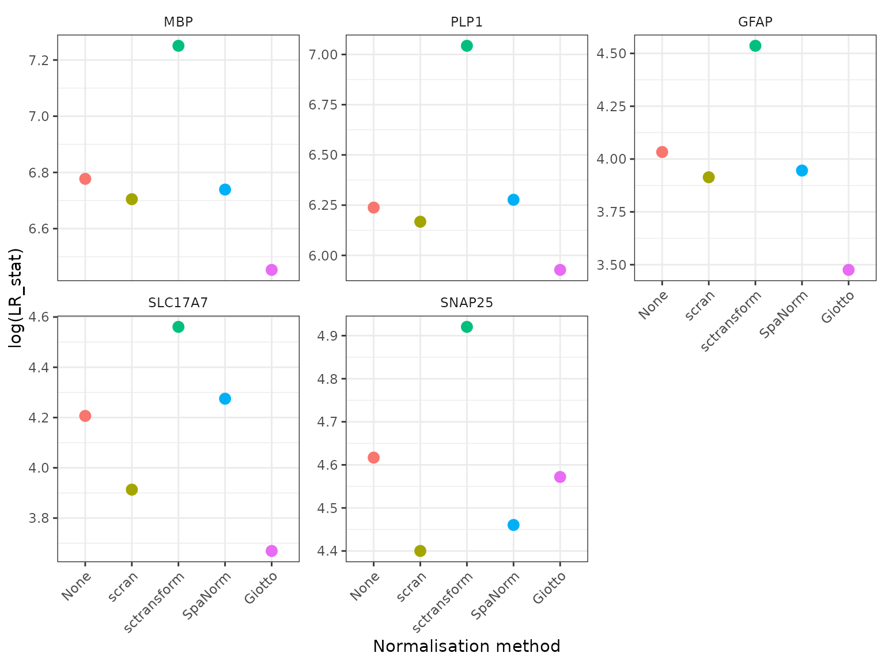

``` r
p_svg_rank <- plot_svg_rank(
  svg_norm = svg_norm,
  genes = marker_genes,
  method_order = NULL,
  method_colors = NULL,
  point_size = 3,
  gene_id = "rownames",
  theme_name = "bw"
)
p_svg_rank$plot
```

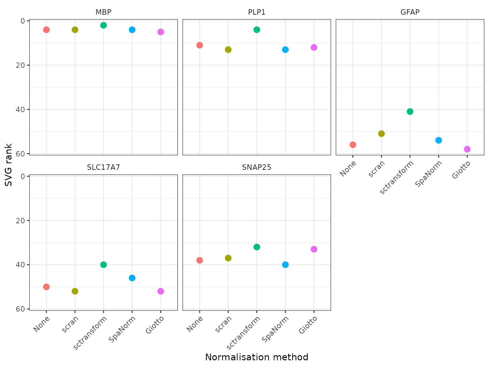

### 6.3 Examine housekeeping genes

We compare housekeeping-gene SVG statistics as an exploratory
diagnostic. These genes are not guaranteed to be spatially uniform;
their behaviour should be interpreted in the context of the tissue.

``` r
housekeeping_genes <- c(
  "GAPDH", "ACTB", "HPRT1", "B2M", "PPIA",
  "RPL13A", "RPLP0", "TBP", "GUSB"
)
```

``` r
p_svg_hk <- plot_svg_gene_set_distribution(
  svg_norm = svg_norm,
  genes = housekeeping_genes,
  stat = "LR_stat",
  method_order = NULL,
  method_colors = NULL,
  gene_id = "rownames",
  transform = "log",
  plot_type = "boxplot",
  add_jitter = TRUE,
  point_size = 1.5,
  alpha = 1,
  theme_name = "classic"
)
p_svg_hk$plot
```

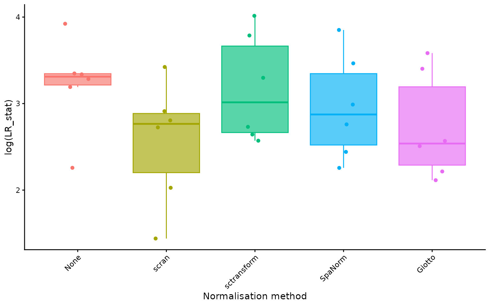

We also calculate the proportion of selected housekeeping genes among
the top 50, 100, 200 and 300 ranked SVGs.

``` r
p_svg_topn <- plot_svg_topn_gene_set(
  svg_norm = svg_norm,
  genes = housekeeping_genes,
  top_n = c(50, 100, 200, 300),
  method_order = NULL,
  method_colors = NULL,
  gene_id = "rownames",
  theme_name = "classic"
)
p_svg_topn$plot
```

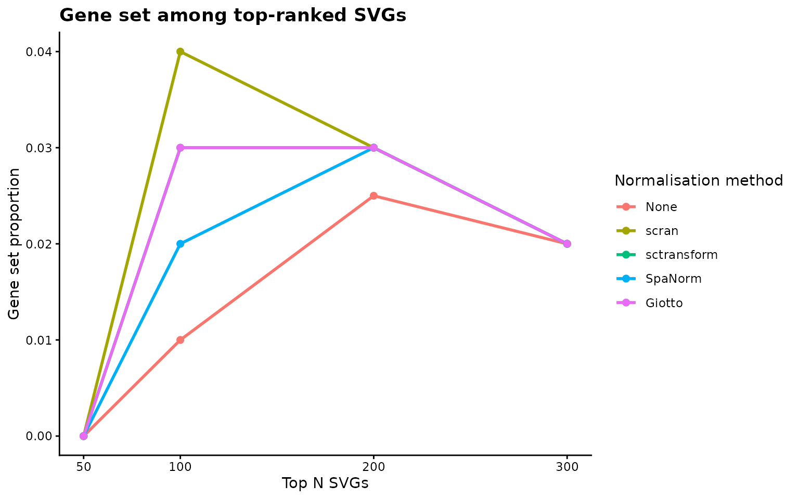

### 6.4 Compare gene sets

We compare the distribution of SVG statistics for biological markers and
housekeeping genes. The transformed statistics are displayed separately
for each gene set.

``` r
gene_sets <- list(
  "Housekeeping genes" = housekeeping_genes,
  "Biological markers" = marker_genes
)

p_svg_sets <- plot_svg_gene_sets(
  svg_norm = svg_norm,
  gene_sets = gene_sets,
  stat = "LR_stat",
  method_order = NULL,
  method_colors = NULL,
  gene_id = "rownames",
  transform = "log",
  plot_type = "boxplot",
  scales = "free_y",
  facet_ncol = 3,
  add_jitter = TRUE,
  point_size = 1,
  alpha = 0.65,
  jitter_alpha = 0.5,
  box_width = 0.65,
  title = "Spatial variability across gene sets",
  subtitle = NULL,
  x_label = "Normalisation method",
  y_label = "Log likelihood-ratio statistic",
  show_legend = FALSE,
  theme_name = "classic"
)
p_svg_sets$plot
```

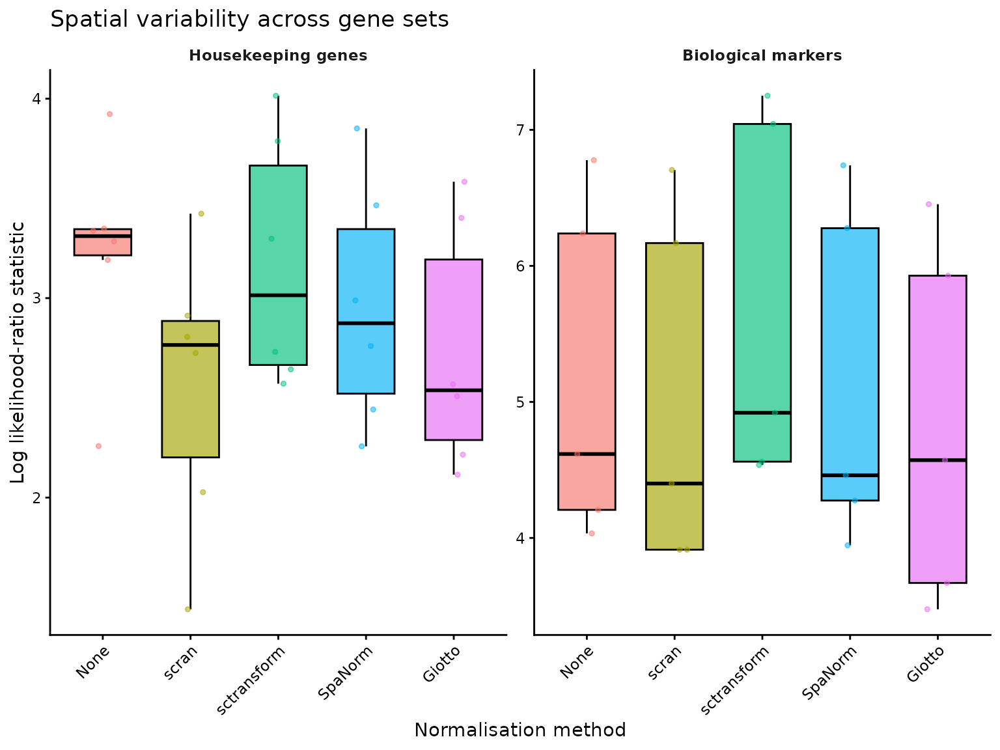

## 7. Spatial expression of marker genes

We visualise selected DLPFC markers across normalisation methods. In the
scaled plot, expression is rescaled to the interval from 0 to 1 for each
gene across the selected methods. We can also plot the unscaled assay
values; their numerical scales may not be directly comparable for
methods that return different kinds of transformed expression.

``` r
spatial_markers <- c(
  "MBP", "MOBP", "PCP4", "GFAP", "SLC17A7", "GAD1"
)

p_marker_maps <- plot_spatial_expression(
  norm_list = norm,
  genes = c("MBP", "MOBP", "PCP4", "GFAP"),
  methods = c("None", "scran", "SpaNorm"),
  assay_name = "logcounts",
  method_order = NULL,
  scale_expr = TRUE,
  scale_by = "gene",
  point_size = 0.5,
  colour_option = "magma",
  ncol_genes = 1,
  theme_name = "classic"
)
p_marker_maps$plot
```

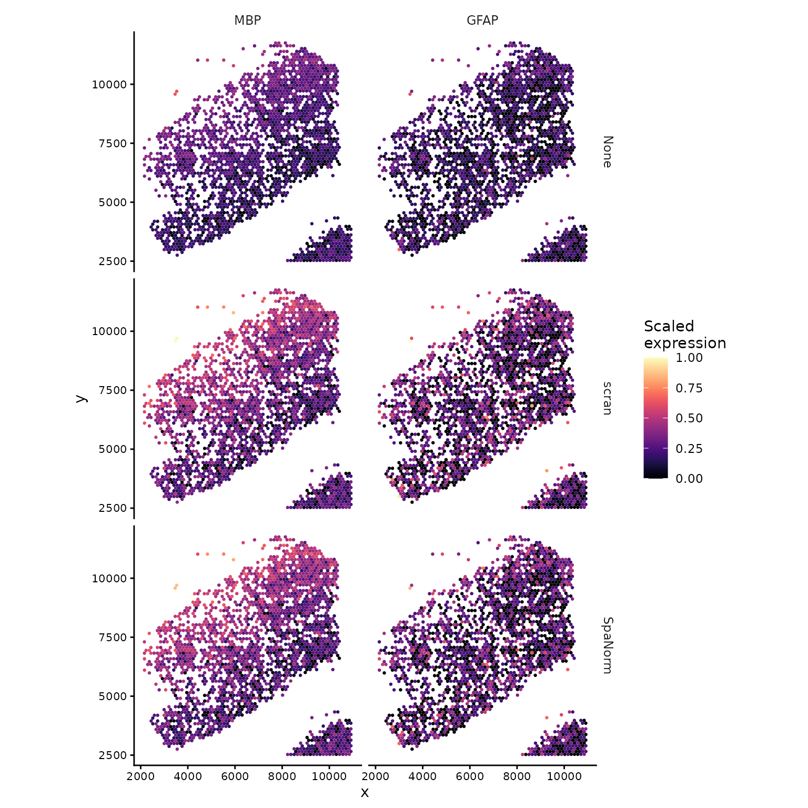

``` r
p_spatial_unscaled <- plot_spatial_expression(
  norm_list = norm,
  genes = spatial_markers,
  assay_name = "logcounts",
  method_order = NULL,
  scale_expr = FALSE,
  point_size = 0.5,
  colour_option = "magma",
  ncol_genes = 1,
  theme_name = "classic"
)
p_spatial_unscaled$plot
```

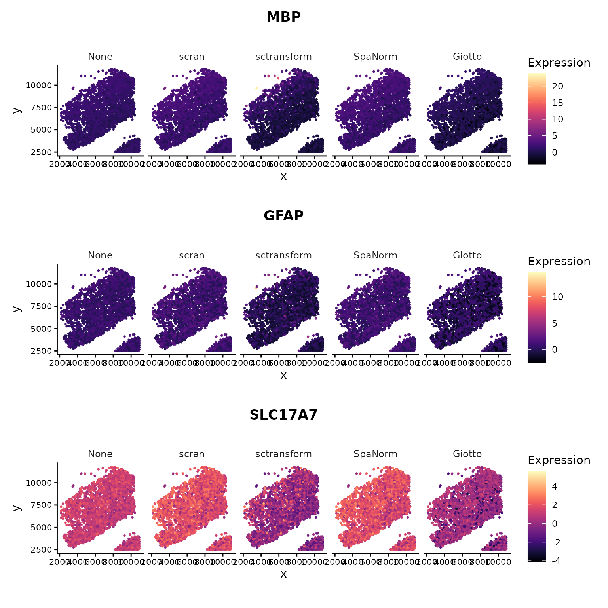

## 8. Cell-type annotation with SingleR

We annotate each normalised spatial dataset using the same DLPFC
single-nucleus RNA-seq reference. The reference cell-type labels are
read from `cellType_broad_hc`, as in the current testing script. This
code retains the original `de.method = "classic"` setting.

``` r
annotated_norm <- run_annotation(
  norm_list = norm,
  ref = ref,
  labels = as.character(ref$cellType_broad_hc),
  method = "SingleR",
  label_name = "SingleR_label",
  pruned_label_name = "SingleR_pruned_label",
  de.method = "classic",
  BPPARAM = BiocParallel::SnowParam(
    workers = 1,
    progressbar = TRUE
  )
)

names(annotated_norm)
#> [1] "None"        "scran"       "sctransform" "SpaNorm"     "Giotto"
head(SummarizedExperiment::colData(annotated_norm$scran))
#> DataFrame with 6 rows and 87 columns
#>            sample_id   Cluster   sum_umi  sum_gene     subject    position
#>          <character> <integer> <numeric> <integer> <character> <character>
#> 151507_2      151507         3      4261      2170      Br5292           0
#> 151507_4      151507         5      3368      1896      Br5292           0
#> 151507_5      151507         1      2981      1620      Br5292           0
#> 151507_6      151507         2      4114      2135      Br5292           0
#> 151507_8      151507         5      4535      2347      Br5292           0
#> 151507_9      151507         4      6577      2911      Br5292           0
#>            replicate subject_position   discard                    key
#>          <character>      <character> <logical>            <character>
#> 151507_2           1      Br5292_pos0     FALSE 151507_AAACAAGTATCTC..
#> 151507_4           1      Br5292_pos0     FALSE 151507_AAACACCAATAAC..
#> 151507_5           1      Br5292_pos0     FALSE 151507_AAACAGCTTTCAG..
#> 151507_6           1      Br5292_pos0     FALSE 151507_AAACAGGGTCTAT..
#> 151507_8           1      Br5292_pos0     FALSE 151507_AAACATTTCCCGG..
#> 151507_9           1      Br5292_pos0     FALSE 151507_AAACCACTACACA..
#>          cell_count SNN_k50_k4 SNN_k50_k5 SNN_k50_k6 SNN_k50_k7 SNN_k50_k8
#>           <integer>  <integer>  <integer>  <integer>  <integer>  <integer>
#> 151507_2          3          1          1          1          1          1
#> 151507_4          5          2          3          4          5          8
#> 151507_5          3          1          1          1          1          1
#> 151507_6          2          1          1          1          1          1
#> 151507_8          5          1          1          1          1          1
#> 151507_9          0          1          1          1          1          1
#>          SNN_k50_k9 SNN_k50_k10 SNN_k50_k11 SNN_k50_k12 SNN_k50_k13 SNN_k50_k14
#>           <integer>   <integer>   <integer>   <integer>   <integer>   <integer>
#> 151507_2          1           1           4           4           4           4
#> 151507_4          9          10          11          10           9          10
#> 151507_5          3           3           3           3           3           3
#> 151507_6          3           3           3           3           3           3
#> 151507_8          3           3           3           3           3           3
#> 151507_9          1           1           2           2           2           2
#>          SNN_k50_k15 SNN_k50_k16 SNN_k50_k17 SNN_k50_k18 SNN_k50_k19
#>            <integer>   <integer>   <integer>   <integer>   <integer>
#> 151507_2           3           3           3           2           2
#> 151507_4          11          11          12          13          12
#> 151507_5           2           2           2           1           1
#> 151507_6           2           2           2           1           1
#> 151507_8           2           2           2           1           1
#> 151507_9           1           1           1           6           6
#>          SNN_k50_k20 SNN_k50_k21 SNN_k50_k22 SNN_k50_k23 SNN_k50_k24
#>            <integer>   <integer>   <integer>   <integer>   <integer>
#> 151507_2           2           2           1           1           1
#> 151507_4          11          11          12          20          20
#> 151507_5           1           1           6           6           6
#> 151507_6           1           1           6           6           6
#> 151507_8           1           1           6           6           6
#> 151507_9           6           6           5           5           5
#>          SNN_k50_k25 SNN_k50_k26 SNN_k50_k27 SNN_k50_k28 GraphBased  Maynard
#>            <integer>   <integer>   <integer>   <integer>  <integer> <factor>
#> 151507_2           6           5           5           4          3      6  
#> 151507_4          21          22          21          22          5      5  
#> 151507_5           5           4           4           3          1      4  
#> 151507_6           5           4           4           3          2      1  
#> 151507_8           5           4           4           3          5      5  
#> 151507_9           4           8           8           8          4      2_3
#>          Martinowich layer_guess layer_guess_reordered
#>             <factor>    <factor>              <factor>
#> 151507_2         6        Layer3                Layer3
#> 151507_4         5        WM                    WM    
#> 151507_5         4        Layer6                Layer6
#> 151507_6         1        Layer6                Layer6
#> 151507_8         5        Layer5                Layer5
#> 151507_9         2_3      Layer3                Layer3
#>          layer_guess_reordered_short expr_chrM expr_chrM_ratio SpatialDE_PCA
#>                             <factor> <numeric>       <numeric>     <integer>
#> 151507_2                          L3       657       0.1541892             2
#> 151507_4                          WM       272       0.0807601             6
#> 151507_5                          L6       502       0.1683999             1
#> 151507_6                          L6       532       0.1293145             1
#> 151507_8                          L5       609       0.1342889             1
#> 151507_9                          L3      1102       0.1675536             3
#>          SpatialDE_pool_PCA   HVG_PCA pseudobulk_PCA markers_PCA SpatialDE_UMAP
#>                   <integer> <integer>      <integer>   <integer>      <integer>
#> 151507_2                  3         1              2           2              1
#> 151507_4                  7         6              6           8              5
#> 151507_5                  1         3              1           1              2
#> 151507_6                  3         1              1           3              2
#> 151507_8                  1         3              1           2              2
#> 151507_9                  2         2              2           2              4
#>          SpatialDE_pool_UMAP  HVG_UMAP pseudobulk_UMAP markers_UMAP
#>                    <integer> <integer>       <integer>    <integer>
#> 151507_2                   3         1               2            1
#> 151507_4                   7         7               7            1
#> 151507_5                   3         6               1            1
#> 151507_6                   3         2               4            1
#> 151507_8                   1         6               5            1
#> 151507_9                   2         3               2            1
#>          SpatialDE_PCA_spatial SpatialDE_pool_PCA_spatial HVG_PCA_spatial
#>                      <integer>                  <integer>       <integer>
#> 151507_2                     4                          1               2
#> 151507_4                     7                          6               7
#> 151507_5                     1                          2               1
#> 151507_6                     1                          1               1
#> 151507_8                     1                          2               1
#> 151507_9                     2                          3               4
#>          pseudobulk_PCA_spatial markers_PCA_spatial SpatialDE_UMAP_spatial
#>                       <integer>           <integer>              <integer>
#> 151507_2                      3                   1                      2
#> 151507_4                      7                   7                      7
#> 151507_5                      1                   2                      8
#> 151507_6                      1                   1                      3
#> 151507_8                      1                   1                      3
#> 151507_9                      3                   1                      5
#>          SpatialDE_pool_UMAP_spatial HVG_UMAP_spatial pseudobulk_UMAP_spatial
#>                            <integer>        <integer>               <integer>
#> 151507_2                           2                1                       2
#> 151507_4                           8                7                       8
#> 151507_5                           2                8                       1
#> 151507_6                           2                2                       5
#> 151507_8                           3                5                       1
#> 151507_9                           7                6                       6
#>          markers_UMAP_spatial spatialLIBD ManualAnnotation in_tissue array_row
#>                     <integer>    <factor>      <character> <logical> <integer>
#> 151507_2                    1          L3               NA      TRUE        50
#> 151507_4                    1          WM               NA      TRUE        59
#> 151507_5                    1          L6               NA      TRUE        43
#> 151507_6                    1          L6               NA      TRUE        47
#> 151507_8                    1          L5               NA      TRUE        61
#> 151507_9                    1          L3               NA      TRUE         3
#>          array_col       sum  detected subsets_Mito_sum subsets_Mito_detected
#>          <integer> <numeric> <integer>        <numeric>             <integer>
#> 151507_2       102      4261      2170              657                    12
#> 151507_4        19      3368      1896              272                    12
#> 151507_5         9      2981      1620              502                    12
#> 151507_6        13      4114      2135              532                    12
#> 151507_8        97      4535      2347              609                    12
#> 151507_9       117      6577      2911             1102                    13
#>          subsets_Mito_percent     total       donor slice_index sec_cluster_MNN
#>                     <numeric> <numeric> <character>   <integer>       <logical>
#> 151507_2             15.41892      4261     donor_1           1              NA
#> 151507_4              8.07601      3368     donor_1           1              NA
#> 151507_5             16.83999      2981     donor_1           1              NA
#> 151507_6             12.93145      4114     donor_1           1              NA
#> 151507_8             13.42889      4535     donor_1           1              NA
#> 151507_9             16.75536      6577     donor_1           1              NA
#>                niche scaled_LS sizeFactor library_size log_library_size
#>          <character> <numeric>  <numeric>    <numeric>        <numeric>
#> 151507_2           1   1.73118   1.103653         1852          7.52456
#> 151507_4           3   1.18793   0.731092         1259          7.13887
#> 151507_5           4   1.21940   0.886934         1390          7.23778
#> 151507_6           4   1.65540   1.093432         1774          7.48156
#> 151507_8           4   1.79646   1.272411         1949          7.57558
#> 151507_9           5   2.65098   1.793275         2993          8.00437
#>          detected_genes mito_fraction SingleR_label SingleR_pruned_label
#>               <numeric>     <numeric>   <character>          <character>
#> 151507_2            319      0.354752     Ambiguous            Ambiguous
#> 151507_4            280      0.215250         Oligo                Oligo
#> 151507_5            309      0.361151     Ambiguous            Ambiguous
#> 151507_6            319      0.299324     Ambiguous            Ambiguous
#> 151507_8            331      0.312468     Ambiguous            Ambiguous
#> 151507_9            343      0.367858     Ambiguous            Ambiguous
table(annotated_norm$scran$SingleR_label)
#> 
#> Ambiguous     Astro EndoMural     Oligo 
#>      1993         1         7         4
```

Before comparing annotations, we confirm that the spatial spot
identifiers appear in the same order across all normalisation methods.

``` r
stopifnot(
  all(vapply(
    annotated_norm,
    function(spe) {
      identical(
        colnames(spe),
        colnames(annotated_norm[[1]])
      )
    },
    logical(1)
  ))
)
```

### 8.1 Visualise spatial cell-type assignments

We compare the spatial distributions of predicted cell types and the
pruned SingleR labels. Pruned labels can include missing assignments
where confidence was insufficient.

``` r
p_annotation <- plot_spatial_annotation(
  norm_list = annotated_norm,
  annotation_col = "SingleR_label",
  method_order = NULL,
  point_size = 0.5,
  palette = NULL,
  ncol = 3,
  theme_name = "classic"
)
p_annotation$plot
```


``` r
p_annotation_pruned <- plot_spatial_annotation(
  norm_list = annotated_norm,
  annotation_col = "SingleR_pruned_label",
  method_order = NULL,
  point_size = 0.5,
  palette = NULL,
  ncol = 3,
  theme_name = "classic"
)
p_annotation_pruned$plot
```

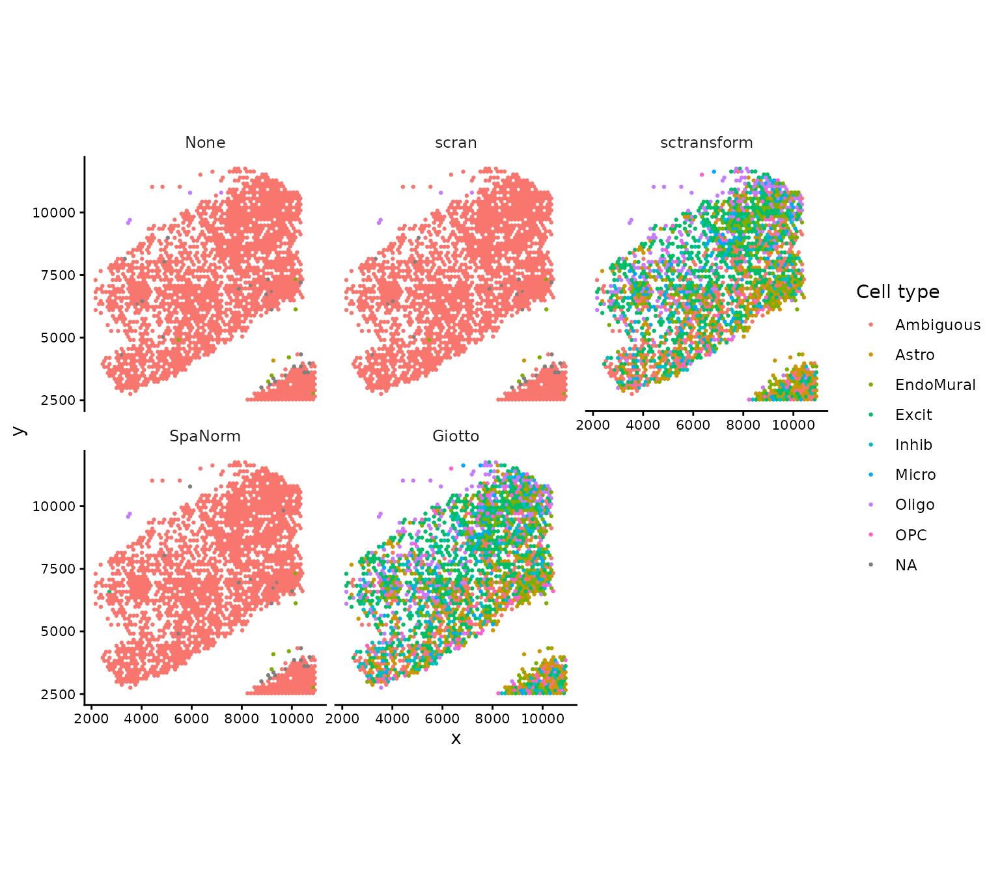

### 8.2 Compare predicted cell-type composition

We examine relative proportions and absolute spot counts assigned to
each predicted cell type.

``` r
p_celltype_prop <- plot_celltype_proportion(
  norm_list = annotated_norm,
  annotation_col = "SingleR_label",
  method_order = NULL,
  palette = NULL,
  show = "proportion",
  theme_name = "classic"
)
p_celltype_prop$plot
```

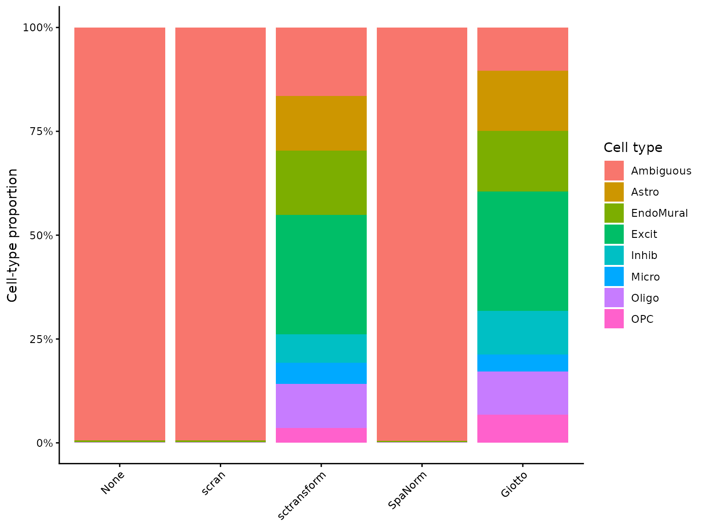

``` r
p_celltype_count <- plot_celltype_proportion(
  norm_list = annotated_norm,
  annotation_col = "SingleR_label",
  method_order = NULL,
  palette = NULL,
  show = "count",
  theme_name = "classic"
)
p_celltype_count$plot
```

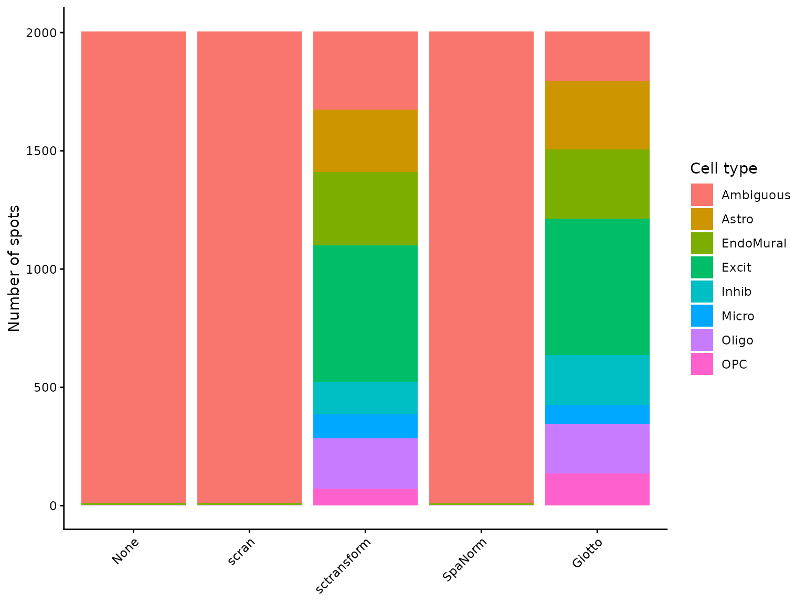

### 8.3 Calculate and plot annotation agreement

Pairwise agreement measures the fraction of spatial spots receiving the
same predicted cell-type label under two normalisation methods. This is
a measure of consistency between methods, rather than accuracy against a
known spot-level cell-type ground truth.

``` r
annotation_agreement <- calculate_annotation_agreement(
  norm_list = annotated_norm,
  annotation_col = "SingleR_label",
  method_order = NULL,
  remove_na = TRUE
)
annotation_agreement
#>        method1     method2 agreement n_compared
#> 1         None       scran 1.0000000       2005
#> 2         None sctransform 0.1695761       2005
#> 3         None     SpaNorm 0.9975062       2005
#> 4         None      Giotto 0.1087282       2005
#> 5        scran sctransform 0.1695761       2005
#> 6        scran     SpaNorm 0.9975062       2005
#> 7        scran      Giotto 0.1087282       2005
#> 8  sctransform     SpaNorm 0.1685786       2005
#> 9  sctransform      Giotto 0.8483791       2005
#> 10     SpaNorm      Giotto 0.1077307       2005

p_agreement <- plot_annotation_agreement(
  norm_list = annotated_norm,
  annotation_col = "SingleR_label",
  method_order = NULL,
  remove_na = TRUE,
  show_values = TRUE,
  digits = 2,
  colour_option = "viridis",
  theme_name = "classic"
)
p_agreement$plot
```

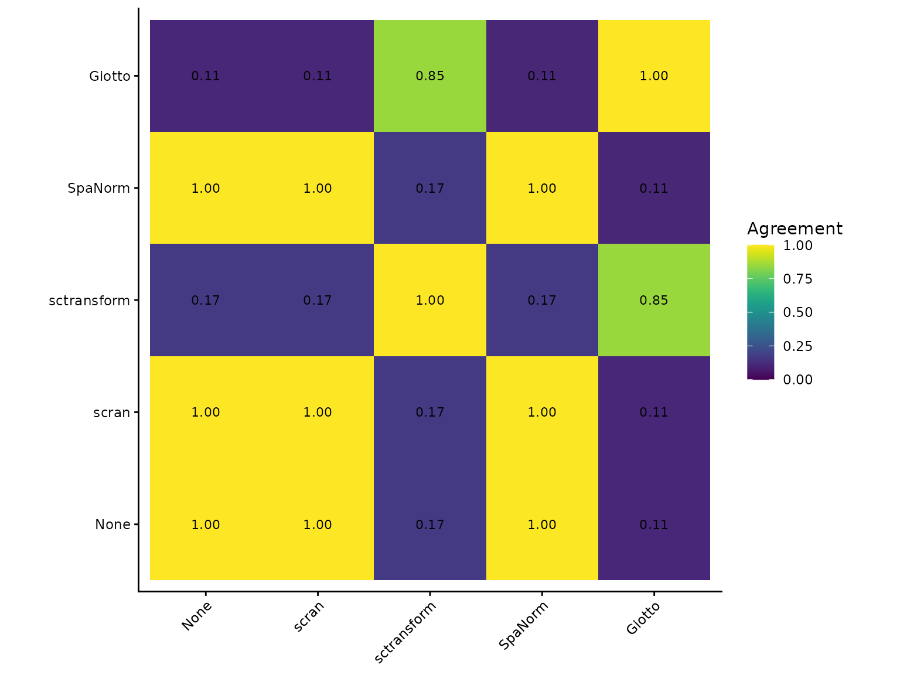

## 9. BANKSY spatial clustering

We use BANKSY with the same parameter settings for each normalised
dataset. Spatial neighbourhood information is incorporated alongside
gene expression to identify spatial domains.

``` r
banksy_norm <- run_banksy_individual(
  norm_list = norm,
  methods = names(norm),
  assay_name = "logcounts",
  cluster_col = "banksy_cluster",
  k_geom = 15,
  lambda = 0.8,
  resolution = 0.2,
  seed = 123
)

names(banksy_norm)
#> [1] "None"        "scran"       "sctransform" "SpaNorm"     "Giotto"
head(SummarizedExperiment::colData(banksy_norm$scran))
#> DataFrame with 6 rows and 87 columns
#>            sample_id   Cluster   sum_umi  sum_gene     subject    position
#>          <character> <integer> <numeric> <integer> <character> <character>
#> 151507_2      151507         3      4261      2170      Br5292           0
#> 151507_4      151507         5      3368      1896      Br5292           0
#> 151507_5      151507         1      2981      1620      Br5292           0
#> 151507_6      151507         2      4114      2135      Br5292           0
#> 151507_8      151507         5      4535      2347      Br5292           0
#> 151507_9      151507         4      6577      2911      Br5292           0
#>            replicate subject_position   discard                    key
#>          <character>      <character> <logical>            <character>
#> 151507_2           1      Br5292_pos0     FALSE 151507_AAACAAGTATCTC..
#> 151507_4           1      Br5292_pos0     FALSE 151507_AAACACCAATAAC..
#> 151507_5           1      Br5292_pos0     FALSE 151507_AAACAGCTTTCAG..
#> 151507_6           1      Br5292_pos0     FALSE 151507_AAACAGGGTCTAT..
#> 151507_8           1      Br5292_pos0     FALSE 151507_AAACATTTCCCGG..
#> 151507_9           1      Br5292_pos0     FALSE 151507_AAACCACTACACA..
#>          cell_count SNN_k50_k4 SNN_k50_k5 SNN_k50_k6 SNN_k50_k7 SNN_k50_k8
#>           <integer>  <integer>  <integer>  <integer>  <integer>  <integer>
#> 151507_2          3          1          1          1          1          1
#> 151507_4          5          2          3          4          5          8
#> 151507_5          3          1          1          1          1          1
#> 151507_6          2          1          1          1          1          1
#> 151507_8          5          1          1          1          1          1
#> 151507_9          0          1          1          1          1          1
#>          SNN_k50_k9 SNN_k50_k10 SNN_k50_k11 SNN_k50_k12 SNN_k50_k13 SNN_k50_k14
#>           <integer>   <integer>   <integer>   <integer>   <integer>   <integer>
#> 151507_2          1           1           4           4           4           4
#> 151507_4          9          10          11          10           9          10
#> 151507_5          3           3           3           3           3           3
#> 151507_6          3           3           3           3           3           3
#> 151507_8          3           3           3           3           3           3
#> 151507_9          1           1           2           2           2           2
#>          SNN_k50_k15 SNN_k50_k16 SNN_k50_k17 SNN_k50_k18 SNN_k50_k19
#>            <integer>   <integer>   <integer>   <integer>   <integer>
#> 151507_2           3           3           3           2           2
#> 151507_4          11          11          12          13          12
#> 151507_5           2           2           2           1           1
#> 151507_6           2           2           2           1           1
#> 151507_8           2           2           2           1           1
#> 151507_9           1           1           1           6           6
#>          SNN_k50_k20 SNN_k50_k21 SNN_k50_k22 SNN_k50_k23 SNN_k50_k24
#>            <integer>   <integer>   <integer>   <integer>   <integer>
#> 151507_2           2           2           1           1           1
#> 151507_4          11          11          12          20          20
#> 151507_5           1           1           6           6           6
#> 151507_6           1           1           6           6           6
#> 151507_8           1           1           6           6           6
#> 151507_9           6           6           5           5           5
#>          SNN_k50_k25 SNN_k50_k26 SNN_k50_k27 SNN_k50_k28 GraphBased  Maynard
#>            <integer>   <integer>   <integer>   <integer>  <integer> <factor>
#> 151507_2           6           5           5           4          3      6  
#> 151507_4          21          22          21          22          5      5  
#> 151507_5           5           4           4           3          1      4  
#> 151507_6           5           4           4           3          2      1  
#> 151507_8           5           4           4           3          5      5  
#> 151507_9           4           8           8           8          4      2_3
#>          Martinowich layer_guess layer_guess_reordered
#>             <factor>    <factor>              <factor>
#> 151507_2         6        Layer3                Layer3
#> 151507_4         5        WM                    WM    
#> 151507_5         4        Layer6                Layer6
#> 151507_6         1        Layer6                Layer6
#> 151507_8         5        Layer5                Layer5
#> 151507_9         2_3      Layer3                Layer3
#>          layer_guess_reordered_short expr_chrM expr_chrM_ratio SpatialDE_PCA
#>                             <factor> <numeric>       <numeric>     <integer>
#> 151507_2                          L3       657       0.1541892             2
#> 151507_4                          WM       272       0.0807601             6
#> 151507_5                          L6       502       0.1683999             1
#> 151507_6                          L6       532       0.1293145             1
#> 151507_8                          L5       609       0.1342889             1
#> 151507_9                          L3      1102       0.1675536             3
#>          SpatialDE_pool_PCA   HVG_PCA pseudobulk_PCA markers_PCA SpatialDE_UMAP
#>                   <integer> <integer>      <integer>   <integer>      <integer>
#> 151507_2                  3         1              2           2              1
#> 151507_4                  7         6              6           8              5
#> 151507_5                  1         3              1           1              2
#> 151507_6                  3         1              1           3              2
#> 151507_8                  1         3              1           2              2
#> 151507_9                  2         2              2           2              4
#>          SpatialDE_pool_UMAP  HVG_UMAP pseudobulk_UMAP markers_UMAP
#>                    <integer> <integer>       <integer>    <integer>
#> 151507_2                   3         1               2            1
#> 151507_4                   7         7               7            1
#> 151507_5                   3         6               1            1
#> 151507_6                   3         2               4            1
#> 151507_8                   1         6               5            1
#> 151507_9                   2         3               2            1
#>          SpatialDE_PCA_spatial SpatialDE_pool_PCA_spatial HVG_PCA_spatial
#>                      <integer>                  <integer>       <integer>
#> 151507_2                     4                          1               2
#> 151507_4                     7                          6               7
#> 151507_5                     1                          2               1
#> 151507_6                     1                          1               1
#> 151507_8                     1                          2               1
#> 151507_9                     2                          3               4
#>          pseudobulk_PCA_spatial markers_PCA_spatial SpatialDE_UMAP_spatial
#>                       <integer>           <integer>              <integer>
#> 151507_2                      3                   1                      2
#> 151507_4                      7                   7                      7
#> 151507_5                      1                   2                      8
#> 151507_6                      1                   1                      3
#> 151507_8                      1                   1                      3
#> 151507_9                      3                   1                      5
#>          SpatialDE_pool_UMAP_spatial HVG_UMAP_spatial pseudobulk_UMAP_spatial
#>                            <integer>        <integer>               <integer>
#> 151507_2                           2                1                       2
#> 151507_4                           8                7                       8
#> 151507_5                           2                8                       1
#> 151507_6                           2                2                       5
#> 151507_8                           3                5                       1
#> 151507_9                           7                6                       6
#>          markers_UMAP_spatial spatialLIBD ManualAnnotation in_tissue array_row
#>                     <integer>    <factor>      <character> <logical> <integer>
#> 151507_2                    1          L3               NA      TRUE        50
#> 151507_4                    1          WM               NA      TRUE        59
#> 151507_5                    1          L6               NA      TRUE        43
#> 151507_6                    1          L6               NA      TRUE        47
#> 151507_8                    1          L5               NA      TRUE        61
#> 151507_9                    1          L3               NA      TRUE         3
#>          array_col       sum  detected subsets_Mito_sum subsets_Mito_detected
#>          <integer> <numeric> <integer>        <numeric>             <integer>
#> 151507_2       102      4261      2170              657                    12
#> 151507_4        19      3368      1896              272                    12
#> 151507_5         9      2981      1620              502                    12
#> 151507_6        13      4114      2135              532                    12
#> 151507_8        97      4535      2347              609                    12
#> 151507_9       117      6577      2911             1102                    13
#>          subsets_Mito_percent     total       donor slice_index sec_cluster_MNN
#>                     <numeric> <numeric> <character>   <integer>       <logical>
#> 151507_2             15.41892      4261     donor_1           1              NA
#> 151507_4              8.07601      3368     donor_1           1              NA
#> 151507_5             16.83999      2981     donor_1           1              NA
#> 151507_6             12.93145      4114     donor_1           1              NA
#> 151507_8             13.42889      4535     donor_1           1              NA
#> 151507_9             16.75536      6577     donor_1           1              NA
#>                niche scaled_LS sizeFactor library_size log_library_size
#>          <character> <numeric>  <numeric>    <numeric>        <numeric>
#> 151507_2           1   1.73118   1.103653         1852          7.52456
#> 151507_4           3   1.18793   0.731092         1259          7.13887
#> 151507_5           4   1.21940   0.886934         1390          7.23778
#> 151507_6           4   1.65540   1.093432         1774          7.48156
#> 151507_8           4   1.79646   1.272411         1949          7.57558
#> 151507_9           5   2.65098   1.793275         2993          8.00437
#>          detected_genes mito_fraction clust_M0_lam0.8_k50_res0.2 banksy_cluster
#>               <numeric>     <numeric>                   <factor>       <factor>
#> 151507_2            319      0.354752                          2              2
#> 151507_4            280      0.215250                          4              4
#> 151507_5            309      0.361151                          4              4
#> 151507_6            319      0.299324                          4              4
#> 151507_8            331      0.312468                          3              3
#> 151507_9            343      0.367858                          5              5
table(banksy_norm$scran$banksy_cluster)
#> 
#>   1   2   3   4   5 
#> 680 472 436 260 157
```

### 9.1 Compare predicted domains with cortical layers

We show the manual cortical layer annotation once and the predicted
BANKSY clusters for each normalisation method. Cluster numbers are
method-specific labels, so the same number across methods does not
necessarily indicate the same biological domain.

``` r
p_banksy <- plot_spatial_clustering(
  norm_list = banksy_norm,
  cluster_col = "banksy_cluster",
  ground_truth_col = "layer_guess",
  show = "both",
  methods = names(banksy_norm),
  method_order = NULL,
  point_size = 0.5,
  palette = NULL,
  truth_palette = NULL,
  ncol = 5,
  legend_point_size = 4,
  theme_name = "classic"
)
p_banksy$plot
```

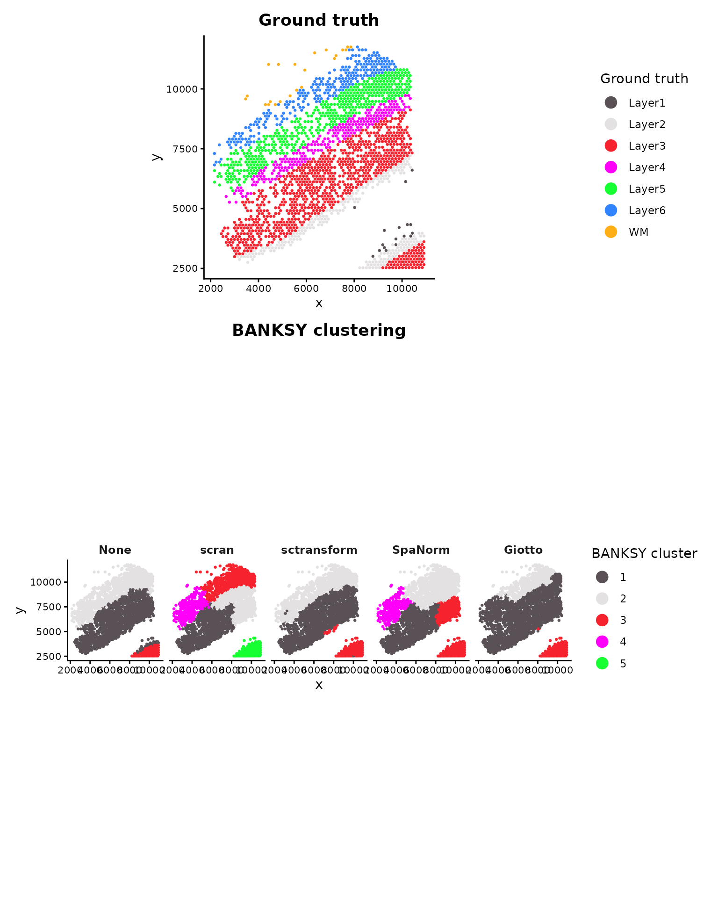

The individual panels are also available as `p_banksy$plots$truth` and
`p_banksy$plots$predicted` without rerunning clustering.

### 9.2 Evaluate clustering with ARI

The adjusted Rand index (ARI) measures agreement between BANKSY clusters
and the manual cortical layer annotations. A score of 1 indicates
perfect agreement; the index adjusts for chance agreement.

``` r
ari_df <- calculate_ari(
  norm_list = banksy_norm,
  ground_truth_col = "layer_guess",
  cluster_col = "banksy_cluster",
  methods = names(banksy_norm)
)
ari_df
#>        method  slice       ARI    n
#> 1        None slice1 0.4026881 2005
#> 2       scran slice1 0.3083520 2005
#> 3 sctransform slice1 0.3936315 2005
#> 4     SpaNorm slice1 0.2848142 2005
#> 5      Giotto slice1 0.1799254 2005
```

``` r
p_ari <- plot_ari(
  ari_df = ari_df,
  method_col = "method",
  ari_col = "ARI",
  method_order = NULL,
  point_size = 4,
  palette = NULL,
  theme_name = "classic"
)
p_ari$plot
```

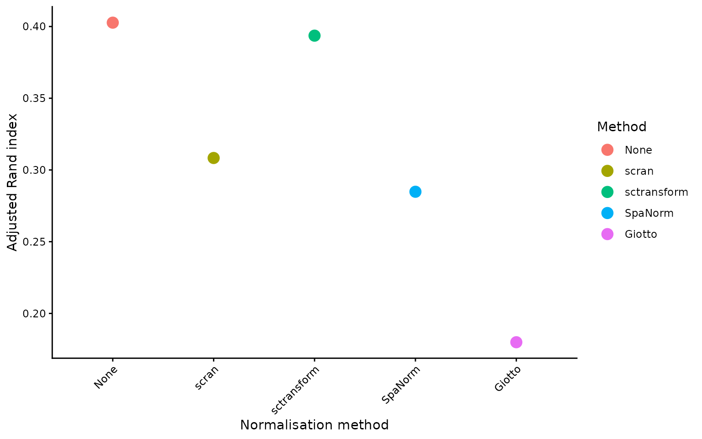

## 10. Differential expression and GO enrichment

We identify genes associated with each BANKSY cluster and perform GO
Biological Process enrichment using the human annotation database
`org.Hs.eg.db`. The cluster-specific differential-expression analysis
uses the same settings as the existing
[`calculate_go()`](https://lahiru-lsb.github.io/STBench/reference/calculate_go.md)
workflow, including an FDR cutoff of 0.05. GO enrichment is an
exploratory interpretation of the identified clusters.

``` r
go_result <- calculate_go(
  norm_list = banksy_norm,
  cluster_col = "banksy_cluster",
  methods = names(banksy_norm),
  assay_name = "logcounts",
  OrgDb = org.Hs.eg.db::org.Hs.eg.db,
  key_type = "SYMBOL",
  ont = "BP",
  fdr_cutoff = 0.05,
  min_prop = 0.7,
  min_spots = 30,
  min_genes = 10,
  pvalue_cutoff = 0.05,
  qvalue_cutoff = 0.05,
  p_adjust_method = "BH",
  readable = TRUE
)

names(go_result)
#> [1] "markers"  "genes"    "go"       "universe"
head(go_result$genes)
#>   method cluster    gene          FDR rank
#> 1   None       2     MBP 2.250936e-30    1
#> 2   None       2    PLP1 7.063686e-17    2
#> 3   None       2 SCGB2A2 1.244553e-11    3
#> 4   None       2  TMSB10 7.845692e-11    4
#> 5   None       2  TUBA1B 1.503016e-10    5
#> 6   None       2   STMN2 1.926931e-09    6
head(go_result$go)
#>           ID                                         Description GeneRatio
#> 1 GO:0000226               microtubule cytoskeleton organization      7/18
#> 2 GO:0007010                           cytoskeleton organization      8/18
#> 3 GO:0007017                           microtubule-based process      7/18
#> 4 GO:0015980 energy derivation by oxidation of organic compounds    47/214
#> 5 GO:0009060                                 aerobic respiration    46/214
#> 6 GO:0045333                                cellular respiration    46/214
#>   BgRatio RichFactor FoldEnrichment   zScore       pvalue    p.adjust
#> 1  19/336  0.3684211       6.877193 6.265594 1.241039e-05 0.005572264
#> 2  36/336  0.2222222       4.148148 4.748877 1.613703e-04 0.025596973
#> 3  27/336  0.2592593       4.839506 4.942232 1.710265e-04 0.025596973
#> 4  53/336  0.8867925       1.392347 4.115897 1.120432e-05 0.003704042
#> 5  52/336  0.8846154       1.388929 4.034243 1.688773e-05 0.003704042
#> 6  52/336  0.8846154       1.388929 4.034243 1.688773e-05 0.003704042
#>        qvalue
#> 1 0.005199299
#> 2 0.023883707
#> 3 0.023883707
#> 4 0.003537535
#> 5 0.003537535
#> 6 0.003537535
#>                                                                                                                                                                                                                                                                                                                                  geneID
#> 1                                                                                                                                                                                                                                                                                             TUBA1B/STMN2/TUBB2A/CRYAB/MAP1B/NEFL/TUBB
#> 2                                                                                                                                                                                                                                                                                      TMSB10/TUBA1B/STMN2/TUBB2A/CRYAB/MAP1B/NEFL/TUBB
#> 3                                                                                                                                                                                                                                                                                             TUBA1B/STMN2/TUBB2A/CRYAB/MAP1B/NEFL/TUBB
#> 4 MT-ND2/MT-CO1/MT-ND1/MT3/MT-ND4/MT-ND3/MT-CYB/MT-ND5/NDUFA4/MT-ATP6/MT-CO2/MT-ND4L/MT-CO3/UQCR11/CHCHD10/NDUFA3/NDUFB1/ATP5F1E/NDUFA13/NDUFB2/UQCR10/MDH1/NDUFA1/COX6A1/NDUFB4/ATP5PF/PARK7/COX6B1/CHCHD2/ATP5MF/COX4I1/UQCRB/NDUFB8/ATP5IF1/COX7A2/MT-ATP8/NDUFS5/ATP5MG/ATP5ME/NDUFC2/COX8A/COX5B/ATP5F1A/COX7C/COX7B/ATP5F1D/UQCRH
#> 5     MT-ND2/MT-CO1/MT-ND1/MT-ND4/MT-ND3/MT-CYB/MT-ND5/NDUFA4/MT-ATP6/MT-CO2/MT-ND4L/MT-CO3/UQCR11/CHCHD10/NDUFA3/NDUFB1/ATP5F1E/NDUFA13/NDUFB2/UQCR10/MDH1/NDUFA1/COX6A1/NDUFB4/ATP5PF/PARK7/COX6B1/CHCHD2/ATP5MF/COX4I1/UQCRB/NDUFB8/ATP5IF1/COX7A2/MT-ATP8/NDUFS5/ATP5MG/ATP5ME/NDUFC2/COX8A/COX5B/ATP5F1A/COX7C/COX7B/ATP5F1D/UQCRH
#> 6     MT-ND2/MT-CO1/MT-ND1/MT-ND4/MT-ND3/MT-CYB/MT-ND5/NDUFA4/MT-ATP6/MT-CO2/MT-ND4L/MT-CO3/UQCR11/CHCHD10/NDUFA3/NDUFB1/ATP5F1E/NDUFA13/NDUFB2/UQCR10/MDH1/NDUFA1/COX6A1/NDUFB4/ATP5PF/PARK7/COX6B1/CHCHD2/ATP5MF/COX4I1/UQCRB/NDUFB8/ATP5IF1/COX7A2/MT-ATP8/NDUFS5/ATP5MG/ATP5ME/NDUFC2/COX8A/COX5B/ATP5F1A/COX7C/COX7B/ATP5F1D/UQCRH
#>   Count method cluster GeneRatio_numeric log10_padj
#> 1     7   None       2         0.3888889   2.253968
#> 2     8   None       2         0.4444444   1.591811
#> 3     7   None       2         0.3888889   1.591811
#> 4    47   None       3         0.2196262   2.431324
#> 5    46   None       3         0.2149533   2.431324
#> 6    46   None       3         0.2149533   2.431324
names(go_result$markers)
#> [1] "None"        "scran"       "sctransform" "SpaNorm"     "Giotto"
names(go_result$universe)
#> [1] "None"        "scran"       "sctransform" "SpaNorm"     "Giotto"
```

### 10.1 Visualise enriched biological processes

For each cluster and normalisation method, we visualise the five most
significant GO terms. The title and subtitle identify the dataset and
the comparison. The `top_n` argument controls the displayed terms; the
original enrichment results remain available in `go_result`.

``` r
p_go <- plot_go(
  go_result = go_result,
  top_n = 5,
  method_col = "method",
  cluster_col = "cluster",
  method_order = NULL,
  point_size_range = c(2, 7),
  theme_name = "classic",
  methods = NULL,
  title = "GO enrichment in DLPFC spatial domains",
  subtitle = "Comparison across normalisation methods",
  ncol = 3
)
p_go$plot
```

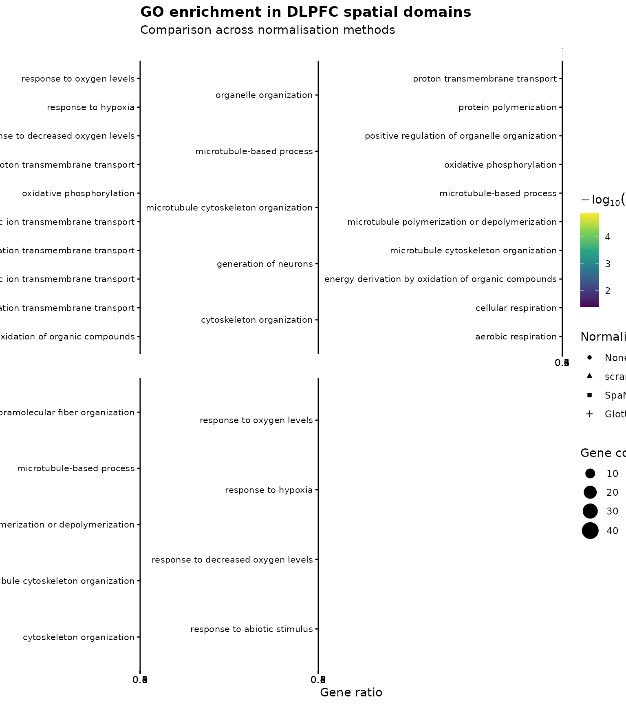

## Summary

This vignette demonstrates how STBench can apply and benchmark several
normalisation methods using consistent downstream analyses. The visual
comparisons examine QC, normalised library sizes, UMAP, spatial
variability, cell-type annotations, spatial clustering and functional
enrichment.

The example is currently intended for **local development and testing**.
For a distributable package vignette, the data-loading section should
use accessible example data, and computationally expensive steps may
need a precomputed demonstration dataset or build-time caching strategy.
Before interpreting results, confirm that gene identifiers match the
selected human marker genes and `org.Hs.eg.db` identifier type.
