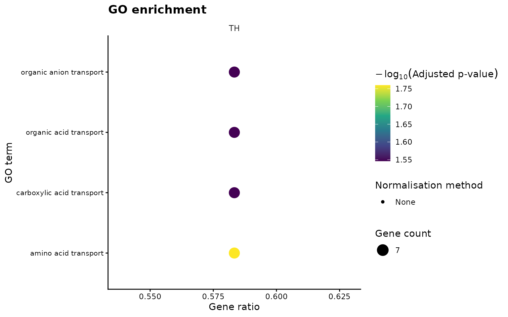
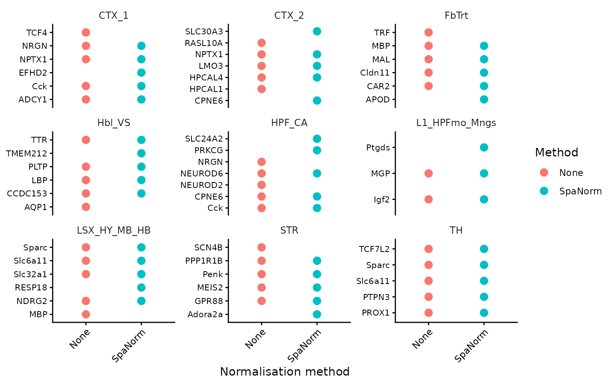
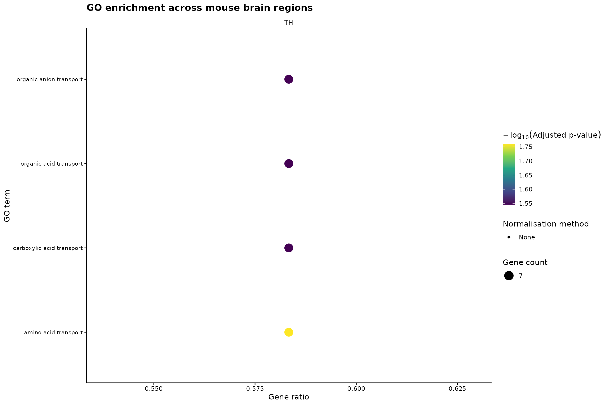
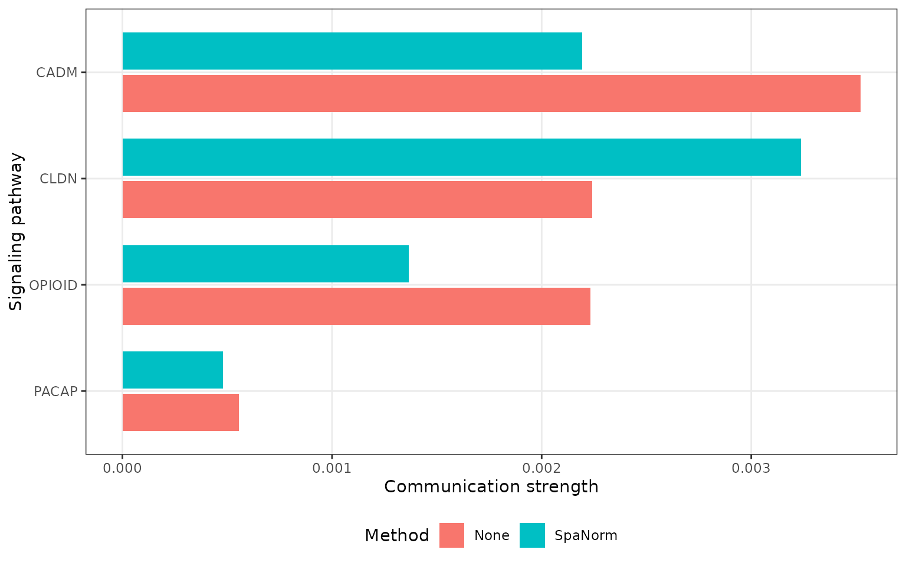
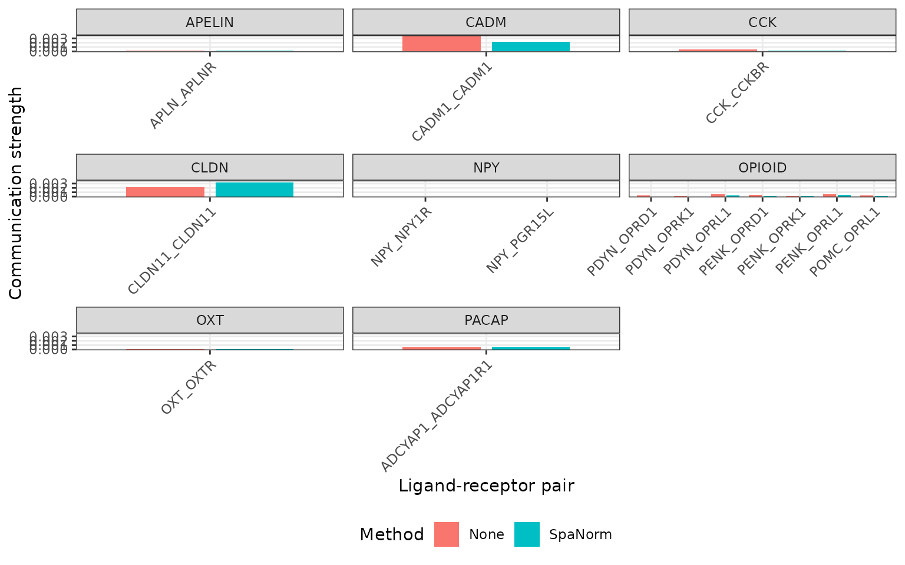
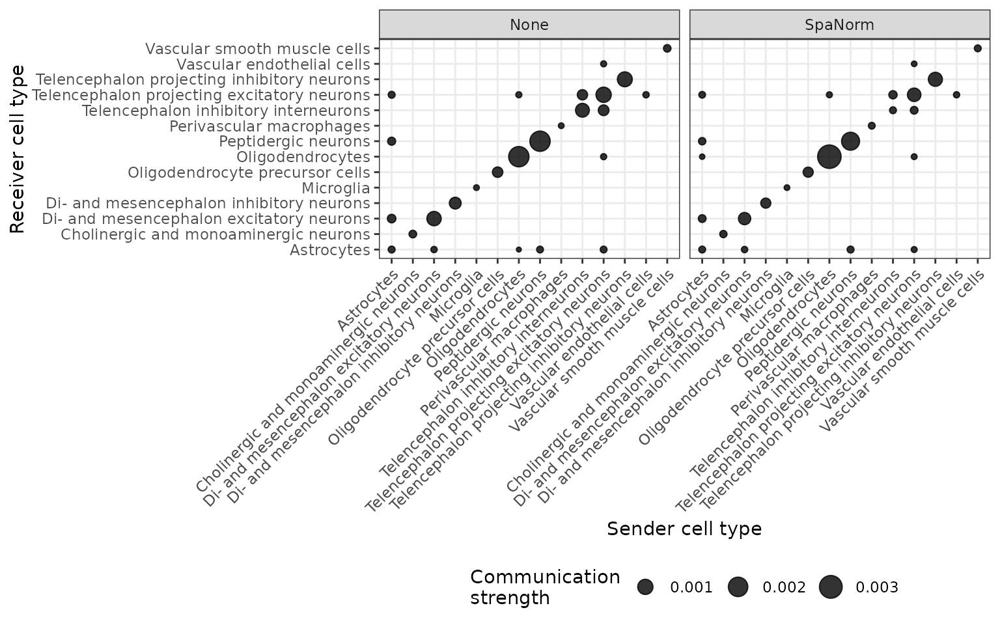
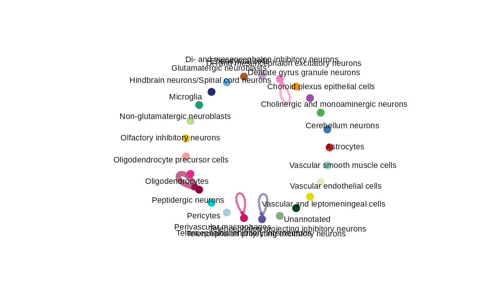
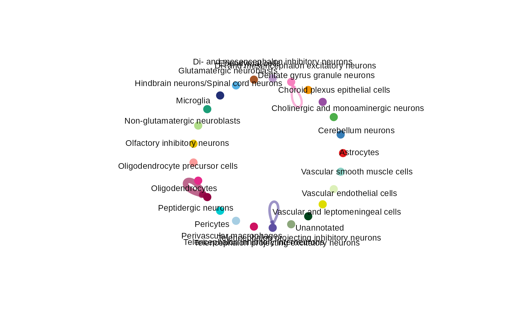

# Biological interpretation and cell-cell communication with STBench

## Introduction

We identify genes associated with annotated cell types and perform Gene
Ontology (GO) Biological Process enrichment using the mouse annotation
database `org.Mm.eg.db`. The example dataset is small, and statistical
significance or detectable signalling cannot be guaranteed.

``` r
data(norm_ccc_example)
norm <- norm_ccc_example
names(norm)
#> [1] "None"    "SpaNorm"
```

## Differential expression and GO enrichment

The region-specific differential-expression analysis uses a configurable
test, including an FDR cutoff of 0.05.

``` r
go_result <- calculate_go(
  norm_list = norm,
  cluster_col = "Main_molecular_tissue_region",
  methods = names(norm),
  assay_name = "logcounts",
  OrgDb = org.Mm.eg.db::org.Mm.eg.db,
  key_type = "SYMBOL",
  ont = "BP",
  fdr_cutoff = 0.05,
  min_prop = 0.5,
  min_spots = 10,
  min_genes = 5,
  pvalue_cutoff = 0.05,
  qvalue_cutoff = 0.05,
  p_adjust_method = "BH",
  readable = TRUE,
  test_type = "t"
)

names(go_result)
#> [1] "markers"  "genes"    "go"       "universe"
head(go_result$genes)
#>   method cluster  gene          FDR rank
#> 1   None   CTX_1  NRGN 7.004472e-12    1
#> 2   None   CTX_1 NPTX1 2.393713e-10    2
#> 3   None   CTX_1  TCF4 6.065665e-07    3
#> 4   None   CTX_1   Cck 1.081228e-06    4
#> 5   None   CTX_1 ADCY1 2.003602e-06    5
#> 6   None   CTX_1 EFHD2 1.898462e-05    6
head(go_result$go)
#>           ID               Description GeneRatio BgRatio RichFactor
#> 1 GO:0006865      amino acid transport      7/12  30/304  0.2333333
#> 2 GO:0015711   organic anion transport      7/12  39/304  0.1794872
#> 3 GO:0015849    organic acid transport      7/12  39/304  0.1794872
#> 4 GO:0046942 carboxylic acid transport      7/12  39/304  0.1794872
#>   FoldEnrichment   zScore       pvalue   p.adjust     qvalue
#> 1       5.911111 5.734369 2.553054e-05 0.01738630 0.01738630
#> 2       4.547009 4.801668 1.669734e-04 0.02842721 0.02842721
#> 3       4.547009 4.801668 1.669734e-04 0.02842721 0.02842721
#> 4       4.547009 4.801668 1.669734e-04 0.02842721 0.02842721
#>                                   geneID Count method cluster GeneRatio_numeric
#> 1 Slc6a11/Slc17a6/Cck/Grm1/Hrh3/Grm2/Agt     7   None      TH         0.5833333
#> 2 Slc6a11/Slc17a6/Cck/Grm1/Hrh3/Grm2/Agt     7   None      TH         0.5833333
#> 3 Slc6a11/Slc17a6/Cck/Grm1/Hrh3/Grm2/Agt     7   None      TH         0.5833333
#> 4 Slc6a11/Slc17a6/Cck/Grm1/Hrh3/Grm2/Agt     7   None      TH         0.5833333
#>   log10_padj
#> 1   1.759793
#> 2   1.546266
#> 3   1.546266
#> 4   1.546266
```

### Visualise enriched biological processes

For each region and normalisation method, we visualise the five most
significant GO terms. The `top_n` argument controls the displayed terms;
the original enrichment results remain available in `go_result`.

``` r
if (nrow(go_result$go) > 0L) {
  p_go <- plot_go(
    go_result = go_result,
    top_n = 5,
    method_col = "method",
    cluster_col = "cluster",
    point_size_range = c(2, 7),
    theme_name = "classic",
    title = "GO enrichment",
    ncol = 2
  )
  print(p_go$plot)
} else {
  message("No significant GO terms were detected in the example data.")
}
```



### Visualise differential-expression genes

These plots display significant DE genes used as input to GO enrichment,
even when no GO terms reach significance.

``` r
if (nrow(go_result$genes) > 0L) {
  p_go_genes <- plot_go_genes(
    go_result = go_result,
    top_n = 5,
    method_col = "method",
    cluster_col = "cluster",
    gene_col = "gene",
    point_size = 3,
    theme_name = "classic"
  )
  print(p_go_genes$plot)
} else {
  message("No significant DE genes were detected in the example data.")
}
```



### Visualise GO enrichment results

We visualise the five most significant GO Biological Process terms for
each cell type and normalisation method. Point size represents the
number of genes associated with each GO term, while colour represents
the adjusted p-value.

``` r
if (nrow(go_result$go) > 0L) {

  p_go <- plot_go(
    go_result = go_result,
    top_n = 5,
    method_col = "method",
    cluster_col = "cluster",
    method_order = NULL,
    point_size_range = c(2, 7),
    theme_name = "classic",
    methods = NULL,
    title = "GO enrichment across mouse brain regions",
    subtitle = NULL,#"Comparison across normalisation methods",
    ncol = 3
  )

  p_go$plot

}
```



## Cell-cell communication analysis

CellChat is applied independently to each normalised dataset using the
same analysis parameters. This allows us to investigate variation in
inferred communication patterns across normalisation methods.

### Prepare data for CellChat

For the mouse example data, we use the mouse CellChat database. Spatial
scaling factors and interaction distances must be validated for the
coordinate units and spatial technology. The values below are
illustrative.

``` r
data("CellChatDB.mouse", package = "CellChat")
ccc_database <- CellChat::CellChatDB.mouse
ccc_spe <- norm

celltype_col <- "cell_type"
spatial_factors <- data.frame(ratio = 0.5, tol = 12.5)
interaction_range <- 250
contact_range <- 25
```

### Run CellChat across normalisation methods

This workflow requires CellChat and sufficient ligand-receptor genes. An
error is informative if the small example contains too few supported
interactions.

``` r
ccc_results <- run_ccc(
  spelist = ccc_spe,
  celltype_col = celltype_col,
  database = ccc_database,
  spatial_factors = spatial_factors,
  interaction_range = interaction_range,
  contact_range = contact_range,
  assay_name = "logcounts",
  nboot = 10,
  min_cells = 5,
  trim = 0.1,
  scale_distance = 0.1,
  variable_both = FALSE,
  verbose = FALSE
)
#> [1] "Create a CellChat object from a data matrix"
#> Create a CellChat object from spatial transcriptomics data... 
#> Set cell identities for the new CellChat object 
#> The cell groups used for CellChat analysis are  Astrocytes, Cerebellum neurons, Cholinergic and monoaminergic neurons, Choroid plexus epithelial cells, Dentate gyrus granule neurons, Di- and mesencephalon excitatory neurons, Di- and mesencephalon inhibitory neurons, Ependymal cells, Glutamatergic neuroblasts, Hindbrain neurons/Spinal cord neurons, Microglia, Non-glutamatergic neuroblasts, Olfactory inhibitory neurons, Oligodendrocyte precursor cells, Oligodendrocytes, Peptidergic neurons, Pericytes, Perivascular macrophages, Telencephalon inhibitory interneurons, Telencephalon projecting excitatory neurons, Telencephalon projecting inhibitory neurons, Unannotated, Vascular and leptomeningeal cells, Vascular endothelial cells, Vascular smooth muscle cells 
#> The number of highly variable ligand-receptor pairs used for signaling inference is 94 
#> truncatedMean is used for calculating the average gene expression per cell group. 
#> [1] ">>> Run CellChat on spatial transcriptomics data using distances as constraints of the computed communication probability <<< [2026-11-21 15:09:25.05241]"
#> The input L-R pairs have both secreted signaling and contact-dependent signaling. Run CellChat in a contact-dependent manner for `Cell-Cell Contact` signaling, and in a diffusion manner based on the `interaction.range` for other L-R pairs. 
#> [1] ">>> CellChat inference is done. Parameter values are stored in `object@options$parameter` <<< [2026-11-21 15:09:28.972749]"
#> The cell-cell communication related with the following cell groups are excluded due to the few number of cells:  Cerebellum neurons, Dentate gyrus granule neurons, Glutamatergic neuroblasts, Non-glutamatergic neuroblasts, Olfactory inhibitory neurons !     5.2% interactions are removed!
#> [1] "Create a CellChat object from a data matrix"
#> Create a CellChat object from spatial transcriptomics data... 
#> Set cell identities for the new CellChat object 
#> The cell groups used for CellChat analysis are  Astrocytes, Cerebellum neurons, Cholinergic and monoaminergic neurons, Choroid plexus epithelial cells, Dentate gyrus granule neurons, Di- and mesencephalon excitatory neurons, Di- and mesencephalon inhibitory neurons, Ependymal cells, Glutamatergic neuroblasts, Hindbrain neurons/Spinal cord neurons, Microglia, Non-glutamatergic neuroblasts, Olfactory inhibitory neurons, Oligodendrocyte precursor cells, Oligodendrocytes, Peptidergic neurons, Pericytes, Perivascular macrophages, Telencephalon inhibitory interneurons, Telencephalon projecting excitatory neurons, Telencephalon projecting inhibitory neurons, Unannotated, Vascular and leptomeningeal cells, Vascular endothelial cells, Vascular smooth muscle cells 
#> The number of highly variable ligand-receptor pairs used for signaling inference is 93 
#> truncatedMean is used for calculating the average gene expression per cell group. 
#> [1] ">>> Run CellChat on spatial transcriptomics data using distances as constraints of the computed communication probability <<< [2026-11-21 15:09:35.750611]"
#> The input L-R pairs have both secreted signaling and contact-dependent signaling. Run CellChat in a contact-dependent manner for `Cell-Cell Contact` signaling, and in a diffusion manner based on the `interaction.range` for other L-R pairs. 
#> [1] ">>> CellChat inference is done. Parameter values are stored in `object@options$parameter` <<< [2026-11-21 15:09:39.315286]"
#> The cell-cell communication related with the following cell groups are excluded due to the few number of cells:  Cerebellum neurons, Dentate gyrus granule neurons, Glutamatergic neuroblasts, Non-glutamatergic neuroblasts, Olfactory inhibitory neurons !     7.8% interactions are removed!
```

### Compare signalling pathway strengths

Pathway strengths are summarised using communication probabilities
returned by CellChat.

``` r
p_ccc_pathways <- plot_ccc_pathways(
  ccc_result = ccc_results,
  top_n = 4,
  method_order = names(ccc_results),
  log_scale = FALSE
)
p_ccc_pathways
```



### Compare ligand-receptor interactions

This comparison examines differences in individual inferred interactions
and their associated signalling pathways.

``` r
p_ccc_lr <- plot_ccc_lr(
  ccc_result = ccc_results,
  top_n = 15,
  method_order = names(ccc_results),
  log_scale = FALSE
)
p_ccc_lr
```



### Compare sender-receiver communication

Communication between sender and receiver cell-type groups is summarised
for each normalisation method.

``` r
p_ccc_sender_receiver <- plot_ccc_sender_receiver(
  ccc_result = ccc_results,
  methods = names(ccc_results),
  method_order = names(ccc_results)
)
p_ccc_sender_receiver
```



### Visualise pathway-specific communication networks

The following code visualises a detected signalling pathway using
CellChat’s circle layout.

``` r
detected_pathways <- unique(unlist(lapply(
  ccc_results,
  function(x) x$cellchat@netP$pathways
)))

if (length(detected_pathways) > 0L) {
  pathway <- detected_pathways[1]
  for (method in names(ccc_results)) {
    cellchat <- ccc_results[[method]]$cellchat
    if (!is.null(cellchat) && pathway %in% cellchat@netP$pathways) {
      CellChat::netVisual_aggregate(
        cellchat,
        signaling = pathway,
        layout = "circle"
      )
    }
  }
}
```



## Summary

These analyses provide a framework for evaluating the sensitivity of
inferred cell-cell communication patterns to different normalisation
methods.

The comparisons describe differences in computationally inferred
communication and should not be interpreted as direct evidence of
biological signalling changes.

## Session information

``` r
sessionInfo()
#> R version 4.5.0 (2025-04-11)
#> Platform: x86_64-pc-linux-gnu
#> Running under: Red Hat Enterprise Linux 9.8 (Plow)
#> 
#> Matrix products: default
#> BLAS/LAPACK: FlexiBLAS OPENBLAS;  LAPACK version 3.10.1
#> 
#> locale:
#>  [1] LC_CTYPE=en_AU.UTF-8       LC_NUMERIC=C              
#>  [3] LC_TIME=en_AU.UTF-8        LC_COLLATE=en_AU.UTF-8    
#>  [5] LC_MONETARY=en_AU.UTF-8    LC_MESSAGES=en_AU.UTF-8   
#>  [7] LC_PAPER=en_AU.UTF-8       LC_NAME=C                 
#>  [9] LC_ADDRESS=C               LC_TELEPHONE=C            
#> [11] LC_MEASUREMENT=en_AU.UTF-8 LC_IDENTIFICATION=C       
#> 
#> time zone: Australia/Melbourne
#> tzcode source: system (glibc)
#> 
#> attached base packages:
#> [1] stats     graphics  grDevices utils     datasets  methods   base     
#> 
#> other attached packages:
#> [1] future_1.69.0       bigmemory_4.6.4     Biobase_2.69.0     
#> [4] BiocGenerics_0.56.0 generics_0.1.4      STBench_0.1.0      
#> 
#> loaded via a namespace (and not attached):
#>   [1] fs_1.6.6                    matrixStats_1.5.0          
#>   [3] enrichplot_1.30.5           httr_1.4.8                 
#>   [5] RColorBrewer_1.1-3          doParallel_1.0.17          
#>   [7] backports_1.5.0             tools_4.5.0                
#>   [9] R6_2.6.1                    lazyeval_0.2.2             
#>  [11] GetoptLong_1.1.0            withr_3.0.3                
#>  [13] cli_3.6.5                   textshaping_1.0.1          
#>  [15] network_1.20.0              scatterpie_0.2.5           
#>  [17] labeling_0.4.3              sass_0.4.10                
#>  [19] S7_0.2.1                    pbapply_1.7-4              
#>  [21] pkgdown_2.2.1               systemfonts_1.3.1          
#>  [23] yulab.utils_0.2.4           gson_0.2.1                 
#>  [25] svglite_2.2.2               DOSE_4.4.0                 
#>  [27] R.utils_2.13.0              dichromat_2.0-0.1          
#>  [29] parallelly_1.46.1           limma_3.65.1               
#>  [31] rstudioapi_0.17.1           RSQLite_2.4.6              
#>  [33] FNN_1.1.4.1                 gridGraphics_0.5-1         
#>  [35] shape_1.4.6.1               car_3.1-5                  
#>  [37] dplyr_1.2.0                 GO.db_3.22.0               
#>  [39] Matrix_1.7-4                S4Vectors_0.47.0           
#>  [41] abind_1.4-8                 R.methodsS3_1.8.2          
#>  [43] lifecycle_1.0.5             yaml_2.3.12                
#>  [45] edgeR_4.7.3                 carData_3.0-6              
#>  [47] SummarizedExperiment_1.39.1 qvalue_2.41.0              
#>  [49] SparseArray_1.9.0           grid_4.5.0                 
#>  [51] blob_1.3.0                  promises_1.5.0             
#>  [53] dqrng_0.4.1                 crayon_1.5.3               
#>  [55] ggtangle_0.1.3              lattice_0.22-9             
#>  [57] beachmat_2.25.1             cowplot_1.2.0              
#>  [59] KEGGREST_1.49.1             magick_2.9.1               
#>  [61] sna_2.8                     pillar_1.11.1              
#>  [63] knitr_1.51                  ComplexHeatmap_2.25.2      
#>  [65] metapod_1.17.0              fgsea_1.35.6               
#>  [67] GenomicRanges_1.61.1        rjson_0.2.23               
#>  [69] CellChat_2.2.0              future.apply_1.20.1        
#>  [71] codetools_0.2-20            fastmatch_1.1-8            
#>  [73] glue_1.8.1                  ggiraph_0.9.5              
#>  [75] ggfun_0.2.0                 fontLiberation_0.1.0       
#>  [77] data.table_1.18.2.1         vctrs_0.7.2                
#>  [79] png_0.1-8                   treeio_1.34.0              
#>  [81] org.Mm.eg.db_3.21.0         gtable_0.3.6               
#>  [83] cachem_1.1.0                xfun_0.57                  
#>  [85] S4Arrays_1.9.1              mime_0.13                  
#>  [87] Seqinfo_0.99.2              coda_0.19-4.1              
#>  [89] SingleCellExperiment_1.32.0 iterators_1.0.14           
#>  [91] statmod_1.5.1               bluster_1.19.0             
#>  [93] nlme_3.1-168                ggtree_4.0.1               
#>  [95] bit64_4.6.0-1               fontquiver_0.2.1           
#>  [97] bslib_0.10.0                irlba_2.3.7                
#>  [99] otel_0.2.0                  colorspace_2.1-2           
#> [101] DBI_1.3.0                   tidyselect_1.2.1           
#> [103] bit_4.6.0                   compiler_4.5.0             
#> [105] BiocNeighbors_2.3.1         desc_1.4.3                 
#> [107] fontBitstreamVera_0.1.1     DelayedArray_0.35.2        
#> [109] scales_1.4.0                NMF_0.28                   
#> [111] rappdirs_0.3.4              stringr_1.6.0              
#> [113] SpatialExperiment_1.20.0    digest_0.6.39              
#> [115] presto_1.0.0                rmarkdown_2.31             
#> [117] XVector_0.49.0              htmltools_0.5.9            
#> [119] pkgconfig_2.0.3             MatrixGenerics_1.22.0      
#> [121] fastmap_1.2.0               rlang_1.1.7                
#> [123] GlobalOptions_0.1.3         htmlwidgets_1.6.4          
#> [125] shiny_1.13.0                farver_2.1.2               
#> [127] jquerylib_0.1.4             jsonlite_2.0.0             
#> [129] BiocParallel_1.43.4         statnet.common_4.13.0      
#> [131] GOSemSim_2.36.0             R.oo_1.27.1                
#> [133] BiocSingular_1.25.0         magrittr_2.0.4             
#> [135] Formula_1.2-5               scuttle_1.19.0             
#> [137] ggnetwork_0.5.14            ggplotify_0.1.3            
#> [139] patchwork_1.3.2             Rcpp_1.1.1                 
#> [141] ape_5.8-1                   ggnewscale_0.5.2           
#> [143] gdtools_0.5.0               reticulate_1.45.0          
#> [145] stringi_1.8.9               ggalluvial_0.12.5          
#> [147] MASS_7.3-65                 plyr_1.8.9                 
#> [149] parallel_4.5.0              listenv_0.10.0             
#> [151] ggrepel_0.9.6               bigmemory.sri_0.1.8        
#> [153] Biostrings_2.77.2           splines_4.5.0              
#> [155] circlize_0.4.17             locfit_1.5-9.12            
#> [157] ggpubr_0.6.1                igraph_2.2.2               
#> [159] uuid_1.2-2                  ggsignif_0.6.4             
#> [161] rngtools_1.5.2              reshape2_1.4.5             
#> [163] stats4_4.5.0                ScaledMatrix_1.17.0        
#> [165] evaluate_1.0.5              scran_1.37.0               
#> [167] BiocManager_1.30.27         foreach_1.5.2              
#> [169] tweenr_2.0.3                httpuv_1.6.17              
#> [171] tidyr_1.3.2                 purrr_1.2.1                
#> [173] polyclip_1.10-7             clue_0.3-67                
#> [175] ggplot2_4.0.2               gridBase_0.4-7             
#> [177] ggforce_0.5.0.9000          rsvd_1.0.5                 
#> [179] broom_1.0.8                 xtable_1.8-8               
#> [181] RSpectra_0.16-2             tidytree_0.4.6             
#> [183] rstatix_0.7.2               tidydr_0.0.6               
#> [185] later_1.4.8                 viridisLite_0.4.3          
#> [187] ragg_1.4.0                  tibble_3.3.1               
#> [189] clusterProfiler_4.18.4      aplot_0.2.9                
#> [191] memoise_2.0.1               AnnotationDbi_1.72.0       
#> [193] registry_0.5-1              IRanges_2.43.0             
#> [195] cluster_2.1.8.2             globals_0.19.0
```
