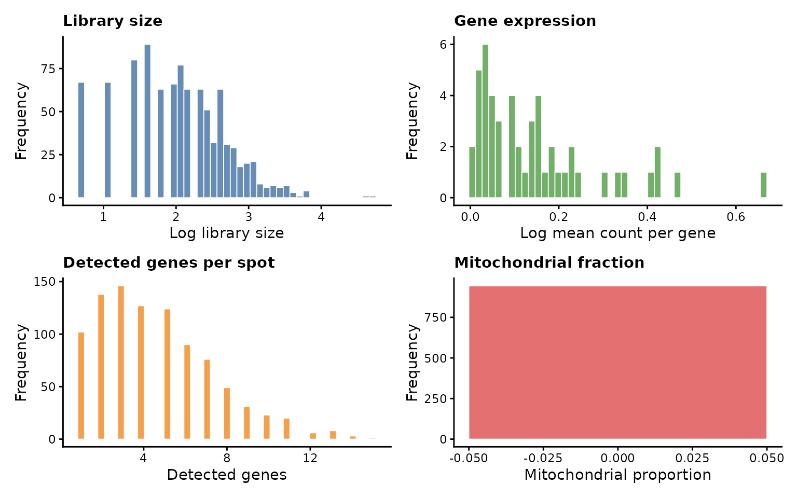
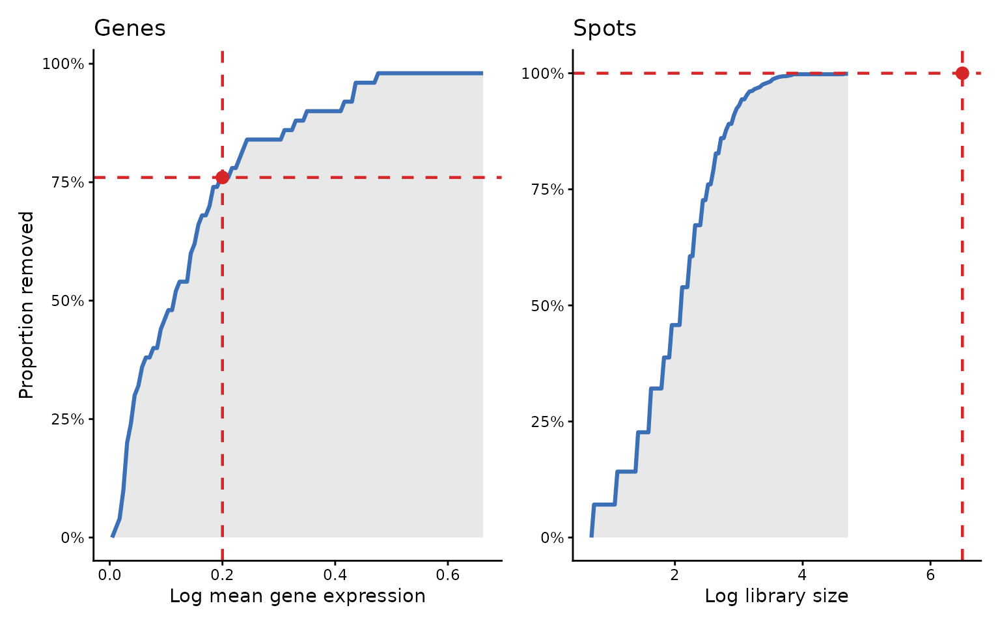
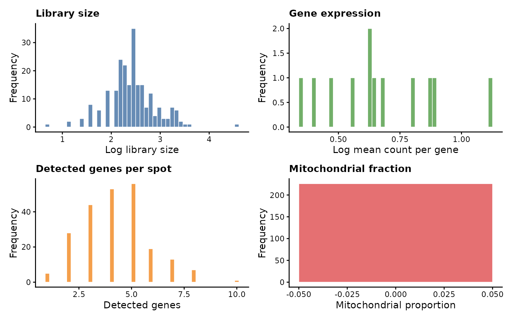
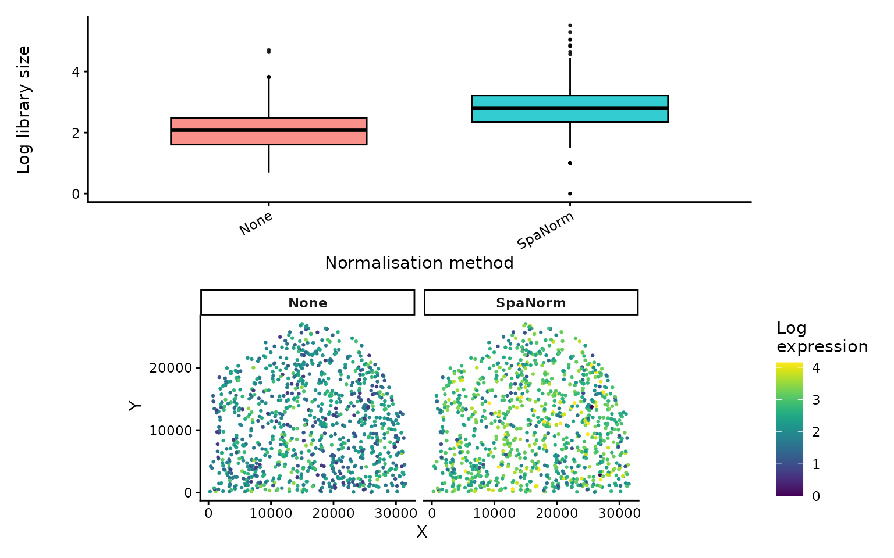
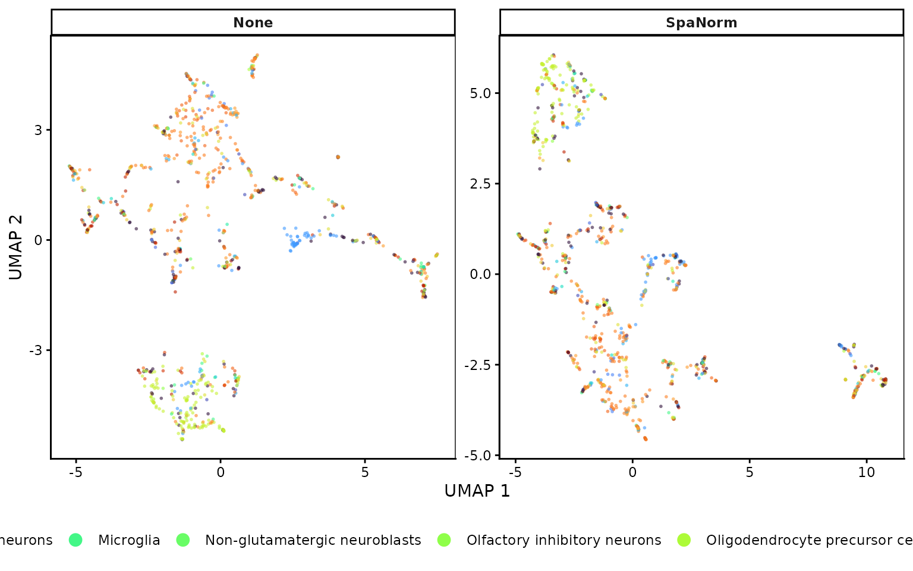

# Getting started with STBench

## Introduction

STBench is an R package for comparing normalisation methods in spatial
transcriptomics.

## Load data

``` r
data(spe_example)
data(norm_example)

dim(spe_example)
#> NULL
names(norm_example)
#> [1] "None"    "SpaNorm"
```

## Quality control

### Calculate and visualise QC metrics

We first calculate spot-level metrics, including library size, detected
genes and mitochondrial fraction, together with gene-level expression
summaries. We inspect their distributions before filtering.

``` r
spe <- add_qcs(
  spe_example,
  assay_name = "counts",
  mito_pattern = "^mt-|^MT-"
)

p_qc <- plot_qc(
  spe,
  bins = 45,
  show_density = TRUE,
  theme_name = "classic"
)
p_qc$plot
```



### Explore filtering thresholds

We examine the relationship between possible cutoffs and the proportions
of spots and genes removed, without performing any filtering. We use
illustrative rather than dataset-specific thresholds.

``` r
p_cutoffs <- plot_qc_cutoffs(
  spe,
  library_cutoff = 6.5,
  gene_cutoff = 0.2,
  n_points = 100,
  theme_name = "classic"
)
p_cutoffs$plot
```



### Apply filtering and reassess QC

We remove spots and genes below the selected thresholds. Choose cutoffs
appropriate to the dataset.

``` r
spe_filtered <- filter_qc(
  spe,
  library_cutoff = 2.5,
  gene_cutoff = 0.2,
  recalculate = TRUE,
  assay_name = "counts",
  mito_pattern = "^mt-|^MT-"
)
plot_qc(spe_filtered, theme_name = "classic")$plot
```



## Apply normalisation methods

The `None` method provides a log1p-transformed baseline. Method-specific
arguments are supplied through `params`. We execute normalisation on the
small dataset; for subsequent comparisons, we use the saved
`norm_example` for a consistent reference.

``` r
norm_recomputed <- normalize_spe(
  spe_example,
  methods = c("None", "SpaNorm"),
  params = list(
    spanorm = list(
      sample_p = 0.15,
      df_tps = 6,
      adj_method = "logpac",
      seed = 123
    )
  )
)
```

``` r
norm <- norm_example
lapply(norm, dim)
#> $None
#> [1]  50 944
#> 
#> $SpaNorm
#> [1]  50 944
```

## Compare normalised library sizes

We compare summed normalised expression across spots. The comparison
uses the normalisation methods in the example dataset.

``` r
p_ls <- plot_library_size_comparison(
  norm,
  methods = names(norm),
  assay_name = "logcounts",
  point_size = 0.5,
  theme_name = "classic"
)
p_ls$plot
```



## UMAP visualisation

We run PCA and UMAP independently for each normalisation method and
colour by the available cell-type annotation.

``` r
umap_data <- get_umap_data(
  norm,
  methods = names(norm),
  prop_spots = 1,
  seed = 123,
  assay_name = "logcounts",
  n_pcs = 10,
  n_neighbors = 15
)
```

``` r
p_umap <- plot_umap_comparison(
  umap_data,
  colour_by = "cell_type",
  point_size = 1,
  alpha = 0.6,
  ncol = 2,
  theme_name = "classic"
)
p_umap$plot
```



## Session information

``` r
sessionInfo()
#> R version 4.5.0 (2025-04-11)
#> Platform: x86_64-pc-linux-gnu
#> Running under: Red Hat Enterprise Linux 9.8 (Plow)
#> 
#> Matrix products: default
#> BLAS/LAPACK: FlexiBLAS OPENBLAS;  LAPACK version 3.10.1
#> 
#> locale:
#>  [1] LC_CTYPE=en_AU.UTF-8       LC_NUMERIC=C              
#>  [3] LC_TIME=en_AU.UTF-8        LC_COLLATE=en_AU.UTF-8    
#>  [5] LC_MONETARY=en_AU.UTF-8    LC_MESSAGES=en_AU.UTF-8   
#>  [7] LC_PAPER=en_AU.UTF-8       LC_NAME=C                 
#>  [9] LC_ADDRESS=C               LC_TELEPHONE=C            
#> [11] LC_MEASUREMENT=en_AU.UTF-8 LC_IDENTIFICATION=C       
#> 
#> time zone: Australia/Melbourne
#> tzcode source: system (glibc)
#> 
#> attached base packages:
#> [1] stats     graphics  grDevices utils     datasets  methods   base     
#> 
#> other attached packages:
#> [1] STBench_0.1.0
#> 
#> loaded via a namespace (and not attached):
#>   [1] gridExtra_2.3               rlang_1.1.7                
#>   [3] magrittr_2.0.4              scater_1.37.0              
#>   [5] otel_0.2.0                  matrixStats_1.5.0          
#>   [7] compiler_4.5.0              systemfonts_1.3.1          
#>   [9] vctrs_0.7.2                 pkgconfig_2.0.3            
#>  [11] SpatialExperiment_1.20.0    crayon_1.5.3               
#>  [13] fastmap_1.2.0               magick_2.9.1               
#>  [15] XVector_0.49.0              scuttle_1.19.0             
#>  [17] labeling_0.4.3              rmarkdown_2.31             
#>  [19] ggbeeswarm_0.7.3            ragg_1.4.0                 
#>  [21] xfun_0.57                   bluster_1.19.0             
#>  [23] cachem_1.1.0                beachmat_2.25.1            
#>  [25] jsonlite_2.0.0              DelayedArray_0.35.2        
#>  [27] BiocParallel_1.43.4         irlba_2.3.7                
#>  [29] parallel_4.5.0              cluster_2.1.8.2            
#>  [31] R6_2.6.1                    bslib_0.10.0               
#>  [33] RColorBrewer_1.1-3          limma_3.65.1               
#>  [35] GenomicRanges_1.61.1        jquerylib_0.1.4            
#>  [37] Rcpp_1.1.1                  Seqinfo_0.99.2             
#>  [39] SummarizedExperiment_1.39.1 knitr_1.51                 
#>  [41] IRanges_2.43.0              FNN_1.1.4.1                
#>  [43] Matrix_1.7-4                splines_4.5.0              
#>  [45] igraph_2.2.2                tidyselect_1.2.1           
#>  [47] rstudioapi_0.17.1           dichromat_2.0-0.1          
#>  [49] abind_1.4-8                 yaml_2.3.12                
#>  [51] viridis_0.6.5               codetools_0.2-20           
#>  [53] lattice_0.22-9              tibble_3.3.1               
#>  [55] Biobase_2.69.0              withr_3.0.3                
#>  [57] S7_0.2.1                    evaluate_1.0.5             
#>  [59] desc_1.4.3                  SpaNorm_1.3.4              
#>  [61] pillar_1.11.1               MatrixGenerics_1.22.0      
#>  [63] stats4_4.5.0                generics_0.1.4             
#>  [65] S4Vectors_0.47.0            ggplot2_4.0.2              
#>  [67] sparseMatrixStats_1.21.0    scales_1.4.0               
#>  [69] glue_1.8.1                  metapod_1.17.0             
#>  [71] tools_4.5.0                 BiocNeighbors_2.3.1        
#>  [73] ScaledMatrix_1.17.0         RSpectra_0.16-2            
#>  [75] locfit_1.5-9.12             fs_1.6.6                   
#>  [77] scran_1.37.0                grid_4.5.0                 
#>  [79] edgeR_4.7.3                 SingleCellExperiment_1.32.0
#>  [81] patchwork_1.3.2             beeswarm_0.4.0             
#>  [83] BiocSingular_1.25.0         vipor_0.4.7                
#>  [85] cli_3.6.5                   rsvd_1.0.5                 
#>  [87] textshaping_1.0.1           S4Arrays_1.9.1             
#>  [89] viridisLite_0.4.3           dplyr_1.2.0                
#>  [91] uwot_0.2.4                  gtable_0.3.6               
#>  [93] sass_0.4.10                 digest_0.6.39              
#>  [95] BiocGenerics_0.56.0         SparseArray_1.9.0          
#>  [97] ggrepel_0.9.6               dqrng_0.4.1                
#>  [99] rjson_0.2.23                htmlwidgets_1.6.4          
#> [101] farver_2.1.2                htmltools_0.5.9            
#> [103] pkgdown_2.2.1               lifecycle_1.0.5            
#> [105] statmod_1.5.1
```
