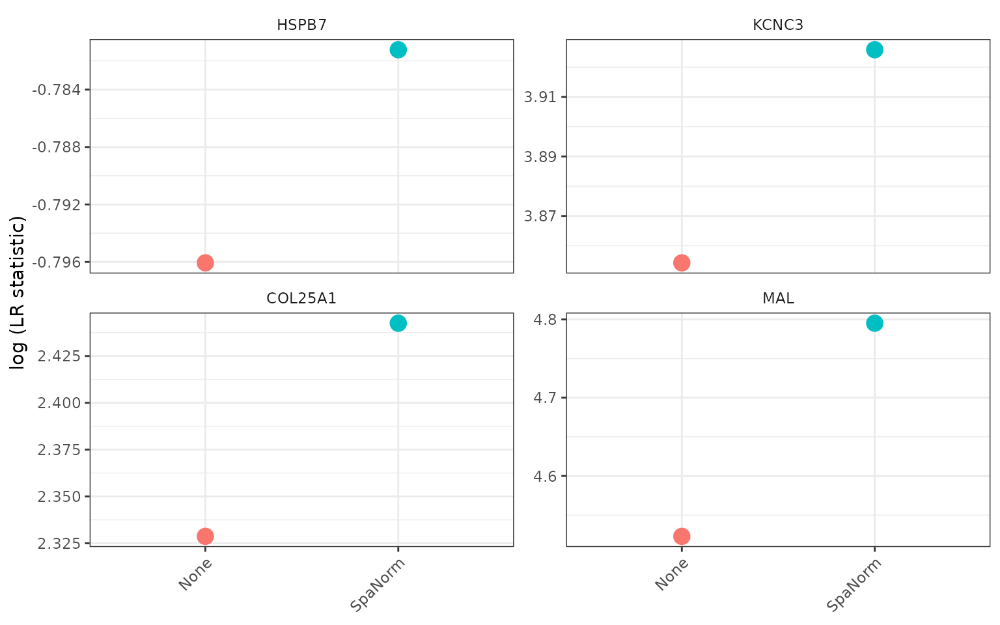
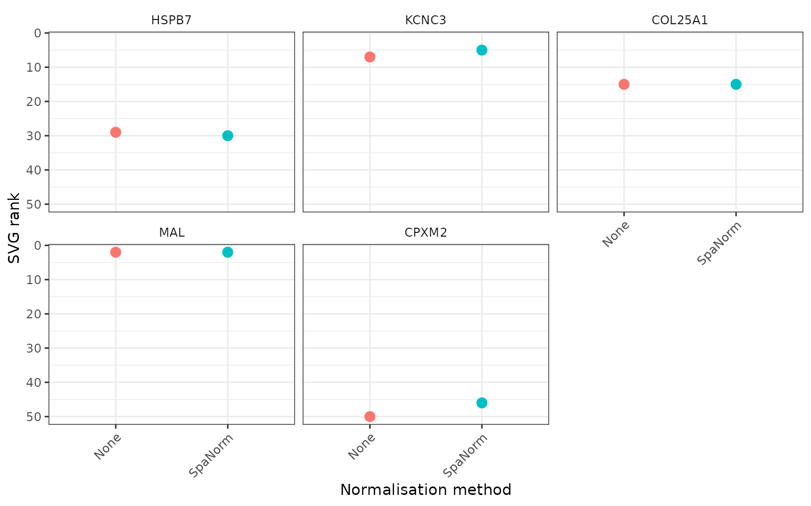
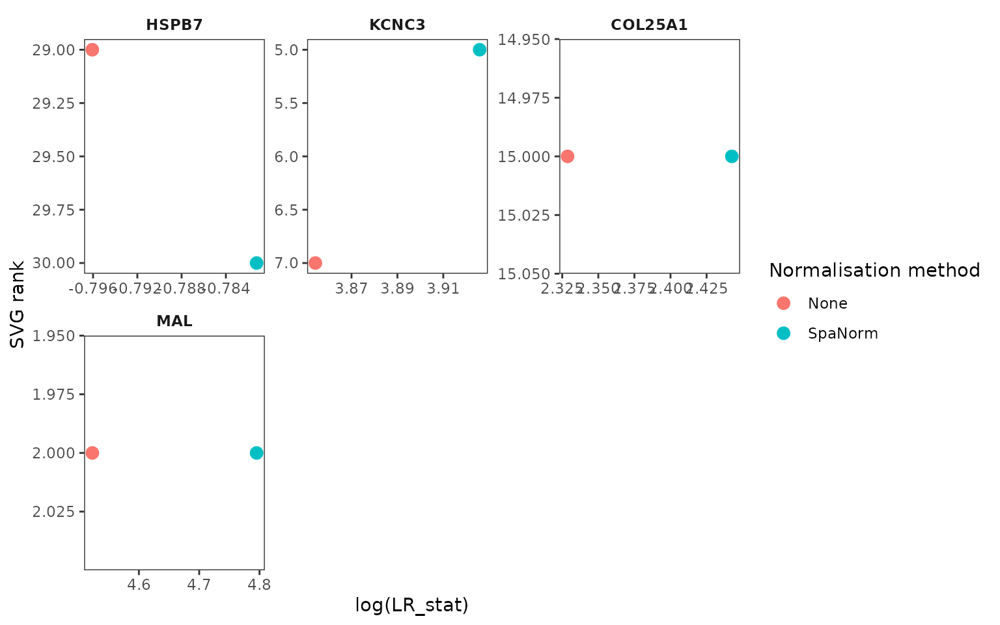
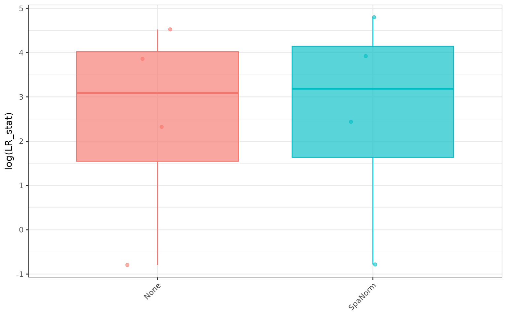
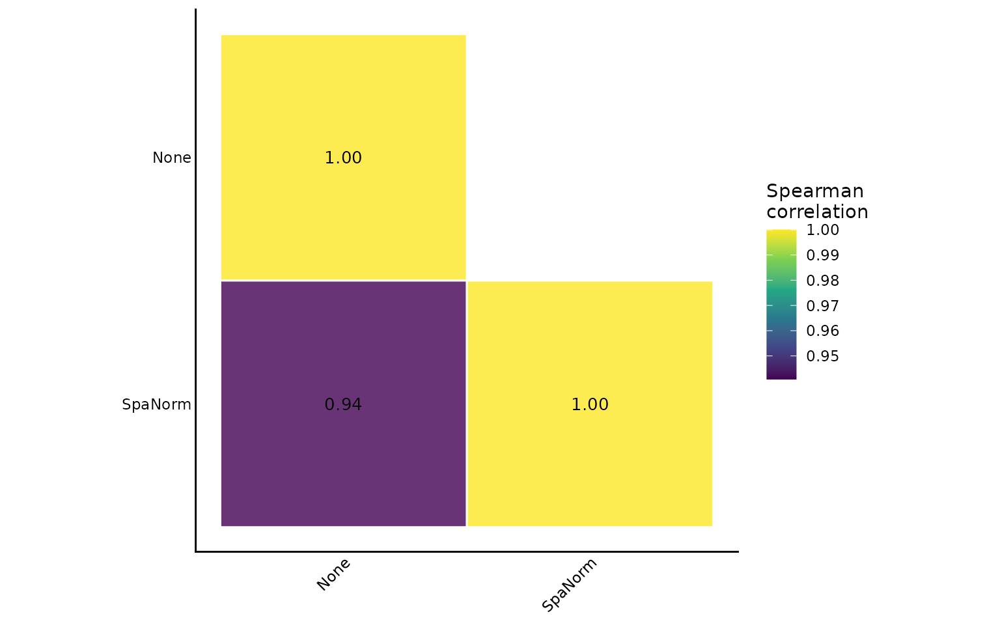
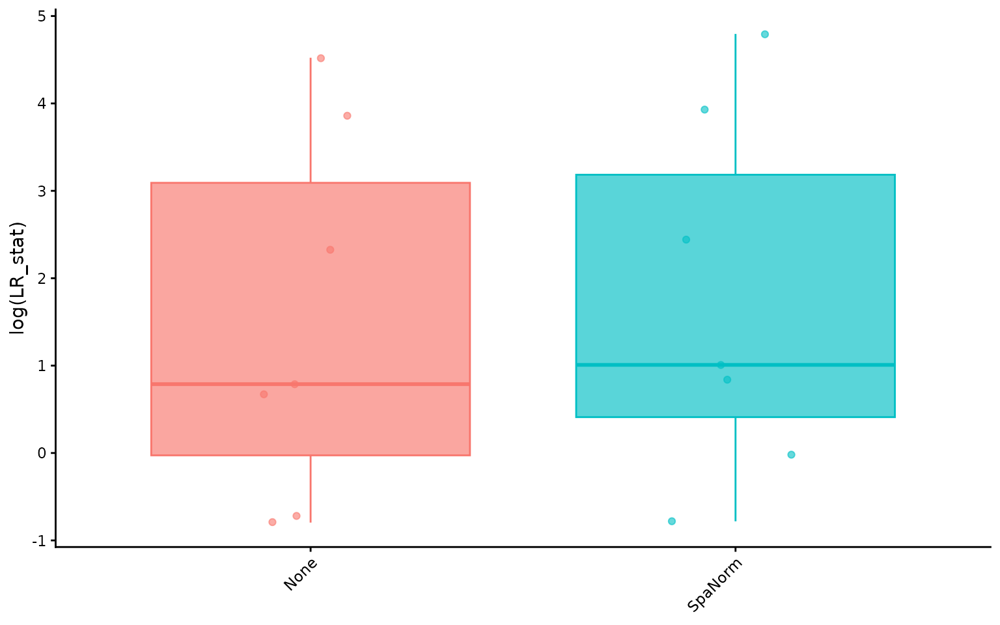
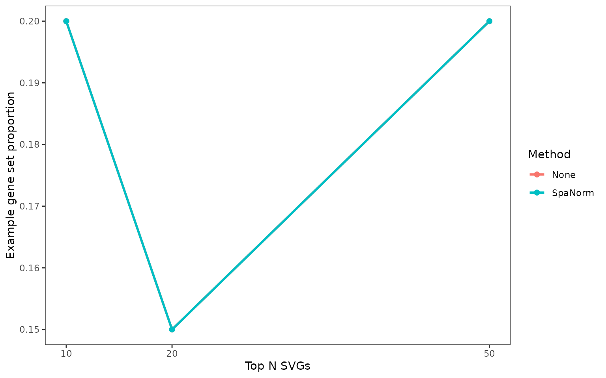
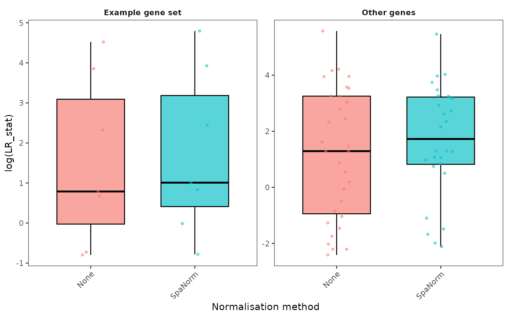
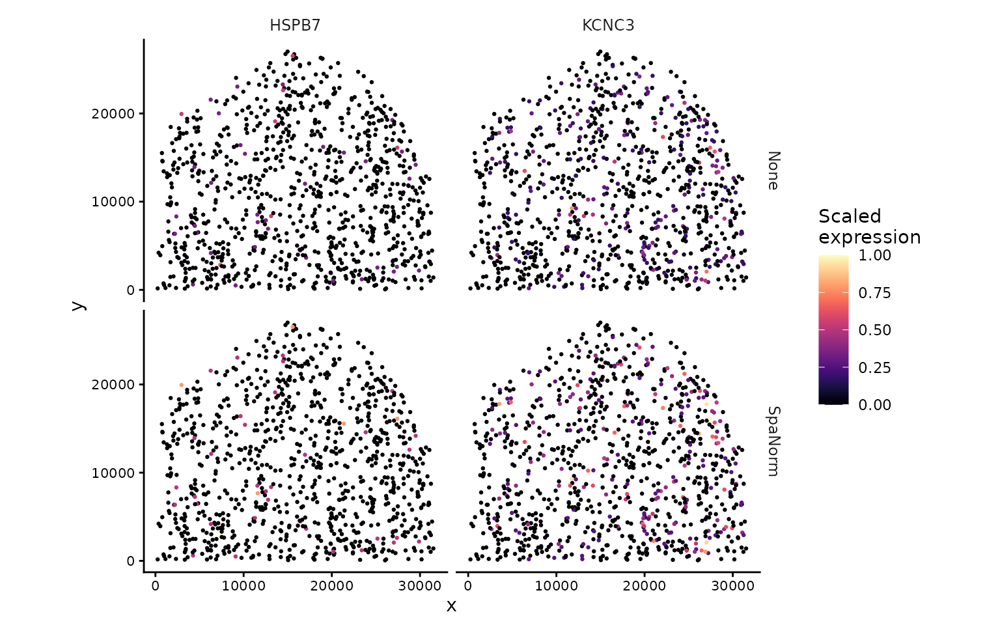

# Spatially variable gene analysis with STBench

## Introduction

We use the same SVG detection procedure for each normalised dataset to
examine how normalisation affects spatial variability statistics and
gene rankings. The supplied `svg_example` contains precomputed results,
avoiding repeated, potentially expensive nnSVG calculations.

``` r
data(norm_example)
data(svg_example)
norm <- norm_example
svg_norm <- svg_example
names(svg_norm)
#> [1] "None"    "SpaNorm"
```

## Detect spatially variable genes

To reproduce SVG detection from the normalised data, run the code below.
The remaining sections use the supplied precomputed results.

``` r
svg_recomputed <- run_svg(
  norm_list = norm,
  method = "nnSVG",
  n_threads = 1,
  verbose = FALSE
)
```

## Evaluate biologically relevant marker genes

We evaluate example genes available in the SVG results rather than
assuming that a particular tissue-marker panel is present in this small
dataset.

``` r
common_genes <- Reduce(intersect, lapply(svg_norm, rownames))
marker_genes <- head(common_genes, 5)
marker_genes
#> [1] "HSPB7"   "KCNC3"   "COL25A1" "MAL"     "CPXM2"
```

### Compare SVG statistics

Higher likelihood-ratio (LR) statistics indicate stronger statistical
evidence of spatial variation.

``` r
if (length(marker_genes) > 0L) {
  p_svg_markers <- plot_svg_stat(
    svg_norm = svg_norm,
    genes = marker_genes,
    stat = "LR_stat",
    transform = "log",
    point_size = 4,
    gene_id = "rownames",
    theme_name = "bw"
  )
  p_svg_markers$plot
}
```



### Compare SVG rankings

Smaller ranks indicate higher relative priority in SVG detection.

``` r
if (length(marker_genes) > 0L) {
  p_svg_rank <- plot_svg_rank(
    svg_norm = svg_norm,
    genes = marker_genes,
    point_size = 3,
    gene_id = "rownames",
    theme_name = "bw"
  )
  p_svg_rank$plot
}
```



### Investigate SVG ranks against LR statistics

``` r
if (length(marker_genes) > 0L) {
  p <- plot_svg_rank_vs_stat(
    svg_norm = svg_norm,
    genes = marker_genes,
    stat = "LR_stat",
    transform = "log",
    scales = "free",
    ncol = 3,
    point_size = 3,
    theme_name = "bw"
  )
  p$plot
}
```



### Compare overall marker gene SVG statistics

``` r
if (length(marker_genes) > 0L) {
  p_svg_mk <- plot_svg_gene_set_distribution(
    svg_norm = svg_norm,
    genes = marker_genes,
    stat = "LR_stat",
    gene_id = "rownames",
    transform = "log",
    plot_type = "boxplot",
    add_jitter = TRUE,
    point_size = 1.5,
    theme_name = "bw"
  )
  p_svg_mk$plot
}
```



## Evaluate SVG ranking consistency

Correlations are calculated using genes shared across the methods.
Higher correlations indicate greater similarity in rankings.

``` r
p_cor <- plot_svg_rank_correlation(
  svg_norm = svg_norm,
  show_values = TRUE,
  digits = 2,
  theme_name = "classic"
)
p_cor$plot
```



## Investigate housekeeping gene behaviour

Housekeeping genes are generally expected to exhibit relatively stable
expression, although they are not necessarily spatially uniform. A
tissue-specific, curated list is preferable in full analyses.

For a self-contained demonstration, we use a small subset of the
available genes as an *illustrative gene set*. These genes are not
claimed to be housekeeping genes.

``` r
example_gene_set <- head(common_genes, 10)
```

``` r
if (length(example_gene_set) > 0L) {
  p_svg_set <- plot_svg_gene_set_distribution(
    svg_norm = svg_norm,
    genes = example_gene_set,
    stat = "LR_stat",
    gene_id = "rownames",
    transform = "log",
    plot_type = "boxplot",
    add_jitter = TRUE,
    point_size = 1.5,
    theme_name = "classic"
  )
  p_svg_set$plot
}
```



### Examine genes among top-ranked SVGs

``` r
if (length(example_gene_set) > 0L) {
  p_topn <- plot_svg_topn_gene_set(
    svg_norm = svg_norm,
    genes = example_gene_set,
    top_n = c(10, 20, 50),
    gene_id = "rownames",
    theme_name = "bw",
    gene_set_name = "Example gene set"
  )
  p_topn$plot
}
```



### Compare SVG statistics between gene sets

``` r
gene_sets <- list(
  "Example gene set" = example_gene_set,
  "Other genes" = setdiff(common_genes, example_gene_set)
)
if (all(lengths(gene_sets) > 0L)) {
  p_svg_sets <- plot_svg_gene_sets(
    svg_norm = svg_norm,
    gene_sets = gene_sets,
    stat = "LR_stat",
    gene_id = "rownames",
    transform = "log",
    plot_type = "boxplot",
    theme_name = "bw"
  )
  p_svg_sets$plot
}
```



## Spatial expression of marker genes

Expression can be scaled between 0 and 1 by gene for comparing spatial
patterns; unscaled values can also be plotted, but numerical scales need
not be directly comparable across transformations.

``` r
if (length(marker_genes) > 0L) {
  p_marker_maps <- plot_spatial_expression(
    norm_list = norm,
    genes = head(marker_genes, 2),
    methods = names(norm),
    assay_name = "logcounts",
    scale_expr = TRUE,
    scale_by = "gene",
    point_size = 0.5,
    colour_option = "magma",
    ncol_genes = 1,
    theme_name = "classic"
  )
  p_marker_maps$plot
}
```



## Session information

``` r
sessionInfo()
#> R version 4.5.0 (2025-04-11)
#> Platform: x86_64-pc-linux-gnu
#> Running under: Red Hat Enterprise Linux 9.8 (Plow)
#> 
#> Matrix products: default
#> BLAS/LAPACK: FlexiBLAS OPENBLAS;  LAPACK version 3.10.1
#> 
#> locale:
#>  [1] LC_CTYPE=en_AU.UTF-8       LC_NUMERIC=C              
#>  [3] LC_TIME=en_AU.UTF-8        LC_COLLATE=en_AU.UTF-8    
#>  [5] LC_MONETARY=en_AU.UTF-8    LC_MESSAGES=en_AU.UTF-8   
#>  [7] LC_PAPER=en_AU.UTF-8       LC_NAME=C                 
#>  [9] LC_ADDRESS=C               LC_TELEPHONE=C            
#> [11] LC_MEASUREMENT=en_AU.UTF-8 LC_IDENTIFICATION=C       
#> 
#> time zone: Australia/Melbourne
#> tzcode source: system (glibc)
#> 
#> attached base packages:
#> [1] stats     graphics  grDevices utils     datasets  methods   base     
#> 
#> other attached packages:
#> [1] STBench_0.99.0
#> 
#> loaded via a namespace (and not attached):
#>  [1] SummarizedExperiment_1.39.1 gtable_0.3.6               
#>  [3] rjson_0.2.23                xfun_0.57                  
#>  [5] bslib_0.10.0                ggplot2_4.0.2              
#>  [7] htmlwidgets_1.6.4           Biobase_2.69.0             
#>  [9] lattice_0.22-9              vctrs_0.7.2                
#> [11] tools_4.5.0                 generics_0.1.4             
#> [13] stats4_4.5.0                parallel_4.5.0             
#> [15] tibble_3.3.1                pkgconfig_2.0.3            
#> [17] Matrix_1.7-4                RColorBrewer_1.1-3         
#> [19] S7_0.2.1                    desc_1.4.3                 
#> [21] S4Vectors_0.47.0            lifecycle_1.0.5            
#> [23] compiler_4.5.0              farver_2.1.2               
#> [25] textshaping_1.0.1           Seqinfo_0.99.2             
#> [27] codetools_0.2-20            htmltools_0.5.9            
#> [29] sass_0.4.10                 yaml_2.3.12                
#> [31] pillar_1.11.1               pkgdown_2.2.1              
#> [33] crayon_1.5.3                jquerylib_0.1.4            
#> [35] BiocParallel_1.43.4         SingleCellExperiment_1.32.0
#> [37] cachem_1.1.0                DelayedArray_0.35.2        
#> [39] viridis_0.6.5               BRISC_1.0.6                
#> [41] magick_2.9.1                abind_1.4-8                
#> [43] tidyselect_1.2.1            digest_0.6.39              
#> [45] dplyr_1.2.0                 labeling_0.4.3             
#> [47] fastmap_1.2.0               grid_4.5.0                 
#> [49] cli_3.6.5                   SparseArray_1.9.0          
#> [51] magrittr_2.0.4              S4Arrays_1.9.1             
#> [53] dichromat_2.0-0.1           withr_3.0.3                
#> [55] scales_1.4.0                rmarkdown_2.31             
#> [57] XVector_0.49.0              matrixStats_1.5.0          
#> [59] otel_0.2.0                  gridExtra_2.3              
#> [61] RANN_2.6.2                  nnSVG_1.13.1               
#> [63] ragg_1.4.0                  SpatialExperiment_1.20.0   
#> [65] pbapply_1.7-4               evaluate_1.0.5             
#> [67] knitr_1.51                  GenomicRanges_1.61.1       
#> [69] IRanges_2.43.0              viridisLite_0.4.3          
#> [71] rlang_1.1.7                 Rcpp_1.1.1                 
#> [73] rdist_0.0.5                 glue_1.8.1                 
#> [75] BiocGenerics_0.56.0         rstudioapi_0.17.1          
#> [77] jsonlite_2.0.0              R6_2.6.1                   
#> [79] MatrixGenerics_1.22.0       systemfonts_1.3.1          
#> [81] fs_1.6.6
```
